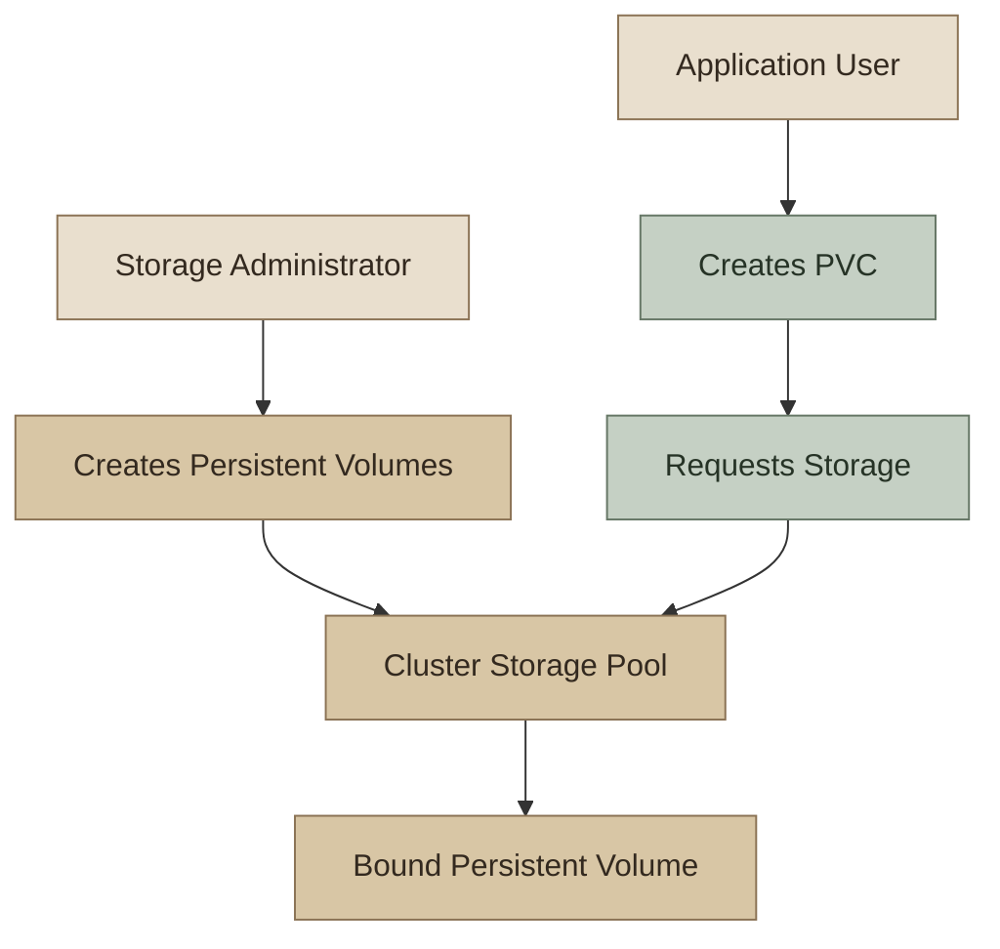
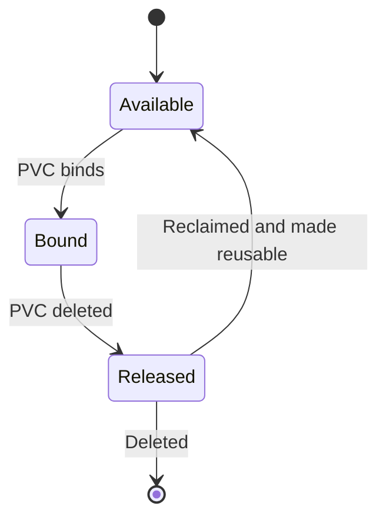

# Persistent Volumes (PV)

## 1. The Problem with Pod-Level Volume Configuration

في الدرس السابق، عرفنا إننا بنقدر نعرّف Volume مباشرة داخل Pod Definition.

لكن تخيل Cluster كبير فيه:

- عدد كبير من Developers.
- Applications مختلفة.
- Pods كتير.
- Storage Backends متعددة.

لو كل Developer مسؤول عن تحديد Storage Configuration بنفسه في كل Pod، هيكون عندنا تكرار وصعوبة في الإدارة.

المطلوب إننا نفصل بين:

1. **Storage Provisioning:** مسؤولية Administrator.
2. **Storage Consumption:** مسؤولية Application Users.

وهنا بيظهر دور Persistent Volumes.

## 2. What is a Persistent Volume?

<InfoCard title="Persistent Volume (PV)" variant="concept">
Persistent Volume هو Kubernetes Object بيمثل Storage Resource متاح على مستوى الـ Cluster، وبيتم تجهيزه وإدارته بشكل مستقل عن الـ Pods اللي هتستخدمه.
</InfoCard>

الـ Administrator يجهز مجموعة من الـ Persistent Volumes، والـ Users يطلبوا Storage منها عن طريق Persistent Volume Claims (PVCs).



## 3. Creating a Persistent Volume

هنبدأ بمثال بسيط لـ PV باستخدام `hostPath`.

### persistent-volume.yaml

```yaml
apiVersion: v1
kind: PersistentVolume
metadata:
  name: pv-vol1
spec:
  capacity:
    storage: 1Gi

  accessModes:
    - ReadWriteOnce

  persistentVolumeReclaimPolicy: Retain

  hostPath:
    path: /data
    type: DirectoryOrCreate
```

### Understanding the Configuration

| Field | Purpose |
|---|---|
| `apiVersion` | Kubernetes API version |
| `kind` | Defines the resource type |
| `metadata.name` | Persistent Volume name |
| `capacity.storage` | Declared storage capacity |
| `accessModes` | Supported access mode |
| `persistentVolumeReclaimPolicy` | Defines what happens after the PVC is released |
| `hostPath` | Uses a directory on the Node |

## 4. Access Modes

Access Modes بتحدد طريقة الوصول اللي الـ Volume بيدعمها.

| Access Mode | Meaning |
|---|---|
| `ReadWriteOnce (RWO)` | Can be mounted as read-write by a single Node at a time |
| `ReadOnlyMany (ROX)` | Can be mounted read-only by many Nodes |
| `ReadWriteMany (RWX)` | Can be mounted read-write by many Nodes |
| `ReadWriteOncePod (RWOP)` | Can be mounted read-write by a single Pod |

<Callout type="warning">
Access Modes مش معناها بالضرورة إن Kubernetes بيمنع كل عمليات القراءة أو الكتابة على مستوى التطبيق. هي جزء من طريقة طلب واستخدام الـ Storage، والقدرات الفعلية بتعتمد على الـ Storage Driver والـ Backend.
</Callout>

## 5. Creating and Inspecting a PV

<Steps>
  <li>
    **Create the Persistent Volume**

    ```bash
    kubectl apply -f persistent-volume.yaml
    ```
  </li>
  <li>
    **List Persistent Volumes**

    ```bash
    kubectl get pv
    ```
  </li>
  <li>
    **Get Detailed Information**

    ```bash
    kubectl describe pv pv-vol1
    ```

    ممكن تلاحظ إن الـ PV حالته `Available`، وده معناه إنه لسه مش مربوط بأي PVC.
  </li>
</Steps>

## 6. PV Is a Cluster-Scoped Resource

نقطة مهمة: PersistentVolume مش Namespaced Resource.

يعني:

- الـ PV متاح على مستوى الـ Cluster.
- مش تابع لـ Namespace معين.
- الـ PVC اللي بيطلب استخدامه هو Namespaced Resource.

## 7. hostPath in Production

المحاضرة استخدمت `hostPath` لتوضيح فكرة الـ PV، لكنه مش اختيار مناسب عادةً كحل Production Storage.

السبب إن الـ Data مرتبطة بـ Node معينة.

لو الـ Pod اتنقل إلى Node أخرى، مش بالضرورة يلاقي نفس البيانات.

في Production، اختار Storage Backend مناسبًا للـ Cluster، زي Network Storage أو Cloud Storage من خلال CSI Driver.

## 8. PV Lifecycle Overview

في سياق الـ PV/PVC، هتقابل حالات أساسية:

| Phase | Meaning |
|---|---|
| `Available` | PV is ready and not bound to a claim |
| `Bound` | PV is bound to a PVC |
| `Released` | PVC was deleted, but the PV has not become available for a new claim |
| `Failed` | Automatic reclamation failed |



## 9. Key Takeaways

- PV represents a storage resource in the Cluster.
- Administrators can provision PVs independently of Pods.
- PVs are cluster-scoped.
- `capacity` declares the storage size.
- `accessModes` describe supported access patterns.
- `hostPath` is useful for learning but generally unsuitable for production multi-node storage.
- PVCs are used by users to request storage from available PVs.

<Callout type="tip">
فكر في PV على إنه Storage Resource جاهز في الـ Cluster، والـ PVC هو الطلب اللي بيحاول يحجز الـ Resource ده.
</Callout>
