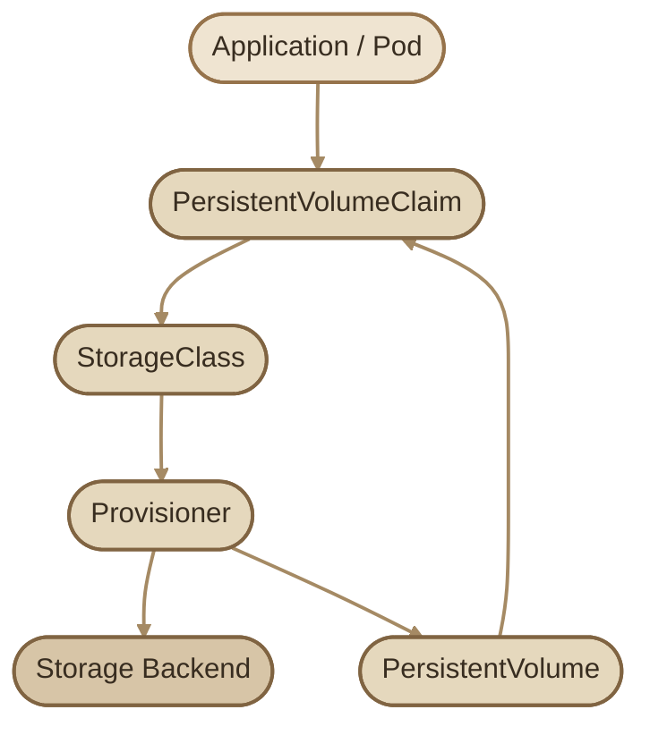
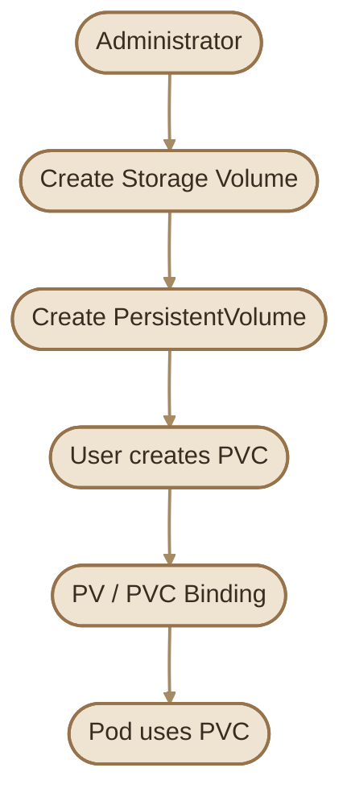
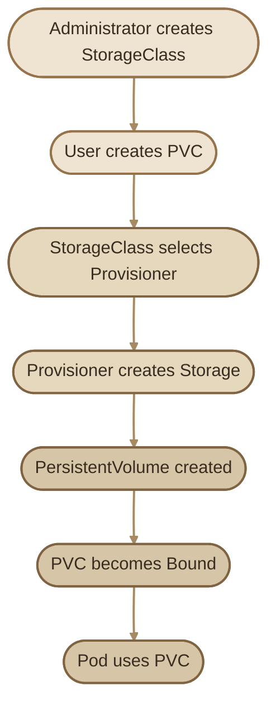
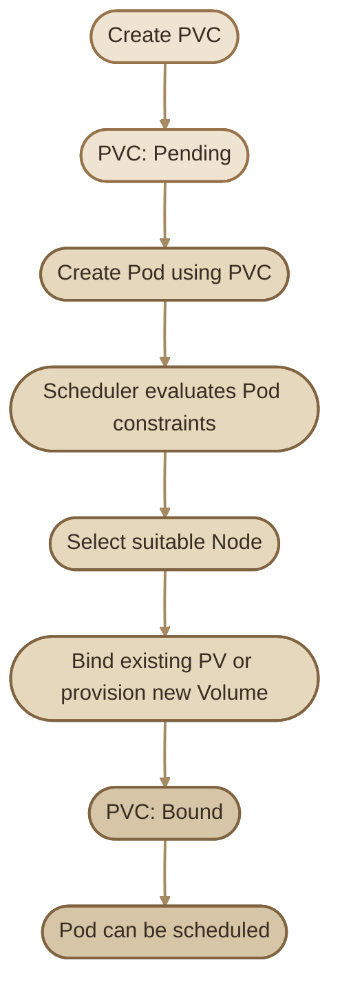
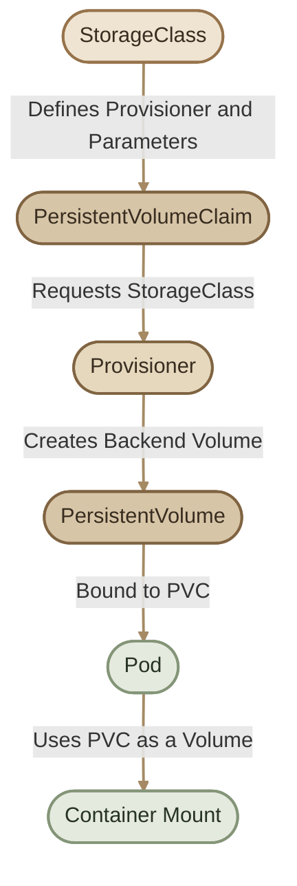
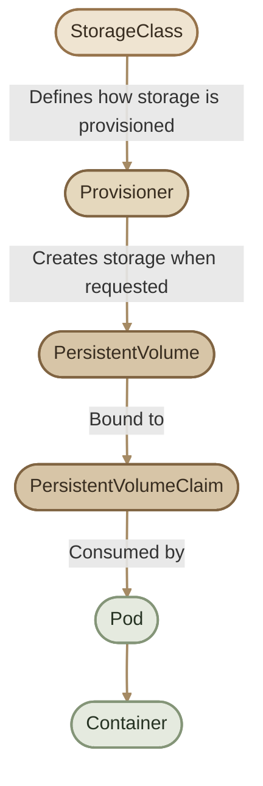

## 1. Introduction

في Kubernetes، اتعلمنا إننا نقدر ننشئ PersistentVolume (PV)، وبعدها ننشئ PersistentVolumeClaim (PVC) علشان نطلب مساحة تخزين ونستخدمها داخل Pod.

لكن فيه مشكلة في الطريقة دي.

تخيّل إن عندك Application محتاج `20Gi` من التخزين على Cloud Provider.

باستخدام Static Provisioning، الـ Administrator محتاج يعمل الآتي:

1. ينشئ Storage Volume على الـ Cloud Provider.
2. ينشئ PersistentVolume يمثل الـ Volume ده داخل Kubernetes.
3. يجهز PV بالمواصفات المناسبة.
4. يسيب المستخدم ينشئ PVC علشان يحجز التخزين.

كل مرة Application جديد يحتاج Storage، ممكن نحتاج نكرر الخطوات دي.

ده بيعمل شغل يدوي إضافي، وبيصعّب إدارة التخزين لما يكون عندنا عدد كبير من Applications.

هنا بيظهر دور **StorageClass**.

## 2. What Is a StorageClass?

الـ StorageClass هو Kubernetes Object بيعرّف نوع أو Class من التخزين المتاح داخل الـ Cluster.

بدل ما الـ Administrator ينشئ كل Volume يدويًا، يقدر يعرّف StorageClass تحدد:

- مين المسؤول عن إنشاء الـ Storage Volume.
- نوع التخزين المطلوب.
- Parameters الخاصة بالـ Storage Provider.
- سياسة التعامل مع الـ Volume بعد حذف الـ PVC.
- إمتى يتم إنشاء الـ Volume وربطه بالـ PVC.

بمعنى أبسط:

الـ StorageClass بتحدد **How Storage Should Be Provisioned**.

<InfoCard title="Think of StorageClass as a Storage Profile" variant="concept">

تخيّل إن عندك ثلاثة أنواع من التخزين:

- `standard`: تخزين عادي بتكلفة أقل.
- `fast`: تخزين SSD لأداء أعلى.
- `premium`: تخزين بمواصفات أعلى وسياسة حماية مختلفة.

بدل ما المستخدم يعرف تفاصيل إنشاء كل نوع من الـ Disks، هو ببساطة يطلب الـ StorageClass المناسبة لاحتياجه.

</InfoCard>

### I. StorageClass in the Storage Architecture



لاحظ إن الـ StorageClass لا تستبدل PV أو PVC.

هي بتضيف طبقة لإدارة عملية توفير التخزين، بينما يظل الـ PVC هو الطلب الذي يستخدمه الـ Pod، ويظل الـ PV هو الـ Resource الذي يمثل التخزين داخل Kubernetes.

## 3. Static vs Dynamic Provisioning

لفهم أهمية StorageClasses، لازم نفرّق بين طريقتين لتوفير التخزين.

### I. Static Provisioning

في Static Provisioning، الـ Administrator بيجهز التخزين بنفسه قبل ما المستخدم يطلبه.

الخطوات:

1. إنشاء Storage Volume على الـ Storage Backend.
2. إنشاء PV يمثل الـ Volume داخل Kubernetes.
3. إنشاء PVC يطلب Storage مناسبًا.
4. Kubernetes يعمل Binding بين الـ PV والـ PVC.



**Example:**

الـ Administrator أنشأ Disk حجمه `20Gi` على Storage Provider، وبعدها أنشأ PV بالمواصفات المناسبة.

المستخدم يقدر الآن ينشئ PVC يطلب نفس نوع التخزين.

**The limitation:** كل Volume جديد يحتاج تجهيزًا مسبقًا، وقد يتطلب تدخلًا يدويًا من الـ Administrator.

### II. Dynamic Provisioning

في Dynamic Provisioning، Kubernetes يستطيع توفير Storage تلقائيًا عندما يتم إنشاء PVC يطلب StorageClass مناسبة.

الخطوات:

1. الـ Administrator ينشئ StorageClass.
2. المستخدم ينشئ PVC ويحدد `storageClassName`.
3. Kubernetes يطلب من الـ Provisioner توفير Volume بالمواصفات المطلوبة.
4. الـ Provisioner ينشئ Storage Volume على الـ Backend.
5. يتم إنشاء PV تلقائيًا وربطه بالـ PVC.
6. الـ Pod يستخدم الـ PVC.



<InfoCard title="Important: Dynamic Provisioning Still Creates a PV" variant="insight">

الفرق مش إننا استغنينا عن PersistentVolume.

الـ PV ما زال موجودًا، لكن بدل ما الـ Administrator ينشئه يدويًا، بيتم إنشاؤه تلقائيًا بواسطة عملية Dynamic Provisioning.

</InfoCard>

### III. Comparison

| Feature | Static Provisioning | Dynamic Provisioning |
|---|---|---|
| Storage Volume creation | Manual | Automatic |
| PV creation | Manual | Automatic |
| StorageClass required | Not necessarily | Yes |
| PVC | Required | Required |
| Typical use | Pre-created storage | On-demand storage |

## 4. How Does a StorageClass Work?

الـ StorageClass تعتمد على مجموعة من الحقول، وأهمها:

- `provisioner`
- `parameters`
- `reclaimPolicy`
- `volumeBindingMode`

### I. Provisioner

الـ Provisioner هو المسؤول عن توفير Storage Volume بالطريقة التي يحددها الـ StorageClass.

كل StorageClass لازم يكون عندها Provisioner.

مثال:

```yaml
apiVersion: storage.k8s.io/v1
kind: StorageClass
metadata:
  name: fast-storage
provisioner: ebs.csi.aws.com
```

في المثال ده:

- اسم الـ StorageClass هو `fast-storage`.
- الـ Provisioner هو `ebs.csi.aws.com`.
- الـ Provisioner ده تابع لـ AWS EBS CSI Driver.

لما PVC يطلب الـ StorageClass دي، Kubernetes يقدر يستخدم الـ Driver لتوفير EBS Volume، بشرط إن الـ CSI Driver يكون مثبتًا ومهيأ بشكل صحيح.

### II. Common Provisioner Examples

| Provisioner | Storage Platform |
|---|---|
| `ebs.csi.aws.com` | AWS EBS CSI Driver |
| `pd.csi.storage.gke.io` | Google Compute Engine Persistent Disk CSI Driver |
| `disk.csi.azure.com` | Azure Disk CSI Driver |
| `file.csi.azure.com` | Azure File CSI Driver |
| `kubernetes.io/no-provisioner` | No Dynamic Provisioning |

**Important:** أسماء الـ Provisioners تعتمد على الـ Storage Driver المستخدم. مش كل Provisioner متاح تلقائيًا في Kubernetes، وبعضها يحتاج تثبيت Driver خارجي.

<InfoCard title="Legacy Provisioner Names" variant="warning">

قد تقابل أسماء قديمة مثل:

`kubernetes.io/gce-pd`

دي من الـ In-tree Provisioners القديمة. في التصميمات الحديثة، يتم استخدام CSI Drivers، مثل:

`pd.csi.storage.gke.io`

كذلك AWS EBS انتقل إلى CSI Driver بدل الـ In-tree Plugin القديم.

</InfoCard>

### III. Parameters

الـ `parameters` بتحدد تفاصيل إضافية عن الـ Storage Volume الذي سيتم إنشاؤه.

مثلًا، ممكن تحدد:

- نوع الـ Disk.
- نوع الأداء.
- Encryption.
- Replication settings.
- File system type.

مثال على AWS EBS CSI:

```yaml
apiVersion: storage.k8s.io/v1
kind: StorageClass
metadata:
  name: gp3-storage
provisioner: ebs.csi.aws.com
parameters:
  type: gp3
  encrypted: "true"
```

هنا:

- `type: gp3` يحدد نوع EBS Volume.
- `encrypted: "true"` يطلب إنشاء Volume مشفر.

لاحظ إن الـ Parameters دي خاصة بالـ AWS EBS CSI Driver.

مش معنى كده إن كل Provisioner بيفهم نفس الـ Parameters.

<Callout type="warning" title="Parameters Are Driver-Specific">

لازم تراجع Documentation الخاصة بالـ Storage Driver قبل استخدام Parameters.

Kubernetes لا يضمن إن أي Parameter تكتبها ستكون مدعومة من الـ Provisioner.

</Callout>

### IV. Reclaim Policy

الـ `reclaimPolicy` بتحدد ما الذي يحدث للـ PersistentVolume بعد حذف الـ PVC المرتبط به.

الاختيارات الأساسية:

| Policy | Behavior |
|---|---|
| `Delete` | حذف الـ PV والـ Backend Volume إذا كان الـ Driver يدعم ذلك. |
| `Retain` | الاحتفاظ بالـ PV والبيانات ليتم التعامل معها يدويًا. |

لو لم تحدد قيمة، فالافتراضي في StorageClass هو:

`Delete`

مثال:

```yaml
reclaimPolicy: Retain
```

**Important:** الـ Reclaim Policy الموجودة في StorageClass تُطبّق على الـ PVs التي يتم إنشاؤها ديناميكيًا من خلالها. أما الـ PVs التي أنشأها الـ Administrator يدويًا، فلها Reclaim Policy الخاصة بها.

### V. Allow Volume Expansion

تقدر تحدد إذا كان مسموحًا بزيادة حجم الـ Volume بعد إنشائه.

```yaml
allowVolumeExpansion: true
```

عند تفعيلها، يمكن زيادة طلب التخزين في PVC، بشرط أن يدعم الـ Storage Driver والـ Backend عملية التوسعة.

مثال:

```yaml
apiVersion: v1
kind: PersistentVolumeClaim
metadata:
  name: app-data
spec:
  storageClassName: fast-storage
  accessModes:
    - ReadWriteOnce
  resources:
    requests:
      storage: 20Gi
```

لو احتجنا زيادة الحجم إلى `30Gi`، يمكن تحديث طلب الـ PVC إلى:

```yaml
resources:
  requests:
    storage: 30Gi
```

لا يمكن استخدام هذه الخاصية لتقليل حجم الـ Volume.

### VI. Mount Options

يمكن تحديد Mount Options للـ Volumes التي يتم إنشاؤها من خلال StorageClass.

مثال:

```yaml
mountOptions:
  - discard
```

الـ Mount Options تعتمد على نوع الـ Storage Backend والـ Driver.

كمان Kubernetes لا يتحقق من صحة كل Mount Option؛ لو كتبت Option غير مدعومة، ممكن تفشل عملية Mount.

## 5. Volume Binding Mode

الـ `volumeBindingMode` بتحدد إمتى يتم ربط PVC بالـ PV، أو إمتى يتم تنفيذ Dynamic Provisioning.

يوجد وضعان أساسيان:

- `Immediate`
- `WaitForFirstConsumer`

### I. Immediate

ده الوضع الافتراضي.

بمجرد إنشاء PVC، Kubernetes يحاول يعمل Binding مع PV مناسب، أو يبدأ Dynamic Provisioning إذا كان الـ StorageClass يدعم ذلك.

```yaml
volumeBindingMode: Immediate
```

**Example:**

```text
PVC Created
    |
    v
Storage Provisioning / PV Binding
    |
    v
PVC Bound
    |
    v
Pod Scheduled
```

المشكلة المحتملة إن بعض أنواع التخزين مرتبطة بمكان جغرافي أو Node معينة.

مثلًا، لو الـ Storage Backend موجود في Availability Zone معينة، والـ Pod محتاج يشتغل في Zone مختلفة، ممكن تحصل مشكلة Scheduling.

### II. WaitForFirstConsumer

في الوضع ده، Kubernetes بيأجل عملية Binding أو Provisioning لحد ما يتم إنشاء Pod يستخدم الـ PVC.

```yaml
volumeBindingMode: WaitForFirstConsumer
```

ليه ده مفيد؟

لأن Kubernetes يقدر يراعي متطلبات الـ Pod قبل ما يختار مكان التخزين.

مثلًا:

- Node Selector.
- Pod Affinity / Anti-Affinity.
- Resource Requirements.
- Taints and Tolerations.
- Storage Topology.

### III. How It Works



<InfoCard title="Why Does the PVC Stay Pending?" variant="insight">

مع `WaitForFirstConsumer`، ظهور PVC في حالة `Pending` بعد إنشائه مباشرة قد يكون سلوكًا طبيعيًا.

مش شرط يكون فيه مشكلة في Capacity أو Access Modes.

الـ PVC ممكن يكون مستني Pod يستخدمه علشان Kubernetes يحدد المكان المناسب للـ Volume.

</InfoCard>

### IV. Immediate vs WaitForFirstConsumer

| Behavior | Immediate | WaitForFirstConsumer |
|---|---|---|
| Binding | عند إنشاء PVC | بعد إنشاء Pod يستخدمه |
| Provisioning | عند إنشاء PVC | أثناء عملية Scheduling |
| Scheduling awareness | لا ينتظر متطلبات Pod | يراعي متطلبات Pod |
| Typical use | Storage متاح من أي Node | Local أو Topology-constrained Storage |

**Important:** لا تستخدم `spec.nodeName` مع PVC يعتمد على `WaitForFirstConsumer`؛ لأن ده يتجاوز Scheduler وقد يترك PVC في حالة `Pending`.

استخدم `nodeSelector` أو Affinity بدلًا منه عند الحاجة لتحديد Node.

## 6. StorageClass and PVC

بعد إنشاء StorageClass، المستخدم يقدر يطلب التخزين من خلالها باستخدام `storageClassName` داخل PVC.

### I. Example StorageClass

```yaml
apiVersion: storage.k8s.io/v1
kind: StorageClass
metadata:
  name: standard-storage
provisioner: pd.csi.storage.gke.io
parameters:
  type: pd-standard
reclaimPolicy: Delete
volumeBindingMode: WaitForFirstConsumer
allowVolumeExpansion: true
```

### II. Example PVC

```yaml
apiVersion: v1
kind: PersistentVolumeClaim
metadata:
  name: app-data
spec:
  accessModes:
    - ReadWriteOnce
  storageClassName: standard-storage
  resources:
    requests:
      storage: 20Gi
```

الـ PVC بيطلب:

- `20Gi` من التخزين.
- `ReadWriteOnce` كـ Access Mode.
- StorageClass اسمها `standard-storage`.

Kubernetes يستخدم الـ Provisioner والـ Parameters المحددين في الـ StorageClass لتوفير التخزين.

### III. Complete Flow



## 7. Multiple Storage Classes

تقدر تنشئ أكثر من StorageClass داخل نفس الـ Cluster.

كل واحدة ممكن تمثل نوعًا مختلفًا من التخزين أو مستوى مختلفًا من الأداء والتكلفة.

مثال توضيحي:

| StorageClass | Storage Type | Example Use Case |
|---|---|---|
| `standard` | Standard Disk | General workloads |
| `fast` | SSD | Applications requiring higher IOPS |
| `premium` | High-performance SSD | Latency-sensitive workloads |

الـ User يختار النوع المناسب من خلال `storageClassName`.

```yaml
spec:
  storageClassName: fast
```

بكده يقدر نفس الـ Cluster يوفر أكثر من Storage Profile لمختلف التطبيقات.

## 8. Default StorageClass

ممكن الـ Administrator يحدد StorageClass تكون هي الافتراضية للـ Cluster.

لو المستخدم أنشأ PVC ولم يحدد `storageClassName`، Kubernetes يمكنه استخدام الـ Default StorageClass.

يتم تحديدها باستخدام Annotation:

```yaml
apiVersion: storage.k8s.io/v1
kind: StorageClass
metadata:
  name: standard
  annotations:
    storageclass.kubernetes.io/is-default-class: "true"
provisioner: example.csi.driver
```

الآن، PVC بالشكل التالي:

```yaml
apiVersion: v1
kind: PersistentVolumeClaim
metadata:
  name: app-data
spec:
  accessModes:
    - ReadWriteOnce
  resources:
    requests:
      storage: 10Gi
```

يمكن أن يستخدم الـ Default StorageClass تلقائيًا.

### I. Important Difference: Empty vs Unspecified

في PVC، فيه فرق بين عدم تحديد `storageClassName` وبين تحديده بقيمة فارغة:

```yaml
storageClassName: ""
```

- عدم تحديد الحقل: يسمح باستخدام Default StorageClass إذا كانت موجودة.
- تحديد `storageClassName: ""`: يطلب عدم استخدام StorageClass، وبالتالي لا يتم تطبيق Dynamic Provisioning عن طريق Default StorageClass.

<Callout type="note" title="Default StorageClass">

يفضل وجود Default StorageClass واحدة فقط لتجنب الالتباس.

يمكن تقنيًا أن يكون أكثر من StorageClass عليها Annotation الافتراضية، لكن Kubernetes يستخدم الأحدث عند تطبيق Defaulting على PVC جديد لا يحدد StorageClass.

</Callout>

## 9. StorageClass vs PV vs PVC

من المهم جدًا عدم الخلط بين الثلاثة:

| Object | Responsibility |
|---|---|
| StorageClass | Defines how storage should be provisioned |
| PersistentVolume | Represents the provisioned storage resource |
| PersistentVolumeClaim | Requests and reserves storage for a workload |

<InfoCard title="Remember the Relationship" variant="summary">

- StorageClass: How should storage be created?
- PV: What storage resource is available?
- PVC: What storage does the application need?
- Pod: Which PVC should I use?

</InfoCard>

---
## 10. Lab Objectives

في الجزء العملي هنشتغل على Cluster يحتوي على مجموعة من StorageClasses وPersistentVolumes.

الأهداف:

- استعراض StorageClasses الموجودة في الـ Cluster.
- تحديد الـ StorageClass التي لا تدعم Dynamic Provisioning.
- فحص `volumeBindingMode`.
- معرفة الـ Provisioner المستخدم في StorageClass معينة.
- ربط PVC موجودة مسبقًا بـ Local PV.
- فهم سبب بقاء PVC في حالة `Pending`.
- استخدام PVC داخل Pod.
- إنشاء StorageClass جديدة باستخدام `no-provisioner`.

### I. Lab Workflow

<Steps>
  <li>Inspect existing StorageClasses and identify their provisioners and binding modes.</li>
  <li>Identify the StorageClass that does not support Dynamic Provisioning.</li>
  <li>Inspect the Portworx StorageClass provisioner.</li>
  <li>Inspect the existing PersistentVolume and note its StorageClass and Access Mode.</li>
  <li>Create a PersistentVolumeClaim that targets the Local PV.</li>
  <li>Understand why the PVC may stay Pending and fix the configuration.</li>
  <li>Create a Pod that uses the PVC and verify the mount.</li>
  <li>Create a new StorageClass with `no-provisioner` and `WaitForFirstConsumer` binding mode.</li>
</Steps>

## 11. Inspect Existing StorageClasses

أولًا، اعرض StorageClasses الموجودة:

```bash
kubectl get storageclass
```

أو باستخدام الاختصار:

```bash
kubectl get sc
```

لعرض تفاصيل StorageClass معينة:

```bash
kubectl describe sc <storage-class-name>
```

ولعرض تعريفها كاملًا:

```bash
kubectl get sc <storage-class-name> -o yaml
```

عدد الـ StorageClasses:

```bash
kubectl get sc --no-headers | wc -l
```

**Lab Task:** اعرف عدد StorageClasses الموجودة في الـ Cluster، ثم أعد تنفيذ الأمر بعد إضافة StorageClasses جديدة.

## 12. Identify the No-Provisioner StorageClass

المطلوب هو تحديد StorageClass التي لا تدعم Dynamic Volume Provisioning.

اعرض القائمة:

```bash
kubectl get sc
```

وابحث عن Provisioner:

```bash
kubectl get sc \
  -o custom-columns=NAME:.metadata.name,PROVISIONER:.provisioner
```

الـ StorageClass التي تستخدم:

```yaml
provisioner: kubernetes.io/no-provisioner
```

هي التي لا تدعم Dynamic Provisioning.

في هذا السيناريو، اسمها:

```text
local-storage
```

### I. Inspect Its Volume Binding Mode

```bash
kubectl get sc local-storage -o yaml
```

أو:

```bash
kubectl describe sc local-storage
```

ستجد:

```yaml
volumeBindingMode: WaitForFirstConsumer
```

وده معناه إن Kubernetes هيأجل Binding لحد ما يتم إنشاء Pod يستخدم الـ PVC.

<Callout type="note" title="Important">

`no-provisioner` لا يعني إن StorageClass غير مفيدة.

هي لا تنشئ Volumes تلقائيًا، لكنها ما زالت مفيدة في تنظيم وربط Local PersistentVolumes باستخدام `WaitForFirstConsumer`.

</Callout>

## 13. Inspect the Portworx StorageClass

المطلوب معرفة الـ Provisioner الخاص بالـ StorageClass:

`portworx-io-priority-high`

نفّذ:

```bash
kubectl get sc portworx-io-priority-high -o yaml
```

أو:

```bash
kubectl describe sc portworx-io-priority-high
```

يمكنك أيضًا استخراج الـ Provisioner مباشرة:

```bash
kubectl get sc portworx-io-priority-high \
  -o jsonpath='{.provisioner}{"\n"}'
```

في السيناريو ده، القيمة هي:

```text
portworx-volume
```

## 14. Inspect the Existing PersistentVolume

الخطوة التالية هي فحص الـ PV المسمى:

`local-pv`

```bash
kubectl get pv
```

ثم:

```bash
kubectl describe pv local-pv
```

اعرض الـ YAML:

```bash
kubectl get pv local-pv -o yaml
```

ابحث عن المعلومات التالية:

- Capacity.
- Access Modes.
- StorageClass Name.
- Volume Mode.
- Node Affinity إذا كان الـ PV يستخدم `local`.

**Lab Task:** هل يوجد PVC حاليًا يستخدم `local-pv`؟

اعرض الـ PVCs:

```bash
kubectl get pvc -A
```

أو اعرض الـ Claim المرتبط بالـ PV مباشرة:

```bash
kubectl get pv local-pv \
  -o jsonpath='{.spec.claimRef}{"\n"}'
```

لو لم يوجد `claimRef` ولا يوجد PVC مرتبط بالـ PV، فهو غير محجوز حاليًا.

## 15. Create a PersistentVolumeClaim

المطلوب إنشاء PVC باسم:

`local-pvc`

ويجب أن يرتبط بالـ PV:

`local-pv`

قبل كتابة YAML، راجع مواصفات الـ PV:

```bash
kubectl describe pv local-pv
```

في هذا السيناريو، المواصفات المطلوبة هي:

| Property | Value |
|---|---|
| PVC Name | `local-pvc` |
| Requested Storage | `500Mi` |
| Access Mode | `ReadWriteOnce` |
| StorageClass | `local-storage` |

### I. local-pvc.yaml

```yaml
apiVersion: v1
kind: PersistentVolumeClaim
metadata:
  name: local-pvc
spec:
  accessModes:
    - ReadWriteOnce

  storageClassName: local-storage

  resources:
    requests:
      storage: 500Mi
```

أنشئ الـ PVC:

```bash
kubectl apply -f local-pvc.yaml
```

تحقق من الحالة:

```bash
kubectl get pvc
```

المتوقع:

```text
NAME        STATUS
local-pvc   Pending
```

## 16. Why Is the PVC Pending?

رغم إننا حددنا:

- Capacity مناسبة.
- Access Mode مطابق.
- StorageClass صحيحة.

الـ PVC ما زال في حالة `Pending`.

إيه السبب؟

افحص الـ PVC:

```bash
kubectl describe pvc local-pvc
```

راجع الـ Events في آخر الـ Output.

قد تجد رسالة مشابهة لـ:

```text
waiting for first consumer to be created before binding
```

السبب هو إن StorageClass `local-storage` تستخدم:

```yaml
volumeBindingMode: WaitForFirstConsumer
```

وبالتالي Kubernetes يؤجل عملية Binding حتى يتم إنشاء Pod يستخدم الـ PVC.

**المهم هنا:** الـ PVC ليس بالضرورة فيه مشكلة. هو ينتظر الـ Consumer.

## 17. Create a Pod That Uses the PVC

المطلوب إنشاء Pod اسمه:

`nginx`

باستخدام Image:

`nginx:alpine`

ويجب أن يستخدم PVC:

`local-pvc`

ويعمل Mount للتخزين في:

`/var/www/html`

### I. nginx.yaml

```yaml
apiVersion: v1
kind: Pod
metadata:
  name: nginx
spec:
  containers:
    - name: nginx
      image: nginx:alpine

      volumeMounts:
        - name: local-pvc-volume
          mountPath: /var/www/html

  volumes:
    - name: local-pvc-volume
      persistentVolumeClaim:
        claimName: local-pvc
```

أنشئ الـ Pod:

```bash
kubectl apply -f nginx.yaml
```

تحقق من حالة الـ Pod:

```bash
kubectl get pod nginx
```

ثم افحص الـ PVC:

```bash
kubectl get pvc local-pvc
```

المفترض أن يصبح:

```text
NAME        STATUS
local-pvc   Bound
```

وتحقق من الـ PV:

```bash
kubectl get pv local-pv
```

المفترض أن يصبح:

```text
NAME       STATUS
local-pv   Bound
```

### II. Why Did It Become Bound?

لأننا أنشأنا Pod يستخدم الـ PVC.

الآن يستطيع Kubernetes تقييم متطلبات الـ Pod واختيار Node مناسبة، وبعدها تتم عملية Binding بين الـ PVC والـ PV المتاح.

<InfoCard title="CKA Insight" variant="insight">

مع `WaitForFirstConsumer`:

- إنشاء PVC وحده قد لا يؤدي إلى Binding.
- إنشاء Pod يستخدم PVC يبدأ عملية Scheduling-aware Binding.
- يجب أن تكون هناك PV مناسبة لمتطلبات الـ PVC والـ Pod.

</InfoCard>

### III. Verify the Mount

اعرض تفاصيل الـ Pod:

```bash
kubectl describe pod nginx
```

افحص الـ Volume Mounts:

```bash
kubectl exec nginx -- df -h
```

وللتأكد من أن المسار موجود:

```bash
kubectl exec nginx -- ls -la /var/www/html
```

**Note:** هذا الـ Lab يركز على Binding وMounting. وجود Volume داخل المسار لا يعني أن Nginx أصبح يقدم محتوى Website تلقائيًا من هذا المسار؛ ده يحتاج إعدادًا مناسبًا لمحتوى التطبيق.

## 18. Create a StorageClass with No Provisioner

المطلوب إنشاء StorageClass جديدة باسم:

`delayed-volume-sc`

بالمواصفات التالية:

| Property | Value |
|---|---|
| Name | `delayed-volume-sc` |
| Provisioner | `kubernetes.io/no-provisioner` |
| Volume Binding Mode | `WaitForFirstConsumer` |

### I. delayed-volume-sc.yaml

```yaml
apiVersion: storage.k8s.io/v1
kind: StorageClass
metadata:
  name: delayed-volume-sc

provisioner: kubernetes.io/no-provisioner

volumeBindingMode: WaitForFirstConsumer
```

أنشئ الـ StorageClass:

```bash
kubectl apply -f delayed-volume-sc.yaml
```

تحقق:

```bash
kubectl get sc
```

واعرض التفاصيل:

```bash
kubectl describe sc delayed-volume-sc
```

المفترض أن تجد:

```text
Provisioner:          kubernetes.io/no-provisioner
VolumeBindingMode:    WaitForFirstConsumer
```

### II. Understand What We Created

الـ StorageClass دي:

- لا تنشئ Storage Volumes تلقائيًا.
- لا تنشئ PVs تلقائيًا.
- يمكن استخدامها مع PVs يتم إنشاؤها مسبقًا.
- تؤجل Binding حتى يتم إنشاء Pod يستخدم الـ PVC.

يعني وجود `WaitForFirstConsumer` لا يحوّل `no-provisioner` إلى Dynamic Provisioner.

---

## 19. Troubleshooting Checklist

لو PVC فضلت في حالة `Pending`، امشِ بالترتيب ده:

<Steps>
  <li>
    **Check the PVC**

    ```bash
    kubectl describe pvc <pvc-name>
    ```

    راجع Events والـ Requested Storage والـ Access Modes.
  </li>
  <li>
    **Check the StorageClass**

    ```bash
    kubectl get sc <storage-class-name> -o yaml
    ```

    تأكد من `provisioner` و`volumeBindingMode`.
  </li>
  <li>
    **Check Available PVs**

    ```bash
    kubectl get pv
    ```

    راجع Capacity وAccess Modes وStorageClass Name.
  </li>
  <li>
    **Check the Consumer Pod**

    ```bash
    kubectl get pods -A
    ```

    هل يوجد Pod يستخدم الـ PVC؟ وهل يستطيع الـ Scheduler تشغيله؟
  </li>
  <li>
    **Check Pod Events**

    ```bash
    kubectl describe pod <pod-name>
    ```

    راجع Scheduling وVolume Mount Errors.
  </li>
</Steps>

### I. Common Causes

| Symptom | Possible Cause |
|---|---|
| PVC Pending | No matching PV |
| PVC Pending | StorageClass mismatch |
| PVC Pending | Insufficient PV capacity |
| PVC Pending | Access Mode mismatch |
| PVC Pending with WaitForFirstConsumer | No Pod is consuming the PVC yet |
| Pod Pending | No suitable Node for the Pod and Volume |
| Pod Mount failure | Storage Driver or Node mount problem |

## 20. Knowledge Check

اختبر فهمك قبل الانتقال للموضوع التالي:

<Callout type="lab" title="Questions">

1. What is the main purpose of a StorageClass?
2. What is the difference between Static and Dynamic Provisioning?
3. Does Dynamic Provisioning eliminate PersistentVolumes?
4. What does the `provisioner` field define?
5. What happens when a PVC uses a StorageClass with `WaitForFirstConsumer`?
6. Does `kubernetes.io/no-provisioner` support Dynamic Provisioning?
7. Why can a PVC remain Pending even when its requested capacity and access mode are valid?
8. What is the difference between an unspecified `storageClassName` and `storageClassName: ""`?
9. What happens when a dynamically provisioned PV uses the `Delete` reclaim policy and its PVC is deleted?
10. Can a StorageClass have multiple different sets of Parameters for different storage types?

</Callout>

## 21. Key Takeaways

- StorageClass defines how storage should be provisioned.
- Static Provisioning requires manually creating the Storage Volume and PV.
- Dynamic Provisioning creates storage on demand through a Provisioner.
- Dynamic Provisioning still creates a PV; it only automates its creation.
- The PVC selects a StorageClass through `storageClassName`.
- Provisioner Parameters are specific to the Storage Driver.
- `Immediate` performs binding or provisioning as soon as the PVC is created.
- `WaitForFirstConsumer` delays binding or provisioning until a Pod uses the PVC.
- `kubernetes.io/no-provisioner` does not support Dynamic Provisioning.
- Local PVs are statically provisioned and benefit from `WaitForFirstConsumer`.
- A PVC in `Pending` is not always an error; inspect its Events before troubleshooting.

<Callout type="note" title="The Big Picture">



StorageClass is the provisioning policy, PV is the storage resource, and PVC is the application's request for that resource.
</Callout>

## References

- [Kubernetes — Storage Classes](https://kubernetes.io/docs/concepts/storage/storage-classes/)
- [Kubernetes — Dynamic Volume Provisioning](https://kubernetes.io/docs/concepts/storage/dynamic-provisioning/)
- [Kubernetes — Persistent Volumes](https://kubernetes.io/docs/concepts/storage/persistent-volumes/)
- [Kubernetes — Local Volumes](https://kubernetes.io/docs/concepts/storage/volumes/#local)
