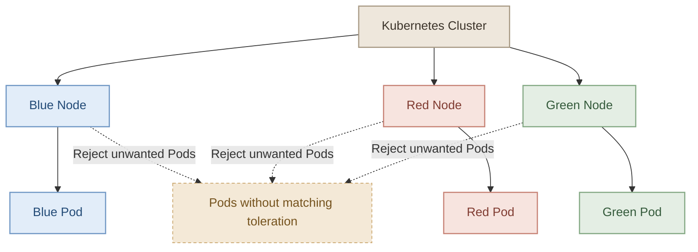
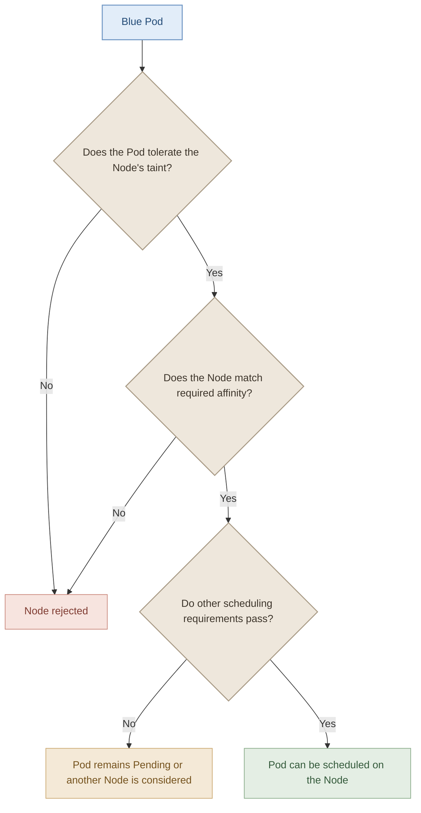

## 1. Overview

في Kubernetes، عندنا أكتر من طريقة للتحكم في توزيع الـ Pods على الـ Nodes. اتعلمنا طريقتين مهمين:

- **Taints and Tolerations:** للتحكم في الـ Pods اللي يُسمح لها بالـ scheduling على Node معينة.
- **Node Affinity:** لتحديد الـ Nodes اللي الـ Pod تفضّلها أو لازم تتشغّل عليها.

كل واحدة بتحل مشكلة مختلفة، وعشان كده ممكن نحتاج نستخدم الاتنين مع بعض.

<InfoCard
  title="The key difference"
  description="Taints repel Pods that don't tolerate them. Node Affinity attracts Pods to matching Nodes, or requires them to match."
  icon="branch"
  tags={["Scheduling", "Placement"]}
/>

## 2. The Scenario

تخيّل إن عندنا Kubernetes cluster مشترك بين أكتر من Team، وعندنا 3 Nodes مخصصة لتطبيقات بألوان مختلفة:

- Blue Pod لازم تشتغل على Blue Node.
- Red Pod لازم تشتغل على Red Node.
- Green Pod لازم تشتغل على Green Node.

وفي نفس الوقت، مش عايزين Pods تابعة لفرق تانية تشتغل على الـ Nodes دي، ومش عايزين الـ Pods بتاعتنا تروح تشتغل على Nodes تانية في الـ cluster.

إزاي نحقق الشرطين دول؟



*The goal: control where our Pods run and which Pods are allowed onto our dedicated Nodes.*

## 3. Approach One: Taints and Tolerations Only

### I. How it works

بنضيف Taint لكل Node، وبنخلي الـ Pod المناسبة عندها Toleration للـ Taint دي.

مثلاً، الـ Blue Node عليها Taint بالشكل ده:

```bash
kubectl taint nodes blue-node color=blue:NoSchedule
```

والـ Blue Pod عندها الـ Toleration المطابقة:

```yaml
spec:
  tolerations:
    - key: color
      operator: Equal
      value: blue
      effect: NoSchedule
```

كده الـ Blue Pod تقدر تتعمل لها scheduling على الـ Blue Node، بينما الـ Pods اللي مش عندها Toleration مناسبة هتُمنع من الـ scheduling عليها بسبب `NoSchedule`.

لكن فيه مشكلة مهمة.

### II. Why is this not enough?

الـ Toleration **مش معناها إن الـ Pod لازم تروح للـ Node دي**؛ معناها إنها مسموح لها تتواجد عليها من ناحية الـ Taint.

لو الـ Blue Pod عندها Toleration للـ Blue Node، ممكن الـ Scheduler يختار لها Node تانية مفيهاش Taint يمنعها، طالما باقي شروط الـ scheduling متحققة.

<InfoCard
  title="Important"
  description="A toleration allows a Pod to be scheduled onto a tainted Node. It does not select that Node or guarantee placement there."
  icon="shield"
  tags={["Toleration ≠ Placement"]}
/>

إذن، Taints and Tolerations لوحدها مش كفاية لضمان إن كل Pod تروح للـ Node المطابقة للونها.

## 4. Approach Two: Node Affinity Only

### I. How it works

بدل ما نعتمد على الـ Taints، بنضيف Labels للـ Nodes، وبنستخدم Node Affinity علشان نحدد الـ Nodes اللي كل Pod لازم تشتغل عليها.

مثلاً، نضيف Label للـ Blue Node:

```bash
kubectl label nodes blue-node color=blue
```

وبعدين نضيف Required Node Affinity للـ Blue Pod:

```yaml
spec:
  affinity:
    nodeAffinity:
      requiredDuringSchedulingIgnoredDuringExecution:
        nodeSelectorTerms:
          - matchExpressions:
              - key: color
                operator: In
                values:
                  - blue
```

الـ Pod هنا لازم تشتغل على Node عندها الـ Label:

`color=blue`

لو مفيش Node مطابقة ومتاحة، الـ Pod هتفضل Pending لحد ما شروط الـ scheduling تتحقق.

### II. Why is this not enough?

الـ Node Affinity بتحدد مكان تشغيل الـ Pod بتاعتنا، لكنها مش بتمنع Pods تانية من العمل على نفس الـ Node.

أي Pod تانية، مفيش Taint يمنعها، ومحققة شروط الـ scheduling الخاصة بيها، ممكن تتشغّل على الـ Blue Node حتى لو مش تابعة للـ Team بتاعتنا.

<InfoCard
  title="Important"
  description="Node Affinity controls where our Pods can run. It does not reserve a Node exclusively for those Pods."
  icon="wrench"
  tags={["Placement ≠ Isolation"]}
/>

## 5. The Solution: Combine Both Approaches

علشان نحقق الشرطين مع بعض، بنستخدم كل مفهوم في دوره الصحيح:

1. **Taints and Tolerations:** تمنع الـ Pods غير المسموح لها من الـ scheduling على الـ Nodes المخصصة.
2. **Node Affinity:** تضمن إن الـ Pods بتاعتنا تتوجّه للـ Nodes اللي عليها الـ Labels المطلوبة.

### I. The scheduling flow



الـ Scheduler لازم يلاقي Node تحقق كل شروط الـ scheduling، بما فيها الـ Taints والـ Affinity والـ Resources المتاحة وباقي القيود.

**ملحوظة:** الـ Affinity هنا بتستخدم `requiredDuringSchedulingIgnoredDuringExecution`، يعني الشرط مطلوب وقت الـ scheduling. لو الـ Labels اتغيرت بعد ما الـ Pod اشتغلت، النوع ده مش بيجبر الـ Pod على المغادرة تلقائيًا.

## 6. Practical Example

هنطبّق الفكرة على 3 Nodes:

| Node | Label | Taint |
|---|---|---|
| `blue-node` | `color=blue` | `color=blue:NoSchedule` |
| `red-node` | `color=red` | `color=red:NoSchedule` |
| `green-node` | `color=green` | `color=green:NoSchedule` |

> **قبل ما تبدأ:** المثال بيفترض إن عندك 3 Nodes مناسبة للتجربة. استخدم أسماء الـ Nodes الحقيقية عندك، ومتطبّقش Taints على Nodes بتاعة بيئة مشتركة أو Production من غير ما تفهم تأثيرها على الـ workloads الموجودة.

### I. Step 1: Label the Nodes

<InfoCard title="Label Nodes" description="أضف `color=blue/red/green` لكل Node المطابقة." icon="wrench" tags={["Label"]} />

```bash
kubectl label nodes blue-node color=blue
kubectl label nodes red-node color=red
kubectl label nodes green-node color=green
```

نتأكد من الـ Labels:

```bash
kubectl get nodes --show-labels
```

### II. Step 2: Apply Taints

<InfoCard title="Taint Nodes" description="أضف `NoSchedule` Taint لكل Node باستخدام `kubectl taint`." icon="shield" tags={["Taint"]} />

```bash
kubectl taint nodes blue-node color=blue:NoSchedule
kubectl taint nodes red-node color=red:NoSchedule
kubectl taint nodes green-node color=green:NoSchedule
```

نتحقق من الـ Taints:

```bash
kubectl describe node blue-node
kubectl describe node red-node
kubectl describe node green-node
```

ابحث عن `Taints` في الـ output.

### III. Step 3: Create the Blue Pod

<InfoCard title="Create Pod" description="أنشئ `blue-pod.yaml` مع Toleration و Required Affinity." icon="cube" tags={["Pod", "YAML"]} />

أنشئ ملف `blue-pod.yaml`:

```yaml
apiVersion: v1
kind: Pod
metadata:
  name: blue-pod
  labels:
    app: color-demo
    color: blue
spec:
  containers:
    - name: nginx
      image: nginx:alpine

  tolerations:
    - key: color
      operator: Equal
      value: blue
      effect: NoSchedule

  affinity:
    nodeAffinity:
      requiredDuringSchedulingIgnoredDuringExecution:
        nodeSelectorTerms:
          - matchExpressions:
              - key: color
                operator: In
                values:
                  - blue
```

طبّق الملف:

```bash
kubectl apply -f blue-pod.yaml
```

### IV. Step 4: Verify the Placement

<InfoCard title="Verify Placement" description="راجع مكان الـ Pod باستخدام `kubectl get pods -o wide` و `describe`." icon="layers" tags={["Verify"]} />

```bash
kubectl get pod blue-pod -o wide
```

افحص الـ Pod بالتفصيل:

```bash
kubectl describe pod blue-pod
```

المفروض الـ Pod تتعمل لها scheduling على الـ `blue-node` لو الـ Node متاحة وباقي الشروط متحققة.

كرر نفس الفكرة مع الـ Red وGreen Pods، مع تعديل الـ `name` والـ `value` والـ Label المطلوبة لتناسب كل لون.

### V. Step 5: Test the Restrictions

<InfoCard title="Test Restrictions" description="جرّب Pods بدون Toleration أو بـ Affinity مختلفة وراجع `Events`." icon="branch" tags={["Test"]} />

جرّب إنشاء Pod بدون Toleration على الـ Nodes المخصصة. بسبب الـ `NoSchedule` Taints، الـ Nodes دي مش هتقبل الـ Pod دي للـ scheduling.

بعدها جرّب إنشاء Pod عندها Toleration للـ Blue Node، لكن عندها Required Node Affinity بتطلب `color=red`. الـ Blue Node هتترفض بسبب الـ Affinity، والـ Red Node هتترفض بسبب الـ Taint لو الـ Pod مفيش عندها Toleration للـ Red Taint.

تقدر تراجع الـ Events باستخدام:

```bash
kubectl describe pod <pod-name>
kubectl get events --sort-by=.metadata.creationTimestamp
```

الـ Events هتساعدك تفهم ليه الـ Scheduler مش قادر يلاقي Node مناسبة.

## 7. Comparison Table

| Feature | Taints and Tolerations | Node Affinity |
|---|---|---|
| Main purpose | منع Pods غير المتوافقة من الـ scheduling على Node | تحديد الـ Nodes المناسبة للـ Pod |
| Works from | ناحية الـ Node عن طريق Taints، والـ Pod عن طريق Tolerations | ناحية الـ Pod عن طريق Affinity rules |
| Prevents unwanted Pods? | نعم، حسب الـ Taint والـ Effect والـ Tolerations | لا |
| Directs Pods to specific Nodes? | لا، مش لوحدها | نعم |
| Can be combined? | نعم | نعم |

## 8. Common Mistakes

- **Mistake 1:** إضافة Toleration والاعتقاد إن الـ Pod لازم تشتغل على الـ Node دي.  
  **Correction:** أضف Node Affinity لو عايز تفرض مكان تشغيلها.

- **Mistake 2:** إضافة Node Affinity والاعتقاد إن الـ Node بقت محجوزة للـ Pod.  
  **Correction:** استخدم Taints لمنع الـ Pods غير المتوافقة من الـ scheduling عليها.

- **Mistake 3:** الاعتقاد إن وجود Toleration يضمن تشغيل الـ Pod.  
  **Correction:** لازم باقي شروط الـ scheduling تتحقق، زي الموارد المتاحة والـ Affinity والـ constraints الأخرى.

- **Mistake 4:** اعتبار الـ Taints وسيلة أمان كاملة لعزل الـ Teams.  
  **Correction:** الـ Taints وAffinity أدوات scheduling، وليست بديلًا عن Kubernetes RBAC وNetwork Policies والضوابط الأمنية المناسبة.

## 9. Key Takeaways

<InfoCard
  title="Taints and Tolerations"
  description="Control which Pods are allowed onto tainted Nodes."
  icon="shield"
  tags={["Repel"]}
/>

<InfoCard
  title="Node Affinity"
  description="Control which Nodes a Pod must or prefers to run on."
  icon="wrench"
  tags={["Attract", "Require"]}
/>

<InfoCard
  title="Use Both Together"
  description="Combine Taints and Tolerations with Node Affinity when you want dedicated scheduling placement for specific workloads."
  icon="branch"
  tags={["Placement", "Isolation policy"]}
/>

**الخلاصة:** لو عايز الـ Pod بتاعتك تروح للـ Node المناسبة، استخدم Node Affinity. ولو عايز تمنع الـ Pods غير المناسبة من الدخول للـ Node، استخدم Taints and Tolerations. ولما تحتاج الاتنين، اجمع بينهم.

