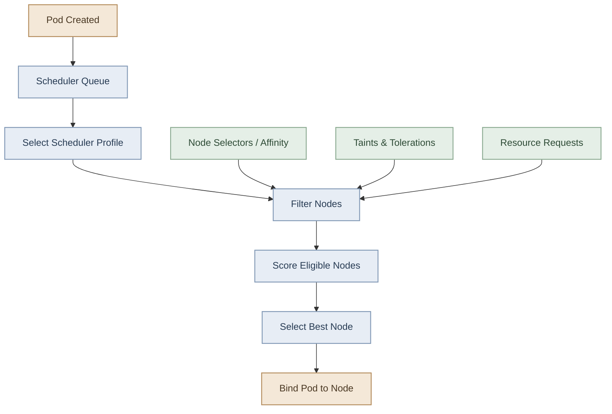

## Overview

الـ **Kubernetes Scheduler** هو الـ control-plane component المسؤول عن اختيار الـ Node المناسبة لكل Pod لسه متعملهاش scheduling.

خلال موديول Scheduling، اتعلمنا إزاي نتحكم في اختيار الـ Node، وإزاي نستخدم Scheduler إضافي، وإزاي نضبط إعدادات الـ Scheduler.

في الدرس ده هنراجع المفاهيم دي، وناخد فكرة عن **Scheduler Profiles**.

<InfoCard title="Default Scheduler" description="Kubernetes يستخدم `default-scheduler` افتراضيًا لاختيار Nodes." icon="wrench" tags={["Default"]} />

## 1. Scheduler Configuration

الـ Scheduler ممكن يتشغّل باستخدام إعدادات مختلفة حسب طريقة إنشاء الـ Kubernetes cluster.

في kubeadm clusters، غالبًا هتلاقي الـ default scheduler شغال كـ **Static Pod** على الـ control-plane node.

تقدر تفحصه باستخدام:

```bash
kubectl get pods -n kube-system -l component=kube-scheduler
```

ولمعرفة تفاصيل الـ Pod:

```bash
kubectl describe pod -n kube-system <scheduler-pod-name>
```

ملحوظة: طريقة التشغيل ومكان ملفات الـ configuration ممكن يختلفوا حسب الـ cluster setup.

## 2. Default Scheduler vs. Additional Schedulers

الـ Kubernetes بيستخدم Scheduler افتراضي اسمه عادةً `default-scheduler`.

تقدر كمان تشغّل Scheduler إضافي، وتخلي Pods معينة تطلب استخدامه عن طريق `spec.schedulerName`.

```yaml
apiVersion: v1
kind: Pod
metadata:
  name: custom-scheduled-pod
spec:
  schedulerName: my-scheduler
  containers:
    - name: nginx
      image: nginx:alpine
```

في المثال ده، الـ Pod بتطلب Scheduler اسمه `my-scheduler`.

**Important:** وجود `schedulerName` مختلف مش معناه إن عندك scheduling logic مختلف تلقائيًا. لازم يكون فيه Scheduler شغال فعلًا بالاسم ده، ومُعدّ للتعامل مع الـ Pods المطلوبة. غير كده، ممكن الـ Pod تفضل في حالة `Pending`.

## 3. What Are Scheduler Profiles?

الـ **Scheduler Profile** هو مجموعة إعدادات بتحدد مراحل الـ scheduling اللي الـ Scheduler بينفذها، والـ plugins المستخدمة في كل مرحلة.

بدل ما تشغّل عملية Scheduler منفصلة لكل نوع من أنواع الـ scheduling، تقدر تضبط أكثر من Profile داخل نفس الـ `kube-scheduler` process.

من المراحل الأساسية للـ scheduling:

- **QueueSort:** ترتيب الـ Pods المنتظرة في الـ scheduling queue.
- **PreFilter:** تجهيز أو التحقق من معلومات قبل تقييم الـ Nodes.
- **Filter:** استبعاد الـ Nodes غير المناسبة.
- **Score:** تقييم الـ Nodes المتبقية وترتيبها.
- **Bind:** ربط الـ Pod بالـ Node المختارة.

الـ Scheduler بيستخدم plugins لتنفيذ المراحل دي، وتقدر إعدادات الـ Profile تحدد الـ plugins المفعّلة أو المعطّلة في كل مرحلة.

<InfoCard title="Profile Concept" description="Scheduler Profiles بتحدد مراحل الـ Scheduling والـ Plugins المستخدمة داخل نفس الـ Process." icon="layers" tags={["Profiles", "Plugins"]} />

### I. Scheduler Profiles vs. Multiple Schedulers

<TableCard title="Profiles vs Multiple Schedulers" caption="تخصيص داخل نفس الـ Process مقابل عمليات منفصلة.">
| Feature | Scheduler Profiles | Multiple Schedulers |
|---|---|---|
| التشغيل | عدة Profiles داخل Scheduler process واحدة | ممكن تشغّل عمليات Scheduler منفصلة |
| منطق الجدولة | يختلف حسب الـ Profile والـ plugins | ممكن يكون لكل Scheduler إعدادات أو منطق مختلف |
| اختيار الـ Pod | باستخدام `schedulerName` المطابق للـ Profile | باستخدام `schedulerName` المطابق للـ Scheduler |
| الاستخدام | تخصيص سلوك الجدولة داخل نفس الـ Scheduler | تشغيل Scheduler إضافي مستقل عند الحاجة |
</TableCard>

الفرق الأساسي إن الـ **Profile مش بالضرورة Scheduler process جديدة**؛ دي مجموعة إعدادات داخل الـ Scheduler نفسه.

<InfoCard title="Profile Selection" description="الـ Pod بتحدد اسم الـ Profile عبر `schedulerName` المطابق لاسم Profile مُعدّ." icon="wrench" tags={["Selection", "Pod"]} />

## 4. How Does a Pod Select a Profile?

الـ Pod بتحدد اسم الـ Scheduler المطلوب باستخدام:

```yaml
spec:
  schedulerName: default-scheduler
```

لو الاسم مطابق لاسم Profile مُعدّ داخل الـ Scheduler، فالـ Scheduler يقدر يطبّق إعدادات الـ Profile دي على الـ Pod.

مثال توضيحي لإعداد Scheduler يحتوي على Profile إضافي:

```yaml
apiVersion: kubescheduler.config.k8s.io/v1
kind: KubeSchedulerConfiguration
profiles:
  - schedulerName: default-scheduler
  - schedulerName: resource-aware-scheduler
    plugins:
      score:
        disabled:
          - name: TaintToleration
```

**مهم:** المثال توضيحي لفكرة الـ Profiles والـ plugin configuration، مش إعداد إنتاجي كامل. تعطيل Plugin زي `TaintToleration` ممكن يغيّر سلوك الجدولة بشكل مؤثر، ولازم تفهم تأثيره قبل تطبيقه. كمان لازم تتأكد إن إصدار Kubernetes المستخدم بيدعم الـ API version والإعدادات دي.

<InfoCard title="Scheduling Flow" description="Filter → Score → Bind مع قيود Taints/Affinity وRequests." icon="cube" tags={["Filter", "Score", "Bind"]} />

## 5. How Scheduling Fits Together

الـ Scheduler بيجمع بين عدة قيود وإعدادات عشان يختار الـ Node المناسبة.



الـ `Filter` بيحدد الـ Nodes المؤهلة، والـ `Score` بيرتّب الـ Nodes المؤهلة حسب معايير الـ Scheduler. مش كل Plugin بيشتغل بنفس الطريقة أو في كل مرحلة.

## 6. Quick Revision

<Callout type="lab" title="Check your understanding" />

<Steps>
<li>الفرق بين `nodeSelector` و `nodeAffinity`.</li>
<li>الفرق بين `taints` و `tolerations`.</li>
<li>دور `resource requests` في اختيار الـ Node.</li>
<li>إزاي تحدد Scheduler مختلف عبر `spec.schedulerName`.</li>
<li>إزاي تفحص الـ Scheduler والـ scheduling events.</li>
<li>الفرق بين Multiple Schedulers و Scheduler Profiles.</li>
</Steps>

## 7. Useful Commands

```bash
# Inspect scheduler Pods
kubectl get pods -n kube-system -l component=kube-scheduler

# Check why a Pod is not scheduled
kubectl describe pod <pod-name>

# Inspect recent events
kubectl get events -A --sort-by=.metadata.creationTimestamp

# Check a Pod's assigned Node and scheduler name
kubectl get pod <pod-name> -o jsonpath='{.spec.schedulerName}{"\n"}{.spec.nodeName}{"\n"}'
```

<CardGrid columns={3} label="Command Reference Cards">
<InfoCard title="Scheduler Selection" description="الـ `spec.schedulerName` يحدد اسم الـ Scheduler المطلوب للـ Pod." icon="sliders" tags={["Selection"]} />

<InfoCard title="Profiles vs Multiple" description="Multiple Schedulers = عمليات منفصلة؛ Profiles = إعدادات داخل نفس الـ Process." icon="branch" tags={["Comparison"]} />

<InfoCard title="Scheduling Flow" description="Filter ثم Score ثم Bind مع قيود Taints/Affinity وRequests." icon="layers" tags={["Flow"]} />
</CardGrid>

## 8. Key Takeaways

<InfoCard variant="summary" title="The Scheduler Profiles Mental Model" description="الـ Scheduler الواحد بيشتغل بمراحل Filter → Score → Bind؛ الـ Profiles بتخصّص الـ plugins داخل المراحل، وMultiple Schedulers بيضيف عمليات مستقلة تختار بـ `schedulerName`." icon="wheel" tags={["Mental Model"]} />

- الـ Scheduler مسؤول عن اختيار الـ Node المناسبة للـ Pod.
- الـ Scheduling constraints بتحدد الـ Nodes المقبولة، والـ scoring بيرتّب الاختيارات.
- `spec.schedulerName` بتحدد اسم الـ Scheduler أو الـ Profile المطلوب.
- Multiple Schedulers و Scheduler Profiles طريقتان مختلفتان لتخصيص سلوك الـ scheduling.
- Scheduler Profiles موضوع أعمق من مجرد تحديد اسم Scheduler؛ لأنها بتسمح بتخصيص الـ scheduling plugins ومراحل تنفيذها.

