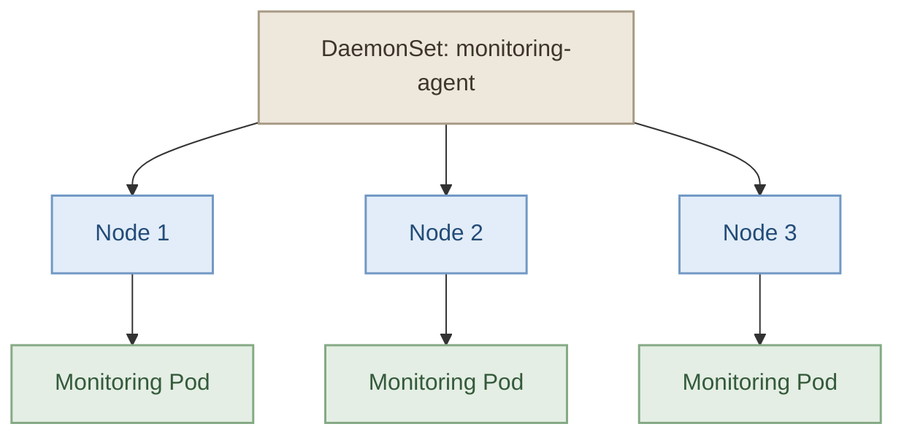
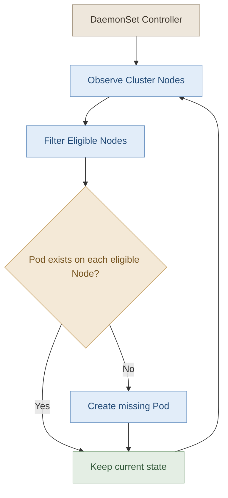

## 1. What Is a DaemonSet?

الـ **DaemonSet** هو Kubernetes workload resource بيضمن تشغيل نسخة من الـ Pod على كل Node مؤهلة حسب إعدادات الـ DaemonSet والـ scheduling constraints.

بمعنى أبسط، بدل ما تحدد عدد النسخ بنفسك زي الـ Deployment، الـ DaemonSet بيحافظ على وجود Pod على كل Node تنطبق عليها الشروط.

مثلًا، لو عندك Cluster فيه 3 Worker Nodes، وعايز تشغّل Logging Agent على كل واحدة، فالـ DaemonSet مناسب للمهمة دي.

<InfoCard
  title="The Core Idea"
  description="A DaemonSet runs a copy of a Pod on each eligible Node, rather than targeting a fixed replica count."
  icon="cube"
  tags={["Workloads", "Node-level agents"]}
/>

## 2. How Does a DaemonSet Work?

تخيّل إن عندنا Cluster فيها 3 Nodes، وعايزين نشغّل Monitoring Agent على كل واحدة.



الـ DaemonSet بيتابع الـ Nodes المؤهلة:

- لما Node جديدة تدخل الـ Cluster وتحقق شروط الـ scheduling، Kubernetes بيحاول يشغّل عليها Pod جديدة تابعة للـ DaemonSet.
- لما Node تخرج من الـ Cluster، الـ Pod المرتبطة بيها مش بتفضل كنسخة مستقلة على Node تانية؛ الـ DaemonSet بيعيد التوفيق بين الحالة المطلوبة والحالة الفعلية.
- لو Pod اتعطلت أو اتحذفت من Node ما زالت مؤهلة، Kubernetes بيحاول يرجّع الحالة المطلوبة.

**مهم:** مش شرط كل Node في الـ Cluster يكون عليها Pod من الـ DaemonSet. الـ Node Affinity والـ Node Selectors والـ Taints والـ Tolerations ممكن تخلي بعض الـ Nodes غير مؤهلة.

## 3. DaemonSet vs Deployment vs ReplicaSet

التلاتة Kubernetes resources، لكن كل واحد له غرض مختلف.

| Feature | Deployment | ReplicaSet | DaemonSet |
|---|---|---|---|
| Main purpose | إدارة تطبيقات الـ Pods والـ rollouts | الحفاظ على عدد محدد من الـ Pods | تشغيل Pod على كل Node مؤهلة |
| Replica count | عدد محدد | عدد محدد | بيتحدد حسب عدد الـ Nodes المؤهلة |
| New eligible Node | مش بيزود Pod تلقائيًا لمجرد إضافة Node | مش بيزود نسخة لمجرد إضافة Node | بيحاول يشغّل Pod عليها |
| Typical use | Web applications, APIs | الحفاظ على عدد النسخ | Logging, monitoring, node agents |

غالبًا هتستخدم Deployment لتطبيق زي Web API، وDaemonSet لتشغيل Agent محتاج يشتغل على مستوى كل Node.

## 4. Common Use Cases

<box gap={3}>
  <row align="start" gap={3}>
    <box background="surface-secondary" radius="lg" size="44px" align="center" justify="center">
      <icon name="activity" size="xl" />
    </box>
    <box flex="1" gap={1}>
      **Monitoring Agents**

      تشغيل Node-level monitoring agents لجمع معلومات عن الـ CPU والـ Memory والـ Node health.
    </box>
  </row>
  <divider color="subtle" />
  <row align="start" gap={3}>
    <box background="surface-secondary" radius="lg" size="44px" align="center" justify="center">
      <icon name="file-text" size="xl" />
    </box>
    <box flex="1" gap={1}>
      **Log Collectors**

      تشغيل Agents تجمع الـ Logs من الـ Nodes والـ Containers، مثل Fluent Bit أو Fluentd، حسب طريقة إعداد الـ Logging.
    </box>
  </row>
  <divider color="subtle" />
  <row align="start" gap={3}>
    <box background="surface-secondary" radius="lg" size="44px" align="center" justify="center">
      <icon name="network" size="xl" />
    </box>
    <box flex="1" gap={1}>
      **Networking Agents**

      بعض حلول الـ Container Networking بتشغّل Node-level agents باستخدام DaemonSets.
    </box>
  </row>
</box>

### I. What about kube-proxy?

في كتير من الـ Kubernetes Clusters، الـ `kube-proxy` بيتشغّل كـ DaemonSet داخل `kube-system`.

لكن مش كل Cluster لازم يكون عنده DaemonSet باسم `kube-proxy`؛ بعض حلول الشبكات ممكن تستبدل وظيفته بطريقة مختلفة.

## 5. DaemonSet YAML Structure

تعريف الـ DaemonSet مشابه للـ Deployment في وجود `selector` و`template`، لكن فيه اختلافات مهمة:

- `kind` بيكون `DaemonSet`.
- الـ Pod definition موجودة داخل `spec.template`.
- الـ `selector` لازم يطابق الـ Labels الموجودة في الـ Pod template.
- مفيش `spec.replicas`؛ عدد الـ Pods بيتحدد من الـ Nodes المؤهلة.
- مفيش Deployment-style rolling update strategy؛ الـ DaemonSet عنده `updateStrategy` خاصة بيه.

مثال بسيط:

```yaml
apiVersion: apps/v1
kind: DaemonSet
metadata:
  name: node-monitor
  namespace: default
spec:
  selector:
    matchLabels:
      app: node-monitor

  template:
    metadata:
      labels:
        app: node-monitor

    spec:
      containers:
        - name: monitor
          image: busybox:1.36
          command:
            - sh
            - -c
            - "while true; do sleep 3600; done"
```

الـ Container في المثال ده للتجربة فقط، مش Monitoring Agent حقيقي.

احفظ الملف باسم `daemonset.yaml`، وبعدها أنشئ الـ DaemonSet:

```bash
kubectl apply -f daemonset.yaml
```

وتابع الحالة:

```bash
kubectl get daemonsets
kubectl get pods -o wide
```

## 6. Understanding the DaemonSet Controller

الـ DaemonSet Controller بيتابع الحالة المطلوبة ويقارنها بالحالة الفعلية، وبعدها بيحاول يعالج أي اختلاف.



في إصدارات Kubernetes الحديثة، الـ DaemonSet Controller بيعمل إنشاء للـ Pods باستخدام scheduling constraints مناسبة، والـ default scheduler بيختار الـ Node الفعلية وفقًا للشروط والموارد المتاحة.

تاريخيًا، كان فيه اختلاف في آلية جدولة الـ DaemonSet Pods؛ لكن في الإصدارات الحديثة، ما تعتمدش على تعيين `spec.nodeName` يدويًا كطريقة التشغيل المعتادة للـ DaemonSets.

## 7. Useful kubectl Commands

### I. List DaemonSets

```bash
kubectl get daemonsets
```

اختصار الأمر:

```bash
kubectl get ds
```

### II. List DaemonSets in All Namespaces

```bash
kubectl get daemonsets -A
```

ده مفيد لأن الـ DaemonSets الخاصة بمكونات الـ Cluster غالبًا بتكون في `kube-system` بدل `default`.

### III. Inspect a DaemonSet

```bash
kubectl describe daemonset node-monitor
```

ولو موجودة في Namespace معينة:

```bash
kubectl describe daemonset node-monitor -n kube-system
```

### IV. Inspect Pods on All Nodes

```bash
kubectl get pods -o wide
```

لعرض Pods الخاصة بالـ DaemonSet فقط، تقدر تستخدم الـ Label اللي حددتها في الـ Manifest:

```bash
kubectl get pods -l app=node-monitor -o wide
```

### V. Inspect DaemonSet Status

```bash
kubectl get daemonset node-monitor
```

أهم الأعمدة:

- `DESIRED`: عدد الـ Pods المطلوب تشغيلها على الـ Nodes المؤهلة.
- `CURRENT`: عدد الـ Pods الموجودة حاليًا حسب حالة الـ DaemonSet.
- `READY`: عدد الـ Pods الجاهزة.
- `AVAILABLE`: عدد الـ Pods المتاحة وفقًا لمتطلبات الجاهزية.
- `UP-TO-DATE`: عدد الـ Pods اللي اتحدّثت للنسخة الحالية من الـ template.

## 8. Practical Lab

<Callout type="lab" title="Hands-on: DaemonSet" />

<Steps>
<li>

<InfoCard title="Lab 1: Inspect DaemonSets" description="اعرض كل الـ DaemonSets وقارنها في Namespace `kube-system`." icon="layers" tags={["Inspect"]} />

```bash
kubectl get ds -A
kubectl describe ds kube-proxy -n kube-system
```

</li>
<li>

<InfoCard title="Lab 2: Create Logging DaemonSet" description="أنشئ `logging-agent` باستخدام Manifest وحدّد `matchLabels`." icon="wrench" tags={["Create", "YAML"]} />

```bash
kubectl apply -f logging-daemonset.yaml
```

</li>
<li>

<InfoCard title="Lab 3: Clean Up" description="احذف الـ DaemonSet بعد التجربة." icon="shield" tags={["Cleanup"]} />

```bash
kubectl delete -f logging-daemonset.yaml
```

</li>
</Steps>

## 9. Common Mistakes

- **Mistake:** افتراض إن الـ DaemonSet لازم تشغّل Pod على كل Node بلا استثناء.  
  **Correction:** هي بتستهدف الـ Nodes المؤهلة فقط وفقًا للـ scheduling constraints.

- **Mistake:** إضافة `replicas` للـ DaemonSet زي الـ Deployment.  
  **Correction:** عدد الـ Pods بيتحدد من عدد الـ Nodes المؤهلة.

- **Mistake:** نسيان تطابق الـ selector مع الـ Pod template labels.  
  **Correction:** تأكد إن `spec.selector.matchLabels` بتطابق الـ Labels الموجودة في `spec.template.metadata.labels`.

- **Mistake:** افتراض إن كل DaemonSet جاهزة بمجرد إن الـ resource اتعملت.  
  **Correction:** راجع `DESIRED` و`READY` والـ Pod Events.

- **Mistake:** اعتبار DaemonSet بديلًا لكل أنواع الـ workload.  
  **Correction:** استخدم Deployment للتطبيقات اللي محتاجة عدد نسخ محدد، وDaemonSet للـ agents اللي محتاجة تغطي الـ Nodes المؤهلة.

## 10. Key Takeaways

<InfoCard
  title="One Pod per Eligible Node"
  description="DaemonSets maintain a Pod on each Node that matches the DaemonSet's scheduling requirements."
  icon="cube"
  tags={["Node coverage"]}
/>

<InfoCard
  title="Automatic Reconciliation"
  description="When eligible Nodes are added or removed, Kubernetes adjusts the DaemonSet's Pods to match the desired state."
  icon="cycle"
  tags={["Controller"]}
/>

<InfoCard
  title="Typical Use Cases"
  description="Node-level logging, monitoring, and networking agents are common DaemonSet workloads."
  icon="wrench"
  tags={["Logging", "Monitoring", "Networking"]}
/>

**الخلاصة:** استخدم `DaemonSet` لما تحتاج تشغّل نسخة من Pod على كل Node مؤهلة، زي الـ Logging Agents والـ Monitoring Agents. أما لو هدفك تشغيل عدد محدد من نسخ تطبيق، فالـ Deployment هو الاختيار المعتاد.

