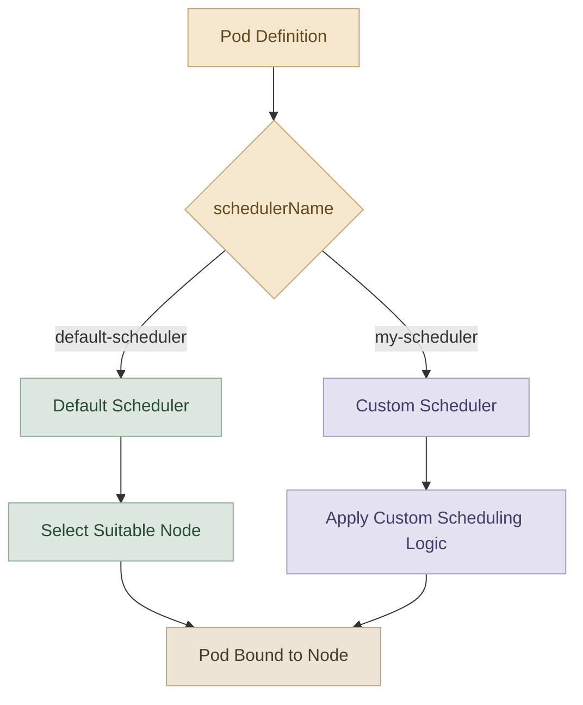
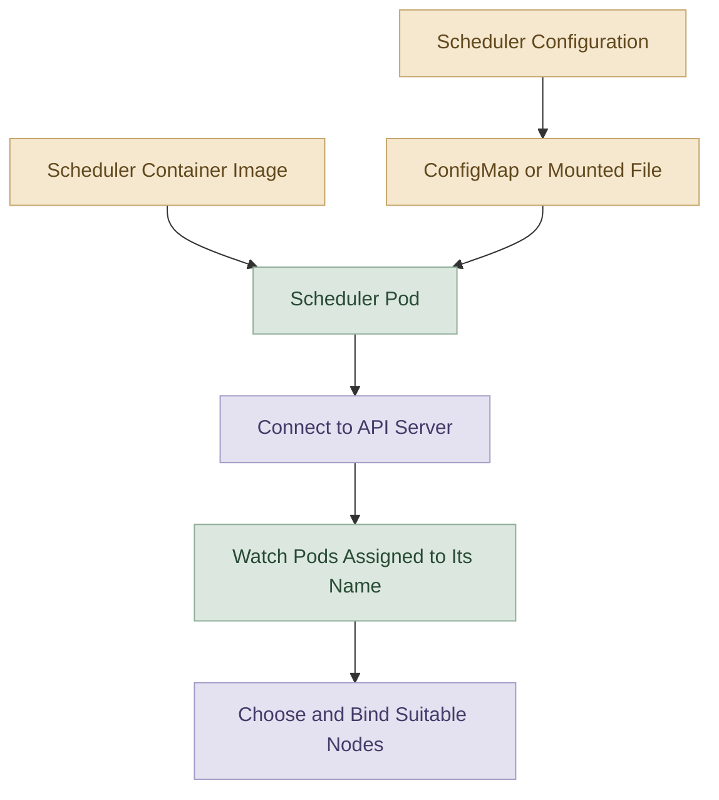
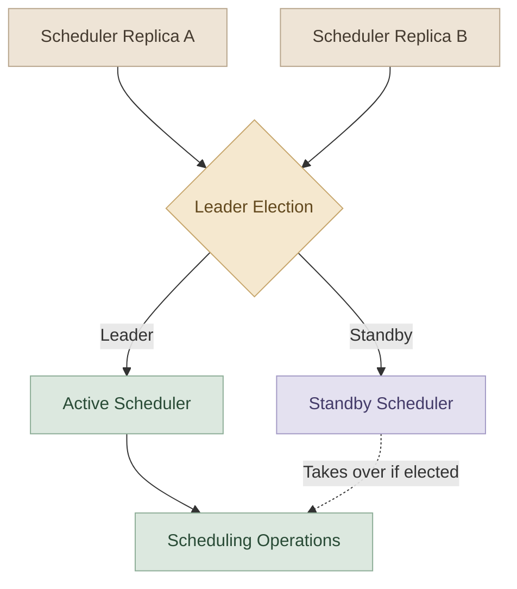

## 1. What Are Multiple Schedulers?

الـ Kubernetes بييجي مع **Default Scheduler** اسمه `default-scheduler`، وده المسؤول عن اختيار الـ Node المناسبة للـ Pods اللي محتاجة Scheduling.

الـ Scheduler بيقيّم عوامل مختلفة، زي:

- توفر الـ CPU والـ Memory.
- الـ `nodeSelector` و`nodeAffinity`.
- الـ `taints` و`tolerations`.
- القيود الأخرى اللي بتأثر على صلاحية الـ Node لاستضافة الـ Pod.

لكن أحيانًا تطبيق معين بيحتاج Scheduling Logic مخصصة، مثل متطلبات خاصة بالـ Hardware أو سياسات Placement إضافية.

بدل ما تعتمد على الـ Default Scheduler لكل التطبيقات، تقدر تشغّل **Additional Scheduler** وتوجّه Pods محددة ليه.

<InfoCard title="Core Concept" description="A Pod can request a specific scheduler through spec.schedulerName. The scheduler with that name must be deployed, configured, and able to schedule the Pod." icon="branch" tags={["Scheduling", "Kubernetes"]} />

### I. Architecture Overview



الـ Custom Scheduler مش مجرد اسم مختلف؛ لو محتاج سلوك مختلف فعلًا، لازم يكون عندك Scheduler implementation أو configuration مناسبة تحقق السلوك المطلوب. تشغيل نسخة تانية من الـ Scheduler بنفس الـ Binary وحده مش معناه إن خوارزمية الجدولة اتغيرت.

## 2. How Does Kubernetes Identify a Scheduler?

كل Scheduler لازم يكون له اسم يميّزه عن غيره.

الاسم الافتراضي هو:

```text
default-scheduler
```

أما الـ Scheduler الإضافي، ممكن تسميه مثلًا:

```text
my-scheduler
```

الاسم ده بيظهر في إعدادات الـ Scheduler، وبتستخدمه في تعريف الـ Pod عشان تحدد مين المسؤول عن جدولتها.

### I. Example: Scheduler Configuration

في الإصدارات الحديثة، إعدادات الـ `kube-scheduler` بتستخدم API من نوع `KubeSchedulerConfiguration`.

مثال توضيحي مبسّط:

```yaml
apiVersion: kubescheduler.config.k8s.io/v1
kind: KubeSchedulerConfiguration
leaderElection:
  leaderElect: false
```

لاحظ إن المثال ده مش إعداد كامل جاهز للتشغيل؛ إعدادات الـ Authentication والـ API Server والـ Deployment لازم تكون مناسبة لبيئتك. كمان إعداد الـ Scheduler بيختلف حسب إصدار Kubernetes.

الاسم `my-scheduler` في الـ Pod مش بيتحدد من اسم ملف الـ Configuration؛ لازم الـ Scheduler اللي هيستقبل الـ Pod يكون مُعدًّا للعمل بالاسم ده، وفقًا لطريقة تشغيله وإصداره.

## 3. Deploying an Additional Scheduler

فيه أكثر من طريقة لتشغيل Scheduler إضافي، حسب تصميم الـ Cluster.

### I. Option A — Run the Scheduler as a Process

ممكن تشغّل الـ `kube-scheduler` Binary إضافي باستخدام Configuration منفصل، مع إعدادات الاتصال بالـ API Server والصلاحيات اللازمة.

ده أسلوب ممكن في بيئات معينة، لكنه مش الطريقة الوحيدة، ومش بالضرورة الاختيار المناسب لكل Cluster.

### II. Option B — Run It as a Pod or Deployment

في Clusters كثيرة، بيتشغّل الـ Scheduler كـ Pod داخل الـ Cluster، وممكن استخدام Deployment لإدارة نسخة أو أكثر منه.

عادةً هتحتاج:

- Scheduler Binary أو Container Image مناسبة.
- Configuration تحدد سلوك الـ Scheduler.
- Authentication وRBAC permissions مناسبة.
- وسيلة لتمرير ملف الإعدادات، زي ConfigMap أو Volume.
- إعدادات Logging وHealth Probes وResources حسب احتياجات البيئة.

الـ Deployment بيساعد في إدارة دورة حياة الـ Scheduler، لكنه لوحده مش بيضيف Scheduling Algorithm مخصصة.

### III. Simplified Deployment Flow



## 4. Assign a Pod to a Specific Scheduler

دي أهم نقطة عملية في الدرس كله.

بتحدد اسم الـ Scheduler في الحقل:

```yaml
spec:
  schedulerName: my-scheduler
```

### I. Complete Pod Example

```yaml
apiVersion: v1
kind: Pod
metadata:
  name: nginx-custom-scheduler
spec:
  schedulerName: my-scheduler
  containers:
    - name: nginx
      image: nginx:stable
```

احفظ الملف مثلًا باسم `nginx-custom-scheduler.yaml`، ثم نفّذ:

```bash
kubectl apply -f nginx-custom-scheduler.yaml
```

وتابع حالة الـ Pod:

```bash
kubectl get pod nginx-custom-scheduler
```

لو الـ Scheduler المطلوب شغال ومُعدّ صح، وعنده الصلاحيات اللازمة، وفيه Node مناسبة، المفروض الـ Pod يتعمل له Scheduling.

**مهم:** وجود `schedulerName: my-scheduler` مش بيعمل Scheduler جديد. الحقل ده بيحدد اسم الـ Scheduler المطلوب، لكن لازم يكون فيه Scheduler فعلي قادر يتعامل مع الـ Pod.

### II. What Happens If the Scheduler Is Missing?

لو الـ Pod بيطلب Scheduler مش موجود أو مش شغال، ممكن يفضل في حالة `Pending`، وغالبًا مش هتلاقي حدث Scheduling ناجح.

افحص التفاصيل:

```bash
kubectl describe pod nginx-custom-scheduler
```

وراجع الأحداث والـ Scheduler logs عشان تعرف سبب المشكلة.

## 5. Verify Which Scheduler Handled the Pod

الـ Events بتساعدك تعرف مين عمل Scheduling للـ Pod.

اعرض أحداث الـ Namespace الحالي:

```bash
kubectl get events --sort-by=.metadata.creationTimestamp
```

أو اعرض تفاصيل الـ Pod:

```bash
kubectl describe pod nginx-custom-scheduler
```

دور على حدث `Scheduled`، وراجع الـ `From` أو الـ `source` والرسالة المرتبطة به. اسم الـ Scheduler اللي أصدر الحدث ممكن يظهر هناك.

كمان تقدر تراجع Logs بتاعة الـ Scheduler نفسه. لو شغال كـ Pod داخل `kube-system` مثلًا:

```bash
kubectl get pods -n kube-system
```

وبعد ما تحدد اسم الـ Pod:

```bash
kubectl logs -n kube-system <scheduler-pod-name>
```

استبدل `<scheduler-pod-name>` بالاسم الفعلي.

## 6. What Is Leader Election?

في بيئات High Availability، ممكن يكون عندك أكثر من نسخة من نفس الـ Scheduler شغالة على Control Plane Nodes مختلفة.

الـ `leaderElection` بيساعد في اختيار نسخة واحدة نشطة لتنفيذ مسؤوليات الجدولة، بدل ما كل النسخ تحاول تنفيذ نفس العمل بشكل متزامن.

مثال توضيحي:



خد بالك من الفرق بين حالتين:

- **Replicas لنفس الـ Scheduler:** غالبًا بتستخدم Leader Election عشان تنسّق النسخ.
- **Schedulers مختلفة بأسماء مختلفة:** ممكن تكون كل واحدة مسؤولة عن Pods مختلفة، حسب `schedulerName` وإعداداتها.

ما ينفعش نفترض إن أي Scheduler إضافي لازم يكون عنده `leaderElect: false`. القرار بيعتمد على عدد النسخ وطريقة تشغيلها وهدف الـ Deployment.

## 7. Troubleshooting Pending Pods

لو الـ Pod فضلت `Pending`، ابدأ بالخطوات دي بالترتيب:

### I. Step 1 — Check the Pod Configuration

```bash
kubectl get pod nginx-custom-scheduler -o yaml
```

راجع:

```yaml
spec:
  schedulerName: my-scheduler
```

اتأكد إن الاسم مطابق للاسم اللي الـ Scheduler بيستخدمه.

### II. Step 2 — Inspect Pod Events

```bash
kubectl describe pod nginx-custom-scheduler
```

راجع آخر الأحداث، خصوصًا لو مفيش حدث `Scheduled` أو ظهر سبب متعلق بالـ Scheduling.

### III. Step 3 — Check the Scheduler

```bash
kubectl get pods -n kube-system
```

لو الـ Scheduler معمول له Deployment، راجع الـ Deployment والـ Pods التابعة له.

### IV. Step 4 — Check Logs and Permissions

```bash
kubectl logs -n kube-system <scheduler-pod-name>
```

لو الـ Scheduler مش قادر يتواصل مع الـ API Server أو معندوش RBAC permissions مناسبة، ممكن يفشل في مراقبة الـ Pods أو عمل Binding للـ Node.

### V. Step 5 — Check Node Suitability

حتى لو الـ Scheduler شغال، ممكن مفيش Node مناسبة بسبب نقص الـ Resources أو قيود الـ Placement.

استخدم:

```bash
kubectl get nodes
kubectl describe nodes
```

ما تفترضش إن كل حالة `Pending` معناها إن الـ Scheduler نفسه فيه مشكلة؛ ممكن يكون السبب في الـ Resources أو الـ Constraints.

## 8. Practical Lab

<Callout type="lab" title="Hands-on: Multiple Schedulers" />

<Steps>
<li>

<InfoCard title="Step 1 — Inspect Default Scheduler" description="راجع الـ Scheduler Pod في `kube-system` وحدّد اسمه الفعلي." icon="layers" tags={["Inspect", "Default"]} />

```bash
kubectl get pods -n kube-system
```

</li>
<li>

<InfoCard title="Step 2 — Inspect Image" description="راجع Image في `kube-scheduler-controlplane` واستخدم الإصدار الفعلي." icon="wrench" tags={["Image", "Version"]} />

```bash
kubectl describe pod kube-scheduler-controlplane -n kube-system
```

</li>
<li>

<InfoCard title="Step 3 — Inspect Config" description="راجع `my-scheduler-config.yaml` أو ConfigMap." icon="cube" tags={["Config"]} />

```bash
cat my-scheduler-config.yaml
kubectl get configmap -n kube-system
```

</li>
<li>

<InfoCard title="Step 4 — Create Custom Pod" description="أنشئ Pod بـ `schedulerName: my-scheduler`." icon="branch" tags={["Pod", "Scheduler"]} />

```yaml
apiVersion: v1
kind: Pod
metadata:
  name: nginx-custom-scheduler
spec:
  schedulerName: my-scheduler
  containers:
    - name: nginx
      image: nginx:stable
```

</li>
<li>

<InfoCard title="Step 5 — Verify Scheduling" description="راجع `Scheduled` event واسم الـ Scheduler." icon="shield" tags={["Verify", "Events"]} />

```bash
kubectl describe pod nginx-custom-scheduler
```

</li>
<li>

<InfoCard title="Step 6 — Clean Up" description="احذف الـ Pod التجريبية بعد التجربة." icon="layers" tags={["Cleanup"]} />

```bash
kubectl delete pod nginx-custom-scheduler
```

</li>
</Steps>

```bash
kubectl get pods -n kube-system
```

في Cluster بيشغّل الـ Scheduler كـ Static Pod، ممكن تلاقي اسمًا مثل:

```text
kube-scheduler-controlplane
```

الاسم ده مثال؛ ممكن يختلف حسب الـ Cluster.

### II. Step 2 — Inspect the Scheduler Image

```bash
kubectl describe pod kube-scheduler-controlplane -n kube-system
```

راجع حقل `Image`. استخدم إصدار الـ Image الفعلي الموجود في بيئتك، بدل الاعتماد على إصدار قديم مذكور في فيديو تعليمي.

### III. Step 3 — Inspect the Additional Scheduler Configuration

لو عندك ملف Configuration جاهز، راجعه قبل إنشاء الـ Scheduler:

```bash
cat my-scheduler-config.yaml
```

لو الـ Configuration متاحة من ConfigMap:

```bash
kubectl get configmap -n kube-system
```

راجع اسم الـ ConfigMap ومحتواها، وتأكد إن الـ Scheduler Pod بيستخدمها بالطريقة الصحيحة.

### IV. Step 4 — Create a Pod That Uses the Custom Scheduler

أنشئ الملف `nginx-custom-scheduler.yaml`:

```yaml
apiVersion: v1
kind: Pod
metadata:
  name: nginx-custom-scheduler
spec:
  schedulerName: my-scheduler
  containers:
    - name: nginx
      image: nginx:stable
```

طبّق الملف:

```bash
kubectl apply -f nginx-custom-scheduler.yaml
```

تابع الحالة:

```bash
kubectl get pod nginx-custom-scheduler -w
```

### V. Step 5 — Verify Scheduling

```bash
kubectl describe pod nginx-custom-scheduler
```

تأكد من وجود حدث `Scheduled`، وراجع اسم الـ Scheduler الظاهر في الحدث لو متاح.

لو الـ Pod فضلت `Pending`، افحص الـ Scheduler نفسه والـ Events والـ Logs قبل ما تغيّر الـ Manifest عشوائيًا.

### VI. Step 6 — Clean Up

بعد انتهاء التجربة:

```bash
kubectl delete pod nginx-custom-scheduler
```

ده بيحذف الـ Pod التجريبية فقط؛ مش بيحذف الـ Scheduler أو الـ ConfigMap.

## 9. Common Mistakes

- **إضافة `schedulerName` فقط:** ده مش كفاية لإنشاء Scheduler أو تشغيله.
- **عدم تطابق الأسماء:** اسم الـ Scheduler في الـ Pod لازم يطابق الاسم اللي الـ Scheduler الفعلي بيتعامل معاه.
- **تجاهل RBAC:** الـ Scheduler محتاج صلاحيات مناسبة للتعامل مع موارد الـ Kubernetes.
- **استخدام Image قديمة من فيديو:** الأفضل استخدام Image متوافقة مع إصدار الـ Cluster الحالي.
- **اعتبار كل Pending مشكلة Scheduler:** لازم تفحص الـ Events والـ Resources والـ Constraints.
- **الخلط بين Custom Scheduler وCustom Scheduling Logic:** تشغيل نسخة إضافية من الـ `kube-scheduler` بنفس الإعدادات مش معناه إنك أضفت خوارزمية جديدة.

## 10. Key Takeaways

- الـ Kubernetes بيدعم تشغيل أكثر من Scheduler.
- كل Scheduler لازم يكون له اسم مميز.
- الحقل `spec.schedulerName` بيحدد الـ Scheduler المطلوب للـ Pod.
- الـ Default Scheduler هو `default-scheduler`.
- الـ Custom Scheduler محتاج إعدادات صحيحة واتصال بالـ API Server وصلاحيات مناسبة.
- الـ Events والـ Logs أدوات أساسية لتشخيص مشاكل الـ Scheduling.
- `leaderElection` بيُستخدم لتنسيق نسخ الـ Scheduler في سيناريوهات High Availability.

