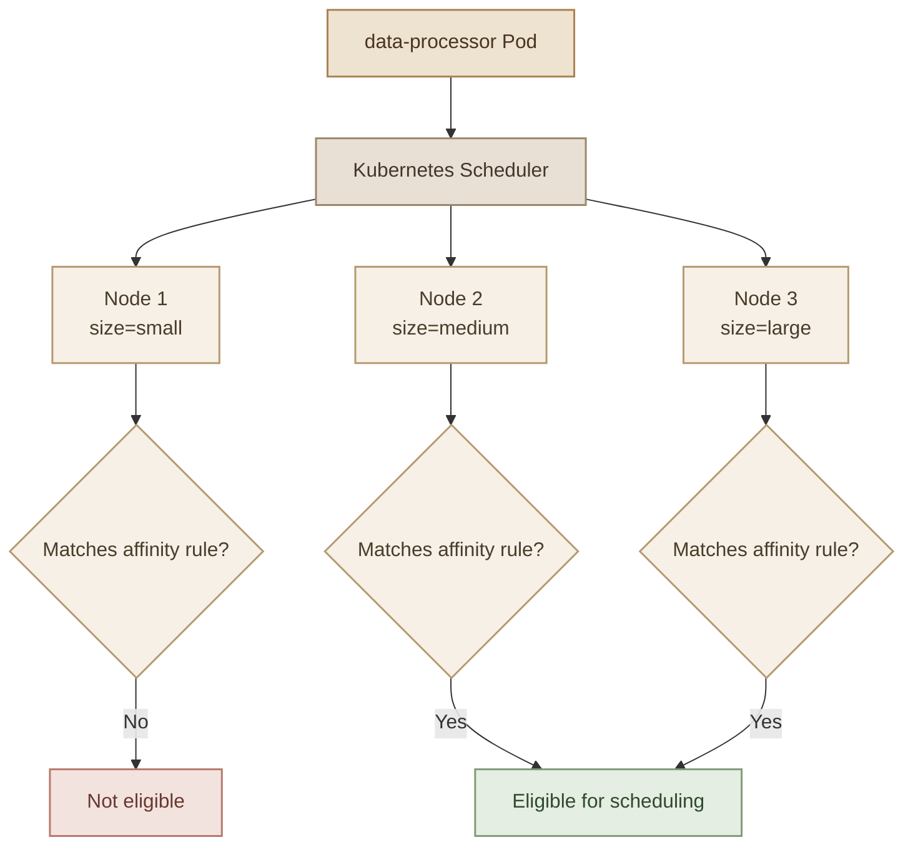
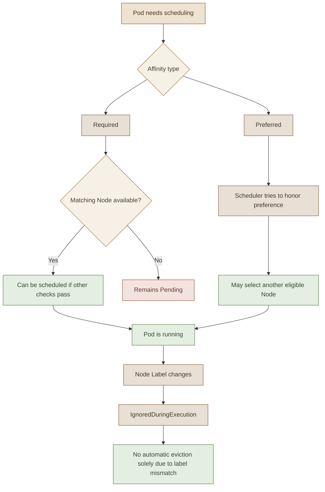

## 1. What Is Node Affinity?

الـ **Node Affinity** هي ميزة في Kubernetes بتسمح لنا نحدد الـ Nodes اللي الـ Pod ينفع تتجدول عليها، باستخدام شروط مبنية على الـ **Node Labels**.

إحنا اتعلمنا في الدرس اللي فات إن `nodeSelector` تقدر تطلب من الـ Scheduler يختار Node عليها Label معينة، مثل:

```yaml
nodeSelector:
  size: large
```

لكن إيه لو عايزين نقول:

- شغّل الـ Pod على Node حجمها `large` أو `medium`.
- اختار Node الـ Label بتاعتها مش `small`.
- اختار Node عندها Label معينة، حتى لو مش مهتمين بقيمتها.
- فضّل Node معينة، لكن لو مش متاحة شغّل الـ Pod على Node مناسبة تانية.

الـ `nodeSelector` مش بتعبّر عن كل الشروط دي بشكل مباشر، وهنا بييجي دور الـ Node Affinity.

<InfoCard title="Core Idea" description="Node Affinity بتحدد شروط اختيار الـ Nodes باستخدام Labels وOperators، وتقدر تحدد هل الشروط إلزامية أم مجرد تفضيل." icon="wrench" tags={["Node Labels", "Scheduling Rules"]} />

## 2. How Node Affinity Works

تخيّل إن عندنا Cluster فيها ثلاث Nodes، وعايزين نشغّل `data-processor` على Node كبيرة أو متوسطة فقط.



الـ Scheduler بيقيّم شروط الـ Affinity، لكن ده مش معناه إن أي Node مطابقة هتشغّل الـ Pod تلقائيًا. لازم باقي شروط الجدولة تكون متحققة برضه، زي الموارد المتاحة والـ Taints والقيود الأخرى.

## 3. Understanding the Node Affinity Structure

الـ Node Affinity بتتكتب داخل `spec` الخاصة بالـ Pod، بالشكل ده:

```yaml
spec:
  affinity:
    nodeAffinity:
      requiredDuringSchedulingIgnoredDuringExecution:
        nodeSelectorTerms:
          - matchExpressions:
              - key: size
                operator: In
                values:
                  - large
```

خلينا نفهم كل جزء:

- `affinity`: بتحتوي على قواعد الـ Affinity الخاصة بالـ Pod.
- `nodeAffinity`: القواعد المتعلقة باختيار الـ Nodes.
- `requiredDuringSchedulingIgnoredDuringExecution`: النوع اللي بيحدد إن الشرط إلزامي وقت الجدولة، مع تجاهل تغيّره بعد تشغيل الـ Pod.
- `nodeSelectorTerms`: مجموعة من الشروط اللي الـ Scheduler بيقيّمها.
- `matchExpressions`: بتحدد الـ Label Key والـ Operator والقيم المطلوبة.

<InfoCard title="Remember the Difference" description="الـ Node Selector والـ Node Affinity بيستخدموا Labels على الـ Nodes، لكن Node Affinity بتوفر Operators وشروط أكثر مرونة." icon="branch" tags={["Labels", "Operators"]} />

## 4. Node Affinity Operators

الـ Operator هو اللي بيحدد طريقة مطابقة الـ Label مع الشرط المطلوب.

| Operator | المعنى |
|---|---|
| `In` | قيمة الـ Label تكون واحدة من القيم المحددة. |
| `NotIn` | قيمة الـ Label لا تكون واحدة من القيم المحددة. |
| `Exists` | الـ Label Key موجودة، بغض النظر عن قيمتها. |
| `DoesNotExist` | الـ Label Key غير موجودة. |
| `Gt` | قيمة الـ Label الرقمية أكبر من القيمة المحددة. |
| `Lt` | قيمة الـ Label الرقمية أصغر من القيمة المحددة. |

بالنسبة إلى `Gt` و`Lt`، لازم قيمة الـ Label والقيمة المقارنة تكونا أعدادًا صحيحة بصيغة نصية صالحة للمقارنة الرقمية.

### I. In — Match Any Listed Value

لو عايزين الـ Pod تشتغل على Node حجمها `large` أو `medium`:

```yaml
affinity:
  nodeAffinity:
    requiredDuringSchedulingIgnoredDuringExecution:
      nodeSelectorTerms:
        - matchExpressions:
            - key: size
              operator: In
              values:
                - large
                - medium
```

هنا وجود قيمة واحدة مطابقة من القائمة كفاية لتحقيق شرط الـ Expression.

### II. NotIn — Exclude Specific Values

لو عايزين نستبعد الـ Nodes اللي عليها `size=small`:

```yaml
affinity:
  nodeAffinity:
    requiredDuringSchedulingIgnoredDuringExecution:
      nodeSelectorTerms:
        - matchExpressions:
            - key: size
              operator: NotIn
              values:
                - small
```

**خلي بالك:** لو الـ Label `size` مش موجودة على Node، فإن `NotIn` ممكن يطابقها؛ لأن الـ Key مش موجودة بقيمة `small`. لو عايز تشترط وجود الـ Label نفسها، أضف Expression منفصلة باستخدام `Exists`.

### III. Exists — Check Whether a Label Exists

 استخدمنا `Exists` لاستهداف الـ Control Plane Node، لأن الـ Label المستهدفة مش محتاجة قيمة محددة؛ المهم إن الـ Key موجودة.

```yaml
affinity:
  nodeAffinity:
    requiredDuringSchedulingIgnoredDuringExecution:
      nodeSelectorTerms:
        - matchExpressions:
            - key: node-role.kubernetes.io/control-plane
              operator: Exists
```

الـ Expression دي بتطابق أي Node عليها الـ Label Key المذكورة، مهما كانت قيمة الـ Label إن وُجدت.

> **Important:** `Exists` بتفحص وجود الـ Label، لكنها لا تتجاوز الـ Taints. لو الـ Node عليها Taint تمنع الـ Pod من الجدولة، لازم تتعامل مع الـ Taint بشكل منفصل.

## 5. Understanding the Boolean Logic

من أهم الحاجات في Node Affinity فهم العلاقة بين الـ Expressions والـ Terms.

- الـ Expressions داخل نفس `nodeSelectorTerm` لازم كلها تتحقق معًا (**AND**).
- الـ `nodeSelectorTerms` المختلفة بتكون بدائل لبعضها (**OR**).
- مع `In`، وجود أي قيمة مطابقة داخل `values` كفاية لتحقيق الـ Expression.

مثال: شغّل الـ Pod على Node حجمها `large` وتكون في بيئة `production`:

```yaml
affinity:
  nodeAffinity:
    requiredDuringSchedulingIgnoredDuringExecution:
      nodeSelectorTerms:
        - matchExpressions:
            - key: size
              operator: In
              values:
                - large
            - key: environment
              operator: In
              values:
                - production
```

الـ Node لازم تحقق الشرطين: `size=large` و`environment=production`.

أما لو عايزين نقبل `size=large` أو `environment=production` كشرطين بديلين، نستخدم `nodeSelectorTerms` منفصلة، مع مراعاة إن كل Term لازم تحتوي على شروطها المطلوبة.

## 6. Types of Node Affinity

فيه نوعان أساسيان بنستخدمهم لتحديد طريقة تعامل الـ Scheduler مع شروط الـ Node Affinity.

<InfoCard title="Required" description="شرط إلزامي وقت الجدولة. لو مفيش Node تحقق الشروط وباقي قيود الجدولة، الـ Pod مش هتتجدول." icon="shield" tags={["Hard Requirement"]} />

<InfoCard title="Preferred" description="تفضيل للـ Scheduler. يحاول اختيار Node مطابقة، لكن ممكن يختار Node أخرى لو التفضيل مش قابل للتحقيق." icon="sliders" tags={["Soft Preference"]} />

### I. Required During Scheduling, Ignored During Execution

الاسم الكامل:

`requiredDuringSchedulingIgnoredDuringExecution`

ده معناه:

- وقت الجدولة: لازم شروط الـ Affinity تتحقق.
- بعد الجدولة: لو الـ Node فقدت الـ Label المطابقة، Kubernetes مش بتطرد الـ Pod تلقائيًا لمجرد إن الشرط بقى غير متحقق.

مثال:

```yaml
affinity:
  nodeAffinity:
    requiredDuringSchedulingIgnoredDuringExecution:
      nodeSelectorTerms:
        - matchExpressions:
            - key: size
              operator: In
              values:
                - large
```

لو مفيش Node عليها `size=large`، الـ Pod مش هتتجدول بنجاح، وهتفضل غالبًا `Pending` لحد ما شروط الجدولة تتحقق.

### II. Preferred During Scheduling, Ignored During Execution

الاسم الكامل:

`preferredDuringSchedulingIgnoredDuringExecution`

ده مناسب لما تكون عايز تفضّل Node معينة، لكن مش عايز تمنع تشغيل الـ Workload لو مفيش Node مطابقة.

مثال:

```yaml
affinity:
  nodeAffinity:
    preferredDuringSchedulingIgnoredDuringExecution:
      - weight: 80
        preference:
          matchExpressions:
            - key: size
              operator: In
              values:
                - large
```

هنا:

- `weight`: رقم من `1` إلى `100` بيوضح قوة التفضيل النسبي.
- `preference`: الشروط اللي الـ Scheduler بيحاول يحققها.

لو مفيش Node مطابقة، الـ Scheduler ممكن يختار Node أخرى مناسبة بدل ما يمنع الجدولة بسبب التفضيل وحده.

الـ Weight مش نسبة مئوية، ومش ضمان إن الـ Pod هتتجدول على Node معينة؛ هو جزء من تقييم الـ Scheduler للتفضيلات.

## 7. Scheduling vs Execution

خلينا نفرّق بين المرحلتين:

- **During Scheduling:** الـ Pod لسه محتاجة تتحدد لها Node.
- **During Execution:** الـ Pod اتجدولت بالفعل وبتشتغل، وبعد كده حصل تغيير في الـ Labels أو البيئة.



## 8. Practice Lab — Blue Deployment on node01

<Callout type="lab" title="Hands-on: Blue Deployment" />

<Steps>
<li>

<InfoCard title="Step 1 — Inspect Node Labels" description="راجع الـ Labels على `node01` باستخدام `kubectl get nodes --show-labels` قبل إضافة أي Label جديدة." icon="layers" tags={["Inspect"]} />

```bash
kubectl get nodes
kubectl describe node node01
```

</li>
<li>

<InfoCard title="Step 2 — Add the Label" description="أضف `color=blue` إلى `node01` وتأكد من النتيجة." icon="wrench" tags={["Label", "Blue"]} />

```bash
kubectl label node node01 color=blue
```

</li>
<li>

<InfoCard title="Step 3 — Create the Deployment" description="أنشئ `blue` بـ 3 Replicas من غير Affinity أولًا." icon="cube" tags={["Deployment"]} />

```bash
kubectl create deployment blue --image=nginx --replicas=3
```

</li>
<li>

<InfoCard title="Step 4 — Edit the Deployment" description="أضف `affinity` داخل `spec.template.spec` مع `requiredDuringSchedulingIgnoredDuringExecution`." icon="branch" tags={["YAML", "Edit"]} />

```yaml
affinity:
  nodeAffinity:
    requiredDuringSchedulingIgnoredDuringExecution:
      nodeSelectorTerms:
        - matchExpressions:
            - key: color
              operator: In
              values:
                - blue
```

</li>
<li>

<InfoCard title="Step 5 — Verify Pod Placement" description="تحقق من تشغيل الـ Replicas على `node01` باستخدام `kubectl get pods -o wide`." icon="shield" tags={["Verify"]} />

```bash
kubectl get pods -o wide
```

</li>
</Steps>

## 9. Practice Lab — Red Deployment on the Control Plane

<Callout type="lab" title="Hands-on: Red Deployment" />

<Steps>
<li>

<InfoCard title="Step 1 — Inspect Control Plane Labels" description="ابحث عن الـ Label الفعلي (`control-plane` أو `master`) في الـ Cluster." icon="layers" tags={["Inspect", "Labels"]} />

```bash
kubectl get nodes --show-labels
```

</li>
<li>

<InfoCard title="Step 2 — Generate YAML" description="أنشئ `red.yaml` بـ `--dry-run=client` لـ Deployment بـ 2 Replicas." icon="wrench" tags={["Generate", "YAML"]} />

```bash
kubectl create deployment red \
  --image=nginx --replicas=2 \
  --dry-run=client -o yaml > red.yaml
```

</li>
<li>

<InfoCard title="Step 3 — Add Affinity" description="أضف `requiredDuringSchedulingIgnoredDuringExecution` مع `Exists` للـ Control Plane Label." icon="branch" tags={["YAML", "Exists"]} />

```yaml
affinity:
  nodeAffinity:
    requiredDuringSchedulingIgnoredDuringExecution:
      nodeSelectorTerms:
        - matchExpressions:
            - key: node-role.kubernetes.io/control-plane
              operator: Exists
```

</li>
<li>

<InfoCard title="Step 4 — Apply & Verify" description="طبّق الملف وراجع مكان الـ Pods مع ملاحظة الـ Taints." icon="shield" tags={["Apply", "Verify"]} />

```bash
kubectl apply -f red.yaml
kubectl get pods -o wide
```

</li>
</Steps>

```bash
kubectl get nodes --show-labels
```

ابحث عن الـ Label الموجودة على الـ Control Plane Node.

الـ Label الشائعة في الإصدارات الحديثة هي:

`node-role.kubernetes.io/control-plane`

وفي بعض الـ Clusters القديمة ممكن تلاقي:

`node-role.kubernetes.io/master`

ما تفترضش إن الاتنين موجودين؛ استخدم الـ Key الفعلي الظاهر في الـ Cluster عندك.

## 10. Node Affinity vs Taints and Tolerations

الاتنين بيتعلقوا بالـ Scheduling، لكن كل واحد بيحل مشكلة مختلفة.

<div class="grid grid-cols-1 gap-4 sm:grid-cols-2">
  <InfoCard title="Node Affinity" description="تحدد الـ Nodes التي تطابق شروط الـ Pod أو تفضيلاتها." icon="wrench" tags={["Placement"]} />
  <InfoCard title="Taints & Tolerations" description="تمنع Pods غير المتحملة من استخدام Node، أو تسمح لها بتجاوز Taint مطابقة." icon="shield" tags={["Repelling"]} />
</div>

| Feature | Node Affinity | Taints & Tolerations |
|---|---|---|
| مكان الإعداد | Pod specification | Taints على Node وTolerations على Pod |
| الهدف | اختيار Nodes حسب Labels | إبعاد Pods غير المتحملة |
| هل يفرض الاختيار؟ | الـ Required يفرض مطابقة الشروط وقت الجدولة | الـ Toleration وحدها لا تفرض اختيار Node |
| الاستخدام معًا | ممكن | ممكن |

في بيئة حقيقية، ممكن تحتاج الاتنين معًا: الـ Affinity عشان توجّه الـ Pod إلى مجموعة Nodes معينة، والـ Taints عشان تمنع الـ Workloads غير المناسبة من استخدامها.

## 11. Common Mistakes

- كتابة `affinity` خارج `spec.template.spec` في Deployment.
- نسيان إن `nodeSelectorTerms` مصفوفة.
- استخدام `Exists` مع `values`؛ الـ Operator ده لا يحتاج قائمة قيم.
- استخدام `In` أو `NotIn` من غير `values`.
- الخلط بين `required` و`preferred`.
- الاعتقاد إن الـ `preferred` تمنع الجدولة لو مفيش Node مطابقة.
- الاعتقاد إن تغيير الـ Label بعد الجدولة هيطرد الـ Pod تلقائيًا.
- نسيان فحص الـ Taints والـ Resources عند استهداف Control Plane Node.

## 12. Key Takeaways

- الـ Node Affinity بتستخدم Node Labels لاختيار الـ Nodes.
- `In` و`NotIn` بيسمحوا بمطابقة القيم أو استبعادها.
- `Exists` و`DoesNotExist` بيتعاملوا مع وجود الـ Label Key.
- `requiredDuringSchedulingIgnoredDuringExecution` شرط إلزامي وقت الجدولة.
- `preferredDuringSchedulingIgnoredDuringExecution` تفضيل مش شرط إلزامي.
- `IgnoredDuringExecution` معناها إن تغيّر مطابقة الـ Affinity بعد الجدولة لا يؤدي وحده إلى طرد الـ Pod.
- ممكن نستخدم Node Affinity مع Taints and Tolerations حسب احتياجات الـ Cluster.
