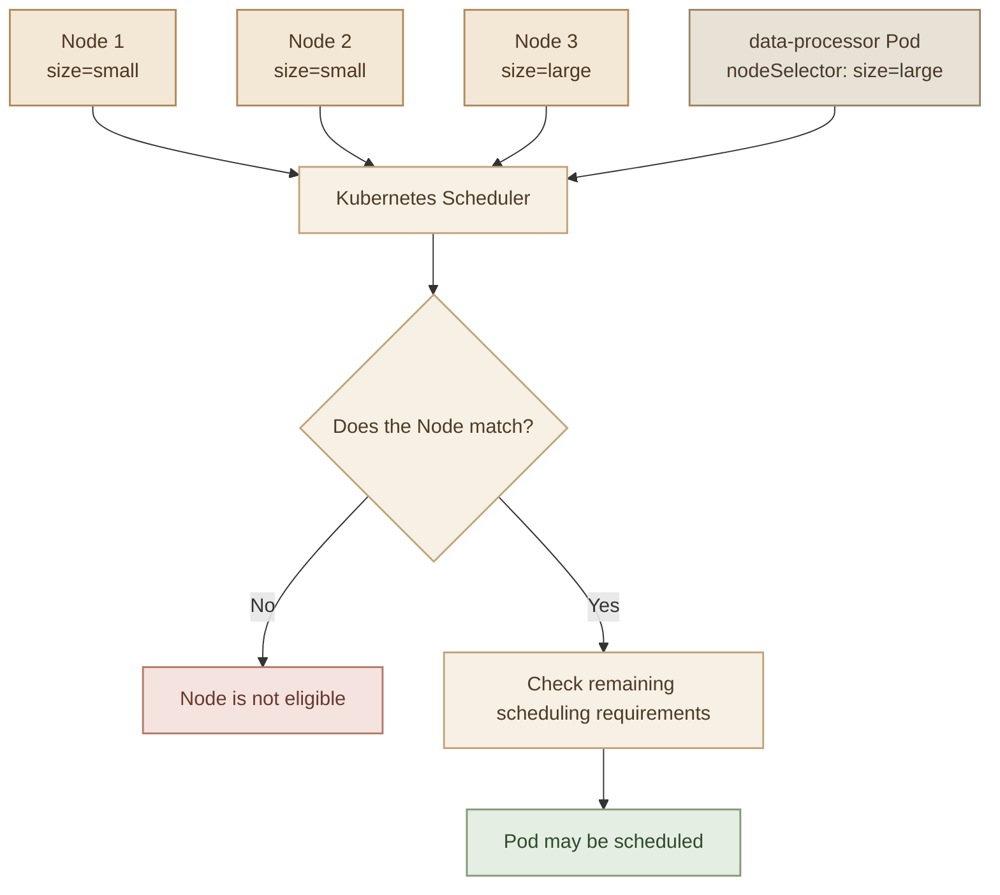
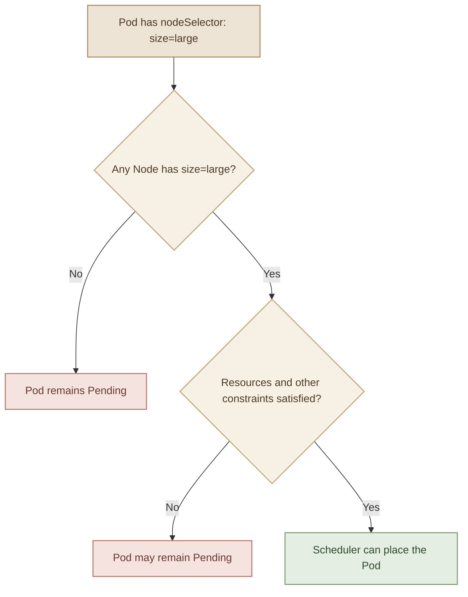

## 1. What Is a Node Selector?

في Kubernetes، الـ **Node Selector** هي أبسط طريقة نحدد بيها الـ Nodes اللي مسموح للـ Pod تتجدول عليها، باستخدام الـ **Labels** الموجودة على الـ Nodes.

بشكل افتراضي، الـ Kubernetes Scheduler بيختار Node مناسبة لتشغيل الـ Pod بناءً على الموارد المتاحة وقيود الـ Scheduling المختلفة.

لكن تخيل إن عندك Cluster فيها 3 Nodes:

- اتنين بإمكانيات Hardware محدودة.
- واحدة بإمكانيات أعلى، مخصصة للـ Workloads اللي بتحتاج Resources أكتر.

إنت عايز الـ `data-processor` Pod تشتغل على الـ Node الكبيرة فقط، بدل ما تتوزع على أي Node بشكل عشوائي.

هنا بييجي دور الـ Node Selector.

<div class="grid grid-cols-1 gap-4 sm:grid-cols-3">
  <InfoCard title="Node Labels" description="بتحدد خصائص أو تصنيفات الـ Node باستخدام Key-Value pairs." icon="cube" tags={["Key", "Value"]} />
  <InfoCard title="Node Selector" description="بيطلب من Kubernetes اختيار Node عندها الـ Label المطلوبة." icon="wrench" tags={["Pod Spec"]} />
  <InfoCard title="Scheduler" description="بيختار Node مناسبة من بين الـ Nodes اللي حققت شروط الـ Scheduling." icon="layers" tags={["Scheduling"]} />
</div>

<Callout type="warning" title="Scheduling reminder">الـ Node Selector مش بيحجز Resources ولا بيضمن إن الـ Node عندها CPU أو Memory كفاية. هو بيحدد شرطًا لازم يتحقق، وباقي شروط الـ Scheduling لازمة تتحقق برضه.</Callout>

## 2. How Node Selectors Work

العملية بتتم في 3 خطوات:

1. نضيف Label على الـ Node اللي عايزين نستهدفها.
2. نحدد نفس الـ Label داخل `nodeSelector` في الـ Pod specification.
3. الـ Scheduler يبحث عن Node تحقق الـ Label المطلوبة وباقي شروط الجدولة.



الـ Pod في المثال بتطلب `size=large`، وبالتالي الـ Nodes اللي عليها `size=small` مش هتكون مؤهلة للـ Pod دي.

لاحظ إن الـ Label هنا مجرد تصنيف إنت ضفته. Kubernetes مش بتعرف تلقائيًا إن الـ Node كبيرة أو صغيرة لمجرد إنك كتبت `size=large`.

## 3. Step 1 — Label a Node

قبل ما نستخدم `nodeSelector`، لازم نتأكد إن الـ Node عليها الـ Label المطلوبة.

اعرض الـ Nodes الموجودة:

```bash
kubectl get nodes
```

ولعرض الـ Labels الموجودة بالفعل:

```bash
kubectl get nodes --show-labels
```

دلوقتي هنضيف Label للـ Node اللي عايزين نخصصها للـ Workload:

```bash
kubectl label nodes node01 size=large
```

في المثال ده:

- `node01`: اسم الـ Node.
- `size`: اسم الـ Label Key.
- `large`: قيمة الـ Label Value.

لو الـ Label `size` موجودة بالفعل وقيمتها مختلفة، الأمر ممكن يرفض التعديل. لو متأكد إنك عايز تغيّر القيمة:

```bash
kubectl label nodes node01 size=large --overwrite
```

وللتأكد من النتيجة:

```bash
kubectl get nodes --show-labels
```

**مهم:** استبدل `node01` باسم الـ Node الحقيقي عندك. مش لازم اسم الـ Node في الـ Cluster يكون `node01`.

## 4. Step 2 — Use nodeSelector in a Pod

بعد ما ضفنا الـ Label على الـ Node، نقدر نستخدمها في الـ Pod definition.

```yaml
apiVersion: v1
kind: Pod
metadata:
  name: data-processor
spec:
  nodeSelector:
    size: large
  containers:
    - name: processor
      image: nginx:alpine
```

الجزء المهم هنا:

```yaml
spec:
  nodeSelector:
    size: large
```

الـ `nodeSelector` موجودة داخل `spec` الخاصة بالـ Pod، وبتطلب إن الـ Node يكون عليها Label اسمها `size` وقيمتها `large`.

أنشئ الـ Pod:

```bash
kubectl apply -f data-processor.yaml
```

وتحقق من مكان تشغيلها:

```bash
kubectl get pods -o wide
```

أو افحص الـ Pod بالتفصيل:

```bash
kubectl describe pod data-processor
```

لو الـ Pod اتجدولت بنجاح، هتلاقي اسم الـ Node في عمود `NODE` في نتيجة الأمر الأول.

<Callout type="tip" title="Example image note">في المثال استخدمنا `nginx:alpine` لتوضيح الـ Scheduling. في مشروع حقيقي، استبدل الـ Image بالـ Application Image المطلوبة.</Callout>

## 5. What If No Node Matches?

لو مفيش أي Node عليها `size=large`، الـ Pod مش هتقدر تتجدول باستخدام الـ Selector ده، وغالبًا هتفضل في حالة `Pending`.

ونفس المشكلة ممكن تحصل لو الـ Node المطابقة عليها موارد غير كافية، أو فيه Scheduling constraints أخرى تمنع تشغيل الـ Pod عليها.



لو الـ Pod فضلت `Pending`، ابدأ بالفحص:

<Callout type="lab" title="Troubleshooting command">
```bash
kubectl describe pod data-processor
```
</Callout>

<InfoCard title="Inspect Events" description="راجع قسم Events في النتيجة عشان تعرف سبب فشل الـ Scheduling بدل ما تفترض إن المشكلة في الـ Label فقط." variant="insight" icon="shield" />

## 6. Node Selector Limitations

الـ Node Selector بسيط ومفيد، لكنه محدود في التعبير عن شروط الـ Scheduling.

<InfoCard title="Limitation: No OR conditions" description="الـ nodeSelector بيعتمد على مطابقة Key-Value pairs؛ كل الشروط لازم تتحقق معًا. مش بيدعم شروط OR أو الاستبعاد مباشرة." variant="warning" icon="shield" />

مثلًا، يقدر يطلب:

```yaml
nodeSelector:
  size: large
```

وده معناه إن الـ Node لازم يكون عليها الـ Label المطابقة.

لكن مش هيقدر يعبّر مباشرة عن شروط أكثر تعقيدًا، زي:

- شغّل الـ Pod على Node حجمها `large` أو `medium`.
- اختار أي Node حجمها مش `small`.
- استخدم شروط متعددة بمجموعات منطقية أكثر مرونة.

السبب إن الـ `nodeSelector` بيعتمد على مطابقة مجموعة من الـ Key-Value pairs، وكل الشروط الموجودة فيه لازم تتحقق معًا.

لما تحتاج شروط أكثر مرونة، بنستخدم **Node Affinity**، وده الموضوع اللي هنشرحه بعد كده.

## 7. Node Selector vs Node Affinity

<div class="grid grid-cols-1 gap-4 sm:grid-cols-3">
  <InfoCard title="Node Label" description="تصنيف Key-Value يُضاف على الـ Node لتحديد خصائصها." icon="cube" tags={["Key", "Value", "Label"]} variant="concept" />
  <InfoCard title="Node Selector" description="شرط في Pod spec يطلب Node مطابقة لـ Label محددة." icon="wrench" tags={["Pod Spec", "Matching"]} variant="concept" />
  <InfoCard title="Node Affinity" description="قواعد أكثر مرونة مثل In / NotIn مع شروط مطلوبة أو مفضلة." icon="branch" tags={["Flexible", "Scheduling"]} variant="comparison" />
</div>

مثال على الفرق:

<TableCard title="Node Selector vs Node Affinity" caption="Quick comparison of scheduling capabilities.">

| Requirement | Node Selector | Node Affinity |
|---|---|---|
| `size=large` | Supported | Supported |
| `size=large` OR `size=medium` | Not directly supported | Supported |
| `size` is not `small` | Not directly supported | Supported |
| Required or preferred node selection | Required label match | Supports required and preferred rules |

</TableCard>

الـ Node Affinity مش بديل لازم تستخدمه في كل الحالات؛ لو الـ Label المطابقة كفاية، فالـ Node Selector غالبًا أوضح وأبسط.

## 8. Practical Lab

<Callout type="lab" title="Hands-on exercise" />

هنطبّق اللي اتعلمناه على الـ Cluster عندك.

<Steps>
<li>

### Step 1 — Inspect the Cluster

```bash
kubectl get nodes
kubectl get nodes --show-labels
```

اختار Node موجودة بالفعل في الـ Cluster عندك، وتأكد إن اسم الـ Label اللي هتستخدمه مش هيتعارض مع تصنيف موجود.

</li>
<li>

### Step 2 — Add a Label

```bash
kubectl label nodes <node-name> workload=processor
```

استبدل `<node-name>` باسم الـ Node الفعلي.

</li>
<li>

### Step 3 — Create the Pod Manifest

أنشئ ملف `node-selector-pod.yaml`:

```yaml
apiVersion: v1
kind: Pod
metadata:
  name: processor-pod
spec:
  nodeSelector:
    workload: processor
  containers:
    - name: nginx
      image: nginx:alpine
```

</li>
<li>

### Step 4 — Apply and Verify

```bash
kubectl apply -f node-selector-pod.yaml
kubectl get pods -o wide
```

تأكد إن الـ Pod اتجدولت على الـ Node اللي عليها `workload=processor`.

</li>
<li>

### Step 5 — Test a Non-Matching Label

غيّر قيمة الـ Selector في ملف الـ YAML إلى قيمة مش موجودة على أي Node، مثل:

```yaml
nodeSelector:
  workload: analytics
```

طبّق التعديل:

```bash
kubectl apply -f node-selector-pod.yaml
kubectl describe pod processor-pod
```

توقّع إن الـ Pod تفضل `Pending` لو مفيش Node تحقق الشرط الجديد. بعد التجربة، رجّع القيمة الصحيحة.

</li>
<li>

### Step 6 — Cleanup

```bash
kubectl delete pod processor-pod --ignore-not-found
```

ولو عايز تشيل الـ Label اللي أضفتها أثناء الـ Lab:

```bash
kubectl label nodes <node-name> workload-
```

<Callout type="warning" title="Cleanup caution">نفّذ إزالة الـ Label فقط لو إنت اللي أضفتها للـ Lab ومش مستخدمة في أي Workload أخرى.</Callout>

</li>
</Steps>

## 9. Key Takeaways

<div class="grid grid-cols-1 gap-4 sm:grid-cols-3">
  <InfoCard title="Node Label" description="Key-Value pair تُضاف على الـ Node لتصنيفها وتحديد خصائصها." variant="concept" icon="cube" tags={["Label", "Node"]} />
  <InfoCard title="Node Selector" description="شرط مباشر في spec: يطلب Node عندها Label مطابقة تمامًا." variant="concept" icon="wrench" tags={["Pod Spec", "Exact Match"]} />
  <InfoCard title="Scheduling" description="لا يضمن موارد كافية؛ الموارد والقيود الأخرى ما زالت مطلوبة." variant="warning" icon="layers" tags={["Pending", "Resources"]} />
</div>

- الـ **Node Label** هي Key-Value pair بنضيفها على الـ Node.
- الـ **Node Selector** بيتكتب داخل `spec` الخاصة بالـ Pod.
- لازم تكون الـ Label المطلوبة موجودة على الـ Node قبل ما الـ Pod تتجدول عليها.
- لو مفيش Node مطابقة، الـ Pod ممكن تفضل `Pending`.
- مطابقة الـ Label لا تضمن وحدها نجاح الـ Scheduling؛ الموارد والقيود الأخرى ما زالت مهمة.
- الـ Node Selector لا يدعم شروط `OR` أو الاستبعاد بشكل مباشر.
- الـ **Node Affinity** هو الاختيار التالي لما نحتاج قواعد Scheduling أكثر مرونة.

