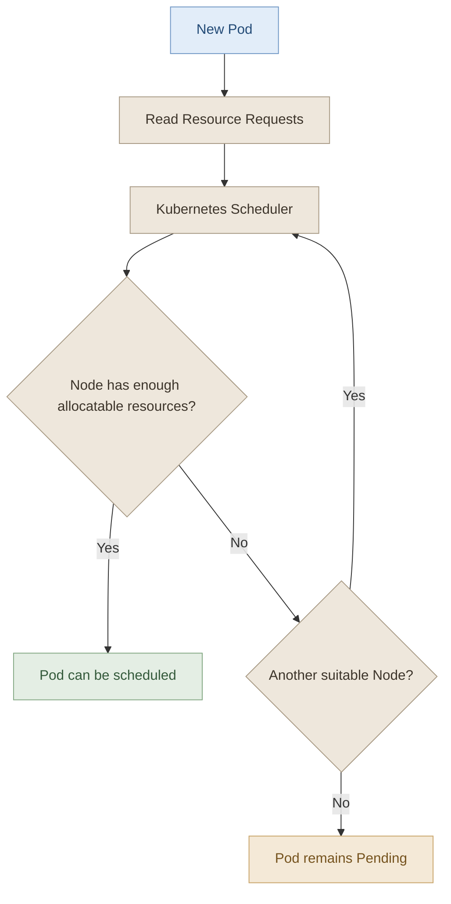

## 1. Overview

كل Node في Kubernetes عندها موارد محدودة، زي:

- **CPU:** قدرة المعالجة.
- **Memory:** الذاكرة المستخدمة أثناء تشغيل التطبيقات.
- **Storage:** مساحة التخزين.

وكل Pod بتستهلك جزء من الموارد دي. علشان Kubernetes توزّع الـ Pods بشكل صحيح وتحافظ على استقرار الـ cluster، بنستخدم `Requests` و`Limits`.

<InfoCard
  title="Resource Requests"
  description="The resources a container requests for scheduling and resource allocation decisions."
  icon="layers"
  tags={["Scheduling", "Minimum requested resources"]}
/>

<InfoCard
  title="Resource Limits"
  description="The maximum CPU or memory a container is allowed to consume under its configured resource constraints."
  icon="shield"
  tags={["CPU", "Memory"]}
/>

## 2. How the Scheduler Uses Resources

تخيّل إن عندنا 3 Nodes، وكل واحدة عندها CPU وMemory متاحين بمقادير مختلفة.

لما نعمل Create لـ Pod جديدة، الـ Scheduler بيبص على الـ Resource Requests بتاعتها، ويحدد هل فيه Node تقدر تستوعبها ولا لأ.



لو مفيش Node مناسبة، الـ Pod هتفضل `Pending`، وممكن تلاقي في الـ Events رسالة زي:

`Insufficient cpu`

أو:

`Insufficient memory`

**مهم:** الـ Scheduler بيعتمد على الـ Requests والموارد المتاحة للـ scheduling، مش على الاستهلاك اللحظي للـ CPU أو الـ Memory فقط. كمان لازم نراعي إن بعض الموارد مستخدمة بالفعل أو محجوزة لعمليات أخرى على الـ Node.

## 3. Resource Requests

الـ `Request` هو مقدار الـ CPU أو الـ Memory اللي الـ Container بتطلبه من Kubernetes.

الـ Scheduler بيستخدم القيمة دي علشان يقرر هل الـ Node مناسبة لاستضافة الـ Pod ولا لأ.

مثال:

```yaml
apiVersion: v1
kind: Pod
metadata:
  name: web-pod
spec:
  containers:
    - name: nginx
      image: nginx:alpine
      resources:
        requests:
          cpu: "500m"
          memory: "256Mi"
```

في المثال ده، الـ Container بتطلب:

- `500m` CPU.
- `256Mi` Memory.

### I. CPU Units

في Kubernetes، وحدة CPU واحدة بتعادل وحدة CPU منطقية واحدة كما يراها النظام، وده غالبًا بيكون Core أو Hardware Thread حسب البيئة.

| CPU value | Meaning |
|---|---|
| `1` | One CPU unit |
| `500m` | Half a CPU unit |
| `250m` | A quarter of a CPU unit |
| `100m` | One tenth of a CPU unit |
| `1m` | One thousandth of a CPU unit |

الحرف `m` معناه **milliCPU**.

مثلًا:

`500m = 0.5 CPU`

ومش لازم تستخدم مضاعفات `500m`؛ تقدر تحدد قيم أصغر أو أكبر حسب احتياج التطبيق والموارد المتاحة.

### II. Memory Units

Kubernetes بتدعم وحدات مختلفة للذاكرة، وأهم فرق لازم تعرفه هو الفرق بين الوحدات العشرية والثنائية.

| Unit | Meaning |
|---|---|
| `256M` | 256,000,000 bytes |
| `256Mi` | 268,435,456 bytes |
| `1G` | 1,000,000,000 bytes |
| `1Gi` | 1,073,741,824 bytes |

- `M` و`G` وحدات عشرية.
- `Mi` و`Gi` وحدات ثنائية.

عشان كده `1Gi` أكبر من `1G`.

**Best practice:** استخدم `Mi` و`Gi` في أمثلة الـ Kubernetes لما تكون عايز تحدد قيم الذاكرة بوحدات ثنائية واضحة.

## 4. Resource Limits

الـ `Limit` هو الحد الأقصى لاستهلاك الـ Container للـ CPU أو Memory، وفقًا للقيود اللي تم ضبطها.

مثال:

```yaml
apiVersion: v1
kind: Pod
metadata:
  name: limited-pod
spec:
  containers:
    - name: nginx
      image: nginx:alpine
      resources:
        requests:
          cpu: "250m"
          memory: "128Mi"
        limits:
          cpu: "500m"
          memory: "256Mi"
```

في المثال ده:

- الـ Container بتطلب `250m` CPU و`128Mi` Memory.
- الحد الأقصى للـ CPU هو `500m`.
- الحد الأقصى للـ Memory هو `256Mi`.

الـ Request والـ Limit مش لازم يكونوا نفس القيمة.

### I. What happens when a container exceeds its limits?

الـ CPU والـ Memory بيتعاملوا بشكل مختلف.

<box gap={3}>
  <row align="start" gap={3}>
    <box background="surface-secondary" radius="lg" size="44px" align="center" justify="center">
      <icon name="cpu" size="xl" />
    </box>
    <box flex="1" gap={1}>
      **CPU Limit**

      الـ CPU مورد قابل للـ throttling. لو الـ Container حاولت تستخدم CPU أكتر من الـ Limit، ممكن Kubernetes تقيّد وقت المعالجة المسموح لها بيه. ده ممكن يبطّأ التطبيق، لكنه مش معناه إن الـ Container هتتقتل لمجرد إنها وصلت للـ CPU Limit.
    </box>
  </row>
  <divider color="subtle" />
  <row align="start" gap={3}>
    <box background="surface-secondary" radius="lg" size="44px" align="center" justify="center">
      <icon name="memory-stick" size="xl" />
    </box>
    <box flex="1" gap={1}>
      **Memory Limit**

      الـ Memory مش بتتعامل مع الـ Limit عن طريق throttling زي الـ CPU. لو الـ Container تجاوزت حد الذاكرة، ممكن يحصل لها إنهاء بواسطة النظام بسبب نفاد الذاكرة، وتظهر حالة `OOMKilled`.
    </box>
  </row>
</box>

> `OOMKilled` معناها إن الـ Container اتقتلت بسبب مشكلة نفاد الذاكرة. لو ظهر الخطأ ده، راجع الـ Memory Limit واستهلاك التطبيق والـ Events قبل ما تقرر تزود القيمة.

## 5. Requests vs Limits

| Property | Requests | Limits |
|---|---|---|
| Purpose | Scheduling decisions and resource allocation | Restrict maximum resource usage |
| CPU | Used to determine scheduling fit | CPU can be throttled |
| Memory | Used to determine scheduling fit | Exceeding the limit can trigger an OOM kill |
| Must be equal? | No | No |

### I. A practical example

لو عندك Container بالشكل ده:

```yaml
resources:
  requests:
    cpu: "250m"
    memory: "128Mi"
  limits:
    cpu: "1"
    memory: "256Mi"
```

ده معناه إن الـ Scheduler بياخد في الاعتبار طلب الـ Container البالغ `250m` CPU و`128Mi` Memory، بينما الـ Container عندها حدود أعلى للاستهلاك.

وجود Limit أعلى من Request بيدي مساحة للاستهلاك الإضافي، لكن ده مش ضمان إن الموارد هتكون متاحة دائمًا وقت الحاجة.

## 6. Are There Default Requests and Limits?

مفيش قاعدة عامة في Kubernetes تقول إن كل Container هتاخد تلقائيًا `500m` CPU و`256Mi` Memory كـ Requests، أو إن كل Container هتكون محدودة تلقائيًا بـ `1` CPU و`512Mi` Memory.

القيم دي ممكن تكون موجودة في بيئة تدريبية أو ناتجة عن إعدادات معينة، لكنها **مش Defaults عامة مضمونة في كل Cluster**.

الـ Defaults الفعلية ممكن تتأثر بإعدادات الـ Namespace، خصوصًا:

- `LimitRange`
- `ResourceQuota`

ولو الـ Pod مش محددة Requests أو Limits، لازم تفحص إعدادات الـ Cluster والـ Namespace علشان تعرف القيم الفعلية اللي هتُطبق عليها.

لفحص الـ LimitRanges:

```bash
kubectl get limitrange
kubectl describe limitrange
```

ولفحص الـ ResourceQuotas:

```bash
kubectl get resourcequota
kubectl describe resourcequota
```
---

## 7. Useful Troubleshooting Commands

```bash
# List Pods and their Nodes
kubectl get pods -o wide

# Inspect scheduling errors and resource settings
kubectl describe pod <pod-name>

# Inspect the full Pod specification
kubectl get pod <pod-name> -o yaml

# Check recent cluster events
kubectl get events --sort-by=.metadata.creationTimestamp

# Inspect Node capacity and allocatable resources
kubectl describe node <node-name>

# View current resource usage, if Metrics Server is available
kubectl top nodes
kubectl top pods
```

`kubectl top` بيعرض الاستهلاك الحالي التقريبي، لكنه محتاج Metrics Server شغال. وهو مختلف عن الـ Requests والـ Limits المعرّفة في الـ Pod.

## 8. Common Mistakes

- **Mistake:** اعتبار الـ Request حدًا أقصى للاستهلاك.  
  **Correction:** الـ Request بتدخل في قرارات الـ Scheduling، بينما الـ Limit بتحدد سقف الاستهلاك.

- **Mistake:** افتراض إن الـ CPU Limit هتقتل الـ Container عند تجاوزها.  
  **Correction:** غالبًا بيحصل CPU throttling.

- **Mistake:** التعامل مع `OOMKilled` كأنه مشكلة CPU.  
  **Correction:** افحص الـ Memory Limit واستهلاك الذاكرة.

- **Mistake:** افتراض وجود Defaults ثابتة لكل الـ Clusters.  
  **Correction:** افحص إعدادات الـ Namespace والـ `LimitRange` والـ Admission configuration.

- **Mistake:** زيادة الـ Memory Limit من غير التأكد إن الـ Node تقدر تستوعب الحمل.  
  **Correction:** راجع موارد الـ Node وطلبات الـ Pods الأخرى، لأن زيادة الحدود مش معناها إن الذاكرة الفعلية بقت متاحة.

## 9. Key Takeaways

<InfoCard
  title="Requests"
  description="Help the Scheduler determine whether a Node can accommodate a Pod."
  icon="wrench"
  tags={["Scheduling"]}
/>

<InfoCard
  title="Limits"
  description="Constrain container resource consumption. CPU is throttled; exceeding a memory limit can cause an OOM kill."
  icon="shield"
  tags={["CPU", "Memory"]}
/>

<InfoCard
  title="Troubleshooting"
  description="Use kubectl describe, Pod YAML, and Events to investigate scheduling failures and OOMKilled containers."
  icon="pulse"
  tags={["Debugging"]}
/>

**الخلاصة:** الـ Requests بتساعد Kubernetes تختار Node مناسبة، والـ Limits بتحط حدود لاستهلاك الـ Container. فهم الفرق بينهم ضروري علشان تتجنب مشاكل الـ Pending Pods والـ CPU throttling والـ OOMKilled.

