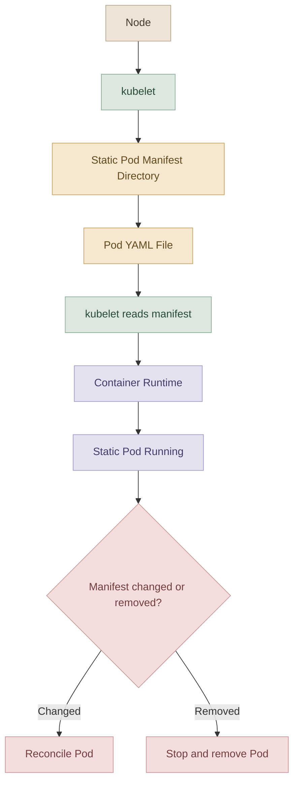
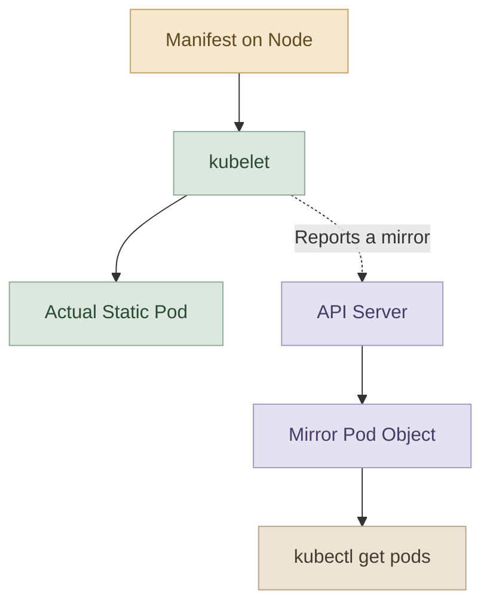
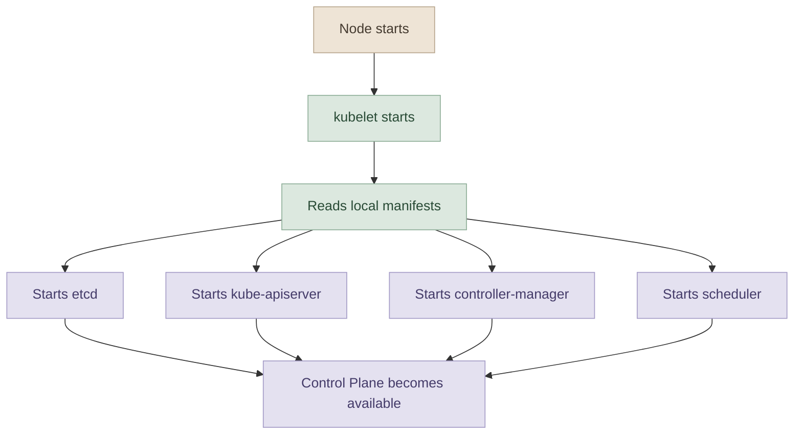

## 1. What Is a Static Pod?

الـ **Static Pod** هو Pod بيقوم الـ `kubelet` بإنشائه وإدارته مباشرةً من ملف Manifest موجود على الـ Node، من غير ما يحتاج `Deployment` أو `ReplicaSet` أو `DaemonSet` عشان ينشئه.

في الـ Pods العادية، الـ `kubelet` غالبًا بيستقبل تعليمات من الـ `kube-apiserver`، وبيبدأ تشغيل الـ Pods المطلوبة على الـ Node.

لكن في الـ Static Pods، الـ `kubelet` بيقرأ ملفات الـ Manifest من Directory محدد على الـ Node، وبعدها ينشئ الـ Pods ويحافظ عليها شغالة.

<InfoCard title="Core Concept" description="The kubelet is responsible for creating and maintaining Static Pods from local manifest files." icon="cube" tags={["Kubelet", "Static Pods"]} />

### I. How It Works



الفكرة الأساسية إن الـ `kubelet` بيراقب الـ Manifests، ولو محتوى ملف اتغير أو الملف اتمسح، بيعمل Reconciliation عشان حالة الـ Pod الفعلية تتوافق مع الملفات الموجودة.

## 2. Static Pods vs. Regular Pods

في الـ Kubernetes Cluster المعتاد، الـ Control Plane مسؤول عن إدارة الـ Workloads عن طريق الـ API Server والـ Controllers والـ Scheduler.

أما الـ Static Pods، فمصدر تعريفها الأساسي هو ملف موجود على الـ Node نفسه.

| Feature | Static Pod | Regular Pod |
|---|---|---|
| Source of definition | Local manifest file | Kubernetes API |
| Who manages it? | kubelet | Depends on the workload and its controllers |
| Requires API Server to create it? | No | Normally, yes |
| Managed by Deployment or ReplicaSet? | No | Possibly |
| Can kube-scheduler schedule it? | No | Usually, yes |
| Can `kubectl delete pod` permanently remove it? | No, as long as its manifest remains | Depends on its owner/controller |

**مهم:** الـ Regular Pod مش شرط يكون تابعًا لـ Deployment؛ ممكن يكون Pod اتعمل مباشرةً باستخدام `kubectl run` أو Manifest.

## 3. Where Are Static Pod Manifests Stored?

الـ `kubelet` محتاج يعرف الـ Directory اللي هيقرأ منه ملفات الـ Static Pods. المسار ده بيتحدد في إعداداته، ومش لازم يكون نفس المسار في كل Cluster.

المسار الشائع في Clusters اللي تم إعدادها باستخدام `kubeadm` هو:

```text
/etc/kubernetes/manifests
```

ومن أمثلة الملفات اللي ممكن تلاقيها جواه:

```text
/etc/kubernetes/manifests/
├── etcd.yaml
├── kube-apiserver.yaml
├── kube-controller-manager.yaml
└── kube-scheduler.yaml
```

الملفات دي بتعرّف الـ Control Plane components اللي بتشتغل كـ Static Pods في إعدادات `kubeadm` المعتادة.

### I. How Does kubelet Know the Path?

فيه إعداد اسمه `staticPodPath` داخل ملف إعدادات الـ `kubelet`، أو ممكن يتحدد الـ Path باستخدام خيار `--pod-manifest-path` في بعض طرق التشغيل.

في `kubeadm`، تقدر غالبًا تراجع:

```bash
sudo cat /var/lib/kubelet/config.yaml
```

وابحث عن:

```yaml
staticPodPath: /etc/kubernetes/manifests
```

القيمة دي مجرد مثال شائع؛ استخدم القيمة الموجودة فعلًا على الـ Node عندك.

تقدر كمان تفحص طريقة تشغيل الـ `kubelet`:

```bash
systemctl cat kubelet
```

ولو فيه خيار `--config`، راجع الملف المشار إليه. مش شرط تلاقي `--pod-manifest-path` مباشرةً في الـ Service file؛ في بعض الإعدادات، الـ Path بيكون موجود في ملف الـ Configuration.

## 4. What Happens When a Static Pod Is Created?

الـ `kubelet` بيتعامل مع الـ Static Pod بشكل مباشر:

1. يقرأ الـ Manifest من الـ Directory المحدد.
2. يتحقق من تعريف الـ Pod.
3. يطلب من الـ Container Runtime تشغيل الـ Containers.
4. يتابع حالة الـ Pod ويحاول استعادتها لو حصل Crash، طالما الـ Manifest ما زال موجودًا.
5. يلاحظ تغييرات الملفات ويطبّق الحالة المطلوبة.

لكن خليك فاكر إن ده مش معناه إن الـ Pod هيكون `Running` دائمًا؛ ممكن يفشل بسبب Image غير موجودة، أو نقص Resources، أو مشكلة في الـ Configuration.

### I. Example: Static Pod Manifest

هنستخدم `busybox` كمثال بسيط.

```yaml
apiVersion: v1
kind: Pod
metadata:
  name: static-busybox
  labels:
    app: static-busybox
spec:
  containers:
    - name: busybox
      image: busybox:1.36
      command:
        - sleep
        - "1000"
```

لو حفظت الملف ده داخل الـ Static Pod manifest directory الفعلي، الـ `kubelet` هيقرأه ويحاول تشغيل الـ Pod.

لاحظ إننا ما احتجناش نكتب `replicas` أو نعمل `Deployment`؛ ده تعريف Pod مباشر.

## 5. Can We See Static Pods Using kubectl?

أيوه، لو الـ Node جزء من Kubernetes Cluster متصل بالـ API Server.

في الحالة دي، الـ `kubelet` بيقدر ينشئ **Mirror Pod** في الـ API Server عشان يعرض معلومات عن الـ Static Pod.



الـ Mirror Pod بيسمحلك تشوف حالة الـ Static Pod باستخدام `kubectl`، لكنه مش المصدر الأساسي لتعريفه أو إدارته.

مثال:

```bash
kubectl get pods -A
```

غالبًا هتلاحظ إن اسم الـ Static Pod بينتهي باسم الـ Node، مثل:

```text
kube-apiserver-controlplane
etcd-controlplane
```

الـ suffix ده علامة مفيدة، لكنه مش دليل كافي لوحده.

### How to Verify a Static Pod

استخدم:

```bash
kubectl get pod kube-apiserver-controlplane \
  -n kube-system -o yaml
```

داخل الـ output، راجع `metadata.ownerReferences`. في الـ Static Pod المعتاد، هتلاقي الـ owner هو الـ Node.

مثال توضيحي:

```yaml
metadata:
  ownerReferences:
    - apiVersion: v1
      kind: Node
      name: controlplane
```

لو الـ Pod تابع لـ `ReplicaSet` بدلًا من `Node`، فده مؤشر إنه Pod عادي تم إنشاؤه عن طريق Controller، مش Static Pod.

**ملحوظة:** لو مفيش API Server متاح، مش هتقدر تعتمد على `kubectl` لعرض الـ Pods. وقتها بتفحص الـ Node والـ Container Runtime مباشرةً باستخدام أدوات مناسبة زي `crictl` في البيئات اللي بتستخدم CRI.

## 6. Why Are Static Pods Useful?

من أهم استخداماتها تشغيل مكونات الـ Kubernetes Control Plane نفسها.

في إعدادات `kubeadm` المعتادة، ممكن تلاقي الملفات التالية:

- `kube-apiserver`
- `kube-controller-manager`
- `kube-scheduler`
- `etcd`

وجود الـ Manifests محليًا بيسمح للـ `kubelet` بتشغيل المكونات دي حتى قبل ما الـ API Server يكون متاحًا.

وده مهم لأن الـ API Server نفسه ممكن يكون Static Pod. لو كان تشغيله معتمدًا على أوامر من الـ API Server، هنقع في مشكلة اعتماد دائري.

### I. Bootstrap Concept



الرسم بيوضح الفكرة العامة، مش ترتيبًا زمنيًا صارمًا لتشغيل كل مكوّن؛ بعض المكونات محتاجة مكونات أخرى تكون جاهزة قبل ما تشتغل بنجاح.

## 7. Static Pods vs. DaemonSets

الاتنين ممكن ينتج عنهم Pods على الـ Nodes المختلفة، لكن طريقة إدارتهم مختلفة تمامًا.

| Feature | Static Pod | DaemonSet |
|---|---|---|
| Created by | kubelet | DaemonSet controller |
| Definition source | Local manifest on each relevant Node | DaemonSet object in the API Server |
| Needs Kubernetes API to define the workload? | No | Yes |
| Typical use case | Control Plane components | Logging and monitoring agents |
| Rescheduling | kubelet reconciles the local manifest on its Node | Controller manages Pods across eligible Nodes |

مثال على استخدام `DaemonSet`: تشغيل Agent لجمع Logs على كل Node مناسب.

مثال على استخدام `Static Pod`: تشغيل `kube-apiserver` على Control Plane Node.

**تصحيح مهم:** مش صحيح إن كل Pods الخاصة بالـ `DaemonSet` بيتجاهلها الـ `kube-scheduler`. في السلوك المعتاد، الـ DaemonSet controller بيجهّز Pods مناسبة للـ Nodes، والـ Scheduler بيشارك في جدولتها. أما الـ Static Pods، فالـ `kubelet` هو اللي بيديرها مباشرةً من الـ Manifests، من غير ما الـ Scheduler يختار لها Node.

## 8. Practical Lab

<Callout type="lab" title="Hands-on: Static Pods" />

<Steps>
<li>

<InfoCard title="Step 1 — Identify Path" description="حدد `staticPodPath` من إعدادات الـ `kubelet`." icon="layers" tags={["Inspect", "Kubelet"]} />

```bash
sudo grep -n 'staticPodPath' /var/lib/kubelet/config.yaml
systemctl cat kubelet
```

</li>
<li>

<InfoCard title="Step 2 — Inspect Pods" description="راجع الـ Mirror Pods وأسامي الـ Nodes في `ownerReferences`." icon="pulse" tags={["Inspect", "Mirror"]} />

```bash
kubectl get pods -A
kubectl get pod kube-apiserver-controlplane -n kube-system -o yaml
```

</li>
<li>

<InfoCard title="Step 3 — Create Static Pod" description="أنشئ ملف `static-busybox.yaml` في الـ manifest directory." icon="cube" tags={["Create", "Manifest"]} />

```bash
sudo nano /etc/kubernetes/manifests/static-busybox.yaml
```

</li>
<li>

<InfoCard title="Step 4 — Update Pod" description="غيّر الـ Image في الـ Manifest وراقب الـ Reconciliation." icon="wrench" tags={["Update", "Reconcile"]} />

```yaml
image: busybox:1.36.1
```

</li>
<li>

<InfoCard title="Step 5 — Delete Correctly" description="احذف ملف الـ Manifest من الـ Node؛ لا تعتمد على `kubectl delete`." icon="shield" tags={["Cleanup"]} />

```bash
sudo rm /etc/kubernetes/manifests/static-busybox.yaml
```

</li>
</Steps>

## 9. Common Mistakes

## 9. Common Mistakes

- **الاعتماد على اسم الـ Pod فقط:** وجود اسم الـ Node في النهاية علامة مفيدة، لكن الأفضل مراجعة `ownerReferences` وإعدادات الـ Node.
- **حذف الـ Pod باستخدام `kubectl delete`:** لازم تشيل مصدر تعريفه، وهو ملف الـ Manifest، من الـ Node الصحيح.
- **افتراض إن المسار ثابت:** `/etc/kubernetes/manifests` مسار شائع، لكن `staticPodPath` ممكن يكون مختلفًا.
- **الخلط بين Static Pods وDaemonSets:** الـ Static Pods مصدرها Manifests محلية؛ الـ DaemonSets موارد داخل الـ API Server.
- **الاعتقاد إن كل Static Pod لازم يكون في Cluster:** الـ `kubelet` يقدر يدير Static Pods محليًا حتى من غير Cluster متكامل، لكن وقتها مش هيكون عندك API Server تعرض من خلاله Mirror Pods.

## 10. Key Takeaways

- الـ Static Pod بيتنشأ وبيتدار مباشرةً بواسطة الـ `kubelet`.
- الـ `staticPodPath` بيحدد مكان ملفات الـ Manifest.
- تغيير أو حذف الـ Manifest بيؤثر على الـ Pod اللي الـ `kubelet` بيديره.
- في الـ Cluster، الـ Mirror Pod بيسمح بعرض معلومات الـ Static Pod من خلال `kubectl`.
- الـ Static Pods بتُستخدم عادةً لتشغيل مكونات الـ Control Plane في Clusters اللي أُنشئت باستخدام `kubeadm`.
- الـ DaemonSets والـ Static Pods مش نفس الحاجة؛ طريقة الإنشاء والإدارة مختلفة.

