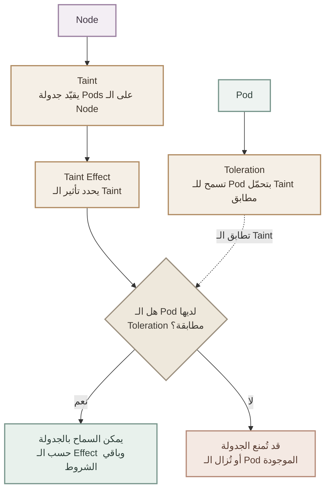
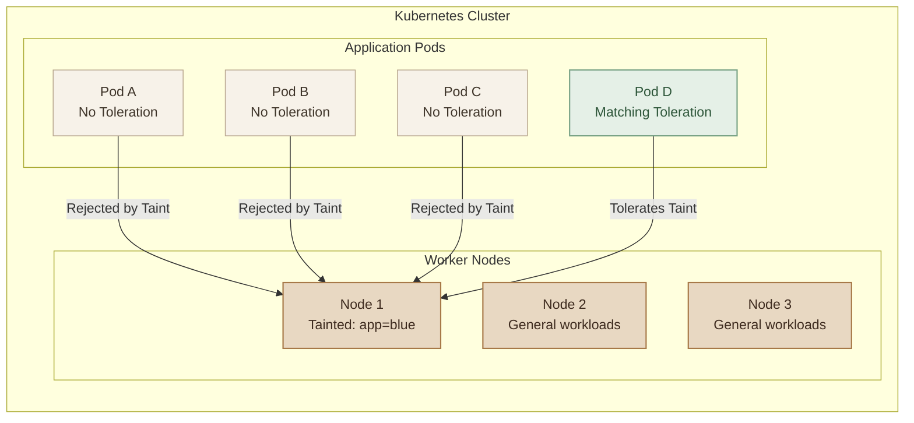
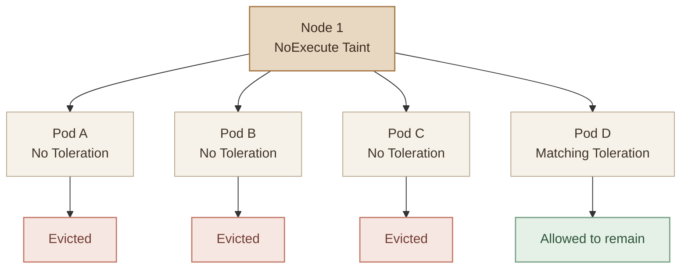
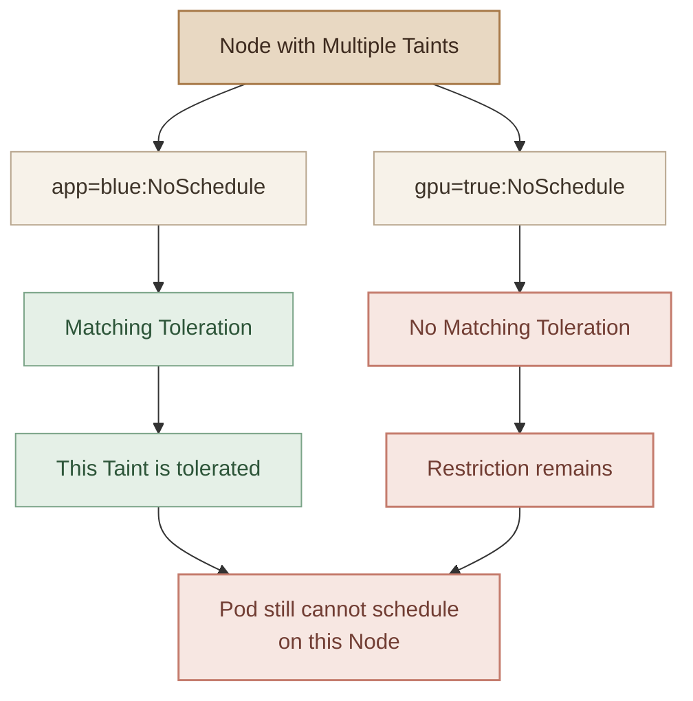
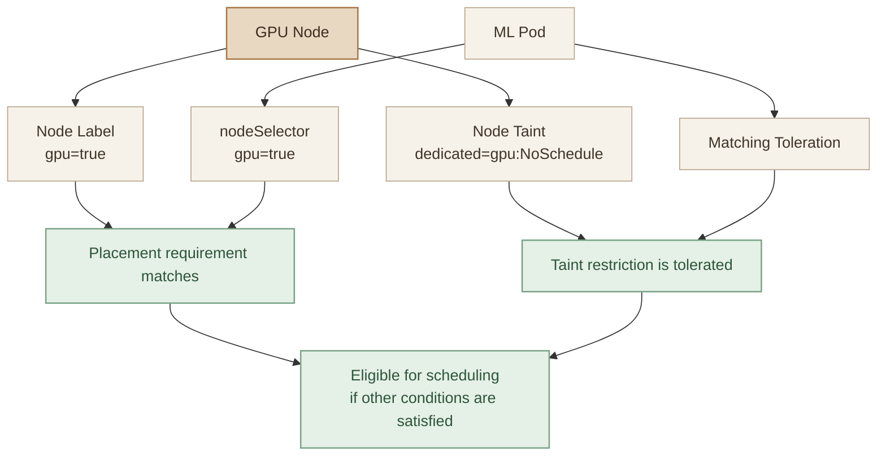

## Overview

في Kubernetes، الـ **Scheduler** مسؤول عن اختيار الـ Node المناسبة لتشغيل كل Pod. لكن أحيانًا بنحتاج نخصص Nodes لتشغيل أنواع معينة من الـ workloads، ونمنع الـ Pods غير المناسبة من العمل عليها.

هنا بييجي دور **Taints and Tolerations**.



- **Taint:** بتحط شرط على الـ Node، وبتبعد عنها الـ Pods اللي مش متوافقة مع الشرط.
- **Toleration:** بتسمح للـ Pod إنها تتحمّل الـ Taint، لكنها مش بتضمن إنها تتجدول على الـ Node دي.
- **Taint Effect:** بيحدد التصرف؛ مثلًا NoSchedule يمنع جدولة Pods الجديدة غير المتحمّلة للـ Taint، بينما NoExecute ممكن كمان يزيل Pods موجودة بالفعل لو مش متحمّلة له.

الهدف الأساسي هو التحكم في الـ Pod placement، مش تأمين الـ Cluster ضد الاختراق.

## 1. Understanding the Concept

### I. The Bug and Repellent Analogy

تخيّل إن شخصًا استخدم Repellent علشان يمنع الحشرات من الاقتراب منه:

- الشخص بيمثّل الـ **Node**.
- الحشرات بتمثّل الـ **Pods**.
- الـ Repellent بيمثّل الـ **Taint**.
- قدرة الحشرة على تحمّل رائحة الـ Repellent بتمثّل الـ **Toleration**.

الحشرة اللي مش بتتحمل الرائحة هتتمنع من الوصول للشخص، لكن الحشرة اللي بتتحملها ممكن تقترب منه.

بنفس الطريقة، الـ Node اللي عليها Taint ممكن تمنع Pods معينة، بينما الـ Pods اللي عندها Toleration مطابق تقدر تتحمل القيد ده.

**Important:** الـ Taints and Tolerations مش آلية Security أو Authentication. وظيفتها الأساسية التحكم في جدولة الـ Pods على الـ Nodes.

### II. A Kubernetes Example

تخيّل إن عندنا Cluster فيها 3 Worker Nodes و4 Pods:

- Node 1
- Node 2
- Node 3
- Pods A, B, C, D

في البداية، مفيش قيود على الـ Nodes، وبالتالي الـ Scheduler يقدر يختار Nodes مناسبة للـ Pods بناءً على الموارد وباقي شروط الجدولة.

دلوقتي قررنا تخصيص Node 1 لتطبيق معين، وعايزين نسمح لـ Pod D فقط بتحمّل الـ Taint الخاص بها.



الـ Pods A وB وC مش هتتجدول على Node 1 بسبب الـ Taint، بينما Pod D تقدر تتحمل القيد ده.

لكن ده **مش معناه إن Pod D لازم تروح Node 1**؛ ممكن تتجدول على Node 2 أو Node 3 لو مفيش Placement Constraints تمنع ده.

## 2. Understanding Taints

الـ Taint بيتضاف على الـ **Node**، وبيتكوّن من ثلاثة أجزاء:

| Component | Meaning |
|---|---|
| `key` | اسم العلامة |
| `value` | قيمة العلامة |
| `effect` | تأثير العلامة |

مثال:

```bash
kubectl taint nodes node1 app=blue:NoSchedule
```

تفصيل الأمر:

- `kubectl taint nodes`: إضافة Taint إلى Node.
- `node1`: اسم الـ Node.
- `app=blue`: الـ Key والـ Value.
- `NoSchedule`: الـ Effect.

الـ Taint الناتج هو:

```text
app=blue:NoSchedule
```

المعنى: الـ Scheduler مش هيجدول Pods جديدة على `node1` لو مش عندها Toleration مطابق للـ Taint ده.

### I. Adding and Inspecting Taints

الصيغة العامة:

```bash
kubectl taint nodes <node-name> <key>=<value>:<effect>
```

مثال آخر:

```bash
kubectl taint nodes node2 dedicated=database:NoSchedule
```

لمراجعة الـ Nodes:

```bash
kubectl get nodes
```

ولعرض تفاصيل Node معينة:

```bash
kubectl describe node node1
```

ابحث عن قسم `Taints` في الـ output.

لو مفيش Taints، ممكن تلاقي:

```text
Taints: <none>
```

ولو فيه Taint، هتشوف الـ Key والـ Value والـ Effect.

## 3. Understanding Tolerations

الـ Toleration بتتضاف إلى الـ **Pod** داخل `spec`.

مثلًا، لو عندنا الـ Taint ده على Node:

```text
app=blue:NoSchedule
```

نقدر نضيف Toleration مطابقة للـ Pod:

```yaml
apiVersion: v1
kind: Pod
metadata:
  name: blue-app
spec:
  tolerations:
    - key: "app"
      operator: "Equal"
      value: "blue"
      effect: "NoSchedule"

  containers:
    - name: nginx
      image: nginx:alpine
```

### I. Understanding the Fields

| Field | Explanation |
|---|---|
| `key: "app"` | نفس الـ Key الموجود في الـ Taint |
| `operator: "Equal"` | يشترط تطابق الـ Value |
| `value: "blue"` | نفس قيمة الـ Taint |
| `effect: "NoSchedule"` | الـ Effect المطلوب تحمّله |

لازم شروط المطابقة تكون متحققة علشان الـ Toleration تتحمل الـ Taint المقصود.

**مهم:** القيم النصية زي `key` و`value` بتتكتب بين quotes في أمثلتنا لتوضيحها. أما الـ `operator` والـ `effect` فهما قيم نصية برضه، والـ YAML يسمح بكتابتهما من غير quotes.

### II. Equal vs Exists

فيه Operators أساسية لفهم مطابقة الـ Tolerations.

**Equal**

بتشترط تطابق الـ Key والـ Value، بالإضافة إلى الـ Effect لو تم تحديده.

```yaml
tolerations:
  - key: "app"
    operator: "Equal"
    value: "blue"
    effect: "NoSchedule"
```

دي تطابق:

```text
app=blue:NoSchedule
```

لكن مش هتطابق:

```text
app=red:NoSchedule
```

لأن الـ Value مختلفة.

**Exists**

بتشترط وجود الـ Key، من غير ما تشترط قيمة معينة.

```yaml
tolerations:
  - key: "app"
    operator: "Exists"
    effect: "NoSchedule"
```

دي ممكن تطابق Taints مختلفة القيم، طالما الـ Key والـ Effect متوافقين.

مع `Exists`، لازم `value` تكون غير محددة أو فارغة. ولو الـ `effect` غير محدد، فالـ Toleration ممكن تطابق الـ Taints الخاصة بنفس الـ Key عبر أكثر من Effect.

## 4. Taint Effects

الـ Effect بيحدد طريقة تعامل Kubernetes مع الـ Pod اللي مش بتتحمل الـ Taint.

<div class="grid gap-4 sm:grid-cols-3">
  <InfoCard
    variant="comparison"
    title="NoSchedule"
    description="الـ Scheduler مش هيجدول Pods جديدة على الـ Node من غير Toleration مطابق. الـ Pods الموجودة لا تتأثر."
    icon="shield"
    tags={["Hard restriction"]}
  />
  <InfoCard
    variant="comparison"
    title="PreferNoSchedule"
    description="Restriction ناعم: الـ Scheduler بيحاول يتجنب الـ Node، لكن ممكن يجدول Pods عليه عند الحاجة."
    icon="sliders"
    tags={["Soft restriction"]}
  />
  <InfoCard
    variant="comparison"
    title="NoExecute"
    description="بيمنع جدولة Pods جديدة وطرد الـ Pods الموجودة غير المتحمّلة للـ Taint. الـ Pods ذات الـ Toleration تبقى."
    icon="cycle"
    tags={["Evicts existing pods"]}
  />
</div>

### I. NoSchedule

الـ Scheduler مش هيجدول Pods جديدة على الـ Node لو مش عندها Toleration مطابق.

<InfoCard variant="insight" title="Common misconception" icon="pulse">
  الـ Pods الموجودة بالفعل مش بتتطرد لمجرد إضافة <code>NoSchedule</code>. الـ Taint ده بيمنع الجدولة الجديدة فقط؛ الطرد بيحصل مع <code>NoExecute</code> بس.
</InfoCard>

```bash
kubectl taint nodes node1 app=blue:NoSchedule
```

**Use case:** تخصيص Node لتطبيق معين ومنع جدولة Pods غير المتحمّلة للـ Taint عليها.

### II. PreferNoSchedule

ده Soft Restriction.

الـ Scheduler بيحاول يتجنب الـ Node لو الـ Pod مش بتتحمل الـ Taint، لكن ده مش منع مطلق.

```bash
kubectl taint nodes node1 app=blue:PreferNoSchedule
```

**Use case:** تفضيل عدم وضع بعض الـ workloads على Node معينة، مع الاحتفاظ بمرونة الجدولة عند الحاجة.

### III. NoExecute

ده بيأثر على الـ Pods الجديدة والموجودة بالفعل:

- الـ Pods الجديدة غير المتحمّلة للـ Taint مش هتتجدول على الـ Node.
- الـ Pods الموجودة بالفعل وغير المتحمّلة للـ Taint ممكن يتم طردها.
- الـ Pods اللي عندها Toleration مطابق ممكن تفضل عليها.

```bash
kubectl taint nodes node1 app=blue:NoExecute
```

**Use case:** عزل Node عن بعض الـ workloads، مع مراعاة أن الـ Pods الموجودة بالفعل ممكن تتأثر بالطرد.

### IV. Comparing the Effects

| Effect | New Pods Without Matching Toleration | Existing Pods Without Matching Toleration |
|---|---|---|
| `NoSchedule` | لا تتم جدولتها على الـ Node | تظل موجودة بسبب هذا الـ Taint وحده |
| `PreferNoSchedule` | يحاول الـ Scheduler تجنّب الـ Node | تظل موجودة بسبب هذا الـ Taint وحده |
| `NoExecute` | لا تتم جدولتها على الـ Node | يتم طردها من الـ Node |

### V. Understanding NoExecute in More Detail

تخيّل إن Node 1 عليها Pods A وB وC وD. بعد إضافة Taint باستخدام `NoExecute`، تبيّن إن Pod D فقط عندها Toleration مطابق.



الـ Pods اللي لا تتحمل الـ Taint بتتطرد من الـ Node، بينما Pod D تقدر تفضل عليها.

خد بالك إن الـ Pod اللي تم طردها ممكن يتم تشغيلها على Node أخرى بواسطة الـ controllers المسؤولة عنها، لكن ده بيعتمد على وجود Node مناسبة وباقي شروط الجدولة.

### VI. Toleration Seconds

مع `NoExecute`، ممكن تحدد المدة اللي الـ Pod تتحمل فيها الـ Taint قبل ما تصبح مؤهلة للطرد، باستخدام `tolerationSeconds`.

```yaml
tolerations:
  - key: "app"
    operator: "Equal"
    value: "blue"
    effect: "NoExecute"
    tolerationSeconds: 60
```

المعنى: لو الـ Taint المطابق اتضاف إلى Node والـ Pod موجودة عليها، هتتحمل الـ Taint لمدة 60 ثانية قبل ما تصبح مؤهلة للطرد، طالما الـ Taint ما زال موجودًا.

لو الـ Taint اتشال قبل انتهاء المدة، مش هيتم طرد الـ Pod بسبب الـ Taint ده.

أما لو لم يتم تحديد `tolerationSeconds` مع `NoExecute`، فالـ Pod التي تتحمل الـ Taint تقدر تفضل على الـ Node من غير حد زمني بسبب هذا الـ Taint.

## 5. Multiple Taints and Tolerations

ممكن Node واحدة يكون عليها أكثر من Taint، وممكن Pod واحدة يكون عندها أكثر من Toleration.

Kubernetes بتتعامل مع الـ Taints كقيود متعددة:

1. تفحص الـ Taints الموجودة على الـ Node.
2. تتجاهل كل Taint تمتلك الـ Pod له Toleration مطابقًا.
3. تطبّق تأثيرات الـ Taints المتبقية.

مثال: عندنا Node عليها الـ Taints التالية:

```text
app=blue:NoSchedule
gpu=true:NoSchedule
```

والـ Pod عندها Toleration للـ Taint الأول فقط.

النتيجة: الـ Pod ما زالت ممنوعة من الجدولة على الـ Node دي، بسبب Taint الـ GPU اللي لا تتحمله.



## 6. Taints and Tolerations vs Node Selectors

الاتنين بيأثروا على الـ Pod placement، لكن كل واحد بيحل مشكلة مختلفة.

### I. Taints and Tolerations

بتتحكم في الـ Pods اللي مسموح لها تتحمل القيود الموجودة على Node معينة.

### II. Node Selector

بيحدد الـ Nodes اللي الـ Pod لازم تختار من بينها بناءً على Labels.

مثلًا، لو عندك Node عليها Label:

```text
gpu=true
```

تقدر توجّه Pod للـ Nodes اللي عندها الـ Label ده باستخدام:

```yaml
spec:
  nodeSelector:
    gpu: "true"
```

لكن لو الـ Node عليها Taint:

```text
dedicated=gpu:NoSchedule
```

فالـ Pod هتحتاج كمان Toleration مطابق علشان ما تتمنعش بسبب الـ Taint.

### III. Using Both Together



النتيجة:

- الـ `nodeSelector` بيطلب Node عندها Label معين.
- الـ Toleration بتسمح للـ Pod بتحمّل الـ Taint المطابق.
- الـ Scheduler لسه لازم يتحقق من الموارد المتاحة وباقي شروط الجدولة.

**قاعدة مهمة:** الـ Taint بيقول للـ Node مين تمنعه، والـ Node Selector بيقول للـ Pod تختار Nodes بمواصفات إيه.

## 7. Removing a Taint

تقدر تحذف Taint باستخدام نفس الـ Key والـ Value والـ Effect، مع إضافة `-` في نهاية الأمر.

مثلًا، لحذف:

```text
app=blue:NoSchedule
```

استخدم:

```bash
kubectl taint nodes node1 app=blue:NoSchedule-
```

الشرطة في النهاية بتشير إلى حذف الـ Taint.

للتأكد من النتيجة:

```bash
kubectl describe node node1
```

راجع قسم `Taints` مرة أخرى.

**مهم:** لازم تحدد الـ Taint اللي عايز تحذفه بشكل صحيح. حذف Taint من Node بيغيّر قيود الجدولة عليها، وممكن يسمح لجدولة Pods جديدة كانت ممنوعة من قبل.

## 8. The Control Plane Taint

الـ Control Plane Node هي Node عادية من ناحية نموذج الـ Scheduling، لكنها بتشغّل مكونات إدارة الـ Cluster.

في كثير من الـ Kubernetes clusters، بيكون عليها Taint افتراضي يمنع جدولة application workloads عليها، وغالبًا بيكون بالشكل ده:

```text
node-role.kubernetes.io/control-plane:NoSchedule
```

في Clusters أقدم، ممكن تلاقي الـ Key بالشكل التالي:

```text
node-role.kubernetes.io/master:NoSchedule
```

تقدر تتأكد من الـ Taints الموجودة عليها باستخدام:

```bash
kubectl describe node <control-plane-node-name>
```

عدم جدولة الـ Application Pods على الـ Control Plane هو سلوك شائع ومقصود، لكنه مش قاعدة مطلقة في كل أنواع الـ clusters.

تقدر تقنيًا تحذف الـ Taint، لكن **ما تعملش كده في بيئة production لمجرد تشغيل Pod عليها**. الأفضل عادةً تخصيص Worker Nodes لتشغيل الـ application workloads.

## 9. Practical Lab — Taints and Tolerations

في التمرين ده هنطبق نفس السيناريو الموجود في الكورس، باستخدام Node اسمها `node01` وPod اسمها `mosquito` وPod اسمها `bee`.

### I. Lab Objectives

- معرفة عدد الـ Nodes الموجودة في الـ Cluster.
- التأكد من وجود Taints.
- إضافة Taint إلى `node01`.
- ملاحظة سبب بقاء Pod في حالة `Pending`.
- إنشاء Pod عندها Toleration مطابق.
- إزالة الـ Taint الافتراضي عن الـ Control Plane في بيئة التدريب، ثم ملاحظة جدولة الـ Pod المعلّقة.

**تنبيه:** إزالة الـ Control Plane Taint هنا خطوة تعليمية خاصة بالـ Lab، وليست توصية عامة لبيئة production.

### II. Step 1 — Check the Nodes

```bash
kubectl get nodes
```

في بيئة الكورس، النتيجة كانت Node للـ Control Plane وNode باسم `node01`، أي مجموعهم Nodeين.

الأمر ده هو اللي بيحدد العدد الفعلي في بيئتك؛ ما تفترضش إن كل Cluster لازم يكون فيها Nodeين فقط.

### III. Step 2 — Check the Taints on node01

```bash
kubectl describe node node01
```

راجع قسم `Taints`.

في بداية التمرين، مفيش Taints على `node01`، وكانت النتيجة:

```text
Taints: <none>
```

لكن ممكن تلاقي نتيجة مختلفة في بيئتك لو فيه Taints مضافة مسبقًا.

### IV. Step 3 — Add a Taint to node01

المطلوب في الكورس إضافة Taint بالـ Key `spray`، والـ Value `mortein`، والـ Effect `NoSchedule`.

```bash
kubectl taint nodes node01 spray=mortein:NoSchedule
```

تأكد من إضافتها:

```bash
kubectl describe node node01
```

المفروض تشوف Taint مشابهة للتالي:

```text
spray=mortein:NoSchedule
```

كده `node01` هترفض جدولة الـ Pods الجديدة اللي لا تتحمل الـ Taint ده.

### V. Step 4 — Create the mosquito Pod

أنشئ Pod باستخدام صورة Nginx:

```bash
kubectl run mosquito --image=nginx
```

راجع حالة الـ Pod:

```bash
kubectl get pods
```

في بيئة الكورس، الـ Pod فضلت في حالة `Pending`.

### VI. Step 5 — Understand Why mosquito Is Pending

نفّذ:

```bash
kubectl describe pod mosquito
```

راجع قسم `Events`.

في بيئة الكورس، الرسالة أوضحت إن الـ Pod لا تتحمل الـ Taint الموجودة على `node01`.

لكن فيه تفصيلة مهمة: الـ Control Plane نفسها كانت عليها Taint من البداية. بعد إضافة Taint إلى `node01`، بقت الـ Nodeين غير متاحتين لجدولة الـ Pod دي.

بالتالي، الـ Pod فضلت `Pending` لأن مفيش Node مناسبة تقبلها.

`Pending` مش معناها بالضرورة إن صورة الـ Container فيها مشكلة؛ ممكن تكون المشكلة في الـ Scheduling.

### VII. Step 6 — Generate a Pod YAML for bee

الـ `kubectl run` البسيط مش بيوفر Flag مباشرة لإضافة Toleration بالطريقة اللي محتاجينها هنا، لذلك هنولّد YAML ونعدّله.

استخدم:

```bash
kubectl run bee --image=nginx --dry-run=client -o yaml > bee.yaml
```

افتح الملف:

```bash
nano bee.yaml
```

أضف `tolerations` تحت `spec`، مع الحفاظ على باقي محتوى الملف:

```yaml
apiVersion: v1
kind: Pod
metadata:
  name: bee
spec:
  tolerations:
    - key: "spray"
      operator: "Equal"
      value: "mortein"
      effect: "NoSchedule"

  containers:
    - name: bee
      image: nginx
```

احفظ الملف، ثم أنشئ الـ Pod:

```bash
kubectl apply -f bee.yaml
```

تابع حالة الـ Pods:

```bash
kubectl get pods -o wide
```

في بيئة الكورس، الـ `bee` اتجدولت على `node01` لأنها بقت تتحمل الـ Taint الموجود عليها.

### VIII. Step 7 — Inspect the Control Plane Taint

اعرض الـ Nodes:

```bash
kubectl get nodes
```

اعرف الاسم الفعلي للـ Control Plane Node، وبعدها نفّذ:

```bash
kubectl describe node <control-plane-node-name>
```

راجع قسم `Taints`. في بيئة الكورس، كانت الـ Control Plane عليها Taint بتأثير `NoSchedule`.

### IX. Step 8 — Remove the Control Plane Taint

في بيئة الكورس، المطلوب كان إزالة الـ Taint الموجودة على الـ Control Plane.

أولًا، اعرض الـ Taint بدقة باستخدام `kubectl describe node`، ثم احذف الـ Taint المطابقة باستخدام الصيغة التالية:

```bash
kubectl taint nodes <control-plane-node-name> <exact-taint-key>:NoSchedule-
```

استبدل `<control-plane-node-name>` بالاسم الفعلي، و`<exact-taint-key>` بالـ Key الظاهر في الـ output.

مثلًا، لو كانت الـ Taint:

```text
node-role.kubernetes.io/control-plane:NoSchedule
```

فأمر حذفها يكون:

```bash
kubectl taint nodes <control-plane-node-name> node-role.kubernetes.io/control-plane:NoSchedule-
```

**لا تنسخ الأمر قبل التأكد من اسم الـ Node والـ Taint الفعلية.** بعض الـ Clusters تستخدم الـ Key القديم `master` بدلًا من `control-plane`.

### X. Step 9 — Observe the Scheduling Result

راجع الـ Pods مرة أخرى:

```bash
kubectl get pods -o wide
```

في بيئة الكورس، الـ `mosquito` اللي كانت `Pending` اتجدولت على الـ Control Plane بعد إزالة الـ Taint.

ليه ده حصل؟

1. في البداية، الـ Control Plane كانت تمنع جدولة الـ Pod بسبب الـ Taint الافتراضي.
2. بعد إضافة `spray=mortein:NoSchedule`، بقت `node01` تمنع الـ Pod برضه.
3. الـ `mosquito` ما كانش عندها Toleration لأي من الـ Taints دي، ففضلت `Pending`.
4. الـ `bee` كان عندها Toleration للـ Taint الموجودة على `node01`، فتمكنت من الجدولة عليها.
5. بعد إزالة الـ Taint من الـ Control Plane، بقت عندنا Node مناسبة للـ `mosquito`، فالـ Scheduler قدر يجدولها من غير ما نعيد إنشاء الـ Pod.

**النتيجة الأساسية:** لما ظروف الـ Scheduling تتغير، الـ Scheduler ممكن يجدول Pod كانت `Pending` تلقائيًا، طالما لسه موجودة ومفيش مانع آخر.

### XI. Step 10 — Clean Up

احذف الـ Pods اللي أنشأتها:

```bash
kubectl delete pod mosquito bee --ignore-not-found
```

احذف الـ Taint اللي أضفتها إلى `node01`:

```bash
kubectl taint nodes node01 spray=mortein:NoSchedule-
```

لو شلت الـ Control Plane Taint خلال التمرين، راجع سياسة الـ Cluster قبل إعادة ضبطها. في بيئة تدريب مؤقتة، ممكن يكون الأفضل إعادة إنشاء الـ Cluster أو إرجاع إعدادها الأصلي بدل ترك الـ Control Plane من غير الحماية الافتراضية.

## 10. Common Mistakes

### I. Mistake 1 — Thinking Toleration Assigns a Node

الـ Toleration مش بتوجّه الـ Pod إلى Node بعينها؛ هي بتسمح لها بتحمّل Taint مطابق.

استخدم `nodeSelector` أو `nodeAffinity` لو محتاج توجّه الـ Pod إلى Nodes محددة.

### II. Mistake 2 — Mismatched Values

لو الـ Node عليها:

```text
spray=mortein:NoSchedule
```

والـ Pod عندها:

```yaml
tolerations:
  - key: "spray"
    operator: "Equal"
    value: "different-value"
    effect: "NoSchedule"
```

فالـ Toleration مش مطابقة لأن القيمة مختلفة.

### III. Mistake 3 — Mismatched Effects

لو الـ Taint بتستخدم `NoSchedule`، لكن الـ Toleration محددة `NoExecute`، فهي مش مطابقة لنفس الـ Effect.

### IV. Mistake 4 — Assuming NoSchedule Evicts Existing Pods

الـ `NoSchedule` بتمنع الجدولة الجديدة غير المتحمّلة، لكنها لا تطرد الـ Pods الموجودة بالفعل لمجرد إضافة الـ Taint.

### V. Mistake 5 — Forgetting Multiple Taints

لو الـ Node عليها أكثر من Taint مؤثر على الـ Scheduling، فالـ Pod لازم تتحمل كل القيود التي تمنعها من الجدولة على الـ Node دي.

### VI. Mistake 6 — Treating Pending as an Image Error

حالة `Pending` ممكن تنتج عن عدم وجود Node مناسبة، أو موارد غير كافية، أو Scheduling Constraints.

استخدم:

```bash
kubectl describe pod <pod-name>
```

لمراجعة `Events` وفهم السبب الفعلي بدل التخمين.

## Key Takeaways

- الـ **Taint** بيتضاف على الـ Node.
- الـ **Toleration** بتتضاف على الـ Pod.
- الـ Taint بتقيّد جدولة الـ Pods اللي لا تتحملها.
- الـ Toleration بتسمح للـ Pod بتحمّل Taint مطابق، لكنها لا تضمن اختيار Node معينة.
- `NoSchedule` يمنع الجدولة الجديدة غير المتحمّلة.
- `PreferNoSchedule` بيحاول تجنّب الـ Node بدل المنع المطلق.
- `NoExecute` ممكن يمنع الجدولة الجديدة ويطرد الـ Pods الموجودة التي لا تتحمل الـ Taint.
- `tolerationSeconds` بيحدد مدة التحمل مع `NoExecute`.
- إزالة Taint ممكن تخلّي Pod كانت `Pending` قابلة للجدولة من غير إعادة إنشائها.
- الـ Control Plane غالبًا عليها Taint افتراضي لتجنب تشغيل الـ application workloads عليها.
- استخدم `nodeSelector` أو `nodeAffinity` لو هدفك توجيه Pod إلى Nodes معينة.
