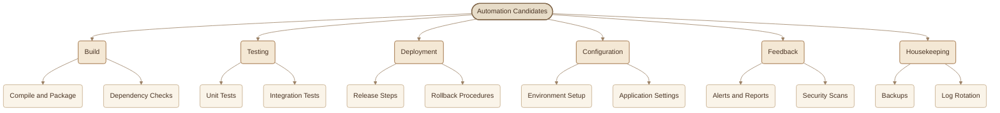
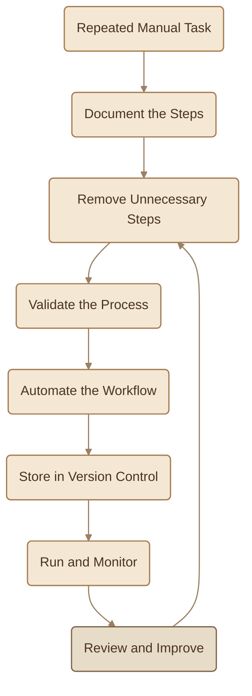
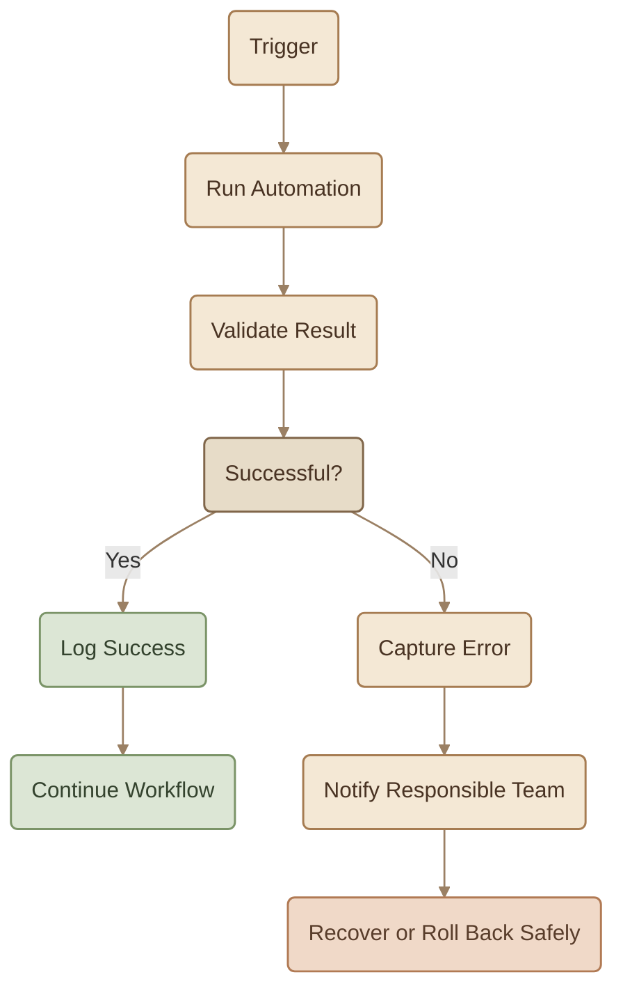

## Introduction

لو فيه عادة بتميّز مهندس عنده DevOps Mindset، فهو إنه لما يلاقي نفسه بيكرر نفس الخطوات كل يوم، ما يكتفيش بحفظها وتنفيذها أسرع؛ بيسأل نفسه: هل ممكن أخلي الخطوات دي تتنفّذ تلقائيًا؟

<Callout type="tip" title="Repetition">

Repetitive work is an opportunity for automation.

</Callout>

الـ **Automation** هي المرحلة اللي فيها DevOps بيتحوّل من مجرد مبادئ وثقافة إلى ممارسة يومية.

لكن الهدف مش إننا نحوّل كل حاجة إلى Scripts وخلاص. المهم نعرف **إيه اللي يستحق الـ Automation، وإزاي ننفّذه بأمان، وإمتى نحتاج تدخل بشري**.

## 1. Why Automate?

خلينا نقارن بين طريقتين لتنفيذ نفس المهمة: Deployment لتطبيق.

<TableCard title="Manual vs Automated Deployment">
| Aspect | Manual Deployment | Automated Deployment |
|---|---|---|
| **Speed** | خطوات يدوية ممكن تستغرق وقتًا طويلًا. | تنفيذ الخطوات المعروفة بسرعة وبشكل متكرر. |
| **Consistency** | النتيجة ممكن تختلف حسب الشخص أو الخطوات المنسية. | نفس الـ Workflow بيتنفّذ وفقًا لتعريف محدد. |
| **Human Errors** | احتمال Typing Mistakes أو نسيان خطوة. | تقليل الأخطاء اليدوية، مع بقاء احتمال وجود Bugs في الـ Automation نفسها. |
| **Availability** | محتاج شخص متاح ينفّذ العملية. | ممكن يشتغل تلقائيًا عند Trigger مناسب. |
| **Knowledge Sharing** | تفاصيل التنفيذ ممكن تكون محفوظة في ذاكرة شخص واحد. | الخطوات موجودة في Scripts أو Pipelines قابلة للمراجعة. |
| **Onboarding** | الشخص الجديد محتاج يتعلم خطوات يدوية متفرقة. | يقدر يفهم الـ Workflow من الملفات والـ Documentation. |
</TableCard>

### I. The Four Benefits

<CardGrid columns={2} label="Automation Benefits">
<InfoCard variant="feature" title="Speed" description="تنفيذ المهام المتكررة بسرعة أكبر وتقليل الوقت الضائع في الخطوات اليدوية." icon="wheel" tags={["Speed"]} />

<InfoCard variant="feature" title="Consistency" description="تنفيذ نفس الخطوات وفقًا لتعريف واضح بدل الاعتماد على الذاكرة." icon="cycle" tags={["Consistent"]} />

<InfoCard variant="feature" title="Reliability" description="تقليل الأخطاء الناتجة عن التكرار اليدوي، مع اختبار الـ Automation ومراقبتها." icon="shield" tags={["Reliable"]} />

<InfoCard variant="feature" title="Shared Knowledge" description="حفظ خطوات التنفيذ في Version Control بحيث يقدر الفريق يراجعها ويفهمها ويطوّرها." icon="branch" tags={["Shared"]} />
</CardGrid>

الـ Automation مش بتضمن إن العملية صحيحة لمجرد إنها تلقائية. لو الـ Script فيها Bug، ممكن تكرر نفس الخطأ على نطاق أكبر وبسرعة أعلى.

عشان كده، الـ Automation الجيدة لازم تكون مبنية على Process مفهوم ومختبر.

## 2. What to Automate First

مش كل مهمة تستحق الوقت اللي هتصرفه في أتمتتها. الأولوية عادةً بتكون للمهام اللي بتتكرر كتير، وبتستهلك وقت، أو معرضة للأخطاء، أو بتعطّل شغل أشخاص تانيين.



### I. A Practical Priority Order

<CardGrid columns={2} label="Automation Priority">
<InfoCard variant="concept" title="1 — Repetitive and Error-Prone Tasks" description="ابدأ بالمهام اللي بتكررها باستمرار، وخصوصًا لو نسيان خطوة أو كتابة قيمة غلط ممكن يسبب مشكلة. Examples: Build commands, tests, backups." icon="cycle" />

<InfoCard variant="concept" title="2 — Tasks That Block Other People" description="المهام اللي بتخلي أعضاء الفريق ينتظروا تنفيذ خطوة يدوية ممكن تكون مرشحة قوية للـ Automation. Examples: Environment provisioning, test execution." icon="wheel" />

<InfoCard variant="concept" title="3 — Stable Processes With Clear Steps" description="لما تكون العملية مفهومة ونتيجتها قابلة للتحقق، بيكون تحويلها إلى Automation أسهل وأكثر أمانًا. Examples: Packaging an application, rotating logs." icon="modules" />

<InfoCard variant="concept" title="4 — Rare or Judgment-Heavy Tasks" description="أجّل أتمتة المهام النادرة أو اللي لسه مش فاهمينها كويس، إلا لو فيه سبب قوي يبرر الاستثمار فيها. Examples: Unfamiliar recovery procedures or complex one-off decisions." icon="layers" />
</CardGrid>

## 3. The Core Rules of the Automation Mindset

### I. Script Repetition, Not Every One-Off Task

فيه قاعدة عملية مشهورة بتقول: لو نفّذت نفس المهمة يدويًا مرتين، فكّر في أتمتتها قبل المرة الثالثة.

دي مش قاعدة حسابية لازم تتطبق حرفيًا؛ الفكرة إن التكرار بيكشف فرصة لتحويل الخطوات إلى عملية ثابتة.

لو المهمة هتتنفّذ مرة واحدة بس، ومش هتتكرر، كتابة Script كاملة ممكن تستهلك وقت أكتر من تنفيذها يدويًا.

لكن لو بتعمل نفس الخطوات يوميًا، فالـ Automation ممكن توفر وقتك وتقلل احتمالات الخطأ على المدى الطويل.

### II. Automate a Good Process First

الـ Automation بتسرّع العملية الموجودة، سواء كانت صحيحة أو مليانة مشاكل.

لو عندك Process معقدة فيها خطوات غير ضرورية، وأتمتّها من غير ما تراجعها، هتفضل عندك نفس التعقيدات لكن بشكل أسرع.

الأفضل تمشي بالتسلسل ده:



الفكرة إنك تفهم الخطوات الأول، تبسّطها، تتأكد إنها بتوصل للنتيجة المطلوبة، وبعدها تحوّلها إلى Script أو Pipeline.

### III. Version Everything

لو عندك Script على جهازك الشخصي ومحدش غيرك يعرف إنها موجودة، فالفريق مش هيقدر يعتمد عليها بسهولة.

الـ Scripts والـ Tests والـ Infrastructure Definitions لازم تتعامل معاها باعتبارها Code.

استخدم **Git** علشان:

- تحفظ تاريخ التغييرات.
- تراجع التعديلات قبل دمجها.
- تشارك الـ Scripts مع باقي الفريق.
- ترجع إلى نسخة سابقة عند الحاجة.
- تربط تغييرات الـ Automation بالـ Issues أو Tasks المناسبة.

مثال لتنظيم بسيط:

```text
automation/
├── scripts/
│   ├── build.sh
│   ├── test.sh
│   └── deploy.sh
├── tests/
│   └── validate-config.sh
└── README.md
```

التنظيم ده مجرد مثال؛ شكل المجلدات بيتحدد حسب المشروع، لكن المهم إن الـ Automation تكون قابلة للفهم والمراجعة بدل ما تكون مجموعة أوامر متفرقة على أجهزة الفريق.

### IV. Make It Idempotent

كلمة **Idempotency** معناها إنك تقدر تنفّذ نفس العملية أكثر من مرة من غير ما تكرر تأثيرها بشكل غير مقصود.

مثلًا، لو الـ Script مسؤولة عن التأكد إن User موجود في Linux، فالمطلوب مش إنها تنشئ User جديد في كل مرة؛ المطلوب إنها تضمن وجوده.

فيه فرق بين المثالين دول:

```bash
# Not idempotent: fails if the user already exists
useradd deploy
```

```bash
# Idempotent for ensuring the user exists
id deploy >/dev/null 2>&1 || useradd deploy
```

في المثال الثاني، بنفحص وجود الـ User الأول، وبننّفذ `useradd` فقط لو مش موجود.

لكن ده مثال تعليمي محدود؛ في Scripts حقيقية، لازم كمان تتعامل مع Errors الناتجة عن أسباب تانية، وتتأكد من الصلاحيات المطلوبة. ولو بتستخدم أدوات Configuration Management، غالبًا هتلاقي فيها آليات جاهزة للتعامل مع الحالة المطلوبة بدل كتابة كل الفحوصات يدويًا.

<InfoCard variant="insight" title="Desired State" icon="cycle">

بدل ما تقول للـ Automation: «نفّذ الخطوات دي كل مرة»، فكّر في النتيجة المطلوبة: «اتأكد إن الحالة النهائية صحيحة». ده جوهر مهم من مبادئ Idempotency وConfiguration Management.

</InfoCard>

### V. Make Automation Observable and Recoverable

لما الـ Automation تنجح، محتاج تعرف إنها نجحت. ولما تفشل، محتاج تعرف فشلت ليه، وإيه الخطوة الآمنة التالية.

الـ Automation الجيدة بتوفّر:

<CardGrid columns={2} label="Observability and Recovery">
<InfoCard variant="concept" title="Logs" description="سجل واضح للخطوات والنتائج." icon="layers" tags={["Logs"]} />

<InfoCard variant="concept" title="Exit Codes" description="نتيجة تنفيذ يمكن للـ Scripts والـ Pipelines الاعتماد عليها." icon="terminal" tags={["Codes"]} />

<InfoCard variant="concept" title="Alerts" description="تنبيه مناسب لما يحصل Failure مهم." icon="pulse" tags={["Alerts"]} />

<InfoCard variant="concept" title="Validation" description="فحوصات تؤكد إن العملية وصلت للنتيجة المطلوبة." icon="shield" tags={["Validate"]} />

<InfoCard variant="concept" title="Recovery Plan" description="خطوات واضحة للتعامل مع الفشل واستعادة الحالة السليمة." icon="flag" tags={["Recover"]} />
</CardGrid>



مش كل عملية ينفع نعمل لها Rollback تلقائي. مثلًا، حذف بيانات أو تنفيذ Database Migration ممكن يحتاج خطة Recovery مختلفة. المهم إنك تفهم تأثير الفشل قبل ما تقرر طريقة التعامل معاه.

### VI. Never Automate What You Don't Understand

لو مش فاهم الـ Process اللي بتحاول تأتمتها، ممكن تعمل Script تنفّذ أوامر خطيرة من غير ما تدرك تأثيرها.

قبل كتابة الـ Automation، اسأل نفسك:

<ChecklistCard title="Before Automating" items={[
  "إيه النتيجة المطلوبة؟",
  "إيه الـ Preconditions اللازمة؟",
  "إيه الآثار الجانبية المحتملة؟",
  "إزاي هعرف إن التنفيذ نجح؟",
  "إيه اللي يحصل لو فشل في منتصف الطريق؟",
  "هل أقدر أختبره بأمان قبل تطبيقه على Production؟",
]} />

**Automation of a mystery produces mystery at scale.**

افهم العملية، جرّبها، وثّقها، وبعدها أتمتها.

## 4. Common Automation Mistakes

<CardGrid columns={3} label="Common Automation Mistakes">
<InfoCard variant="danger" title="Automating a Broken Process" description="لو العملية نفسها غلط، أتمتتها هتكرر الغلط بسرعة أكبر. بسّط العملية وصحّحها قبل الـ Automation." icon="wrench" tags={["Broken"]} />

<InfoCard variant="danger" title="Automating Everything at Once" description="محاولة أتمتة النظام كله دفعة واحدة بتصعّب الاختبار والتشخيص. ابدأ بمهمة صغيرة وتأكد من نجاحها." icon="layers" tags={["Scope"]} />

<InfoCard variant="warning" title="No Approval for Risky Actions" description="عمليات زي حذف البيانات أو تعديل Production بشكل خطير ممكن تحتاج Approval أو مراجعة بشرية قبل التنفيذ." icon="shield" tags={["Risky"]} />

<InfoCard variant="warning" title="Ignoring Version Control" description="الـ Scripts المؤقتة ممكن تتحول إلى جزء أساسي من الشغل من غير ما حد يراجعها أو يوثّقها." icon="branch" tags={["VCS"]} />

<InfoCard variant="warning" title="Set and Forget" description="الـ Automation محتاجة Testing وMonitoring وصيانة. الـ Pipeline اللي بتفشل بصمت ممكن تسبب مشاكل أكبر من الخطوات اليدوية." icon="flag" tags={["Observe"]} />
</CardGrid>

### I. What Should Remain Human-Controlled?

مش الهدف إننا نشيل الإنسان من كل خطوة. بعض القرارات محتاجة Judgment أو فهم للسياق أو مسؤولية واضحة.

أمثلة على الحالات اللي ممكن تحتاج تدخل بشري:

- الموافقة على تغييرات عالية الخطورة في Production.
- مراجعة خطة حذف أو تعديل بيانات حساسة.
- اتخاذ قرار أثناء Incident غير مألوف.
- تقييم مخاطر تغيير كبير قبل تنفيذه.
- الموافقة على إجراء لا يمكن التراجع عنه بسهولة.

ومع ذلك، تقدر تأتمت الفحوصات وتجهيز التقارير والتحقق من الشروط قبل ما تطلب Approval. كده الإنسان بياخد قرار مبني على معلومات واضحة بدل ما يضطر ينفّذ كل خطوة بنفسه.

## 5. The Payoff: Automate the Boring Parts

الهدف من الـ Automation مش إزالة دور الإنسان؛ الهدف هو تقليل الوقت اللي بيضيع في الأعمال المتكررة، علشان المهندسين يقدروا يركّزوا على التصميم والتحليل والتحسين.

```mermaid
flowchart TD
    subgraph BEFORE["Before Automation"]
        direction TB
        B1("Manual Repetition")
        B2("Copy and Paste")
        B3("Remembering Steps")
        B4("Engineering and Problem Solving")
    end

    subgraph AFTER["After Automation"]
        direction TB
        A1("Automated Repetitive Tasks")
        A2("Review Automation Results")
        A3("Design and Improvement")
        A4("Engineering and Problem Solving")
    end

    classDef manual fill:#f0d9c8,stroke:#b17a54,color:#593d2b,stroke-width:1.5px
    classDef automated fill:#e4e9d8,stroke:#82936c,color:#34432e,stroke-width:1.5px
    classDef engineering fill:#e7dcc8,stroke:#80664a,color:#493323,stroke-width:1.8px

    class B1,B2,B3 manual
    class A1,A2 automated
    class B4,A3,A4 engineering

    style BEFORE fill:#f8eee5,stroke:#c69b7a,color:#593d2b,stroke-width:1.5px
    style AFTER fill:#edf0e5,stroke:#9aa987,color:#34432e,stroke-width:1.5px

    linkStyle default stroke:#9b8064,stroke-width:1.3px
```



بعد ما تأتمت المهام المتكررة، وقت المهندس يقدر يتحوّل إلى:

<CardGrid columns={3} label="Where Engineer Time Goes">
<InfoCard variant="concept" title="Architecture" description="تحسين Architecture." icon="layers" tags={["Design"]} />

<InfoCard variant="concept" title="Investigation" description="التحقيق في المشاكل المعقدة." icon="terminal" tags={["Debug"]} />

<InfoCard variant="concept" title="Review" description="مراجعة الـ Automation والـ Security." icon="shield" tags={["Review"]} />

<InfoCard variant="concept" title="Performance" description="تحسين Performance وReliability." icon="pulse" tags={["Perf"]} />

<InfoCard variant="concept" title="New Solutions" description="تصميم حلول جديدة بدل تكرار خطوات محفوظة." icon="wheel" tags={["Build"]} />
</CardGrid>

وده بالضبط المكان اللي الـ Automation بتضيف فيه قيمة حقيقية.

## 6. What Should You Remember?

<CardGrid columns={3} label="Automation Mindset Recap">
<InfoCard variant="summary" title="01 — Start With Repetition" description="ابدأ بالمهام المتكررة والمعرضة للأخطاء أو اللي بتعطّل شغل الفريق." icon="wheel" tags={["Start"]} />

<InfoCard variant="summary" title="02 — Fix the Process First" description="افهم الخطوات، وبسّطها، وتأكد من صحتها قبل ما تحوّلها إلى Automation." icon="cycle" tags={["Process"]} />

<InfoCard variant="summary" title="03 — Version Everything" description="خزن Scripts وTests وInfrastructure Definitions في Git، وخليها قابلة للمراجعة." icon="branch" tags={["Version"]} />

<InfoCard variant="summary" title="04 — Make It Idempotent" description="صمّم الـ Automation بحيث تقدر تعيد تشغيلها بأمان من غير آثار جانبية غير مقصودة." icon="cycle" tags={["Idempotent"]} />

<InfoCard variant="summary" title="05 — Keep It Observable and Safe" description="اختبر النتائج، سجّل الأخطاء، وخطط للتعافي، واستخدم Human Approval عند الحاجة." icon="shield" tags={["Safe"]} />

<InfoCard variant="summary" title="06 — Understand Before Automating" description="ما تأتمتش عملية مش فاهمها؛ لأنك ممكن توسّع نطاق الخطأ بدل ما تحلّه." icon="layers" tags={["Understand"]} />
</CardGrid>

**The key idea:** Automation مش مجرد Scripts بتنفّذ أوامر؛ هي طريقة لبناء عمليات قابلة للتكرار والاختبار والتحسين، مع ترك القرارات اللي تحتاج Judgment للبشر.

والمقال التالي عن **CI/CD** هيشرح إزاي نطبّق الـ Mindset ده على عملية بناء واختبار وتسليم الـ Software.
