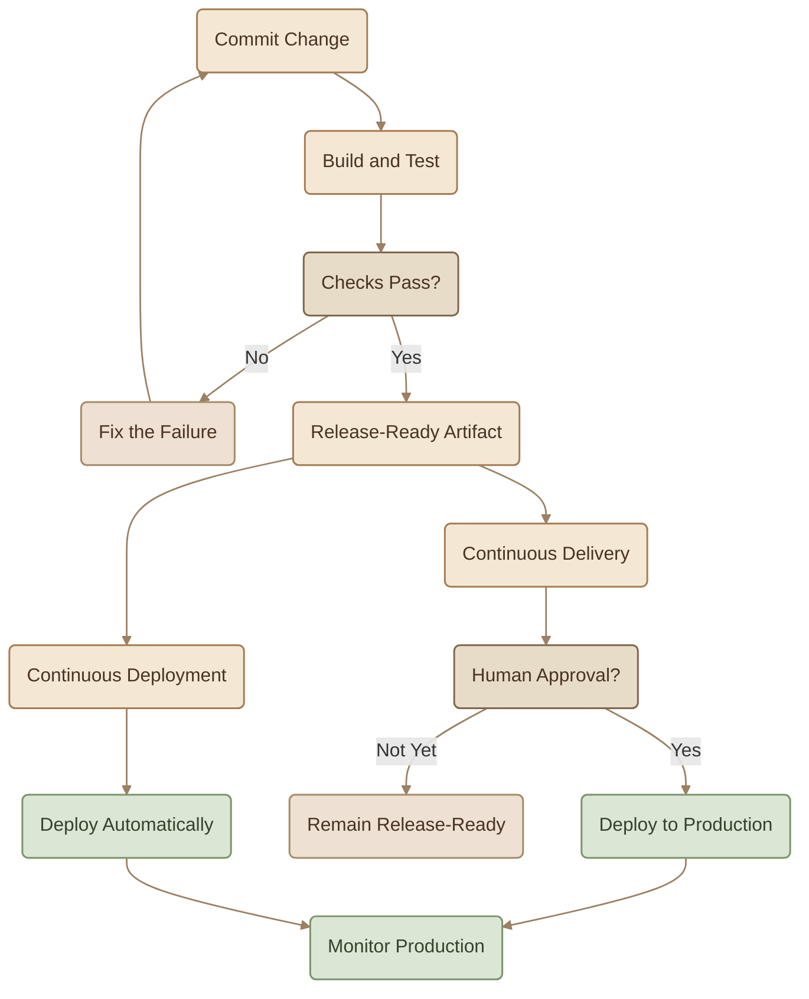
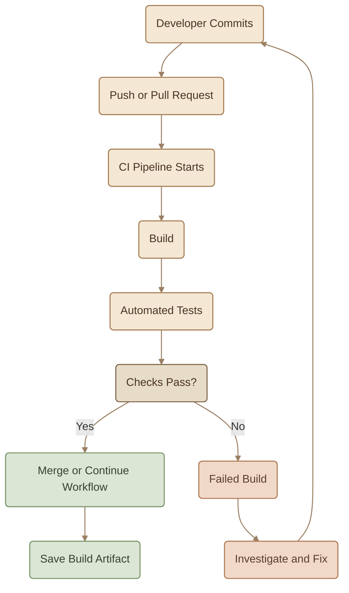
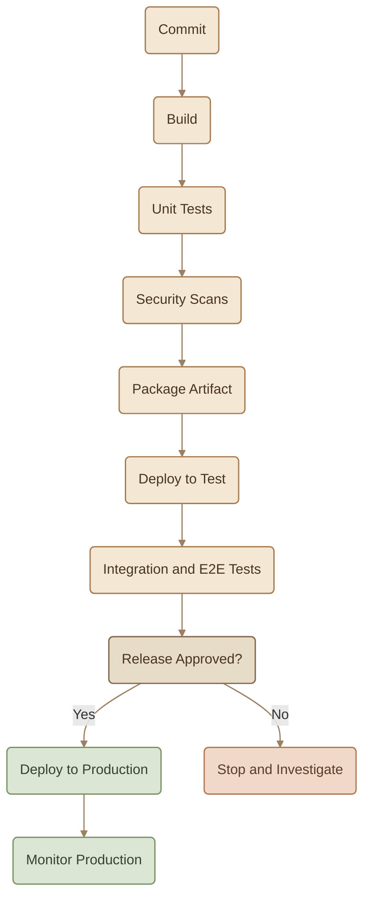
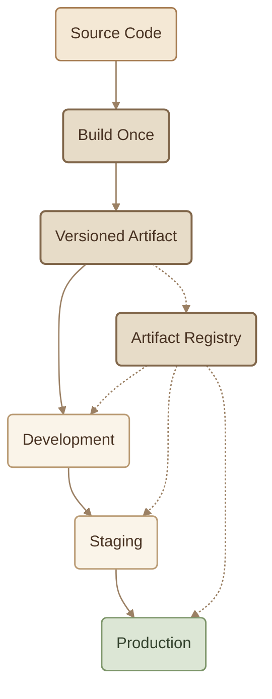

## Introduction

لو الـ Automation هي طريقة التفكير في DevOps، فالـ **CI/CD** هو واحد من أهم التطبيقات العملية للفكرة دي.

بدل ما الـ Developer يكتب الـ Code، وبعدها شخص تاني ينفّذ Build وTesting وDeployment يدويًا، بنربط الخطوات دي في Workflow متكرر اسمه **CI/CD Pipeline**.

الـ Pipeline بتاخد التغيير من الـ Source Code، وتنفّذ عليه فحوصات آلية، وتجهّز الـ Artifact، وتساعد في توصيله للـ Production بطريقة قابلة للتكرار والمراجعة.

## 1. What CI/CD Actually Means

الاختصار CI/CD بيشير إلى ثلاث ممارسات مترابطة:

<CardGrid columns={3} label="CI and CD">
<InfoCard variant="concept" title="Continuous Integration (CI)" description="دمج التغييرات بشكل متكرر في Shared Codebase، مع تشغيل Build وAutomated Tests علشان المشاكل تظهر بدري." icon="branch" tags={["CI"]} />

<InfoCard variant="concept" title="Continuous Delivery (CD)" description="الحفاظ على الـ Software في حالة تسمح بإصدارها بعد اجتياز الفحوصات المطلوبة، مع إمكانية وجود Human Approval قبل Production." icon="flag" tags={["Delivery"]} />

<InfoCard variant="concept" title="Continuous Deployment (CD)" description="نشر كل تغيير يجتاز الـ Pipeline إلى Production تلقائيًا، من غير خطوة Approval يدوية لكل Release." icon="wheel" tags={["Deploy"]} />
</CardGrid>

### I. *Continuous* Delivery vs Continuous Deployment

الفرق الأساسي بين الاتنين هو هل الـ Production Deployment بيحصل تلقائيًا بعد اجتياز الشروط، ولا فيه خطوة قرار بشرية قبل النشر.

<TableCard title="CI/CD Practices">
| Practice | Main Goal | Production Deployment |
|---|---|---|
| **Continuous Integration** | دمج واختبار التغييرات باستمرار. | مش جزءًا إلزاميًا من CI نفسها. |
| **Continuous Delivery** | الحفاظ على نسخة جاهزة للإصدار. | ممكن يحتاج Human Approval أو Trigger يدوي. |
| **Continuous Deployment** | أتمتة وصول التغييرات المؤهلة إلى Production. | تلقائي بعد اجتياز الـ Gates المطلوبة. |
</TableCard>

**مهم:** Continuous Delivery مش معناها إن كل Release لازم تستنى Approval؛ معناها إن الـ Software تفضل جاهزة للإصدار، والقرار النهائي بالنشر ممكن يكون يدويًا أو حسب سياسة الفريق. أما Continuous Deployment فبتأتمت النشر نفسه لكل تغيير مؤهل.

كتير من الفرق بتبدأ بـ CI مع Continuous Delivery، وبعد ما تثق في الـ Testing والـ Monitoring وآليات Recovery، ممكن تنتقل إلى Continuous Deployment لو طبيعة النظام تسمح بده.

## 2. Continuous Integration: The Discipline

الـ CI مش مجرد Server بيشغّل Commands؛ هي طريقة شغل بتعتمد على دمج التغييرات بشكل متكرر والحصول على Feedback سريع.

### I. The CI Workflow

<Steps>
<li>
<InfoCard title="Commit Frequently" description="الـ Developers يعملوا Commits صغيرة ويرفعوا التغييرات بشكل متكرر." icon="branch" />
</li>
<li>
<InfoCard title="Trigger the Pipeline" description="الـ Pipeline تبدأ تلقائيًا عند Trigger مناسب، زي Push أو Pull Request." icon="wheel" />
</li>
<li>
<InfoCard title="Build and Test" description="الـ Code يتعمل له Build وتشتغل عليه Automated Tests." icon="cube" />
</li>
<li>
<InfoCard title="Investigate Failures" description="لو فيه Failure، الفريق يحقق فيها ويصلّحها قبل ما يعتمد على التغيير." icon="wrench" />
</li>
</Steps>

### II. Keep the Main Branch Green

لما الـ Build أو الاختبارات تفشل على الـ Main Branch، الفريق لازم يتعامل مع المشكلة بجدية وسرعة.

وجود Broken Mainline ممكن يعطّل بقية الفريق، لأن أي تغيير جديد هيبقى أصعب في التحقق منه وسط Failure موجودة أصلًا.

عشان كده، من الممارسات المهمة:

- تشغيل CI على التغييرات قبل دمجها.
- استخدام Branch Protection وRequired Checks عند الحاجة.
- إصلاح الـ Failures بسرعة بدل تجاهلها.
- إبقاء التغييرات صغيرة علشان التشخيص يبقى أسهل.

<InfoCard variant="insight" title="Green Build" icon="flag">

الـ Green Build معناها إن الـ Checks المطلوبة نجحت. لكنها مش ضمان مطلق إن مفيش Bugs؛ جودة الـ CI بتعتمد على الاختبارات والفحوصات اللي بتشغّلها فعلًا.

</InfoCard>

## 3. Anatomy of a CI/CD Pipeline

الـ **Pipeline** عبارة عن مجموعة Stages مترابطة، كل واحدة بتنّفذ مهمة أو بتتحقق من شرط قبل الانتقال للمرحلة التالية.

### I. What Does Each Stage Do?

<CardGrid columns={3} label="Pipeline Stages">
<InfoCard variant="concept" title="Build" description="تحويل الـ Source Code إلى نسخة قابلة للتشغيل أو التوزيع، مع اكتشاف أخطاء الـ Compilation والـ Dependencies." icon="cube" tags={["Build"]} />

<InfoCard variant="concept" title="Unit Tests" description="اختبار أجزاء صغيرة من الـ Code بسرعة للتأكد من إنها بتعمل بالشكل المتوقع." icon="flag" tags={["Tests"]} />

<InfoCard variant="concept" title="Security Scans" description="فحص أنواع معينة من المخاطر، زي Vulnerable Dependencies أو أخطاء Security في الـ Code، حسب الأدوات المستخدمة." icon="shield" tags={["Security"]} />

<InfoCard variant="concept" title="Package Artifact" description="تجهيز Artifact بإصدار واضح يمكن تخزينه وتتبع مصدره واستخدامه في المراحل التالية." icon="cube" tags={["Artifact"]} />

<InfoCard variant="concept" title="Deploy to Test" description="نشر الـ Artifact في Test Environment علشان نختبره في بيئة أقرب للتشغيل الفعلي." icon="wheel" tags={["Deploy"]} />

<InfoCard variant="concept" title="Integration and E2E Tests" description="التحقق من تفاعل مكونات النظام مع بعضها، واختبار سيناريوهات كاملة من منظور المستخدم أو النظام." icon="cycle" tags={["E2E"]} />

<InfoCard variant="concept" title="Approval" description="خطوة اختيارية لمراجعة الإصدار قبل Production، خصوصًا في Continuous Delivery أو البيئات الحساسة." icon="network" tags={["Approve"]} />

<InfoCard variant="concept" title="Monitoring" description="متابعة سلوك الـ Application بعد النشر، واكتشاف المشاكل اللي ممكن الاختبارات السابقة ما تكشفهاش." icon="pulse" tags={["Monitor"]} />
</CardGrid>

### II. Quality Gates

مش لازم كل Pipeline تحتوي على نفس المراحل، ومش كل Stage لازم تكون منفصلة تقنيًا.

لكن المفهوم المهم هو **Quality Gates**: شروط لازم تتحقق قبل ما التغيير ينتقل للمرحلة التالية.

مثلًا:

- لو الـ Build فشل، ما نكملش كأن مفيش مشكلة.
- لو Required Tests فشلت، ما نعتبرش التغيير جاهزًا للدمج أو الإصدار.
- لو الـ Security Policy منعت Artifact معينة، نوقف نشرها.
- لو حصلت مشكلة في Production، نستخدم إجراءات الاستجابة والتعافي المناسبة.

## 4. Build Once, Promote Everywhere

من أهم مبادئ CI/CD إنك **تبني الـ Artifact مرة واحدة، وتستخدم نفس النسخة خلال مراحل التسليم**.

تخيّل إنك بتبني Docker Image لتطبيقك. بعد نجاح الـ Build، بتخزن الـ Image باستخدام Version أو Digest محدد، وبعدها تختبرها وتروّجها بين الـ Environments.

### I. Why Does It Matter?

لو عملت Build جديد في كل Environment، ممكن الـ Artifact الناتجة تختلف بسبب:

<CardGrid columns={2} label="Why Rebuilds Diverge">
<InfoCard variant="warning" title="Dependency Versions" description="اختلاف Dependency Versions." icon="modules" tags={["Deps"]} />

<InfoCard variant="warning" title="Build Arguments" description="اختلاف Build Arguments." icon="sliders" tags={["Args"]} />

<InfoCard variant="warning" title="Base Image or Toolchain" description="اختلاف Base Image أو Toolchain." icon="cube" tags={["Base"]} />

<InfoCard variant="warning" title="Source Changes" description="تغييرات حصلت في الـ Source Code بين عمليتين Build." icon="branch" tags={["Source"]} />
</CardGrid>

بالتالي، النسخة اللي اختبرتها في Staging مش بالضرورة تكون مطابقة للنسخة اللي نشرتها في Production.

لما تستخدم نفس الـ Artifact، بتقلل النوع ده من الاختلافات، وبتحسن Traceability: تقدر تربط النسخة المنشورة بالـ Build والـ Commit اللي أنتجها.

### II. Does Configuration Stay the Same?

لأ. الـ Artifact تفضل نفسها، لكن إعدادات التشغيل ممكن تختلف حسب البيئة.

مثلًا، الـ Application ممكن تستخدم Database مختلفة في Staging عن Production. المهم إنك تدير الاختلافات دي بطريقة واضحة وآمنة، من غير ما تعيد بناء الـ Artifact لمجرد تغيير إعدادات التشغيل.

<InfoCard variant="tip" title="One Artifact, Controlled Configuration" icon="layers">

نفس الـ Artifact بتنتقل بين البيئات، بينما Environment-specific Configuration وSecrets بتتحدد بشكل منفصل. ده بيساعدك تحافظ على اتساق النسخة من غير خلط إعدادات البيئات ببعضها.

</InfoCard>

## 5. Why Teams Use CI/CD

<CardGrid columns={3} label="Why Teams Use CI/CD">
<InfoCard variant="feature" title="Fast Feedback" description="اكتشاف الأخطاء بعد التغيير بوقت قصير، بدل ما تتراكم التغييرات ويصعب تحديد مصدر المشكلة." icon="cycle" tags={["Feedback"]} />

<InfoCard variant="feature" title="Repeatable Releases" description="تنفيذ خطوات Build وTesting وDeployment بطريقة موحّدة بدل الاعتماد على خطوات يدوية متفرقة." icon="cycle" tags={["Repeat"]} />

<InfoCard variant="feature" title="Documented Workflow" description="تعريف الـ Pipeline نفسه بيوضح خطوات التسليم وشروط النجاح والفشل." icon="layers" tags={["Docs"]} />

<InfoCard variant="feature" title="Controlled Risk" description="استخدام Tests وSecurity Checks وApprovals لتقليل احتمالات وصول تغييرات غير مؤهلة إلى Production." icon="shield" tags={["Risk"]} />

<InfoCard variant="feature" title="Frequent Improvement" description="تسليم تغييرات صغيرة بشكل متكرر بيساعد الفريق يتعلم من النتائج ويحسّن العملية باستمرار." icon="pulse" tags={["Improve"]} />

<InfoCard variant="feature" title="Shared Ownership" description="الـ Workflow بتبقى مرئية وقابلة للمراجعة من الفريق، بدل اعتماد التسليم على معرفة شخص واحد." icon="network" tags={["Own"]} />
</CardGrid>

النتيجة المطلوبة مش مجرد إن الـ Pipeline تشتغل بسرعة؛ الهدف إن الـ Releases تبقى **متوقعة، قابلة للتكرار، وسهلة المتابعة والتعافي عند الفشل**.

## 6. Common CI/CD Mistakes

### I. Long Feedback Loops

لو الـ Pipeline بتاخد ساعات علشان تدي Feedback، الـ Developers ممكن يبدأوا يجمّعوا تغييرات أكتر قبل ما يختبروها.

**Better approach:** شغّل الفحوصات السريعة بدري، زي Unit Tests، وبعدها شغّل الاختبارات الأبطأ في المراحل المناسبة.

### II. Flaky Tests

الـ Flaky Test هي اختبار نتيجته بتتغير من Run للتاني من غير تغيير حقيقي يبرر النتيجة.

لما الاختبارات تفشل بشكل عشوائي، الفريق ممكن يبدأ يتجاهل Failures، وده بيضعف الثقة في الـ Pipeline.

**Better approach:** حقق في الاختبارات غير المستقرة، واعزلها عند الضرورة مع وجود خطة لإصلاحها. ما تخليش تجاهلها حلًا دائمًا.

### III. Deploying From a Laptop

لو Production Deployment بتعتمد على أوامر ينفّذها شخص من جهازه، ممكن تختلف الخطوات أو الصلاحيات أو الإعدادات من مرة للتانية.

**Better approach:** خلّي النشر يتم من خلال Workflow معروفة ومراقبة، مع صلاحيات محددة وآمنة.

### IV. No Recovery Plan

الـ Pipeline ممكن تنجح في النشر، لكن التغيير نفسه يسبب مشكلة بعد وصوله إلى Production.

**Better approach:** جهّز إجراءات مناسبة للتعافي، زي Rollback أو Roll Forward أو تعطيل Feature، حسب طبيعة التطبيق والبيانات.

مش كل تغيير ينفع يتعمل له Rollback بنفس الطريقة، خصوصًا لو فيه Database Schema Changes أو تغييرات غير قابلة للعكس.

### V. Manual Configuration Between Stages

لو كل انتقال بين Environments محتاج خطوات إعداد يدوية غير موثقة، هتفضل عندك فرص لأخطاء بشرية حتى لو باقي الـ Pipeline مؤتمت.

**Better approach:** استخدم Configuration Management وSecrets Management وInfrastructure as Code، مع تسجيل أي خطوة يدوية لازمة ومراجعتها.

### VI. Treating CI/CD as a Tool

تثبيت CI/CD Platform مش معناه إن الفريق بيطبّق Continuous Integration أو Continuous Delivery بشكل صحيح.

ممكن يكون عندك Pipeline موجودة، لكن التغييرات كبيرة، والاختبارات ضعيفة، والـ Releases نادرة، والـ Failures بتتجاهل.

**Better approach:** ركّز على الممارسات نفسها: Small Changes، Automated Testing، Fast Feedback، Versioned Artifacts، وSafe Deployments.

## 7. What Should You Remember?

<CardGrid columns={3} label="CI/CD Recap">
<InfoCard variant="summary" title="01 — Continuous Integration" description="دمج التغييرات باستمرار وتشغيل Build وTests آليًا علشان المشاكل تظهر بدري." icon="branch" tags={["CI"]} />

<InfoCard variant="summary" title="02 — Continuous Delivery" description="الحفاظ على الـ Software في حالة جاهزة للإصدار، مع إمكانية وجود Approval قبل Production." icon="flag" tags={["Delivery"]} />

<InfoCard variant="summary" title="03 — Continuous Deployment" description="نشر كل تغيير مؤهل إلى Production تلقائيًا بعد اجتياز الـ Pipeline." icon="wheel" tags={["Deploy"]} />

<InfoCard variant="summary" title="04 — Quality Gates" description="كل مرحلة بتتحقق من شروط معينة قبل انتقال التغيير للمرحلة التالية." icon="cycle" tags={["Gates"]} />

<InfoCard variant="summary" title="05 — Build Once" description="ابنِ الـ Artifact مرة، واستخدم نفس النسخة خلال مراحل الاختبار والنشر." icon="cube" tags={["Artifact"]} />

<InfoCard variant="summary" title="06 — Feedback and Recovery" description="راقب نتائج الـ Deployment، واختبر إجراءات التعافي، وحسّن الـ Pipeline باستمرار." icon="pulse" tags={["Feedback"]} />
</CardGrid>

**The key idea:** CI/CD بتحوّل الـ Automation Mindset إلى عملية مستمرة لبناء واختبار وتسليم الـ Software. ابدأ بـ CI واضحة وموثوقة، وبعدها أضف Deployment Stages تدريجيًا، وطوّر مستوى الـ Automation مع تحسّن الاختبارات والـ Monitoring والثقة في عملية التسليم.
