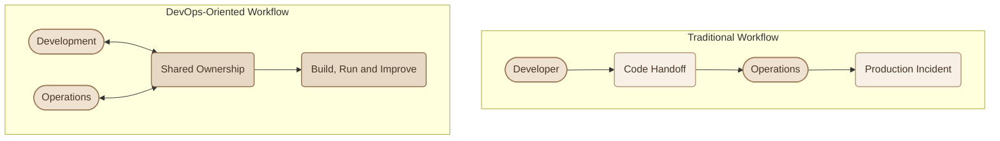
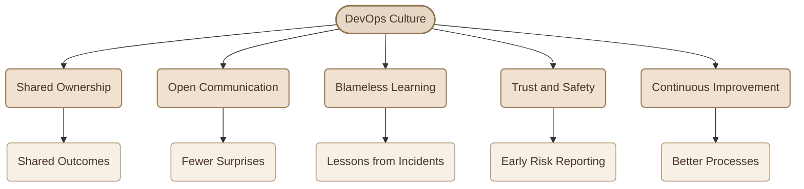
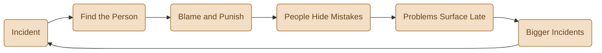
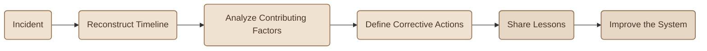
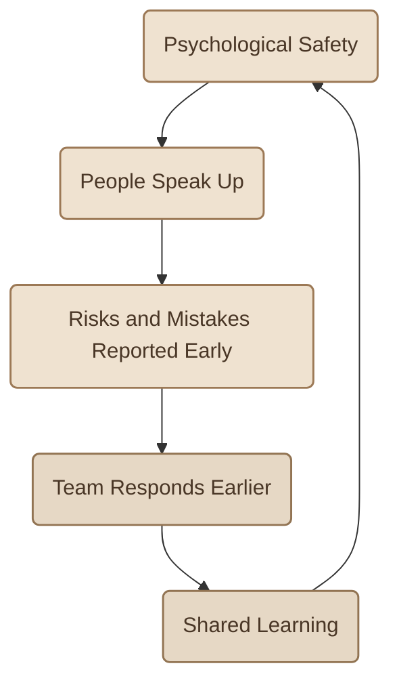
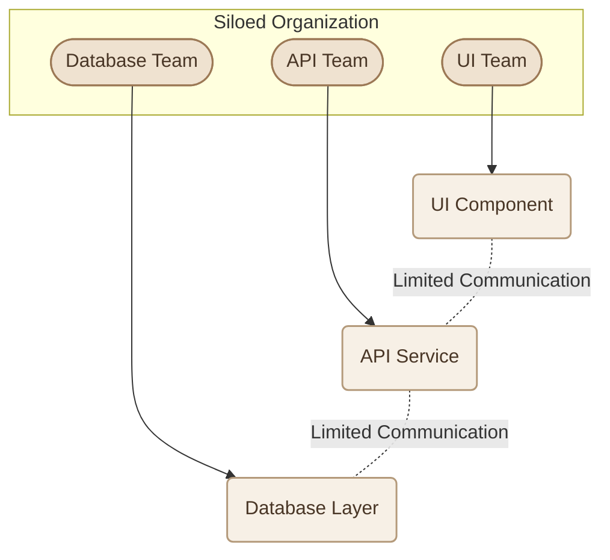

## Introduction

فيه حقيقة مهمة لازم تفهمها وإنت بتتعلم DevOps: **ممكن تستخدم أحدث Tools وأقوى Automation، ومع ذلك تفشل في تطبيق DevOps بشكل فعّال.**

ليه؟ لأن الـ Tools مش بتصلّح مشاكل التواصل، ومش بتخلي الفرق تتعاون مع بعضها بشكل تلقائي، ومش بتمنع ثقافة إلقاء اللوم على الآخرين.

الـ Tools بتساعدك تنفّذ الشغل، لكن الطريقة اللي الناس بتفكّر وتتواصل وتتعامل بيها مع المشاكل هي اللي بتحدد مدى نجاح الـ Process.

علشان كده، الـ **DevOps Culture** بتعتبر الأساس اللي بتتبني عليه الممارسات التانية، زي الـ CI/CD والـ Automation والـ Monitoring.

## 1. Shared Ownership: You Build It, You Run It

في الـ Traditional Workflow، الـ Developer ممكن يكتب الـ Code ويسلّمه لفريق الـ Operations، وبعدها يعتبر إن مسؤوليته انتهت.

لو حصلت مشكلة في الـ Production، فريق الـ Operations هو اللي بيتعامل معاها، حتى لو السبب مرتبط بتغيير في الـ Code أو قرار اتاخد أثناء الـ Development.

الـ DevOps بيحاول يغيّر طريقة التفكير دي من خلال مفهوم اسمه **Shared Ownership**.

الفكرة إن الفريق اللي بيبني الـ Application يفضل مهتم بجودتها وطريقة تشغيلها، والناس المسؤولة عن الـ Operations تشارك بخبرتها من بدري في تصميم وتجهيز الـ Application.

وده ممكن ينعكس على طريقة الشغل:

<CardGrid columns={2} label="Effects of Shared Ownership">
<InfoCard variant="concept" title="Better Code" description="الـ Developers يهتموا بالـ Error Handling والـ Logging والـ Reliability، مش بس إن الـ Code يشتغل." icon="code" tags={["Code"]} />

<InfoCard variant="concept" title="Safer Deployments" description="الفريق يفهم مخاطر التغييرات ويجهّز طريقة مناسبة للتعامل مع الـ Failures." icon="shield" tags={["Deploy"]} />

<InfoCard variant="concept" title="Faster Feedback" description="المشاكل اللي بتظهر في الـ Production ترجع بسرعة للأشخاص اللي يقدروا يصلحوها." icon="pulse" tags={["Feedback"]} />

<InfoCard variant="concept" title="Clearer Responsibility" description="يبقى فيه وضوح حول مين مسؤول عن التنفيذ والمتابعة وحل المشاكل." icon="flag" tags={["Own"]} />
</CardGrid>

<InfoCard variant="insight" title="Shared Ownership Doesn't Mean Everyone Does Everything" icon="network">
مش مطلوب من كل Developer إنه يبقى خبير Networking أو من كل Operations Engineer إنه يكتب الـ Application بالكامل.

المطلوب إن الفريق يشارك المسؤولية عن النتيجة النهائية، مع الحفاظ على التخصصات وتوزيع المهام بشكل واضح.
</InfoCard>

## 2. Communication and Collaboration

الـ DevOps Culture بتظهر في التفاصيل اليومية، مش بس في الـ Organizational Structure أو الاجتماعات الرسمية.

مثلًا، لو فريق الـ Operations عرف بمتطلبات الـ Application قبل الـ Deployment بيوم واحد، فغالبًا هيضطر يتعامل مع مفاجآت كان ممكن اكتشافها بدري.

لكن لو شارك في الـ Planning من البداية، يقدر يساعد في تحديد متطلبات الـ Infrastructure والـ Security والـ Monitoring قبل ما التغييرات توصل للـ Production.

<CardGrid columns={2} label="Collaboration Habits">
<InfoCard variant="concept" title="Cross-Functional Teams" description="جمع الخبرات المطلوبة لبناء وتسليم وتشغيل الـ Application حول هدف مشترك، بدل الاعتماد على سلسلة طويلة من التسليمات بين الفرق." icon="network" tags={["Teams"]} />

<InfoCard variant="concept" title="Early Communication" description="مناقشة الـ Requirements والـ Risks والـ Infrastructure Needs بدري، قبل ما تتحول لمشاكل أثناء الـ Deployment." icon="pulse" tags={["Early"]} />

<InfoCard variant="concept" title="ChatOps" description="استخدام قنوات تواصل مشتركة لمتابعة الـ Alerts والـ Deployments والعمليات المهمة، بحيث تكون المعلومات متاحة للأشخاص المعنيين." icon="terminal" tags={["ChatOps"]} />

<InfoCard variant="concept" title="Transparency" description="توضيح إيه اللي بيتغيّر، وليه، وإمتى هيتم نشره، وإيه تأثيره المتوقع على الـ System." icon="flag" tags={["Open"]} />
</CardGrid>

### I. What a Healthy DevOps Culture Looks Like

كل عنصر من دول بيدعم الباقي.

مثلًا، لو فيه Trust بين أفراد الفريق، الناس هتكون أقدر على الإبلاغ عن المشاكل بدري. ولما المعلومات تكون واضحة، الفريق يقدر يحلل المشكلة ويتعلم منها بدل ما يضيّع وقته في تبادل اللوم.

## 3. Blameless Postmortems

تخيّل إن الساعة 2 صباحًا، والـ Production Application وقعت بعد Deployment جديد.

أول رد فعل للفريق في الموقف ده ممكن يكشف كتير عن ثقافة المؤسسة.

هل السؤال الأول هيكون: مين اللي عمل الـ Deployment؟

ولا: إيه اللي حصل، وإزاي وصلنا للحالة دي، وإيه اللي نقدر نغيّره علشان المشكلة ما تتكررش؟

الفرق ده هو جوهر مفهوم **Blameless Postmortems**.

### I. The Blame Culture

في ثقافة إلقاء اللوم، التركيز بيكون على تحديد الشخص المسؤول عن الخطأ ومعاقبته، بدل فهم الظروف اللي سمحت بحدوثه.

لما الناس تخاف من الاعتراف بالأخطاء، ممكن تتأخر في الإبلاغ عن مشكلة، أو تخفي معلومة مهمة، أو تتجنب اقتراح تغيير شايفة إنه ضروري.

وده بيخلّي المؤسسة تخسر فرصة اكتشاف المشاكل وهي لسه صغيرة.

### II. The Blameless Approach

الـ Blameless Postmortem بيركّز على إعادة بناء الأحداث وفهم الأسباب والعوامل اللي ساهمت في المشكلة، وبعدها تحديد إجراءات تقلل احتمال تكرارها.

خلينا نطبّق ده على مثال بسيط.

حصل Failure بعد Deployment لأن الـ Application بدأت تستخدم Environment Variable جديدة، لكنها ما كانتش متعرفة في الـ Production Environment.

بدل ما نكتفي بإننا نقول إن الشخص اللي عمل الـ Deployment نسي يضيفها، نراجع الـ Process نفسها:

<ChecklistCard title="Process Review Questions" items={[
  "هل فيه Automated Check بيتأكد من وجود الـ Required Environment Variables؟",
  "هل الـ Staging Environment قريبة بما يكفي من الـ Production Configuration؟",
  "هل الـ Deployment Pipeline بتتحقق من الـ Configuration قبل النشر؟",
  "هل الـ Error Messages والـ Alerts بتوضح سبب المشكلة بسرعة؟",
]} />

بعد التحليل، ممكن نضيف Validation تلقائي للـ Configuration، ونحسّن الـ Error Messages، ونوثّق خطوات الـ Recovery.

بالطريقة دي، الفريق مش بس بيحل المشكلة الحالية؛ هو كمان بيقلل احتمالية تكرارها.

<InfoCard variant="insight" title="Blameless Doesn't Mean No Accountability" icon="shield">
الـ Blameless Culture مش معناها تجاهل الأخطاء أو عدم وجود مسؤولية.

معناها إن التحقيق في الـ Incident يركّز على الحقائق والظروف والـ System Design، وإن الإجراءات التصحيحية تستهدف منع تكرار المشكلة، بدل افتراض إن معاقبة شخص واحد هتحل المشكلة من جذورها.
</InfoCard>

### III. What a Good Postmortem Should Include

الـ Postmortem المفيد مش مجرد تقرير عن اللي حصل؛ المفروض يساعد الفريق يتعلم ويتصرف بناءً على اللي اتعلمه.

<TableCard title="Postmortem Elements">
| Element | Purpose |
|---|---|
| **Incident Summary** | وصف مختصر للمشكلة وتأثيرها. |
| **Timeline** | ترتيب الأحداث من بداية المشكلة لحد استعادة الخدمة. |
| **Impact** | تحديد الخدمات والـ Users اللي اتأثروا. |
| **Contributing Factors** | فهم العوامل التقنية والتنظيمية اللي ساهمت في الـ Incident. |
| **Corrective Actions** | تحديد إجراءات واضحة لتحسين الـ System أو الـ Process. |
| **Action Owners** | تحديد المسؤول عن تنفيذ كل إجراء ومتابعته. |
| **Lessons Learned** | مشاركة المعرفة مع الفرق المعنية لمنع تكرار المشكلة. |
</TableCard>

الأهم إن الـ Action Items يكون ليها Owner واضح وأولوية مناسبة، وتراجع لحد ما يتم تنفيذها؛ لأن التقرير لو اتكتب واتحفظ من غير أي تغيير، فالفريق غالبًا مش هيستفيد منه بالشكل المطلوب.

## 4. Trust and Psychological Safety

فيه مفهوم مهم مرتبط بالـ Blameless Culture اسمه **Psychological Safety**.

المقصود بيه إن الشخص يحس إنه يقدر يسأل، أو يعترف إنه مش فاهم حاجة، أو يبلّغ عن مشكلة، أو يعترض على قرار تقني، من غير خوف غير مبرر من الإهانة أو العقاب لمجرد إنه اتكلم.

في بيئة شغل صحية، المهندس يقدر يقول:

- "The deployment step seems risky. Can we automate it?"
- "I don't fully understand this alert."
- "I think we should roll back this release."
- "I made a mistake in the configuration, and I need help fixing it."

الكلام ده ممكن يبدو بسيطًا، لكنه مهم جدًا في البيئات اللي فيها Systems معقدة وقراراتها ممكن تأثر على الـ Production.

لكن Psychological Safety مش معناها إن أي قرار لازم يتقبل من غير نقاش، أو إن مفيش Standards أو Accountability.

بالعكس، الفريق الصحي بيقدر يناقش القرارات بصراحة، ويرفض الحلول الخطرة بأسباب واضحة، ويحاسب نفسه على تنفيذ الإجراءات المتفق عليها من غير تحويل الاختلاف التقني لهجوم شخصي.

**لما الناس تتكلم بدري، الفريق بيكون عنده فرصة أفضل للتعامل مع المشكلة قبل ما تتحول إلى Outage.**

## 5. Culture in Practice

إزاي نعرف إذا كانت ثقافة الفريق بتدعم DevOps فعلًا؟

ممكن نبدأ بمراجعة بعض التصرفات اليومية، بدل الاعتماد على أسماء الـ Teams أو عدد الـ Tools المستخدمة.

<TableCard title="Unhealthy vs Healthy Culture">
| Area | Unhealthy Culture | Healthy DevOps Culture |
|---|---|---|
| Deployments | "That's Operations' problem." | "We build, deliver, and support the service together." |
| Incidents | "Who caused this?" | "What happened, and how can we prevent it?" |
| Failures | إخفاء الأخطاء خوفًا من العقاب. | الإبلاغ عن الأخطاء وتحليلها ومشاركة الدروس المستفادة. |
| Knowledge | المعلومات محصورة داخل أفراد أو Teams. | توثيق المعرفة ومشاركتها وتدريب الآخرين. |
| Changes | تغييرات كبيرة ومخيفة. | تغييرات أصغر، مع Testing وRollback Plans مناسبة. |
| Feedback | اكتشاف المشاكل بعد فوات الأوان. | Monitoring وAlerts وFeedback يساعدوا على الاستجابة المبكرة. |
</TableCard>

الهدف مش إن كل فريق يطبّق نفس التنظيم أو يستخدم نفس الـ Workflow حرفيًا؛ الهدف إن طريقة الشغل تقلل المفاجآت، وتسهّل اكتشاف المشاكل، وتدعم التعاون والتحسين المستمر.

## 6. Conway's Law: Your Organization Shapes Your Software

فيه ملاحظة مشهورة في هندسة البرمجيات اسمها **Conway's Law**.

بتقول، بصورة مبسطة، إن تصميم الـ Systems اللي المؤسسة بتبنيها غالبًا بيعكس طريقة التواصل والعلاقات بين الفرق اللي بتبنيها.

تخيّل مؤسسة عندها ثلاث Teams منفصلة:

<CardGrid columns={3} label="Siloed Teams">
<InfoCard variant="concept" title="UI Team" description="Team مسؤولة عن الـ UI." icon="layers" tags={["UI"]} />

<InfoCard variant="concept" title="API Team" description="Team مسؤولة عن الـ API." icon="modules" tags={["API"]} />

<InfoCard variant="concept" title="Database Team" description="Team مسؤولة عن الـ Database." icon="database" tags={["DB"]} />
</CardGrid>

لو الفرق دي نادرًا ما بتتواصل، ممكن كل Team تصمم الجزء الخاص بيها بناءً على افتراضات مختلفة عن باقي الأجزاء.

ممكن مثلًا الـ UI Team تفترض إن الـ API هترجع بيانات بشكل معين، بينما الـ API Team تكون بتطوّر Contract مختلف، والـ Database Team تغيّر الـ Schema من غير تنسيق كفاية مع باقي الفرق.

النتيجة ممكن تكون Integration Problems، وتأخير في التسليم، ووقت إضافي لتعديل الـ Interfaces بين الأجزاء.

### I. Applying the Idea Carefully

الـ Conway's Law مش معناها إنك لازم تجمع كل الناس في Team واحدة، ولا إن تغيير الـ Org Chart هيحل كل مشاكل الـ Architecture تلقائيًا.

لكنها بتوضح إن طريقة تنظيم الفرق والتواصل بينها ليها تأثير على شكل الـ Software اللي بتبنيه.

علشان كده، المؤسسة ممكن تحسّن التعاون عن طريق:

<CardGrid columns={2} label="Improving Collaboration">
<InfoCard variant="tip" title="Organize Around Services" description="تنظيم الفرق حول Services أو Product Areas واضحة." icon="modules" tags={["Structure"]} />

<InfoCard variant="tip" title="Define Interfaces" description="تحديد مسؤوليات الـ APIs والـ Interfaces بين الـ Services." icon="network" tags={["Contracts"]} />

<InfoCard variant="tip" title="Share Decisions" description="مشاركة الـ Technical Decisions والـ Architecture Changes." icon="flag" tags={["Decisions"]} />

<InfoCard variant="tip" title="Cross-Team Reviews" description="تشجيع الـ Cross-Team Reviews عند وجود Dependencies مشتركة." icon="git-pull-request" tags={["Reviews"]} />

<InfoCard variant="tip" title="Platforms and Docs" description="توفير Platforms وDocumentation تقلل الاحتكاك بين الفرق." icon="layers" tags={["Enable"]} />
</CardGrid>

الهدف إن الـ Organizational Structure يساعد على بناء System متكامل، بدل ما يكون سببًا في تكوين Silos جديدة.

<InfoCard variant="insight" title="Conway's Law in Practice" icon="branch">
لو الـ Architecture بتحتاج تعاون مستمر بين فرق مختلفة، لكن المؤسسة بتخلي التواصل بينهم صعبًا، فغالبًا ده هيظهر في شكل Integration Problems وتأخير في التسليم.

تحسين الـ Communication Structure ممكن يساعد، بشرط إن التصميم التقني نفسه يكون مناسبًا، وإن الفرق تلتزم بواجهات واضحة ومسؤوليات محددة.
</InfoCard>

## 7. What Should You Remember?

<CardGrid columns={3} label="DevOps Culture Recap">
<InfoCard variant="summary" title="01 — Culture Before Tools" description="الـ Tools بتدعم طريقة الشغل، لكنها مش بديل عن Collaboration وTrust ووضوح المسؤوليات." icon="layers" tags={["Culture"]} />

<InfoCard variant="summary" title="02 — Shared Ownership" description="الفريق اللي بيبني الـ Service يشارك في تشغيلها وتحسينها، مع توزيع واضح للمهام والتخصصات." icon="network" tags={["Ownership"]} />

<InfoCard variant="summary" title="03 — Blameless Learning" description="الـ Postmortems بتحوّل الـ Incidents إلى فرص للتعلم وتحسين الـ Systems والـ Processes." icon="cycle" tags={["Learning"]} />

<InfoCard variant="summary" title="04 — Psychological Safety" description="تشجيع الناس على السؤال والإبلاغ عن المخاطر والأخطاء بدري بيساعد الفريق يتعامل مع المشاكل قبل ما تكبر." icon="shield" tags={["Safety"]} />

<InfoCard variant="summary" title="05 — Conway's Law" description="طريقة تنظيم الفرق والتواصل بينها ممكن تنعكس على تصميم الـ Software؛ لذلك الـ Organizational Structure جزء مهم من الصورة." icon="branch" tags={["Org"]} />
</CardGrid>

**الخلاصة:** الـ DevOps Culture هي اللي بتخلّي التعاون والأتمتة والتحسين المستمر جزءًا من الشغل اليومي. من غير ثقافة تدعم مشاركة المسؤولية والتعلم من الأخطاء، ممكن الـ Tools تزود سرعة تنفيذ الـ Process القديمة من غير ما تعالج مشاكلها الأساسية.
