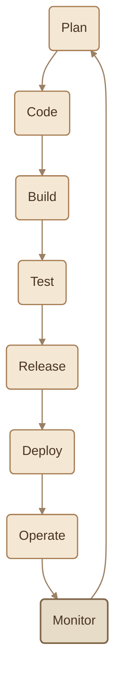
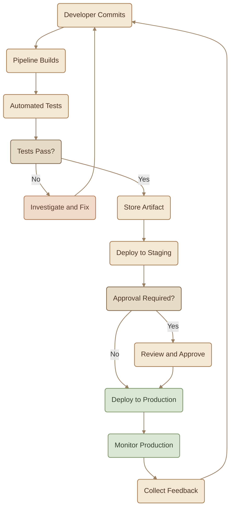
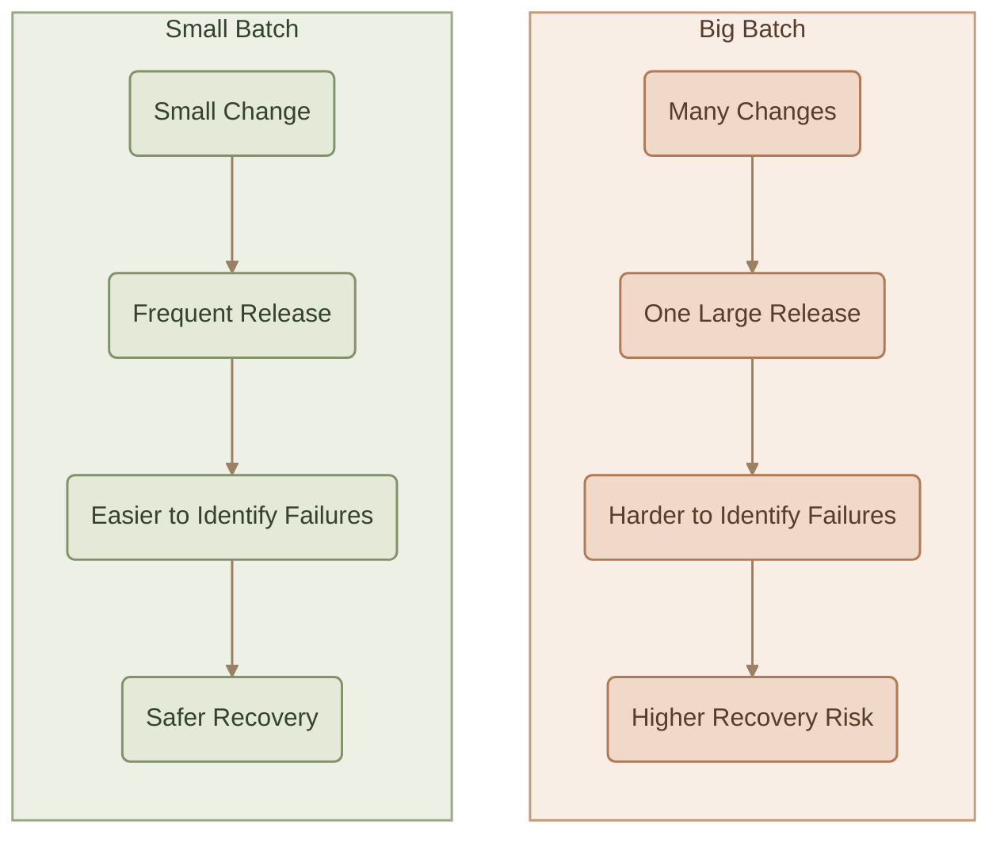
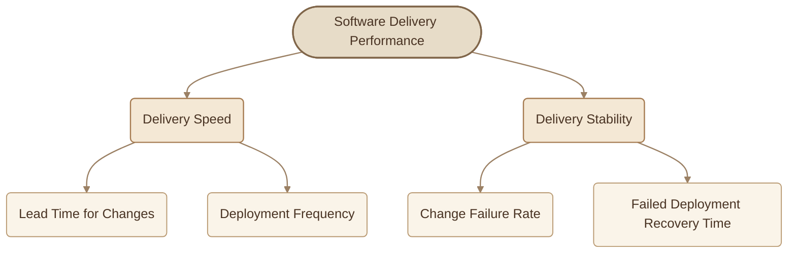

## Introduction

كل Software بتستخدمه مرّ برحلة قبل ما يوصل ليك: بدأت بفكرة، وبعدها اتخطط لها، واتكتب الـ Code، واتعمله Testing، ثم اتعمله Release وDeployment، وأخيرًا تمت مراقبته وهو شغال في Production.

الرحلة دي بنسميها **Software Delivery Lifecycle**، وهي المراحل اللي بيمرّ بها الـ Software من الفكرة لحد التشغيل الفعلي، مع الاستمرار في جمع Feedback لتحسينه.

دور DevOps مش إنه يخترع مراحل جديدة، لكن إنه يربط المراحل الموجودة ببعض، ويخليها **أسرع، وأكثر اعتمادًا على Automation، وأسهل في القياس والتحسين**.

## 1. The Software Delivery Lifecycle

الـ Lifecycle بيتكوّن من ثماني مراحل أساسية، وكل مرحلة بتجهّز الـ Output اللي المرحلة التالية بتحتاجه.

### I. The Eight Phases

<TableCard title="The Eight Phases">
| Phase | What Happens | DevOps Contribution |
|---|---|---|
| **Plan** | تحديد المطلوب تنفيذه وترتيب الأولويات. | إشراك Development وOperations وTesting في التخطيط. |
| **Code** | كتابة الـ Code ومراجعته قبل دمجه. | استخدام Version Control والعمل على تغييرات صغيرة. |
| **Build** | تحويل Source Code إلى Software قابل للتشغيل. | Automated وRepeatable Builds. |
| **Test** | التأكد إن التغييرات بتعمل بالشكل المتوقع. | تشغيل Automated Tests مع كل تغيير مناسب. |
| **Release** | تجهيز Version قابلة للتوزيع والنشر. | إنشاء Versioned Artifacts واضحة وقابلة للتتبع. |
| **Deploy** | نشر الـ Software في بيئة معينة. | استخدام Automated Deployments وConsistent Processes. |
| **Operate** | تشغيل الأنظمة والمحافظة على استقرارها. | Infrastructure as Code وOperational Automation. |
| **Monitor** | متابعة سلوك النظام وجمع Metrics وLogs. | استخدام Monitoring وAlerting لإنتاج Feedback مفيد. |
</TableCard>

### II. Why Is It a Lifecycle?

خد بالك من آخر سهم في الرسم: **Monitor → Plan**.

بعد ما الـ Software يوصل إلى Production، بنراقب سلوكه ونشوف المستخدمين بيتعاملوا معاه إزاي، وهل ظهرت Errors أو Performance Issues، وهل حقق المطلوب.

النتائج دي بترجع لمرحلة التخطيط، وبتساعد الفريق يحدد التغيير التالي.

<InfoCard variant="insight" title="The Feedback Loop" icon="pulse">

الـ Software Delivery مش خط مستقيم بينتهي عند Deployment. هي Continuous Loop: كل Release بتوفر معلومات تساعد الفريق يخطط ويحسّن الـ Release اللي بعدها.

</InfoCard>

## 2. One Change, End to End

خلينا نتتبع تغيير واحد من لحظة كتابة الـ Code لحد ما يوصل إلى Production.

### I. How Does the Pipeline Help?

<CardGrid columns={2} label="How the Pipeline Helps">
<InfoCard variant="concept" title="Automated Builds" description="بدل ما كل Developer يبني الـ Application بطريقة مختلفة، الـ Pipeline بتنفذ خطوات Build معروفة وقابلة للتكرار." icon="cube" tags={["Build"]} />

<InfoCard variant="concept" title="Automated Tests" description="لو تغيير جديد كسر Functionality موجودة، الاختبارات تقدر تكتشف المشكلة قبل وصول التغيير إلى Production." icon="shield" tags={["Test"]} />

<InfoCard variant="concept" title="Artifact Management" description="بنحتفظ بالـ Build الناتج ونقدر نتتبعه بدل ما نعيد بناء نسخة مختلفة لكل Environment." icon="database" tags={["Artifacts"]} />

<InfoCard variant="concept" title="Controlled Deployment" description="ممكن ننشر تلقائيًا إلى Staging، مع الاحتفاظ بخطوة Approval قبل Production لو سياسة الفريق بتتطلب ده." icon="wheel" tags={["Deploy"]} />

<InfoCard variant="concept" title="Monitoring" description="بعد النشر، بنراقب الـ Application عشان نعرف إذا كان التغيير نجح أو تسبب في مشكلة." icon="pulse" tags={["Observe"]} />
</CardGrid>

<InfoCard variant="tip" title="Build Once, Promote Across Environments" icon="layers">

الفكرة إنك تبني الـ Artifact مرة، وبعدها تروّج نفس الـ Artifact بين Staging وProduction، مع اختلاف Configuration الخاصة بكل Environment عند الحاجة. ده يقلل احتمال إن النسخة اللي اختبرتها تختلف عن النسخة اللي نشرتها.

</InfoCard>

الهدف مش إن كل Deployment لازم يحصل بدون أي تدخل بشري؛ الهدف إن خطوات التسليم تكون **Repeatable، قابلة للاختبار، وواضحة**، وإن الـ Automation تمنع الأخطاء الممكن اكتشافها مسبقًا.

## 3. Big Batches vs Small Batches

من أهم الاختلافات العملية اللي DevOps بيشجع عليها هو **حجم التغييرات اللي بنسلّمها في كل مرة**.

تخيّل فريق بيجمع تغييرات شهر كامل في Release واحدة، مقارنة بفريق بيسلّم تغييرات صغيرة على فترات متقاربة.

### I. Comparison

<TableCard title="Big Batch vs Small Batch">
| Aspect | Big Batch — Monthly Release | Small Batch — Frequent Releases |
|---|---|---|
| **Risk per Release** | تغييرات كتير ممكن تتأثر ببعض. | نطاق كل تغيير أصغر وأسهل في الفحص. |
| **Debugging** | صعب تحدد أي تغيير تسبب في المشكلة. | أسهل تربط المشكلة بتغيير محدد. |
| **Rollback** | ممكن يكون معقد بسبب حجم التغييرات واعتماد بعضها على بعض. | غالبًا أسهل لو التغيير معزول والـ Rollback مدعوم. |
| **Feedback** | بتكتشف المشاكل متأخرًا. | بتتعلم من نتائج التغييرات بسرعة أكبر. |
| **Recovery** | ممكن يحتاج وقتًا أطول للتحقيق والإصلاح. | ممكن تقل مساحة المشكلة ويسهل تحديد سببها. |
</TableCard>

### Why Are Small Batches Safer?

لما تنشر تغييرات صغيرة، بتقلل عدد المتغيرات اللي محتاج تفحصها لو حصلت مشكلة.

مثلًا، لو نشرت 20 تغييرًا في Release واحدة وظهر Bug، هتحتاج تحقق في التغييرات كلها والعلاقات بينها.

لكن لو كل تغيير اتسلّم بصورة مستقلة، فغالبًا هيكون أسهل تعرف أي تغيير مرتبط بالمشكلة.

ده مش معناه إن كل Small Change آمن تلقائيًا؛ لازم كمان يكون عندك Testing مناسب، ومراقبة جيدة، وطريقة واضحة للتعافي من المشاكل.

<InfoCard variant="tip" title="Small Batches Reduce Risk" icon="shield">

التغييرات الصغيرة بتسهّل اكتشاف المشاكل، وتسرّع Feedback، وتقلل حجم التغيير اللي محتاج تراجعه أو تتراجع عنه عند حدوث Failure.

</InfoCard>

## 4. The Four Key Metrics

إزاي نعرف إن عملية Software Delivery بتتحسن فعلًا؟

عدد الـ Deployments لوحده مش كفاية. ممكن فريق ينشر كل يوم، لكن كل Release تسبب مشاكل وتحتاج وقتًا طويلًا للإصلاح.

عشان كده، أبحاث **DORA** بتستخدم أربع Metrics أساسية لقياس جوانب مهمة من سرعة التسليم واستقرار الخدمة.

### I. Lead Time for Changes

**السؤال:** من وقت ما التغيير يدخل عملية التطوير المعتمدة، لحد ما يوصل إلى Production، بنحتاج وقت قد إيه؟

الـ Lead Time بيساعدك تعرف سرعة انتقال التغييرات خلال عملية التسليم.

- **Better Direction:** تقليل الوقت مع الحفاظ على الجودة والاعتمادية.
- **Example:** بدل ما التغيير يحتاج أسبوعين لحد النشر، الفريق يقدر يوصّله خلال يومين.

<Callout type="note" title="مهم">

لازم تحدد نقطة البداية والنهاية بوضوح عند قياس الـ Lead Time؛ بعض الفرق بتقيس من أول Commit، بينما DORA بتعرّف المقياس بطريقة مرتبطة بالتغيير من بدء العمل عليه حتى دخوله Production.

</Callout>

### II. Deployment Frequency

**السؤال:** بننشر تغييرات إلى Production كل قد إيه؟

المقياس ده بيقيس معدل تكرار الـ Deployments، مش عدد مرات تشغيل الـ Pipeline فقط.

- **Better Direction:** نشر أكثر تكرارًا عندما يكون ذلك مناسبًا لطبيعة النظام.
- **Example:** الانتقال من Release واحدة كل شهر إلى Releases صغيرة ومتكررة.

ارتفاع الـ Deployment Frequency ممكن يكون علامة جيدة، لكنه لازم يتقري مع باقي الـ Metrics؛ كثرة النشر مع ارتفاع معدل الفشل مش نتيجة مثالية.

### III. Change Failure Rate

**السؤال:** نسبة قد إيه من الـ Deployments بتسبب Failure أو تحتاج إلى تدخل تصحيحي؟

المقياس ده بيساعدك تعرف مدى استقرار عملية التسليم.

- **Better Direction:** تقليل نسبة الـ Deployments اللي تسبب مشاكل.
- **Example:** لو 10 Deployments من أصل 100 أدّت إلى Failures وفقًا لتعريف الفريق، يبقى Change Failure Rate يساوي 10%.

ممكن تختلف طريقة تحديد الـ Failure حسب النظام والفريق؛ المهم استخدام تعريف ثابت وواضح.

### IV. Failed Deployment Recovery Time

**السؤال:** لما Deployment تسبب مشكلة، بنحتاج وقت قد إيه لاستعادة الخدمة؟

المقياس ده بيركز على سرعة التعافي بعد Failure مرتبطة بالنشر.

- **Better Direction:** استعادة الخدمة في وقت أقصر.
- **Example:** بدل ما المشكلة تحتاج ساعات طويلة للتحقيق والإصلاح، الفريق يقدر يستعيد الخدمة خلال دقائق.

قد تلاقي مصادر أو إصدارات أقدم بتستخدم اسم **Time to Restore Service** أو **Mean Time to Recovery (MTTR)**. في مصطلحات DORA الحديثة، من المهم التمييز بين وقت التعافي من Deployment فاشلة وبين MTTR العام، لأن نطاق القياس ممكن يختلف.

### V. Metrics at a Glance

<TableCard title="DORA Metrics at a Glance">
| Metric | السؤال الأساسي | الاتجاه المطلوب |
|---|---|---|
| **Lead Time for Changes** | التغيير بيوصل إلى Production بعد قد إيه؟ | أقل |
| **Deployment Frequency** | بننشر إلى Production كل قد إيه؟ | أكثر تكرارًا عند ملاءمة ذلك |
| **Change Failure Rate** | كام نسبة الـ Deployments اللي بتسبب Failure؟ | أقل |
| **Failed Deployment Recovery Time** | بنستعيد الخدمة بعد Deployment فاشلة في قد إيه؟ | أقل |
</TableCard>

<CardGrid columns={2} label="The Four DORA Metrics">
<InfoCard variant="feature" title="Lead Time" description="قِس سرعة انتقال التغيير من بداية العمل عليه إلى Production." icon="cycle" tags={["Speed"]} />

<InfoCard variant="feature" title="Deployment Frequency" description="قِس تكرار الـ Deployments الفعلية إلى Production." icon="wheel" tags={["Frequency"]} />

<InfoCard variant="feature" title="Change Failure Rate" description="قِس نسبة الـ Deployments التي تسبب Failures وفقًا لتعريف ثابت." icon="shield" tags={["Stability"]} />

<InfoCard variant="feature" title="Recovery Time" description="قِس الوقت اللازم للتعافي من Deployment فاشلة." icon="flag" tags={["Recovery"]} />
</CardGrid>

### VI. How Do the Metrics Work Together?

ما ينفعش تحكم على أداء الفريق باستخدام Metric واحدة بس.

مثلًا، زيادة Deployment Frequency مع تقليل Lead Time شيء إيجابي من ناحية السرعة، لكن لو Change Failure Rate ارتفع ووقت التعافي طال، يبقى التحسن مش متوازن.

الهدف هو تحسين سرعة التسليم **مع الحفاظ على الاستقرار والقدرة على التعافي**.

## 5. What Should You Remember?

<CardGrid columns={3} label="SDLC Recap">
<InfoCard variant="summary" title="01 — The Lifecycle" description="الـ SDLC دورة متكاملة تبدأ بالتخطيط وتنتهي بعودة Feedback من Production إلى التخطيط من جديد." icon="cycle" tags={["Loop"]} />

<InfoCard variant="summary" title="02 — Automation" description="DevOps بيربط المراحل ويجعل تنفيذها أكثر اتساقًا وقابلية للتكرار باستخدام Automation." icon="sliders" tags={["Automate"]} />

<InfoCard variant="summary" title="03 — Small Batches" description="التغييرات الصغيرة بتسهّل Testing وDebugging وRecovery، وبتسرّع التعلّم من النتائج." icon="layers" tags={["Batches"]} />

<InfoCard variant="summary" title="04 — Four Metrics" description="الـ Lead Time وDeployment Frequency وChange Failure Rate وRecovery Time بتساعدك تقيس أداء عملية التسليم من أكثر من زاوية." icon="pulse" tags={["DORA"]} />

<InfoCard variant="summary" title="05 — Production Feedback" description="الـ Deployment مش نهاية الرحلة؛ Monitoring وFeedback جزء أساسي من دورة تطوير الـ Software." icon="flag" tags={["Feedback"]} />
</CardGrid>

**The key idea:** DevOps مش مجرد إنك تنشر Software أسرع؛ هو إنك تبني عملية تسليم متكررة، قابلة للقياس، وتقدر تتحسن باستمرار من غير ما تضحي بالاعتمادية.
