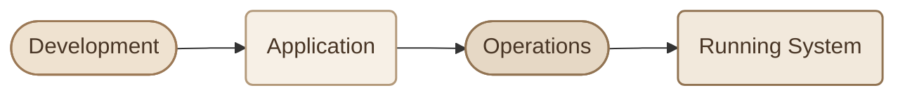
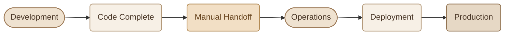
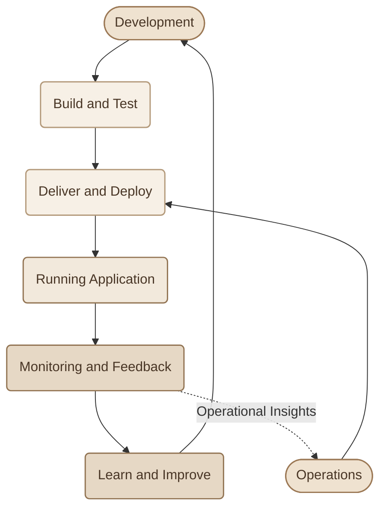
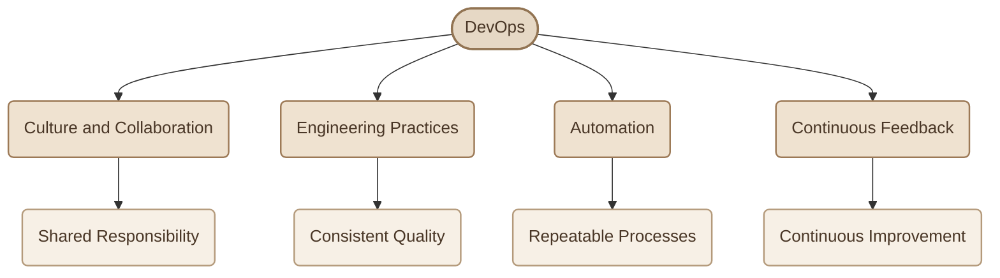
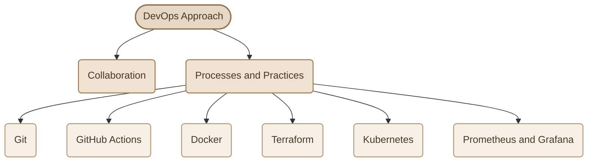
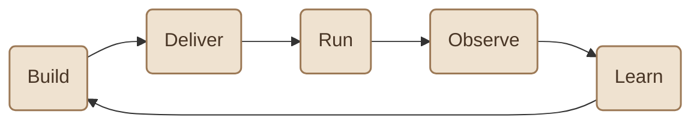

## Introduction

DevOps هو **طريقة شغل (Way of Working)** بتجمع بين الـ **Development** والـ **Operations**، وهدفها إن بناء الـ Software وتسليمه وتشغيله يبقوا جزء من عملية واحدة مستمرة، بدل ما كل فريق يشتغل بمعزل عن التاني.

الفكرة مش إننا نكتب Code أسرع وخلاص، لكن إننا نحسّن الـ **Software Delivery Lifecycle** بالكامل، بدايةً من كتابة الـ Code، مرورًا بالـ Deployment، لحد تشغيل الـ Application ومتابعتها في الـ Production.

<CardGrid columns={3} label="The Three Perspectives">
<InfoCard variant="comparison" title="Development" description="مسؤول عن بناء الـ Application، إضافة Features جديدة، إصلاح Bugs، واختبار الـ Code." icon="code" tags={["Build"]} />

<InfoCard variant="comparison" title="Operations" description="مسؤول عن الـ Infrastructure، تشغيل الـ Applications، الـ Deployment، ومتابعة استقرار الـ Systems." icon="cube" tags={["Run"]} />

<InfoCard variant="comparison" title="DevOps" description="بيقرّب الفريقين من بعض، ويعتمد على Collaboration وAutomation وContinuous Feedback لتحسين عملية تسليم وتشغيل الـ Software." icon="cycle" tags={["Together"]} />
</CardGrid>

## 1. Development and Operations

علشان نفهم الـ DevOps، لازم الأول نفهم طبيعة الشغل في كل ناحية.

### I. Development

الـ **Development Team** مسؤول بشكل أساسي عن بناء الـ Application وتطويرها.

من ضمن مسؤولياته:

<CardGrid columns={3} label="Development Responsibilities">
<InfoCard variant="concept" title="Write Code" description="كتابة الـ Code وتنظيمه." icon="code" tags={["Code"]} />

<InfoCard variant="concept" title="Build Features" description="تنفيذ Features جديدة." icon="layers" tags={["Features"]} />

<InfoCard variant="concept" title="Fix Bugs" description="إصلاح الـ Bugs." icon="wrench" tags={["Bugs"]} />

<InfoCard variant="concept" title="Test Logic" description="اختبار الـ Application Logic." icon="shield" tags={["Testing"]} />

<InfoCard variant="concept" title="Prepare Releases" description="تجهيز إصدارات جديدة من الـ Software." icon="flag" tags={["Releases"]} />
</CardGrid>

### II. Operations

الـ **Operations Team** مسؤول عن تشغيل الـ Application والمحافظة على استقرارها في الـ Environment الحقيقي.

من ضمن مسؤولياته:

<CardGrid columns={3} label="Operations Responsibilities">
<InfoCard variant="concept" title="Infrastructure" description="إدارة الـ Infrastructure والـ Servers." icon="cube" tags={["Servers"]} />

<InfoCard variant="concept" title="Environments" description="تجهيز الـ Environments." icon="layers" tags={["Envs"]} />

<InfoCard variant="concept" title="Deployments" description="نشر الـ Applications باستخدام Deployment Processes مناسبة." icon="wheel" tags={["Deploy"]} />

<InfoCard variant="concept" title="Availability" description="متابعة الـ Availability والـ Performance." icon="pulse" tags={["Uptime"]} />

<InfoCard variant="concept" title="Monitoring" description="مراقبة الـ Systems والتعامل مع المشاكل التشغيلية." icon="flag" tags={["Systems"]} />
</CardGrid>

### III. How They Work Together

بشكل مبسّط، الـ Development بيبني الـ Software، والـ Operations بيشغّله ويحافظ على استقراره.

الاتنين مهمين، لأن كتابة Software شغال على جهاز الـ Developer مش معناها بالضرورة إنه هيشتغل بنفس الطريقة لما يتنشر على Production.

المشكلة بتظهر لما كل طرف يركّز على مسؤوليته فقط، من غير ما يكون فيه تعاون كفاية بين المرحلتين.

## 2. The Gap Between Development and Operations

في الـ Traditional Workflow، ممكن الـ Development Team يعتبر إن شغله خلص بمجرد ما الـ Code يبقى جاهز، وبعدها يسلّمه للـ Operations Team علشان يتولى الـ Deployment.

هنا ممكن الـ Operations Team يكتشف إن الـ Application محتاجة Dependencies مش موجودة على الـ Server، أو Configuration مختلفة، أو تغييرات في الـ Infrastructure قبل ما تقدر تشتغل.

بالتالي، المشكلة مش بالضرورة في الـ Code نفسه؛ المشكلة ممكن تكون في المسافة بين بناء الـ Software وتشغيله.

<CardGrid columns={2} label="What Goes Wrong">
<InfoCard variant="warning" title="Communication Problems" description="عدم وضوح المتطلبات أو عدم مشاركة المعلومات المهمة بين الفريقين." icon="network" tags={["Gap"]} />

<InfoCard variant="warning" title="Manual Handoffs" description="الاعتماد على تسليمات يدوية بين الفرق، مع احتمالية نسيان خطوات أو إعدادات مهمة." icon="branch" tags={["Handoffs"]} />

<InfoCard variant="warning" title="Environment Differences" description="اختلاف الـ Dependencies أو الـ Configuration بين بيئة الـ Development وبيئة الـ Production." icon="layers" tags={["Envs"]} />

<InfoCard variant="warning" title="Slow Feedback" description="اكتشاف المشاكل متأخرًا، بعد ما الـ Application تكون انتقلت لمرحلة أبعد في عملية التسليم." icon="cycle" tags={["Late"]} />
</CardGrid>

النتيجة ممكن تكون Delays، وDeployment Failures، وشغل متكرر، ووقت أطول لحل المشاكل.

**وهنا بتيجي أهمية الـ DevOps:** تقليل الفجوة بين بناء الـ Software وتشغيله، وتحسين التعاون بين الأطراف المسؤولة عنه.

## 3. How DevOps Connects the Two Worlds

بدل ما نتعامل مع الـ Development والـ Operations باعتبارهم مرحلتين منفصلتين، الـ DevOps بيشجّع التعاون خلال الـ **Entire Software Delivery Lifecycle**.

الفكرة إن الـ Development يستفيد من المشاكل والـ Feedback اللي بتظهر في الـ Production، والـ Operations يشارك في تحسين طريقة تجهيز وتسليم الـ Application من البداية.

وده بيساعد الفريقين يكتشفوا المشاكل بدري، ويقللوا الـ Manual Work، ويحسّنوا الـ Reliability.

<Callout type="note" title="مهم">

الـ DevOps مش معناه بالضرورة إن كل الناس لازم تبقى في Team واحدة أو إن كل شخص لازم يكون مسؤول عن كل حاجة. المهم وجود Collaboration وShared Responsibility تجاه النتيجة النهائية.

</Callout>

## 4. DevOps Is a Way of Working

من الأخطاء الشائعة إن الناس تتعامل مع الـ DevOps باعتباره اسم Tool معينة أو Job Title وخلاص.

لكن الـ DevOps أوسع من كده؛ لأنه بيعتمد على مجموعة أفكار وممارسات بتكمّل بعضها.

خلينا نفهم كل جزء بسرعة:

<CardGrid columns={2} label="What DevOps Is Built On">
<InfoCard variant="concept" title="Culture and Collaboration" description="الفرق تتشارك المعلومات، وتفهم تأثير قراراتها على باقي مراحل الـ Software Lifecycle، بدل ما كل فريق يشتغل بمعزل عن التاني." icon="network" tags={["Culture"]} />

<InfoCard variant="concept" title="Engineering Practices" description="استخدام ممارسات زي Version Control، وTesting، وCode Review، وطرق واضحة لإدارة التغييرات." icon="branch" tags={["Practices"]} />

<InfoCard variant="concept" title="Automation" description="أتمتة المهام المتكررة، زي الـ Testing والـ Build والـ Deployment، لتقليل الأخطاء اليدوية وتحسين الـ Consistency." icon="sliders" tags={["Automate"]} />

<InfoCard variant="concept" title="Continuous Feedback" description="جمع المعلومات من الـ Tests والـ Monitoring والـ Logs، واستخدامها لتحسين الـ Application وطريقة تشغيلها." icon="pulse" tags={["Feedback"]} />
</CardGrid>

مثلًا، لو كل Deployment محتاج مجموعة خطوات يدوية، الفريق ممكن يضيّع وقت في تكرار نفس الشغل، أو ينسى خطوة مهمة.

لكن باستخدام Automation، يقدر الفريق يحوّل الخطوات دي إلى Process واضحة وقابلة للتكرار.

ولو حصلت مشكلة بعد الـ Deployment، الـ Monitoring والـ Logs بيساعدوا في اكتشافها وفهم سببها، وبعدها الفريق يقدر يحسّن الـ Process نفسها.

## 5. DevOps Is Not a Tool

هتسمع مصطلح DevOps جنب Technologies كتير، زي:

- Git
- Docker
- Kubernetes
- GitHub Actions
- Terraform
- AWS
- Prometheus
- Grafana

كل Tool من دول ممكن يساعد في تنفيذ جزء من الـ DevOps Practices، لكن مفيش Tool واحدة لوحدها تساوي DevOps.

خلينا نوضّح الفرق:

<TableCard title="Role of Each Technology">
| Technology | دورها في الـ DevOps |
|---|---|
| Git | إدارة تغييرات الـ Code والتعاون عليه باستخدام Version Control. |
| Docker | بناء وتشغيل Applications داخل Containers. |
| Kubernetes | إدارة الـ Containerized Applications على نطاق أكبر. |
| GitHub Actions | أتمتة Workflows زي Testing وBuild وDeployment. |
| Terraform | تعريف وإدارة الـ Infrastructure باستخدام Infrastructure as Code. |
| AWS | توفير Cloud Infrastructure وخدمات لتشغيل الـ Applications. |
| Prometheus & Grafana | جمع Metrics ومتابعتها وعرضها للمساعدة في فهم حالة الـ Systems. |
</TableCard>

<InfoCard variant="insight" title="The Key Difference" icon="layers">
الـ Tools بتساعدك تنفّذ الشغل، لكن الـ DevOps هو طريقة تنظيم الشغل والتعاون والأتمتة والتحسين المستمر.

ممكن تستخدم Docker وKubernetes في مشروع، لكن لو الـ Teams لسه بتشتغل في Silos، ومفيش Feedback واضح أو Processes مناسبة، فمجرد استخدام الأدوات مش كفاية لتحقيق أهداف الـ DevOps.
</InfoCard>

## 6. A Simple Mental Model

أسهل طريقة تفهم بيها الـ DevOps هي إنك تبص للـ Software باعتباره دورة مستمرة، مش مهمة بتنتهي بمجرد ما الـ Code يخلص.

خلينا نمشي في الدورة دي:

<Steps>
<li>

<InfoCard title="Build" description="نبني الـ Application ونختبر الـ Code." icon="cube" />

</li>
<li>

<InfoCard title="Deliver" description="نجهّز الـ Release ونعمل Deploy للـ Application." icon="flag" />

</li>
<li>

<InfoCard title="Run" description="نشغّل الـ Application داخل الـ Environment المستهدف." icon="wheel" />

</li>
<li>

<InfoCard title="Observe" description="نتابع الـ Logs والـ Metrics والـ Application Behavior." icon="pulse" />

</li>
<li>

<InfoCard title="Learn" description="نفهم المشاكل والـ Feedback ونستخدمهم لتحسين الـ Software والـ Process." icon="cycle" />

</li>
</Steps>

بعد كده الدورة بتبدأ من جديد، لكن بناءً على المعلومات اللي اتجمعت من التشغيل الفعلي.

مش لازم كل مؤسسة تستخدم نفس الـ Tools أو نفس الـ Architecture علشان تطبّق الأفكار دي؛ لأن الاختيارات بتختلف حسب طبيعة الـ Application والـ Infrastructure واحتياجات الفريق.

المهم هو إن عملية البناء والتسليم والتشغيل والتحسين تكون مترابطة.

## 7. What Should You Remember?

<CardGrid columns={2} label="What is DevOps Recap">
<InfoCard variant="summary" title="01 — Way of Working" description="الـ DevOps هو طريقة شغل بتجمع بين People وProcesses وTechnology، مش Tool واحدة." icon="cycle" tags={["Mindset"]} />

<InfoCard variant="summary" title="02 — Collaboration" description="بيقرّب الـ Development والـ Operations وبيقلل العزلة بين الفريقين." icon="network" tags={["Teams"]} />

<InfoCard variant="summary" title="03 — Automation" description="بيشجّع أتمتة المهام المتكررة علشان نحسّن الـ Consistency ونقلل الأخطاء اليدوية." icon="sliders" tags={["Automate"]} />

<InfoCard variant="summary" title="04 — Continuous Feedback" description="بيستخدم المعلومات الناتجة من الـ Testing والـ Production علشان يطوّر الـ Software والـ Workflow باستمرار." icon="pulse" tags={["Feedback"]} />
</CardGrid>

في النهاية، الهدف من الـ DevOps مش مجرد إننا نعمل Deployment أسرع، لكن إننا نحسّن الطريقة اللي الـ Software بيتبني وبيتسلّم وبيشتغل بيها، مع تعاون أفضل بين الفرق وFeedback مستمر يساعدنا نطوّر النتيجة النهائية.
