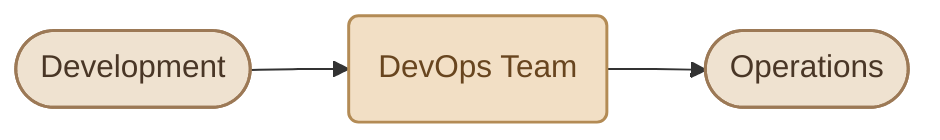
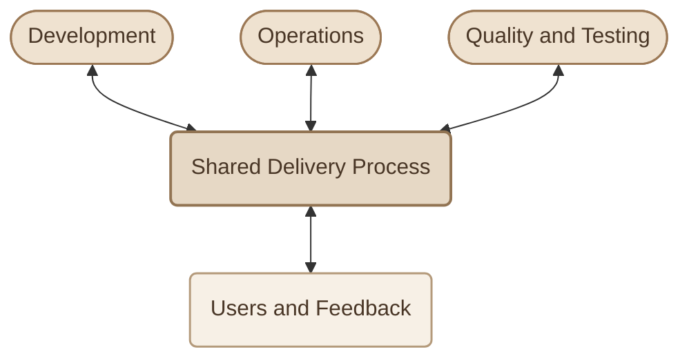
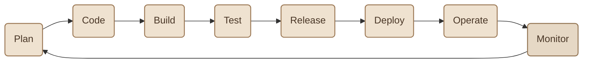
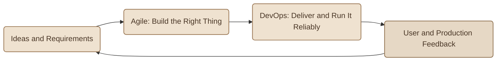
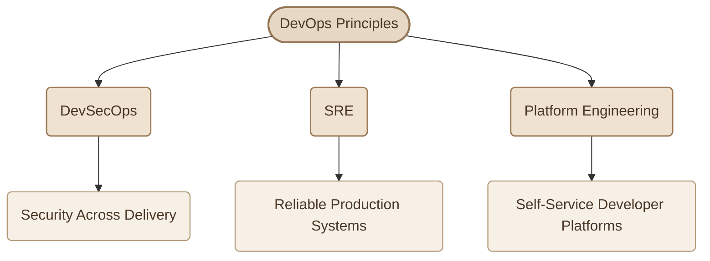
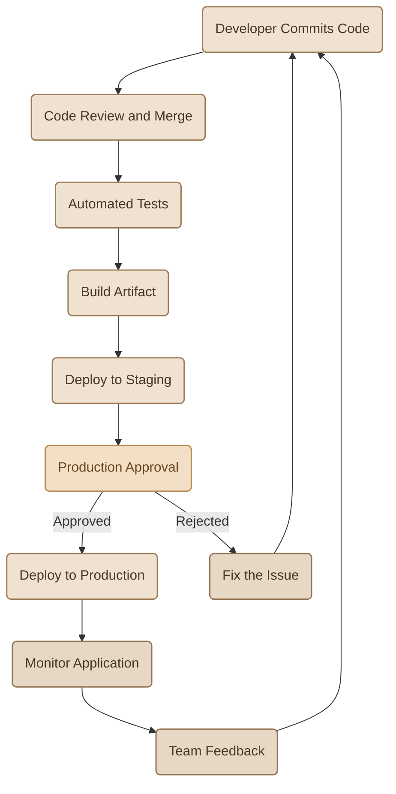

## Introduction

بعد ما فهمنا **What is DevOps?** و**Why DevOps?**، فاضل سؤال مهم: إحنا بنطبّق الـ DevOps فين بالظبط؟ هل هو Team معينة جوه الشركة؟ ولا مجموعة Tools؟ ولا طريقة شغل بتأثر على مراحل مختلفة؟

الإجابة ببساطة: **الـ DevOps بيمتد عبر الـ Software Delivery Lifecycle بالكامل**، من أول التخطيط للـ Application، لحد تشغيلها ومراقبتها والاستفادة من الـ Feedback لتحسينها.

يعني مش مكانه في مرحلة واحدة أو قسم واحد؛ هو مجموعة Practices بتربط الناس والعمليات المسؤولة عن بناء الـ Software وتسليمه وتشغيله.

## 1. DevOps Is Not a Team You Hand Work To

من أشهر المفاهيم الغلط عن الـ DevOps إن الشركة تعمل Team باسم DevOps، وبعدها تحوّل لها كل مسؤوليات الـ Deployment والـ Infrastructure، وتسيب باقي الفرق من غير مسؤولية عن تشغيل الـ Software.

مثلًا، ممكن تسمع الجملة دي:

<Callout type="warning" title="The Wrong Mental Model">

عندنا DevOps Team، هما المسؤولين عن كل الـ Deployments، فإحنا كـ Developers مش محتاجين نهتم بالـ Operations.

</Callout>

المشكلة إن التفكير ده ممكن يعيد بناء نفس الحاجز القديم بين الـ Development والـ Operations، لكن باسم جديد.

في النموذج ده، أي فريق محتاج يعمل Deployment ممكن يضطر يستنى الـ DevOps Team، ومع زيادة عدد الـ Applications والـ Releases، الفريق ده ممكن يتحول إلى **Bottleneck** يعطّل الشغل بدل ما يسهّله.

كمان، لو الـ Developers مش بيشاركوا في فهم مشاكل الـ Production، والـ Operations مش بتشارك في تحسين الـ Delivery Process، هتفضل فيه فجوة بين بناء الـ Software وتشغيله.

### I. The Better Mental Model

الأفضل إننا نتعامل مع الـ DevOps باعتباره **Shared Practices** بتربط الأدوار المختلفة حول عملية تسليم وتشغيل مشتركة.

ده مش معناه إن كل الناس هتعمل نفس الشغل.

<CardGrid columns={3} label="Roles Stay Specialized">
<InfoCard variant="concept" title="Developers" description="لسه مسؤولين عن كتابة الـ Code وتصميم الـ Application Logic." icon="code" tags={["Code"]} />

<InfoCard variant="concept" title="Operations Engineers" description="لسه عندهم خبرة متخصصة في الـ Infrastructure والـ Networking والـ Reliability." icon="cube" tags={["Infra"]} />

<InfoCard variant="concept" title="QA Engineers" description="بيساعدوا في تحسين الـ Quality والتحقق من سلوك الـ Application." icon="shield" tags={["Quality"]} />
</CardGrid>

الاختلاف إن الأدوار دي بتتعاون بشكل أفضل، وبتشارك المسؤولية عن النتيجة النهائية بدل ما كل طرف يسلّم شغله للتاني وينتهي دوره.

<InfoCard variant="insight" title="Shared Responsibility ≠ Same Responsibilities" icon="network">
الـ DevOps مش معناه إن كل شخص لازم يعمل كل حاجة. معناه إن كل دور يساهم بخبرته في عملية متكاملة، وإن مشاكل الـ Delivery والـ Production تكون مسؤولية مشتركة بدل ما تتحول إلى مشكلة فريق واحد فقط.
</InfoCard>

## 2. Across the Whole Software Lifecycle

الـ DevOps مش بيبدأ عند الـ Deployment وينتهي بعده؛ ممارساته ممكن تظهر في كل مرحلة من مراحل الـ Software Lifecycle.

خلينا نشوف إزاي الـ DevOps Practices بتأثر على كل مرحلة.

<TableCard title="DevOps Across the Lifecycle">
| Stage | How DevOps Fits |
|---|---|
| **Plan** | الـ Development والـ Operations والـ Testing يتعاونوا في فهم المتطلبات والمخاطر. |
| **Code** | استخدام Version Control، وCode Reviews، وتقسيم التغييرات إلى Changes أصغر. |
| **Build** | أتمتة الـ Build Process علشان تكون خطوات التجهيز واضحة وقابلة للتكرار. |
| **Test** | تشغيل Automated Tests لاكتشاف المشاكل قبل انتقال التغييرات لمراحل أبعد. |
| **Release** | تجهيز Versioned Artifacts واضحة، بحيث نعرف النسخة اللي بنجهّز لنشرها. |
| **Deploy** | استخدام Automated Pipelines وعمليات Deployment قابلة للتكرار. |
| **Operate** | تشغيل الـ Applications وإدارة الـ Infrastructure والـ Configuration بصورة منظمة. |
| **Monitor** | متابعة الـ Metrics والـ Logs والـ Errors، واستخدام النتائج في التخطيط للتحسينات التالية. |
</TableCard>

خد بالك إن الـ Monitoring بيربط آخر الدورة بأولها.

مثلًا، لو الـ Monitoring وضّح إن استهلاك الـ Memory زاد بعد إضافة Feature جديدة، الفريق يقدر يستخدم المعلومات دي لتحديد السبب، وتحسين الـ Code أو الـ Configuration، وإضافة Tests أو Monitoring مناسبة لمنع تكرار المشكلة.

**وده جوهر الـ Continuous Feedback:** إن المعلومات الناتجة من التشغيل الفعلي ترجع للفريق وتساعده ياخد قرارات أفضل في التغييرات القادمة.

## 3. DevOps and Agile

غالبًا هتقابل مصطلح **Agile** جنب الـ DevOps، لأن الاتنين بيهتموا بتحسين طريقة تطوير وتسليم الـ Software، لكن كل واحد بيركّز على جانب مختلف.

<CardGrid columns={2} label="Agile and DevOps">
<InfoCard variant="comparison" title="Agile" description="بيركّز على طريقة تنظيم وتطوير الـ Software، زي العمل في Iterations قصيرة، وترتيب الأولويات، والحصول على Feedback متكرر." icon="cycle" tags={["Build Right"]} />

<InfoCard variant="comparison" title="DevOps" description="بيركّز على ربط تطوير الـ Software بتسليمها وتشغيلها، من خلال Collaboration وAutomation وContinuous Feedback." icon="wheel" tags={["Deliver Reliable"]} />
</CardGrid>

ممكن نفهم العلاقة بينهم بالشكل ده:

مثلًا، فريق ممكن يستخدم Agile وينفّذ Features في Iterations قصيرة، لكن يفضّل يجمع التغييرات كلها في Release واحدة كبيرة كل عدة شهور.

هنا الفريق ممكن يكون سريع في تطوير الـ Features، لكن لسه عنده مشكلة في توصيلها للـ Users.

الـ DevOps بيساعد في تحسين الجزء ده عن طريق أتمتة الـ Build والـ Testing والـ Deployment، وتحسين الـ Monitoring والـ Feedback.

وفي المقابل، ممكن فريق يستخدم Automation قوية من غير ما يكون عنده طريقة فعّالة لترتيب الأولويات أو الاستجابة لاحتياجات الـ Users.

**Agile وDevOps مش بدائل لبعض؛ ممكن يكملوا بعض لتحسين الرحلة من الفكرة لحد الـ Production.**

## 4. Related Practices and Disciplines

وأنت بتتعلم DevOps، هتقابل مفاهيم قريبة منه، وكل مفهوم منها بيركّز على جانب مهم من بناء وتشغيل الأنظمة.

<CardGrid columns={3} label="Related Disciplines">
<InfoCard variant="concept" title="DevSecOps" description="دمج الـ Security في مراحل الـ Software Delivery بدل ما نستنى لآخر المشروع علشان نكتشف المشاكل الأمنية." icon="shield" tags={["Security"]} />

<InfoCard variant="concept" title="SRE" description="اختصار لـ Site Reliability Engineering، وهو مجال بيستخدم Software Engineering وممارسات تشغيلية لتحسين الـ Reliability وإدارة مخاطر التغييرات." icon="pulse" tags={["Reliability"]} />

<InfoCard variant="concept" title="Platform Engineering" description="بناء Internal Platforms وأدوات وخدمات مشتركة تساعد فرق الـ Software إنها تبني وتختبر وتنشر Applications بسهولة أكبر." icon="layers" tags={["Platforms"]} />
</CardGrid>

### I. How They Relate to DevOps

المخطط بيوضّح العلاقة العامة بينهم، مش إن كل مجال لازم يكون تابع تنظيميًا للـ DevOps.

خلينا نفرّق بينهم بشكل أدق:

- **DevSecOps:** بيركّز على تضمين الـ Security في الـ Development والـ Delivery والـ Operations.
- **SRE:** بيركّز على الـ Reliability باستخدام مبادئ هندسة البرمجيات، مع أدوات لقياس وإدارة استقرار الخدمة.
- **Platform Engineering:** بيركّز على توفير Platforms داخلية تقلل الـ Cognitive Load على فرق الـ Product، وتسهّل استخدام البنية التحتية والخدمات المشتركة.

كل مجال ليه أهداف وممارسات متخصصة، لكن فيه تداخل واضح بينهم وبين أهداف الـ DevOps.

## 5. Where You See DevOps in Daily Work

خلينا نربط الكلام النظري بمثال عملي.

تخيّل إنك بتشتغل على Application، وعملت تعديل في الـ Code وعايز توصّله للـ Production.

في Workflow منظم، ممكن العملية تمشي بالشكل ده:

في المثال ده، فيه مجموعة ممارسات DevOps واضحة:

<Steps>
<li>

<InfoCard title="Code Review" description="بيساعد في مراجعة التغييرات قبل دمجها." icon="git-pull-request" />

</li>
<li>

<InfoCard title="Automated Tests" description="بتتحقق من سلوك الـ Application بعد التعديل." icon="shield" />

</li>
<li>

<InfoCard title="Build Artifact" description="بيكون ناتج محدد من عملية الـ Build." icon="cube" />

</li>
<li>

<InfoCard title="Staging Environment" description="بتتيح اختبار النسخة في بيئة مناسبة قبل الـ Production." icon="layers" />

</li>
<li>

<InfoCard title="Production Approval" description="ممكن يكون خطوة مطلوبة حسب سياسة النشر ومستوى المخاطر." icon="flag" />

</li>
<li>

<InfoCard title="Monitoring" description="بيساعد الفريق يتأكد إن الـ Application شغالة بشكل طبيعي بعد الـ Deployment." icon="pulse" />

</li>
</Steps>

في بعض المشاريع، الـ Deployment ممكن يحصل تلقائيًا بعد نجاح الشروط المطلوبة. وفي مشاريع تانية، ممكن يكون فيه Approval يدوي قبل النشر للـ Production.

المهم إن العملية تكون واضحة، وقابلة للتكرار، ومناسبة لمستوى المخاطر.

<InfoCard variant="insight" title="A Practical Sign of DevOps" icon="flag">
لما الـ Developer يقدر يرسل Change، وتعدّي على Review وAutomated Tests وBuild وDeployment Process واضحة، وبعدها الفريق يراقب النتيجة ويتعلم منها، فأنت بتشوف ممارسات DevOps مطبّقة في الشغل اليومي.
</InfoCard>

## 6. What Should You Remember?

<CardGrid columns={2} label="Where DevOps Fits Recap">
<InfoCard variant="summary" title="01 — Across the Lifecycle" description="الـ DevOps بيمتد من الـ Planning والـ Coding لحد الـ Deployment والـ Monitoring." icon="cycle" tags={["Lifecycle"]} />

<InfoCard variant="summary" title="02 — Shared Ownership" description="الـ DevOps مش مجرد Team تستلم كل الـ Deployments؛ هو تعاون بين الأدوار المختلفة مع الحفاظ على التخصصات والمسؤوليات الواضحة." icon="network" tags={["Ownership"]} />

<InfoCard variant="summary" title="03 — Agile and DevOps" description="الـ Agile بيساعد الفرق تطوّر الـ Software وتستجيب للتغيير، والـ DevOps بيساعدها تربط التطوير بالتسليم والتشغيل الموثوق." icon="cycle" tags={["Agile"]} />

<InfoCard variant="summary" title="04 — Related Disciplines" description="الـ DevSecOps والـ SRE والـ Platform Engineering مجالات متداخلة مع DevOps، لكن لكل واحد منها تركيز وممارسات متخصصة." icon="layers" tags={["Disciplines"]} />
</CardGrid>

**الخلاصة:** الـ DevOps مش محطة بتوصل لها الـ Application بعد ما الـ Development يخلّص شغله؛ هو طريقة شغل بتربط مراحل الـ Software Lifecycle ببعض، وبتساعد الناس المسؤولة عن البناء والتسليم والتشغيل إنها تشتغل لتحقيق نتيجة مشتركة.
