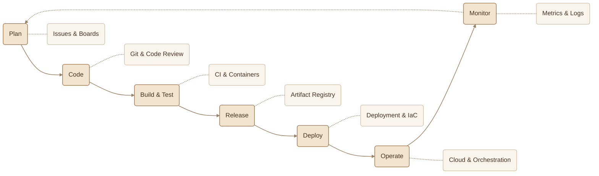
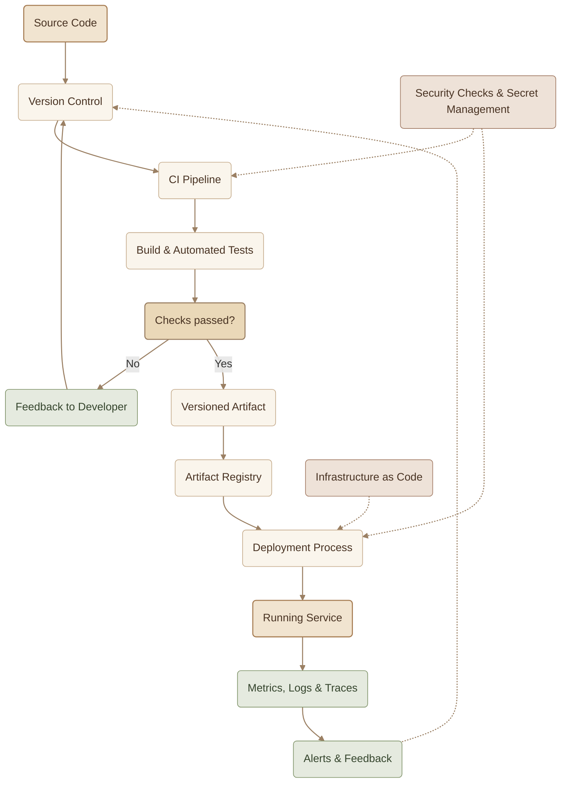
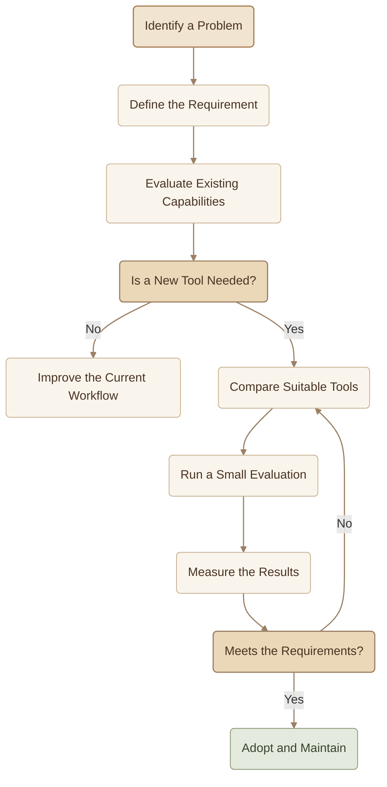

## Introduction

By now, you have explored DevOps culture, the software delivery lifecycle, environments, automation, and CI/CD. This article zooms out to examine the **DevOps Toolchain** — the collection of tools that support these practices as one connected system.

The goal is not to learn every tool on the market. It is to understand **what each category does, where it fits, and why a team might need it**.

<Callout type="note" title="Tools Are Not DevOps">

Docker is not DevOps. Terraform is not DevOps. Jenkins is not DevOps. Tools support DevOps practices; they do not replace them.

</Callout>

## 1. The Toolchain Across the Lifecycle

The Software Delivery Lifecycle gives us a useful way to organize the toolchain. Each phase has different responsibilities, and tools help teams perform those responsibilities consistently.

The lifecycle is a model, not a rigid sequence. Real workflows may run stages in parallel, repeat tests, or deploy independently. Monitoring also feeds information back into planning, development, and operations.

## 2. Toolchain Categories

Each category solves a different class of problem. A team may use one tool for several responsibilities, or combine specialized tools when there is a clear benefit.

<CardGrid columns={3} label="Toolchain Categories">
<InfoCard variant="concept" title="Version Control" icon="branch" tags={["Tools"]}>
  **Purpose:** Track changes, collaborate safely, and review code.

  **Examples:** Git, GitHub, GitLab.

  **Why it matters:** Every meaningful change can be traced and reviewed.
</InfoCard>
<InfoCard variant="concept" title="CI/CD" icon="cycle" tags={["Tools"]}>
  **Purpose:** Automate building, testing, and software delivery.

  **Examples:** GitHub Actions, GitLab CI/CD, Jenkins.

  **Why it matters:** Reduces repetitive manual work and shortens feedback loops.
</InfoCard>
<InfoCard variant="concept" title="Containers" icon="cube" tags={["Tools"]}>
  **Purpose:** Package an application and its runtime dependencies consistently.

  **Examples:** Docker, containerd.

  **Why it matters:** Makes application packaging more predictable across environments.
</InfoCard>
<InfoCard variant="concept" title="Orchestration" icon="layers" tags={["Tools"]}>
  **Purpose:** Manage containerized workloads across a cluster.

  **Examples:** Kubernetes.

  **Why it matters:** Supports scheduling, scaling, service discovery, and recovery.
</InfoCard>
<InfoCard variant="concept" title="Infrastructure as Code" icon="code" tags={["Tools"]}>
  **Purpose:** Define and manage infrastructure through version-controlled files.

  **Examples:** Terraform, OpenTofu, Pulumi.

  **Why it matters:** Makes infrastructure changes reviewable and repeatable.
</InfoCard>
<InfoCard variant="concept" title="Configuration Management" icon="sliders" tags={["Tools"]}>
  **Purpose:** Configure operating systems, packages, and services consistently.

  **Examples:** Ansible, Puppet, Chef.

  **Why it matters:** Reduces configuration drift across machines.
</InfoCard>
<InfoCard variant="concept" title="Cloud Platforms" icon="cloud" tags={["Tools"]}>
  **Purpose:** Provide compute, storage, networking, and managed services.

  **Examples:** AWS, Microsoft Azure, Google Cloud.

  **Why it matters:** Teams can provision resources without owning all the underlying hardware.
</InfoCard>
<InfoCard variant="concept" title="Observability" icon="pulse" tags={["Tools"]}>
  **Purpose:** Understand system health through metrics, logs, and traces.

  **Examples:** Prometheus, Grafana, Loki, OpenTelemetry.

  **Why it matters:** Helps teams detect problems and investigate their causes.
</InfoCard>
<InfoCard variant="concept" title="Security" icon="shield" tags={["Tools"]}>
  **Purpose:** Identify vulnerabilities, protect secrets, and enforce security controls.

  **Examples:** Trivy, HashiCorp Vault, cloud-native security services.

  **Why it matters:** Security becomes part of the delivery process rather than a final checkpoint.
</InfoCard>
<InfoCard variant="concept" title="Collaboration" icon="network" tags={["Tools"]}>
  **Purpose:** Share updates, coordinate incidents, and communicate deployment events.

  **Examples:** Slack, Mattermost, Microsoft Teams.

  **Why it matters:** Keeps developers, operations, and security teams aligned.
</InfoCard>
</CardGrid>

## 3. How the Categories Fit Together

A toolchain is more than a list of products. Its value comes from how information and artifacts move between its components.

Notice that security and infrastructure management are not necessarily single stages. They can influence several parts of the workflow.

## 4. A Simple Example Stack

Consider a small application that needs to move from a code change to a monitored production service.

<Steps>
<li>

<InfoCard title="1 — Git and GitHub" description="The developer commits and pushes a change. Git records the history, while GitHub hosts the repository and supports code review." icon="branch" tags={["1"]} />

</li>
<li>

<InfoCard title="2 — GitHub Actions" description="A workflow builds the application and runs automated tests when the relevant event occurs." icon="cycle" tags={["2"]} />

</li>
<li>

<InfoCard title="3 — Docker and an Image Registry" description="The application is packaged into a container image and stored in a registry so deployment systems can retrieve a known version." icon="cube" tags={["3"]} />

</li>
<li>

<InfoCard title="4 — Terraform and the Deployment Platform" description="Terraform can provision supported infrastructure resources. A separate deployment mechanism releases the application to the target environment." icon="cloud" tags={["4"]} />

</li>
<li>

<InfoCard title="5 — Prometheus and Grafana" description="Prometheus collects metrics, while Grafana visualizes them in dashboards and can help surface alerts." icon="pulse" tags={["5"]} />

</li>
</Steps>

This is one possible stack, not a universal prescription. For example, Terraform does not deploy every application by itself, and Prometheus does not replace centralized logging.

## 5. Choosing Tools Wisely

Choosing a tool should start with a real problem, not popularity or curiosity alone.

<CardGrid columns={2} label="Choosing Tools">
<InfoCard variant="tip" title="Start with the Problem" description="Identify the practice you need to improve first. If builds are inconsistent, investigate build automation before selecting a CI platform." icon="flag" tags={["Start"]} />

<InfoCard variant="tip" title="Prefer Simplicity" description="Start with the smallest toolchain that satisfies the requirements. Every additional component adds configuration, integration, maintenance, and learning costs." icon="layers" tags={["Simple"]} />

<InfoCard variant="tip" title="Consider Managed Services" description="Managed services can reduce operational overhead for small teams. Compare cost, control, compliance, reliability, and vendor lock-in before deciding." icon="cloud" tags={["Managed"]} />

<InfoCard variant="tip" title="Choose Mature Technology" description="Documentation, community support, predictable releases, and a clear upgrade path are often more valuable than novelty." icon="flag" tags={["Mature"]} />

<InfoCard variant="tip" title="Avoid Unnecessary Overlap" description="Multiple tools can be justified when their responsibilities differ. Avoid maintaining several systems that solve the same problem without a clear reason." icon="git-merge" tags={["Overlap"]} />

<InfoCard variant="tip" title="Measure the Outcome" description="Evaluate tools by their effect on delivery speed, reliability, security, operational effort, and team experience — not by the number of features they offer." icon="pulse" tags={["Measure"]} />
</CardGrid>

A practical decision process looks like this:

## 6. Common Mistakes

<CardGrid columns={2} label="Common Mistakes">
<InfoCard variant="warning" title="Choosing Tools Before Defining Requirements" description="This often creates complexity without solving the original problem." icon="wrench" tags={["Mistake"]} />

<InfoCard variant="warning" title="Confusing Tool Categories" description="Containers package applications; orchestration manages workloads; CI/CD automates delivery. They work together but are not interchangeable." icon="modules" tags={["Mistake"]} />

<InfoCard variant="warning" title="Automating a Broken Process" description="Automation can make a poor workflow execute faster without making it better." icon="wrench" tags={["Mistake"]} />

<InfoCard variant="warning" title="Ignoring Integration and Maintenance" description="A tool must fit the team's workflow, security requirements, and operational capabilities." icon="git-merge" tags={["Mistake"]} />

<InfoCard variant="warning" title="Treating Observability as Monitoring Alone" description="Metrics are useful, but logs and traces can provide different evidence when investigating incidents." icon="pulse" tags={["Mistake"]} />

<InfoCard variant="warning" title="Building an Oversized Stack Too Early" description="A beginner or small team does not need every tool category implemented on day one." icon="layers" tags={["Mistake"]} />
</CardGrid>

## 7. What Should You Remember?

<CardGrid columns={3} label="Toolchain Recap">
<InfoCard variant="summary" title="01 — Connected System" description="The DevOps Toolchain connects tools across planning, coding, building, delivery, operations, and feedback." icon="cycle" tags={["Chain"]} />

<InfoCard variant="summary" title="02 — Categories First" description="Learn tool categories and responsibilities before memorizing product names." icon="modules" tags={["Learn"]} />

<InfoCard variant="summary" title="03 — Different Problems" description="Infrastructure as Code, configuration management, containers, orchestration, CI/CD, and observability solve different problems." icon="layers" tags={["Problems"]} />

<InfoCard variant="summary" title="04 — Small and Integrated" description="A small, integrated toolchain is often more effective than a large collection of overlapping tools." icon="cube" tags={["Size"]} />

<InfoCard variant="summary" title="05 — Requirements-Based Choice" description="Select tools based on requirements, team skills, maintenance costs, security, and measurable outcomes." icon="flag" tags={["Choose"]} />

<InfoCard variant="summary" title="06 — Tools Enable Practices" description="Tools enable DevOps practices; collaboration, automation, continuous feedback, and shared responsibility remain essential." icon="shield" tags={["Essence"]} />
</CardGrid>

The goal is not to collect tools. It is to build a reliable system in which each tool has a clear purpose and contributes to better software delivery.
