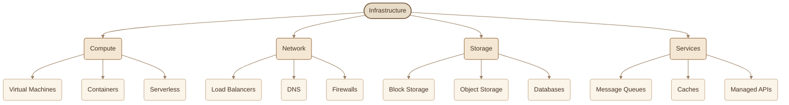
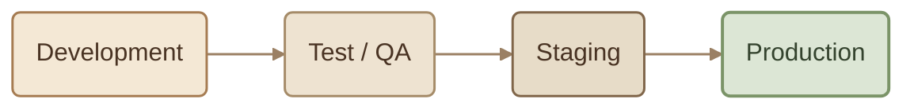
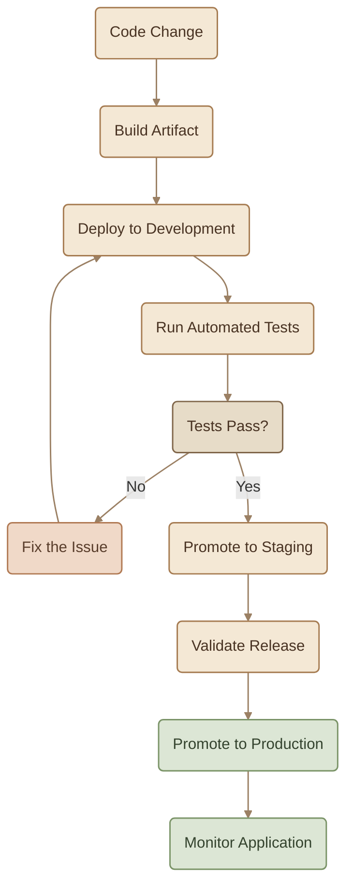
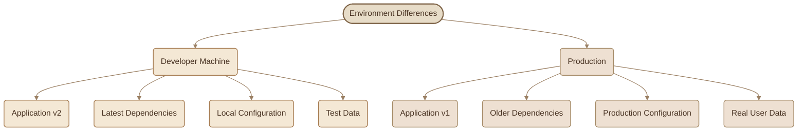
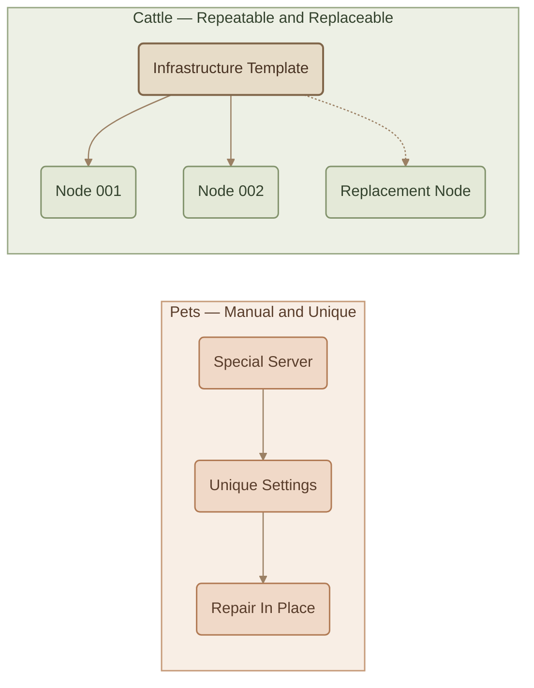

الـ Code لوحده مش كفاية علشان الـ Application تشتغل. هي محتاجة Compute Resources تشغّلها، وNetwork تتواصل من خلالها، وStorage تحتفظ بالبيانات، وDatabases وخدمات تانية تعتمد عليها.

كل المكونات دي بنسميها **Infrastructure**.

كمان، مش بنشغّل الـ Application في مكان واحد بس. غالبًا بنحتاج أكتر من Environment خلال مراحل التطوير والاختبار، قبل ما نوصل للـ Production اللي بيستخدمه الناس فعلًا.

في DevOps، مش المهم إن الـ Application تشتغل وبس؛ المهم إنها تشتغل بطريقة متوقعة في كل Environment.

## 1. What Is Infrastructure?

الـ **Infrastructure** هي كل الموارد والمكونات اللي الـ Software بتعتمد عليها علشان تشتغل.

### I. The Main Infrastructure Components

<CardGrid columns={2} label="Main Infrastructure Components">
<InfoCard variant="concept" title="Compute" description="الموارد اللي بتنفّذ الـ Code، زي Virtual Machines وContainers وServerless Functions." icon="cube" tags={["Compute"]} />

<InfoCard variant="concept" title="Network" description="المكونات اللي بتسمح للأنظمة تتواصل مع بعضها ومع المستخدمين، زي DNS وLoad Balancers وFirewalls." icon="network" tags={["Network"]} />

<InfoCard variant="concept" title="Storage" description="الموارد اللي بتحتفظ بالبيانات، زي Block Storage وObject Storage وDatabases." icon="database" tags={["Storage"]} />

<InfoCard variant="concept" title="Supporting Services" description="خدمات بتدعم الـ Application، زي Message Queues وCaches وManaged APIs." icon="modules" tags={["Services"]} />
</CardGrid>

### II. Traditional vs Modern Infrastructure

قديمًا، تجهيز Server جديد ممكن يحتاج Tickets وموافقات وانتظار فريق مسؤول عن الـ Infrastructure.

وممكن الـ Engineer يضطر يجهّز الـ Server يدويًا: يثبت Packages، ويعدّل Configuration، ويضبط Network Settings، وبعدها يدوّن الخطوات في Documentation.

في Cloud Environments الحديثة، بقى ممكن إنشاء موارد كتير خلال دقائق باستخدام Automation وConfiguration Files.

وده بيمهّد لمفهوم **Infrastructure as Code (IaC)**، اللي هنفهمه بالتفصيل في مقالات لاحقة.

<InfoCard variant="insight" title="The DevOps Perspective" icon="sliders">

بدل ما نعتمد على خطوات يدوية بتختلف من شخص للتاني، بنحاول نخلي إنشاء وإدارة الـ Infrastructure عملية قابلة للتكرار والمراجعة والـ Automation.

</InfoCard>

## 2. Why Do We Need Multiple Environments?

تخيّل إنك بتطوّر Application عليها مستخدمين حقيقيين. هل منطقي تجرّب كل تغيير جديد مباشرة على النظام اللي بيستخدموه؟

غالبًا لأ؛ لأن أي Bug ممكن يؤثر على بيانات حقيقية أو يعطّل الخدمة.

عشان كده، بنستخدم Environments مختلفة، وكل واحدة ليها غرض محدد.

<TableCard title="Common Environments">
| Environment | Purpose | Main Audience |
|---|---|---|
| **Development (Dev)** | تطوير الـ Features وتجربة التغييرات أثناء العمل. | Developers |
| **Test / QA** | التحقق من صحة التغييرات واكتشاف Bugs. | Testers وQA |
| **Staging** | تجربة الـ Release في بيئة قريبة من Production. | الفريق قبل النشر |
| **Production (Prod)** | تشغيل الـ Application للمستخدمين الفعليين. | Real Users |
</TableCard>

### I. Each Environment Has a Different Risk Level

<CardGrid columns={2} label="Risk Levels">
<InfoCard variant="concept" title="Development" description="مساحة للتجربة وتطوير الـ Code، وعادةً بتكون أقل تكلفة وأقل خطورة على المستخدمين." icon="code" tags={["Dev"]} />

<InfoCard variant="concept" title="Test / QA" description="بنشغّل اختبارات للتأكد من إن الـ Application بتعمل زي ما هو متوقع." icon="shield" tags={["QA"]} />

<InfoCard variant="concept" title="Staging" description="بنراجع الـ Release في ظروف قريبة من Production قدر الإمكان." icon="layers" tags={["Staging"]} />

<InfoCard variant="warning" title="Production" description="البيئة الفعلية؛ أي مشكلة فيها ممكن تؤثر على المستخدمين أو البيانات أو Availability." icon="wheel" tags={["Prod"]} />
</CardGrid>

كل انتقال بين البيئات ممكن يتضمن Quality Checks أو Approval أو Automated Gates، حسب طبيعة المشروع.

مش كل فريق لازم يستخدم الأربع Environments بشكل منفصل؛ العدد والتقسيم بيعتمدوا على حجم النظام ومتطلبات الاختبار والتكلفة والمخاطر.

## 3. The Path of a Change

خلينا نشوف إزاي تغيير واحد ممكن ينتقل من الـ Code إلى Production.

### I. Build Once, Promote Across Environments

من أهم الأفكار هنا إننا **نبني الـ Artifact مرة واحدة، وبعدها نروّجه بين الـ Environments** بدل ما نعمل Build جديد في كل مرحلة.

يعني لو عندك Application مبنية في شكل Docker Image، ممكن تعمل الآتي:

<Steps>
<li>
<InfoCard title="Build" description="تبني الـ Image وتحدد لها Version واضح." icon="cube" tags={["1"]} />
</li>
<li>
<InfoCard title="Development" description="تختبر نفس الـ Image في Development." icon="code" tags={["2"]} />
</li>
<li>
<InfoCard title="Staging" description="تستخدم نفس الـ Image في Staging." icon="layers" tags={["3"]} />
</li>
<li>
<InfoCard title="Production" description="تنشر نفس الـ Image في Production بعد اجتياز الفحوصات المطلوبة." icon="wheel" tags={["4"]} />
</li>
</Steps>

ليه ده مهم؟

لأن إعادة الـ Build في كل Environment ممكن تنتج Artifacts مختلفة، حتى لو الـ Source Code المفروض واحد، بسبب اختلاف Dependencies أو Build Settings أو غيرها.

لكن استخدام نفس الـ Artifact بيساعدك تضمن إن النسخة اللي اختبرتها هي نفسها النسخة اللي بتنشرها.

<InfoCard variant="tip" title="Same Artifact, Different Configuration" icon="layers">

بنستخدم نفس الـ Artifact قدر الإمكان، لكن مش لازم نستخدم نفس الـ Configuration في كل Environment. مثلًا، Database URL وAPI Endpoints وSecrets ممكن تختلف بين Development وProduction.

</InfoCard>

## 4. "It Works on My Machine"

الجملة دي من أشهر المشاكل في عالم Software Development:

<Callout type="warning" title="It Works on My Machine">

الكود شغّال تمام على جهاز الـ Developer، لكنه بيفشل لما يتنشر في Production.

</Callout>

المشكلة مش بالضرورة تكون في الـ Code نفسه؛ ساعات السبب هو اختلاف البيئة اللي بيشتغل فيها.

### I. Why Do Environments Drift Apart?

كلمة **Environment Drift** بتوصف حالة اختلاف الـ Environments عن بعضها بمرور الوقت، بسبب تغييرات أو إعدادات أو Dependencies مش متطابقة.

مثلًا:

في المثال ده، الـ Application بتشتغل على نسختين مختلفتين، مع Dependencies وConfiguration وData مختلفة. بالتالي، نجاح الاختبار على جهاز الـ Developer مش ضمان إن النسخة هتشتغل بنفس الطريقة في Production.

### II. Common Causes

<CardGrid columns={2} label="Common Causes of Drift">
<InfoCard variant="warning" title="Different OS or Runtime" description="اختلاف إصدار Linux أو .NET Runtime أو غيره." icon="cube" tags={["Runtime"]} />

<InfoCard variant="warning" title="Dependency Mismatch" description="اختلاف إصدارات Libraries أو Packages." icon="modules" tags={["Deps"]} />

<InfoCard variant="warning" title="Configuration Differences" description="وجود Environment Variables أو Settings مختلفة." icon="sliders" tags={["Config"]} />

<InfoCard variant="warning" title="Missing Secrets" description="إعدادات الاتصال أو Credentials مش موجودة أو غير صحيحة." icon="shield" tags={["Secrets"]} />

<InfoCard variant="warning" title="Different Data" description="الاختبارات المحلية بتستخدم بيانات بسيطة، بينما Production فيها بيانات حقيقية وحالات أكثر تعقيدًا." icon="database" tags={["Data"]} />

<InfoCard variant="warning" title="Manual Changes" description="تعديل إعدادات Server يدويًا من غير ما يتم تسجيلها أو تطبيقها على باقي البيئات." icon="wrench" tags={["Manual"]} />
</CardGrid>

## 5. Environment Parity

**Environment Parity** معناها إننا نخلي بيئات التطوير والاختبار والنشر متشابهة قدر الإمكان في الجوانب اللي ممكن تؤثر على سلوك الـ Application.

مش المطلوب إن كل Environment تكون نسخة مطابقة تمامًا من التانية؛ لأن لكل واحدة Configuration وData وصلاحيات مختلفة حسب دورها.

المطلوب إن الاختلافات تكون **مقصودة، واضحة، ومتحكَّم فيها**.

### I. How Do We Improve Parity?

<CardGrid columns={2} label="Improving Parity">
<InfoCard variant="concept" title="Containers — Docker" description="بنغلف الـ Application وDependencies المطلوبة في Container Image، علشان نقلل الاختلافات بين البيئات اللي بتشغّلها." icon="cube" tags={["Containers"]} />

<InfoCard variant="concept" title="Infrastructure as Code" description="بنعرّف الموارد والـ Infrastructure في ملفات قابلة للمراجعة وإعادة الاستخدام، بدل الاعتماد على الإعداد اليدوي." icon="code" tags={["IaC"]} />

<InfoCard variant="concept" title="Configuration as Code" description="بننظّم الإعدادات غير السرية في ملفات وإعدادات قابلة للتتبع، مع إدارة الـ Secrets بطريقة آمنة." icon="sliders" tags={["Config"]} />

<InfoCard variant="concept" title="Version Pinning" description="بنحدد إصدارات الـ Dependencies والـ Base Images بشكل واضح، ونحدّثها بطريقة مقصودة بدل الاعتماد على تغييرات غير متوقعة." icon="branch" tags={["Versions"]} />
</CardGrid>

### II. What Should Be Consistent — and What Should Differ?

<TableCard title="Consistency vs Intentional Differences">
| Aspect | Desired Approach |
|---|---|
| **Application Artifact** | استخدام نفس النسخة المختبرة عند الترقية بين البيئات. |
| **Runtime and Dependencies** | الحفاظ على إصدارات متوافقة ومحددة قدر الإمكان. |
| **Infrastructure Structure** | استخدام تعريفات متسقة للموارد المطلوبة. |
| **Configuration Values** | نفس الأسلوب في إدارة الإعدادات، مع قيم مناسبة لكل Environment. |
| **Secrets and Credentials** | قيم منفصلة وآمنة لكل بيئة، دون تضمينها في Source Code. |
| **Data and Permissions** | بيانات وصلاحيات تناسب غرض كل بيئة، مع حماية بيانات Production. |
</TableCard>

<InfoCard variant="warning" title="Parity Does Not Mean Identical Secrets" icon="shield">

ماينفعش تنسخ Production Secrets إلى جهاز الـ Developer لمجرد إنك عايز توحّد البيئات. وحّد طريقة إدارة الإعدادات والـ Runtime والـ Dependencies قدر الإمكان، لكن حافظ على الفصل بين Credentials والبيانات والصلاحيات.

</InfoCard>

## 6. Pets vs Cattle

في DevOps، فيه تشبيه مشهور بيوضح الفرق بين إدارة الـ Infrastructure يدويًا وإدارتها بشكل قابل للاستبدال: **Pets vs Cattle**.

### I. Pets — Handcrafted Infrastructure

الـ Servers هنا بتتعامل معاها كأن كل Server له شخصية خاصة.

- بتسمي كل Server باسم مميز.
- بتضيف عليه إعدادات وتعديلات يدويًا.
- لما يحصل عطل، بتحاول تصلّح نفس الـ Server.
- مع الوقت، ممكن كل Server يبقى مختلف عن الباقي.

ده بيخلي الاعتماد على Server معين مشكلة؛ لأن استبداله ممكن يحتاج معرفة بتفاصيل محدش وثّقها.

### II. Cattle — Replaceable Infrastructure

في الأسلوب ده، الـ Servers بتتجهز من Templates أو Definitions معروفة.

- الـ Instances بتكون متشابهة في الأساس.
- الـ Configuration بتتطبق بطريقة قابلة للتكرار.
- لو Instance تعطلت، ممكن تستبدلها بأخرى من نفس التعريف.
- الحالة المطلوبة للـ Infrastructure بتكون موثقة وقابلة لإعادة الإنشاء.

### III. Does Cattle Mean Never Repairing a Server?

لأ. الفكرة مش إنك ممنوع تصلّح أي Server؛ الفكرة إنك ما تعتمدش على تغييرات يدوية غير موثقة باعتبارها الطريقة الوحيدة للحفاظ على النظام.

في بيئات Cloud وContainer Orchestration، استبدال Instance أو Container متعطل ممكن يكون أفضل من محاولة إصلاحه يدويًا، بشرط إن البيانات المهمة تكون محفوظة خارج الـ Instance، وإن الـ Replacement Process يكون متصمم بشكل صحيح.

## 7. Manual Infrastructure vs Infrastructure as Code

الفرق الأساسي مش مجرد سرعة الإنشاء؛ الفرق في **إمكانية التكرار، والمراجعة، والتتبع، والاستعادة**.

<TableCard title="Manual Infrastructure vs IaC">
| Aspect | Manual Infrastructure | Infrastructure as Code |
|---|---|---|
| **Provisioning** | Tickets وخطوات يدوية وانتظار. | إنشاء الموارد من Definitions قابلة للتنفيذ. |
| **Consistency** | بتعتمد على الشخص والخطوات اللي نفّذها. | تقدر تعيد تطبيق نفس التعريفات بشكل متسق. |
| **Changes** | ممكن تحصل مباشرة على الموارد من غير مراجعة واضحة. | يمكن مراجعتها وتوثيقها باستخدام Version Control. |
| **Recovery** | ممكن تعتمد على الذاكرة والـ Documentation. | تقدر تعيد إنشاء الموارد من التعريفات، مع مراعاة البيانات والحالة المطلوبة. |
| **Auditability** | تتبع التغييرات ممكن يكون صعبًا. | تاريخ التغييرات ومراجعاتها أوضح عند تطبيق Workflow مناسب. |
| **Scaling** | زيادة الموارد ممكن تحتاج تكرار خطوات يدوية. | يمكن أتمتة إنشاء الموارد وتعديلها. |
</TableCard>

Infrastructure as Code مش معناها إنك تكتب ملفات وخلاص؛ لازم كمان يكون فيه مراجعة للتغييرات، وإدارة آمنة للـ State والـ Secrets، واختبار مناسب قبل تطبيق التعديلات الحساسة.

## 8. What Should You Remember?

<CardGrid columns={3} label="Infrastructure Recap">
<InfoCard variant="summary" title="01 — Infrastructure" description="كل الموارد اللي الـ Software بتعتمد عليها، بما فيها Compute وNetwork وStorage والخدمات المساعدة." icon="cube" tags={["Infra"]} />

<InfoCard variant="summary" title="02 — Environments" description="Development وTest وStaging وProduction بتساعدنا نتحقق من التغييرات قبل وصولها للمستخدمين." icon="layers" tags={["Envs"]} />

<InfoCard variant="summary" title="03 — Same Artifact" description="ابنِ الـ Artifact مرة، وروّجه بين البيئات بدل إعادة بنائه في كل مرحلة." icon="cube" tags={["Artifact"]} />

<InfoCard variant="summary" title="04 — Environment Parity" description="خلّي البيئات متشابهة في الجوانب المؤثرة على سلوك الـ Application، وسجّل الاختلافات المقصودة." icon="branch" tags={["Parity"]} />

<InfoCard variant="summary" title="05 — Replaceable Infrastructure" description="صمّم الـ Infrastructure بحيث تقدر تعيد إنشاء الموارد واستبدالها من Definitions واضحة بدل الاعتماد على إعدادات يدوية فريدة." icon="cycle" tags={["Cattle"]} />
</CardGrid>

**The key idea:** كل ما كانت الـ Infrastructure والـ Environments قابلة للتكرار ومتسقة، كل ما أصبح الـ Testing والـ Deployment والـ Recovery أسهل وأكثر اعتمادًا على Automation. وده أساس مهم لبناء CI/CD Pipeline موثوقة.
