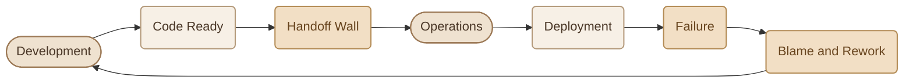
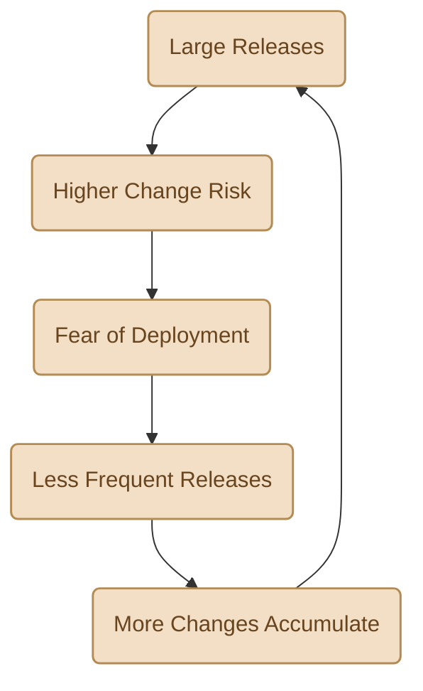
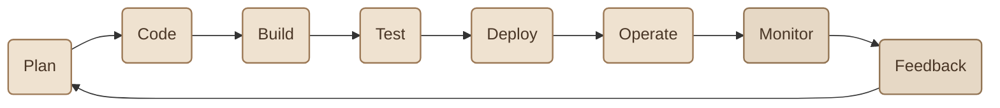
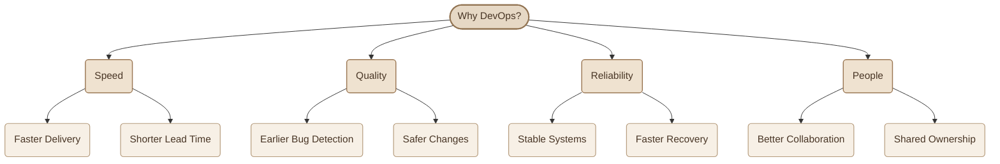

## Introduction

بعد ما فهمنا **What is DevOps?**، السؤال الطبيعي دلوقتي: إحنا محتاجين DevOps ليه أصلًا؟ وإيه المشاكل اللي بيحلّها؟

السبب ببساطة إن بناء الـ Software وتشغيله مش دايمًا بيكونوا سهلين لما كل فريق يشتغل بمعزل عن التاني. ممكن الـ Development يسلّم Features بسرعة، لكن الـ Deployment يفشل. وممكن الـ Operations تحافظ على استقرار الـ System، لكن أي تغيير جديد ياخد وقت طويل علشان يوصل للـ Users.

الـ DevOps بيحاول يحل التعارض ده، بحيث الفرق تقدر **تسلّم Changes بسرعة، من غير ما تضحي بالـ Stability والـ Reliability**.

## 1. The Old Way: Two Separate Worlds

في الـ Traditional Workflow، المسؤوليات غالبًا بتكون متقسمة بين فريقين، وكل فريق بيتحاسب على أهداف مختلفة.

<CardGrid columns={2} label="Two Teams, Two Goals">
<InfoCard variant="comparison" title="Development Team" description="تركيزه الأساسي على بناء Features جديدة، إصلاح Bugs، وتسليم Changes بسرعة." icon="code" tags={["Build"]} />

<InfoCard variant="comparison" title="Operations Team" description="تركيزه الأساسي على استقرار الـ Systems، الحفاظ على Availability، وتقليل مخاطر الـ Deployment." icon="cube" tags={["Run"]} />
</CardGrid>

المشكلة مش إن أهداف الفريقين غلط؛ بالعكس، الاتنين مهمين. المشكلة إن كل فريق ممكن يحاول يحقق هدفه من غير ما يكون مسؤول بشكل مشترك عن النتيجة النهائية.

الـ Development عايز Changes جديدة توصل بسرعة، بينما الـ Operations عايز يقلل التغييرات المفاجئة اللي ممكن تسبب مشاكل في الـ Production.

### I. The Blame Wall

في بعض المؤسسات، بيكون فيه فصل واضح بين الفريقين، لدرجة إن تسليم الـ Application بيشبه رميها من ناحية للتانية فوق حائط.

مثلًا، الـ Developer ممكن يقول إن الـ Application اشتغلت عنده كويس، وإن المشكلة من الـ Server Configuration.

وفي المقابل، الـ Operations Engineer ممكن يكتشف إن الـ Application محتاجة Dependencies أو Environment Variables مش موجودة على الـ Production Environment.

بدل ما الفريقين يشتغلوا مع بعض لحل المشكلة من جذورها، يبدأ كل طرف يحمّل التاني المسؤولية.

**النتيجة؟** وقت ضايع في الـ Troubleshooting والـ Rework، وتأخير في الـ Releases، ومشاكل كان ممكن اكتشافها بدري.

## 2. What Goes Wrong Without DevOps

لما الـ Development والـ Operations يشتغلوا كأنهم عالمين منفصلين، مجموعة مشاكل بتبدأ تظهر بشكل متكرر.

<CardGrid columns={2} label="Common Problems">
<InfoCard variant="warning" title="Slow Releases" description="الـ Changes بتتجمع لفترات طويلة، وبعدها تنزل في Release واحدة كبيرة، وده بيخلّي عملية التسليم أبطأ وأصعب في الاختبار." icon="cycle" tags={["Slow"]} />

<InfoCard variant="warning" title="Manual Deployments" description="الاعتماد على خطوات يدوية طويلة بيزود احتمالية إن حد ينسى خطوة أو ينفّذ أمر بطريقة مختلفة." icon="terminal" tags={["Manual"]} />

<InfoCard variant="warning" title="Environment Differences" description="الـ Application تشتغل على جهاز الـ Developer، لكن تفشل في الـ Production بسبب اختلاف الـ Configuration أو الـ Dependencies." icon="layers" tags={["Envs"]} />

<InfoCard variant="warning" title="Late Feedback" description="المشكلة ممكن تفضل مستخبية لحد ما الـ Code يوصل لمراحل متقدمة، وساعتها اكتشاف السبب وإصلاحه بيكون أصعب." icon="pulse" tags={["Late"]} />
</CardGrid>

### I. The Fear of Releasing

فيه مشكلة تانية بتظهر نتيجة المشاكل السابقة: **الخوف من الـ Deployment**.

لو كل Release بتحتاج أيام من التحضير، واختبارات يدوية، واحتمال كبير لحدوث Failure، الفريق طبيعي يبدأ يقلل عدد الـ Releases.

لكن تقليل عدد الـ Releases معناه إن Changes أكتر هتتجمع مع بعض، وبالتالي كل Release بتبقى أكبر وأصعب في الاختبار، ولو حصلت مشكلة بيكون تحديد الـ Change المسؤول عنها أصعب.

وهنا بتظهر دائرة من المشاكل: الفريق بيحاول يتجنب الـ Risk، لكن طريقة الشغل نفسها بتخلّي كل Release أصعب وأعلى مخاطرة.

## 3. How DevOps Fixes This

الـ DevOps بيواجه المشاكل دي من خلال تحسين طريقة الشغل، مش بمجرد إضافة Tools جديدة.

فيه أربع أفكار أساسية بتساعد في كسر الدائرة دي.

<CardGrid columns={2} label="How DevOps Breaks the Cycle">
<InfoCard variant="comparison" title="Small, Frequent Changes" description="تقسيم الـ Changes الكبيرة إلى Changes أصغر، بحيث يسهل اختبار كل تغيير وفهم تأثيره والرجوع عنه لو احتجنا." icon="git-pull-request" tags={["Small"]} />

<InfoCard variant="comparison" title="Automation" description="أتمتة خطوات الـ Build والـ Testing والـ Deployment لتقليل الشغل اليدوي وتكرار نفس الـ Process بصورة موثوقة." icon="sliders" tags={["Automate"]} />

<InfoCard variant="comparison" title="Shared Ownership" description="الـ Development والـ Operations يتعاونوا لتحقيق هدف مشترك: تسليم Changes بشكل آمن، وتشغيل الـ Application بصورة مستقرة." icon="network" tags={["Own"]} />

<InfoCard variant="comparison" title="Fast Feedback" description="استخدام Automated Tests والـ Monitoring والـ Logs لاكتشاف المشاكل بسرعة بدل انتظار ظهورها بعد فترة طويلة." icon="pulse" tags={["Fast"]} />
</CardGrid>

### I. From Handoffs to Continuous Delivery

بدل ما الـ Workflow ينتهي عند تسليم الـ Code لفريق تاني، الـ DevOps بيربط مراحل الـ Software Delivery ببعضها.

خلينا نفهم إيه اللي بيتغير في الـ Workflow ده:

<Steps>
<li>

<InfoCard title="Plan" description="تحديد الـ Requirements والـ Changes المطلوبة." icon="flag" tags={["1"]} />

</li>
<li>

<InfoCard title="Code" description="تنفيذ التغييرات باستخدام Version Control." icon="code" tags={["2"]} />

</li>
<li>

<InfoCard title="Build" description="تجهيز نسخة قابلة للاختبار والتشغيل." icon="cube" tags={["3"]} />

</li>
<li>

<InfoCard title="Test" description="تشغيل الاختبارات لاكتشاف المشاكل بدري." icon="shield" tags={["4"]} />

</li>
<li>

<InfoCard title="Deploy" description="نشر الـ Application باستخدام خطوات واضحة وقابلة للتكرار." icon="wheel" tags={["5"]} />

</li>
<li>

<InfoCard title="Operate" description="تشغيل الـ Application ومتابعة حالتها في الـ Environment المستهدف." icon="sliders" tags={["6"]} />

</li>
<li>

<InfoCard title="Monitor" description="جمع معلومات عن الـ Performance والأخطاء والـ Availability." icon="pulse" tags={["7"]} />

</li>
<li>

<InfoCard title="Feedback" description="استخدام النتائج لتحديد التحسينات والتغييرات التالية." icon="cycle" tags={["8"]} />

</li>
</Steps>

الـ Automated Pipeline ممكن يساعد في ربط مراحل زي الـ Build والـ Test والـ Deploy، بينما الـ Collaboration بيساعد الفرق تفهم المشاكل وتتخذ قرارات أفضل.

<Callout type="note" title="ملحوظة مهمة">

مش معنى الـ DevOps إن كل مؤسسة لازم يكون عندها Team واحدة مسؤولة عن كل حاجة. المقصود إن المسؤوليات تكون واضحة، والتعاون مستمر، والـ Feedback يوصل للأشخاص المناسبين من غير تأخير غير ضروري.

</Callout>

## 4. The Benefits at a Glance

لما الفرق تحسّن الـ Workflow وتستخدم Automation وContinuous Feedback بشكل مناسب، ده ممكن ينعكس على أربع نواحي أساسية.

<CardGrid columns={2} label="Four Benefits">
<InfoCard variant="feature" title="Speed" description="توصيل الـ Features والـ Fixes للـ Users بسرعة أكبر، وتقليل الوقت من بداية التغيير لحد ما يبقى متاحًا للاستخدام." icon="wheel" tags={["Fast"]} />

<InfoCard variant="feature" title="Quality" description="اكتشاف الـ Bugs في وقت أبكر، وتوفير اختبارات متكررة تساعد على تقليل الأخطاء قبل وصول التغييرات للـ Production." icon="shield" tags={["Quality"]} />

<InfoCard variant="feature" title="Reliability" description="تحسين استقرار الـ Systems، والاستعداد للمشاكل، وتقليل الوقت اللازم لاستعادة الخدمة بعد حدوث Failure." icon="flag" tags={["Stable"]} />

<InfoCard variant="feature" title="People" description="تقليل الاحتكاك بين الفرق، وتحسين التواصل، وتوجيه المجهود لحل المشاكل وتحسين الـ Software بدل تبادل اللوم." icon="network" tags={["Teams"]} />
</CardGrid>

الفوائد دي مش بتحصل تلقائيًا بمجرد إن المؤسسة تعلن إنها بتطبّق DevOps؛ هي نتيجة تطبيق ممارسات مناسبة، وقياس النتائج، والتحسين المستمر.

## 5. Before and After

الجدول ده بيلخّص الفرق بين الـ Traditional Workflow والـ DevOps-Oriented Workflow.

<TableCard title="Traditional vs DevOps-Oriented Workflow">
| Aspect | Traditional Workflow | DevOps-Oriented Workflow |
|---|---|---|
| Releases | تغييرات كبيرة ومتباعدة | تغييرات أصغر وأكثر تكرارًا عند ملاءمة ذلك |
| Feedback | ممكن يتأخر لفترات طويلة | Feedback أسرع من الـ Tests والـ Monitoring |
| Deployments | خطوات يدوية متكررة | Automation وRepeatable Processes |
| Failures | التركيز على تحديد المسؤول | التركيز على فهم السبب ومنع تكرار المشكلة |
| Responsibilities | فرق منفصلة وتسليمات متكررة | Collaboration وShared Responsibility |
| Work Rhythm | Firefighting ورد فعل للمشاكل | Continuous Improvement واستباق المشاكل |
</TableCard>

المقصود مش إن كل Workflow تقليدي سيئ، أو إن أي Workflow يستخدم DevOps هيكون مثالي؛ المقارنة بتوضح الاتجاه العام للتحسين.

مثلًا، لو الـ Deployment بقى Automated، ده مش معناه إن كل Deployment آمن تلقائيًا. لسه محتاجين Testing مناسب، ومراجعة للتغييرات، وMonitoring، وخطة للتعامل مع الـ Failures.

## 6. Why It Matters Beyond the Team

فوائد الـ DevOps مش مقتصرة على الـ Developers والـ Operations Engineers؛ هي ممكن تمتد للـ Business والـ Customers كمان.

<CardGrid columns={3} label="Beyond the Team">
<InfoCard variant="feature" title="For Customers" description="وصول الـ Features الجديدة والـ Bug Fixes بشكل أسرع، مع تحسين تجربة استخدام الـ Application." icon="network" tags={["Customers"]} />

<InfoCard variant="feature" title="For the Business" description="الاستجابة بشكل أسرع لاحتياجات السوق، وتقليل أثر الـ Downtime، وتحسين القدرة على تجربة أفكار جديدة." icon="flag" tags={["Business"]} />

<InfoCard variant="feature" title="For Engineers" description="وقت أقل في الشغل اليدوي المتكرر، ووقت أكبر في بناء الأنظمة وتحسينها وحل المشاكل من جذورها." icon="wrench" tags={["Engineers"]} />
</CardGrid>

تخيّل إن عندك Application لمتجر إلكتروني، واكتشفت إن عملية الدفع فيها Bug.

في Workflow بطيء، ممكن الإصلاح يحتاج انتظار Release كبيرة، وبعدها تجهيز Deployment يدوي طويل.

أما مع Workflow محسّن، ممكن الفريق يختبر الـ Fix بسرعة، ويتأكد من نجاح الاختبارات المطلوبة، وبعدها ينشر التغيير من خلال Pipeline مناسبة.

النتيجة المحتملة هي وصول الإصلاح للـ Customers في وقت أقصر، وتقليل الفترة اللي المشكلة بتأثر فيها على الخدمة.

## 7. What Should You Remember?

<CardGrid columns={2} label="Why DevOps Recap">
<InfoCard variant="summary" title="01 — The Problem" description="الفصل بين الـ Development والـ Operations ممكن يسبب Delays، وManual Work، وLate Feedback، وصعوبة في الـ Releases." icon="wrench" tags={["Problem"]} />

<InfoCard variant="summary" title="02 — The Approach" description="الـ DevOps بيشجّع Collaboration وAutomation وSmall Changes وContinuous Feedback." icon="cycle" tags={["Approach"]} />

<InfoCard variant="summary" title="03 — The Outcome" description="الهدف هو Software Delivery أسرع وأكثر أمانًا، مع تحسين الـ Reliability وتقليل وقت التعافي من المشاكل." icon="flag" tags={["Outcome"]} />

<InfoCard variant="summary" title="04 — The Reality" description="الأدوات لوحدها مش كفاية؛ تحقيق الفوائد محتاج Processes مناسبة وتعاون وقياس مستمر للنتائج." icon="layers" tags={["Reality"]} />
</CardGrid>

**الخلاصة:** إحنا بنستخدم DevOps علشان نقلل المسافة بين بناء الـ Software وتشغيله، ونقدر نوصّل Changes للـ Users بسرعة وأمان، ونتعلم من المشاكل بدل ما نكررها.

الهدف مش السرعة على حساب الاستقرار، ولا الاستقرار على حساب التطوير؛ الهدف هو تحقيق الاتنين مع بعض من خلال طريقة شغل أفضل.
