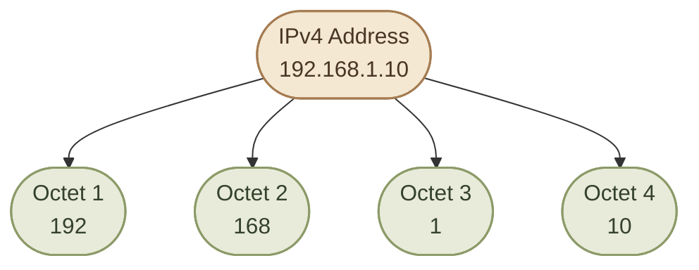
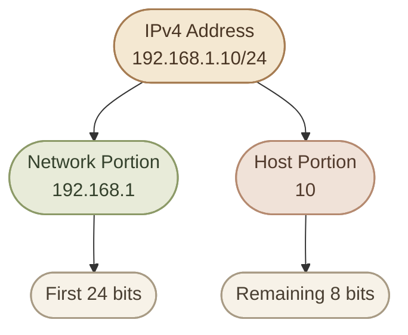

import InfoCard from "../../../src/components/InfoCard.astro";
import CardGrid from "../../../src/components/CardGrid.astro";

## Introduction

الـ **IP Address** هو عنوان منطقي بيُستخدم لتحديد واجهة شبكة والمساعدة في توصيل البيانات إلى وجهتها عبر شبكات الـ IP.

تخيّل إن عندك أجهزة كتير متصلة بشبكة، وكل جهاز محتاج يتواصل مع أجهزة تانية. هنا بييجي دور الـ IP Address؛ لأنه بيساعد الشبكة تحدد وجهة الـ IP Packets وتوجّهها للمكان المناسب.

في الدرس ده هنركّز على **IPv4**، وهو واحد من إصدارات بروتوكول IP.

## 1. What Is an IPv4 Address?

الـ **IPv4 Address** هو عنوان بيتكوّن من **32 bits**.

الـ Bit هو أصغر وحدة بيانات ثنائية، وقيمته بتكون إما `0` أو `1`.

وبما إن عنوان IPv4 بيتكوّن من 32 bits، فإحنا بنكتبه عادةً في صورة أربع مجموعات من الأرقام مفصولة بنقط.

مثال:

`192.168.1.10`

كل مجموعة من المجموعات الأربعة اسمها **Octet**، وكل Octet بيتكوّن من 8 bits.

<CardGrid columns={2} label="IPv4 at a glance">
  <InfoCard title="32 bits" description="لكل IPv4 Address." icon="code" variant="concept" />
  <InfoCard title="4 octets" description="في الكتابة المعتادة." icon="layers" variant="concept" />
  <InfoCard title="8 bits" description="لكل Octet." icon="code" variant="concept" />
  <InfoCard title="0 to 255" description="كل Octet بيُمثّل رقمًا من `0` إلى `255`." icon="network" variant="concept" />
</CardGrid>

## 2. The Structure of an IPv4 Address

خلينا نفكّك العنوان ده:

`192.168.1.10`

كل رقم بيمثّل Octet مستقل، والـ Octets الأربعة مع بعض بيكوّنوا العنوان الكامل.



النقط اللي بين الأرقام دي مجرد طريقة لعرض العنوان بشكل مقروء. العنوان نفسه في التمثيل الثنائي بيتكوّن من 32 bits متتابعة.

### I. Why Is Each Part Between 0 and 255?

كل Octet بيتكوّن من 8 bits، وكل Bit ليه قيمة ممكن تكون `0` أو `1`.

عدد التركيبات الممكنة لـ 8 bits هو:

`2⁸ = 256`

وبما إن العد بيبدأ من الصفر، فالقيم الممكنة بتكون من `0` لحد `255`.

عشان كده:

<CardGrid columns={2} label="Octet Validation">
  <InfoCard title="Valid format" description="`192.168.1.10` عنوان مكتوب بصيغة IPv4 صحيحة من ناحية الشكل." icon="shield" variant="success" />
  <InfoCard title="Invalid format" description="`192.168.1.256` غير صالح كعنوان IPv4 بالشكل المعتاد؛ لأن `256` أكبر من الحد المسموح به للـ Octet." icon="shield" variant="warning" />
</CardGrid>

خلي بالك إن صحة الشكل مش معناها بالضرورة إن العنوان متاح للاستخدام على شبكتك؛ فيه عناوين ليها استخدامات خاصة، وفيه عناوين ممكن تكون محجوزة أو غير مناسبة حسب تصميم الشبكة.

## 3. IPv4 in Binary

رغم إننا بنكتب IPv4 كأربع أرقام عشرية، الكمبيوتر بيتعامل مع العنوان باعتباره 32 bits.

كل Octet بيتكوّن من 8 bits، وقيم الخانات فيه من الشمال لليمين هي:

`128  64  32  16  8  4  2  1`

كل خانة قيمتها بتتحسب لو الـ Bit المقابل لها يساوي `1`، وبتكون صفرًا لو الـ Bit يساوي `0`.

مثلًا، الرقم `192` بيتكتب بالثنائي بالشكل ده:

`11000000`

لأن:

`128 + 64 = 192`

### I. Example: Convert 10 to Binary

الرقم `10` بيتكوّن من:

`8 + 2 = 10`

وبالتالي تمثيله في 8 bits هو:

`00001010`

الأصفار اللي على الشمال مهمة هنا لأنها بتكمّل الـ Octet إلى 8 bits.

### II. A Complete IPv4 Example

خلينا نمثّل العنوان:

`192.168.1.10`

بالثنائي:

| Decimal Octet | Binary Octet |
|---:|---|
| 192 | `11000000` |
| 168 | `10101000` |
| 1 | `00000001` |
| 10 | `00001010` |

إذًا العنوان الكامل في Binary هو:

`11000000.10101000.00000001.00001010`

النقط هنا مستخدمة لتوضيح حدود الـ Octets، وكل Octet لسه مكوّن من 8 bits.

<InfoCard title="Why learn binary?" icon="layers" variant="insight">

مش مطلوب تحفظ التحويلات كلها من أول يوم، لكن فهم الـ Binary هيساعدك بعدين لما ندرس Subnet Mask وSubnetting؛ لأن تحديد أجزاء الـ Network والـ Host بيعتمد على التمثيل الثنائي للعنوان.
</InfoCard>

## 4. Network Portion vs Host Portion

عنوان IPv4 مش مجرد رقم بنعرّف بيه الجهاز. حسب إعدادات الشبكة والـ Prefix المستخدم، العنوان بيحتوي على جزأين منطقيين:

<CardGrid columns={2} label="Two Logical Portions">
  <InfoCard title="Network Portion" description="الجزء اللي بيحدد الشبكة اللي العنوان تابع ليها." icon="network" variant="concept" />
  <InfoCard title="Host Portion" description="الجزء اللي بيميز عنوان الواجهة داخل الشبكة دي." icon="terminal" variant="concept" />
</CardGrid>

خلينا ناخد مثالًا تعليميًا:

`192.168.1.10/24`

في المثال ده، `/24` معناه إن أول 24 bits بتحدد الـ Network Portion، والـ 8 bits المتبقية بتحدد الـ Host Portion.



**مهم:** المثال ده بيستخدم `/24` لتوضيح الفكرة. مش كل IPv4 Address بيكون تقسيمه بالشكل ده؛ الـ Prefix Length هو اللي بيحدد عدد الـ bits المخصصة للشبكة.

هنشرح معنى الـ Prefix Length بالتفصيل، وعلاقته بالـ Subnet Mask، في الدروس القادمة.

## 5. What Is a Prefix Length?

الـ **Prefix Length** هو رقم بيتكتب بعد علامة `/`، وبيحدد عدد الـ bits المستخدمة في تحديد الشبكة.

أمثلة:

| IPv4 Address with Prefix | Network Bits | Remaining Host Bits |
|---|---:|---:|
| `192.168.1.10/24` | 24 | 8 |
| `10.20.30.40/16` | 16 | 16 |
| `172.16.5.20/8` | 8 | 24 |

الأمثلة دي بتوضّح التقسيم المنطقي حسب الـ Prefix المكتوب، مش قواعد ثابتة مرتبطة بشكل العنوان.

لاحظ إننا بنحسب عدد الـ Host Bits بطرح الـ Prefix Length من 32:

`Host Bits = 32 − Prefix Length`

مثلًا، لو الـ Prefix Length هو `/24`:

`32 − 24 = 8 Host Bits`

لسه مش محتاج تحسب عدد الأجهزة المتاحة أو تحدد Network Address وBroadcast Address؛ دي موضوعات هنتناولها لما ندرس الـ Subnet Mask وSubnetting.

## 6. Public vs Private IPv4 Addresses

فيه فرق مهم بين الـ **Public IP Address** والـ **Private IP Address**.

<CardGrid columns={2}>
  <InfoCard title="Private IPv4" icon="layers" variant="concept" eyebrow="Internal networks">

    عناوين مخصصة للاستخدام داخل الشبكات الخاصة، زي شبكات المنازل والشركات. عادةً مش بيتم توجيهها مباشرةً عبر الإنترنت العام.
  </InfoCard>
  <InfoCard title="Public IPv4" icon="network" variant="concept" eyebrow="Internet routing">

    عناوين قابلة للتوجيه عبر الإنترنت العام، وفقًا لتخصيص العناوين وسياسات التوجيه. استخدامها الفعلي بيعتمد على مزوّد الخدمة وإعدادات الشبكة.
  </InfoCard>
</CardGrid>

### I. Private IPv4 Ranges

فيه ثلاث مجموعات رئيسية مخصصة لعناوين IPv4 الخاصة:

| Private Range | CIDR | Example |
|---|---|---|
| `10.0.0.0` – `10.255.255.255` | `10.0.0.0/8` | `10.10.1.5` |
| `172.16.0.0` – `172.31.255.255` | `172.16.0.0/12` | `172.20.1.10` |
| `192.168.0.0` – `192.168.255.255` | `192.168.0.0/16` | `192.168.1.10` |

دي نطاقات الـ Private IPv4 المعروفة في RFC 1918.

خلي بالك من نقطة مهمة: مش كل عنوان بيبدأ بـ `172` يعتبر Private. النطاق الخاص هنا هو من `172.16.0.0` إلى `172.31.255.255` فقط.

وبرضه مش كل عنوان بيبدأ بـ `192.168` أو `10` لازم يكون مناسبًا لأي استخدام؛ لازم تراعي إعدادات الشبكة والـ Prefix والوجهة المطلوبة.

### II. Why Do Private Addresses Matter?

الأجهزة المنزلية كتير بيكون عندها Private IP Addresses، والـ Router ممكن يستخدم **NAT — Network Address Translation** عشان يسمح لأجهزة الشبكة بمشاركة عنوان Public IP في الاتصالات الصادرة.

لكن الـ Private IP لوحده مش بيمنع الاتصال بالإنترنت، والـ Public IP لوحده مش معناه إن كل الخدمات متاحة من الإنترنت؛ ده بيعتمد كمان على الـ Routing والـ Firewall وإعدادات الاتصال.

## 7. Special IPv4 Addresses

مش كل عنوان IPv4 بيُستخدم كعنوان عادي لجهاز على الشبكة. فيه عناوين ليها أغراض خاصة.

<CardGrid columns={2}>
  <InfoCard title="Loopback" icon="layers" variant="concept" eyebrow="127.0.0.0/8">

    النطاق `127.0.0.0/8` مخصص للـ Loopback. العنوان الشائع `127.0.0.1` بيشير إلى الجهاز نفسه.
  </InfoCard>
  <InfoCard title="Unspecified Address" icon="network" variant="concept" eyebrow="0.0.0.0">

    العنوان `0.0.0.0` ممكن يُستخدم للدلالة على عنوان غير محدد، واستخدامه الدقيق بيعتمد على السياق.
  </InfoCard>
  <InfoCard title="Limited Broadcast" icon="cloud" variant="concept" eyebrow="255.255.255.255">

    عنوان Broadcast محدود يُستخدم لإرسال البيانات إلى الأجهزة المناسبة على الشبكة المحلية، وفقًا للسياق وقواعد البروتوكول.
  </InfoCard>
  <InfoCard title="Link-Local" icon="terminal" variant="concept" eyebrow="169.254.0.0/16">

    نطاق ممكن تستخدم منه الواجهة عنوانًا تلقائيًا عند عدم توفر إعداد IPv4 مناسب، حسب نظام التشغيل وإعداداته.
  </InfoCard>
</CardGrid>

### I. Example: Loopback

لما تكتب:

```bash
ping -c 4 127.0.0.1
```

أنت بتختبر الاتصال بالـ Loopback على جهازك، مش الاتصال بجهاز آخر على الشبكة.

الاختبار ده ممكن يساعدك تتأكد إن جزءًا من مسار الشبكة المحلي بيستجيب، لكنه مش دليل على إن كارت الشبكة الفيزيائي أو اتصال الإنترنت شغال.

## 8. IPv4 Addressing in Linux

دلوقتي نطبّق على Linux ونشوف عناوين IP الموجودة عندك.

### I. View IP Addresses

```bash
ip addr
```

الأمر ده بيعرض الـ Network Interfaces وعناوين IP المرتبطة بيها.

ممكن تلاقي مثلًا:

```text
2: enp3s0: <BROADCAST,MULTICAST,UP>
    inet 192.168.1.10/24 ...
```

ده مثال توضيحي؛ اسم الواجهة والعنوان الفعلي عندك ممكن يكونوا مختلفين.

في السطر ده:

<CardGrid columns={2} label="Reading the Linux Output">
  <InfoCard title="enp3s0" description="هو اسم الـ Network Interface." icon="network" variant="concept" />
  <InfoCard title="192.168.1.10" description="هو عنوان IPv4 في المثال." icon="tag" variant="concept" />
  <InfoCard title="/24" description="هو الـ Prefix Length." icon="layers" variant="concept" />
  <InfoCard title="inet" description="بتشير هنا إلى عنوان IPv4." icon="code" variant="concept" />
</CardGrid>

### II. Show Only IPv4 Information

```bash
ip -4 addr
```

الأمر ده بيعرض معلومات عناوين IPv4 للواجهات.

### III. Check the Routing Table

```bash
ip route
```

الأمر ده بيعرض الـ Routing Table، وبيساعدك تفهم إزاي الجهاز بيختار المسار المناسب للوجهات المختلفة.

وجود IP Address صحيح مش كفاية لوحده لضمان الوصول إلى أي جهاز؛ لازم إعدادات الشبكة والتوجيه تكون مناسبة كمان.

## 9. Common Misconceptions

<CardGrid columns={3} label="Common Misconceptions">
  <InfoCard title="Not always public" icon="network" variant="tip" description="الأجهزة ممكن تستخدم Private IP Addresses داخل الشبكات المحلية، وتوصل للإنترنت من خلال Router أو Gateway ينفّذ NAT، حسب إعداد الشبكة." />
  <InfoCard title="An octet has limits" icon="layers" variant="tip" description="عنوان IPv4 المكتوب بالصيغة المعتادة بيتكوّن من أربع Octets، وكل Octet بيمثّل قيمة من `0` إلى `255`. لكن لازم نفرّق بين صحة الشكل وصلاحية العنوان للاستخدام في سياق معين." />
  <InfoCard title="The address is not enough" icon="terminal" variant="tip" description="عشان تفهم الشبكة بشكل كامل، هتحتاج تعرف الـ Prefix Length والـ Routing وأحيانًا DNS وإعدادات أخرى. مجرد معرفة عنوان IP مش كفاية لتحديد كل حاجة." />
</CardGrid>

## 10. Knowledge Check

**Q1.** How many bits are in an IPv4 address?

- A. 8 bits
- B. 16 bits
- C. 32 bits
- D. 128 bits

**Q2.** How many bits are in each IPv4 octet?

- A. 4 bits
- B. 8 bits
- C. 16 bits
- D. 32 bits

**Q3.** Which of the following is a valid dotted-decimal IPv4 address format?

- A. `192.168.1.256`
- B. `192.168.1.10`
- C. `192.168.1`
- D. `192.168.1.10.5`

**Q4.** Which of these is within the RFC 1918 private IPv4 ranges?

- A. `10.10.1.5`
- B. `8.8.8.8`
- C. `1.1.1.1`
- D. `203.0.113.10`

**Q5.** Your Linux machine shows `192.168.1.10/24` on an interface. What does `/24` tell you at a high level?

## 11. Summary

<CardGrid columns={3} label="IPv4 Key Takeaways">
  <InfoCard title="32 bits" description="IPv4 Address بيتكوّن من **32 bits**." icon="code" variant="summary" />
  <InfoCard title="Four octets" description="العنوان بيتكتب عادةً في صورة **4 Octets**، كل واحد منهم 8 bits." icon="layers" variant="summary" />
  <InfoCard title="Octet range" description="كل Octet بيمثّل قيمة من `0` إلى `255`." icon="network" variant="summary" />
  <InfoCard title="Prefix Length" description="الـ Prefix Length بيحدد عدد الـ bits المخصصة للـ Network Portion." icon="tag" variant="summary" />
  <InfoCard title="Address types" description="IPv4 فيه عناوين Public وPrivate، بالإضافة إلى عناوين ليها استخدامات خاصة." icon="branch" variant="summary" />
  <InfoCard title="Linux inspection" description="أوامر Linux زي `ip addr` و`ip -4 addr` بتساعدك تفحص عناوين الشبكة." icon="terminal" variant="summary" />
</CardGrid>
