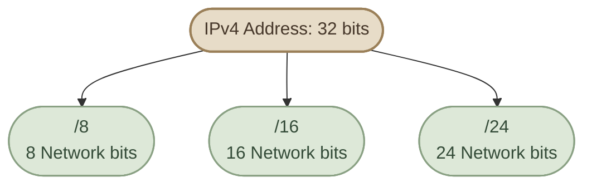
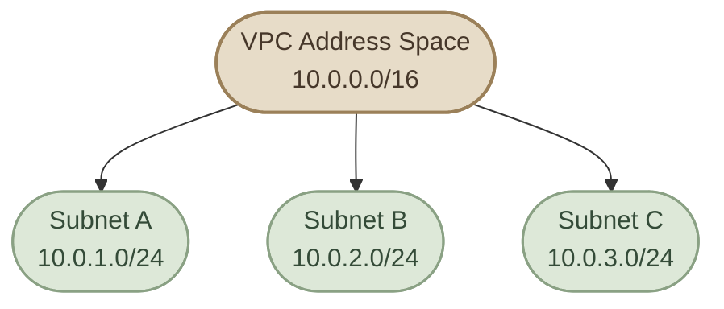

## Introduction

في الدرسين اللي فاتوا، اتعرفنا على الـ **Subnet Mask**، وفهمنا إزاي بنستخدمه لتحديد الـ Network Portion والـ Host Portion داخل عنوان IPv4.

الـ CIDR بيخلّينا نعبّر عن نفس المعلومة بطريقة مختصرة. بدل ما نكتب:

`192.168.1.10` مع `255.255.255.0`

نقدر نكتب العنوان بالشكل ده:

`192.168.1.10/24`

الرقم `24` هنا مش جزء من الـ IP Address نفسه؛ ده اسمه **CIDR Prefix Length**، وبيحدد عدد الـ bits المخصصة لجزء الشبكة.

## 1. What Does CIDR Mean?

**CIDR** اختصار لـ *Classless Inter-Domain Routing*. بنستخدمه للتعبير عن طول جزء الشبكة في عنوان IP.

في IPv4، العنوان حجمه 32 bits، وبالتالي:

- الـ Prefix بيحدد عدد الـ Network Bits.
- الباقي بيكون عدد الـ Host Bits.
- مجموع الاتنين لازم يساوي 32.

<InfoCard title="One Rule to Remember" icon="layers" variant="concept">

في `192.168.1.10/24`:

- `192.168.1.10` هو الـ IPv4 Address.
- `/24` هو الـ Prefix Length.
- 24 bits للشبكة، و8 bits للـ Host.

</InfoCard>

المعادلة الأساسية:

```text
Host Bits = 32 - Prefix Length
```

يعني لو الـ Prefix هو `/16`، هيتبقى 16 Host Bits. ولو `/24`، هيتبقى 8 Host Bits.

## 2. Understanding `/8`, `/16`, and `/24`

التلاتة دول من أشهر الـ Prefix Lengths اللي هتقابلها في الشبكات، وخصوصًا في إعدادات الـ Servers والـ Cloud Infrastructure.

<CardGrid columns={1} label="Common Prefix Lengths">

<InfoCard title="8/ — Large Address Space" icon="network" variant="feature">

**Subnet Mask:** `255.0.0.0`

- Network Bits: 8
- Host Bits: 24
- Total IPv4 addresses: 16,777,216

أول Octet بيحدد جزء الشبكة، والثلاثة الباقيين ضمن الجزء المتبقي من العنوان.

</InfoCard>

<InfoCard title="16/ — Medium Address Space" icon="network" variant="feature">

**Subnet Mask:** `255.255.0.0`

- Network Bits: 16
- Host Bits: 16
- Total IPv4 addresses: 65,536

أول اتنين Octets بيمثلوا جزء الشبكة، وآخر اتنين بيمثلوا الجزء المتبقي.

</InfoCard>

<InfoCard title="24/ — Smaller Address Space" icon="network" variant="feature">

**Subnet Mask:** `255.255.255.0`

- Network Bits: 24
- Host Bits: 8
- Total IPv4 addresses: 256

أول ثلاثة Octets بيمثلوا جزء الشبكة، والـ Octet الأخير بيمثل الجزء المتبقي.

</InfoCard>

</CardGrid>

الأرقام دي بتمثل **إجمالي عدد العناوين** داخل كل Prefix، مش عدد الأجهزة القابلة للاستخدام بالضرورة. في شبكات IPv4 التقليدية متعددة الأجهزة، فيه عناوين بتُحجز للـ Network Address والـ Broadcast Address، وهنحسب الـ Usable Hosts بالتفصيل في درس لاحق.

## 3. Visualizing the Prefix

خلّينا نشوف إزاي الـ Prefix بيقسّم الـ 32 bits.



كل ما رقم الـ Prefix يزيد، عدد الـ Network Bits بيزيد، وعدد الـ Host Bits بيقل.

وده معناه إن الـ Prefix الأكبر بيؤدي عادةً إلى Subnet أصغر من ناحية عدد العناوين، بينما الـ Prefix الأصغر بيسمح بمساحة عناوين أكبر.

## 4. How Many Addresses Does a Prefix Provide?

بما إن IPv4 فيه 32 bits، وعدد الـ Host Bits بيتحدد من الـ Prefix، نقدر نحسب إجمالي العناوين باستخدام المعادلة:

```text
Total Addresses = 2^(32-Prefix Length)
```

مثلًا، `/24` فيه 8 Host Bits:

```text
2^8 = 256
```

و`/16` فيه 16 Host Bits:

```text
2^(16) = 65,536
```

و`/8` فيه 24 Host Bits:

```text
2^(24) = 16,777,216
```

<InfoCard title="Total Addresses ≠ Usable Hosts" icon="shield" variant="warning">

إجمالي العناوين مش دايمًا بيساوي عدد الأجهزة اللي تقدر تستخدم عنوانًا منها. في الـ IPv4 Subnets التقليدية، عنوان الشبكة وعنوان الـ Broadcast بيكونوا محجوزين عادةً.

وفيه حالات خاصة زي `/31` للوصلات Point-to-Point، و`/32` لتمثيل عنوان واحد؛ عشان كده لازم نفهم نوع الشبكة قبل ما نطبّق قاعدة الـ Usable Hosts.

</InfoCard>

## 5. Same IP, Different Prefix

خد العنوان ده:

`192.168.1.10`

لو كتبناه مع Prefix مختلف، عنوان الـ IP نفسه مش بيتغير، لكن الشبكة اللي بينتمي إليها ممكن تتغير.

<TableCard title="Same IP with Different Prefixes">
| IP with Prefix | Subnet Mask | Network Address |
|---|---|---|
| `192.168.1.10/8` | `255.0.0.0` | `192.0.0.0` |
| `192.168.1.10/16` | `255.255.0.0` | `192.168.0.0` |
| `192.168.1.10/24` | `255.255.255.0` | `192.168.1.0` |
</TableCard>

لاحظ إننا استخدمنا نفس الـ IP Address في الأمثلة الثلاثة، لكن الـ Network Address اختلف بسبب اختلاف الـ Prefix.

الـ **Network Address** بيتحسب عن طريق تطبيق الـ Subnet Mask على الـ IP Address باستخدام عملية Bitwise AND، زي ما اتعلمنا في الدرس السابق.

## 6. CIDR in Real Infrastructure

الـ CIDR مش مجرد طريقة كتابة؛ ده جزء أساسي من تصميم الشبكات.

في بيئة Cloud مثلًا، ممكن تحتاج شبكة تستوعب عددًا كبيرًا من الموارد، وبعدها تقسّم مساحة العناوين إلى شبكات أصغر حسب احتياجات الـ Application والـ Database والـ Load Balancer.



الرسم ده مثال توضيحي لتقسيم مساحة عناوين `10.0.0.0/16` إلى ثلاث Subnets منفصلة من نوع `/24`. كل Subnet من دول بتستهلك 256 عنوانًا من مساحة العناوين، ولسه فيه مساحة أخرى متاحة داخل الـ `/16`، بافتراض عدم وجود تخصيصات أخرى.

في تصميم فعلي، لازم كمان نراعي عدم تداخل الـ CIDR Ranges مع بعضها أو مع الشبكات اللي هتتصل بيها.

## 7. Knowledge Check

**Question 1:** ماذا يعني `/24` في IPv4؟

الإجابة: 24 Network Bits و8 Host Bits.

**Question 2:** كم إجمالي عدد العناوين في `/16`؟

الإجابة: `2^(16) = 65,536` عنوانًا.

**Question 3:** أيهما بيوفر مساحة عناوين أكبر: `/16` أم `/24`؟

الإجابة: `/16`، لأنه بيسيب عددًا أكبر من الـ Host Bits.

**Question 4:** هل نفس الـ IP Address مع Prefix مختلف ممكن ينتج Network Address مختلفًا؟

الإجابة: أيوه. الـ Prefix بيحدد حدود الشبكة، وبالتالي تغييره ممكن يغيّر الـ Network Address.

## Key Takeaways

<CardGrid columns={3} label="CIDR Recap">
<InfoCard variant="summary" title="Prefix = Network Bits" description="الـ CIDR Prefix هو عدد الـ Network Bits داخل IPv4 Address." icon="layers" tags={["Prefix"]} />

<InfoCard variant="summary" title="Sums to 32" description="مجموع الـ Network Bits والـ Host Bits يساوي 32." icon="code" tags={["Bits"]} />

<InfoCard variant="summary" title="Total Addresses" description="إجمالي عدد العناوين بيتحسب باستخدام `2^(32-Prefix Length)`." icon="tag" tags={["Math"]} />

<InfoCard variant="summary" title="Larger Prefix, Smaller Subnet" description="كل ما الـ Prefix يزيد، إجمالي عدد العناوين في الـ Subnet بيقل." icon="network" tags={["Size"]} />

<InfoCard variant="summary" title="Network Address Depends on Prefix" description="الـ Network Address بيتحدد من خلال الـ IP Address والـ Prefix معًا." icon="branch" tags={["Boundary"]} />
</CardGrid>
