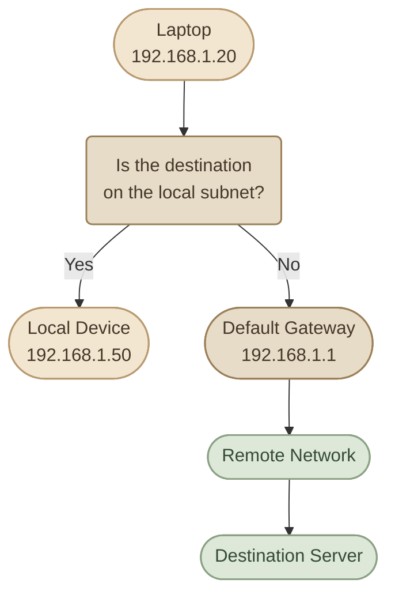

## Introduction

لحد دلوقتي، اتعلمنا إن كل جهاز عنده IP Address، وإن الـ Subnet Mask بيساعده يحدد الشبكة اللي بينتمي ليها. واتعرفنا كمان على الـ MAC Address ودور الـ Router في توصيل الشبكات ببعضها.

لكن تخيّل إن اللابتوب بتاعك متصل بشبكة البيت، وعايز تفتح موقع موجود على سيرفر في شبكة بعيدة. اللابتوب هيبعت البيانات للسيرفر إزاي، وهو مش موجود في نفس الشبكة المحلية؟

هنا بيظهر دور الـ **Default Gateway**.

## 1. What Is a Default Gateway?

الـ **Default Gateway** هو عنوان الـ Router اللي الجهاز بيستخدمه كوجهة تالية (**Next Hop**) لما يحتاج يبعت Traffic إلى شبكة أخرى، ومفيش Route أكثر تحديدًا بيطابق الوجهة.

في شبكة منزلية شائعة، الـ Default Gateway بيكون عنوان الـ Router الداخلي، مثل:

`192.168.1.1`

واللابتوب ممكن يكون عنده:

- IP Address: `192.168.1.20`
- Subnet Mask: `255.255.255.0`
- Default Gateway: `192.168.1.1`

بما إن اللابتوب والـ Gateway موجودين في نفس الشبكة المحلية، يقدر اللابتوب يوصل للـ Gateway مباشرةً على الـ Local Link.

<InfoCard title="The Main Idea" icon="network" variant="concept">

الـ Default Gateway هو نقطة الخروج المعتادة من الشبكة المحلية نحو شبكات أخرى، مش بالضرورة جهاز منفصل عن الـ Router، ومش هو عنوان الـ Public IP نفسه.

</InfoCard>

## 2. How Does a Device Decide Where to Send Traffic?

قبل ما الجهاز يختار الـ Gateway، لازم يحدد إذا كانت وجهة الـ IP موجودة في نفس الشبكة المحلية ولا لأ.

القرار بيعتمد على عنوان الجهاز، والـ Subnet Mask، وعنوان الوجهة، بالإضافة إلى الـ Routing Table الموجودة في النظام.

خلّينا نستخدم المثال ده:

<TableCard title="Example Laptop Settings">
| Setting | Value |
|---|---|
| Laptop IP | `192.168.1.20` |
| Subnet Mask | `255.255.255.0` |
| Default Gateway | `192.168.1.1` |
</TableCard>

دلوقتي عندنا حالتين.

<CardGrid columns={2}>
  <InfoCard title="Local Destination" icon="network" variant="feature">

    **Destination:** `192.168.1.50`

    الوجهة موجودة في نفس الشبكة `192.168.1.0/24`.

    الجهاز بيحاول يوصل للوجهة مباشرةً على الـ Local Link.

  </InfoCard>
  <InfoCard title="Remote Destination" icon="cloud" variant="feature">

    **Destination:** `8.8.8.8`

    الوجهة مش موجودة في الشبكة المحلية.

    الجهاز بيستخدم الـ Default Route لإرسال البيانات إلى الـ Gateway، وفقًا للـ Routing Table.

  </InfoCard>
</CardGrid>

المهم هنا إن الجهاز مش بيبعت كل البيانات للـ Gateway بشكل تلقائي. لو الوجهة محلية، غالبًا بيتواصل معاها مباشرةً؛ ولو الوجهة بعيدة، بيستخدم الـ Route المناسب.

## 3. Follow the Packet

خلّينا نمشي مع Request خارج من اللابتوب إلى سيرفر على الإنترنت.



في حالة الوجهة البعيدة، اللي بيحصل غالبًا كالتالي:

<Steps>
<li>

<InfoCard title="Application Requests" description="التطبيق يطلب إرسال بيانات إلى عنوان IP معين." icon="code" />

</li>
<li>

<InfoCard title="Routing Table Lookup" description="نظام التشغيل يراجع الـ Routing Table ويحدد الـ Route المناسب." icon="branch" />

</li>
<li>

<InfoCard title="Default Route" description="لو الـ Default Route هو الأنسب، النظام يختار الـ Default Gateway كـ Next Hop." icon="wheel" />

</li>
<li>

<InfoCard title="ARP for the Gateway" description="لو محتاج يعرف عنوان الـ MAC الخاص بالـ Gateway، بيستخدم ARP في IPv4 إذا لم تكن المعلومة متاحة بالفعل في الـ Cache." icon="network" />

</li>
<li>

<InfoCard title="Send the Frame" description="الجهاز يرسل Ethernet Frame إلى الـ Gateway، والـ IP Packet بداخلها موجّهة إلى عنوان الوجهة الأصلي." icon="layers" />

</li>
<li>

<InfoCard title="Router Forwards" description="الـ Router يفحص الـ Packet ويستخدم الـ Routing Table الخاصة به لاختيار الخطوة التالية." icon="cloud" />

</li>
</Steps>

الـ Router ممكن يمرر الـ Packet إلى Router آخر، وتتكرر العملية لحد ما توصل إلى الشبكة المطلوبة، وفقًا للـ Routing والـ Firewall وسياسات الشبكة.

## 4. IP Address vs MAC Address at the Gateway

دي من أهم النقاط اللي لازم تفهمها كويس.

افترض إن اللابتوب عنده:

- Source IP: `192.168.1.20`
- Destination IP: `8.8.8.8`
- Gateway IP: `192.168.1.1`
- Gateway MAC: `AA:AA:AA:AA:AA:01`

لما اللابتوب يرسل الـ Frame للـ Gateway، بيكون عنده عنوانان مختلفان على مستويين مختلفين.

<CardGrid columns={2} label="Inside the Ethernet Frame">
<InfoCard variant="feature" title="Layer 2 — Ethernet" description="Destination MAC: `AA:AA:AA:AA:AA:01` — Source MAC: MAC address of the laptop" icon="network" tags={["L2"]} />

<InfoCard variant="feature" title="Layer 3 — IP" description="Source IP: `192.168.1.20` — Destination IP: `8.8.8.8`" icon="cloud" tags={["L3"]} />
</CardGrid>

الـ Ethernet Frame موجهة إلى الـ Gateway على مستوى Layer 2، لكن الـ IP Packet لسه وجهتها `8.8.8.8`.

لما الـ Router يستقبل الـ Frame، بيزيل الـ Layer 2 header، ويفحص الـ IP Packet. ولو هيبعثها عبر Ethernet إلى Next Hop آخر، بيكوّن Frame جديدة بعناوين MAC مناسبة للوصلة الجديدة.

<InfoCard title="Remember This" icon="layers" variant="insight">

عند الانتقال عبر Router، عناوين الـ MAC الخاصة بالـ Frame بتتغير من وصلة إلى أخرى عادةً، لكن عناوين الـ IP المصدر والوجهة بتفضل كما هي أثناء التوجيه العادي. تقنيات زي NAT ممكن تغيّر عناوين IP أو الـ Ports، وده موضوع منفصل.

</InfoCard>

## 5. What Is the Default Route?

الـ **Default Route** هو Route بيستخدمه النظام لما مفيش Route أكثر تحديدًا يطابق عنوان الوجهة.

في IPv4، بيتكتب غالبًا بالشكل ده:

`0.0.0.0/0`

الـ `/0` معناه إن الـ Route مش بيحدد أي Network Bits ثابتة لمطابقة الوجهة، وبالتالي ممكن يطابق أي عنوان IPv4. لكن النظام بيختار الـ Route الأنسب حسب قواعد الـ Routing، ومنها طول الـ Prefix والـ Route Metrics.

مثلًا، ممكن تلاقي في Routing Table:

```text
default via 192.168.1.1 dev wlp2s0
192.168.1.0/24 dev wlp2s0
```

السطر الأول بيوضح الـ Default Route عبر `192.168.1.1`. السطر الثاني بيوضح إن الشبكة المحلية متصلة مباشرةً بالـ Interface.

لما الوجهة تكون `192.168.1.50`، الـ Route الخاص بـ `/24` أكثر تحديدًا من `/0`، فيتم استخدامه. أما الوجهة `8.8.8.8`، فعادةً هتستخدم الـ Default Route لو مفيش Route آخر أكثر تحديدًا.

## 6. Check the Default Gateway on Linux

على Fedora، تقدر تعرض الـ Routing Table باستخدام:

```bash
ip route
```

ولعرض الـ Default Route فقط:

```bash
ip -4 route show default
```

ممكن تظهر نتيجة شبيهة بالآتي:

```text
default via 192.168.1.1 dev wlp2s0 proto dhcp metric 600
```

معنى الحقول الأساسية:

<CardGrid columns={2} label="Reading the Output">
<InfoCard variant="concept" title="default" description="الـ Default Route." icon="flag" tags={["Field"]} />

<InfoCard variant="concept" title="via 192.168.1.1" description="عنوان الـ Next Hop." icon="wheel" tags={["Field"]} />

<InfoCard variant="concept" title="dev wlp2s0" description="الـ Network Interface المستخدمة." icon="network" tags={["Field"]} />

<InfoCard variant="concept" title="proto dhcp" description="مصدر الـ Route في هذا المثال." icon="code" tags={["Field"]} />

<InfoCard variant="concept" title="metric 600" description="قيمة تُستخدم للمفاضلة بين Routes مناسبة وفقًا لقواعد النظام." icon="pulse" tags={["Field"]} />
</CardGrid>

العنوان والـ Interface والـ Metric في جهازك ممكن يختلفوا عن المثال.

ولو عايز تعرض عناوين الـ Interfaces:

```bash
ip -br addr
```

ولو عايز تعرف الـ Route اللي النظام هيستخدمه لعنوان معين:

```bash
ip route get 8.8.8.8
```

الأمر الأخير مفيد جدًا في Troubleshooting، لأنه بيوضح الـ Route والـ Next Hop والـ Interface اللي النظام اختارهم للوجهة المحددة.

## 7. What Happens If the Default Gateway Is Missing?

لو الجهاز محتاج يتواصل مع شبكة خارج الشبكات اللي عنده Routes مناسبة ليها، ومفيش Default Route، غالبًا مش هيعرف يحدد Next Hop للوجهة دي.

لكن ده مش معناه إن الجهاز هيفقد كل الاتصالات؛ ممكن يفضل يتواصل مع الأجهزة الموجودة في الشبكات المتصلة مباشرةً أو الشبكات اللي ليها Routes محددة.

ولو الـ Gateway موجود في الإعدادات لكنه غير قابل للوصول، ممكن الاتصال بالشبكات البعيدة يفشل حتى لو الـ Wi-Fi متصل.

<InfoCard title="Troubleshooting Tip" icon="wrench" variant="tip">

لما الإنترنت يفصل، ما تفترضش فورًا إن المشكلة في الـ DNS.

افحص بالتدريج:

1. هل الـ Interface شغالة وعندها IP Address؟
2. هل الـ Default Route موجود؟
3. هل الـ Gateway قابل للوصول؟
4. هل فيه اتصال بعناوين خارجية؟
5. هل الـ DNS بيحل أسماء المواقع؟

كل خطوة بتساعدك تحدد مكان المشكلة بدل ما تغيّر إعدادات عشوائيًا.

</InfoCard>

## 8. Knowledge Check

**Question 1:** عندك جهاز `192.168.1.20/24` والـ Gateway هو `192.168.1.1`. هل الجهاز يحتاج الـ Gateway عشان يتواصل مع `192.168.1.50`؟

**Answer:** عادةً لأ؛ الوجهة داخل نفس الـ Subnet، فيحاول الجهاز الوصول إليها مباشرةً.

**Question 2:** لما الجهاز يرسل Packet إلى `8.8.8.8` عبر الـ Gateway، هل Destination IP بيتحول إلى `192.168.1.1`؟

**Answer:** لأ. الـ Destination IP يظل `8.8.8.8` في التوجيه العادي. اللي بيتوجه إلى الـ Gateway على مستوى Layer 2 هو الـ Ethernet Frame.

**Question 3:** إيه الفرق بين Default Gateway وDefault Route؟

**Answer:** الـ Default Gateway هو الـ Next Hop اللي هيتم إرسال الـ Traffic إليه، بينما الـ Default Route هو قاعدة التوجيه المستخدمة للوجهات اللي مفيش Route أكثر تحديدًا بيطابقها.

**Question 4:** إيه الأمر اللي يعرض الـ Default Route على Linux؟

**Answer:** `ip -4 route show default`

## Key Takeaways

<CardGrid columns={3} label="Default Gateway Recap">
<InfoCard variant="summary" title="Next Hop" description="الـ Default Gateway هو الـ Next Hop المعتاد للوصول إلى شبكات خارجية." icon="wheel" tags={["Gateway"]} />

<InfoCard variant="summary" title="Local or Remote" description="الجهاز يستخدم الـ Routing Table لتحديد إذا كانت الوجهة محلية أو بعيدة." icon="branch" tags={["Route"]} />

<InfoCard variant="summary" title="0.0.0.0/0" description="الـ Default Route في IPv4 بيتكتب غالبًا `0.0.0.0/0`." icon="code" tags={["Default"]} />

<InfoCard variant="summary" title="MAC vs IP" description="الـ Frame بتتوجه إلى MAC Address الخاص بالـ Gateway، بينما الـ IP Packet بتحتفظ بعنوان وجهتها البعيدة أثناء التوجيه العادي." icon="network" tags={["L2/L3"]} />

<InfoCard variant="summary" title="ip route" description="أمر `ip route` أساسي لفهم مسار البيانات وتشخيص مشاكل الاتصال على Linux." icon="terminal" tags={["Linux"]} />
</CardGrid>
