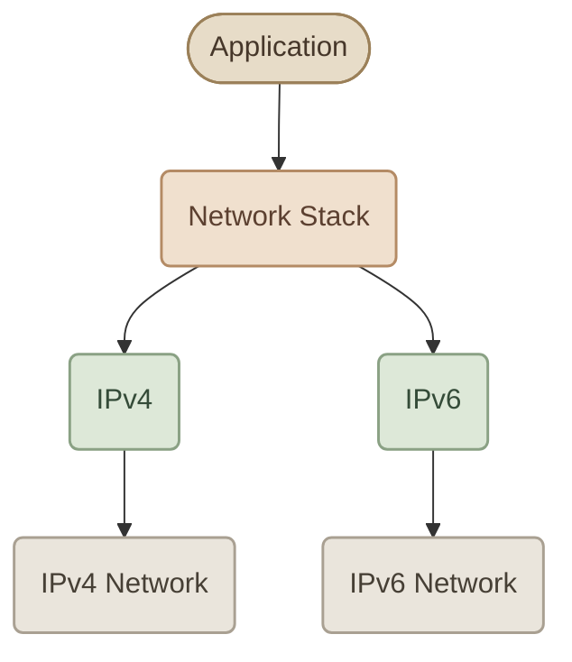

## 1. What Is IPv6?

**IPv6 (Internet Protocol version 6)** هو إصدار من بروتوكول IP اتصمم أساسًا علشان يعالج مشكلة نفاد عناوين IPv4، ويوفر مساحة عناوين أكبر بكتير.

IPv4 بيستخدم عنوان مكوّن من **32 bits**، وده بيوفر حوالي 4.3 مليار عنوان إجمالي. مع زيادة عدد الأجهزة والخدمات المتصلة بالإنترنت، المساحة دي بقت غير كافية.

أما IPv6، فبيستخدم عنوان مكوّن من **128 bits**، وده بيوفر مساحة عناوين ضخمة جدًا.

<InfoCard title="The key idea" icon="network" variant="concept">
IPv6 مش مجرد شكل جديد للعنوان؛ ده إصدار مختلف من Internet Protocol، وليه addressing وheader format وقواعد تشغيل خاصة بيه.
</InfoCard>

## 2. Why Do We Need IPv6?

الأسباب الأساسية لظهور IPv6:

<CardGrid columns={2} label="Why IPv6">
<InfoCard variant="concept" title="IPv4 address exhaustion" description="عدد عناوين IPv4 محدود." icon="network" tags={["Exhaustion"]} />

<InfoCard variant="concept" title="Growing Internet" description="عدد الأجهزة والـ services المتصلة بالشبكة بيزيد باستمرار." icon="cloud" tags={["Growth"]} />

<InfoCard variant="concept" title="Less dependence on NAT" description="مساحة العناوين الأكبر بتقلل الحاجة لاستخدام NAT لمجرد مشاركة عنوان عام واحد بين أجهزة كتير، رغم إن NAT ممكن يفضل مستخدم لأسباب تانية." icon="cycle" tags={["NAT"]} />

<InfoCard variant="concept" title="Simplified base header" description="الـ IPv6 base header اتصمم بشكل مختلف عن IPv4، وبعض الوظائف اتنقلت لـ Extension Headers." icon="layers" tags={["Header"]} />
</CardGrid>

## 3. IPv4 vs IPv6

<TableCard title="IPv4 vs IPv6">
| Feature | IPv4 | IPv6 |
|---|---|---|
| Address size | 32 bits | 128 bits |
| Address format | Decimal, separated by dots | Hexadecimal, separated by colons |
| Example | `192.168.1.10` | `2001:db8:1::10` |
| Address space | About 4.3 billion total addresses | `2^(128)` addresses |
| Broadcast | Supported | No broadcast; multicast is used instead |
| Address resolution | ARP | Neighbor Discovery (NDP), using ICMPv6 |
| Header | Variable length | Fixed 40-byte base header |
</TableCard>

خلي بالك إن IPv6 مش بيستخدم **ARP** لحل عناوين الـ IP إلى MAC addresses؛ بدلًا منه بيستخدم **Neighbor Discovery Protocol (NDP)**، واللي بيعتمد على ICMPv6.

## 4. IPv6 Address Structure

عنوان IPv6 بيتكوّن من **128 bits**، وبيتكتب عادةً في صورة 8 مجموعات، كل مجموعة عبارة عن 16 bits مكتوبة باستخدام hexadecimal digits.

مثال:

```text
2001:0db8:0001:0000:0000:0000:0000:0010
```

كل مجموعة اسمها **hextet**، وبتحتوي على 4 hexadecimal digits كحد أقصى.

```text
2001 : 0db8 : 0001 : 0000 : 0000 : 0000 : 0000 : 0010
 16b    16b    16b    16b    16b    16b    16b    16b

Total: 8 × 16 bits = 128 bits
```

الـ hexadecimal بيستخدم الأرقام من `0` إلى `9` والحروف من `a` إلى `f`. كل hexadecimal digit بيمثل 4 bits، وبالتالي 4 digits بيمثلوا 16 bits.

## 5. IPv6 Address Shortening

عناوين IPv6 ممكن تبقى طويلة، علشان كده فيه قاعدتين أساسيتين لاختصارها.

### I. Rule 1: Remove Leading Zeros

تقدر تشيل الأصفار اللي في بداية أي hextet، لكن مش الأصفار اللي في نهايته.

```text
Original:
2001:0db8:0001:0000:0000:0000:0000:0010

After removing leading zeros:
2001:db8:1:0:0:0:0:10
```

أمثلة:

- `0db8` تصبح `db8`.
- `0001` تصبح `1`.
- `0010` تصبح `10`.
- `1200` تفضل `1200`؛ لأن الأصفار هنا مش في بداية المجموعة.

### II. Rule 2: Replace Consecutive Zero Hextets with `::`

لو فيه مجموعة متتالية من الـ hextets قيمتها صفر، تقدر تستبدلها بـ `::`.

```text
2001:db8:1:0:0:0:0:10
```

تصبح:

```text
2001:db8:1::10
```

الـ `::` ممكن تظهر **مرة واحدة فقط** في العنوان؛ لأن استخدامها مرتين هيخلي عدد مجموعات الصفر المحذوفة غير محدد.

<InfoCard title="Important rule" icon="shield" variant="warning">
لما تشوف `::`، عدد مجموعات الصفر اللي بتمثلها بيتحدد من خلال استكمال العنوان إلى 8 hextets. ما ينفعش تستخدم `::` مرتين في نفس عنوان IPv6.
</InfoCard>

مثال تاني:

```text
Full:      2001:0db8:0000:0000:0000:0000:0000:0001
Shortened: 2001:db8::1
```

## 6. Understanding the Prefix Length

زي ما IPv4 بيستخدم Subnet Mask أو CIDR، IPv6 بيستخدم **Prefix Length** علشان يحدد عدد الـ bits الخاصة بالـ network prefix.

مثال:

```text
2001:db8:1::10/64
```

الجزء `/64` معناه إن أول 64 bits هي الـ prefix، والـ 64 bits المتبقية بتكوّن الجزء الآخر من العنوان.

```mermaid
flowchart TD
    A(["IPv6 Address<br/>2001:db8:1::10/64"]) --> B("Network Prefix<br/>First 64 bits")
    A --> C("Interface Identifier<br/>Remaining 64 bits")

    B --> D("Identifies the network prefix")
    C --> E("Identifies an interface within that prefix")

    classDef address fill:#E7DCC8,stroke:#9B8059,color:#46372A,stroke-width:1.5px
    classDef network fill:#DDE8D8,stroke:#8AA184,color:#344B38,stroke-width:1.5px
    classDef interface fill:#F0E0CE,stroke:#B48B65,color:#5C4030,stroke-width:1.5px

    class A address
    class B,D network
    class C,E interface
```



الـ `/64` شائع جدًا في شبكات IPv6 المحلية، لكنه مش الطول الوحيد الممكن لكل أنواع الـ prefixes.

## 7. Common IPv6 Address Types

IPv6 عنده أنواع مختلفة من العناوين، وكل نوع له استخدام مختلف.

<CardGrid columns={2} label="IPv6 Address Types">
<InfoCard title="Global Unicast" icon="network" variant="concept">
    عناوين قابلة للتوجيه عالميًا على الإنترنت، زي العناوين الموجودة ضمن النطاق `2000::/3`.
</InfoCard>
<InfoCard title="Link-Local" icon="layers" variant="concept">
    بتُستخدم على نفس الـ network link، وغالبًا بتبدأ بـ `fe80::/10`. الراوترات مش بتعمل forwarding لها كعناوين وجهة خارج الـ link المحلي.
</InfoCard>
<InfoCard title="Unique Local" icon="shield" variant="concept">
    عناوين للاستخدام داخل الشبكات الخاصة، ضمن النطاق `fc00::/7`، والجزء المستخدم عادةً محليًا بيكون من `fd00::/8`.
</InfoCard>
<InfoCard title="Multicast" icon="branch" variant="concept">
    عنوان بيشير لمجموعة من الواجهات بدل واجهة واحدة؛ نطاق عناوين multicast بيبدأ بـ `ff00::/8`.
</InfoCard>
</CardGrid>

وفيه كمان عنوان مهم جدًا:

```text
::1
```

ده عنوان **Loopback** في IPv6، وبيؤدي دورًا مشابهًا لـ `127.0.0.1` في IPv4؛ يعني الجهاز بيستخدمه علشان يتواصل مع نفسه.

أما العنوان:

```text
::
```

فهو **Unspecified Address**، وبيمثل عدم تحديد عنوان. مش عنوان عادي بتستخدمه كعنوان وجهة لجهاز على الشبكة.

## 8. Does IPv6 Replace IPv4 Immediately?

لأ. شبكات كتير بتشغّل IPv4 وIPv6 مع بعض، وده اسمه **Dual Stack**.



في Dual Stack، الجهاز ممكن يكون عنده عنوان IPv4 وعنوان IPv6، ويستخدم البروتوكول المناسب حسب الاتصال والـ network configuration.

وده مهم في DevOps وCloud؛ لأن السيرفر أو الـ container أو الـ load balancer ممكن يكون شغال على IPv4 أو IPv6 أو الاتنين، حسب الإعدادات والبنية التحتية.

## 9. Inspect IPv6 on Linux

على Linux، تقدر تستخدم أوامر `ip` علشان تشوف عناوين IPv6 والـ routes.

### I. Show IP addresses

```bash
ip -6 addr show
```

لعرض عناوين IPv6 الموجودة على واجهات الشبكة.

### II. Show IPv6 routes

```bash
ip -6 route show
```

لعرض الـ IPv6 routing table.

### III. Show all addresses briefly

```bash
ip -br addr
```

ده بيعرض عناوين IPv4 وIPv6 بشكل مختصر لكل interface.

### IV. Check loopback

```bash
ping -6 ::1
```

ده بيختبر اتصال IPv6 مع الـ loopback address محليًا، من غير ما يحتاج اتصال خارجي بالإنترنت.

## 10. Key Takeaways

<CardGrid columns={3} label="IPv6 Recap">
<InfoCard variant="summary" title="128 Bits" description="IPv6 بيستخدم عناوين بطول 128 bits." icon="code" tags={["Size"]} />

<InfoCard variant="summary" title="Eight Hextets" description="العنوان بيتكتب في 8 hextets باستخدام hexadecimal digits." icon="layers" tags={["Format"]} />

<InfoCard variant="summary" title="Leading Zeros" description="تقدر تحذف الـ leading zeros من كل hextet." icon="terminal" tags={["Shorten"]} />

<InfoCard variant="summary" title="One :: Only" description="تقدر تختصر سلسلة متتالية من hextets الصفرية باستخدام `::` مرة واحدة فقط." icon="tag" tags={["Shorten"]} />

<InfoCard variant="summary" title="Prefix Length" description="الـ Prefix Length زي `/64` بيحدد عدد الـ bits الخاصة بالـ network prefix." icon="network" tags={["Prefix"]} />

<InfoCard variant="summary" title="NDP and Multicast" description="IPv6 بيستخدم Multicast بدل Broadcast، وNDP بدل ARP." icon="branch" tags={["Protocol"]} />

<InfoCard variant="summary" title="Dual Stack" description="IPv4 وIPv6 ممكن يشتغلوا مع بعض باستخدام Dual Stack." icon="cycle" tags={["Stack"]} />
</CardGrid>
