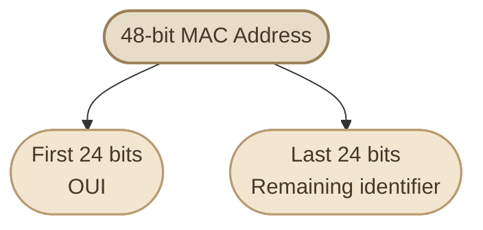
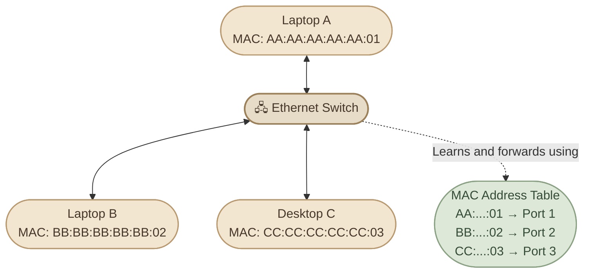
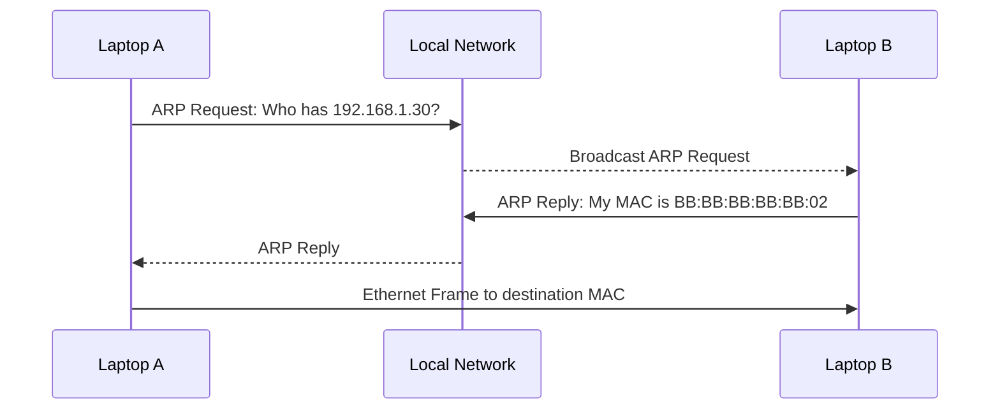

## Introduction

في الدروس السابقة، اتعرفنا على الـ **NIC (Network Interface Card)**، اللي بيسمح للجهاز بالاتصال بالشبكة، واتعلمنا كمان إن الـ **IP Address** بيُستخدم عشان نحدد عنوان الجهاز على شبكة IP.

لكن فيه عنوان تاني مهم بيظهر في الاتصال داخل الشبكة المحلية، وهو **MAC Address**.

عشان نفهم دوره، تخيل إن عندك Laptop وموبايل متصلين بنفس الـ Wi-Fi. كل جهاز عنده IP Address، لكن لما البيانات تتحرك داخل الشبكة المحلية، فيه آلية تانية بتساعد الـ Network Devices إنها توصل الـ Ethernet Frames للـ Interface المقصود.

هنا بييجي دور الـ MAC Address.

## 1. What Is a MAC Address?

الـ **MAC Address (Media Access Control Address)** هو عنوان بيُستخدم لتحديد الـ Network Interface على مستوى الـ Data Link Layer، اللي هي Layer 2 في الـ OSI Model.

في شبكات Ethernet وWi-Fi المعتادة، الـ MAC Address بيساعد الـ Switch أو الـ Access Point في توصيل الـ Frames داخل الشبكة المحلية.

<InfoCard title="The Key Idea" icon="network" variant="concept">

الـ **IP Address** بيساعد في تحديد وجهة الاتصال على مستوى الـ Network Layer، بينما الـ **MAC Address** بيُستخدم لتحديد الـ Interface المقصود داخل الـ Local Link.

الاتنين بيكملوا بعض، ومش بدائل لبعض.

</InfoCard>

خلي بالك من نقطة مهمة: الـ MAC Address مش بالضرورة عنوان ثابت أو هوية دائمة للجهاز كله. الجهاز الواحد ممكن يكون عنده أكتر من Network Interface، وكل Interface ممكن يكون عنده MAC Address مختلف. كمان بعض الأنظمة بتستخدم عناوين MAC عشوائية أو متغيرة لأسباب متعلقة بالخصوصية.

## 2. MAC Address Format

الـ MAC Address التقليدي في Ethernet بيكون حجمه **48 bits (6 bytes)**، وغالبًا بنشوفه مكتوبًا في صورة 6 مجموعات من الأرقام والحروف بالنظام الست عشري **Hexadecimal**.

مثال:

```text
3C:52:82:AB:10:7F
```

كل مجموعة بتمثل Byte واحد، يعني 8 bits. وبما إن الـ Hexadecimal بيستخدم الرموز من `0` إلى `9` ومن `A` إلى `F`، فكل Byte بيتكتب برقمين Hexadecimal.

<InfoCard title="Reading the Address" icon="layers" variant="feature">

في العنوان:

`3C:52:82:AB:10:7F`

- عدد المجموعات: 6.
- حجم كل مجموعة: 8 bits.
- الحجم الإجمالي: 48 bits.
- الفاصل ممكن يكون `:` أو `-` حسب النظام أو الأداة المستخدمة.

</InfoCard>

وممكن تلاقي نفس العنوان مكتوب بالشكل ده:

```text
3C-52-82-AB-10-7F
```

ده مجرد اختلاف في طريقة العرض، مش عنوان مختلف.

## 3. How Is a MAC Address Structured?

في العنوان التقليدي ذي الـ 48 bits، أول 24 bits غالبًا بتمثل الجزء المرتبط بالجهة اللي خصصت العنوان، وده بيتعرف باسم **OUI (Organizationally Unique Identifier)** في العناوين المُدارة عالميًا.

أما آخر 24 bits، فبتكمل العنوان وبتُستخدم للتمييز بين العناوين داخل نطاق التخصيص.



التقسيم ده بيوصف شكلًا شائعًا للعناوين اللي بتتخصص من خلال جهات التسجيل، لكنه مش معناه إنك تقدر تعرف الشركة المصنعة أو الجهاز بشكل مؤكد من أي MAC Address تشوفه. فيه عناوين محلية الإدارة **Locally Administered Addresses**، وفيه MAC Address Randomization، وبالتالي أول جزء مش دايمًا بيحدد الشركة المصنعة بالطريقة المتوقعة.

## 4. MAC Address vs IP Address

ممكن تسأل: طالما عندنا IP Address، ليه محتاجين MAC Address كمان؟

لأن كل واحد بيؤدي دورًا مختلفًا في عملية الاتصال.

<CardGrid columns={2}>

<InfoCard title="IP Address" icon="network" variant="concept">

**Layer 3 — Network**

بيُستخدم في توجيه الـ Packets بين شبكات IP المختلفة.

Example: `192.168.1.20`

</InfoCard>

<InfoCard title="MAC Address" icon="layers" variant="concept">

**Layer 2 — Data Link**

بيُستخدم في توصيل الـ Frames داخل الـ Local Link، زي شبكة Ethernet أو Wi-Fi.

Example: `3C:52:82:AB:10:7F`

</InfoCard>

</CardGrid>

خلّينا نشوف الفرق في جدول مختصر:

<TableCard title="MAC vs IP">
| Property | MAC Address | IP Address |
|---|---|---|
| Main role | توصيل الـ Frames على مستوى Layer 2 | عنونة وتوجيه الـ Packets على مستوى Layer 3 |
| OSI layer | Layer 2 | Layer 3 |
| Typical format | `3C:52:82:AB:10:7F` | `192.168.1.20` |
| Assigned to | Network Interface | Interface ضمن شبكة IP |
| Can change? | أيوه، ممكن يتغير أو يتعمله Randomization | أيوه، ممكن يكون Dynamic أو Static |
| Used by | Switches وعمليات Layer 2 | IP Routers وأنظمة التوجيه |
</TableCard>

**ملحوظة مهمة:** وصف الـ MAC بأنه عنوان مادي ثابت مش دقيق في كل الحالات. ممكن يكون فيه عنوان أصلي مرتبط بالـ Interface، لكن النظام يقدر يستخدم عنوانًا مختلفًا، والعنوان نفسه ممكن يتغير حسب إعدادات الشبكة.

## 5. How Does a Switch Use MAC Addresses?

لما جهاز يبعت Ethernet Frame داخل شبكة محلية، الـ Switch بيقرأ الـ **Source MAC Address** ويتعلم منه إن العنوان ده موجود على الـ Port اللي استقبل منه الـ Frame.

بعد كده، لما يستقبل Frame تانية، بيستخدم الـ **Destination MAC Address** عشان يحدد الـ Port المناسب للإرسال، لو كان عنده Entry للعنوان ده في جدول الـ MAC.

الجدول ده اسمه **MAC Address Table** أو **CAM Table**.



مثلًا، لو Laptop A بعت Frame إلى Laptop B:

<Steps>
<li>

<InfoCard title="Receive" description="الـ Switch يستقبل الـ Frame من Port 1." icon="network" />

</li>
<li>

<InfoCard title="Learn" description="يقرأ الـ Source MAC Address ويتعلم إن عنوان Laptop A موجود على Port 1." icon="terminal" />

</li>
<li>

<InfoCard title="Look Up" description="يبحث عن الـ Destination MAC Address الخاص بـ Laptop B في الـ MAC Address Table." icon="layers" />

</li>
<li>

<InfoCard title="Forward" description="لو العنوان معروف، يرسل الـ Frame إلى الـ Port المرتبط به بدل ما يبعتها لكل الأجهزة." icon="pulse" />

</li>
<li>

<InfoCard title="Flood Unknowns" description="لو عنوان الوجهة غير معروف، فالـ Switch عادةً يعمل **Unknown Unicast Flooding** داخل نفس الـ VLAN، مع استثناء الـ Port اللي استقبل منه الـ Frame." icon="wheel" />

</li>
</Steps>

بالتالي، الـ Switch مش محتاج يعرف الـ IP Address عشان يقرر الـ Port المناسب في عملية Layer 2 forwarding العادية.

## 6. How Does a Device Find the Destination MAC?

هنا فيه نقطة مهمة بتربط الـ MAC Address بالـ IP Address.

افترض إن جهازك عايز يبعت بيانات إلى جهاز تاني موجود في نفس الـ IPv4 subnet. الجهاز بيعرف الـ IP Address الخاص بالوجهة، لكنه محتاج كمان Destination MAC Address عشان يبني الـ Ethernet Frame.

في شبكات IPv4، البروتوكول اللي بيُستخدم عادةً لمعرفة الـ MAC Address المقابل لعنوان IPv4 على الـ Local Link هو **ARP (Address Resolution Protocol)**.



في المثال ده:

- Laptop A يعرف إن عنوان الجهاز الآخر هو `192.168.1.30`.
- لو مفيش Mapping صالح في الـ ARP Cache، بيبعت ARP Request على الشبكة المحلية.
- الجهاز اللي عنده العنوان بيرد بعنوان الـ MAC الخاص به.
- Laptop A يقدر بعدها يرسل الـ Ethernet Frame إلى الـ Destination MAC الصحيح.

لكن لو الوجهة موجودة على **شبكة مختلفة**، الجهاز عادةً مش بيحاول يجيب MAC Address الخاص بالسيرفر البعيد. بدلًا من كده، بيستخدم عنوان الـ MAC الخاص بالـ **Default Gateway** عشان يوصل الـ Frame للـ Router، والـ Router يتولى توجيه الـ IP Packet نحو الشبكة التالية.

ودي من أهم النقاط اللي بتوضح إن الـ IP Address والـ MAC Address بيشتغلوا مع بعض في مستويات مختلفة.

## 7. Broadcast and Special MAC Addresses

مش كل Ethernet Frame لازم تكون وجهتها MAC Address لجهاز واحد بعينه.

من أشهر الأمثلة عنوان الـ Ethernet Broadcast:

```text
FF:FF:FF:FF:FF:FF
```

لما الـ Frame يكون موجهًا إلى العنوان ده، بيتم إرساله إلى كل الـ Interfaces المعنية داخل نطاق الـ Layer 2 broadcast domain، مع مراعاة سلوك الشبكة والبروتوكول المستخدم.

ARP Request في IPv4 مثال شائع على استخدام الـ Broadcast، لأن الجهاز بيسأل: مين عنده عنوان الـ IP ده؟

وفي المقابل، عنوان **Unicast MAC Address** بيُستخدم عادةً لما يكون الإرسال موجهًا إلى Interface محدد.

<InfoCard title="Broadcast Is Not the Same as Internet Broadcast" icon="network" variant="insight">

الـ Ethernet Broadcast بيكون داخل نطاق Layer 2 المحلي، ومش معناه إن الرسالة بتوصل لكل الأجهزة على الإنترنت.

الـ Router العادي لا يمرر Ethernet Broadcast Frames من شبكة محلية إلى شبكة أخرى بالطريقة نفسها.

</InfoCard>

## 8. Check Your MAC Address on Linux

على Fedora، تقدر تعرض الـ Network Interfaces وعناوين الـ MAC الخاصة بها باستخدام:

```bash
ip link
```

ولو عايز النتيجة مختصرة وسهلة القراءة:

```bash
ip -br link
```

مثال توضيحي:

```text
lo               UNKNOWN        00:00:00:00:00:00
enp2s0           UP             3c:52:82:ab:10:7f
wlp3s0            UP             84:xx:xx:xx:xx:xx
```

الأسماء زي `enp2s0` و`wlp3s0` بتشير إلى Network Interfaces، وغالبًا هتلاقي Ethernet وWi-Fi بأسماء مختلفة. أما `lo` فهو الـ Loopback Interface، ومش واجهة اتصال فعلية بالشبكة.

تقدر كمان تفحص عنوان Interface معينة:

```bash
cat /sys/class/net/wlp3s0/address
```

استبدل `wlp3s0` باسم الـ Interface الموجودة عندك.

ولو عايز تعرف الـ MAC Address اللي النظام بيستخدمه حاليًا، فالأفضل تفحص الـ Interface وهي متصلة؛ لأن بعض أنظمة Wi-Fi بتستخدم عنوانًا عشوائيًا حسب إعدادات الخصوصية.

## 9. Common Misconceptions

<CardGrid columns={1}>

<InfoCard title="A MAC Address Is Not Always Permanent" icon="tag" variant="warning">

ممكن يتغير العنوان المستخدم بواسطة النظام، أو يتعمله Randomization. لذلك ما تعتمدش على MAC Address باعتباره هوية ثابتة ومضمونة للجهاز.

</InfoCard>

<InfoCard title="A MAC Address Is Not an Internet Routing Address" icon="cloud" variant="warning">

الـ MAC Address بيُستخدم في نطاق Layer 2، بينما التوجيه بين شبكات IP بيعتمد على الـ IP Address والـ Routing Tables.

</InfoCard>

<InfoCard title="MAC Filtering Is Not Strong Authentication" icon="shield" variant="warning">

السماح لأجهزة معينة بالاتصال بناءً على MAC Address ممكن يساعد في إدارة الوصول، لكنه مش بديل عن التشفير والمصادقة القوية؛ لأن MAC Addresses ممكن تتغير أو يتم انتحالها.

</InfoCard>

</CardGrid>

## 10. Knowledge Check

**Question 1:** عندنا جهاز عنوانه `192.168.1.20`، هل ده MAC Address؟

**الإجابة:** لأ، ده IPv4 Address. الـ MAC Address التقليدي بيكون بالشكل `3C:52:82:AB:10:7F`.

**Question 2:** إيه البروتوكول اللي بيُستخدم عادةً لمعرفة الـ MAC Address المقابل لعنوان IPv4 على الشبكة المحلية؟

**الإجابة:** ARP.

**Question 3:** لو الـ Switch استقبل Frame والـ Destination MAC Address موجود في جدول العناوين، بيعمل إيه؟

**الإجابة:** بيستخدم الـ MAC Address Table لتحديد الـ Port المناسب للإرسال داخل الـ VLAN.

**Question 4:** لو جهاز عايز يتواصل مع IP Address موجود على شبكة مختلفة، هل بيستخدم MAC Address الخاص بالسيرفر البعيد مباشرةً؟

**الإجابة:** عادةً لأ. بيبعت الـ Frame إلى الـ Default Gateway، باستخدام MAC Address الخاص بالـ Gateway على الـ Local Link.

## Key Takeaways

<CardGrid columns={2} label="MAC Address Recap">
  <InfoCard title="Layer 2" description="الـ MAC Address عنوان بيُستخدم على مستوى **Layer 2 — Data Link**." icon="layers" variant="summary" />
  <InfoCard title="48-bit format" description="عنوان Ethernet التقليدي حجمه 48 bits، وغالبًا بيتكتب في 6 مجموعات Hexadecimal." icon="code" variant="summary" />
  <InfoCard title="Switch learning" description="الـ Switch بيتعلم Source MAC Addresses ويستخدم الـ MAC Address Table في Forwarding." icon="network" variant="summary" />
  <InfoCard title="ARP" description="**ARP** بيربط بين IPv4 Addresses وعناوين MAC على الـ Local Link." icon="branch" variant="summary" />
  <InfoCard title="Two roles" description="الـ IP Address والـ MAC Address بيكملوا بعض، لكن كل واحد ليه وظيفة مختلفة." icon="modules" variant="summary" />
  <InfoCard title="Not a security control" description="الـ MAC Address ممكن يتغير أو يتعمله Randomization، ومش وسيلة أمان كافية لوحده." icon="shield" variant="summary" />
</CardGrid>

