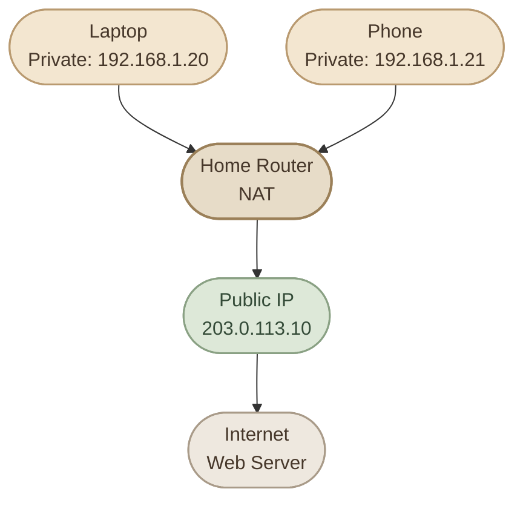
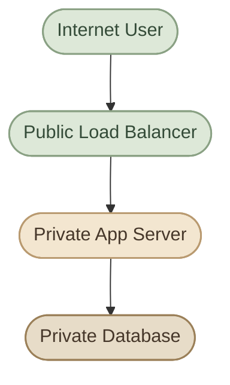

import InfoCard from "../../../src/components/InfoCard.astro";
import CardGrid from "../../../src/components/CardGrid.astro";

## Introduction

في الدرس السابق، اتعلمنا إن كل جهاز متصل بشبكة بيحتاج **IP Address** عشان نقدر نميّزه ونوصل له داخل الشبكة أو عبر شبكات تانية.

لكن مش كل IP Address بيكون قابل للاستخدام بنفس الطريقة. فيه عناوين مخصصة للشبكات الداخلية، وفيه عناوين بتُستخدم للتواصل عبر الإنترنت.

من هنا بيظهر عندنا نوعان مهمان من عناوين IPv4: **Private IP** و**Public IP**.

<CardGrid columns={3} label="What This Lesson Covers">
  <InfoCard title="Private addressing" description="عناوين مخصصة للشبكات الداخلية." icon="network" variant="concept" />
  <InfoCard title="Public routing" description="عناوين تُستخدم للتواصل عبر الإنترنت العام." icon="cloud" variant="concept" />
  <InfoCard title="NAT and access" description="كيف تتصل الأجهزة الخاصة بالإنترنت والخدمات الداخلية." icon="cycle" variant="concept" />
</CardGrid>

## 1. The Core Difference

الفرق الأساسي مش إن واحد سريع والتاني بطيء، ولا إن واحد آمن والتاني غير آمن. الفرق هو **نطاق استخدام العنوان وإمكانية توجيهه عبر الإنترنت العام**.

<CardGrid columns={2} label="Private and Public at a Glance">

<InfoCard title="Private IP" icon="network" variant="concept">

عنوان بيُستخدم داخل شبكة خاصة، زي شبكة البيت أو شبكة شركة أو شبكة داخلية في بيئة Cloud.

الأجهزة الموجودة في نفس الشبكة أو في شبكات خاصة متصلة ببعضها تقدر تستخدمه للتواصل، لكن العنوان نفسه مش بيتم توجيهه مباشرة عبر الإنترنت العام.

**Example:** `192.168.1.20`

</InfoCard>

<InfoCard title="Public IP" icon="cloud" variant="concept">

عنوان قابل للتوجيه عبر الإنترنت العام، وبيُستخدم للوصول إلى الأجهزة أو الخدمات من خلال الإنترنت، وفقًا لقواعد الـ Routing والـ Firewall وإعدادات الشبكة.

**Example:** `8.8.8.8`

</InfoCard>

</CardGrid>

خلّينا ناخد مثال عملي: عندك Laptop وموبايل متصلين بنفس الـ Wi-Fi. كل جهاز ممكن يكون عنده Private IP، بينما الـ Router عنده Public IP بيستخدمه الاتصال بالإنترنت.

يعني وجود Public IP واحد للـ Router لا يعني إن كل جهاز في البيت لازم يكون عنده Public IP منفصل.

## 2. Private IPv4 Address Ranges

مش أي عنوان بنستخدمه داخل البيت يبقى Private IP بالمعنى التقني. فيه ثلاثة Ranges محددة رسميًا لعناوين IPv4 الخاصة، وهي اللي بنحتاج نعرفها ونقدر نميّزها.

<CardGrid columns={3} label="RFC 1918 Private Ranges">

<InfoCard title="10.0.0.0/8" icon="network" variant="feature">

**Range:** `10.0.0.0 – 10.255.255.255`

مساحة عناوين كبيرة جدًا، مناسبة للشبكات الداخلية الكبيرة، والشركات، والـ Cloud networks.

Example: `10.20.30.40`

</InfoCard>

<InfoCard title="172.16.0.0/12" icon="network" variant="feature">

**Range:** `172.16.0.0 – 172.31.255.255`

خلي بالك إن مش كل عنوان بيبدأ بـ `172` يعتبر Private. النطاق الخاص هنا بيبدأ من `172.16.0.0` وينتهي عند `172.31.255.255`.

Example: `172.20.5.10`

</InfoCard>

<InfoCard title="192.168.0.0/16" icon="network" variant="feature">

**Range:** `192.168.0.0 – 192.168.255.255`

ده من أشهر النطاقات في شبكات المنازل والـ Small Offices.

Example: `192.168.1.20`

</InfoCard>

</CardGrid>

العناوين دي محجوزة للاستخدام داخل الشبكات الخاصة، ومش بيتم توجيهها كوجهات عادية عبر الإنترنت العام. لكن ممكن نفس العنوان الخاص يتكرر في شبكات منفصلة؛ مثلًا جهاز في بيتك وجهاز في شركة تانية ممكن يكون عندهم نفس الـ Private IP، وده طبيعي لأن كل واحد موجود في شبكة مختلفة.

## 3. How a Home Network Connects to the Internet

دلوقتي نقدر نفهم إيه اللي بيحصل لما تفتح موقع من اللابتوب.

اللابتوب عنده Private IP، والـ Router عنده اتصال بالـ ISP (Internet Service Provider). في السيناريو الشائع، الـ Router بيستخدم تقنية اسمها **NAT — Network Address Translation** عشان يسمح لأجهزة الشبكة الداخلية بمشاركة عنوان Public IP واحد.



> **ملاحظة:** العنوان `203.0.113.10` في الرسم مخصص للأمثلة والتوثيق، مش عنوان Public IP حقيقي بنستخدمه في اتصال فعلي.

خلّينا نفهم الخطوات بالترتيب:

1. اللابتوب يرسل Request من عنوانه الخاص، مثل `192.168.1.20`.
2. الـ Router يستقبل الـ Traffic ويُجري NAT، وغالبًا يستخدم **PAT (Port Address Translation)** عشان يميّز اتصالات الأجهزة المختلفة.
3. الـ Request يخرج إلى الإنترنت باستخدام عنوان المصدر العام الخاص باتصال الـ Router.
4. لما الـ Response يرجع، الـ Router يستخدم معلومات الاتصال المسجلة عنده عشان يوجّه البيانات للجهاز الصحيح.

بالتالي، الأجهزة بتشارك الـ Public IP في الاتصالات الصادرة، لكن كل جهاز بيحتفظ بعنوانه الخاص داخل الشبكة.

<InfoCard title="NAT Is Not the Same as a Firewall" icon="shield" variant="insight">

الـ NAT بيترجم عناوين الشبكة، بينما الـ Firewall بيطبّق قواعد تسمح أو تمنع الـ Traffic. بعض أجهزة الراوتر بتنفذ الوظيفتين معًا، لكنهما مش نفس التقنية.

كمان وجود NAT وحده مش ضمان كامل للأمان؛ لازم نراعي إعدادات الـ Firewall والخدمات المكشوفة على الشبكة.

</InfoCard>

## 4. Can a Private IP Be Accessed Directly From the Internet?

في الوضع المعتاد، لا. لو عندك جهاز عنوانه `192.168.1.20` داخل البيت، شخص على الإنترنت مش هيقدر يوجّه Packet إليه مباشرة باستخدام العنوان ده عبر الإنترنت العام.

لكن ده مش معناه إن الجهاز غير قابل للوصول في كل الظروف. فيه طرق مختلفة للوصول لخدمات داخل شبكة خاصة، مثل:

<CardGrid columns={3} label="Ways to Reach Private Services">
  <InfoCard title="Port Forwarding" description="إعداد الـ Router لتمرير اتصالات واردة على Port محدد إلى جهاز داخلي، مع مراعاة مخاطر الأمان." icon="git-pull-request" variant="warning" />
  <InfoCard title="VPN" description="إنشاء اتصال يسمح لجهاز بعيد بالوصول إلى الشبكة الخاصة وفقًا للصلاحيات." icon="shield" variant="concept" />
  <InfoCard title="Reverse Proxy or Tunnel" description="إتاحة خدمة داخلية من خلال وسيط أو اتصال مُعد مسبقًا." icon="cycle" variant="concept" />
</CardGrid>

في المقابل، امتلاك Public IP لا يعني تلقائيًا إن أي شخص يقدر يدخل على الجهاز. الـ Firewall، والـ Routing، والخدمات اللي بتستمع للاتصالات، وإعدادات الوصول كلها عوامل مؤثرة.

## 5. Public vs Private IP — Quick Comparison

| Property | Private IP | Public IP |
|---|---|---|
| Primary use | داخل الشبكات الخاصة | التواصل عبر الإنترنت العام |
| Internet routing | لا يُوجَّه مباشرة عبر الإنترنت العام | قابل للتوجيه عبر الإنترنت العام |
| Uniqueness | ممكن يتكرر في شبكات منفصلة | لازم يكون قابلًا للتمييز ضمن نطاق التوجيه العام |
| Common example | `192.168.1.20` | `8.8.8.8` |
| Typical assignment | Router داخلي أو DHCP Server | ISP أو Cloud Provider أو جهة مختصة |
| Security | مش آمن تلقائيًا | مش مكشوف تلقائيًا؛ الوصول يعتمد على الإعدادات |

## 6. How to Check Your IP Addresses on Linux

على Fedora أو أي Linux system، تقدر تبدأ بفحص عناوين الـ Network Interfaces عندك:

```bash
ip -4 addr
```

الأمر ده بيعرض عناوين IPv4 الموجودة على الـ Interfaces، وغالبًا هتلاقي عنوانًا خاصًا زي `192.168.x.x` أو `10.x.x.x` حسب إعداد الشبكة.

لمعرفة الـ Default Gateway والـ Routes:

```bash
ip route
```

غالبًا هتلاقي سطرًا شبيهًا بالآتي:

```text
default via 192.168.1.1 dev wlp2s0
```

ده معناه إن النظام بيستخدم `192.168.1.1` كـ Default Gateway في المثال.

أما عنوان الـ Public IP، فالأمر `ip addr` مش بالضرورة يعرضه؛ لأن الجهاز ممكن يكون خلف Router أو NAT. كمان لو الشبكة تستخدم **CGNAT** عند الـ ISP، فالـ Router نفسه ممكن ما يكونش عنده Public IPv4 مخصص مباشرة.

<CardGrid columns={2} label="Linux Network Checks">
  <InfoCard title="ip -4 addr" description="يعرض عناوين IPv4 الموجودة على الـ Interfaces." icon="terminal" variant="command" />
  <InfoCard title="ip route" description="يعرض الـ Default Gateway والـ Routes." icon="network" variant="command" />
</CardGrid>

## 7. Why This Matters in DevOps & Cloud

فهم الفرق بين النوعين مهم جدًا لما تبدأ تشتغل على Infrastructure حقيقية.

<CardGrid columns={2} label="DevOps and Cloud Design">

<InfoCard title="Private Networks" icon="network" variant="feature">

في AWS VPC أو شبكات Kubernetes، بنستخدم Private IPs للتواصل الداخلي بين الموارد والخدمات، حسب تصميم الشبكة والـ Routing.

</InfoCard>

<InfoCard title="Public Exposure" icon="shield" variant="feature">

لما تنشر Web Application، مش لازم كل Server يكون له Public IP. ممكن تستخدم Load Balancer أو Reverse Proxy كنقطة دخول عامة، وتخلي الـ Backend داخل Private Network.

</InfoCard>

</CardGrid>

مثلًا، في تصميم Cloud شائع:



الـ Load Balancer هو نقطة الدخول العامة، بينما الـ App Server والـ Database ممكن يفضلوا داخل شبكة خاصة. وده بيقلل نقاط الدخول المباشرة، لكنه لا يغني عن ضبط الـ Security Groups والـ Firewall والـ Authentication.

## 8. Knowledge Check

حاول تجاوب قبل ما تبص على الإجابات.

<CardGrid columns={3} label="Check Your Understanding">
<InfoCard title="Question 1" icon="network" variant="concept">

هل العنوان `172.20.5.10` يعتبر Private IP؟

**الإجابة:** أيوه، لأنه داخل النطاق `172.16.0.0 – 172.31.255.255`.

</InfoCard>

<InfoCard title="Question 2" icon="cycle" variant="concept">

لو اللابتوب والموبايل عندهم Private IPs مختلفة، هل لازم يكون عندهم Public IPs مختلفة؟

**الإجابة:** لأ. في شبكة منزلية شائعة، الاتنين ممكن يشاركوا نفس الـ Public IP من خلال NAT/PAT.

</InfoCard>

<InfoCard title="Question 3" icon="shield" variant="concept">

هل وجود Public IP معناه إن الجهاز مفتوح لأي شخص على الإنترنت؟

**الإجابة:** لأ. قابلية الوصول بتعتمد على الـ Routing والـ Firewall والخدمات وإعدادات الأمان.

</InfoCard>
</CardGrid>

## Key Takeaways

<CardGrid columns={2} label="Public vs Private IP Recap">
  <InfoCard title="Private IP" description="عنوان للاستخدام داخل الشبكات الخاصة، ومش بيُوجَّه مباشرة عبر الإنترنت العام." icon="network" variant="summary" />
  <InfoCard title="Public IP" description="عنوان قابل للتوجيه عبر الإنترنت العام، وفقًا لإعدادات الشبكة." icon="cloud" variant="summary" />
  <InfoCard title="Private ranges" description="النطاقات الخاصة في IPv4 هي `10.0.0.0/8` و`172.16.0.0/12` و`192.168.0.0/16`." icon="layers" variant="summary" />
  <InfoCard title="NAT/PAT" description="بيسمح في السيناريو الشائع لأجهزة متعددة بمشاركة Public IPv4 واحد." icon="cycle" variant="summary" />
  <InfoCard title="Access and security" description="Public IP مش معناه إن الجهاز آمن أو مكشوف تلقائيًا؛ إعدادات الوصول والأمان هي اللي بتحدد ده." icon="shield" variant="summary" />
</CardGrid>
