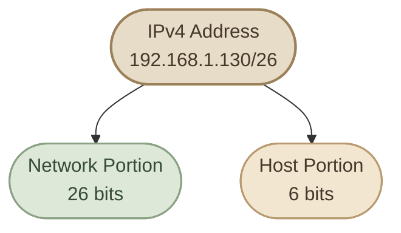

## Introduction

في الدرس السابق، اتعرفنا على الـ **Subnet Mask** والـ **CIDR Prefix**، وفهمنا إن عنوان IPv4 بيتكوّن من 32 bits، وإن جزء من الـ bits بيمثّل الشبكة (**Network Portion**) والجزء الباقي بيمثّل الجهاز داخل الشبكة (**Host Portion**).

السؤال دلوقتي: إزاي الـ Subnet Mask بيحدد الجزء ده فعلًا؟

عشان نفهم ده، هنبدأ بشكل الـ Subnet Mask، وبعدها نحوّله إلى Binary، ونطبّق على IP Addresses حقيقية خطوة بخطوة.

## 1. What Does a Subnet Mask Do?

الـ **Subnet Mask** هو قيمة من 32 bits بتحدد أي bits في الـ IPv4 Address تابعة للشبكة وأي bits تابعة للـ Host.

في الـ Subnet Mask التقليدي، الـ bits بتكون مرتبة بالشكل ده:

- الـ `1` في البداية بيمثّل Network Bits.
- الـ `0` بعدهم بيمثّل Host Bits.

مثلًا، الـ Subnet Mask ده:

`255.255.255.0`

لما نحوّله إلى Binary، بيكون:

```text
11111111.11111111.11111111.00000000
```

أول 24 bits قيمتها `1`، وآخر 8 bits قيمتها `0`. بالتالي، الـ Network Portion طوله 24 bits، والـ Host Portion طوله 8 bits.

<InfoCard title="Remember This Rule" icon="layers" variant="concept">

في الـ Subnet Mask القياسي، الـ `1` بيمثّل Network Bit والـ `0` بيمثّل Host Bit.

لازم الـ `1`s تكون متصلة في البداية، وبعدها الـ `0`s. مش بنختار أماكن الـ Network Bits بشكل عشوائي.

</InfoCard>

## 2. Understanding the Four Octets

زي ما اتعلمنا في IPv4 Addressing، عنوان IPv4 بيتكوّن من أربعة **Octets**، وكل Octet حجمه 8 bits.

الـ Subnet Mask بيتكتب بنفس الطريقة، وكل رقم فيه بيمثّل مجموعة من 8 bits.

<TableCard title="Octet Values in Binary">
| Decimal | Binary | Meaning |
|---:|---|---|
| `255` | `11111111` | كل الـ 8 bits للشبكة |
| `254` | `11111110` | 7 Network Bits و1 Host Bit |
| `252` | `11111100` | 6 Network Bits و2 Host Bits |
| `248` | `11111000` | 5 Network Bits و3 Host Bits |
| `240` | `11110000` | 4 Network Bits و4 Host Bits |
| `224` | `11100000` | 3 Network Bits و5 Host Bits |
| `192` | `11000000` | 2 Network Bits و6 Host Bits |
| `128` | `10000000` | 1 Network Bit و7 Host Bits |
| `0` | `00000000` | كل الـ 8 bits للـ Host |
</TableCard>

مش مطلوب تحفظ كل الأرقام مرة واحدة. المهم تفهم إن قيمة كل Octet بتعتمد على عدد الـ `1`s الموجودة في الـ Binary Representation.

## 3. Reading the Network and Host Portions

خلّينا نستخدم المثال ده:

- IP Address: `192.168.1.10`
- Subnet Mask: `255.255.255.0`

نكتب العنوانين بالـ Binary:

```text
IP Address:
11000000.10101000.00000001.00001010

Subnet Mask:
11111111.11111111.11111111.00000000
```

دلوقتي نقارن الـ IP Address بالـ Subnet Mask. أول 24 bits في الـ Mask قيمتها `1`، وبالتالي أول 24 bits من الـ IP Address هي الـ Network Portion. آخر 8 bits هي الـ Host Portion.

<CardGrid columns={2} label="Network and Host Portions">
<InfoCard variant="feature" title="Network Portion — 24 Bits" description="أول ثلاثة Octets في المثال ده." icon="network" eyebrow="192.168.1" tags={["Network"]} />

<InfoCard variant="feature" title="Host Portion — 8 Bits" description="آخر Octet في المثال ده." icon="terminal" eyebrow="10" tags={["Host"]} />
</CardGrid>

خلي بالك إن التقسيم بالشكل العشري ده واضح في مثال `/24` لأن الحد واقع بين Octets كاملة. لكن في Masks زي `/26`، حدود الشبكة بتكون داخل الـ Octet نفسه، وده هنشوفه في المثال التالي.

## 4. When the Boundary Falls Inside an Octet

مش كل Subnet Mask لازم ينتهي عند نهاية Octet. ممكن جزء الشبكة ياخد بعض الـ bits من الـ Octet الأخير، والباقي يكون للـ Host.

مثلًا:

- IP Address: `192.168.1.130`
- Subnet Mask: `255.255.255.192`
- CIDR Prefix: `/26`

الـ Mask في الـ Binary:

```text
11111111.11111111.11111111.11000000
```

أول 24 bits كاملة للشبكة، ومعاهم أول بتّين من الـ Octet الأخير. كده عندنا 26 Network Bits، و6 Host Bits.



الـ `/26` بيقول لنا إن 26 bits للشبكة، لكن ده لوحده مش كفاية لتحديد قيمة الـ Network Address ذهنيًا من غير تطبيق الـ Mask على الـ IP.

## 5. How to Calculate the Network Address

عشان نحدد الـ **Network Address**، بنعمل عملية Binary اسمها **Bitwise AND** بين الـ IP Address والـ Subnet Mask.

قواعد العملية بسيطة:

<TableCard title="Bitwise AND Rules">
| IP Bit | Mask Bit | Result |
|---:|---:|---:|
| `0` | `0` | `0` |
| `0` | `1` | `0` |
| `1` | `0` | `0` |
| `1` | `1` | `1` |
</TableCard>

يعني الناتج بيكون `1` فقط لما البتّين يكونوا `1`.

نطبّق ده على المثال:

```text
IP Address:   192.168.1.130
Subnet Mask:  255.255.255.192
Network:      192.168.1.128
```

ليه الناتج `192.168.1.128`؟

الـ Octet الأخير من الـ IP هو `130`، وده بالـ Binary:

```text
130 = 10000010
192 = 11000000
```

نعمل Bitwise AND:

```text
IP:       10000010
Mask:     11000000
          --------
Network:  10000000
```

القيمة `10000000` في Binary تساوي `128` في Decimal. إذن الـ Network Address هو `192.168.1.128`.

<InfoCard title="What Did We Learn?" icon="network" variant="insight">

الـ Subnet Mask بيحدد حدود الـ Network وHost Bits، وعملية **Bitwise AND** بين الـ IP والـ Mask بتساعدنا نحسب عنوان الشبكة الناتج.

</InfoCard>

## 6. Subnet Mask and CIDR

الـ **CIDR Prefix** طريقة مختصرة لكتابة عدد الـ Network Bits، بينما الـ **Subnet Mask** بيعبّر عن نفس الحدود في صورة IPv4 Address.

<TableCard title="CIDR and Subnet Mask Reference">
| CIDR | Subnet Mask | Network Bits | Host Bits |
|---|---|---:|---:|
| `/8` | `255.0.0.0` | 8 | 24 |
| `/16` | `255.255.0.0` | 16 | 16 |
| `/24` | `255.255.255.0` | 24 | 8 |
| `/25` | `255.255.255.128` | 25 | 7 |
| `/26` | `255.255.255.192` | 26 | 6 |
| `/27` | `255.255.255.224` | 27 | 5 |
| `/28` | `255.255.255.240` | 28 | 4 |
| `/30` | `255.255.255.252` | 30 | 2 |
| `/32` | `255.255.255.255` | 32 | 0 |
</TableCard>

تقدر تستخدم المعادلة دي لمعرفة عدد الـ Host Bits:

```text
Host Bits = 32 - Prefix Length
```

مثلًا، في `/26`:

```text
32 - 26 = 6
```

ده معناه إن فيه 6 Host Bits. لكن **عدد الـ Host Bits مش هو نفسه عدد الأجهزة القابلة للاستخدام**؛ لأن بعض العناوين بتكون مخصصة لأغراض الشبكة. حساب عدد العناوين المتاحة بالتحديد هيكون موضوع درس منفصل.

## 7. Why Subnet Masks Matter

الـ Subnet Mask مش بس بيساعدنا نحسب عنوان الشبكة. نظام التشغيل بيستخدمه كمان عشان يحدد إذا كانت الوجهة في نفس الـ Subnet أو خارجها.

لو الوجهة Local، الجهاز عادةً يحاول يوصل إليها مباشرةً على الـ Local Link. أما لو الوجهة خارج الشبكة، فالجهاز بيستخدم الـ Default Gateway عشان يبعث البيانات إلى Router.

وده بيربط الـ Subnet Mask بالـ IP Address والـ ARP والـ Routing، اللي اتعرفنا عليهم في الدروس السابقة.

## 8. Knowledge Check

**Question 1:** ما الـ Network Bits والـ Host Bits في `/24`؟

الإجابة: 24 Network Bits و8 Host Bits.

**Question 2:** ما الـ Subnet Mask المقابل لـ `/26`؟

الإجابة: `255.255.255.192`.

**Question 3:** احسب الـ Network Address للعنوان `192.168.1.130/26`.

الإجابة: `192.168.1.128`.

**Question 4:** هل الـ Subnet Mask نفسه هو الـ Network Address؟

الإجابة: لأ. الـ Subnet Mask بيحدد حدود الشبكة، بينما الـ Network Address هو الناتج عند تطبيق الـ Mask على عنوان الـ IP.

## Key Takeaways

<CardGrid columns={3} label="Subnet Mask Recap">
<InfoCard variant="summary" title="Network and Host Bits" description="الـ Subnet Mask بيحدد Network Bits وHost Bits داخل IPv4 Address." icon="network" tags={["Mask"]} />

<InfoCard variant="summary" title="1 = Network, 0 = Host" description="قيمة `1` في الـ Mask بتمثّل Network Bit، وقيمة `0` بتمثّل Host Bit." icon="code" tags={["Binary"]} />

<InfoCard variant="summary" title="CIDR Prefix" description="الـ CIDR Prefix هو عدد الـ Network Bits." icon="layers" tags={["CIDR"]} />

<InfoCard variant="summary" title="Bitwise AND" description="عملية Bitwise AND بتساعدنا نطلع الـ Network Address." icon="terminal" tags={["AND"]} />

<InfoCard variant="summary" title="Usable Hosts Need More" description="عدد الـ Host Bits بيساعدنا في حساب عدد العناوين، لكن تحديد الـ Usable Hosts محتاج خطوة إضافية." icon="tag" tags={["Hosts"]} />
</CardGrid>
