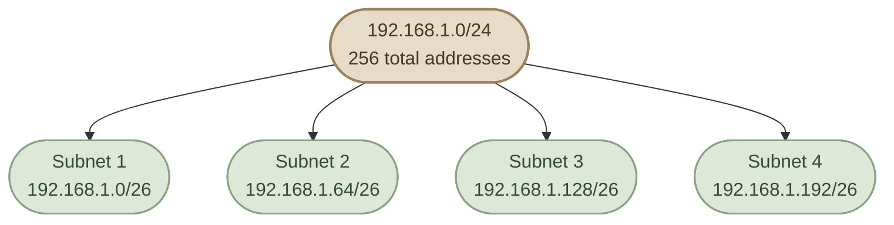
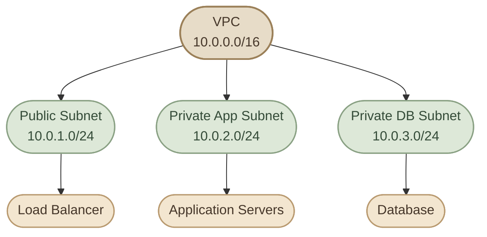

## Introduction

في الدروس السابقة، اتعلمنا إن الـ IPv4 Address بيتكوّن من 32 bits، وإن الـ **Subnet Mask** والـ **CIDR Prefix** بيحددوا الجزء الخاص بالشبكة والجزء الخاص بالأجهزة.

دلوقتي هنستخدم المعلومات دي لحل مشكلة عملية: عندنا شبكة واحدة، لكن محتاجين نقسمها إلى شبكات أصغر، بحيث كل مجموعة من الأجهزة يكون ليها نطاق عناوين خاص بيها.

العملية دي اسمها **Subnetting**.

<CardGrid columns={3} label="Before and After Subnetting">
<InfoCard variant="feature" title="Before Subnetting" description="شبكة واحدة مثل `192.168.1.0/24`، تحتوي على مساحة من 256 عنوان IPv4." icon="network" tags={["Before"]} />

<InfoCard variant="concept" title="Subnetting" description="عملية تقسيم مساحة العناوين إلى شبكات أصغر." icon="cycle" tags={["Process"]} />

<InfoCard variant="feature" title="After Subnetting" description="أربع شبكات أصغر، كل شبكة منها لها Network Address وBroadcast Address ونطاق عناوين خاص بها." icon="layers" tags={["After"]} />
</CardGrid>

<CardGrid columns={2} label="Why Do We Subnet?">
<InfoCard variant="concept" title="Organization" description="تقسيم الأجهزة حسب الوظيفة أو البيئة." icon="modules" tags={["Org"]} />

<InfoCard variant="concept" title="Address Management" description="توزيع عناوين IP بطريقة منظمة." icon="tag" tags={["Addresses"]} />

<InfoCard variant="concept" title="Network Isolation" description="تسهيل فصل الشبكات والتحكم في حركة البيانات بينها." icon="shield" tags={["Isolation"]} />

<InfoCard variant="concept" title="Scalability" description="تسهيل التوسع من غير الاعتماد على شبكة واحدة كبيرة." icon="cloud" tags={["Scale"]} />
</CardGrid>

<InfoCard title="Why Do We Subnet?" icon="network" variant="insight">

لكن تقسيم الـ IP Address Space وحده لا يضمن العزل الأمني؛ العزل الفعلي يعتمد أيضًا على تصميم الشبكة والـ Routing والـ Firewall أو سياسات الوصول.

</InfoCard>

## 2. The Basic Idea Behind Subnetting

خلّينا نبدأ بشبكة:

`192.168.1.0/24`

الـ `/24` معناه إن عندنا 24 Network Bits و8 Host Bits. إجمالي عدد العناوين هو:

```text
2^8 = 256
```

يعني مساحة العناوين من `192.168.1.0` إلى `192.168.1.255`.

في الشبكة التقليدية متعددة الأجهزة، أول عنوان بيكون الـ **Network Address**، وآخر عنوان بيكون الـ **Broadcast Address**، وبالتالي بيتبقى 254 عنوانًا قابلًا للاستخدام كعناوين للأجهزة.

طيب، لو محتاجين أربع شبكات أصغر بدل شبكة واحدة، هنعمل إيه؟

هنستعير بتّين من جزء الـ Host ونضيفهم إلى جزء الشبكة:

- Prefix الأصلي: `/24`
- عدد الـ bits المستعارة: `2`
- Prefix الجديد: `/26`

ليه بتّين؟ لأننا محتاجين أربع شبكات، و:

```text
2^2 = 4
```

<InfoCard title="The Key Rule" icon="layers" variant="concept">

كل Bit بنستعيرها من جزء الـ Host ونضيفها إلى الـ Prefix بتضاعف عدد الـ Subnets الممكنة، لكنها في المقابل بتقلّل عدد العناوين داخل كل Subnet.

</InfoCard>

## 3. Calculate the New Subnet Size

بعد ما حوّلنا الشبكة من `/24` إلى `/26`، عدد الـ Host Bits بقى:

```text
32 - 26 = 6
```

إجمالي عدد العناوين في كل Subnet:

```text
2^6 = 64
```

وفي الشبكات التقليدية متعددة الأجهزة:

```text
Usable Hosts = 64 - 2 = 62
```

بنطرح عنوانين: واحد للـ Network Address وواحد للـ Broadcast Address.

<TableCard title="24/  26/  ">
| Property | Original Network | Each New Subnet |
|---|---:|---:|
| CIDR Prefix | `/24` | `/26` |
| Network Bits | 24 | 26 |
| Host Bits | 8 | 6 |
| Total Addresses | 256 | 64 |
| Usable Hosts | 254 | 62 |
| Number of Subnets | 1 | 4 |
</TableCard>

الأرقام دي تفترض Subnets تقليدية من IPv4. فيه حالات خاصة زي `/31` لوصلات Point-to-Point، واللي ليها قواعد مختلفة لعدد العناوين القابلة للاستخدام.

## 4. Find the New Subnet Mask

إحنا عارفين إن `/26` معناه 26 Network Bits. الـ Subnet Mask المقابل ليه هو:

`255.255.255.192`

ليه آخر Octet بقى `192` بدل `0`؟

لأن أول بتّين في الـ Octet الأخير قيمتهم `1`، والستة الباقيين قيمتهم `0`:

```text
Binary:  11000000
Decimal: 128 + 64 = 192
```

وبالتالي:

```text
CIDR:        /26
Subnet Mask: 255.255.255.192
```

وده بيساعدنا نحدد حدود كل Subnet.

## 5. Find the Subnet Increment

دي خطوة مهمة جدًا في الحل العملي.

لما يكون الـ Subnet Mask فيه Octet جزئي، نقدر نحسب **Block Size** أو **Subnet Increment** باستخدام المعادلة:

```text
Block Size = 256 - Mask Octet
```

في مثالنا، آخر Octet في الـ Mask هو `192`:

```text
256 - 192 = 64
```

إذن كل Subnet جديدة بتبدأ بعد 64 عنوانًا من بداية الـ Subnet السابقة.

بالتالي، بدايات الشبكات في `192.168.1.0/24` بعد تقسيمها إلى `/26` هي:

`0 → 64 → 128 → 192`

خلي بالك إننا بنتكلم عن قيمة آخر Octet، مع ثبات أول ثلاثة Octets في المثال ده.

## 6. Calculate All Four Subnets

دلوقتي نقدر نحدد تفاصيل كل شبكة.

<CardGrid columns={1}>
  <InfoCard title="Subnet 1" icon="network" variant="feature">

    **Network:** `192.168.1.0/26`

    **First Usable Host:** `192.168.1.1`

    **Last Usable Host:** `192.168.1.62`

    **Broadcast:** `192.168.1.63`

    **Usable Hosts:** 62

  </InfoCard>
  <InfoCard title="Subnet 2" icon="network" variant="feature">

    **Network:** `192.168.1.64/26`

    **First Usable Host:** `192.168.1.65`

    **Last Usable Host:** `192.168.1.126`

    **Broadcast:** `192.168.1.127`

    **Usable Hosts:** 62

  </InfoCard>
  <InfoCard title="Subnet 3" icon="network" variant="feature">

    **Network:** `192.168.1.128/26`

    **First Usable Host:** `192.168.1.129`

    **Last Usable Host:** `192.168.1.190`

    **Broadcast:** `192.168.1.191`

    **Usable Hosts:** 62

  </InfoCard>
  <InfoCard title="Subnet 4" icon="network" variant="feature">

    **Network:** `192.168.1.192/26`

    **First Usable Host:** `192.168.1.193`

    **Last Usable Host:** `192.168.1.254`

    **Broadcast:** `192.168.1.255`

    **Usable Hosts:** 62

  </InfoCard>
</CardGrid>

لاحظ إن الـ Broadcast Address في كل Subnet هو العنوان اللي قبل بداية الـ Subnet التالية. وآخر عنوان في الشبكة الأصلية `192.168.1.255` أصبح Broadcast للـ Subnet الرابعة.

## 7. Visualize the Subnet Boundaries

الرسم ده بيوضح إزاي مساحة `/24` اتقسمت إلى أربع Subnets، كل واحدة بحجم `/26`.



كل Subnet من الأربعة ليها نطاق عناوين منفصل، ومفيش تداخل بين النطاقات.

وده هو الهدف الأساسي من الـ Subnetting: تقسيم مساحة العناوين بطريقة محسوبة بدل توزيع IP Addresses بشكل عشوائي.

## 8. A Second Example: Divide a `/24` into `/27`

خلّينا نجرّب Prefix مختلف عشان نشوف تأثيره.

الشبكة الأصلية:

`192.168.10.0/24`

الشبكة المطلوبة:

`/27`

<Steps>
<li>

<InfoCard title="Step 1 — Calculate Host Bits" description="`32 - 27 = 5`" icon="code" />

</li>
<li>

<InfoCard title="Step 2 — Calculate Total Addresses" description="`2^5 = 32`" icon="tag" />

إذن كل Subnet فيها 32 عنوانًا، و30 عنوانًا قابلًا للاستخدام في شبكة IPv4 تقليدية.

</li>
<li>

<InfoCard title="Step 3 — Find the Subnet Mask" description="الـ Mask المقابل لـ `/27` هو `255.255.255.224`." icon="layers" />

</li>
<li>

<InfoCard title="Step 4 — Calculate the Block Size" description="`256 - 224 = 32`" icon="pulse" />

إذن الشبكات بتبدأ عند:

`0, 32, 64, 96, 128, 160, 192, 224`

</li>
</Steps>

وبالتالي، أول شبكتين هما:

<TableCard title="First Two /27 Subnets">
| Property | Subnet 1 | Subnet 2 |
|---|---|---|
| Network | `192.168.10.0/27` | `192.168.10.32/27` |
| First Host | `192.168.10.1` | `192.168.10.33` |
| Last Host | `192.168.10.30` | `192.168.10.62` |
| Broadcast | `192.168.10.31` | `192.168.10.63` |
| Usable Hosts | 30 | 30 |
</TableCard>

ونفس القاعدة تكمل لباقي الشبكات لحد `192.168.10.224/27`.

## 9. Subnetting in DevOps & Cloud

في بيئات الـ Cloud، بنستخدم الـ CIDR لتحديد مساحة العناوين المتاحة داخل الشبكات، وبعدها بنوزعها على Subnets حسب التصميم.

مثلًا، ممكن يكون عندنا VPC بعنوان `10.0.0.0/16`، ونخصص Subnet للـ Public Load Balancer وأخرى للـ Application Servers وثالثة للـ Database.



ده مثال تعليمي لتقسيم العناوين، مش تصميم إنتاجي كامل. في AWS مثلًا، الـ Public Subnet محتاجة إعدادات Routing مناسبة للوصول الخارجي، والـ Private Subnet بتحتاج تصميمًا منفصلًا للـ Egress والـ Security Groups حسب المتطلبات.

كمان لازم نراعي إن الـ CIDR Ranges ما تتداخلش مع الشبكات الأخرى اللي هنحتاج نوصلها، سواء عن طريق VPN أو VPC Peering أو غيرها.

## 10. Knowledge Check

حاول تحل الأسئلة دي بنفسك قبل ما تقرأ الإجابات.

<InfoCard title="Question 1" icon="flag" variant="concept">

عندك `192.168.5.0/24` ومحتاج تقسّمها إلى 4 Subnets متساوية. إيه الـ Prefix الجديد؟

**Answer:** `/26`، لأننا محتاجين استعارة بتّين، و`2^2 = 4`.

</InfoCard>

<InfoCard title="Question 2" icon="flag" variant="concept">

ما عدد العناوين الإجمالي وعدد الـ Usable Hosts في كل `/26` تقليدية؟

**Answer:** 64 عنوانًا إجماليًا، و62 عنوانًا قابلًا للاستخدام.

</InfoCard>

<InfoCard title="Question 3" icon="flag" variant="concept">

ما الـ Network Address للشبكة اللي عنوانها `192.168.5.140/26`؟

**Answer:** `192.168.5.128/26`، لأن بدايات الشبكات في المثال بتزيد بمقدار 64.

</InfoCard>

<InfoCard title="Question 4" icon="flag" variant="concept">

ما الـ Broadcast Address للشبكة `192.168.5.128/26`؟

**Answer:** `192.168.5.191`، لأن النطاق بيبدأ من `.128` وينتهي عند `.191`.

</InfoCard>

## Key Takeaways

<CardGrid columns={3} label="Subnetting Recap">
<InfoCard variant="summary" title="Subnetting" description="هو تقسيم شبكة IP إلى Subnets أصغر." icon="network" tags={["Divide"]} />

<InfoCard variant="summary" title="Borrowing Bits" description="استعارة Host Bits بتزيد عدد الـ Subnets، لكنها بتقلّل عدد العناوين في كل Subnet." icon="code" tags={["Bits"]} />

<InfoCard variant="summary" title="Total Addresses" description="إجمالي العناوين في كل Subnet يساوي `2^(32-Prefix)`." icon="tag" tags={["Math"]} />

<InfoCard variant="summary" title="Usable Hosts" description="في الشبكات التقليدية متعددة الأجهزة، الـ Usable Hosts عادةً يساوي إجمالي العناوين ناقص 2." icon="terminal" tags={["Hosts"]} />

<InfoCard variant="summary" title="Block Size" description="الـ Block Size يسهّل معرفة بدايات الشبكات لما يكون عندنا Subnet Mask جزئي." icon="pulse" tags={["Increment"]} />

<InfoCard variant="summary" title="Boundaries" description="كل Subnet ليها Network Address وBroadcast Address ونطاق عناوين خاص بها." icon="branch" tags={["Limits"]} />
</CardGrid>
