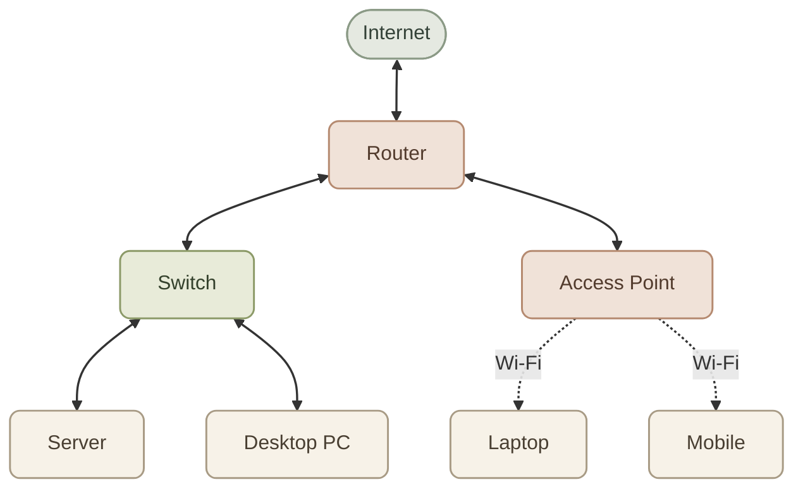
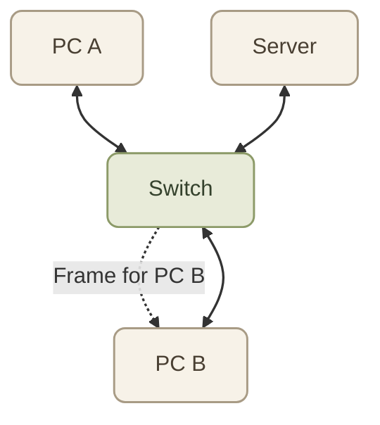
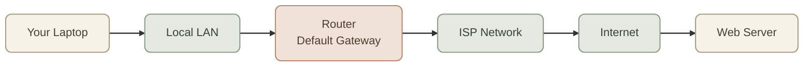
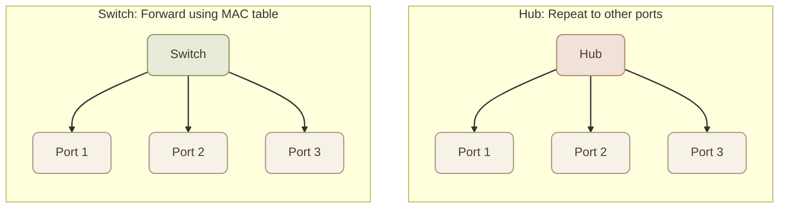
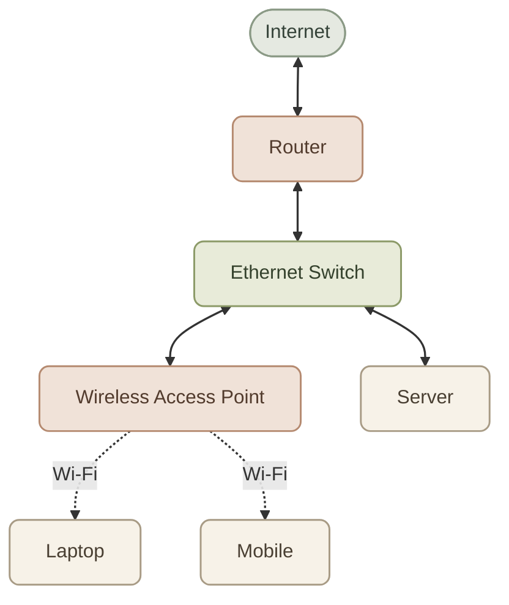

## Introduction

أجهزة الشبكات هي الأجهزة اللي بتساعدنا نوصل الـ Computers والـ Servers والـ Phones ببعض، وننقل البيانات بينهم، ونربط الشبكات المختلفة بالإنترنت.

كل جهاز ليه وظيفة أساسية مختلفة. عشان كده، قبل ما ندرس IP Addressing وSubnetting، لازم نفهم دور كل جهاز في الشبكة.

## 1. The Big Picture

تخيّل شبكة منزلية فيها Laptop وMobile وServer، وكلهم محتاجين يتواصلوا مع بعض ومع الإنترنت.

ده رسم توضيحي مبسّط، مش تصميم إلزامي لكل شبكة. في الواقع، جهاز الـ Router المنزلي ممكن يكون مدمجًا مع الـ Switch والـ Wireless Access Point والـ Firewall في جهاز واحد.

## 2. Switch

الـ **Switch** بيستخدم غالبًا لربط الأجهزة داخل نفس الـ Local Area Network (LAN)، وبيوجّه الـ Ethernet Frames إلى الـ Port المناسب بناءً على عناوين الـ MAC اللي بيتعلمها من حركة الشبكة.

### I. How Does a Switch Work?

لما جهاز يبعت Frame، الـ Switch بيقرأ الـ Source MAC Address عشان يتعلم الجهاز موجود على أنهي Port، وبعدها يستخدم الـ Destination MAC Address عشان يحدد يبعث الـ Frame من أنهي Port.

- لو عارف الـ Destination MAC Address، بيبعث الـ Frame للـ Port المرتبط بيه عادةً.
- لو مش عارف العنوان، بيعمل Flooding للـ Frame على باقي الـ Ports المناسبة داخل الـ VLAN، باستثناء الـ Port اللي استقبل منه الـ Frame.
- الـ Broadcast Frames بتوصل للأجهزة الموجودة في نفس الـ Broadcast Domain، مع مراعاة إعدادات الشبكة.

<InfoCard title="Switch = Connect devices inside a LAN" icon="network" variant="concept">

في الاستخدام الأساسي اللي بنتعلمه هنا، الـ Switch بيشتغل في **Layer 2 — Data Link** من الـ OSI Model. فيه كمان Layer 3 Switches بتقدر تعمل Routing بين الشبكات أو الـ VLANs.
</InfoCard>

### II. Switch Example

لو عندك 3 أجهزة متوصلة بـ Switch، والجهاز الأول عايز يبعت بيانات للجهاز التاني، فالـ Switch بيستخدم الـ MAC Address عشان يوجّه الـ Frame للـ Port المناسب بدل ما يبعته لكل الأجهزة في الحالة العادية.

الرسم بيوضح الفكرة المنطقية للتوجيه داخل الـ LAN، مش كل تفاصيل انتقال الـ Frames أو آلية تعلّم عناوين الـ MAC.

## 3. Router

الـ **Router** بيربط شبكات IP مختلفة، وبيستخدم الـ Routing Table عشان يحدد الـ Next Hop أو واجهة الخروج المناسبة للـ IP Packet.

مثلًا، ممكن يكون عندك شبكة منزلية وشبكة تابعة لمزوّد خدمة الإنترنت (ISP). الـ Router بيساعد في توجيه البيانات بين الشبكتين.

### I. What Does a Router Do?

- يوجّه الـ IP Packets بين الشبكات.
- يستخدم الـ Routing Table لاختيار المسار المناسب.
- غالبًا بيكون عنده Default Route عشان يبعث البيانات اللي وجهتها مش موجودة في المسارات الأكثر تحديدًا إلى الـ Next Hop المناسب.
- ممكن يوفر خدمات إضافية زي NAT وDHCP وFirewall، حسب نوع الجهاز وإعداداته.

<InfoCard title="Router = Connect IP networks" icon="network" variant="concept">

في الموديل التقليدي، الـ Router بيشتغل أساسًا في **Layer 3 — Network**. وجود Router مش معناه إن كل مشكلة شبكة هتتحل تلقائيًا؛ لازم الـ IP Addressing والـ Routing وقواعد الأمان تكون مضبوطة.
</InfoCard>

### II. Router Example

لما جهازك يطلب موقعًا على الإنترنت، غالبًا بيبعت الـ IP Packet إلى الـ Default Gateway الموجود على شبكته المحلية. الـ Router بيفحص معلومات التوجيه، وبعدها يرسل البيانات ناحية الشبكة التالية.

خلي بالك: الـ Router مش لازم يعرف الطريق الكامل لحد السيرفر. غالبًا بيحدد الـ Next Hop، وبعدها Routers أخرى بتكمل التوجيه.

## 4. Hub

الـ **Hub** جهاز قديم لربط أجهزة Ethernet، لكنه أبسط بكتير من الـ Switch.

لما يستقبل إشارة على Port، بيكررها إلى باقي الـ Ports، بدل ما يتعلم عناوين MAC ويوجّه الـ Frames إلى الوجهة المناسبة.

### I. How Does a Hub Work?

- بيكرر الإشارة إلى باقي المنافذ.
- مش بيحتفظ بجدول MAC Addresses زي الـ Switch.
- الأجهزة المتصلة به بتشارك عادةً نفس Collision Domain.
- أجهزة Ethernet المتصلة بـ Hub تقليدي بتعمل بنظام Half-Duplex، وبالتالي ممكن تحصل Collisions.

<InfoCard title="Hub = Repeat signals" icon="network" variant="comparison">

الـ Hub مش بيختار الجهاز المقصود؛ هو بيكرر الإشارة على المنافذ الأخرى. عشان كده، الـ Switch هو الاختيار المعتاد في شبكات Ethernet الحديثة.
</InfoCard>

### II. Hub vs Switch

الرسم توضيحي للفرق في السلوك، مش مخطط لانتقال Packet محددة.

## 5. Access Point (AP)

الـ **Wireless Access Point** بيسمح للأجهزة اللاسلكية بالاتصال بالشبكة المحلية باستخدام Wi-Fi.

يعني بدل ما توصل الـ Laptop أو الـ Mobile بكابل Ethernet، تقدر تتصل بالـ Access Point لاسلكيًا.

### I. What Does an Access Point Do?

- يوفر اتصال Wi-Fi للأجهزة.
- يربط الأجهزة اللاسلكية بالشبكة المحلية.
- غالبًا بيتصل بشبكة سلكية عن طريق Ethernet.
- ممكن يدعم أكتر من SSID أو VLAN حسب الإمكانيات والإعدادات.

<InfoCard title="Access Point = Wireless access to a LAN" icon="cloud" variant="concept">

الـ Access Point مش هو نفسه الـ Router. الـ AP في الوضع المعتاد بيوفر اتصالًا لاسلكيًا بالشبكة، بينما الـ Router مسؤول عن توجيه البيانات بين شبكات IP. بعض أجهزة المنازل بتجمع الوظيفتين في جهاز واحد.
</InfoCard>

### II. Access Point Example

## 6. Modem

الـ **Modem** بيُستخدم للاتصال بوسيط أو خدمة الوصول إلى الإنترنت التي يوفرها الـ ISP، وبيختلف دوره حسب تقنية الاتصال.

اسم Modem جاي تاريخيًا من Modulator-Demodulator، لكن الأجهزة الحديثة ممكن تنفّذ وظائف اتصال أوسع حسب التقنية المستخدمة.

أمثلة على تقنيات الوصول:

- DSL عبر خطوط الهاتف.
- Cable Internet عبر شبكات الكابل.
- في شبكات الألياف الضوئية، الجهاز المستخدم غالبًا بيكون Optical Network Terminal (ONT)، مش Modem تقليدي بنفس المعنى.

<InfoCard title="Modem / ONT = ISP access technology" icon="cloud" variant="concept">

الـ Modem أو الـ ONT بيوفر واجهة الاتصال المناسبة لخدمة مزوّد الإنترنت. أما الـ Router فعادةً بيتولى توجيه حركة البيانات بين الشبكة المحلية والشبكات الخارجية. أحيانًا الوظيفتين بيكونوا مدمجين في جهاز واحد.
</InfoCard>

### I. Modem vs Router

<TableCard title="Modem vs Router vs Gateway" caption="مين بيعمل إيه في شبكة المنزل أو المكتب.">
| Device | Main responsibility |
|---|---|
| Modem | الاتصال بخدمة الإنترنت باستخدام تقنية الوصول المناسبة |
| ONT | إنهاء وصلة الألياف الضوئية وتوفير واجهة للشبكة |
| Router | توجيه IP Packets بين الشبكات |
| Home Gateway | ممكن يجمع Modem أو ONT وRouter وSwitch وWi-Fi في جهاز واحد |
</TableCard>

## 7. Firewall

الـ **Firewall** بيطبّق قواعد للتحكم في حركة الشبكة المسموح بها أو الممنوعة.

ممكن يكون جهازًا ماديًا، أو برنامجًا على سيرفر، أو خدمة سحابية.

### I. What Can a Firewall Do?

- يسمح أو يمنع الاتصالات بناءً على Rules.
- يفلتر حركة البيانات حسب عناوين IP والـ Ports والبروتوكولات، حسب نوع الـ Firewall.
- بعض الأنواع بتفحص اتصالات قائمة أو بتطبّق سياسات على مستوى التطبيقات.
- يساعد في تقليل الوصول غير المصرح به إلى الخدمات.

<InfoCard title="Firewall = Enforce traffic policies" icon="shield" variant="concept">

الـ Firewall مش بديل عن الـ Router بالضرورة. ممكن يكون مدمجًا فيه، أو موجودًا بين الشبكات، أو شغالًا على نفس السيرفر اللي بيستضيف التطبيق.
</InfoCard>

مثال عملي: لو عندك Web Server، ممكن تسمح بالاتصالات الواردة على Port 443، وتمنع الاتصالات الواردة على Port 22 من الإنترنت العام، مع السماح بـ SSH من شبكة الإدارة فقط.

القواعد الفعلية لازم تتحدد حسب تصميم الشبكة ومتطلبات الأمان، مش حسب المثال وحده.

## 8. Compare the Network Devices

<TableCard title="Network Devices at a Glance" caption="وظيفة كل جهاز والطبقة اللي بيشتغل عليها.">
| Device | Main job | Typical OSI layer |
|---|---|---|
| Hub | تكرار الإشارات إلى باقي المنافذ | Layer 1 — Physical |
| Switch | توجيه Frames باستخدام MAC Addresses | Layer 2 — Data Link |
| Router | توجيه IP Packets بين الشبكات | Layer 3 — Network |
| Access Point | توفير اتصال Wi-Fi وربط الأجهزة اللاسلكية بالـ LAN | غالبًا Layer 2 في الوضع التقليدي |
| Modem | توفير الاتصال باستخدام تقنية الوصول إلى ISP | بيعتمد على التقنية؛ مش طبقة واحدة ثابتة |
| Firewall | تطبيق سياسات فلترة حركة الشبكة | ممكن يشتغل على طبقات متعددة |
</TableCard>

التقسيم ده بيوضح الوظيفة الأساسية لكل جهاز. الأجهزة الحديثة ممكن تجمع أكتر من وظيفة، وبعضها بيشتغل على أكتر من Layer.

## 9. How These Devices Work Together

خلينا نربط كل حاجة بمثال: جهازك بيحاول يوصل إلى Web Server على الإنترنت.

<Steps>
<li>

الـ Laptop بيجهّز البيانات ويرسلها عبر Wi-Fi إلى الـ Access Point، أو عبر Ethernet إلى الـ Switch.

</li>
<li>

لو الشبكة محتاجة الوصول إلى شبكة خارجية، البيانات بتوصل إلى الـ Default Gateway.

</li>
<li>

الـ Router بيختار المسار المناسب للـ IP Packet.

</li>
<li>

الـ Firewall، لو موجود في المسار، بيطبّق قواعد السماح والمنع.

</li>
<li>

الـ Modem أو الـ ONT بيوفر واجهة الاتصال بخدمة الـ ISP حسب التقنية المستخدمة.

</li>
<li>

البيانات بتكمل عبر الشبكات المختلفة لحد ما توصل إلى السيرفر، والرد بيرجع عبر المسار المناسب.

</li>
</Steps>

مش لازم كل شبكة تحتوي على كل الأجهزة دي كأجهزة منفصلة؛ التصميم بيتغيّر حسب حجم الشبكة واحتياجاتها.

## 10. Network Devices in DevOps

فهم الأجهزة دي مهم لما تشتغل على Linux Servers أو Docker أو Kubernetes.

<CardGrid columns={2}>
  <InfoCard title="Docker" icon="cloud" variant="insight">

    الـ Containers بتستخدم شبكات افتراضية، وممكن تتواصل مع بعضها أو مع شبكات خارجية عن طريق إعدادات الشبكة والتوجيه المناسبة.
  </InfoCard>
  <InfoCard title="Kubernetes" icon="network" variant="insight">

    الـ Pods والـ Nodes بتحتاج اتصالًا شبكيًا، والـ Network Plugins وServices وIngress بتشارك في توفير الاتصال حسب تصميم الـ Cluster.
  </InfoCard>
  <InfoCard title="Linux Servers" icon="terminal" variant="insight">

    أوامر زي `ip addr` و`ip route` و`ss -lntup` بتساعدك تفحص واجهات الشبكة ومسارات التوجيه والخدمات المستمعة.
  </InfoCard>
  <InfoCard title="Cloud Security" icon="shield" variant="insight">

    الـ Firewalls وقواعد التحكم في حركة الشبكة بتساعدك تحدد مين يقدر يوصل إلى الخدمة، ومن أنهي مصدر وعلى أنهي Port.
  </InfoCard>
</CardGrid>

---

## 11. Summary

<InfoCard variant="summary" title="The Devices Mental Model" description="Hub يكرّر (L1)، Switch يوجّه الإطارات (L2)، Router يوجّه الحزم (L3)، AP يضيف Wi-Fi، Modem يوصّل بالـ ISP، والـ Firewall يطبّق السياسات — وأغلب أجهزة البيت تجمع الستة." icon="network" tags={["Mental Model"]} />

- **Switch:** بيربط الأجهزة داخل LAN وبيوجّه الـ Frames باستخدام MAC Addresses.
- **Router:** بيربط شبكات IP مختلفة وبيوجّه الـ Packets.
- **Hub:** بيكرر الإشارات إلى باقي المنافذ، وهو أقدم وأقل كفاءة من الـ Switch.
- **Access Point:** بيوفر اتصال Wi-Fi بالشبكة المحلية.
- **Modem / ONT:** بيوفر واجهة الاتصال بتقنية الوصول إلى خدمة الـ ISP.
- **Firewall:** بيطبّق قواعد للتحكم في حركة الشبكة.
- الأجهزة الحديثة ممكن تجمع وظائف متعددة في جهاز واحد.

