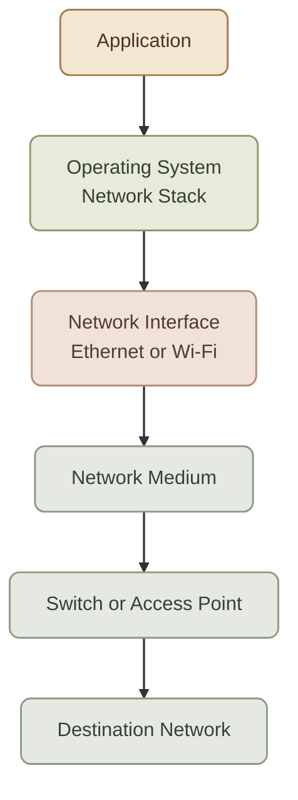
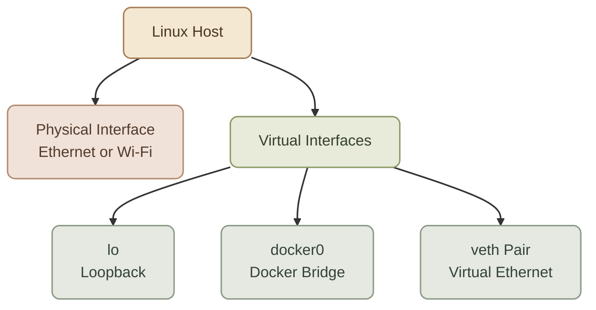

## Introduction

الـ **Network Interface Card (NIC)** هو المكوّن اللي بيسمح للجهاز يتصل بالشبكة ويبعت ويستقبل البيانات.

يعني الـ Laptop أو الـ Server محتاج وسيلة اتصال بالشبكة، وده دور الـ NIC. ممكن يكون الاتصال عن طريق Ethernet Cable أو Wireless Network زي Wi-Fi.

## 1. What Is a NIC?

الـ NIC هو مكوّن Hardware بيوفّر اتصال الشبكة للجهاز. ممكن يكون:

- Ethernet NIC للاتصال السلكي.
- Wireless NIC للاتصال باستخدام Wi-Fi.
- Network Adapter مدمج داخل الـ Motherboard.
- Adapter خارجي، زي USB-to-Ethernet Adapter.

مش شرط يكون الـ NIC كارت منفصل تقدر تشوفه داخل الجهاز؛ أجهزة كتير بيكون فيها Network Adapter مدمج بالفعل.

<InfoCard title="NIC = Network connectivity" icon="network" variant="concept">

الـ NIC بيوفّر واجهة الاتصال بين الجهاز والشبكة. لكنه مش هو الـ Router أو الـ Switch، ومش هو المسؤول وحده عن كل عمليات التواصل الشبكي.
</InfoCard>

## 2. How Does a NIC Work?

لما جهازك يبعت بيانات عبر Ethernet، الـ NIC بيشارك في تجهيز وإرسال الـ Frames على الشبكة، وبيستقبل الـ Frames الواردة ويتعامل مع إشارات الاتصال.

في الاتصال اللاسلكي، الـ Wireless NIC بيستخدم الـ Radio Signals للتواصل عبر Wi-Fi بدل الكابل.

بشكل مبسّط، عملية التواصل بتشمل:

<Steps>
<li>

الـ Application يجهّز البيانات اللي عايز يبعتها.

</li>
<li>

بروتوكولات الشبكة بتضيف المعلومات المطلوبة، زي TCP أو IP Headers حسب نوع الاتصال.

</li>
<li>

طبقة الوصول للشبكة بتجهّز الـ Frame المناسب للتقنية المستخدمة.

</li>
<li>

الـ NIC بيشارك في إرسال البيانات عبر Ethernet أو Wi-Fi.

</li>
<li>

عند الاستقبال، الـ NIC يستقبل البيانات ويسلّمها لنظام التشغيل عشان يعالجها من خلال الـ Network Stack.

</li>
</Steps>



الرسم توضيحي للمسار العام. التفاصيل الفعلية بتختلف حسب نظام التشغيل وتقنية الاتصال، والـ Switch أو الـ Access Point ممكن يكونوا مدمجين في أجهزة أخرى.

## 3. Types of Network Interfaces

<CardGrid columns={2}>
  <InfoCard title="Ethernet NIC" icon="network" variant="concept" eyebrow="Wired">

    بيستخدم Ethernet Cable، وبيكون شائعًا في أجهزة الـ Desktop والـ Servers والـ Network Equipment.
  </InfoCard>
  <InfoCard title="Wireless NIC" icon="cloud" variant="concept" eyebrow="Wireless">

    بيوفّر اتصال Wi-Fi من غير الحاجة إلى كابل Ethernet بين الجهاز والـ Access Point.
  </InfoCard>
  <InfoCard title="USB Network Adapter" icon="terminal" variant="concept" eyebrow="External">

    Adapter خارجي ممكن يضيف Ethernet أو Wireless Connectivity لجهاز مش مجهز بالاتصال المطلوب.
  </InfoCard>
  <InfoCard title="Virtual Network Interface" icon="layers" variant="concept" eyebrow="Software">

    واجهة شبكة منطقية بيعملها نظام التشغيل أو برنامج افتراضي، من غير ما تكون بالضرورة كارت Hardware مستقل.
  </InfoCard>
</CardGrid>

## 4. NIC vs Network Interface

فيه فرق مهم بين المصطلحين دول.

الـ **NIC** غالبًا بيشير إلى الـ Hardware المسؤول عن اتصال الشبكة، أما الـ **Network Interface** فهي واجهة الاتصال اللي نظام التشغيل بيتعامل معاها.

في الاستخدام اليومي، المصطلحين ممكن يُستخدموا بمعنى قريب، لكن في Linux الفرق ده مهم.

<TableCard title="NIC vs Network Interface" caption="الفرق التقني المهم في Linux.">
| Term | Meaning | Example |
|---|---|---|
| NIC | Network hardware أو الـ Adapter | Ethernet Adapter |
| Network Interface | واجهة شبكة يقدر النظام يستخدمها | `enp3s0` |
| Virtual Interface | واجهة منطقية أو افتراضية | `lo`, `docker0`, `veth...` |
</TableCard>

مش كل Network Interface لازم يكون وراه NIC مستقل؛ مثلًا، واجهة `lo` هي Loopback Interface، ودي بتسمح للجهاز يتواصل مع نفسه.

<InfoCard title="Important for Linux" icon="terminal" variant="tip">

لما تستخدم `ip link`، أنت بتعرض Network Interfaces اللي النظام شايفها، مش قائمة بالكروت الفيزيائية فقط.
</InfoCard>

## 5. What Is a MAC Address?

الـ **MAC Address** هو عنوان بيُستخدم على مستوى الـ Link Layer للتعريف بواجهة شبكة في تقنيات زي Ethernet وWi-Fi.

مثال توضيحي لعنوان MAC:

`00:1A:2B:3C:4D:5E`

في Ethernet، الـ Switch بيستخدم الـ MAC Addresses عشان يتعلم الأجهزة متوصلة بأنهي Ports، ويوجّه الـ Frames داخل الـ LAN.

### I. MAC Address vs IP Address

<TableCard title="MAC Address vs IP Address" caption="عنوان على مستوى الـ Link Layer مقابل عنوان منطقي للتوجيه.">
| MAC Address | IP Address |
|---|---|
| مرتبط بالتواصل على مستوى الـ Link Layer. | يُستخدم في العنونة المنطقية والتواصل بين شبكات IP. |
| الـ Switch بيتعلم عناوين MAC لتوجيه الـ Frames. | الـ Router بيستخدم عناوين IP لاتخاذ قرارات التوجيه. |
| عنوان MAC بيكون عادةً مرتبطًا بواجهة الشبكة. | عنوان IP ممكن يتغير حسب إعدادات الشبكة، وممكن يكون عند الواجهة أكثر من عنوان. |
</TableCard>

خلي بالك: عنوان MAC مش ضمان لهوية الجهاز أو وسيلة أمان لوحده، لأنه ممكن يتغير أو يتعمل له Spoofing في بعض الأنظمة.

## 6. Physical vs Virtual Network Interfaces

في شغل DevOps، مش هتتعامل مع Physical NICs بس. هتقابل كمان Virtual Network Interfaces في Linux وDocker والـ Virtual Machines.

### I. Physical Interface

دي واجهة مرتبطة عادةً بمكوّن Hardware فعلي، زي Ethernet Adapter أو Wireless Adapter.

أمثلة محتملة على أسماء Linux Interfaces:

- `enp3s0` — ممكن تكون واجهة Ethernet.
- `wlp2s0` — ممكن تكون واجهة Wireless.

الأسماء دي أمثلة فقط؛ الاسم الحقيقي بيعتمد على الجهاز وإعدادات نظام التشغيل.

### II. Virtual Interface

دي واجهة منطقية بتسمح للنظام أو البرامج بالتعامل مع اتصال شبكي افتراضي.

أمثلة:

- `lo` — Loopback Interface.
- `docker0` — Bridge Interface ممكن ينشئه Docker.
- `veth...` — Virtual Ethernet Pair ممكن يُستخدم لربط Network Namespaces ببعضها.



الرسم بيوضح أنواع واجهات ممكن تظهر على Linux Host؛ مش شرط كل جهاز يكون عنده كل الواجهات دي.

## 7. Network Interface in Linux

خلينا نطبّق عمليًا على Linux، لأن ده هيفيدك في شغل DevOps.

### I. List Network Interfaces

```bash
ip link
```

الأمر ده بيعرض الواجهات الموجودة وحالتها على مستوى الـ Link Layer.

مثال مختصر لشكل ممكن تشوفه:

```text
1: lo: <LOOPBACK,UP,LOWER_UP> mtu 65536 ...
2: enp3s0: <BROADCAST,MULTICAST,UP> mtu 1500 ...
3: wlp2s0: <BROADCAST,MULTICAST> mtu 1500 ...
```

الأسماء والـ Flags بتختلف حسب الجهاز وحالة الاتصال.

### II. View IP Addresses

```bash
ip addr
```

الأمر ده بيعرض عناوين IP المرتبطة بالواجهات، بالإضافة إلى معلومات أخرى.

### III. View Link Status

```bash
ip -br link
```

بيعرض ملخصًا مختصرًا لحالة الـ Interfaces.

ممكن تلاقي واجهة حالتها `UP`، لكن ده لوحده مش دليل كافٍ إن الإنترنت شغال؛ لأن حالة الواجهة شيء، والوصول الفعلي إلى الوجهة شيء تاني.

### IV. Inspect a Physical Ethernet Adapter

لو الأداة `ethtool` متاحة عندك، تقدر تستخدم:

```bash
sudo ethtool enp3s0
```

استبدل `enp3s0` باسم واجهة Ethernet الموجودة عندك.

الأمر ممكن يعرض معلومات زي سرعة الاتصال والـ Duplex وحالة الـ Link، حسب دعم الـ Adapter والـ Driver.

ملحوظة: `ethtool` مش مناسب بنفس الطريقة لكل أنواع الواجهات، خصوصًا الـ Virtual Interfaces والـ Wireless Interfaces.

## 8. NIC and Network Troubleshooting

تخيّل إن Linux Server مش قادر يتواصل مع الشبكة.

بدل ما تفترض إن المشكلة في الـ Router أو الـ Application، ابدأ بفحص واجهة الشبكة.

<CardGrid columns={3} label="Troubleshooting Cases">
<InfoCard title="Case 1: Interface is DOWN" icon="terminal" variant="warning">

لو الواجهة الفيزيائية حالتها `DOWN`، ممكن تكون الواجهة متوقفة إداريًا أو فيه مشكلة في الاتصال أو الـ Driver. افحص الحالة والاتصال قبل ما تحدد السبب.
</InfoCard>

<InfoCard title="Case 2: Interface is UP, but no connectivity" icon="pulse" variant="warning">

حالة `UP` لا تثبت إن فيه اتصال كامل. افحص عنوان IP، والـ Routing، والـ Link Status، وبعد كده اختبر الوصول للوجهة المطلوبة.
</InfoCard>

<InfoCard title="Case 3: Wrong interface or route" icon="branch" variant="warning">

ممكن يكون الجهاز عنده أكتر من Network Interface، والنظام بيستخدم واجهة أو Route غير المناسبة للوصول إلى الوجهة.
</InfoCard>
</CardGrid>

مجموعة أوامر مفيدة كبداية:

```bash
ip -br link
ip addr
ip route
```

كل أمر بيساعدك تشوف جانبًا مختلفًا من حالة الشبكة. تشخيص المشكلة بالكامل ممكن يحتاج كمان فحص الكابل أو Wi-Fi أو الـ Switch أو الـ Firewall حسب الحالة.

## 9. Why NICs Matter in DevOps

الـ NIC مهم في شغل البنية التحتية؛ لأن الاتصال الشبكي بيبدأ من واجهات الشبكة ويمتد عبر الـ Network Stack وباقي الشبكة.

- **Linux:** فحص الواجهات وعناوينها وحالتها.
- **Docker:** التعامل مع Virtual Interfaces وBridge Networks.
- **Virtual Machines:** توصيل الـ Guest OS بشبكة افتراضية أو بواجهة فعلية من خلال الـ Hypervisor.
- **Kubernetes:** الاتصال بين الـ Nodes والـ Pods بيعتمد على إعدادات الشبكة والـ Network Interfaces المناسبة.

مهم تعرف إن الـ NIC الفيزيائي مش هو نفسه الـ Docker Network أو الـ Kubernetes Network. كل واحد فيهم بيشتغل في مستوى مختلف، لكنهم بيتكاملوا لتوفير الاتصال.

---

## 10. Summary

<InfoCard variant="summary" title="The NIC Mental Model" description="الـ NIC بيوفر الوصلة الفيزيائية، واجهة الشبكة هي اللي نظام التشغيل يشوفها (`ip link`)، و`UP` مش معناها متصل — راجع IP والـ Routes دائمًا." icon="network" tags={["Mental Model"]} />

- **NIC:** مكوّن بيوفر اتصال الجهاز بالشبكة، وغالبًا بيكون Hardware.
- **Network Interface:** واجهة اتصال بيقدر نظام التشغيل يتعامل معاها، وممكن تكون Physical أو Virtual.
- **MAC Address:** عنوان بيُستخدم على مستوى الـ Link Layer في تقنيات زي Ethernet وWi-Fi.
- **`ip link`:** بيعرض الواجهات وحالتها على مستوى الـ Link Layer.
- **`ip addr`:** بيعرض عناوين IP المرتبطة بالواجهات.
- وجود Interface بحالة `UP` مش معناه بالضرورة إن الجهاز متصل بالإنترنت.
