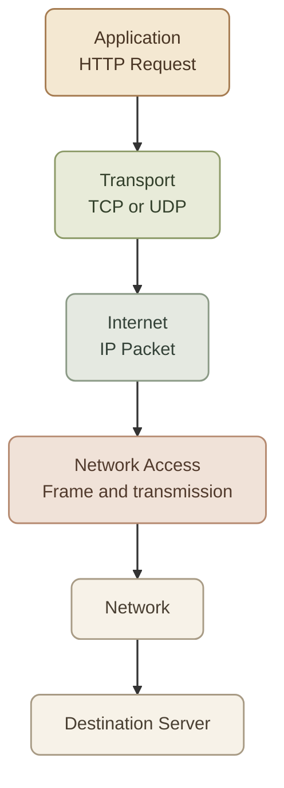

## Introduction

الـ **TCP/IP Model** هو الموديل اللي بيساعدنا نفهم إزاي الأجهزة بتتواصل عبر الشبكات والإنترنت باستخدام مجموعة من الـ **Network Protocols**.

في الدرس اللي فات، اتعلمنا الـ OSI Model المكوّن من 7 Layers. دلوقتي هنشوف الموديل الأقرب لمجموعة البروتوكولات المستخدمة فعليًا في الشبكات، وإزاي الطبقات بتشتغل مع بعض.

## 1. What Is the TCP/IP Model?

الـ TCP/IP Model هو نموذج بيوضّح إزاي البيانات بتتنقل من Application على جهاز إلى Application على جهاز تاني من خلال الشبكة.

اسم TCP/IP جاي من بروتوكولين مهمين:

- **TCP — Transmission Control Protocol:** بيوفّر نقلًا موثوقًا للبيانات، مع آليات لترتيبها وإعادة إرسال البيانات المفقودة.
- **IP — Internet Protocol:** مسؤول عن عنونة الـ IP Addresses وتوجيه الـ Packets ناحية وجهتها عبر الشبكات.

لكن خلي بالك: الموديل مش مقتصر على TCP وIP بس. فيه بروتوكولات تانية زي HTTP وDNS وUDP وEthernet وغيرها.

<InfoCard title="The main idea" icon="network" variant="concept">

كل Layer ليها مسؤولية محددة، وبتستخدم خدمات الطبقات اللي تحتها عشان توصل البيانات للوجهة المطلوبة.

</InfoCard>

## 2. The Four Layers of TCP/IP

النسخة الشائعة في الشرح بتقسّم الموديل إلى أربع طبقات:

<CardGrid columns={2}>
  <InfoCard title="4. Application" icon="layers" variant="concept" eyebrow="User-facing protocols">

    بتتعامل مع بروتوكولات التطبيقات زي HTTP وDNS وSSH.
  </InfoCard>
  <InfoCard title="3. Transport" icon="branch" variant="concept" eyebrow="Process-to-process">

    بتنقل البيانات بين التطبيقات باستخدام TCP أو UDP.
  </InfoCard>
  <InfoCard title="2. Internet" icon="network" variant="concept" eyebrow="Addressing and routing">

    بتستخدم IP Addresses لتوصيل الـ Packets بين الشبكات.
  </InfoCard>
  <InfoCard title="1. Network Access" icon="cloud" variant="concept" eyebrow="Local network delivery">

    بتتعامل مع توصيل البيانات عبر الشبكة المحلية باستخدام تقنيات زي Ethernet وWi-Fi.
  </InfoCard>
</CardGrid>

خلينا نشرح كل Layer بالتفصيل.

## 3. Application Layer

الـ **Application Layer** هي الطبقة اللي بتوفّر بروتوكولات بتستخدمها التطبيقات للتواصل وتبادل البيانات.

في TCP/IP، الطبقة دي بتجمع الوظائف اللي الـ OSI Model بيوزّعها على ثلاث طبقات:

- Application — Layer 7
- Presentation — Layer 6
- Session — Layer 5

### I. Important Protocols

<TableCard title="Important Application-Layer Protocols" caption="أهم البروتوكولات اللي بتشتغل على طبقة الـ Application.">
| Protocol | Purpose |
|---|---|
| HTTP / HTTPS | تبادل بيانات الويب |
| DNS | تحويل أسماء النطاقات إلى IP Addresses عند الحاجة |
| SSH | الاتصال الآمن وإدارة الأجهزة عن بُعد |
| SMTP | إرسال البريد الإلكتروني |
</TableCard>

**Example:**

لما تفتح موقعًا في المتصفح، الـ Browser بيستخدم HTTP أو HTTPS عشان يطلب الصفحة من الـ Web Server.

الـ Application Layer بتحدد شكل الطلب ومعناه، لكنها مش مسؤولة لوحدها عن توصيله عبر الشبكة.

<InfoCard title="DevOps connection" icon="terminal" variant="insight">

لما تشغّل Web Application داخل Docker Container، التطبيق ممكن يكون شغال بنجاح، لكن ده مش معناه تلقائيًا إن المستخدم يقدر يوصل له. لازم كمان باقي الطبقات تكون شغالة صح.

</InfoCard>

## 4. Transport Layer

الـ **Transport Layer** مسؤولة عن نقل البيانات بين التطبيقات أو العمليات (Processes) على الأجهزة.

أشهر بروتوكولين فيها هما TCP وUDP.

### I. TCP vs UDP

<InfoCard title="TCP — Transmission Control Protocol" icon="shield" variant="concept">

TCP بيوفّر اتصالًا موثوقًا بين الطرفين، وبيساعد على ترتيب البيانات وإعادة إرسال الأجزاء المفقودة.

من أمثلته HTTP/1.1 وHTTP/2 في الاستخدام المعتاد، وSSH.
</InfoCard>

<InfoCard title="UDP — User Datagram Protocol" icon="network" variant="concept">

UDP بيبعت البيانات من غير ما يوفّر بنفسه ضمانات التسليم والترتيب اللي TCP بيقدّمها. وده بيخليه مناسبًا لتطبيقات محتاجة تقليل التأخير أو بتنفّذ آلياتها الخاصة.

من أمثلته DNS في استخدامات كتير، وQUIC اللي بيعتمد عليه HTTP/3.
</InfoCard>

### II. What Is a Port?

الـ **Port** رقم بيساعد نظام التشغيل يوجّه بيانات الشبكة إلى التطبيق أو الخدمة المناسبة على الجهاز.

أمثلة شائعة:

<TableCard title="Common Default Ports" caption="الخدمات بتشتغل على أرقام Ports شائعة.">
| Port | Common use |
|---:|---|
| 22 | SSH |
| 53 | DNS |
| 80 | HTTP |
| 443 | HTTPS |
</TableCard>

الأرقام دي هي الـ Default Ports الشائعة، لكن الخدمات ممكن تتظبط على أرقام مختلفة.

خلي بالك من الفرق:

- **IP Address:** بيساعد في تحديد الجهاز أو واجهة الشبكة المقصودة.
- **Port:** بيساعد في تحديد الخدمة أو نقطة الاتصال على الجهاز.
- **Protocol:** بيحدد قواعد التواصل وطريقة التعامل مع البيانات.

## 5. Internet Layer

الـ **Internet Layer** مسؤولة عن الـ IP Addressing وعن توجيه الـ Packets بين الشبكات.

أهم بروتوكول هنا هو **IP — Internet Protocol**.

لما تبعت بيانات لسيرفر موجود على شبكة مختلفة، الـ IP بيحدد عنوان الوجهة في الـ IP Packet، والـ Routers بتستخدم معلومات التوجيه عشان تختار الطريق المناسب.

### I. What Happens at This Layer?

- التعامل مع Source IP Address وDestination IP Address.
- إرسال الـ Packets ناحية الشبكات المطلوبة.
- دعم عملية Routing بين الشبكات.
- التعامل مع بروتوكولات مساعدة زي ICMP، المستخدم في رسائل التحكم والتشخيص.

مهم تفهم إن IP نفسه مش بيضمن وصول كل Packet، ولا بيضمن إن البيانات توصل بالترتيب. دي مش مسؤوليته الأساسية.

<InfoCard title="Important distinction" icon="network" variant="tip">

وجود IP Address صحيح مش كفاية لوحده لضمان التواصل. ممكن يكون فيه مشكلة في الـ Routing أو الـ Firewall أو إعدادات الشبكة. ولسه هنتعلم إزاي نفهم كل جزء بالتفصيل.

</InfoCard>

## 6. Network Access Layer

الـ **Network Access Layer** مسؤولة عن إرسال البيانات عبر الشبكة المحلية أو وصلة الاتصال المستخدمة.

من التقنيات المرتبطة بيها:

- Ethernet — في شبكات سلكية كتير.
- Wi-Fi — في الشبكات اللاسلكية.
- MAC Addresses — لتحديد واجهات الشبكة على مستوى الـ Local Link.
- Frames — وحدة بيانات مهمة في تقنيات زي Ethernet.

في موديل TCP/IP ذي الأربع طبقات، الطبقة دي بتجمع الوظائف اللي الـ OSI Model بيفصلها إلى:

- Data Link Layer — Layer 2.
- Physical Layer — Layer 1.

يعني إرسال Frame عبر Ethernet أو Wi-Fi بيحصل على مستوى الوصول للشبكة، بينما الـ IP مسؤول عن التوصيل المنطقي بين الشبكات.

## 7. OSI vs TCP/IP

الموديلين بيشرحوا التواصل الشبكي، لكن بدرجات مختلفة من التقسيم والتفصيل.

<TableCard title="OSI vs TCP/IP Layers" caption="المقابلة الشائعة بين السبع طبقات ونموذج TCP/IP.">
| OSI Model | TCP/IP Model |
|---|---|
| Application (L7) | Application |
| Presentation (L6) | Application |
| Session (L5) | Application |
| Transport (L4) | Transport |
| Network (L3) | Internet |
| Data Link (L2) | Network Access |
| Physical (L1) | Network Access |
</TableCard>

الجدول ده بيوضّح المقابلة الشائعة بين الموديلين. مش معناه إن كل بروتوكول لازم ينتمي لطبقة واحدة بشكل صارم في كل طريقة تصنيف.

### I. A Simple Comparison

<InfoCard title="OSI Model" icon="layers" variant="comparison">

- 7 Layers.
- نموذج مرجعي مفيد للتعلّم وفهم المسؤوليات.
- بيساعدك تحدد مكان المشكلة بشكل منظم.
</InfoCard>

<InfoCard title="TCP/IP Model" icon="network" variant="comparison">

- 4 Layers في التقسيم الشائع.
- مرتبط بمجموعة البروتوكولات المستخدمة في الإنترنت والشبكات الحديثة.
- مفيد لفهم تفاعل IP وTCP وUDP وبروتوكولات التطبيقات.
</InfoCard>

## 8. How Data Travels Through TCP/IP

خلينا نفترض إنك فاتح Browser وبتحاول توصل إلى Web Server.

البيانات بتبدأ من الـ Application Layer، وبعد كده بتعدّي على الطبقات الأدنى قبل إرسالها عبر الشبكة.



الـ Server بيستقبل البيانات، وبعد كده الطبقات بتتعامل معاها بالعكس لحد ما توصل للتطبيق المناسب. العملية دي مرتبطة بمفهومين:

- **Encapsulation:** إضافة معلومات خاصة بكل طبقة أثناء تجهيز البيانات للإرسال.
- **Decapsulation:** التعامل مع المعلومات المضافة وإزالتها تدريجيًا عند الاستقبال.

ملحوظة: الرسم بيوضّح الترتيب المنطقي، مش كل التفاصيل الخاصة بالإرسال الفعلي. مثلًا، في HTTP/3 بيتم استخدام QUIC فوق UDP بدل TCP.

## 9. A Practical Example

تخيّل إنك بتحاول تفتح `https://example.com`، لكن الصفحة مش بتفتح.

ممكن تفكر باستخدام TCP/IP Model بالشكل ده:

<Steps>
<li>

<InfoCard title="Application Layer" icon="layers" variant="concept">

هل اسم النطاق بيتحلّ بنجاح؟ وهل خدمة الويب بترد بشكل صحيح؟ ممكن تختبر DNS أو تستخدم `curl` لفحص استجابة HTTP.
</InfoCard>

</li>
<li>

<InfoCard title="Transport Layer" icon="branch" variant="concept">

هل الاتصال بالخدمة على الـ Port المطلوب ممكن؟ هل فيه خدمة بتستمع على المنفذ، أو هل الـ Firewall بيمنع الاتصال؟
</InfoCard>

</li>
<li>

<InfoCard title="Internet Layer" icon="network" variant="concept">

هل الجهاز عنده IP Address وإعدادات Routing مناسبة؟ وهل يقدر يوصل إلى الشبكة المطلوبة؟
</InfoCard>

</li>

<li>

<InfoCard title="Network Access Layer" icon="cloud" variant="concept">

هل واجهة الشبكة شغالة؟ وهل الجهاز متصل بالـ Ethernet أو Wi-Fi؟
</InfoCard>

</li>
</Steps>

ممكن تستخدم أوامر Linux دي كبداية للتشخيص:

```bash
# Inspect network addresses
ip addr

# Inspect network interfaces
ip link

# Inspect routing table
ip route

# Inspect listening TCP and UDP sockets
ss -lntup

# Test DNS name resolution
getent hosts example.com

# Inspect an HTTPS request
curl -I https://example.com
```

كل أمر بيكشف جزءًا مختلفًا من الصورة. مفيش أمر واحد منهم بيضمن إنك هتحدد السبب النهائي في كل الحالات.

## 10. Common Misconceptions

<CardGrid columns={3} label="TCP/IP Misconceptions">
<InfoCard title="TCP/IP is not just TCP and IP" icon="layers" variant="tip">

اسم الموديل جاي من بروتوكولين مشهورين، لكن مجموعة البروتوكولات أوسع من كده، وبتشمل HTTP وDNS وUDP وICMP وغيرهم.
</InfoCard>

<InfoCard title="IP does not guarantee delivery" icon="shield" variant="tip">

IP مسؤول عن العنونة والتوصيل بين الشبكات، لكنه مش بروتوكول موثوق لضمان التسليم. TCP بيضيف آليات للموثوقية، بينما UDP لا يوفّر نفس الضمانات.
</InfoCard>

<InfoCard title="A working application does not prove the whole network is healthy" icon="network" variant="tip">

ممكن التطبيق يكون شغال، لكن الوصول ليه يفشل بسبب Port أو Firewall أو Routing أو DNS. لازم تفحص المسار بالكامل بدل ما تفترض إن المشكلة من التطبيق وحده.
</InfoCard>
</CardGrid>

---

## 11. Summary

<InfoCard variant="summary" title="The TCP/IP Mental Model" description="أربع طبقات: Application تتعامل مع البروتوكولات، Transport تربط المنافذ، Internet توجّه الحزم، Network Access تنقل الإطار — والبنية دي شغالة فعليًا على الإنترنت." icon="network" tags={["Mental Model"]} />

- TCP/IP Model بيوضّح إزاي بروتوكولات الشبكة بتشتغل مع بعض.
- التقسيم الشائع بيتكوّن من أربع Layers: Application, Transport, Internet, Network Access.
- Application بتتعامل مع بروتوكولات زي HTTP وDNS.
- Transport بتتعامل مع TCP وUDP، والـ Ports بتساعد في توجيه البيانات للتطبيقات المناسبة.
- Internet Layer مسؤولة عن IP Addressing وRouting.
- Network Access Layer بتتعامل مع تقنيات زي Ethernet وWi-Fi.
- OSI Model مفيد لفهم الوظائف، وTCP/IP مفيد لفهم مجموعة البروتوكولات اللي بتستخدمها الشبكات فعليًا.

