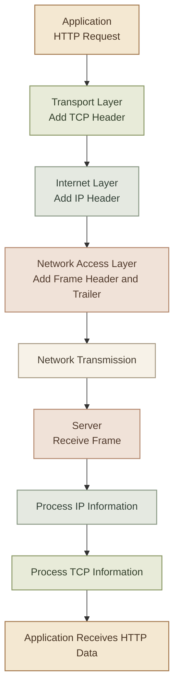
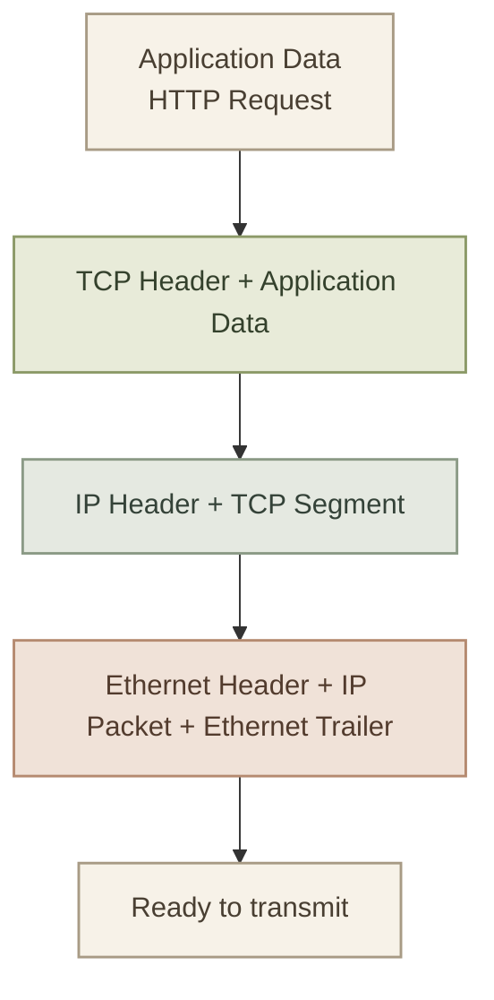
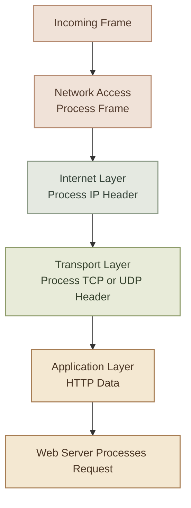
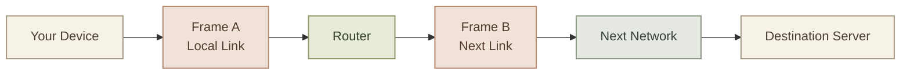

## Introduction

لما تبعت Request من جهازك إلى Web Server، البيانات مش بتتنقل بالشكل نفسه من أول التطبيق لحد الشبكة. كل Layer بتضيف معلومات بتساعد في توصيل البيانات والتعامل معاها، والجهاز المستقبل بيستخدم المعلومات دي عشان يوصل البيانات للتطبيق الصحيح.

العملية دي ليها اسمين:

- **Encapsulation:** إضافة معلومات البروتوكولات أثناء انتقال البيانات من الطبقات العليا إلى الطبقات السفلى قبل الإرسال.
- **Decapsulation:** استقبال البيانات ومعالجة معلومات البروتوكولات أثناء انتقالها من الطبقات السفلى إلى الطبقات العليا.

## 1. The Big Picture

خلينا نفترض إنك فتحت Browser وكتبت عنوان موقع. الـ Browser بيجهّز HTTP Request، وبعد كده البيانات بتمرّ على طبقات الشبكة لحد ما تتبعت إلى السيرفر.



الرسم بيوضح الفكرة العامة، لكن خد بالك إن كل طبقة بتعالج الجزء الخاص بيها؛ مش كل طبقة بتقرأ محتوى الـ Application نفسه.

## 2. What Is Encapsulation?

الـ **Encapsulation** بتحصل عند الجهاز اللي بيبعت البيانات، لما البيانات تنزل من الـ Application Layer ناحية الـ Network Access Layer.

كل طبقة بتضيف معلومات اسمها غالبًا **Header**، وبعض البروتوكولات بتضيف **Trailer** كمان.

### I. How Does It Work?

<CardGrid columns={2}>
  <InfoCard title="Application Data" icon="layers" variant="concept" eyebrow="Application">

    البيانات الأصلية اللي التطبيق عايز يبعتها، زي HTTP Request.
  </InfoCard>
  <InfoCard title="TCP Segment" icon="branch" variant="concept" eyebrow="Transport">

    بيانات التطبيق مع TCP Header، اللي بيحتوي على معلومات زي Source Port وDestination Port.
  </InfoCard>
  <InfoCard title="IP Packet" icon="network" variant="concept" eyebrow="Internet">

    الـ TCP Segment مع IP Header، اللي بيحتوي على معلومات زي Source IP وDestination IP.
  </InfoCard>
  <InfoCard title="Ethernet Frame" icon="cloud" variant="concept" eyebrow="Network Access">

    الـ IP Packet داخل Frame، مع معلومات Ethernet Header وTrailer حسب تنسيق الـ Frame.
  </InfoCard>
</CardGrid>

كل خطوة بتغلّف البيانات بمعلومات إضافية. والبيانات اللي كانت موجودة قبل الإضافة بتفضل جزءًا من المحتوى الداخلي.

## 3. Headers and Trailers

### I. What Is a Header?

الـ **Header** هو جزء من البيانات بييجي قبل الـ Payload، وبيحتوي على معلومات محتاجها البروتوكول عشان يتعامل مع البيانات.

أمثلة:

- **TCP Header:** يحتوي على Source Port وDestination Port ومعلومات خاصة بالاتصال ونقل البيانات.
- **IP Header:** يحتوي على Source IP Address وDestination IP Address، بالإضافة إلى حقول أخرى.
- **Ethernet Header:** يحتوي على معلومات خاصة بالـ Frame، منها عناوين MAC في Ethernet المعتاد.

### II. What Is a Trailer?

الـ **Trailer** بييجي في نهاية وحدة البيانات، وبعض البروتوكولات بتستخدمه لتخزين معلومات إضافية.

في Ethernet التقليدي، الـ Frame بيحتوي على **Frame Check Sequence (FCS)** في النهاية، وده بيساعد على اكتشاف تلف البيانات أثناء النقل.

مش كل Protocol عنده Trailer؛ وجوده بيعتمد على البروتوكول المستخدم.

<InfoCard title="Remember" icon="layers" variant="tip">

الـ Header مش هو البيانات الأصلية نفسها، لكنه معلومات إضافية بتساعد البروتوكول يتعامل مع البيانات. والـ Payload هو المحتوى اللي الوحدة الحالية بتحمله، وممكن يكون بيانات تطبيق أو وحدة بيانات من طبقة أعلى.
</InfoCard>

## 4. Visualizing Encapsulation

خلينا نشوف إزاي البيانات بتتغلّف خطوة بخطوة.



الرسم ده مبسّط، وبيوضح الترتيب المنطقي. في الواقع، حجم الـ Headers والحقول الموجودة فيها بيختلف حسب البروتوكول والإعدادات.

**Important:** الـ TCP Segment والـ IP Packet والـ Ethernet Frame مش أسماء لنفس الحاجة؛ كل اسم بيوصف وحدة البيانات في مستوى مختلف.

## 5. Protocol Data Units (PDUs)

كل Layer ليها اسم شائع لوحدة البيانات اللي بتتعامل معاها، وده بيساعدنا نفهم الكلام التقني ونحل مشاكل الشبكات.

| Layer | Common PDU name | Example |
|---|---|---|
| Application | Data | HTTP Request |
| Transport — TCP | Segment | TCP Header + Data |
| Transport — UDP | Datagram | UDP Header + Data |
| Internet | Packet | IP Header + Payload |
| Network Access | Frame | Ethernet Header + Payload + FCS |
| Physical | Bits | Electrical, optical, or radio signals representing bits |

ملاحظات مهمة:

- مصطلح **PDU** اختصار لـ Protocol Data Unit.
- في طبقة Transport، الاسم بيختلف حسب البروتوكول: TCP Segment وUDP Datagram.
- في الـ Physical Layer، البيانات بتتمثل في إشارات فعلية على وسيط الاتصال.
- بعض المناهج بتستخدم كلمة **Data** بشكل عام في الطبقات العليا، وممكن تلاقي اختلافات بسيطة في المصطلحات بين المراجع.

## 6. What Is Decapsulation?

الـ **Decapsulation** هي العملية العكسية عند الجهاز المستقبل.

لما الـ Server يستقبل البيانات، مش بيسلّم الـ Ethernet Frame مباشرة إلى الـ Web Application. بدلًا من كده، كل طبقة بتتعامل مع معلومات البروتوكول الخاص بيها، وبعدها بتسلّم المحتوى المناسب للطبقة الأعلى.

### I. The Receiving Process

1. **Network Access:** الجهاز يستقبل الـ Frame ويتحقق من معلوماته، بما فيها فحص سلامة الـ Frame حسب التقنية المستخدمة.
2. **Internet:** يتم التعامل مع الـ IP Packet وتحديد ما إذا كانت موجهة للجهاز أو الواجهة المناسبة.
3. **Transport:** يتم التعامل مع TCP أو UDP، وتوجيه البيانات إلى الـ Socket المناسب باستخدام معلومات زي الـ Ports.
4. **Application:** تصل بيانات التطبيق إلى الخدمة المناسبة، مثل Web Server اللي بيعالج HTTP Request.



الطبقات بتعالج المعلومات الخاصة ببروتوكولاتها، وبتتعامل مع البيانات المتبقية باعتبارها Payload للطبقة الحالية.

## 7. Encapsulation vs Decapsulation

| Encapsulation | Decapsulation |
|---|---|
| بتحصل عند إرسال البيانات. | بتحصل عند استقبال البيانات. |
| البيانات بتتحرك منطقيًا من الطبقات العليا للسفلى. | البيانات بتتحرك منطقيًا من الطبقات السفلى للعليا. |
| بتُضاف Headers، وممكن Trailers. | بتُعالَج معلومات البروتوكولات وتُفصل عن المحتوى عند الحاجة. |
| بتجهّز البيانات للإرسال. | بتجهّز البيانات للطبقة الأعلى لحد ما توصل للتطبيق. |

## 8. What Happens at a Router?

دي نقطة مهمة جدًا عشان تفهم انتقال البيانات عبر الإنترنت.

لما جهازك يبعت IP Packet إلى سيرفر على شبكة مختلفة، البيانات غالبًا بتمر على Router أو أكتر. كل Router بيستقبل الـ Frame على واجهة شبكة، ويتعامل مع الـ IP Packet لاتخاذ قرار التوجيه، وبعد كده يغلّف الـ Packet داخل Frame جديد مناسب للوصلة التالية.

يعني **الـ Frame مش بالضرورة بيفضل نفسه طول الطريق**.



خلي بالك من ثلاث نقاط:

- الـ Router بيزيل معلومات الـ Link-layer الخاصة بالـ Frame الوارد، ويتعامل مع الـ IP Packet.
- بيُنشئ Frame جديدًا مناسبًا للـ Next Hop.
- الـ IP Packet بيستمر عادةً عبر المسار، لكن بعض الحقول بتتغير أثناء التوجيه؛ مثل TTL في IPv4 أو Hop Limit في IPv6. وممكن كمان يحصل تعديل للـ IP Headers في حالات زي NAT.

بالتالي، Encapsulation وDecapsulation مش معناهم إن نفس الـ Ethernet Frame هيسافر من جهازك للسيرفر من غير تغيير.

## 9. Why Does Encapsulation Matter in DevOps?

فهم المفهوم ده بيساعدك تفرّق بين مشاكل بتحصل في مستويات مختلفة.

<InfoCard title="Docker networking" icon="cloud" variant="insight">

لما Container يحاول يتواصل مع Container تاني أو مع خدمة خارجية، البيانات بتعدّي عبر طبقات وبروتوكولات مختلفة. معرفة دور كل طبقة بتساعدك تفهم مشاكل الاتصال بدل ما تفترض إن المشكلة في التطبيق وحده.
</InfoCard>

<InfoCard title="Packet analysis" icon="terminal" variant="insight">

أدوات زي `tcpdump` وWireshark بتساعدك تشوف أجزاء من الـ Packets والـ Headers، وده مفيد في تحليل Source/Destination IPs والـ Ports وبعض تفاصيل البروتوكولات.
</InfoCard>

مثلًا، الأمر ده بيعرض حركة الشبكة على واجهة محددة:

```bash
sudo tcpdump -i any -nn
```

- `-i any` بيطلب الالتقاط من الواجهات المتاحة على Linux، حسب دعم النظام.
- `-nn` بيمنع تحويل عناوين الـ IP وأرقام الـ Ports إلى أسماء، عشان تشوف القيم الرقمية مباشرة.

استخدمه في بيئة تملكها أو عندك تصريح بفحصها، وخلي بالك إن Packet Captures ممكن تحتوي على بيانات حساسة.

## 10. Common Misconceptions

<InfoCard title="Every layer does not add both a header and a trailer" icon="layers" variant="tip">

كل بروتوكول بيضيف المعلومات اللي محتاجها حسب تصميمه. بعض البروتوكولات عندها Header فقط، وبعضها عنده Header وTrailer.
</InfoCard>

<InfoCard title="The router does not simply forward the same frame everywhere" icon="network" variant="tip">

الـ Router بيستخدم معلومات الـ IP لاتخاذ قرار التوجيه، وبيتعامل مع الـ Frame الخاص بكل وصلة. الـ Frame بيتغيّر عادةً من وصلة للتانية.
</InfoCard>

<InfoCard title="Decapsulation does not mean all data is discarded" icon="shield" variant="tip">

الـ Headers الخاصة بالطبقات الأدنى بتُعالج أثناء الاستقبال، لكن الـ Payload بيستمر إلى الطبقة الأعلى لحد ما يوصل للتطبيق المناسب.
</InfoCard>

---

## 11. Summary

- **Encapsulation:** إضافة معلومات البروتوكولات أثناء انتقال البيانات لأسفل الطبقات.
- **Decapsulation:** معالجة معلومات البروتوكولات أثناء استقبال البيانات وانتقالها لأعلى الطبقات.
- **Header:** معلومات إضافية في بداية وحدة البيانات.
- **Trailer:** معلومات إضافية في نهايتها، لو البروتوكول بيستخدمها.
- **PDU:** اسم وحدة البيانات في مستوى معين، زي Segment وPacket وFrame.
- الـ Router بيغلّف الـ IP Packet في Frame مناسب للوصلة التالية، وبالتالي الـ Frame ممكن يتغير أثناء الطريق.


