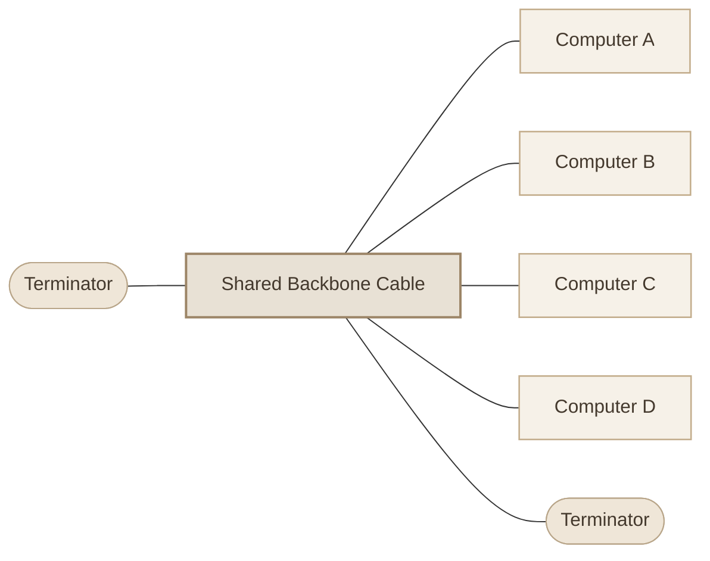
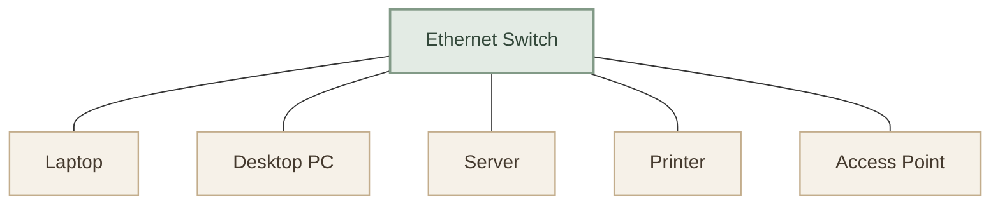
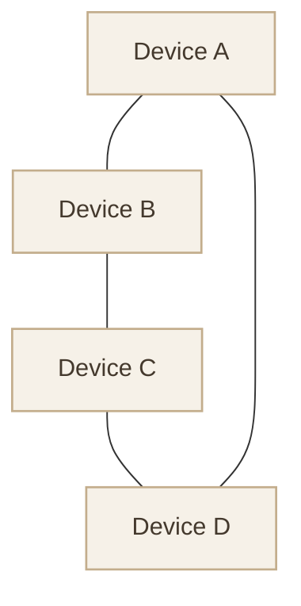
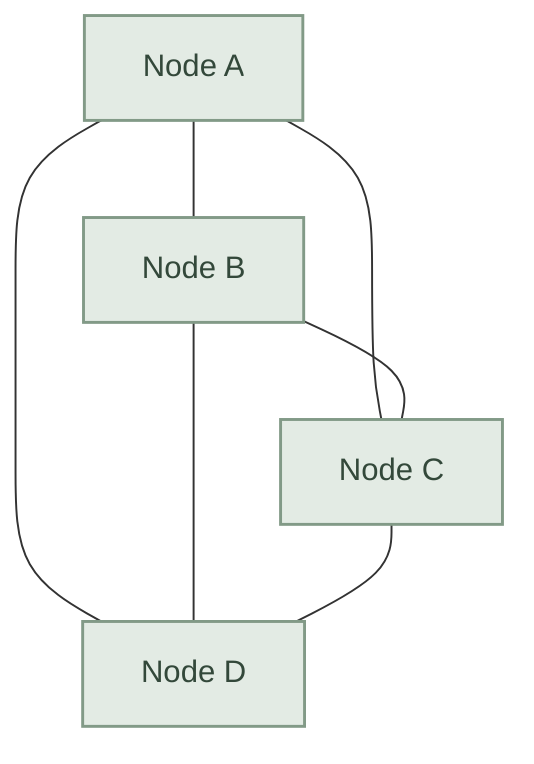
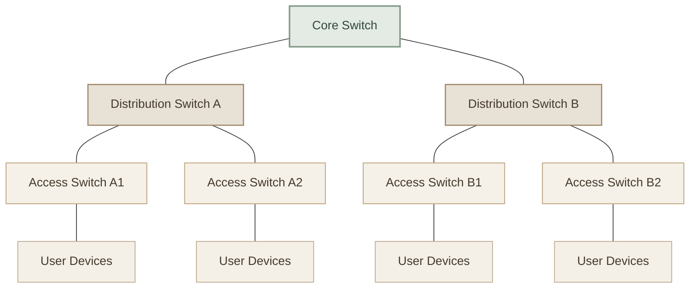
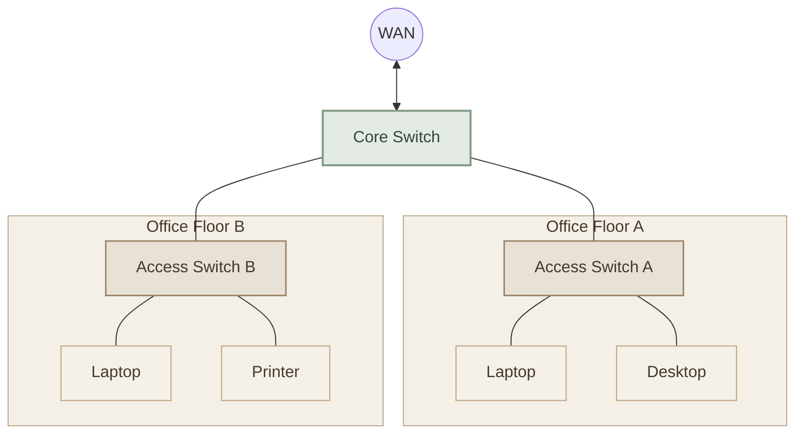

## Overview

الـ **Network Topology** هي الطريقة اللي بنوصف بيها ترتيب الأجهزة والروابط اللي بتربطها ببعض داخل الشبكة.

بمعنى أبسط، لو عندك مجموعة Computers وServers وSwitches، فالـ Topology بتساعدك تفهم مين متصل بمين، والبيانات ممكن تمشي في أي مسارات.

فيه نوعان أساسيان لازم تفرق بينهم:

<InfoCard variant="concept" title="Physical Topology" description="الشكل الفعلي لتوصيل الأجهزة والكابلات ومعدات الشبكة." icon="network" tags={["Physical Layout"]} />

<InfoCard variant="concept" title="Logical Topology" description="الطريقة اللي البيانات بتتحرك أو بتتبادل بيها داخل الشبكة، بغض النظر عن شكل الكابلات بالضرورة." icon="branch" tags={["Data Flow"]} />

مثال: ممكن أجهزة تكون متوصلة فعليًا على Switch في شكل Star، لكن طريقة انتقال البيانات منطقيًا بتعتمد على تقنية الشبكة والبروتوكولات المستخدمة.

## 1. Bus Topology

<InfoCard variant="concept" title="Bus Topology" description="كل الأجهزة بتشارك في الاتصال من خلال خط رئيسي واحد، اسمه Backbone." icon="branch" tags={["Shared Backbone", "Legacy Ethernet"]} />

### I. How It Works

الأجهزة بتتصل بكابل رئيسي مشترك. البيانات اللي بتتبعت على الخط ده ممكن تكون متاحة للأجهزة المتصلة به، وكل جهاز بيحدد إذا كانت البيانات موجهة إليه.

في الشبكات التقليدية المعتمدة على Coaxial Ethernet، كان فيه Terminators في طرفي الكابل لتقليل انعكاس الإشارة.

### II. Advantages

- بسيطة من ناحية الفكرة.
- بتحتاج كابل Backbone رئيسي مشترك.
- كانت مناسبة لبعض الشبكات القديمة الصغيرة.

### III. Disadvantages

- تلف الكابل الرئيسي ممكن يعطل الشبكة كلها.
- مشاركة الوسط الناقل بتزود احتمالية التصادمات في تقنيات Ethernet القديمة المعتمدة على Bus.
- تحديد الأعطال وصيانتها ممكن يكون صعبًا.
- مش هي التصميم المعتاد لشبكات Ethernet الحديثة.

### IV. Where Is It Used?

الـ Bus Topology مهمة تاريخيًا لفهم تطور الشبكات، لكنها مش الاختيار المعتاد لشبكات LAN الحديثة.

## 2. Star Topology

<InfoCard variant="concept" title="Star Topology" description="كل جهاز بيتصل بنقطة مركزية، غالبًا Switch في شبكات Ethernet الحديثة." icon="network" tags={["Central Switch", "Common in LANs"]} />

### I. How It Works

بدل ما الأجهزة تتصل بكابل مشترك واحد، كل جهاز بيكون له وصلة مستقلة إلى الجهاز المركزي.

في شبكة Ethernet مكتبية، الـ Switch بيستقبل الـ Frames وبيوجّهها إلى المنافذ المناسبة بناءً على جدول عناوين MAC، حسب حالة الشبكة وإعداداتها.

### II. Advantages

- سهلة في الإدارة والتوسّع.
- عطل وصلة جهاز واحد غالبًا مش بيعطل بقية الأجهزة.
- تشخيص الأعطال أسهل نسبيًا.
- كل جهاز بيكون له Link مستقل إلى النقطة المركزية.

### III. Disadvantages

- تعطل الـ Central Switch ممكن يقطع الاتصال عن الأجهزة المتصلة به.
- بتحتاج وصلة منفصلة لكل جهاز إلى النقطة المركزية.
- تكلفة معدات الشبكة والكابلات بتزيد مع عدد الأجهزة.

### IV. Real-World Examples

- شبكة أجهزة الكمبيوتر في مكتب.
- شبكة معمل الجامعة.
- شبكة منزلية فيها أجهزة متصلة بـ Ethernet Switch.

<InfoCard variant="insight" title="Important" description="لو جهاز واحد فقد الاتصال بسبب تلف الكابل الخاص به، ده مش معناه إن باقي الأجهزة هتفقد الاتصال. لكن لو الـ Switch المركزي نفسه تعطل، ممكن كل الأجهزة المتصلة به تتأثر." icon="pulse" />

## 3. Ring Topology

<InfoCard variant="concept" title="Ring Topology" description="الأجهزة بتتصل ببعض في مسار دائري، بحيث كل جهاز يكون مرتبطًا بجاره أو بالجزء التالي من الحلقة." icon="cycle" tags={["Circular Layout", "Legacy and Specialized Networks"]} />

### I. How It Works

في الشكل الأساسي، كل جهاز متصل بجهازين مجاورين، والاتصالات بتكوّن حلقة.

بعض تقنيات Ring القديمة كانت تستخدم Token Passing لتنظيم إرسال البيانات، لكن مش كل شبكة Ring بتستخدم نفس آلية نقل البيانات.

### II. Advantages

- شكل الاتصال واضح ومنظم.
- بعض تصميمات Ring بتوفر آليات منظمة للتحكم في الوصول إلى الوسط.
- تقنيات معينة بتقدر تتعامل مع الأعطال باستخدام مسارات احتياطية أو حلقات محمية.

### III. Disadvantages

- في الحلقة البسيطة، انقطاع وصلة أو تعطل جهاز ممكن يعطل الاتصال.
- إضافة أجهزة أو تغيير التوصيلات ممكن يحتاج تخطيطًا.
- الأداء وطريقة التعامل مع الأعطال بيعتمدوا على التقنية المستخدمة.

### IV. Real-World Context

الـ Ring Topology ظهرت في تقنيات زي Token Ring، ولسه فيه شبكات صناعية واتصالات بتستخدم تصاميم حلقية لتحقيق مسارات احتياطية. لكن مش هي الشكل الافتراضي المعتاد لشبكات Ethernet المكتبية الحديثة.

## 4. Mesh Topology

<InfoCard variant="concept" title="Mesh Topology" description="الأجهزة أو عُقد الشبكة بيكون بينها أكتر من مسار اتصال، لتوفير بدائل عند تعطل بعض الروابط." icon="network" tags={["Redundancy", "Multiple Paths"]} />

### I. Types of Mesh

- **Full Mesh:** كل Node متصلة مباشرةً بكل Node أخرى.
- **Partial Mesh:** بعض الـ Nodes فقط بينها اتصالات مباشرة متعددة.

### II. Full Mesh Example

### III. Advantages

- وجود مسارات متعددة ممكن يحسن Availability.
- انقطاع وصلة واحدة مش بالضرورة يقطع الاتصال بين بقية العقد.
- مناسب لبعض تصميمات الشبكات اللي بتحتاج Redundancy.

### IV. Disadvantages

- الـ Full Mesh بيحتاج عددًا كبيرًا من الروابط.
- التكلفة والتعقيد بيزيدوا مع زيادة عدد الـ Nodes.
- الإدارة والتشخيص ممكن يبقوا أصعب في الشبكات الكبيرة.

### V. Where Is It Used?

- بعض شبكات WAN بين مواقع المؤسسات.
- بعض شبكات Wireless Mesh.
- تصميمات شبكات تحتاج مسارات بديلة بين الأجهزة أو المواقع.

<InfoCard variant="insight" title="Scalability" description="في Full Mesh بين n من العقد، عدد الوصلات المباشرة المطلوبة يساوي n × (n − 1) ÷ 2. لذلك التكلفة بتزيد بسرعة مع زيادة عدد العقد." icon="pulse" />

## 5. Tree Topology

<InfoCard variant="concept" title="Tree Topology" description="تصميم هرمي بيجمع مجموعات من الأجهزة أو الشبكات تحت طبقات من نقاط الربط، زي الفروع في الشجرة." icon="branch" tags={["Hierarchical", "Scalable Design"]} />

### I. How It Works

في التصميم الهرمي، ممكن يكون عندك Core Switch بيربط Distribution Switches، وكل واحد منهم بيربط Access Switches اللي متصلة بأجهزة المستخدمين.

ده نموذج شائع لفهم تصميم شبكات المؤسسات، مع العلم إن التصميمات الفعلية ممكن تكون أكثر تعقيدًا وتحتوي على روابط احتياطية.

### II. Advantages

- مناسبة لتقسيم الشبكة إلى أقسام ومجموعات.
- بتسهّل التوسع وإضافة Access Switches وأجهزة جديدة.
- بتدعم الإدارة والتنظيم حسب الطبقات.

### III. Disadvantages

- عطل جهاز أو وصلة في طبقة أعلى ممكن يؤثر على فروع تابعة له.
- التصميم محتاج تخطيطًا جيدًا للـ Capacity والروابط الاحتياطية.
- وجود شكل هرمي لا يضمن تلقائيًا Redundancy أو عدم وجود نقاط فشل منفردة.

### IV. Real-World Examples

- شبكات الجامعات الكبيرة.
- شبكات الشركات متعددة الأقسام.
- شبكات المؤسسات اللي بتستخدم Core وDistribution وAccess Layers.

## 6. Hybrid Topology

<InfoCard variant="concept" title="Hybrid Topology" description="تصميم بيجمع أكتر من Topology في شبكة واحدة حسب احتياجات المؤسسة." icon="modules" tags={["Combined Design", "Flexible"]} />

### I. How It Works

شبكات المؤسسات نادرًا ما بتلتزم بشكل واحد بسيط في كل أجزائها. ممكن تلاقي أجهزة المستخدمين متوصلة في Star، والسويتشات مترتبة بشكل هرمي، والروابط بين بعض المواقع فيها Redundancy.

### II. Advantages

- مرونة في التصميم حسب متطلبات العمل.
- ممكن تجمع سهولة الإدارة مع Redundancy في أجزاء محددة.
- مناسبة للشبكات الكبيرة اللي بتحتاج أكثر من نمط اتصال.

### III. Disadvantages

- التصميم والإدارة ممكن يكونوا أكثر تعقيدًا.
- التكلفة بتعتمد على التقنيات والروابط المستخدمة.
- لازم يتعمل تخطيط جيد لتجنب نقاط الفشل المنفردة.

## 7. Comparison Table

| Topology | Main Structure | Main Advantage | Main Limitation |
| --- | --- | --- | --- |
| Bus | خط رئيسي مشترك | بساطة التصميم الأساسي | الاعتماد على الـ Backbone |
| Star | نقطة مركزية | سهولة الإدارة وعزل أعطال الوصلات الطرفية | تعطل المركز ممكن يؤثر على الجميع |
| Ring | حلقة دائرية | تنظيم الاتصال في بعض التصميمات | انقطاع الحلقة قد يعطل الاتصال إن لم توجد حماية |
| Mesh | مسارات متعددة | Redundancy | التكلفة والتعقيد |
| Tree | طبقات هرمية | قابلية التوسع والتنظيم | الأعطال في الطبقات العليا قد تؤثر على فروع |
| Hybrid | مزيج من أشكال مختلفة | المرونة | تعقيد التصميم والإدارة |

## 8. Key Takeaways

<CardGrid columns={2} label="Topology Summary">
  <InfoCard variant="summary" title="Bus" description="الأجهزة بتشارك خط اتصال رئيسي واحد." icon="branch" tags={["Shared Backbone"]} />
  <InfoCard variant="summary" title="Star" description="كل جهاز بيتصل بنقطة مركزية زي الـ Switch." icon="network" tags={["Central Point"]} />
  <InfoCard variant="summary" title="Ring" description="الاتصالات بتكوّن مسارًا دائريًا بين العقد." icon="cycle" tags={["Circular"]} />
  <InfoCard variant="summary" title="Mesh" description="روابط ومسارات متعددة بتساعد على توفير بدائل." icon="network" tags={["Redundancy"]} />
  <InfoCard variant="summary" title="Tree" description="ترتيب هرمي يسهل تنظيم الشبكات الكبيرة." icon="branch" tags={["Hierarchical"]} />
  <InfoCard variant="summary" title="Hybrid" description="دمج أكثر من شكل حسب احتياجات الشبكة." icon="modules" tags={["Combined"]} />
</CardGrid>
