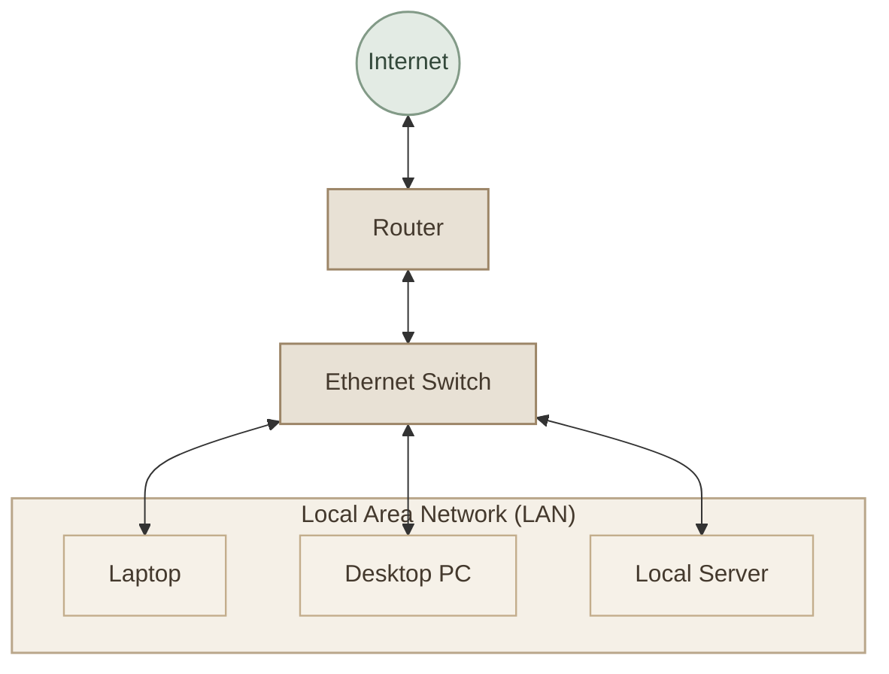
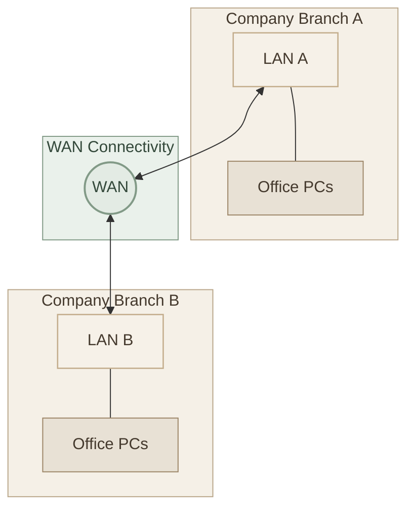
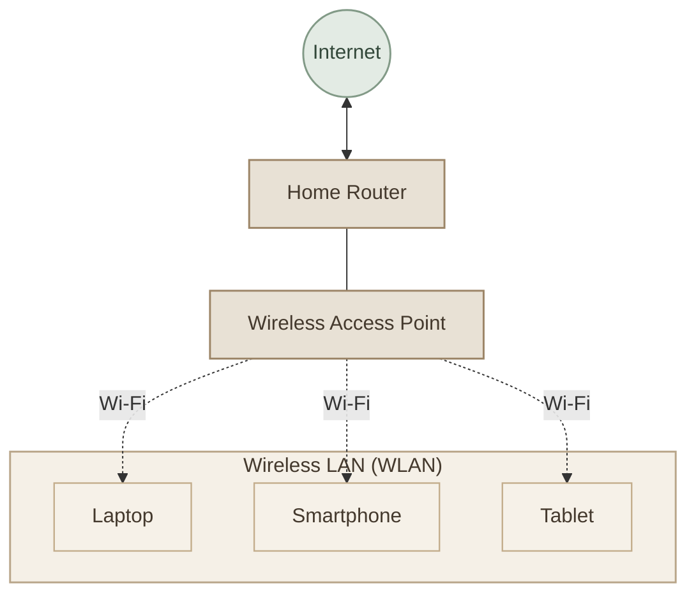
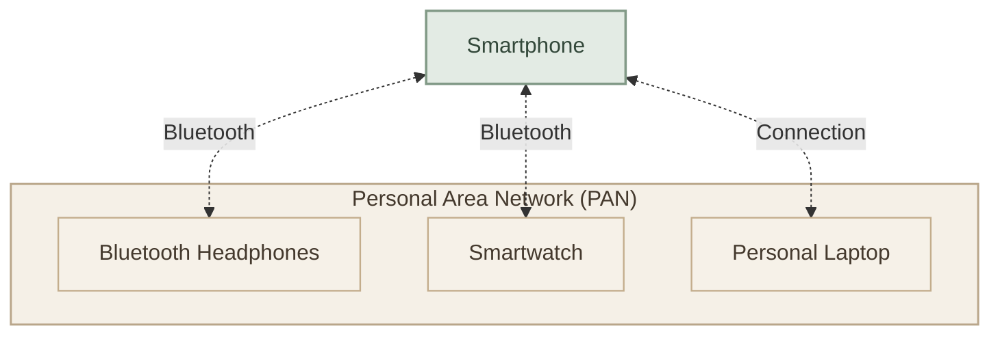

## Overview

الـ **Network Types** هي تصنيفات للشبكات بناءً على عوامل مختلفة، أهمها **Coverage Area**، يعني المساحة الجغرافية اللي الشبكة بتغطيها.

في الدرس ده هنركز على أربعة أنواع أساسية:

- **LAN — Local Area Network**
- **WAN — Wide Area Network**
- **WLAN — Wireless Local Area Network**
- **PAN — Personal Area Network**

مهم تعرف إن التصنيفات دي مش كلها متعارضة؛ لأن كل نوع ممكن يوصف جانب مختلف من الشبكة. مثلًا، الـ WLAN هي شبكة محلية بتستخدم الاتصال اللاسلكي، بينما الـ LAN ممكن تكون سلكية أو لاسلكية.

## 1. LAN — Local Area Network

<InfoCard variant="concept" title="Local Area Network (LAN)" description="شبكة بتربط أجهزة داخل نطاق جغرافي محدود، زي البيت أو المكتب أو معمل الكمبيوتر." icon="network" tags={["Limited Area", "Local Communication"]} />

### I. How It Works

الـ LAN بتسمح للأجهزة الموجودة في نفس الشبكة المحلية إنها تتبادل البيانات والموارد، زي الملفات والطابعات، وفقًا لإعدادات الشبكة والصلاحيات.

أغلب الشبكات المنزلية والمكتبية بتستخدم **Ethernet Switch** لتوصيل الأجهزة السلكية، وممكن تستخدم **Router** عشان تربط الشبكة المحلية بشبكات تانية زي الإنترنت.

### II. Real-World Examples

- شبكة أجهزة الكمبيوتر في الجامعة.
- الأجهزة المتصلة بشبكة مكتب واحد.
- أجهزة البيت المتصلة بالشبكة المحلية.

### III. Key Characteristics

- **Coverage:** مساحة محدودة.
- **Ownership:** غالبًا بتكون تحت إدارة شخص أو مؤسسة واحدة.
- **Connection:** ممكن تستخدم Ethernet أو Wi-Fi.
- **Purpose:** مشاركة البيانات والموارد بين الأجهزة المحلية.

## 2. WAN — Wide Area Network

<InfoCard variant="concept" title="Wide Area Network (WAN)" description="شبكة بتربط شبكات موجودة في مواقع جغرافية متباعدة، زي فروع شركة في مدن أو دول مختلفة." icon="cloud" tags={["Large Geographic Area", "Network of Networks"]} />

### I. How It Works

بدل ما تكون الأجهزة كلها موجودة في مكان واحد، الـ WAN بتربط شبكات محلية متعددة عبر بنية اتصالات مناسبة، زي وصلات الألياف الضوئية أو شبكات مزودي الخدمة أو اتصالات أخرى.

الـ **Internet** هو أشهر مثال على شبكة عالمية ضخمة بتربط عددًا هائلًا من الشبكات.

### II. Real-World Examples

- شركة عندها فروع في القاهرة والإسكندرية.
- بنك بيربط فروعه بمراكز البيانات.
- الإنترنت اللي بيربط شبكات ومؤسسات حول العالم.

### III. Key Characteristics

- **Coverage:** مناطق جغرافية واسعة.
- **Connectivity:** بتعتمد غالبًا على بنية اتصالات تربط مواقع متباعدة.
- **Management:** ممكن تشترك فيها جهات ومزودو خدمة مختلفون.
- **Purpose:** ربط شبكات منفصلة ببعضها.

<InfoCard variant="insight" title="Important Concept" description="الـ WAN مش معناها بالضرورة إن الشبكة بطيئة، والـ LAN مش معناها بالضرورة إنها سريعة في كل الظروف. الأداء بيعتمد على التقنية المستخدمة، والـ Bandwidth، والـ Latency، والازدحام، وعوامل أخرى." icon="pulse" />

## 3. WLAN — Wireless Local Area Network

<InfoCard variant="concept" title="Wireless Local Area Network (WLAN)" description="شبكة محلية بتستخدم اتصالًا لاسلكيًا، غالبًا عن طريق Wi-Fi، لربط الأجهزة داخل نطاق محدود." icon="network" tags={["Wireless", "Wi-Fi", "Local Area"]} />

### I. How It Works

الـ WLAN هي نوع من الشبكات المحلية بيستخدم موجات الراديو بدل كابلات Ethernet في الاتصال اللاسلكي.

الـ **Wireless Access Point (AP)** بيسمح للأجهزة اللاسلكية بالاتصال بالشبكة. وفي الشبكات المنزلية، غالبًا الـ Router بيكون مدمجًا معاه Access Point.

### II. Real-World Examples

- شبكة Wi-Fi في البيت.
- شبكة لاسلكية في الجامعة أو المكتب.
- شبكة Wi-Fi في مكتبة أو مقهى.

### III. Key Characteristics

- **Coverage:** مساحة محلية، حسب قوة الإشارة والبيئة.
- **Medium:** اتصال لاسلكي باستخدام تقنيات مثل Wi-Fi.
- **Mobility:** الأجهزة تقدر تتحرك داخل نطاق التغطية مع مراعاة شروط الاتصال.
- **Security:** لازم تتظبط إعدادات الأمان، مثل استخدام تشفير قوي وكلمة مرور مناسبة.

### IV. LAN vs WLAN

الفرق الأساسي إن **LAN** مصطلح عام لشبكة محلية، بينما **WLAN** بتحدد إن الشبكة المحلية لاسلكية.

يعني ممكن يكون عندك LAN باستخدام Ethernet، أو WLAN باستخدام Wi-Fi، وممكن شبكة واحدة تجمع بين الاتنين.

## 4. PAN — Personal Area Network

<InfoCard variant="concept" title="Personal Area Network (PAN)" description="شبكة شخصية صغيرة بتربط أجهزة قريبة من شخص واحد، زي الموبايل والسماعة والساعة الذكية." icon="pulse" tags={["Very Short Range", "Personal Devices"]} />

### I. How It Works

الـ PAN بتسمح للأجهزة الشخصية إنها تتبادل البيانات أو تتصل ببعض. ممكن تستخدم Bluetooth، أو USB، أو تقنيات أخرى حسب الاستخدام.

مثلًا، لما توصل سماعة Bluetooth بالموبايل، بيكون فيه اتصال شخصي لاسلكي بين الجهازين.

### II. Real-World Examples

- موبايل متصل بسماعة Bluetooth.
- ساعة ذكية بتتصل بالموبايل.
- توصيل موبايل بلابتوب لمشاركة البيانات.

### III. Key Characteristics

- **Coverage:** عادةً نطاق شخصي صغير جدًا.
- **Purpose:** ربط الأجهزة الشخصية القريبة.
- **Technologies:** Bluetooth وUSB وتقنيات مناسبة أخرى.
- **Ownership:** غالبًا أجهزة خاصة بشخص واحد.

## 5. Compare LAN, WAN, WLAN, and PAN

| Feature | LAN | WAN | WLAN | PAN |
| --- | --- | --- | --- | --- |
| Full Form | Local Area Network | Wide Area Network | Wireless Local Area Network | Personal Area Network |
| Coverage | مساحة محلية | مسافات جغرافية واسعة | مساحة محلية لاسلكية | نطاق شخصي قريب |
| Typical Medium | Ethernet أو Wi-Fi | وصلات ومزودو اتصالات وتقنيات متنوعة | Wi-Fi غالبًا | Bluetooth أو USB وغيرها |
| Example | شبكة معمل كمبيوتر | ربط فروع شركة | Wi-Fi المنزل | موبايل وسماعة Bluetooth |
| Main Purpose | ربط الأجهزة محليًا | ربط شبكات متباعدة | اتصال محلي لاسلكي | ربط الأجهزة الشخصية |

<InfoCard variant="insight" title="The Most Important Difference" description="LAN وWAN بيركزوا أساسًا على نطاق الشبكة وطريقة الربط بين المواقع، بينما WLAN بتحدد إن الاتصال المحلي لاسلكي، وPAN بتوصف شبكة شخصية صغيرة. لذلك WLAN مش منافس مباشر لـ LAN؛ هي نوع لاسلكي من الشبكات المحلية." icon="pulse" />

## 6. Key Takeaways

<CardGrid columns={2} label="Network Types Summary">
  <InfoCard variant="summary" title="LAN" description="شبكة محلية لربط الأجهزة داخل مساحة محدودة." icon="network" tags={["Local"]} />
  <InfoCard variant="summary" title="WAN" description="شبكة تربط شبكات ومواقع جغرافية متباعدة." icon="cloud" tags={["Wide Area"]} />
  <InfoCard variant="summary" title="WLAN" description="شبكة محلية تعتمد على الاتصال اللاسلكي." icon="network" tags={["Wireless"]} />
  <InfoCard variant="summary" title="PAN" description="شبكة شخصية تربط أجهزة قريبة من المستخدم." icon="pulse" tags={["Personal"]} />
</CardGrid>

---
