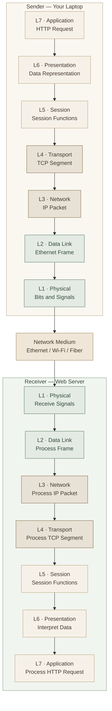
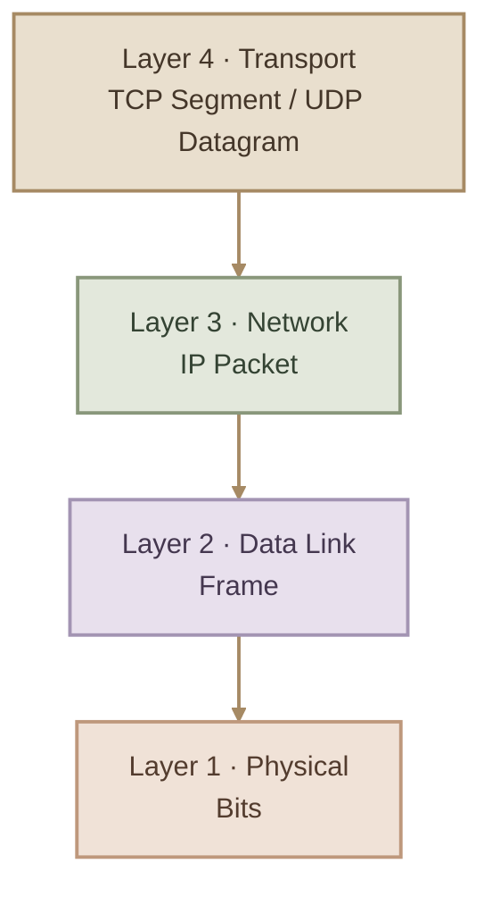

## Overview

الـ **OSI Model (Open Systems Interconnection Model)** هو نموذج مرجعي بيقسّم عملية الاتصال بين الأجهزة إلى **7 Layers**، بحيث كل Layer ليها مسؤوليات محددة وبتتعاون مع الطبقات التانية علشان البيانات توصل من المصدر للوجهة.

تخيّل إنك فاتح Browser وبتدخل على Website موجود على Server بعيد. العملية دي بتحتاج حاجات مختلفة: التطبيق نفسه، تنظيم البيانات، اتصال بين الطرفين، توجيه البيانات عبر الشبكات، نقلها بين الأجهزة المحلية، وأخيرًا إرسال الإشارات الفعلية.

الـ OSI Model بيساعدنا نفهم المسؤوليات دي بشكل منظم بدل ما نتعامل مع الاتصال كله كأنه عملية واحدة.

<InfoCard variant="concept" title="Why Do We Need the OSI Model?" description="بيوفر طريقة موحدة لفهم الشبكات، وتصميم الأنظمة، وشرح البروتوكولات، وتحديد مكان المشكلة أثناء Network Troubleshooting." icon="layers" tags={["7 Layers", "Networking Fundamentals"]} />

## 1. The Seven Layers

الطبقات بترتيبها من أعلى لأسفل:

<CardGrid columns={2} label="OSI Layer Reference">
  <InfoCard variant="concept" title="Layer 7 — Application" description="الخدمات والبروتوكولات اللي بتتعامل مباشرةً مع التطبيقات، زي HTTP وDNS وSSH." icon="cloud" tags={["Application Services"]} />
  <InfoCard variant="concept" title="Layer 6 — Presentation" description="تمثيل البيانات وتنسيقاتها، ومفاهيم زي Encoding وCompression وEncryption." icon="layers" tags={["Data Representation"]} />
  <InfoCard variant="concept" title="Layer 5 — Session" description="إدارة جلسات الاتصال وتنظيم بدايتها واستمرارها وإنهائها." icon="network" tags={["Sessions"]} />
  <InfoCard variant="concept" title="Layer 4 — Transport" description="النقل بين العمليات على الأجهزة، باستخدام آليات زي TCP وUDP وPort Numbers." icon="network" tags={["TCP", "UDP", "Ports"]} />
  <InfoCard variant="concept" title="Layer 3 — Network" description="العنونة المنطقية وتوجيه الـ Packets بين الشبكات باستخدام IP." icon="branch" tags={["IP", "Routing"]} />
  <InfoCard variant="concept" title="Layer 2 — Data Link" description="نقل الـ Frames بين الأجهزة على وصلة الشبكة المحلية، باستخدام عناوين زي MAC في Ethernet." icon="network" tags={["Ethernet", "MAC"]} />
  <InfoCard variant="concept" title="Layer 1 — Physical" description="إرسال واستقبال الإشارات والـ Bits عبر وسط مادي أو لاسلكي." icon="terminal" tags={["Signals", "Cables", "Radio"]} />
</CardGrid>

## 2. Understanding the Layers from Bottom to Top

لفهم النموذج عمليًا، هنبدأ من الطبقة اللي بتتعامل مع الاتصال الفعلي، ونطلع تدريجيًا لحد التطبيق.

### I. Layer 1 — Physical

الـ **Physical Layer** مسؤولة عن نقل الـ Bits على وسط الاتصال الفعلي.

بتتعامل مع خصائص زي الإشارات الكهربائية والضوئية والراديوية، ونوع الوسط المستخدم، وبعض الخصائص الفيزيائية للاتصال.

**Examples:**

- Ethernet cables.
- Fiber-optic cables.
- Wi-Fi radio signals.
- Physical connectors and transmission specifications.

**Troubleshooting examples:**

- كابل Ethernet مفصول.
- كارت الشبكة مش شغال.
- مشكلة في الإشارة أو الـ Link.
- منفذ Switch مش بيعمل Link بسبب مشكلة مادية.

<InfoCard variant="tip" title="Practical Check" description="على Linux، الأمر `ip link` بيساعدك تشوف حالة واجهات الشبكة، لكن حالة الواجهة وحدها مش دليل قاطع على سلامة كل مكونات الاتصال الفيزيائي." icon="terminal" />

### II. Layer 2 — Data Link

الـ **Data Link Layer** مسؤولة عن نقل البيانات في صورة **Frames** عبر وصلة أو شبكة محلية مناسبة.

في Ethernet، بتتعامل مع عناوين **MAC Addresses**، والـ Switch التقليدي بيستخدم عناوين MAC وجدول الـ MAC Address Table علشان يحدد المنفذ المناسب لإرسال الـ Frames.

**Important Concepts:**

- **MAC Address:** عنوان بيُستخدم في تقنيات الشبكة المحلية زي Ethernet.
- **Ethernet Frame:** وحدة البيانات الأساسية في Ethernet على Layer 2.
- **Switching:** توجيه الـ Frames داخل شبكة Layer 2.
- **VLAN:** تقسيم منطقي للشبكة المحلية إلى Broadcast Domains منفصلة.

**Troubleshooting examples:**

- VLAN مش متظبطة صح.
- منفذ Switch موجود في VLAN غلط.
- مشكلة في تعلم عناوين MAC أو في Layer 2 connectivity.

<InfoCard variant="insight" title="Switch vs Router" description="الـ Layer 2 Switch التقليدي بيحوّل Frames باستخدام معلومات Layer 2، بينما الـ Router بيستخدم معلومات Layer 3، زي IP addresses، علشان يوجّه Packets بين الشبكات. فيه أجهزة Multilayer Switch بتدعم الوظيفتين." icon="network" />

### III. Layer 3 — Network

الـ **Network Layer** مسؤولة عن العنونة المنطقية واختيار المسارات بين الشبكات.

أهم مثال هنا هو **IP (Internet Protocol)**. عنوان الـ IP بيساعد في تحديد وجهة الـ Packet، والـ Router بيستخدم جدول التوجيه (Routing Table) علشان يحدد الـ Next Hop أو واجهة الخروج المناسبة.

**Important Concepts:**

- **IPv4 / IPv6:** بروتوكولات العنونة والتوجيه.
- **IP Address:** عنوان منطقي للواجهة داخل الشبكة.
- **Routing:** اختيار المسار المناسب بين الشبكات.
- **ICMP:** بروتوكول بيُستخدم لرسائل التحكم والتشخيص، ومن أمثلته رسائل `ping`.

**Troubleshooting examples:**

- عنوان IP غير صحيح.
- Default Gateway غير مضبوط.
- مفيش Route مناسب للوجهة.
- مشكلة في الوصول بين Subnets مختلفة.

<InfoCard variant="warning" title="Important Distinction" description="وجود IP Address صحيح مش معناه إن الجهاز يقدر يوصل لأي مكان؛ لازم كمان تكون فيه Routes مناسبة، والوجهة قابلة للوصول، وسياسات الشبكة تسمح بالاتصال." icon="shield" />

### IV. Layer 4 — Transport

الـ **Transport Layer** بتتعامل مع الاتصال بين العمليات على الأجهزة المختلفة، وبتستخدم Port Numbers لتمييز الخدمات أو العمليات اللي بتستقبل البيانات.

أشهر بروتوكولين هنا هما TCP وUDP.

<InfoCard variant="comparison" title="TCP vs UDP" description="الاتنين بيشتغلوا على Transport Layer، لكن كل واحد بيقدم طريقة مختلفة لنقل البيانات." icon="network">
  **TCP — Transmission Control Protocol**

  - Connection-oriented.
  - بيوفر نقلًا موثوقًا للبيانات وترتيبًا للـ Bytes وإعادة إرسال بعض البيانات المفقودة.
  - مثال: HTTP/1.1 وHTTP/2 over TCP.

  **UDP — User Datagram Protocol**

  - Connectionless.
  - بيقدم نقل Datagrams من غير ضمان تسليم أو ترتيب من البروتوكول نفسه.
  - مثال: DNS queries في استخدامات شائعة، وReal-time applications.
</InfoCard>

**Important Concepts:**

- **Port Number:** بيساعد في تحديد التطبيق أو الخدمة على الجهاز.
- **TCP Segment:** وحدة بيانات TCP.
- **UDP Datagram:** وحدة بيانات UDP.
- **Segmentation and Reassembly:** تقسيم البيانات وإعادة تجميعها حسب البروتوكول.

**Troubleshooting examples:**

- الخدمة مش بتستقبل على الـ Port المتوقع.
- Firewall بيمنع الاتصال.
- TCP connection مش بتكتمل.
- الخدمة شغالة محليًا لكن مش قابلة للوصول من جهاز آخر.

<InfoCard variant="tip" title="Practical Check" description="على Linux، الأمر `ss -lntup` بيساعدك تفحص الـ Listening Sockets والـ Ports. ملاحظة: بعض تفاصيل العمليات قد تحتاج صلاحيات مناسبة." icon="terminal" />

### V. Layer 5 — Session

الـ **Session Layer** في النموذج النظري مسؤولة عن تنظيم جلسات الاتصال بين التطبيقات، بما يشمل إنشاء الجلسة والمحافظة عليها وإنهاءها، وبعض آليات التحكم في الحوار والاستعادة.

في الشبكات الحديثة، وظائف Session Layer مش دايمًا بتظهر كبروتوكول مستقل؛ غالبًا بتتوزع على التطبيق أو بروتوكولات وطبقات أخرى.

**Examples of concepts:**

- Session establishment and termination.
- Dialog control.
- Session synchronization and recovery.

**Troubleshooting examples:**

- جلسة تطبيق انتهت بشكل غير متوقع.
- التطبيق محتاج يعيد إنشاء Session.
- مشكلة في إدارة الجلسة داخل بروتوكول أو تطبيق معين.

### VI. Layer 6 — Presentation

الـ **Presentation Layer** بتركز على طريقة تمثيل البيانات وتفسيرها بين الأنظمة.

من مسؤولياتها النظرية:

- **Encoding:** تمثيل البيانات بصيغة محددة.
- **Serialization:** تحويل البيانات إلى صيغة مناسبة للنقل والتخزين.
- **Compression:** تقليل حجم البيانات.
- **Encryption:** تشفير البيانات.

في الأنظمة الحقيقية، الوظائف دي ممكن تحصل داخل التطبيق أو مكتبات التشفير أو بروتوكولات مختلفة، مش شرط تكون في Layer مستقلة.

**Examples:**

- JSON وUTF-8 كأمثلة على تنسيقات وتمثيل البيانات.
- ضغط البيانات.
- عمليات التشفير وفك التشفير.

**Troubleshooting examples:**

- مشكلة في Character Encoding.
- الطرف المستقبل مش قادر يفسّر صيغة البيانات.
- مشكلة في إعدادات التشفير أو الشهادات داخل التطبيق.

<InfoCard variant="insight" title="Where Does TLS Fit?" description="في الشرح التقليدي للـ OSI، وظائف التشفير ممكن تتربط بـ Presentation Layer. لكن TLS في الشبكات الحديثة مش تطبيقًا حرفيًا مستقلًا لـ Layer 6؛ الأفضل تفهم الـ OSI كمرجع مفاهيمي، مش خريطة ثابتة لكل بروتوكول." icon="layers" />

### VII. Layer 7 — Application

الـ **Application Layer** هي الطبقة الأقرب للتطبيقات اللي بتستخدم خدمات الشبكة.

هي مش معناها واجهة المستخدم نفسها؛ لكنها بتشمل بروتوكولات الشبكة اللي التطبيقات بتستخدمها للتواصل.

**Examples:**

- **HTTP / HTTPS:** التواصل مع Web Servers.
- **DNS:** الاستعلام عن أسماء النطاقات وتحويلها إلى معلومات DNS، ومنها عناوين IP.
- **SSH:** الوصول والإدارة عن بُعد بشكل آمن.
- **SMTP:** إرسال البريد الإلكتروني.

**Troubleshooting examples:**

- DNS query بترجع نتيجة غير متوقعة.
- Web Server بيرجع HTTP 500.
- التطبيق بيستخدم URL أو إعدادات غير صحيحة.
- الخدمة بتستقبل الاتصال لكن بترجع خطأ على مستوى التطبيق.

## 3. How the Seven Layers Work Together

لما تبعت Request من جهازك إلى Web Server، البيانات بتمر بمراحل مختلفة. في جهاز الإرسال، كل طبقة بتجهّز البيانات أو تضيف معلومات مناسبة لوظيفتها، والعملية دي اسمها **Encapsulation**.

في جهاز الاستقبال، البيانات بتتعالج في الاتجاه العكسي، والطبقات بتستخدم المعلومات المناسبة لاستخراج البيانات وتسليمها للطبقة الأعلى. وده اسمه **Decapsulation**.



**Important:** الرسم ده بيوضح الفكرة النظرية للـ OSI. في الـ TCP/IP stack المستخدم فعليًا، وظائف Session وPresentation غالبًا بتكون مدمجة ضمن Application Layer، ومش كل طبقة في الرسم بتتحول إلى بروتوكول مستقل.

## 4. Protocol Data Units (PDUs)

الـ **PDU (Protocol Data Unit)** هو الاسم اللي بنستخدمه لوصف وحدة البيانات في طبقة معينة.

| OSI Layer | Common PDU Term | Example |
| --- | --- | --- |
| Layer 7 — Application | Data | HTTP Request |
| Layer 6 — Presentation | Data | Encoded application data |
| Layer 5 — Session | Data | Session-related data |
| Layer 4 — Transport | Segment / Datagram | TCP Segment / UDP Datagram |
| Layer 3 — Network | Packet | IP Packet |
| Layer 2 — Data Link | Frame | Ethernet Frame |
| Layer 1 — Physical | Bits | Bits transmitted as signals |

التسميات في بعض المراجع بتختلف، خصوصًا في الطبقات العليا؛ لذلك أهم حاجة تحفظها بثقة هي:



## 5. OSI vs TCP/IP Model

الـ OSI Model بيقسّم الاتصال إلى سبع طبقات، بينما الـ **TCP/IP Model** بيستخدم عادةً أربع طبقات في أحد أشهر أشكاله.

<CardGrid columns={2} label="Model Comparison">
  <InfoCard variant="concept" title="OSI Model" description="نموذج مرجعي مكوّن من سبع طبقات، مفيد لفهم المسؤوليات وتنظيم Network Troubleshooting." icon="layers" tags={["7 Layers", "Reference Model"]} />
  <InfoCard variant="concept" title="TCP/IP Model" description="نموذج عملي لفهم بنية الإنترنت والبروتوكولات المستخدمة في الشبكات الحديثة." icon="network" tags={["4-Layer Model", "Internet Protocols"]} />
</CardGrid>

| OSI Model | Common 4-Layer TCP/IP Model |
| --- | --- |
| Application (L7) | Application |
| Presentation (L6) | Application |
| Session (L5) | Application |
| Transport (L4) | Transport |
| Network (L3) | Internet |
| Data Link (L2) | Network Access / Link |
| Physical (L1) | Network Access / Link |

ملحوظة: فيه مراجع بتعرض TCP/IP في خمس طبقات، وبتفصل Physical عن Data Link. ده اختلاف في طريقة العرض، مش تناقض في طريقة عمل الإنترنت.

## 6. Using OSI for Network Troubleshooting

أهم فايدة عملية للـ OSI Model إنك تقدر ترتّب تفكيرك لما تواجه مشكلة اتصال.

<InfoCard variant="warning" title="Troubleshooting Principle" description="ما تفترضش إن المشكلة في Layer معينة لمجرد إن العرض يشبهها. استخدم الاختبارات والنتائج الفعلية لتضييق نطاق الاحتمالات." icon="shield" />

### I. Example: A Website Is Not Reachable

<CardGrid columns={2} label="Troubleshooting Checklist">
  <InfoCard variant="concept" title="L1 — Physical" description="افحص الكابل، الـ Link، أو حالة الاتصال اللاسلكي." icon="network" tags={["Link"]} />
  <InfoCard variant="concept" title="L2 — Data Link" description="راجع الاتصال المحلي والـ VLAN والـ Switch Port عند الحاجة." icon="network" tags={["Local Network"]} />
  <InfoCard variant="concept" title="L3 — Network" description="افحص IP Address وRoutes وDefault Gateway." icon="branch" tags={["IP", "Routing"]} />
  <InfoCard variant="concept" title="L4 — Transport" description="تأكد من إمكانية الوصول إلى الـ TCP Port المطلوب، وافحص Firewall rules." icon="terminal" tags={["TCP", "Ports"]} />
  <InfoCard variant="concept" title="L7 — Application" description="افحص DNS وHTTP responses وسجلات التطبيق وإعدادات الخدمة." icon="cloud" tags={["DNS", "HTTP"]} />
</CardGrid>

### II. Useful Linux Commands

```bash
# Inspect network interfaces and IP addresses
ip addr

# Inspect interface link state
ip link

# Inspect routing table
ip route

# Inspect listening TCP and UDP sockets
ss -lntup

# Test reachability using ICMP where permitted
ping -c 4 1.1.1.1

# Test DNS resolution
getent hosts example.com

# Test HTTP or HTTPS connectivity
curl -I https://example.com
```

كل أمر بيساعدك تفحص جانبًا معينًا من الاتصال، لكن مفيش أمر واحد بيختبر كل طبقات OSI. مثلًا، نجاح `ping` مش معناه بالضرورة إن HTTP شغال، وفشل `ping` مش دليل قاطع إن السيرفر غير قابل للوصول؛ ممكن ICMP يكون محجوبًا.

## 7. Common Misconceptions

<InfoCard variant="insight" title="OSI Is a Conceptual Model" description="مش كل بروتوكول أو جهاز في العالم الحقيقي بيتطابق بشكل مثالي مع Layer واحدة. النموذج وسيلة للفهم والتحليل، والأنظمة الحديثة ممكن تنفذ وظائف من طبقات مختلفة في نفس المكوّن." icon="layers" />

<InfoCard variant="insight" title="Routers and Switches" description="الـ Router التقليدي بيشتغل أساسًا على Layer 3، والـ Ethernet Switch التقليدي على Layer 2. لكن فيه أجهزة بتجمع وظائف من أكتر من طبقة." icon="network" />

<InfoCard variant="insight" title="Ports vs IP Addresses" description="الـ IP Address بيساعد في تحديد وجهة الشبكة أو الواجهة، بينما الـ Port Number بيساعد في تحديد الخدمة أو العملية داخل الجهاز. الاتنين بيكملوا بعض." icon="terminal" />

## 8. Key Takeaways

<CardGrid columns={2} label="OSI Model Summary">
  <InfoCard variant="summary" title="L1 — Physical" description="Bits and transmission signals." icon="network" />
  <InfoCard variant="summary" title="L2 — Data Link" description="Frames, MAC addresses, and local links." icon="network" />
  <InfoCard variant="summary" title="L3 — Network" description="IP addressing and routing." icon="branch" />
  <InfoCard variant="summary" title="L4 — Transport" description="TCP, UDP, and ports." icon="terminal" />
  <InfoCard variant="summary" title="L5 — Session" description="Session management concepts." icon="layers" />
  <InfoCard variant="summary" title="L6 — Presentation" description="Data representation and transformation." icon="layers" />
  <InfoCard variant="summary" title="L7 — Application" description="Network services used by applications." icon="cloud" />
</CardGrid>
