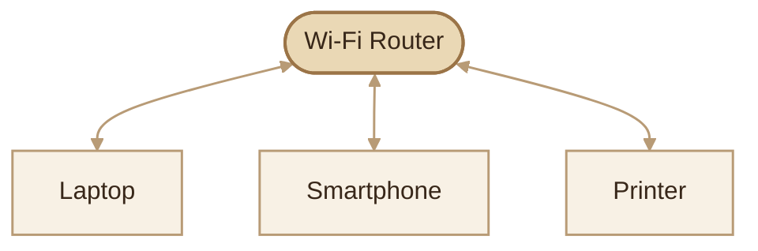
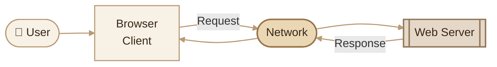
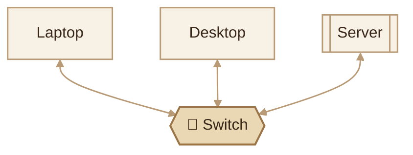
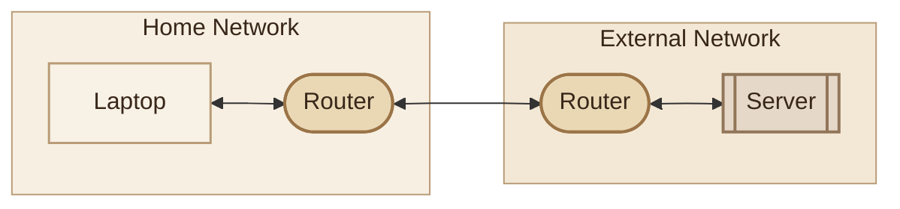
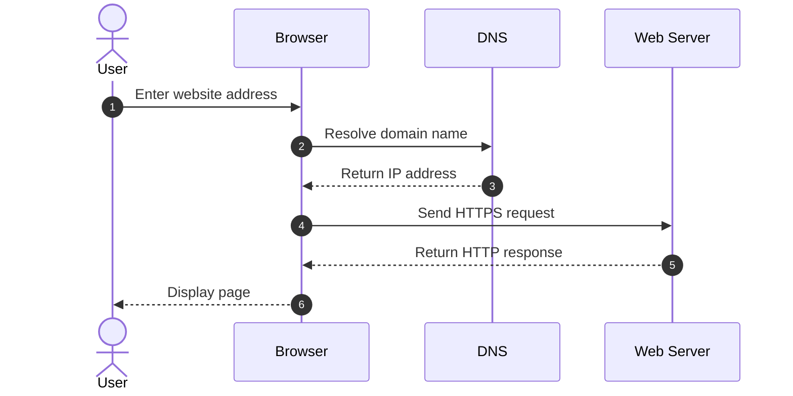
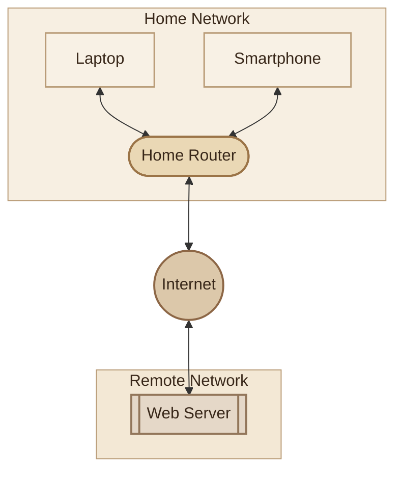

## Learning Objectives

- فهم مفهوم الـ Computer Network وأهميتها.
- التمييز بين الـ Wired وWireless Networks.
- فهم الأدوار الأساسية للـ Client والـ Server والـ Switch والـ Router.
- فهم الفرق بين الـ Network والـ Internet.
- تفسير ليه اتصال الأجهزة ببعض مش معناه بالضرورة إنها تقدر تتواصل بنجاح.
- ربط المفاهيم دي بمشاكل الشبكات اللي بتواجه مهندس DevOps.

---

## 1. What Is a Computer Network?

الـ **Computer Network** هي مجموعة من الأجهزة المتصلة ببعض، بحيث تقدر تتبادل البيانات والموارد باستخدام مجموعة من القواعد والبروتوكولات المعروفة باسم **Network Protocols**.

تخيّل إن عندك Laptop وموبايل وسيرفر. كل جهاز ممكن يكون له وظيفة مختلفة، لكن الشبكة بتسمح للأجهزة دي بالتواصل مع بعضها حسب إعداداتها وطريقة اتصالها.

<InfoCard title="Network" description="A collection of interconnected devices that communicate and share resources." icon="network">
ببساطة، الـ Network بتخلّي الأجهزة تتبادل البيانات بدل ما كل جهاز يشتغل بمعزل عن باقي الأجهزة.
</InfoCard>

### I. Why Do We Need Networks?

بنستخدم الشبكات علشان نقدر:

- **Share Files:** نتبادل الملفات بين الأجهزة.
- **Share Resources:** نستخدم موارد مشتركة، زي الطابعات.
- **Access Services:** نوصل لتطبيقات وسيرفرات موجودة على أجهزة تانية.
- **Communicate:** نبعت ونستقبل البيانات بين الأنظمة.
- **Access the Internet:** نتصل بالخدمات والمواقع الموجودة على الإنترنت.

### II. A Simple Home Network

خلينا نشوف مثال لشبكة منزلية فيها أجهزة متصلة عن طريق Wi-Fi Router.

الرسم بيوضح فكرة الاتصال داخل شبكة منزلية. لكن وجود الأجهزة على نفس الشبكة مش ضمان لوحده لنجاح كل أنواع التواصل؛ لأن ده بيعتمد على إعدادات الشبكة والخدمات وقواعد الأمان.

---

## 2. Network Communication Methods

فيه طريقتان شائعتان لاتصال الأجهزة داخل الشبكات: الاتصال السلكي والاتصال اللاسلكي.

### I. Wired Network

الـ **Wired Network** هي شبكة بتستخدم وسائل اتصال مادية، زي كابلات Ethernet، لربط الأجهزة ببعض.

<InfoCard title="Ethernet" description="A family of technologies commonly used for wired local area networks." icon="network">
بتشوف Ethernet كتير في توصيل أجهزة الكمبيوتر بالسويتشات، وفي توصيل السيرفرات بشبكات الداتا سنتر.
</InfoCard>

من مميزات الاتصال السلكي:

- اتصال مستقر في ظروف كتير.
- سرعات عالية حسب نوع المعدات والكابلات.
- ملائم للسيرفرات والأجهزة اللي محتاجة اتصال ثابت.

### II. Wireless Network

الـ **Wireless Network** بتسمح للأجهزة بالتواصل لاسلكيًا، باستخدام تقنيات زي Wi-Fi.

<InfoCard title="Wi-Fi" description="Wireless networking technology that allows compatible devices to connect to a local network." icon="network">
بتستخدم Wi-Fi علشان توصل اللابتوب والموبايل بالشبكة من غير الحاجة إلى كابل Ethernet لكل جهاز.
</InfoCard>

من مميزات الاتصال اللاسلكي سهولة الاتصال والتنقل، لكن جودة الاتصال ممكن تتأثر بالمسافة والعوائق والتداخل اللاسلكي.

### III. Wired vs Wireless

<InfoCard title="Wired Network" description="Physical connectivity through cables." icon="wrench" tags={["Ethernet", "Cabled"]}>
- اتصال مادي باستخدام الكابلات.
- مناسب لأجهزة كتير بتحتاج اتصالًا ثابتًا.
- جودة الاتصال بتعتمد على الكابلات والمعدات وإعداداتها.
</InfoCard>

<InfoCard title="Wireless Network" description="Connectivity using wireless communication." icon="network" tags={["Wi-Fi", "Wireless"]}>
- اتصال لاسلكي من غير كابل مخصص لكل جهاز.
- مناسب للموبايلات واللابتوبات والأجهزة المتحركة.
- جودة الاتصال بتتأثر بالتغطية والتداخل والعوائق.
</InfoCard>

---

## 3. Essential Network Components

علشان نفهم الشبكات، لازم نفرّق بين أدوار الأجهزة والمكونات الأساسية.

### I. Client and Server

الـ **Client** هو جهاز أو برنامج بيطلب خدمة أو بيانات، أما الـ **Server** فهو جهاز أو برنامج بيقدم خدمة أو بيانات.

مثال: لما تفتح موقع من المتصفح، المتصفح بيعمل دور الـ Client، والبرنامج اللي بيستقبل الطلبات على السيرفر بيعمل دور الـ Server.

**مهم:** الـ Client والـ Server أدوار في الاتصال، مش شرط يكونوا نوعين مختلفين من الأجهزة. نفس الجهاز ممكن يطلب خدمة من سيرفر، وفي نفس الوقت يقدم خدمة لجهاز آخر.

### II. Switch

الـ **Switch** بيستخدم عادةً لربط الأجهزة داخل شبكة محلية، وبيوجّه إطارات Ethernet المعروفة باسم **Frames** اعتمادًا على عناوين MAC.

### III. Router

الـ **Router** وظيفته الأساسية توجيه حزم البيانات المعروفة باسم **IP Packets** بين شبكات IP المختلفة، باستخدام معلومات الـ Routing.

مثلًا، ممكن يكون فيه Router بيربط شبكة الشركة بشبكة أخرى، أو بيربط شبكة المنزل بالإنترنت.

### IV. Access Point

الـ **Wireless Access Point (AP)** بيسمح للأجهزة اللاسلكية بالاتصال بالشبكة من خلال Wi-Fi.

في البيت، غالبًا هتلاقي وظيفة الـ Access Point مدمجة داخل الـ Wi-Fi Router.

### V. Firewall

الـ **Firewall** بيطبّق قواعد للتحكم في حركة مرور الشبكة، وبيسمح باتصالات معينة أو يمنعها حسب القواعد المعرّفة.

<InfoCard title="Core Difference" description="Switching and routing solve different networking problems." icon="network">
الـ Switch بيربط الأجهزة داخل الشبكة المحلية، والـ Router بيوجّه البيانات بين الشبكات. أما الـ Firewall فوظيفته الأساسية التحكم في الاتصالات وفقًا لقواعد الأمان.
</InfoCard>

---

## 4. How Do Devices Communicate?

الأجهزة مش بتتبادل البيانات بشكل عشوائي. التواصل بيتم باستخدام **Protocols**، وهي قواعد بتحدد إزاي البيانات تتنظم وتتبادل وإزاي كل طرف يتعامل معاها.

أمثلة مهمة هنشرحها بالتفصيل في الدروس الجاية:

| Protocol | Purpose |
|---|---|
| IP | عنونة الحزم وتوجيهها بين الشبكات |
| TCP | نقل موثوق ومرتب للبيانات |
| UDP | نقل البيانات من غير ضمان التسليم أو الترتيب |
| DNS | المساعدة في تحويل أسماء النطاقات إلى عناوين IP |
| HTTP | التواصل بين عملاء الويب والسيرفرات |
| HTTPS | استخدام HTTP مع حماية الاتصال بواسطة TLS |

### I. Example: Opening a Website

لما تكتب اسم موقع في المتصفح، جهازك بيحتاج يحدد عنوان السيرفر ويتواصل معاه علشان يبعت طلب ويستقبل الاستجابة.

ده تسلسل مبسط. التفاصيل الفعلية بتختلف حسب الـ DNS Cache، وطريقة إنشاء الاتصال، والبروتوكول المستخدم، وإمكانية إعادة استخدام اتصال سابق.

---

## 5. Network vs Internet

كلمة **Network** معناها شبكة من الأجهزة المتصلة، أما **Internet** فهو نظام عالمي من الشبكات المترابطة اللي بتتواصل باستخدام بروتوكولات مشتركة.

<InfoCard title="Network" description="A connected group of devices that can communicate according to its configuration." icon="network">
ممكن تكون شبكة منزلية أو شبكة شركة أو شبكة خاصة داخل بيئة Cloud.
</InfoCard>

<InfoCard title="Internet" description="A global system of interconnected networks." icon="cloud">
الإنترنت بيربط عددًا ضخمًا من الشبكات ببعض، وبيسمح بالوصول إلى خدمات موجودة في أماكن مختلفة حول العالم.
</InfoCard>

### I. How They Relate

**معلومة مهمة:** انقطاع الإنترنت مش معناه بالضرورة إن الشبكة المحلية توقفت. ممكن الأجهزة تفضل تتواصل محليًا طالما الشبكة والخدمات المطلوبة شغالة وإعداداتها بتسمح بالاتصال.

---

## 6. Does Connectivity Guarantee Communication?

لأ. مجرد إن جهازين متوصلين ببعض مش معناه إن التواصل بينهم هيكون ناجح في كل الحالات.

نجاح الاتصال ممكن يعتمد على:

- **Physical Connectivity:** سلامة الكابل أو الاتصال اللاسلكي.
- **IP Configuration:** إعدادات العناوين المناسبة.
- **Routing:** وجود مسار مناسب لو الاتصال محتاج المرور بين شبكات مختلفة.
- **Firewall Rules:** السماح بالاتصال المطلوب.
- **Service Availability:** وجود الخدمة المطلوبة وهي بتستقبل الاتصالات بالشكل المتوقع.

<InfoCard title="Troubleshooting Principle" description="Connectivity is only one part of successful communication." icon="shield">
لو الاتصال فشل، متفترضش فورًا إن الكابل بايظ أو التطبيق فيه مشكلة. لازم تحدد فين الفشل وتجمع أدلة قبل ما تختار الحل.
</InfoCard>

هنشرح عناوين IP والـ Subnet Mask والـ Routing بالتدريج، قبل ما نعتمد عليهم في أمثلة متقدمة.

---

## 7. Why Networking Matters in DevOps

في شغل DevOps، ممكن تعمل Deploy لتطبيق ويكون شغال فعلًا، لكن المستخدم مش قادر يوصل إليه.

المشكلة ممكن تكون في التطبيق، أو إعدادات Docker، أو الـ Port Mapping، أو DNS، أو Routing، أو Firewall.

### I. Real-World Scenarios

<InfoCard title="Docker Networking" description="Containers need appropriate network connectivity to communicate with each other and external clients." icon="cube">
تشغيل الـ Container مش ضمان إن التطبيق متاح للمستخدم. لازم تفهم الشبكة وعناوين الاستماع والـ Port Mapping.
</InfoCard>

<InfoCard title="Kubernetes Networking" description="Pods and Services depend on networking configuration to provide connectivity." icon="network">
مشاكل الوصول إلى الـ Services أو الـ Pods ممكن تكون مرتبطة بإعدادات الشبكة أو سياسات الاتصال أو اكتشاف الخدمات.
</InfoCard>

<InfoCard title="Cloud Networking" description="Cloud applications depend on routing, network boundaries, and security rules." icon="cloud">
في بيئات Cloud، لازم تفهم إزاي الشبكات والـ Subnets والـ Routing وقواعد الأمان بتتحكم في الوصول إلى الخدمات.
</InfoCard>

---

## 8. Key Takeaways

<InfoCard title="Computer Network" description="Devices connected to communicate and share resources." icon="network">
الشبكة بتسمح للأجهزة بتبادل البيانات باستخدام بروتوكولات وإعدادات مناسبة.
</InfoCard>

<InfoCard title="Switch vs Router" description="Connecting devices vs routing between networks." icon="branch">
الـ Switch بيربط الأجهزة داخل الشبكة المحلية، والـ Router بيوجّه البيانات بين الشبكات.
</InfoCard>

<InfoCard title="Network vs Internet" description="A network can exist without Internet access." icon="network">
ممكن شبكة محلية تشتغل وتسمح بالتواصل بين الأجهزة حتى لو اتصال الإنترنت فاصل.
</InfoCard>

<InfoCard title="DevOps Connection" description="Deployment success does not automatically guarantee network accessibility." icon="terminal">
فهم الشبكات ضروري لتشخيص مشاكل الوصول إلى التطبيقات في Docker وKubernetes وCloud.
</InfoCard>

---

