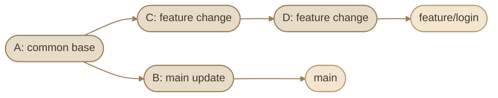
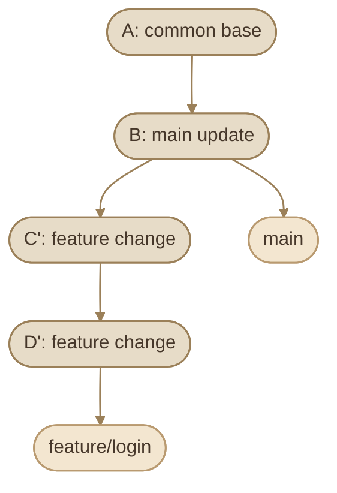

## Introduction

في المواضيع السابقة، اتعلمنا إزاي نعمل commits وننظم branches ونتعامل مع الـ remote repositories. دلوقتي هنركز على أدوات بتساعدنا نفهم تاريخ Git بشكل أعمق، وننظم commits قبل الدمج، وننقل تغييرات محددة بين الفروع، ونحقق في المشاكل.

الأدوات دي مش كلها بتعمل نفس الحاجة:

<CardGrid columns={3} label="History Toolkit">
<InfoCard variant="concept" title="git rebase" description="بيعيد تطبيق commits على نقطة بداية مختلفة." icon="cycle" tags={["Replay", "History"]} />

<InfoCard variant="concept" title="git merge" description="بيدمج تاريخ فرعين في بعض." icon="git-merge" tags={["Combine"]} />

<InfoCard variant="concept" title="git rebase -i" description="بيسمح بإعادة تنظيم commits قبل مشاركتها." icon="sliders" tags={["Interactive"]} />

<InfoCard variant="concept" title="git cherry-pick" description="بينقل التغييرات اللي بيمثلها commit محدد إلى الفرع الحالي." icon="git-pull-request" tags={["Pick", "Port"]} />

<InfoCard variant="concept" title="git bisect" description="بيساعدنا نحدد commit أدخل bug باستخدام البحث الثنائي." icon="flag" tags={["Find Bug"]} />

<InfoCard variant="concept" title="git blame" description="بيوضح آخر commit غيّر كل سطر في ملف." icon="code" tags={["Line History"]} />

<InfoCard variant="concept" title="Detached HEAD" description="حالة في Git بتخليك واقف على commit مباشرة بدل branch عادي." icon="branch" tags={["State"]} />
</CardGrid>

## 1. Understanding `git rebase`

الـ **Rebase** بيعيد تطبيق مجموعة commits فوق نقطة بداية جديدة.

افترض إن عندك branch اسمه `feature/login` اتعمل من `main`، وبعدها `main` اتحرك لقدام بسبب commits جديدة. تقدر تستخدم rebase عشان تعيد تطبيق commits الخاصة بالـ feature فوق أحدث commit في `main`.

### I. Before Rebase



الـ branchين عندهم commit مشترك `A`، وبعده كل فرع اتحرك في اتجاه مختلف.

### II. Perform the Rebase

```bash
# Switch to the feature branch
git switch feature/login

# Replay feature commits on top of main
git rebase main
```

Git هيحدد commits الخاصة بالـ feature بعد نقطة الالتقاء المشتركة، ويحاول يعيد تطبيقها فوق `main`.

### III. After Rebase



الرمز `C'` و`D'` بيوضح إن دي commits جديدة ناتجة عن إعادة تطبيق التغييرات، حتى لو محتواها قريب جدًا من commits الأصلية.

### IV. What Changes During Rebase?

الـ commits المعاد تطبيقها بتحصل على commit IDs جديدة لأن الـ commit identity بتعتمد على بيانات منها الـ parent commit والـ metadata والـ content.

ده معناه إن:

<CardGrid columns={2} label="What Rebase Changes">
<InfoCard variant="concept" title="Content" description="محتوى التغييرات ممكن يفضل كما هو." icon="code" tags={["Changes"]} />

<InfoCard variant="concept" title="Commit Hashes" description="الـ commit hashes بتتغير غالبًا للـ commits اللي اتعاد تطبيقها." icon="cycle" tags={["New IDs"]} />

<InfoCard variant="concept" title="History Shape" description="التاريخ بيتعاد تنظيمه بحيث يظهر خطيًا في الحالة البسيطة." icon="git-merge" tags={["Linear"]} />

<InfoCard variant="warning" title="Conflicts" description="لو حصل تعارض، لازم تحله قبل ما يكمل Git العملية." icon="shield" tags={["Resolve"]} />
</CardGrid>

### V. Handling Conflicts

لو Git وقف بسبب conflict أثناء rebase، افحص الحالة أولًا:

```bash
git status
```

افتح الملفات المتعارضة، وحدد المحتوى الصحيح، واحذف conflict markers بعد حل التعارض.

بعدها:

```bash
git add path/to/resolved-file
git rebase --continue
```

لو ظهر تعارض آخر، كرر خطوات الحل.

لو قررت إلغاء عملية rebase والرجوع لحالة ما قبلها:

```bash
git rebase --abort
```

<InfoCard variant="concept" title="Note" icon="flag">

<InfoCard variant="concept" title="Note" icon="flag">

**مهم:** `git rebase --abort` بيُلغي عملية rebase الحالية، مش أي rebase انتهى بالفعل.

</InfoCard>

</InfoCard>

### VI. When to Use Rebase

استخدم rebase لما تحتاج:

<CardGrid columns={3} label="When Rebase Helps">
<InfoCard variant="concept" title="Update a Feature" description="تحدّث feature branch فوق آخر نسخة من branch آخر." icon="cycle" tags={["Update"]} />

<InfoCard variant="concept" title="Organize Commits" description="تنظّم تاريخ commits قبل مشاركته." icon="sliders" tags={["Cleanup"]} />

<InfoCard variant="concept" title="Keep It Linear" description="تحافظ على تاريخ خطي لو ده أسلوب المشروع." icon="git-merge" tags={["Linear"]} />
</CardGrid>

تجنب إعادة كتابة تاريخ branch مشترك بيشتغل عليه أشخاص آخرون، إلا لو الفريق متفق على الإجراء وعارف تأثيره.

## 2. Merge vs Rebase

كل من `merge` و`rebase` بيساعدك تدمج شغل فرعين، لكن طريقة التعامل مع التاريخ مختلفة.

### I. Git Merge

الـ merge بيجمع تاريخ الفرعين. لو الفرعين اتحركوا من نقطة مشتركة وكان عندهم commits مستقلة، Git غالبًا هيعمل merge commit يحتوي على الفرعين كـ parents.

```bash
git switch main
git merge feature/login
```

الـ merge ممكن يكون fast-forward لو الفرع المستهدف مفيهوش commits جديدة خارج تاريخ الفرع اللي بتدمجه.

### II. Git Rebase

الـ rebase بيعيد تطبيق commits الفرع الحالي فوق نقطة بداية جديدة:

```bash
git switch feature/login
git rebase main
```

بعدها تقدر تدمج الـ feature في `main`. لو `main` لسه عند نفس النقطة اللي اتعمل عليها rebase، ممكن الدمج يحصل fast-forward.

### III. Comparison

<TableCard title="Merge vs Rebase" caption="الاتنين بيعدّلوا التاريخ، لكن بطرق مختلفة تمامًا.">
<TableCard>
| Aspect | Merge | Rebase |
|---|---|---|
| History | بيحافظ على تاريخ التفرع، وقد ينشئ merge commit | بيعيد تطبيق commits وبيغيّر هويتها |
| Commit Hashes | بيحافظ على commits الموجودة | الـ commits المعاد تطبيقها بتحصل على hashes جديدة |
| Conflict Handling | التعارض بيتحل أثناء عملية الدمج | التعارض ممكن يظهر أثناء إعادة تطبيق كل commit |
| Shared Branches | غالبًا مناسب لدمج التغييرات المشتركة | يحتاج حذرًا لو هيعيد كتابة تاريخ مشترك |
| History Shape | ممكن يحتوي على تفرعات وmerge commits | ممكن ينتج تاريخ خطي |
| Typical Use | دمج feature branch مع الاحتفاظ بسياق التفرع | تحديث feature branch أو تنظيم commits قبل مشاركتها |
</TableCard>
</TableCard>

### IV. Visual Comparison

```mermaid
flowchart TD
    subgraph Merge(["Merge"])
        direction LR
        M1(["A"]) --> M2(["B"])
        M1 --> M3(["C"])
        M2 --> M4(["Merge commit"])
        M3 --> M4
    end

    subgraph Rebase(["Rebase"])
        direction LR
        R1(["A"]) --> R2(["B"])
        R2 --> R3(["C'"])
        R3 --> R4(["D'"])
    end

    classDef commit fill:#E7DCC8,stroke:#9B8059,color:#46372A,stroke-width:1.5px
    class M1,M2,M3,M4,R1,R2,R3,R4 commit

    linkStyle default stroke:#9B8059,stroke-width:1.5px
```

المخطط توضيحي: في مثال الـ merge، الفرعان بيتجمعوا في merge commit. في مثال الـ rebase، commits الخاصة بالفرع بتتطبق فوق تاريخ جديد.

### V. Which One Should You Choose?

اختيارك بيعتمد على سياسة المشروع:

<CardGrid columns={3} label="Merge vs Rebase Decision">
<InfoCard variant="comparison" title="Choose Merge" description="لو الفريق عايز يحتفظ بسياق التفرعات والدمج، فالـ merge اختيار طبيعي." icon="git-merge" tags={["Team Context"]} />

<InfoCard variant="comparison" title="Choose Rebase" description="لو عايز تحدّث feature branch بتاريخ خطي قبل الدمج، فالـ rebase ممكن يكون مناسبًا." icon="cycle" tags={["Linear"]} />

<InfoCard variant="comparison" title="Follow PR Policy" description="لو المشروع بيستخدم Pull Requests، اتبع سياسة الفريق الخاصة بـ merge commit أو squash merge أو rebase merge." icon="git-pull-request" tags={["Pull Requests"]} />
</CardGrid>

مش مطلوب تختار واحدة وتمنع التانية تمامًا؛ ممكن تستخدم rebase لتحديث feature branch، وبعدها تعمل merge وفقًا لسياسة المشروع.

## 3. Interactive Rebase

الـ **Interactive Rebase** بيسمح لك تراجع مجموعة commits وتعيد تنظيمها قبل ما تشارك التاريخ النهائي.

من استخداماته:

<CardGrid columns={3} label="Interactive Rebase Uses">
<InfoCard variant="concept" title="Reword" description="تغيير commit messages." icon="code" tags={["Messages"]} />

<InfoCard variant="concept" title="Squash" description="دمج commits صغيرة في commit واحدة." icon="layers" tags={["Combine"]} />

<InfoCard variant="concept" title="Reorder" description="إعادة ترتيب commits." icon="sliders" tags={["Order"]} />

<InfoCard variant="concept" title="Edit" description="تعديل محتوى commit سابقة." icon="wrench" tags={["Amend"]} />

<InfoCard variant="warning" title="Drop" description="حذف commit غير مطلوبة من التاريخ المحلي." icon="shield" tags={["Remove"]} />
</CardGrid>

ابدأ بعرض التاريخ:

```bash
git log --oneline --graph --decorate -10
```

لو عايز تراجع آخر 4 commits:

```bash
git rebase -i HEAD~4
```

Git هيفتح محرر نصوص يعرض قائمة commits. الأوامر المتاحة بتكون موضحة داخل الملف نفسه.

### I. Common Interactive Rebase Commands

<TableCard title="Interactive Rebase Commands" caption="الأوامر المتاحة داخل الـ todo list.">
<TableCard>
| Command | Meaning |
|---|---|
| `pick` | الاحتفاظ بالـ commit كما هي |
| `reword` | تعديل رسالة الـ commit |
| `edit` | التوقف عند الـ commit لتعديلها |
| `squash` | دمج التغيير مع الـ commit السابقة مع إمكانية تحرير الرسائل |
| `fixup` | دمج التغيير مع الـ commit السابقة مع تجاهل رسالة الـ commit الحالية |
| `drop` | حذف الـ commit من التاريخ المعاد بناؤه |
</TableCard>
</TableCard>

### II. Example: Reword a Commit

لو عندك:

```text
pick a12bc34 add login
pick b23cd45 fix typo
pick c34de56 update tests
```

وتريد تغيير رسالة الـ commit الثانية، عدّل السطر إلى:

```text
pick a12bc34 add login
reword b23cd45 fix typo
pick c34de56 update tests
```

احفظ الملف واقفله، وبعدها Git هيسمح لك بتعديل رسالة الـ commit المحددة.

### III. Example: Edit a Commit

غيّر `pick` إلى `edit` عند الـ commit المطلوبة. لما Git يوقف العملية:

```bash
# Modify the relevant files
git add path/to/file

# Amend the stopped commit
git commit --amend
```

بعد ما تخلص التعديل:

```bash
git rebase --continue
```

استخدم `git status` لو احتجت تعرف حالة العملية الحالية.

### IV. Important Safety Rules

<CardGrid columns={2} label="Interactive Rebase Safety">
<InfoCard variant="tip" title="Review First" description="راجع الـ commits قبل بدء interactive rebase." icon="pulse" tags={["Inspect"]} />

<InfoCard variant="warning" title="Understand drop" icon="shield" tags={["Caution"]}>

ما تستخدمش `drop` لمجرد إنك مش فاهم commit معينة؛ افهم تأثير حذفها الأول.

</InfoCard>

<InfoCard variant="tip" title="Abort Is Available" icon="git-merge" tags={["Abort"]}>

لو العملية لسه شغالة، `git rebase --abort` بيلغيها.

</InfoCard>

<InfoCard variant="warning" title="Shared History" description="تجنّب إعادة كتابة commits منشورة على branch مشترك إلا باتفاق واضح مع الفريق." icon="flag" tags={["Shared Branch"]} />
</CardGrid>

## 4. Squashing Commits

الـ **Squashing** هو دمج تغييرات عدة commits في commit واحدة.

أحيانًا أثناء التطوير تعمل commits زي:

```text
add login form
fix login spacing
fix validation
fix tests
```

لو دي كلها خطوات صغيرة لنفس التغيير، ممكن يكون من الأفضل دمجها في commit واحدة واضحة قبل الدمج النهائي، حسب سياسة المشروع.

### I. Squash Using Interactive Rebase

ابدأ بمراجعة التاريخ:

```bash
git log --oneline -5
```

لو عايز تعيد تنظيم آخر 4 commits:

```bash
git rebase -i HEAD~4
```

هيظهر شيء مشابه:

```text
pick a12bc34 add login form
pick b23cd45 fix login spacing
pick c34de56 fix validation
pick d45ef67 fix tests
```

خلي أول commit `pick`، واستخدم `squash` أو `fixup` للباقي:

```text
pick a12bc34 add login form
squash b23cd45 fix login spacing
squash c34de56 fix validation
squash d45ef67 fix tests
```

احفظ التعديلات واتبع تعليمات Git لإنشاء رسالة الـ commit النهائية.

### II. Squash vs Fixup

<CardGrid columns={2} label="Squash vs Fixup">
<InfoCard variant="concept" title="squash" description="بيدمج التغييرات وبيسمح لك تراجع رسائل الـ commits وتكتب رسالة نهائية." icon="layers" tags={["Keep Message"]} />

<InfoCard variant="concept" title="fixup" description="بيدمج التغييرات مع الـ commit السابقة وبيتجاهل رسالة الـ commit اللي بتتدمج." icon="wrench" tags={["Drop Message"]} />
</CardGrid>

### III. Squash Merge vs Interactive Rebase

المصطلحين مرتبطين لكن مش متطابقين:

<CardGrid columns={2} label="Squash Approaches">
<InfoCard variant="concept" title="Interactive Rebase Squashing" icon="sliders" tags={["Local History"]}>

بتعيد تنظيم تاريخ commits في branch باستخدام `git rebase -i`.

</InfoCard>

<InfoCard variant="concept" title="Squash Merge" description="أسلوب دمج بيجمع تغييرات branch في commit واحدة على الفرع المستهدف، وغالبًا بيتنفذ من واجهة GitHub أو بأوامر Git مناسبة." icon="git-merge" tags={["Single Commit"]} />
</CardGrid>

اختيار squash merge في Pull Request مش معناه بالضرورة إن تاريخ الفرع الأصلي اتغير؛ الفرع المصدر ممكن يفضل محتفظًا بالـ commits القديمة.

## 5. `git cherry-pick`

الـ **Cherry-pick** بيسمح لك تطبق التغيير اللي بيمثله commit محدد على الفرع الحالي، من غير ما تدمج الفرع المصدر بالكامل.

مثال: عندك bug fix اتعمل على `feature/payment`، وعايز تنقله إلى `release/1.4` من غير إدخال كل التغييرات الأخرى الموجودة في feature branch.

### IV. Basic Usage

اعرض الـ commits:

```bash
git log --oneline feature/payment
```

افترض إن commit الإصلاح هي `a12bc34`.

انتقل إلى الفرع المستهدف:

```bash
git switch release/1.4
git cherry-pick a12bc34
```

Git هيحاول يطبق التغيير في الفرع الحالي وينشئ commit جديدة.

### V. Cherry-pick a Range

ممكن تطبق نطاقًا من commits باستخدام range:

```bash
git cherry-pick A^..B
```

ده بيحاول يطبق commits من `A` إلى `B`، بما فيهم `A` و`B`، وفقًا لترتيب التاريخ. لازم تتأكد إن النطاق ده فعلًا هو المطلوب، لأن اختيار commits غير مناسبة ممكن يدخل تغييرات غير مقصودة.

### VI. Handling Conflicts

لو حصل تعارض:

```bash
git status
```

حل التعارضات، وبعدها:

```bash
git add path/to/resolved-file
git cherry-pick --continue
```

ولو عايز تلغي عملية cherry-pick الحالية:

```bash
git cherry-pick --abort
```

### VII. Cherry-pick vs Merge

<TableCard title="Cherry-pick vs Merge" caption="بيدمج كل واحد بمستوى مختلف من التاريخ.">
<TableCard>
| Operation | What It Applies |
|---|---|
| `git merge` | بيدمج تاريخ branch في الفرع الحالي |
| `git cherry-pick` | بيطبق تغييرات commit محددة على الفرع الحالي |
</TableCard>
</TableCard>

الـ cherry-pick مفيد لنقل hotfix أو تغيير مستقل بين فروع مختلفة، لكن استخدامه المتكرر من غير تنظيم ممكن يصعّب تتبع مصدر التغييرات أو يؤدي إلى وجود commits مختلفة تمثل تغييرات متشابهة في أكثر من فرع.

## 6. Detached HEAD

في الوضع الطبيعي، `HEAD` بيشير إلى الفرع الحالي، والفرع بيشير إلى commit محددة.

أما في حالة **Detached HEAD**، فـ `HEAD` بيشير مباشرة إلى commit بدل ما يكون مرتبطًا بفرع محلي عادي.

ممكن تدخل الحالة دي لما تنتقل إلى commit محددة باستخدام hash، أو تفحص tag أو حالة تاريخية معينة.

### I. Enter Detached HEAD

```bash
git log --oneline
git switch --detach a12bc34
```

دلوقتي أنت بتفحص حالة المشروع عند commit محددة، ومش واقف على branch عادي.

تقدر تقرأ الملفات وتشغل الاختبارات وتجرب التغييرات. لكن لو أنشأت commits جديدة في الحالة دي، مش هيكون فيه branch عادي بيتحرك تلقائيًا للاحتفاظ بيها.

### II. How to Keep New Commits

لو بدأت تعمل تغييرات وعايز تحتفظ بها في branch:

```bash
git switch -c experiment/login-fix
```

الأمر ده بيعمل branch جديد من الـ commit الحالية، وبيخلي `HEAD` مرتبطًا بالفرع الجديد.

### III. Return to an Existing Branch

لو خلصت الفحص وعايز ترجع لفرع موجود:

```bash
git switch main
```

قبل التنقل، افحص `git status` واتأكد إن عندكش تغييرات غير محفوظة ممكن تتأثر بالتنقل.

### IV. Detached HEAD Is Not an Error

الحالة دي مش مشكلة في حد ذاتها؛ هي مفيدة لفحص نسخة قديمة من المشروع أو تجربة commit معينة من غير ما تحرك فرع موجود.

المشكلة بتظهر لو أنشأت commits جديدة، وبعدها تنقلت بعيدًا عنها من غير ما تحفظها في branch أو مرجع آخر. ممكن تقدر تستعيدها باستخدام `reflog` طالما لسه موجودة ضمن المراجع المسجلة، لكن الأفضل تنشئ branch بمجرد ما تقرر الاحتفاظ بالشغل.

## 7. `git bisect` and `git blame`

الأداتان بيساعدوك تحقق في المشاكل، لكن كل واحدة بتجاوب على سؤال مختلف:

<CardGrid columns={2} label="Investigation Questions">
<InfoCard variant="concept" title="git bisect" description="أنهي commit أدخلت المشكلة؟" icon="flag" tags={["Regression"]} />

<InfoCard variant="concept" title="git blame" description="أنهي commit غيّرت السطور الحالية في الملف، ومين سجلها؟" icon="code" tags={["Line History"]} />
</CardGrid>

### I. `git bisect`

لنفترض إن التطبيق كان شغال في الماضي، لكن حاليًا فيه bug، ومش عارف أنهي commit أدخلته.

بدل ما تراجع كل commits يدويًا، `git bisect` بيستخدم binary search لتضييق نطاق البحث بين نسخة سليمة ونسخة معطوبة.

#### Step 1: Start Bisect

```bash
git bisect start
```

#### Step 2: Mark the Current Commit as Bad

لو النسخة الحالية فيها المشكلة:

```bash
git bisect bad
```

#### Step 3: Mark a Known Good Commit

اختار commit قديمة متأكد إن المشكلة ما كانتش موجودة فيها:

```bash
git bisect good <known-good-commit>
```

Git هينتقل إلى commit في منتصف النطاق تقريبًا. اختبر التطبيق وحدد نتيجة الاختبار:

```bash
git bisect good
```

أو:

```bash
git bisect bad
```

كرر العملية لحد ما Git يحدد commit التي أدخلت المشكلة أو يضيّق النطاق بما يكفي للتحقيق فيها.

#### Step 4: Finish the Investigation

بعد انتهاء البحث:

```bash
git bisect reset
```

الأمر ده بيرجعك إلى الحالة السابقة لعملية bisect، عادةً الفرع أو الـ commit اللي بدأت منها.

<InfoCard variant="concept" title="Note" icon="flag">

<InfoCard variant="concept" title="Note" icon="flag">

**مهم:** لازم يكون تعريف `good` و`bad` واضحًا، والاختبار قابلًا للتكرار. لو بعض الـ commits لا يمكن اختبارها بسبب تغييرات في بيئة التشغيل أو اعتماديات مفقودة، لازم تتعامل مع النتائج بحذر.

</InfoCard>

</InfoCard>

#### Automated Bisect

لو عندك script بيرجع exit code مناسب حسب نتيجة الاختبار، تقدر تخلي Git ينفذ الاختبار على commits المرشحة:

```bash
git bisect start
git bisect bad
git bisect good <known-good-commit>
git bisect run ./test-regression.sh
git bisect reset
```

في المثال، لازم `test-regression.sh` يكون executable، ويرجع `0` لما النسخة تكون سليمة، و`1` إلى `127` عندما يفشل الاختبار بسبب وجود المشكلة. تجنب exit codes المحجوزة لحالات خاصة في `git bisect run`، زي `125` لتخطي commit لا يمكن اختباره.

### II. `git blame`

الأمر `git blame` بيوضح الـ commit والمسؤول المسجل عنها لكل سطر في ملف.

```bash
git blame src/auth/login.cs
```

تقدر تحدد نطاق سطور:

```bash
git blame -L 20,45 src/auth/login.cs
```

وتقدر تراجع نسخة الملف عند commit معينة:

```bash
git blame <commit> -- src/auth/login.cs
```

المعلومات اللي هتظهر عادةً تشمل commit hash واسم المؤلف وتاريخ التغيير ومحتوى السطر.

### III. Important Limitation

`git blame` بيحدد آخر commit غيّرت السطر الحالي، لكنه مش بالضرورة يحدد الشخص اللي تسبب في المشكلة أو صاحب القرار التصميمي الأصلي.

عشان تفهم السبب، افتح الـ commit المرتبطة:

```bash
git show <commit>
```

وبعدها راجع الرسالة والسياق والملفات المرتبطة، وممكن تحتاج تبحث في الـ history الأقدم.

### IV. Bisect vs Blame

<TableCard title="Which Git Tool Answers What?" caption="كل أداة بترد على سؤال مختلف في التاريخ.">
<TableCard>
| Tool | Main Question | Best Use |
|---|---|---|
| `git bisect` | أنهي commit أدخلت الـ regression؟ | البحث عن مصدر bug بين commits كثيرة |
| `git blame` | أنهي commit غيّرت السطور دي؟ | فهم تاريخ جزء معين من الملف |
| `git log` | إيه التغييرات اللي حصلت مع الوقت؟ | مراجعة التاريخ العام |
| `git show` | إيه محتوى commit معينة؟ | فحص التغيير المرتبط بـ commit |
</TableCard>
</TableCard>

## 8. Practical Safety Checklist

قبل استخدام أدوات تعديل التاريخ، اتبع الخطوات دي:

<Steps>
<li>

<InfoCard title="راجع حالة المستودع" icon="terminal" />
```bash
git status
```

</li>

<li>

<InfoCard title="افحص التاريخ قبل التعديل" icon="terminal" />
```bash
git log --oneline --graph --decorate -15
```

</li>

<li>

<InfoCard title="تأكد إنك واقف على الفرع الصحيح" icon="branch" />
```bash
git branch --show-current
```

</li>

<li>

افهم هل الـ commits محلية فقط، ولا اتشاركت بالفعل مع الفريق.

</li>

<li>

استخدم `git rebase --abort` أو `git cherry-pick --abort` فقط أثناء العملية المناسبة لو قررت إلغائها.

</li>

<li>

تجنّب force-push على branch مشترك من غير اتفاق واضح.

</li>

<li>

لو مش متأكد من تأثير أمر على التاريخ، اعمل مرجعًا احتياطيًا واضحًا قبل تنفيذ العملية.

</li>
</Steps>

## Key Takeaways

<Callout type="tip" title="Mental Model">
أدوات تعديل التاريخ بتشتغل على نفس الفكرة: **تعيد كتابة أو تختار جزء من history** — `rebase` بيعيد تطبيق، `merge` بيجمع، `cherry-pick` بيتقّل، و`bisect`/`blame` بيبحثوا. القاعدة الذهبية: التاريخ المشترك بيتعاد كتابته بحذر وبالتنسيق مع الفريق.
</Callout>

<CardGrid columns={2} label="Advanced Git History Recap">
<InfoCard variant="tip" title="rebase" description="بيعيد تطبيق commits فوق نقطة بداية جديدة، وغالبًا بيغيّر hashes الخاصة بها." icon="cycle" tags={["Replay"]} />

<InfoCard variant="tip" title="merge" description="بيجمع تاريخ الفروع، وقد ينشئ merge commit." icon="git-merge" tags={["Combine"]} />

<InfoCard variant="tip" title="rebase -i" description="بيسمح لك تعيد تنظيم commits وتعدل رسائلها أو تدمجها." icon="sliders" tags={["Interactive"]} />

<InfoCard variant="tip" title="Squashing" description="بيجمع تغييرات عدة commits في commit واحدة، سواء أثناء interactive rebase أو من خلال squash merge." icon="layers" tags={["Condense"]} />

<InfoCard variant="tip" title="cherry-pick" description="بينقل تغييرات commits محددة إلى الفرع الحالي." icon="git-pull-request" tags={["Pick"]} />

<InfoCard variant="tip" title="Detached HEAD" description="مفيد لفحص commits قديمة، لكن لازم تحفظ أي شغل جديد في branch لو عايز تحتفظ به." icon="branch" tags={["Inspect"]} />

<InfoCard variant="tip" title="bisect & blame" icon="code" tags={["Investigate"]}>

`bisect` بيساعدك تحدد commit أدخلت bug، و`blame` بيساعدك تفهم تاريخ السطور الحالية.

</InfoCard>

<InfoCard variant="warning" title="Handle With Care" description="أدوات تعديل التاريخ قوية، لكن استخدامها على commits مشتركة يحتاج حذرًا وتنسيقًا مع الفريق." icon="shield" tags={["Caution"]} />
</CardGrid>
