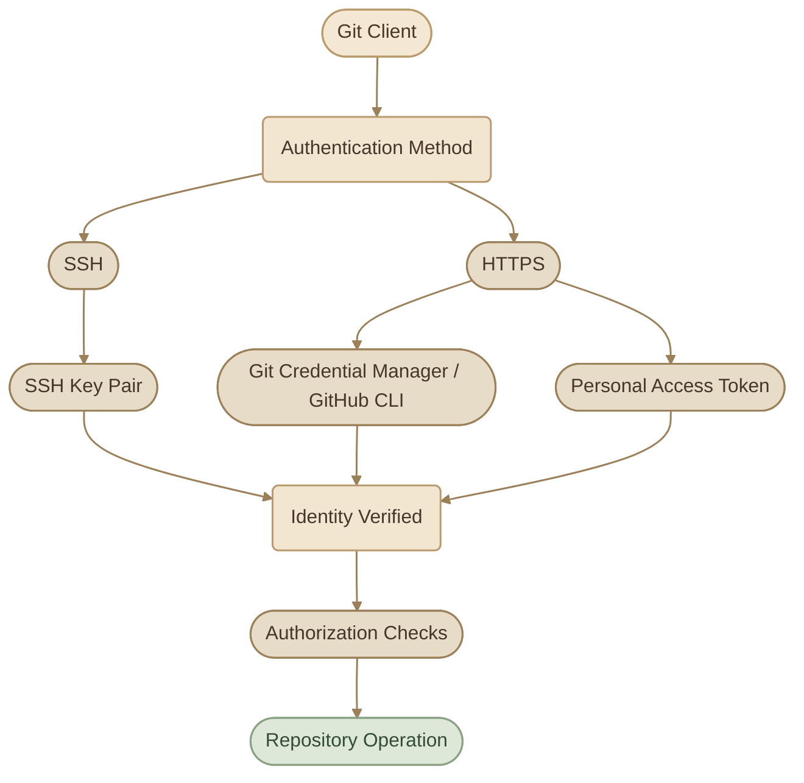
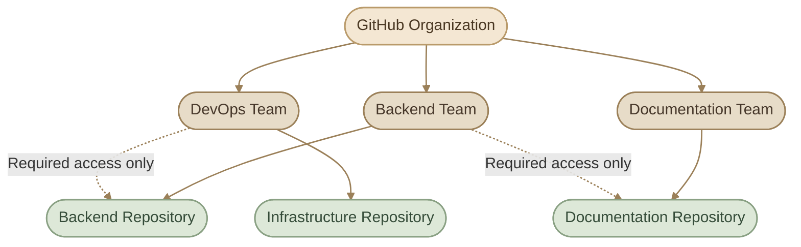

## Introduction

قبل ما تقدر تعمل `push` أو تتعامل مع Repository خاص على GitHub، لازم GitHub يعرف **إنت مين**، ويتأكد إنك تملك الصلاحيات المطلوبة للعملية اللي بتحاول تنفذها.

هنا عندنا مفهومين أساسيين:

<CardGrid columns={2} label="Authentication vs Authorization">
  <InfoCard variant="comparison" title="Authentication" icon="shield">

التحقق من هويتك — *Who are you?*

  </InfoCard>
  <InfoCard variant="comparison" title="Authorization" icon="network">

تحديد الصلاحيات المتاحة ليك — *What are you allowed to do?*

  </InfoCard>
</CardGrid>

<InfoCard variant="concept" title="Authentication vs Authorization" description="نجاح تسجيل الدخول لا يعني بالضرورة امتلاك صلاحية الوصول لكل Repository أو تعديل كل إعداداته." icon="shield" />

## 1. Authentication Methods

في التعامل مع GitHub من خلال Git، أشهر طريقتين للمصادقة هما:

<CardGrid columns={2} label="Authentication Methods">
  <InfoCard variant="concept" title="SSH" description="باستخدام SSH Key Pair." icon="tag" />
  <InfoCard variant="concept" title="HTTPS" description="باستخدام HTTPS Remote URL، مع آلية مصادقة مدعومة مثل Git Credential Manager أو GitHub CLI أو Personal Access Token عند الحاجة." icon="cloud" />
</CardGrid>



### I. Choosing an Authentication Method

<CardGrid columns={2} label="Authentication Methods">
  <InfoCard variant="concept" title="SSH Keys" description="مناسب للشغل اليومي من Terminal؛ بتضيف Public Key إلى حساب GitHub وتحتفظ بالـ Private Key على جهازك." icon="tag" tags={["SSH", "Developer Workstation"]} />
  <InfoCard variant="comparison" title="HTTPS" description="مناسب لو بتفضل HTTPS URLs أو محتاج تستخدم Git Credential Manager أو GitHub CLI لإدارة المصادقة." icon="cloud" tags={["HTTPS", "Credentials"]} />
</CardGrid>

## 2. SSH Keys

الـ SSH بيعتمد على زوج من المفاتيح:

<CardGrid columns={2} label="SSH Key Pair">
  <InfoCard variant="comparison" title="Public Key" description="المفتاح العام، بتضيفه إلى GitHub." icon="tag" />
  <InfoCard variant="comparison" title="Private Key" description="المفتاح الخاص، بيظل على جهازك ولازم تحافظ عليه." icon="shield" />
</CardGrid>

لما تتصل بـ GitHub عن طريق SSH، بيتم التحقق من قدرتك على استخدام الـ Private Key المقابل للـ Public Key المسجل.

### I. Generate an SSH Key Pair

على Linux، تقدر تنشئ مفتاح باستخدام `ssh-keygen`:

```bash
ssh-keygen -t ed25519 -C "your_email@example.com"
```

- `-t ed25519`: تحديد نوع المفتاح.
- `-C`: إضافة تعليق يساعدك في التعرف على المفتاح.

المسار الافتراضي غالبًا هيكون:

```text
~/.ssh/id_ed25519
~/.ssh/id_ed25519.pub
```

الملف الأول هو الـ **Private Key**، والتاني هو الـ **Public Key**.

<InfoCard variant="tip" title="If You Already Have a Key" description="لو عندك SSH Key بالفعل، راجع المفاتيح الموجودة قبل إنشاء مفتاح جديد. ولو الأداة سألتك عن Passphrase، فاستخدام واحدة بيضيف طبقة حماية للـ Private Key." icon="tag" />

### II. Add the Public Key to GitHub

اعرض الـ Public Key:

```bash
cat ~/.ssh/id_ed25519.pub
```

انسخ محتواه، وبعدها افتح إعدادات حسابك على GitHub:

**Settings → SSH and GPG keys → New SSH key**

أضف المفتاح واحفظه. لا ترفع الملف `id_ed25519`؛ المطلوب هو `id_ed25519.pub`.

### III. Test the SSH Connection

```bash
ssh -T git@github.com
```

لو الاتصال نجح، GitHub هيعرض رسالة ترحيب تؤكد إن المصادقة تمت بنجاح. وقد تظهر رسالة عن عدم توفير shell access؛ ده طبيعي لأن GitHub مش خادم Shell عام.

### IV. Use SSH with a Repository

SSH Remote URL بيكون بالشكل ده:

```bash
git clone git@github.com:USERNAME/REPOSITORY.git
```

لو عندك Repository بالفعل وعايز تغيّر الـ Remote من HTTPS إلى SSH:

```bash
git remote -v
git remote set-url origin git@github.com:USERNAME/REPOSITORY.git
git remote -v
```

<InfoCard variant="tip" title="Private Key Safety" description="ما تشاركش الـ Private Key، وما ترفعوش إلى Git Repository. لو اتكشف، اعتبره compromised واتخذ خطوات إبطاله أو استبداله حسب طريقة استخدامه." icon="shield" />

## 3. HTTPS Authentication

بدل SSH، تقدر تستخدم HTTPS للوصول إلى Repository:

```bash
git clone https://github.com/USERNAME/REPOSITORY.git
```

لكن فيه نقطة مهمة: **HTTPS هو عنوان الاتصال، مش طريقة المصادقة نفسها.**

عند تنفيذ عمليات تحتاج مصادقة، ممكن تستخدم:

- GitHub CLI.
- Git Credential Manager.
- Personal Access Token، عند الحاجة.

GitHub لا يقبل كلمة مرور حسابك العادية لمصادقة عمليات Git عبر HTTPS؛ لو طُلب منك إدخال كلمة مرور في سياق استخدام PAT، استخدم الـ Token بدلًا منها.

### I. Check the Remote URL

```bash
git remote -v
```

مثال للنتيجة:

```text
origin  https://github.com/USERNAME/REPOSITORY.git (fetch)
origin  https://github.com/USERNAME/REPOSITORY.git (push)
```

### II. Switch Between HTTPS and SSH

من HTTPS إلى SSH:

```bash
git remote set-url origin git@github.com:USERNAME/REPOSITORY.git
```

ومن SSH إلى HTTPS:

```bash
git remote set-url origin https://github.com/USERNAME/REPOSITORY.git
```

<InfoCard variant="concept" title="Note" icon="flag">

**مهم:** تغيير الـ Remote URL مش بيدي حسابك صلاحيات جديدة؛ هو بس بيغير طريقة الاتصال. الصلاحيات بتتحدد بناءً على الهوية اللي تمت المصادقة بيها وإعدادات الـ Repository أو Organization.

</InfoCard>

## 4. Personal Access Tokens (PATs)

الـ **Personal Access Token** هو Credential بتستخدمه بدل كلمة مرور الحساب في سيناريوهات مدعومة، زي Git operations عبر HTTPS أو بعض طلبات GitHub API.

تقدر تعتبره مفتاح وصول له صلاحيات محددة.

### I. When Do You Need a PAT?

أمثلة على استخداماته:

<CardGrid columns={3} label="PAT Use Cases">
  <InfoCard variant="concept" title="التعامل مع GitHub API." icon="terminal" />
  <InfoCard variant="concept" title="أتمتة مهام محتاجة الوصول إلى GitHub." icon="cycle" />
  <InfoCard variant="concept" title="تنفيذ Git operations عبر HTTPS لما تكون طريقة المصادقة المستخدمة بتعتمد على Token." icon="branch" />
</CardGrid>

قبل إنشاء Token، فكّر لو GitHub CLI أو Git Credential Manager يقدر يدير المصادقة بطريقة أنسب لاحتياجك.

### II. PAT Security Rules

<CardGrid columns={2} label="Token Security">
  <InfoCard variant="warning" title="Treat It Like a Password" description="ما تحطش الـ Token في الكود أو Git History أو ملف عام، وما تشاركوش في المحادثات أو Screenshots." icon="tag" tags={["Secrets", "Credential Safety"]} />
  <InfoCard variant="tip" title="Limit Its Lifetime" description="حدد Expiration مناسب، وراجع الـ Tokens اللي مبقتش محتاجها، واعمل Revoke لأي Token اتكشف." icon="cycle" tags={["Expiration", "Revocation"]} />
</CardGrid>

قواعد عملية:

<ChecklistCard title="PAT Practical Rules" items={['استخدم أقل صلاحيات ممكنة.', 'حدد Repositories المطلوبة بدل منح وصول أوسع من اللازم.', 'اختار Expiration مناسب لطبيعة الاستخدام.', 'خزّن الـ Token في Credential Manager أو Secret Store مناسب.', 'ما تطبعش الـ Token في Logs.', 'احذف أو اعمل Revoke للـ Token لما تنتهي الحاجة إليه.']} />

## 5. Fine-Grained vs Classic Tokens

دي من أهم الفروقات في GitHub Authentication.

GitHub بيوفر نوعين من Personal Access Tokens:

- **Fine-grained Personal Access Tokens**
- **Personal Access Tokens (classic)**

### I. Comparison

<TableCard>
| Feature | Fine-Grained Token | Classic Token |
|---|---|---|
| Repository access | تقدر تحدد Repositories معينة | صلاحياته أوسع حسب الـ Scopes والوصول المتاح للحساب |
| Permissions | صلاحيات دقيقة حسب نوع المورد والعملية | يعتمد على Scopes أوسع |
| Organization approval | ممكن الـ Organization تشترط موافقة المسؤولين | مش بيخضع لنفس آلية الموافقة الخاصة بالـ Fine-grained Tokens |
| Expiration | تقدر تحدد مدة صلاحية، وقد تفرض الـ Organization سياسة أقصى مدة | تقدر تحدد مدة صلاحية، لكن السياسات المتاحة تختلف |
| Compatibility | أكثر دقة، لكن مش مدعوم في كل السيناريوهات | ما زال مطلوبًا في بعض السيناريوهات والـ API endpoints |
</TableCard>

### II. Fine-Grained Tokens

عند إنشاء Fine-grained Token، تقدر تحدد:

<CardGrid columns={2} label="Fine-Grained Options">
  <InfoCard variant="feature" title="Resource owner" description="الحساب أو الـ Organization اللي هيوصل له." icon="network" />
  <InfoCard variant="feature" title="Repository access" description="Repositories معينة أو النطاق المتاح وفقًا للاختيارات." icon="branch" />
  <InfoCard variant="feature" title="Permissions" description="زي صلاحيات قراءة أو كتابة محتوى الـ Repository." icon="sliders" />
  <InfoCard variant="feature" title="Expiration" description="مدة الصلاحية." icon="cycle" />
</CardGrid>

مثلًا، لو عندك Script محتاج يقرأ محتوى Repository واحد، ما تدّيلوش صلاحية الكتابة أو الوصول لكل Repositories من غير داعٍ.

### III. Classic Tokens

Classic Tokens بتستخدم نظام Scopes أوسع، زي `repo`، اللي ممكن يمنح وصولًا واسعًا إلى Repositories الخاصة اللي حسابك يقدر يوصل لها.

استخدمها فقط لما تكون محتاجها لسبب واضح، زي سيناريو غير مدعوم بالـ Fine-grained Tokens.

<InfoCard variant="warning" title="Fine-Grained Is Preferred, Not Universal" description="GitHub بيوصي باستخدام Fine-grained Tokens لما تكون مناسبة، لكن فيه سيناريوهات وبعض API endpoints لسه محتاجة Classic Tokens. راجع دعم النوع المطلوب قبل ما تختار." icon="flag" />

### IV. Creating a Fine-Grained Token

من GitHub:

<Steps>
<li>

<InfoCard title="افتح Settings." icon="sliders" />

</li>
<li>

<InfoCard title="اختار Developer settings." icon="code" />

</li>
<li>

<InfoCard title="افتح Personal access tokens → Fine-grained tokens." icon="tag" />

</li>
<li>

<InfoCard title="اختار Generate new token." icon="cycle" />

</li>
<li>

<InfoCard title="حدد الاسم والـ Expiration." icon="flag" />

</li>
<li>

<InfoCard title="اختار Resource owner." icon="network" />

</li>
<li>

<InfoCard title="حدد Repository access." icon="branch" />

</li>
<li>

<InfoCard title="امنح أقل Permissions مطلوبة." icon="sliders" />

</li>
<li>

<InfoCard title="أنشئ الـ Token وخزّنه بأمان." icon="shield" />

</li>
</Steps>

لو الـ Organization بتشترط موافقة المسؤولين، ممكن يفضل الـ Token في حالة `pending` لحد ما تتم الموافقة عليه.

## 6. Collaborators and Permissions

لو بتشتغل مع فريق على Repository، مش لازم كل شخص يستخدم حسابك أو الـ Credentials بتاعتك.

بدل كده، أضف الأشخاص بصلاحيات مناسبة.

في Repositories الشخصية على GitHub، تقدر تدعو Collaborators وتمنحهم الوصول اللازم حسب إعدادات الـ Repository.

### I. Common Repository Roles

الأدوار المتاحة بتختلف حسب نوع الـ Repository والسياق، لكن الأدوار الشائعة في GitHub تشمل:

<TableCard>
| Role | General Responsibility |
|---|---|
| Read | عرض ومراجعة محتوى الـ Repository |
| Triage | إدارة Issues وPull Requests بدون صلاحيات كتابة الكود نفسها |
| Write | المساهمة في محتوى الـ Repository وإجراء تغييرات مسموحة |
| Maintain | إدارة جوانب من الـ Repository بدون كل صلاحيات الإدارة الحساسة |
| Admin | إدارة إعدادات وصلاحيات الـ Repository، ضمن حدود المنصة والسياسات |
</TableCard>

ما تفترضش إن كل Role متاح بنفس الصورة في كل نوع Repository أو سياق مشاركة؛ راجع الأدوار اللي GitHub بيعرضها عند إدارة الوصول.

### II. Add a Collaborator

من إعدادات الـ Repository:

**Settings → Collaborators / Collaborators and teams**

بعدها ادعُ الشخص وحدد الوصول المناسب حسب الخيارات المتاحة.

الفكرة مش إن كل شخص في الفريق ياخد أعلى Role؛ المطلوب إنه يمتلك الصلاحيات اللي تخليه ينجز شغله فقط.

## 7. Organizations and Teams

لما عدد الأشخاص والـ Repositories يكبر، إدارة الوصول Repository-by-Repository بتبقى أصعب.

هنا بيظهر دور **GitHub Organizations**.

الـ Organization بتوفر مساحة مشتركة لإدارة Repositories والأعضاء والفرق والسياسات.

### I. Organization Members and Teams

<CardGrid columns={2} label="Organization Concepts">
  <InfoCard variant="concept" title="Organization" description="المساحة المشتركة لإدارة المشاريع والأعضاء." icon="layers" />
  <InfoCard variant="concept" title="Members" description="الأشخاص اللي عندهم عضوية في الـ Organization." icon="network" />
  <InfoCard variant="concept" title="Teams" description="مجموعات من الأعضاء تقدر تستخدمها لتسهيل تنظيم الوصول إلى Repositories." icon="modules" />
  <InfoCard variant="concept" title="Repository Permissions" description="الصلاحيات اللي بتحدد إيه اللي يقدر الشخص أو الفريق يعمله على Repository معين." icon="sliders" />
</CardGrid>

مثال: ممكن يكون عندك فريق `backend` وفريق `devops`، وكل فريق يحصل على وصول يتناسب مع مسؤولياته.



الأسهم المتقطعة في الرسم مجرد مثال على إن الفريق ممكن يحتاج وصولًا إضافيًا لبعض الـ Repositories؛ مش معناها إن كل أعضاء الـ Organization لازم يكون عندهم وصول تلقائي لكل Repository.

### II. Why Use Teams?

<CardGrid columns={2} label="Why Use Teams">
  <InfoCard variant="feature" title="تسهيل إدارة الوصول لمجموعات من الأشخاص." icon="network" />
  <InfoCard variant="feature" title="تقليل تكرار إضافة الأعضاء يدويًا لكل Repository." icon="cycle" />
  <InfoCard variant="feature" title="تنظيم المسؤوليات بين الفرق." icon="modules" />
  <InfoCard variant="feature" title="تسهيل مراجعة الصلاحيات مع نمو المشروع." icon="shield" />
</CardGrid>

<InfoCard variant="concept" title="Note" icon="flag">

**ملاحظة:** صلاحيات الـ Team الفعلية بتعتمد على الـ Repository permissions وإعدادات الـ Organization؛ اسم الفريق لوحده مش بيحدد صلاحياته.

</InfoCard>

## 8. Least Privilege Principle

مبدأ **Least Privilege** معناه:

<InfoCard variant="insight" title="Least Privilege" description="امنح كل مستخدم أو Credential أقل قدر من الصلاحيات اللازمة لإنجاز المهمة المطلوبة." icon="shield" />

المبدأ ده مش خاص بحسابات الأشخاص فقط؛ ينطبق كمان على PATs، والـ Automation credentials، وأي وسيلة وصول أخرى.

### I. Example: Repository Access

افترض إن عندك ثلاثة أشخاص:

<TableCard>
| Person | Responsibility | Appropriate Access |
|---|---|---|
| Developer | تعديل الكود وفتح PRs | صلاحيات تتيح المساهمة المطلوبة |
| Reviewer | مراجعة التغييرات وإدارة المراجعات | صلاحيات مناسبة للمراجعة |
| Project Coordinator | متابعة Issues | صلاحيات إدارة Issues حسب الحاجة |
</TableCard>

دي أمثلة توضيحية؛ الاختيار النهائي لازم يتناسب مع المهام الفعلية وإعدادات GitHub.

### II. Example: Token Permissions

افترض إن Script محتاج يقرأ ملفات من Repository واحد.

<InfoCard variant="danger" title="Over-Privileged Design" icon="wrench">

- Token عنده وصول واسع لكل Repositories.
- صلاحيات كتابة رغم إن المطلوب قراءة فقط.
- مدة صلاحية أطول من الحاجة.

</InfoCard>

<InfoCard variant="success" title="Least-Privilege Design" icon="flag">

- الوصول إلى Repository المطلوب فقط.
- صلاحيات قراءة المحتوى فقط.
- مدة صلاحية مناسبة.
- تخزين آمن وإمكانية الإلغاء عند انتهاء الحاجة.

</InfoCard>

<CardGrid columns={2} label="Least Privilege Checklist">
  <InfoCard variant="success" title="Do" description="حدد الـ Resource والـ Permissions المطلوبة، وراجع الصلاحيات دوريًا، وألغِ الـ Credentials غير المستخدمة." icon="flag" tags={["Minimum Access", "Review"]} />
  <InfoCard variant="danger" title="Avoid" description="مشاركة حساب واحد بين الفريق، أو منح Admin للجميع، أو تخزين Tokens داخل الكود أو ملفات عامة." icon="wrench" tags={["Over-Permissioning", "Credential Leaks"]} />
</CardGrid>

### III. A Simple Access Review

قبل ما تمنح أي صلاحية، اسأل نفسك:

<ChecklistCard title="Access Review Questions" items={['مين الشخص أو البرنامج اللي محتاج الوصول؟', 'أنهي Repository أو Resource محتاجه؟', 'هل يحتاج Read فقط، ولا Write، ولا Admin؟', 'هل فيه طريقة تمنحه وصولًا أضيق؟', 'هل الصلاحية لازم تستمر، ولا لها مدة محددة؟', 'إزاي هتلغي الوصول لو انتهت الحاجة إليه؟']} />

## 9. Practical Lab

هنطبق المفاهيم على Repository تجريبي تملكه، من غير ما نحتاج ننشئ Token بصلاحيات واسعة أو نشارك Credentials.

<Steps>
<li>

<InfoCard title="Inspect the Remote" icon="network" />

داخل Repository محلي:

```bash
git remote -v
```

حدد إذا كان الاتصال عبر SSH أو HTTPS.

</li>
<li>

<InfoCard title="Check SSH Authentication" icon="tag" />

لو عندك SSH Key مسجل على GitHub:

```bash
ssh -T git@github.com
```

تأكد إن الرسالة بتشير إلى حساب GitHub الصحيح.

</li>
<li>

<InfoCard title="Inspect Local Git Configuration" icon="code" />

```bash
git config --get user.name
git config --get user.email
```

خلي بالك: `user.name` و`user.email` بيحددوا بيانات الكاتب في الـ Commits، لكنهم **مش وسيلة مصادقة** مع GitHub.

</li>
<li>

<InfoCard title="Design a Least-Privilege Token" icon="sliders" />

من غير ما تحتاج تنشئ Token فعلي، اكتب مواصفات Token لبرنامج مهمته قراءة ملفات Repository واحد:

```text
Purpose: Read repository files
Resource owner: The intended owner
Repository access: One required repository
Permissions: Read-only contents access, plus only other required permissions
Expiration: A suitable limited duration
Storage: Secure credential store
```

</li>
<li>

<InfoCard title="Design Team Access" icon="modules" />

افترض إن عندك فريقين، `backend` و`devops`، وثلاثة Repositories.

اكتب جدولًا يحدد:

<ChecklistCard title="Team Access Design" items={['كل فريق محتاج يوصل لأنهي Repositories.', 'مستوى الصلاحية المطلوب.', 'أي صلاحيات إضافية لازم تتمنع.']} />

الهدف إنك تتعلم تصميم الصلاحيات قبل تطبيقها على مشروع حقيقي.

</li>
</Steps>

## Summary

<CardGrid columns={2} label="Key Takeaways">
  <InfoCard variant="summary" title="Authentication" description="SSH بيعتمد على Key Pair، وHTTPS هو طريقة اتصال يمكن استخدامها مع آليات مصادقة مختلفة." icon="tag" />
  <InfoCard variant="summary" title="Personal Access Tokens" description="Fine-grained Tokens بتوفر تحكمًا أدق في الموارد والصلاحيات، لكن Classic Tokens ما زالت مطلوبة في بعض السيناريوهات." icon="code" />
  <InfoCard variant="summary" title="Access Management" description="Collaborators وOrganizations وTeams بتساعد في تنظيم الوصول بناءً على مسؤوليات الأشخاص." icon="network" />
  <InfoCard variant="summary" title="Least Privilege" description="قلل نطاق الوصول والصلاحيات والمدة الزمنية إلى الحد اللازم للمهمة." icon="shield" />
</CardGrid>
