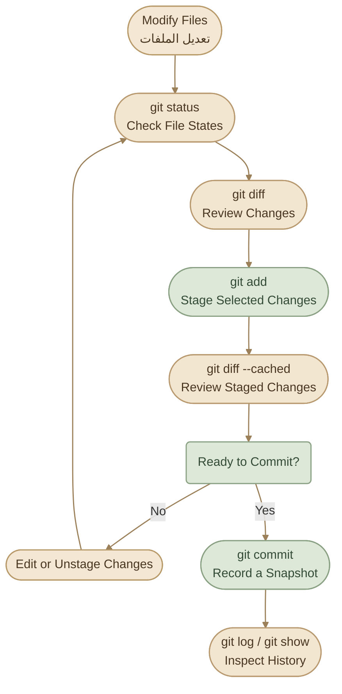

---
title: Basic Git Workflow
description: Learn the everyday Git workflow using status, add, commit, diff, log, and show to inspect changes and manage project history.
category: version-control
order: 4
level: beginner
draft: false
tags:
  - git
  - git-workflow
  - git-status
  - git-add
  - git-commit
  - git-diff
language: ar
---

## Overview

في الشغل اليومي، Git مش مجرد أداة بتسجل التغييرات؛ هو كمان بيساعدك تراجع شغلك قبل ما تحفظه في تاريخ المشروع.

الـ Workflow الأساسي غالبًا بيمر بالمراحل دي:

1. تعدّل ملفات المشروع داخل الـ `Working Directory`.
2. تستخدم `git status` علشان تعرف حالة الملفات.
3. تستخدم `git diff` علشان تراجع التغييرات.
4. تستخدم `git add` علشان تحدد التغييرات اللي عايز تسجلها.
5. تراجع الـ Staged Changes مرة تانية.
6. تستخدم `git commit` علشان تسجل Snapshot جديدة.
7. تستخدم `git log` و`git show` علشان تراجع تاريخ المشروع والـ Commits.

<InfoCard variant="concept" title="The Core Workflow" description="راجع التغييرات، جهّز اللي تقصده، راجع الـ Staging Area، وبعدها اعمل Commit. الهدف مش إنك تنفذ الأوامر بسرعة، لكن إنك تكون عارف بالضبط إيه اللي هيتسجل في تاريخ المشروع." icon="wrench" tags={["Inspect", "Stage", "Commit"]} />


## 1. The Daily Git Workflow

خلينا نشوف دورة الشغل كاملة قبل ما نشرح كل أمر لوحده.

<CardGrid columns={4} label="The Four Core Commands">
<InfoCard variant="concept" title="git status" description="اعرف الملفات المعدّلة والمجهّزة والأخطاء." icon="pulse" tags={["Inspect"]} />
<InfoCard variant="concept" title="git diff" description="راجع التغييرات قبل ما تجهّزها أو تسجلها." icon="layers" tags={["Review"]} />
<InfoCard variant="concept" title="git add" description="جهّز التغييرات المحددة للـ next commit." icon="wrench" tags={["Stage"]} />
<InfoCard variant="concept" title="git commit" description="سجّل Snapshot جديدة من الـ staged changes." icon="cube" tags={["Record"]} />
</CardGrid>



مش لازم كل مرة تنفذ نفس الأوامر بنفس الترتيب حرفيًا، لكن دي طريقة منظمة وآمنة، خصوصًا لما تكون لسه بتتعلم أو بتشتغل على مشروع مهم.


## 2. `git status` — Understand the Current State

أول أمر ترجعله لما تفتح مشروع أو تخلص تعديل هو:

```bash
git status
```

الأمر ده بيعرض حالة الـ Working Directory والـ Staging Area، وبيساعدك تعرف:

- الملفات الجديدة اللي Git مش بيتتبعها `Untracked`.
- الملفات المتتبعة اللي اتعدلت `Modified`.
- الملفات اللي جهزتها للـ Commit `Staged`.
- الـ Branch الحالي، وأحيانًا معلومات عن علاقته بالـ Remote.

### I. Example Output

```text
On branch main

Changes not staged for commit:
  modified:   src/app.py

Untracked files:
  notes.md

no changes added to commit
```

في المثال ده:

- `src/app.py` ملف متتبع واتعدل، لكن التغييرات مش موجودة في الـ Staging Area.
- `notes.md` ملف جديد Git مش بيتتبعه لسه.
- مفيش تغييرات مجهزة للـ Commit الحالي.

### II. Short Status

لو عايز Output مختصر:

```bash
git status --short
```

ممكن تشوف نتيجة بالشكل ده:

```text
 M src/app.py
?? notes.md
```

في الـ Short Status، العمودين بيمثلوا حالتين مختلفتين: الأول مرتبط بالـ Index، والتاني بالـ Working Tree. بالتالي ` M` معناها إن فيه تعديل غير مجهز، و`??` معناها ملف Untracked.

<InfoCard variant="tip" title="Start With git status" description="استخدم git status قبل ما تعمل add أو commit. الأمر بيديك صورة واضحة عن حالة الملفات وبيقلل احتمالية تسجيل تغييرات مش مقصودة." icon="terminal" tags={["Inspection", "Workflow"]} />


## 3. `git add` — Stage Your Changes

بعد ما تعرف حالة الملفات، بتستخدم `git add` علشان تجهز التغييرات للـ Commit القادم.

### I. Stage a Specific File

```bash
git add src/app.py
```

ده بيجهز التغييرات الحالية الموجودة في `src/app.py`.

### II. Stage Multiple Files

```bash
git add src/app.py README.md
```

مناسب لما تكون عارف بالضبط الملفات اللي عايز تضمّن تغييراتها.

### III. Stage All Changes Under the Current Directory

```bash
git add .
```

الأمر ده بيجهز التغييرات المناسبة الموجودة تحت الـ Current Directory، بما فيها الملفات الجديدة والتعديلات والـ Deletions التي يلتقطها الأمر، مع مراعاة قواعد التجاهل.

خد بالك إن `git add .` مش معناه بالضرورة إضافة كل ملف على الجهاز؛ نطاقه هو المسار الحالي وما تحته، وGit بيتجاهل الملفات المطابقة لقواعد التجاهل.

### IV. Stage Parts of a File

لو ملف واحد فيه تغييرات كتير، لكن عايز تسجل جزء منها بس:

```bash
git add -p
```

الأمر بيدخلك في Interactive Mode، بحيث تقدر تراجع أجزاء التغييرات وتختار أي أجزاء تتضاف للـ Staging Area.

ده مفيد لما تكون عامل تعديلات مرتبطة بأكتر من موضوع في نفس الملف.

### V. Verify What You Staged

بعد `git add`، متفترضش إنك خلصت:

```bash
git status
git diff --cached
```

الأمر الأول بيعرض الحالة، والتاني بيعرض تفاصيل التغييرات المجهزة للـ Commit.

<InfoCard variant="warning" title="git add Does Not Create a Commit" description="git add بيحدّث الـ Staging Area فقط. التغييرات مش بتدخل في تاريخ المشروع إلا لما تنفذ git commit بنجاح." icon="layers" />


## 4. `git diff` — Review Changes

الأمر `git diff` بيعرض الاختلافات بين حالات الملفات المختلفة. ودي من أهم الأدوات اللي هتستخدمها علشان تراجع شغلك قبل تسجيله.

### I. Unstaged Changes

```bash
git diff
```

بيعرض التغييرات الموجودة في الـ Working Directory مقارنة بالـ Staging Area.

بمعنى أبسط: بيوريك التعديلات اللي لسه مش مجهزة للـ Commit.

### II. Staged Changes

```bash
git diff --cached
```

أو:

```bash
git diff --staged
```

الاتنين بيعرضوا التغييرات المجهزة في الـ Staging Area مقارنة بالـ Commit الحالي.

### III. Compare Two Commits

```bash
git diff COMMIT_A COMMIT_B
```

ده بيعرض الفرق بين الشجرتين المرتبطتين بالـ Commitين المحددين.

تقدر تستخدم Commit IDs أو References مناسبة بدل `COMMIT_A` و`COMMIT_B`.

### IV. Inspect a Specific File

```bash
git diff -- src/app.py
```

الـ `--` بيفصل بين الخيارات والمسارات، وبيخلي المقصود بالاسم اللي بعده واضح باعتباره Path.

### V. Understanding Diff Output

مثال لتغيير بسيط:

```diff
- DEBUG = True
+ DEBUG = False
```

- السطر اللي بيبدأ بـ `-` هو السطر الموجود في النسخة القديمة من المقارنة.
- السطر اللي بيبدأ بـ `+` هو السطر الموجود في النسخة الجديدة.

مش معنى `+` و`-` إن Git بيمسح التغيير أو بيطبقه تلقائيًا؛ ده مجرد عرض للاختلافات.

### VI. Which Diff Should You Use?

<TableCard title="Which git diff to Use" caption="كل diff بيقارن بين حالتين مختلفتين من الملفات.">
<TableCard>
| Command | What It Compares |
|---|---|
| `git diff` | Working Directory vs Staging Area |
| `git diff --cached` | Staging Area vs Current Commit |
| `git diff HEAD` | Working Directory and Index changes vs `HEAD` |
| `git diff COMMIT_A COMMIT_B` | Two Commit snapshots |
</TableCard>
</TableCard>

<InfoCard variant="insight" title="Review Both Sides" description="git diff بيراجع التغييرات غير المجهزة، وgit diff --cached بيراجع التغييرات المجهزة. لو هتعمل Commit، مراجعة الـ Staged Changes تحديدًا خطوة مهمة." icon="pulse" tags={["Diff", "Code Review"]} />


## 5. `git commit` — Record a Snapshot

بعد ما تراجع التغييرات وتتأكد إن الـ Staging Area فيها اللي إنت عايزه، تقدر تسجل Commit جديد.

### I. Create a Commit

```bash
git commit -m "Add input validation"
```

الخيار `-m` بيحدد رسالة الـ Commit، والرسالة المفروض تلخص التغيير اللي سجلته.

أمثلة على رسائل واضحة:

```text
Add input validation
Fix configuration loading
Update installation instructions
Remove unused dependency
```

الأفضل إن الرسالة تكون محددة وتشرح التغيير، بدل رسائل عامة زي `update` أو `changes`.

### II. What Does a Commit Include?

الـ Commit بيسجل الحالة المجهزة في الـ Staging Area، مش كل تعديل موجود في الـ Working Directory تلقائيًا.

يعني لو عندك ملفين متعدلين، وجهزت واحد بس باستخدام `git add`، فالـ Commit العادي هيسجل التغيير المجهز فقط، مش التعديل الآخر غير المجهز.

```bash
git status
git add src/app.py
git diff --cached
git commit -m "Fix application startup"
```

بعدها، لو فيه تعديلات تانية غير مجهزة، هتفضل موجودة في الـ Working Directory.

### III. Inspect the Result

```bash
git status
```

لو مفيش تغييرات أخرى، ممكن تظهر رسالة بالشكل ده:

```text
On branch main
nothing to commit, working tree clean
```

معناها إن مفيش تغييرات حالية محتاجة تسجيل أو ملفات غير متتبعة ظاهرة في حالة الـ Working Tree.

### IV. A Note About `git commit -a`

ممكن تشوف الأمر ده:

```bash
git commit -am "Update application logic"
```

الخيار `-a` بيجهز التعديلات والحذف في الملفات المتتبعة بالفعل قبل إنشاء الـ Commit، لكنه مش بيضيف الملفات الجديدة Untracked.

في البداية، الأفضل تستخدم `git add` بشكل صريح علشان تبقى عارف إيه اللي هيدخل في الـ Commit.


## 6. `git log` — Explore Commit History

بعد ما تبدأ تعمل Commits، هتحتاج تعرف تاريخ المشروع: مين عمل التغييرات؟ إمتى؟ وإيه الرسائل المرتبطة بيها؟

الأمر الأساسي:

```bash
git log
```

بيعرض تاريخ الـ Commits اللي يمكن الوصول إليها من الـ Current Branch، بما يشمل عادةً الـ Commit ID والـ Author والتاريخ ورسالة الـ Commit.

### I. Compact History

```bash
git log --oneline
```

مثال:

```text
a81f3d2 Fix application startup
9bc12e4 Add input validation
47ad6c1 Initial commit
```

كل سطر بيمثل Commit، مع اختصار الـ ID ورسالة الـ Commit.

### II. Limit the Number of Commits

```bash
git log -5 --oneline
```

بيعرض أحدث خمسة Commits في التاريخ اللي بيستعرضه Git من الـ Current Branch.

### III. Show a Graph

```bash
git log --oneline --graph --decorate --all
```

الأمر ده مفيد لما يكون عندك أكتر من Branch وعايز تشوف شكل التاريخ والـ References المرتبطة بالـ Commits.

مثال مبسط:

```text
* c3d8a12 (HEAD -> main) Update documentation
* b1f4e91 Fix configuration
* 8a2d611 Initial commit
```

الـ Output الحقيقي بيتغير حسب الـ Branches والـ Merge History الموجودة عندك.

### IV. Useful Filters

```bash
# Show commits by author
git log --author="Your Name"

# Search commit messages
git log --grep="validation"

# Show commits affecting a specific path
git log -- README.md

# Include file change summaries
git log --stat
```

دي أدوات مفيدة لما المشروع يكبر ويبقى صعب تراجع التاريخ كله يدويًا.


## 7. `git show` — Inspect a Specific Commit

الـ `git log` بيساعدك تتصفح تاريخ الـ Commits، أما `git show` فبيساعدك تفحص Commit معين وتفاصيله.

### I. Show the Latest Commit

```bash
git show
```

من غير تحديد Reference، الأمر بيعرض تفاصيل الـ Commit المرتبط عادةً بـ `HEAD`، ومنها Metadata والـ Diff الخاص به.

### II. Show a Specific Commit

```bash
git show a81f3d2
```

استبدل `a81f3d2` بالـ Commit ID المناسب من تاريخ مشروعك.

### III. Show Only the Commit Summary

```bash
git show --stat a81f3d2
```

ده بيعرض ملخص الملفات اللي اتغيرت وعدد الأسطر المضافة والمحذوفة.

### IV. Show a File as It Existed in a Commit

```bash
git show a81f3d2:README.md
```

ده بيعرض محتوى `README.md` كما هو مسجل في الـ Commit المحدد، بشرط إن المسار ده موجود في الحالة المسجلة للـ Commit.

لاحظ الفرق:

- `git log` بيعرض تاريخ الـ Commits.
- `git show` بيفحص Commit أو Object محدد.
- `git diff` بيقارن بين حالات مختلفة.


## 8. Putting Everything Together

<Callout type="lab" title="Hands-on: Full Workflow" />

<Steps>
<li>

<InfoCard title="Step 1 — Check State" description="راجع حالة المشروع بـ git status." icon="layers" tags={["Status"]} />

```bash
git status
```

</li>
<li>

<InfoCard title="Step 2 — Edit File" description="عدّل ملفًا مثل README.md." icon="wrench" tags={["Edit"]} />

</li>
<li>

<InfoCard title="Step 3 — Review Changes" description="راجع التغييرات غير المجهّزة عبر git diff." icon="branch" tags={["Diff"]} />

```bash
git diff
```

</li>
<li>

<InfoCard title="Step 4 — Stage Changes" description="جهّز التعديلات بـ git add." icon="cube" tags={["Stage"]} />

```bash
git add README.md
```

</li>
<li>

<InfoCard title="Step 5 — Review Staged" description="راجع التغييرات المجهّزة عبر git diff --cached." icon="shield" tags={["Review"]} />

```bash
git diff --cached
```

</li>
<li>

<InfoCard title="Step 6 — Commit" description="سجّل Snapshot جديدة بـ git commit." icon="wrench" tags={["Commit"]} />

```bash
git commit -m "docs: update README"
```

</li>
<li>

<InfoCard title="Step 7 — Verify State" description="تأكد من حالة المشروع بعد الـ Commit." icon="layers" tags={["Status"]} />

```bash
git status
```

</li>
<li>

<InfoCard title="Step 8 — Inspect Commit" description="راجع الـ Commit بـ git log و git show." icon="pulse" tags={["Inspect"]} />

```bash
git log -1 --oneline
git show --stat HEAD
```

</li>
</Steps>


## 9. Common Mistakes

<CardGrid columns={2} label="Workflow Mistakes">
  <InfoCard variant="warning" title="Skipping git status" description="ممكن تفتكر إنك عارف حالة المشروع، لكن تلاقي ملفات Untracked أو تعديلات قديمة مش واخد بالك منها." icon="shield" />

  <InfoCard variant="warning" title="Confusing the Two Diffs" description="git diff بيراجع التغييرات غير المجهزة، بينما git diff --cached بيراجع التغييرات الموجودة في الـ Staging Area." icon="branch" />

  <InfoCard variant="warning" title="Committing Too Much" description="مراجعة الـ Staged Changes قبل الـ Commit بتقلل احتمالية إدخال تغييرات غير مرتبطة أو غير مكتملة." icon="layers" />

  <InfoCard variant="warning" title="Using Vague Messages" description="رسالة Commit واضحة بتخلي فهم تاريخ المشروع ومراجعة التغييرات أسهل على المدى الطويل." icon="layers" />
</CardGrid>


## Key Takeaways

<InfoCard variant="summary" title="The Core Loop" description="status → diff → add → diff --cached → commit → log. افهم حالة الملفات قبل كل خطوة، وراجع الـ staged changes قبل التسجيل." icon="cycle" tags={["Mental Model"]} />

- `git status` بيعرض حالة الـ Working Directory والـ Staging Area.
- `git add` بيجهز التغييرات اللي عايز تسجلها.
- `git commit` بيسجل Snapshot من التغييرات المجهزة.
- `git diff` بيعرض الاختلافات بين حالات الملفات.
- `git log` بيعرض تاريخ الـ Commits.
- `git show` بيفحص Commit أو Object محدد.
- مراجعة التغييرات قبل الـ Commit جزء أساسي من الـ Git Workflow، مش خطوة إضافية مالهاش لازمة.

