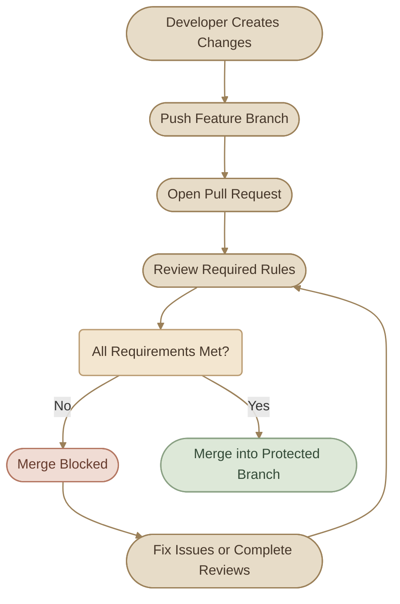
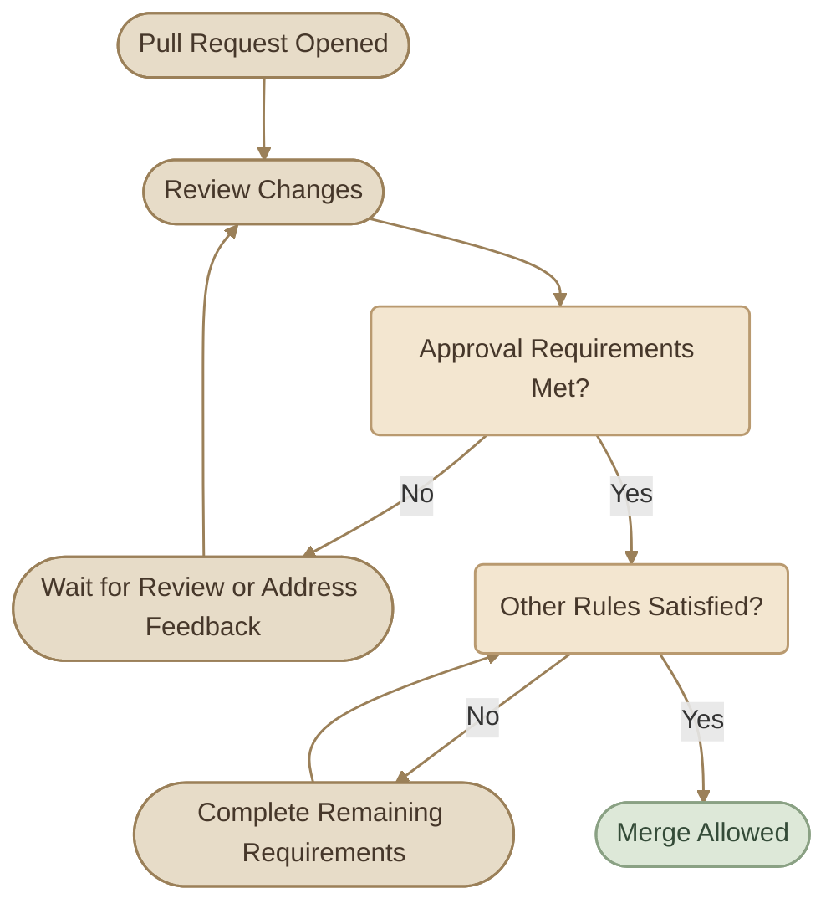
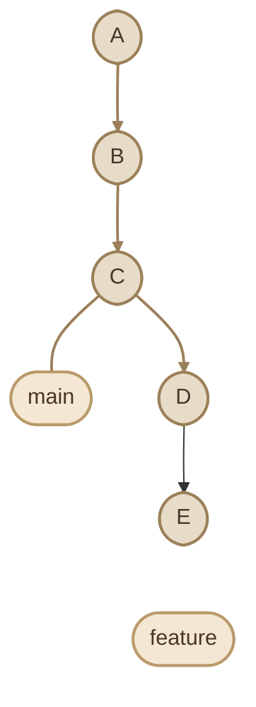
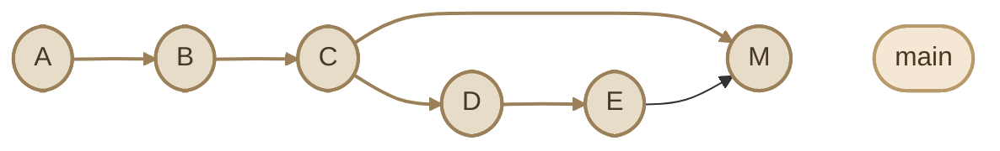
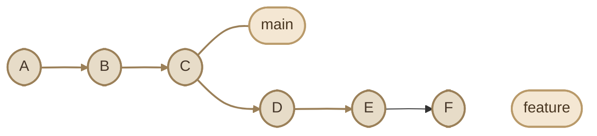
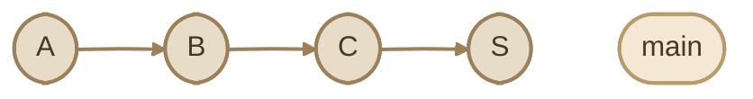
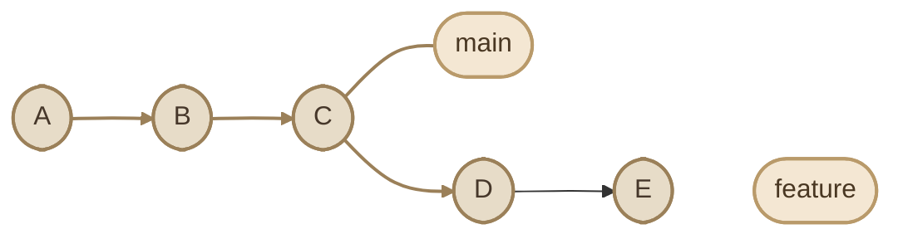
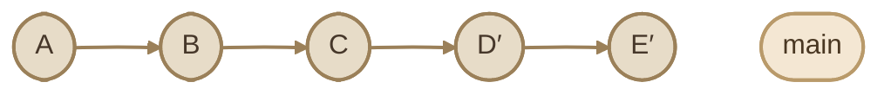
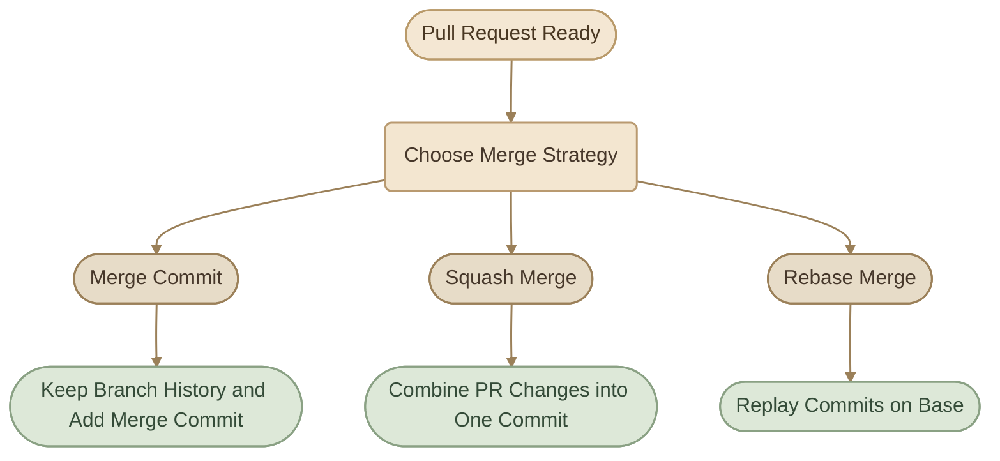
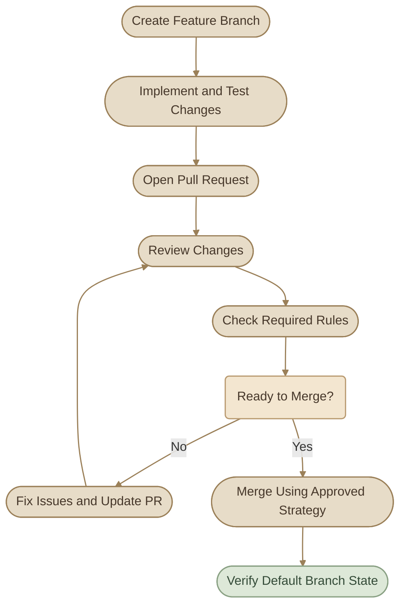

## Introduction

في المشاريع الحقيقية، مش كفاية إننا نعمل Pull Requests ونراجع الكود؛ لازم كمان نضمن إن التغييرات مش هتدخل الـ `main` إلا لما تستوفي شروط المشروع.

هنا بييجي دور **Branch Protection** و**Rulesets**. الأدوات دي بتساعدك تفرض قواعد على الـ Branches المهمة، زي اشتراط مراجعات قبل الدمج، أو منع Force Push، أو اشتراط نجاح فحوصات معينة.

وفي نفس الوقت، لازم تختار **Merge Strategy** مناسبة؛ لأن طريقة الدمج بتأثر على شكل الـ Git History وإمكانية تتبّع التغييرات لاحقًا.

### I. What You Will Learn

<CardGrid columns={2} label="Learning Objectives">
  <InfoCard variant="concept" title="Branch Protection" description="افهم إزاي تحمي الـ main من التغييرات المباشرة وغير المراجَعة." icon="shield" tags={["Rules", "Safety"]} />
  <InfoCard variant="feature" title="Rulesets" description="تعرّف على طريقة تنظيم القواعد وتطبيقها على Branches متعددة." icon="layers" tags={["Policies", "Repository"]} />
  <InfoCard variant="comparison" title="Merge Strategies" description="قارن بين Merge Commit وSquash Merge وRebase Merge." icon="git-merge" tags={["History", "GitHub"]} />
  <InfoCard variant="tip" title="Stable Default Branch" description="استخدم قواعد واضحة لتقليل مخاطر إدخال تغييرات غير جاهزة." icon="branch" tags={["main", "Reliability"]} />
</CardGrid>

## 1. Branch Protection Rules

الـ **Branch Protection Rules** هي قواعد بتحدد الشروط اللي لازم تتحقق قبل السماح بعمليات معينة على Branch محددة.

مثلًا، ممكن تحمي `main` بحيث ما ينفعش دمج تغييرات فيها إلا من خلال Pull Request عليها الموافقات المطلوبة.

### I. Why Protect Important Branches?

تخيّل إن كل Developer يقدر يعمل Push مباشرةً على `main` من غير مراجعة أو اختبارات. خطأ بسيط ممكن يأثر على بقية الفريق أو يكسر نسخة البرنامج اللي بيعتمد عليها الـ Deployment.

حماية الـ Branch بتساعد على تقليل المخاطر دي من خلال فرض قواعد واضحة.

### II. Common Protection Settings

<TableCard>
| Rule | Purpose |
|---|---|
| Require a pull request before merging | اشتراط تقديم التغييرات من خلال PR |
| Require approving reviews | اشتراط عدد معين من الموافقات |
| Require status checks to pass | اشتراط نجاح فحوصات محددة قبل الدمج |
| Require conversation resolution | اشتراط معالجة أو إغلاق المحادثات المطلوبة |
| Require linear history | منع Merge Commits على الـ Branch المحمية |
| Require signed commits | اشتراط Commits موقّعة ومتحققًا منها |
| Restrict who can push | تقييد الأشخاص أو التطبيقات المسموح لها بالـ Push |
| Block force pushes | منع إعادة كتابة تاريخ الـ Branch باستخدام Force Push |
| Restrict deletions | منع حذف الـ Branch بواسطة الأشخاص غير المسموح لهم |
</TableCard>

مش لازم تفعّل كل القواعد لكل Branch؛ اختار القواعد حسب أهمية الـ Branch وطبيعة المشروع.

### III. Example: Protecting `main`

افترض إن عندك Repository فيها:

```text
main
develop
feature/add-health-check
fix/config-validation
```

ممكن تختار إن `main` تحتاج:

<CardGrid columns={2} label="Protection Requirements">
  <InfoCard variant="feature" title="Pull Request قبل الدمج." icon="git-pull-request" />
  <InfoCard variant="feature" title="موافقة واحدة أو أكثر." icon="flag" />
  <InfoCard variant="feature" title="نجاح الفحوصات المطلوبة." icon="pulse" />
  <InfoCard variant="feature" title="حل المحادثات المطلوبة." icon="code" />
  <InfoCard variant="feature" title="منع Force Push." icon="shield" />
  <InfoCard variant="feature" title="منع حذف الـ Branch." icon="branch" />
</CardGrid>

وفي نفس الوقت، تسمح للمطورين يشتغلوا بحرية أكبر على Feature Branches.

### IV. How Branch Protection Works



### V. Important Notes

<CardGrid columns={2} label="Important Notes">
  <InfoCard variant="warning" title="Branch Protection مش بديل عن الاختبارات أو المراجعة الجيدة؛ هي بتفرض شروطًا محددة." icon="shield" />
  <InfoCard variant="warning" title="الـ Administrators أو الأشخاص المسموح لهم بتجاوز القواعد ممكن تكون عندهم صلاحيات استثنائية، حسب الإعدادات." icon="tag" />
  <InfoCard variant="warning" title="قواعد الحماية لا تضمن وحدها إن الكود خالٍ من الأخطاء." icon="flag" />
  <InfoCard variant="warning" title="لو الـ Branch مهمة، راجع مين يقدر يتجاوز القواعد، مش بس القواعد نفسها." icon="modules" />
</CardGrid>

<InfoCard variant="warning" title="Protection Must Be Enforced" description="وجود سياسة مكتوبة في README مش كفاية. لو عايز GitHub تمنع الدمج فعليًا عند عدم استيفاء شروط معينة، لازم تضبط قواعد الحماية المناسبة على الـ Repository." icon="shield" />

## 2. Rulesets — الفكرة والاستخدام

الـ **Rulesets** هي وسيلة أحدث وأكثر مرونة لتنظيم قواعد التعامل مع Branches وTags في GitHub.

هي بتسمح لك تحدد القواعد المطلوبة، وتختار الـ Branches أو الـ Tags المستهدفة، وتحدد حالة تطبيق القواعد والصلاحيات الخاصة بتجاوزها.

### I. Rulesets vs Branch Protection Rules

الاتنين ممكن يحموا الـ Branches، لكن طريقة تنظيم القواعد مختلفة.

<TableCard>
| Feature | Branch Protection Rules | Rulesets |
|---|---|---|
| Main purpose | حماية Branches باستخدام Rule محددة | تنظيم سياسات على Branches أو Tags مستهدفة |
| Rules applying to the same target | قاعدة Branch Protection واحدة هي اللي تنطبق في كل مرة | ممكن أكتر من Ruleset تنطبق على نفس الهدف |
| Enforcement status | بتتدار من خلال إعدادات القاعدة | ممكن تكون Active أو Disabled |
| Visibility | حسب صلاحيات الوصول والإعدادات | يمكن للمستخدمين اللي عندهم Read access الاطلاع على Rulesets النشطة |
| Rule combination | لا تعتمد على نفس آلية تجميع الـ Rulesets | القواعد المتطابقة بتتجمع، والأكثر تقييدًا يسري عند تعارض نفس نوع القاعدة |
</TableCard>

GitHub بتدعم النظامين، وممكن قواعد الحماية والـ Rulesets تنطبق مع بعض؛ لذلك لازم تراجع كل القواعد الفعالة بدل ما تفترض إن Rule واحدة هي الوحيدة المؤثرة.

### II. Understanding Enforcement Status

في الـ Rulesets، أهم حالتين للمبتدئ:

<CardGrid columns={2} label="Enforcement Status">
  <InfoCard variant="comparison" title="Active" description="القواعد بتتطبق." icon="flag" />
  <InfoCard variant="comparison" title="Disabled" description="القواعد موجودة لكنها غير مفعّلة." icon="sliders" />
</CardGrid>

وجود Ruleset بحالة `Disabled` مش معناه إن الحماية المطلوبة موجودة فعليًا؛ لازم تتأكد من القواعد الأخرى اللي ممكن تنطبق على نفس الـ Branch.

### III. Example: A Main Branch Ruleset

ممكن تنشئ Ruleset تستهدف الـ Default Branch وتطلب:

<CardGrid columns={2} label="Ruleset Requirements">
  <InfoCard variant="feature" title="Pull Request قبل الدمج." icon="git-pull-request" />
  <InfoCard variant="feature" title="موافقات من Reviewers." icon="flag" />
  <InfoCard variant="feature" title="نجاح Status Checks محددة." icon="pulse" />
  <InfoCard variant="feature" title="منع Force Push." icon="shield" />
  <InfoCard variant="feature" title="منع حذف الـ Branch." icon="branch" />
</CardGrid>

ولو عندك Release Branches، ممكن تعمل Ruleset تانية تستهدف Branches بأسماء زي `release/*` وتفرض عليها شروطًا مختلفة حسب احتياجات المشروع.

### IV. When Are Rulesets Useful?

<CardGrid columns={2} label="Ruleset Use Cases">
  <InfoCard variant="concept" title="Multiple Branches" description="تطبيق قواعد موحدة على مجموعة Branches باستخدام Targeting patterns." icon="branch" />
  <InfoCard variant="feature" title="Centralized Policies" description="تجميع القواعد المرتبطة بحماية الـ Repository في سياسات واضحة." icon="layers" />
  <InfoCard variant="insight" title="Visibility" description="مساعدة المساهمين على معرفة القواعد الفعالة التي تؤثر على الـ Branches." icon="terminal" />
  <InfoCard variant="warning" title="Controlled Bypass" description="تحديد أشخاص أو Teams أو Apps يمكنها تجاوز قواعد معينة، حسب الإعدادات." icon="tag" />
</CardGrid>

### V. Practical Example

لنفترض إن عندك:

```text
main
develop
release/1.0
release/2.0
feature/health-check
```

ممكن تستخدم:

<CardGrid columns={3} label="Practical Example">
  <InfoCard variant="concept" title="Ruleset للـ `main`." icon="branch" />
  <InfoCard variant="concept" title="Ruleset تستهدف `release/*`." icon="tag" />
  <InfoCard variant="concept" title="قواعد أخف أو مختلفة للـ Feature Branches حسب سياسة الفريق." icon="sliders" />
</CardGrid>

الهدف مش زيادة عدد القواعد، لكن تطبيق الحماية المناسبة على الـ Branches المناسبة.

<InfoCard variant="tip" title="Avoid Overlapping Rules Without a Plan" description="لو عندك أكتر من Ruleset وقواعد Branch Protection، راجع تأثيرها مجتمعة. ممكن تكون كل قاعدة منطقية لوحدها، لكن اجتماعها يفرض شروطًا أشد مما كنت تقصد." icon="sliders" />

## 3. Required Reviews

الـ **Required Reviews** معناها إن GitHub تشترط الحصول على عدد معين من الموافقات قبل السماح بدمج Pull Request في الـ Branch المحمية.

مثلًا، ممكن تشترط موافقة واحدة على الأقل من شخص عنده صلاحية المراجعة، أو تطلب موافقة من Code Owner للملفات التي يملكها.

### I. Why Require Reviews?

مراجعة التغييرات قبل الدمج بتساعد على:

<CardGrid columns={2} label="Why Require Reviews">
  <InfoCard variant="feature" title="اكتشاف Bugs قبل دخولها للـ Default Branch." icon="flag" />
  <InfoCard variant="feature" title="التأكد من إن التغيير بيحقق الهدف." icon="flag" />
  <InfoCard variant="feature" title="مراجعة التغييرات الأمنية أو الحساسة." icon="shield" />
  <InfoCard variant="feature" title="مشاركة المعرفة بين أعضاء الفريق." icon="network" />
  <InfoCard variant="feature" title="تقليل الاعتماد على شخص واحد في اتخاذ القرارات." icon="modules" />
</CardGrid>

### II. Common Review Requirements

حسب إعدادات GitHub والخطة المتاحة، ممكن تفرض قواعد مثل:

<TableCard>
| Requirement | Meaning |
|---|---|
| Required approving reviews | عدد محدد من الموافقات مطلوب |
| Require review from Code Owners | تغييرات الملفات المملوكة تحتاج موافقة مناسبة من Code Owners |
| Dismiss stale approvals | إلغاء الموافقات القديمة لو التغيير اتغير بالشكل المحدد في القاعدة |
| Require approval of the most recent reviewable push | اشتراط موافقة من شخص آخر على أحدث Push قابل للمراجعة |
| Require conversation resolution | حل محادثات المراجعة المطلوبة قبل الدمج |
</TableCard>

مش لازم كل المشاريع تستخدم كل الخيارات.

### III. Example: One Required Approval

افترض إن `main` محمية وبتحتاج موافقة واحدة على الأقل.

الـ Workflow هيكون:

<Steps>
<li>

<InfoCard title="Open the Pull Request" icon="git-pull-request" />

Developer يفتح Pull Request.

</li>
<li>

<InfoCard title="Review the Changes" icon="code" />

Reviewer يراجع التغييرات.

</li>
<li>

<InfoCard title="Choose Approve" icon="flag" />

لو التغيير مناسب، يختار `Approve`.

</li>
<li>

<InfoCard title="Request Changes or Discuss" icon="wrench" />

لو فيه مشكلة مؤثرة، يختار `Request changes` أو يناقشها.

</li>
<li>

<InfoCard title="Merge Becomes Allowed" icon="git-merge" />

بعد استيفاء شروط المراجعة وبقية قواعد الحماية، يصبح الدمج مسموحًا.

</li>
</Steps>

وجود Approval وحده مش ضمان إن GitHub هتسمح بالدمج؛ باقي الشروط لازم تتحقق أيضًا.

### IV. Review Requirements Flow



<InfoCard variant="warning" title="Approval Is Not a Formality" description="متعتبرش الموافقة خطوة شكلية. لازم الـ Reviewer يفحص التغيير فعلًا، خصوصًا لو بيأثر على Infrastructure أو Security أو Production." icon="shield" />

## 4. Required Status Checks — The Concept

الـ **Status Check** هي نتيجة بتوضح حالة فحص أو عملية مرتبطة بـ Commit أو Pull Request.

ممكن تكون النتيجة جاية من GitHub Actions أو CI provider خارجي أو Integration تانية.

أما **Required Status Checks** فهي فحوصات بتشترط GitHub نجاحها قبل السماح بالدمج في الـ Branch المحمية.

### I. Example

تخيّل إن Pull Request بتغيّر Application code، والمشروع عنده فحوصات زي:

```text
unit-tests          success
lint                success
security-scan       failure
```

لو `security-scan` من الفحوصات المطلوبة، فالـ PR مش هتكون مؤهلة للدمج لحد ما يتم التعامل مع الفشل وتتحقق الشروط المطلوبة.

### II. Why Are They Important?

Required Status Checks بتساعد على منع دمج تغييرات قبل اجتياز فحوصات آلية مهمة.

لكن لازم تميّز بين:

<CardGrid columns={1} label="Key Distinctions">
  <InfoCard variant="comparison" title="Status Check" description="النتيجة الفعلية لفحص معين." icon="pulse" />
  <InfoCard variant="comparison" title="Required Status Check" description="فحص محدد تم اختياره كشرط للدمج." icon="flag" />
  <InfoCard variant="comparison" title="CI Pipeline" description="عملية أوسع ممكن تشغّل مجموعة من الفحوصات والمهام." icon="cycle" />
</CardGrid>

مش كل Check في المشروع لازم تكون Required، ومش كل CI job بالضرورة شرط للدمج.

### III. Strict vs Loose — Concept Only

في بعض إعدادات GitHub، فيه فرق بين اشتراط إن الـ Branch تكون محدثة مع الـ Base branch قبل الدمج، وبين السماح بالدمج حتى لو فيه تغييرات أحدث على الـ Base.

<CardGrid columns={2} label="Strict vs Loose">
  <InfoCard variant="comparison" title="Strict" description="الـ Branch لازم تكون محدثة مع الـ Base وفقًا للقاعدة." icon="flag" />
  <InfoCard variant="comparison" title="Loose" description="ممكن تسمح القاعدة بالدمج من غير اشتراط التحديث ده." icon="sliders" />
</CardGrid>

الاختيار بيوازن بين التأكد من توافق التغيير مع أحدث نسخة وبين عدد مرات إعادة تشغيل الفحوصات المطلوبة.

**مش هندخل هنا في إعداد CI/CD أو كتابة Workflows**؛ المطلوب في الموضوع ده إنك تفهم إن Status Checks ممكن تكون شروطًا إلزامية للدمج.

<InfoCard variant="insight" title="Passing Checks Reduce Risk" description="نجاح الفحوصات المطلوبة مؤشر مهم على جودة التغيير، لكنه مش ضمان كامل. جودة الاختبارات نفسها ومدى تغطيتها بيأثروا على قيمتها." icon="flag" />

## 5. Merge Commit vs Squash Merge vs Rebase Merge

GitHub بتدعم ثلاث استراتيجيات أساسية لدمج Pull Requests، حسب إعدادات الـ Repository:

<CardGrid columns={3} label="Merge Strategies">
  <InfoCard variant="comparison" title="Merge Commit" icon="git-merge" />
  <InfoCard variant="comparison" title="Squash and Merge" icon="layers" />
  <InfoCard variant="comparison" title="Rebase and Merge" icon="branch" />
</CardGrid>

الفرق الأساسي بينها هو شكل الـ Git History الناتج عن الدمج، وده بيأثر على طريقة تتبّع التغييرات وقراءة تاريخ المشروع.

### I. Merge Commit

في الطريقة دي، GitHub بتدمج التغييرات مع الاحتفاظ بتاريخ الـ Branch، وبتضيف Merge Commit توضح نقطة الدمج بين الفرعين.

لو الـ Feature Branch فيها عدة Commits، تقدر تفضل شايفها بشكل منفصل في التاريخ.

**مثال مبسط:**

قبل الدمج:



بعد Merge Commit:



الـ `M` هي Merge Commit اللي بتربط تاريخ الفرعين.

**مناسب لما:**

<CardGrid columns={1} label="When Suitable">
  <InfoCard variant="feature" title="عايز تحتفظ بتسلسل الـ Commits داخل الـ Feature Branch." icon="git-merge" />
  <InfoCard variant="feature" title="مهم عندك معرفة تاريخ تفرع الفرع ودمجه." icon="branch" />
  <InfoCard variant="feature" title="فريقك بيفضّل إظهار عمليات الدمج في الـ History." icon="layers" />
</CardGrid>

### II. Squash and Merge

في الطريقة دي، GitHub بتجمع التغييرات الموجودة في الـ Pull Request في Commit واحدة على الـ Base Branch.

ده معناه إن الـ Commits الأصلية للـ Feature Branch مش بتظهر كـ Commits منفصلة على تاريخ الـ Base بعد الدمج؛ لكن الـ PR نفسها بتفضل موجودة على GitHub حسب سياسة الاحتفاظ بالمعلومات.

قبل الدمج:



بعد Squash Merge:



الـ `S` هي Commit واحدة بتحتوي على التغييرات المجمّعة.

**مناسب لما:**

<CardGrid columns={1} label="When Suitable">
  <InfoCard variant="feature" title="عايز تاريخًا بسيطًا على الـ Base Branch." icon="layers" />
  <InfoCard variant="feature" title="الـ Feature Branch فيها Commits كثيرة صغيرة أو تجريبية." icon="git-pull-request" />
  <InfoCard variant="feature" title="عايز كل PR ممثلة غالبًا بCommit واحدة في التاريخ الرئيسي." icon="git-merge" />
</CardGrid>

لكن لو أسماء الـ Commits أو تقسيمها مهمين لفهم التغيير، راجع وصف الـ PR ورسائل الـ Commits قبل الدمج.

### III. Rebase and Merge

في الطريقة دي، GitHub بتعيد تطبيق Commits الخاصة بالـ Pull Request فوق أحدث Commit في الـ Base Branch، من غير إنشاء Merge Commit تقليدية.

الـ Commits الناتجة بتكون لها IDs جديدة لأن إعادة تطبيق الـ Commits بتنتج تاريخًا مختلفًا.

قبل الدمج:



بعد Rebase Merge:



الرمزان `D'` و`E'` بيمثلوا Commits جديدة مكافئة من حيث التغييرات المقصودة، لكن بمعرّفات مختلفة.

**مناسب لما:**

<CardGrid columns={1} label="When Suitable">
  <InfoCard variant="feature" title="عايز تاريخًا خطيًا من غير Merge Commit." icon="branch" />
  <InfoCard variant="feature" title="عايز تحتفظ بالـ Commits منفصلة بدل تجميعها في Commit واحدة." icon="git-merge" />
  <InfoCard variant="feature" title="فريقك عنده سياسة بتفضّل Linear History." icon="flag" />
</CardGrid>

### IV. Side-by-Side Comparison

<TableCard>
| Feature | Merge Commit | Squash Merge | Rebase Merge |
|---|---|---|---|
| Keeps individual PR commits on base history | نعم | لا، بتتجمع في Commit واحدة | نعم، كـ Commits معاد تطبيقها |
| Adds a merge commit | نعم، عادةً | لا | لا |
| Produces linear base history | مش بالضرورة | نعم | نعم |
| Simplifies the main history | أقل | غالبًا الأكثر بساطة | يحافظ على Commits منفصلة |
| Preserves the original commit IDs on the base | نعم بالنسبة للـ Commits المدمجة | لا، بتظهر Commit جديدة | لا، الـ Commits المعاد تطبيقها لها IDs جديدة |
| Common use | الاحتفاظ بتاريخ الدمج والفروع | تاريخ بسيط لكل PR | تاريخ خطي مع Commits منفصلة |
</TableCard>

### V. Visual Comparison



### Vi. Which Strategy Should You Choose?

مفيش Strategy واحدة أفضل لكل المشاريع؛ الاختيار بيعتمد على طبيعة الـ Workflow والـ History اللي الفريق عايز يحتفظ بيه.

<TableCard>
| Project Preference | Possible Choice |
|---|---|
| الاحتفاظ بتاريخ الفروع وعمليات الدمج | Merge Commit |
| PR واحدة = Commit واحدة في التاريخ الرئيسي | Squash Merge |
| Linear History مع الاحتفاظ بالـ Commits منفصلة | Rebase Merge |
</TableCard>

لو فريقك عنده سياسة واضحة، اتبعها. ولو بتصمم Workflow جديدة، اتفقوا على استراتيجية الدمج قبل ما تبدأوا تستخدموها بشكل غير موحد.

### VII. Important: Linear History

لو الـ Branch المحمية بتشترط **Linear History**، فالدمج اللي بيضيف Merge Commit تقليدية مش هيكون متوافقًا مع الشرط.

في الحالة دي، لازم تكون إعدادات الدمج والسياسات متوافقة مع Squash أو Rebase Merge.

كمان GitHub بتسمح للـ Repository بتحديد طرق الدمج المتاحة؛ بالتالي مش شرط تلاقي كل الخيارات في كل مشروع.

<InfoCard variant="tip" title="Choose Consistency Over Personal Preference" description="في فريق عمل، توحيد طريقة الدمج أهم من اختيار كل Developer للطريقة اللي بيفضلها. الاتساق بيسهّل مراجعة الـ History وفهم التغييرات." icon="git-merge" />

## 6. Deleting Branches After Merge

بعد دمج Pull Request، الـ Feature Branch ممكن ما تبقاش مطلوبة. حذفها بيساعد على تقليل الزحمة في قائمة الـ Branches.

لكن لازم نفرّق بين:

<CardGrid columns={3} label="Deletion Types">
  <InfoCard variant="comparison" title="حذف الـ Branch من GitHub." icon="cloud" />
  <InfoCard variant="comparison" title="حذف الـ Branch المحلية على جهازك." icon="terminal" />
  <InfoCard variant="comparison" title="حذف الـ Commits من تاريخ الـ Base Branch." icon="git-merge" />
</CardGrid>

دي عمليات مختلفة.

### I. Automatic Deletion on GitHub

GitHub بتوفر إعدادًا لحذف الـ Head Branch تلقائيًا بعد دمج الـ Pull Request.

لو الإعداد مفعّل، GitHub ممكن تحذف الـ Branch المصدر بعد الدمج، بشرط إن قواعد الحماية والصلاحيات تسمح بذلك.

في Pull Request جاية من Fork، إعداد الحذف في الـ Fork نفسها وصلاحيات الشخص اللي بيعمل Merge ممكن يكونوا مؤثرين؛ فمش شرط إن إعدادات الـ Base Repository وحدها تتحكم في حذف الـ Branch الموجودة على Fork خارجية.

### II. Manual Deletion on GitHub

لو الـ Branch لسه موجودة بعد الدمج، ممكن تحذفها من صفحة الـ Pull Request المدمجة لو عندك الصلاحية المناسبة، والإعدادات مش مانعة الحذف.

قبل الحذف، تأكد إنك مش محتاج الـ Branch لاستكمال شغل آخر أو لمراجعة تغييرات غير مدمجة.

### III. Deleting a Local Branch

بعد ما تتأكد إن الشغل اتدمج، تقدر تحذف الـ Branch المحلية:

```bash
git switch main
git branch -d feature/health-check
```

الأمر `git branch -d` بيحاول يمنع حذف Branch فيها تغييرات غير مدمجة حسب قواعد Git.

أما لو عايز تحذف Branch من Remote، استخدم الأمر التالي فقط بعد التأكد من الاسم والـ Remote:

```bash
git push origin --delete feature/health-check
```

ده بيطلب حذف الـ Branch المسماة من الـ Remote `origin`، بشرط وجود الصلاحيات وعدم وجود قواعد تمنع الحذف.

<InfoCard variant="warning" title="Never Delete by Habit" description="اتأكد إن الـ Branch لم تعد مطلوبة وإن التغييرات المهمة اتدمجت أو اتنقلت لمكان آخر. حذف Branch مش هو نفسه حذف Commit من التاريخ، لكنه ممكن يصعّب الوصول إلى شغل غير مدمج." icon="wrench" />

## 7. Keeping the Default Branch Stable

الـ **Default Branch** هي الـ Branch الافتراضية للمستودع على GitHub، وغالبًا بتكون `main`.

بتكون نقطة مرجعية مهمة للـ Pull Requests والـ Repository workflows، لكن استقرارها محتاج قواعد وممارسات واضحة.

### I. Practices That Help Keep `main` Stable

<CardGrid columns={2} label="Stable Branch Practices">
  <InfoCard variant="feature" title="Require Pull Requests" description="خلي التغييرات تدخل من خلال PR بدل السماح بالتعديلات المباشرة غير المراجَعة، حسب احتياجات المشروع." icon="git-pull-request" />
  <InfoCard variant="feature" title="Require Appropriate Reviews" description="حدد عدد الموافقات المطلوب، واطلب مراجعة من Code Owners لما يكون مناسبًا." icon="flag" />
  <InfoCard variant="feature" title="Require Relevant Status Checks" description="اختار الفحوصات المهمة فعلًا للتغيير، بدل ما تفرض Checks غير مستقرة أو غير مرتبطة بالهدف." icon="pulse" />
  <InfoCard variant="feature" title="Prevent Unsafe Force Pushes" description="منع Force Push على الـ Default Branch بيقلل خطر إعادة كتابة تاريخ مشترك بصورة غير مقصودة." icon="shield" />
  <InfoCard variant="feature" title="Keep Changes Focused" description="الـ PR الصغيرة والمترابطة أسهل في المراجعة والتشخيص من التغييرات الكبيرة غير المرتبطة." icon="sliders" />
  <InfoCard variant="feature" title="Use a Consistent Merge Strategy" description="الاتساق في طريقة الدمج بيسهّل فهم الـ History ومراجعة التغييرات السابقة." icon="git-merge" />
  <InfoCard variant="feature" title="Investigate Failed Checks" description="لو Status Check فشلت، افهم السبب بدل ما تحاول تجاوزها من غير مبرر." icon="wrench" />
</CardGrid>

### II. A Stable Default Branch Workflow



### III. Stable Does Not Mean Untouchable

الهدف مش منع التغيير على `main`، لكن التأكد إن التغييرات بتدخل بطريقة متوقعة وقابلة للمراجعة.

حتى مع وجود حماية، ممكن Bug يعدّي بسبب نقص الاختبارات أو قصور في المراجعة. لذلك استقرار الـ Branch محتاج الجمع بين:

<CardGrid columns={2} label="What Stability Needs">
  <InfoCard variant="concept" title="قواعد واضحة." icon="flag" />
  <InfoCard variant="concept" title="مراجعة جيدة." icon="code" />
  <InfoCard variant="concept" title="فحوصات مناسبة." icon="pulse" />
  <InfoCard variant="concept" title="تغييرات محدودة النطاق." icon="sliders" />
  <InfoCard variant="concept" title="متابعة بعد الدمج عند الحاجة." icon="cycle" />
</CardGrid>

<InfoCard variant="success" title="Protect the Workflow, Not Just the Branch" description="أفضل نتيجة بتحصل لما تكون القواعد التقنية متوافقة مع طريقة عمل الفريق؛ الحماية القوية من غير اختبارات مناسبة أو مراجعة جيدة مش كفاية وحدها." icon="shield" />

## 8. Practical Lab — Protect a Test Repository

في التطبيق ده، استخدم Repository تجريبية تملك صلاحيات إدارتها. متغيّرش إعدادات مشروع مش بتملكه أو مستودع مهم من غير موافقة المسؤول عنه.

<Steps>
<li>

<InfoCard title="Prepare the Repository" icon="branch" />

تأكد إن عندك:

- Default Branch، مثل `main`.
- Branch تانية للتجربة.
- Pull Request تقدر تراجعها وتدمجها.

</li>
<li>

<InfoCard title="Inspect Branch Protection Options" icon="sliders" />

من إعدادات الـ Repository، راجع خيارات حماية الـ Branches أو إنشاء Rulesets.

لاحظ خيارات مثل:

- Require a pull request before merging.
- Require approving reviews.
- Require status checks.
- Block force pushes.
- Restrict deletions.

مش لازم تفعّل كل الخيارات في الـ Lab؛ الهدف فهم دور كل قاعدة وتأثيرها.

</li>
<li>

<InfoCard title="Understand Review Requirements" icon="flag" />

افتح Pull Request تجريبية، وحدد إيه الشروط اللي لازم تتحقق قبل الدمج.

لو الـ Repository صغيرة ومفيهاش Collaborators، ممكن ما تقدرش تختبر عمليًا كل متطلبات المراجعة؛ في الحالة دي، اكتفِ بفهم الإعدادات المتاحة بدل ما تحاول الالتفاف عليها.

</li>
<li>

<InfoCard title="Compare Merge Strategies" icon="git-merge" />

لو إعدادات الـ Repository بتسمح، جرّب استراتيجيات الدمج في Pull Requests تجريبية منفصلة.

بعد كل تجربة، افحص التاريخ:

```bash
git log --oneline --graph --decorate --all
```

قارن شكل الـ History بعد كل Strategy، ولاحظ الفرق بين Merge Commit والتاريخ الناتج عن Squash وRebase.

</li>
<li>

<InfoCard title="Practice Branch Cleanup" icon="wrench" />

بعد دمج الـ PR التجريبية، راجع هل الـ Head Branch اتحذفت تلقائيًا.

لو لسه موجودة، افهم إعدادات الحذف والصلاحيات قبل ما تحذفها يدويًا.

</li>
</Steps>

### I. Lab Checklist

<ChecklistCard title="Lab Checklist" items={['فهمت دور Branch Protection Rules.', 'عرفت الفرق الأساسي بين Rulesets وقواعد حماية الـ Branches.', 'فهمت Required Reviews.', 'فهمت مفهوم Required Status Checks من غير الدخول في إعداد CI/CD.', 'قارنت بين Merge Commit وSquash Merge وRebase Merge.', 'فهمت الفرق بين حذف الـ Remote Branch والـ Local Branch.', 'حددت ممارسات تساعد على استقرار الـ Default Branch.']} />

## Summary

<CardGrid columns={2} label="Key Takeaways">
  <InfoCard variant="summary" title="Protect Important Branches" description="استخدم القواعد لمنع الدمج غير المستوفي للشروط المطلوبة." icon="shield" />
  <InfoCard variant="summary" title="Understand Rulesets" description="Rulesets تسمح بتجميع سياسات متعددة وتطبيقها على أهداف مختلفة." icon="layers" />
  <InfoCard variant="summary" title="Choose a Merge Strategy" description="Merge Commit تحتفظ بشكل الدمج، Squash تجمع تغييرات PR في Commit واحدة، وRebase تنتج تاريخًا خطيًا مع Commits معاد تطبيقها." icon="git-merge" />
  <InfoCard variant="summary" title="Keep main Stable" description="اجمع بين المراجعات والفحوصات المناسبة والحماية من التغييرات الخطرة." icon="branch" />
</CardGrid>

### I. Essential Commands

```bash
# Inspect commit history
git log --oneline --graph --decorate --all

# Switch to the default branch
git switch main

# Delete a safely merged local branch
git branch -d feature/health-check

# Delete a remote branch only when it is no longer needed
git push origin --delete feature/health-check
```
