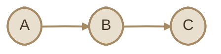
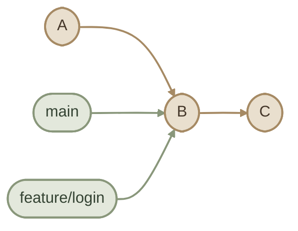
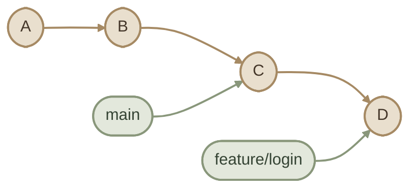
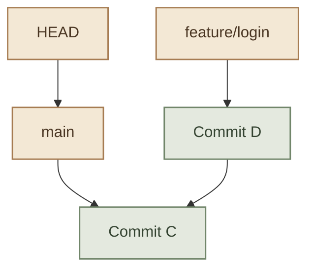
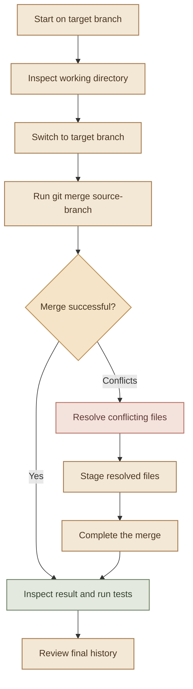
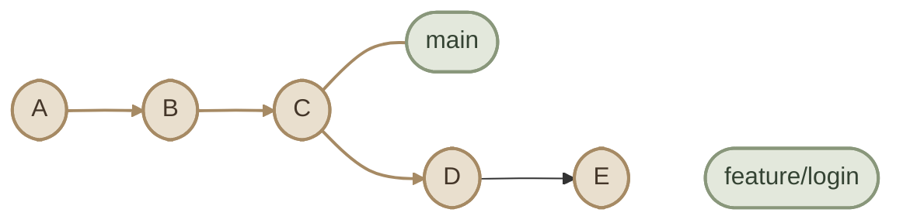
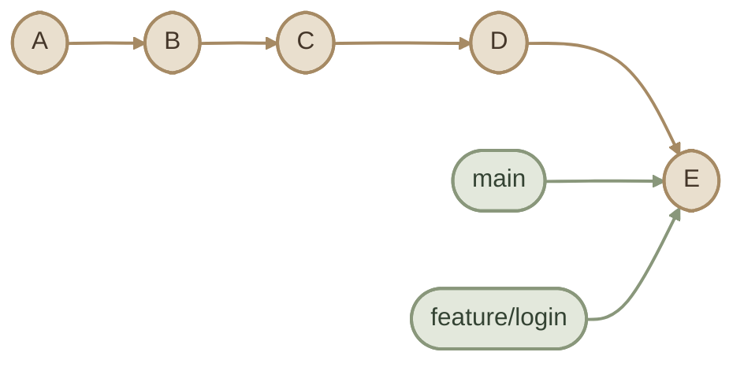
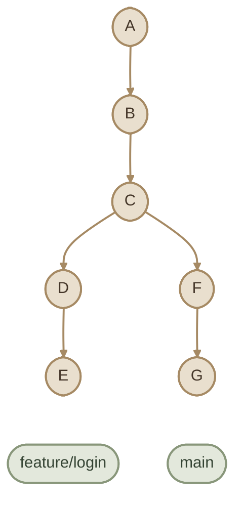
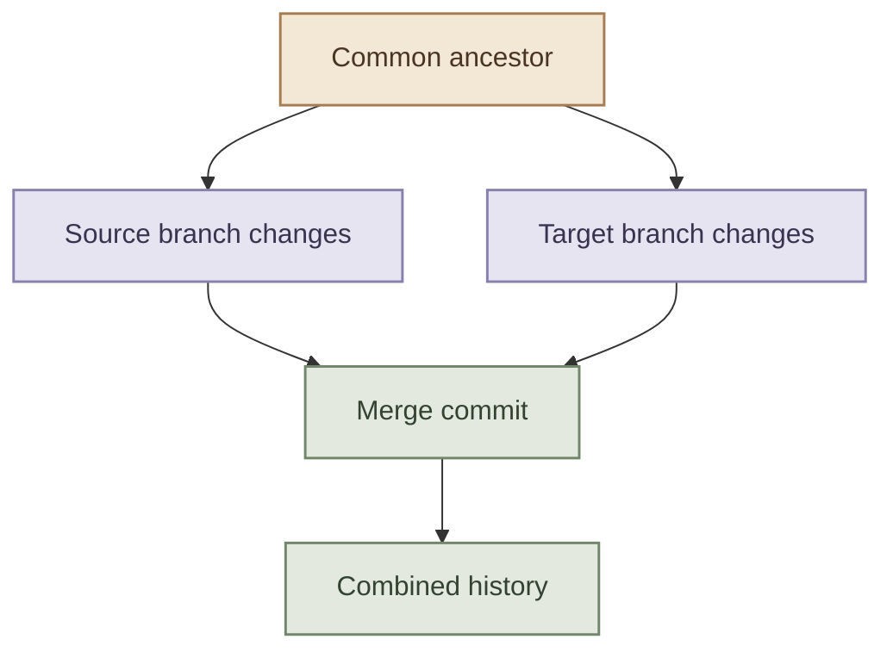

## Overview

الـ **Branching** و**Merging** من أهم المفاهيم في Git؛ لأنهم بيسمحوا لك تطوّر features جديدة، تصلّح bugs، وتجرب تغييرات من غير ما تضطر تخلط كل شغلك مباشرةً بالـ main codebase.

بدل ما تعدّل على نفس الخط اللي باقي الفريق بيعتمد عليه، تقدر تعمل Branch مستقل، تشتغل عليه، وبعد ما تتأكد إن التغييرات سليمة، تدمجها في Branch تاني باستخدام `git merge`.

<InfoCard variant="concept" title="The Core Idea" description="A branch is a movable reference to a commit. Creating a branch gives you another line of development without immediately changing the existing branch." icon="branch" tags={["Branches", "Commits"]} />

## 1. What Is a Branch?

الـ **Branch** في Git عبارة عن reference بيشير إلى Commit معيّن، وبيتحرك تلقائيًا لما تعمل commits جديدة على نفس الـ branch.

تخيّل إن عندك مشروع بدأ بالـ commits دي:



في الحالة دي، الـ `main` ممكن يشير إلى الـ commit `C`.

لما تنشئ branch جديد اسمه `feature/login`، Git مش بيعمل نسخة كاملة من المشروع؛ هو بيعمل reference جديد يشير لنفس الـ commit الحالي.

```bash
git branch feature/login
```

بعد إنشاء الـ branch، الاتنين بيشيروا إلى نفس الـ commit:



لما تنتقل إلى `feature/login` وتعمل commit جديد `D`، الـ feature branch هو اللي بيتحرك إلى `D`، بينما `main` يفضل عند `C`.



ده معناه إن كل Branch يقدر يتقدم في مساره بشكل مستقل، مع إمكانية دمج التغييرات لاحقًا.

### I. How Branches Work Internally

Git بيستخدم branch names كـ references للـ commits. الـ branch مش نسخة منفصلة من كل ملفات المشروع، ومش container بيخزن كل التغييرات لوحده.

كمان، لازم نفرّق بين حاجتين:

- **Branch:** اسم بيشير إلى commit.
- **Working Directory:** الملفات اللي بتشتغل عليها حاليًا.
- **HEAD:** بيحدد إنت واقف على أنهي branch أو commit.

في الاستخدام المعتاد، `HEAD` بيشير إلى الـ current branch، والـ branch بيشير إلى آخر commit عليه.



الـ diagram بيوضح إن `HEAD` بيحدد الـ current branch، بينما كل branch reference بيشير إلى commit. والـ commits نفسها بتحتفظ بعلاقاتها بالـ parent commits.

### II. Why Use Branches?

<CardGrid columns={2} label="Common Branch Purposes">
<InfoCard variant="feature" title="Feature Development" description="بناء ميزة جديدة في عزل عن الفرع الأساسي." icon="flag" tags={["feature/*"]} />
<InfoCard variant="feature" title="Bug Fixes" description="إصلاح خطأ محدد من غير تأثير باقي الشغل." icon="wrench" tags={["fix/*"]} />
<InfoCard variant="feature" title="Experiments" description="تجربة استراتيجية أو إثبات فكرة قبل اعتمادها." icon="cycle" tags={["experiment/*"]} />
<InfoCard variant="feature" title="Release Preparation" description="تجهيز وإصلاح إصدار مستقر قبل النشر." icon="tag" tags={["release/*"]} />
</CardGrid>

الفكرة إنك تقدر تفصل التغييرات حسب الهدف منها، وتراجعها وتختبرها قبل ما تدمجها في branch تاني.

## 2. `git branch`, `git switch`, and `git checkout`

الأوامر دي مرتبطة بإدارة الـ branches، لكن كل أمر ليه استخدامات مختلفة.

### I. `git branch`

لعرض الـ local branches:

```bash
git branch
```

الـ branch اللي قبله `*` هو الـ current branch.

لعرض الـ remote-tracking branches:

```bash
git branch -r
```

لعرض كل الـ local والـ remote-tracking branches:

```bash
git branch -a
```

لإنشاء branch جديد من غير الانتقال إليه:

```bash
git branch feature/login
```

إنشاء branch جديد مش معناه إنك انتقلت إليه؛ لازم تستخدم أمر للتبديل.

### II. `git switch`

الأمر المخصص للتنقل بين الـ branches في إصدارات Git الحديثة:

```bash
git switch main
```

للانتقال إلى branch موجود:

```bash
git switch feature/login
```

لإنشاء branch جديد والانتقال إليه مباشرةً:

```bash
git switch -c feature/login
```

الاختصار `-c` معناه create.

لو الـ branch موجود بالفعل، استخدم `git switch feature/login` بدل `-c`.

### III. `git checkout`

الأمر الأقدم اللي كان بيُستخدم لأكتر من وظيفة، منها التنقل بين الـ branches واستعادة الملفات من إصدارات معينة.

للتنقل إلى branch موجود:

```bash
git checkout main
```

لإنشاء branch جديد والانتقال إليه:

```bash
git checkout -b feature/login
```

الأمر ده لسه صالح للاستخدام، لكن `git switch` أوضح لما يكون هدفك هو التنقل بين الـ branches فقط.

<InfoCard variant="comparison" title="Which Command Should You Use?" description="Use git branch to inspect or create branch references, git switch to move between branches, and git checkout when working with older workflows or commands that support both switching and restoring files." icon="branch" tags={["CLI", "Git"]} />

### IV. Important: Switching Branches Safely

Git ممكن يرفض الانتقال إلى branch تاني لو فيه تغييرات محلية هتتعارض مع الملفات اللي المفروض تتغير أثناء الانتقال.

قبل ما تبدّل، راجع حالة الـ working directory:

```bash
git status
```

لو عندك تغييرات غير محفوظة، قرر هل هتعمل commit، أو هتستخدم `git stash` مؤقتًا، أو هتتخلّص منها لو مش محتاجها.

**متستخدمش أوامر حذف التغييرات لمجرد إن Git منعك من التنقل.** اتأكد الأول إن التغييرات مش محتاجها.

## 3. Creating and Working on a Feature Branch

خلينا نطبّق Workflow بسيط.

افتكر إن عندك مشروع على `main` وعايز تضيف ميزة Login.

<Steps>
<li>

<InfoCard title="Step 1 — Check Your Current State" description="اتأكد إنك على الـ branch المناسب وإن الـ working directory حالته واضحة." icon="pulse" tags={["Status"]} />

```bash
git status
git branch
```

</li>
<li>

<InfoCard title="Step 2 — Create and Switch to a Branch" description="أنشئ feature branch جديد وانتقل إليه مباشرة." icon="branch" tags={["Branch"]} />

```bash
git switch -c feature/login
```

</li>
<li>

<InfoCard title="Step 3 — Make Changes and Commit Them" description="عدّل ملفات الـ Login، جهّزها، وسجّلها." icon="wrench" tags={["Commit"]} />

```bash
git status
git add src/auth/
git commit -m "feat(auth): add login flow"
```

عدّل مسار `src/auth/` حسب بنية مشروعك الفعلية. لو التغييرات موزعة على ملفات مختلفة، اعمل stage للملفات المناسبة بدل ما تفترض إن المسار ده موجود.

</li>
<li>

<InfoCard title="Step 4 — Inspect the Branch History" description="شوف الـ commits والـ branches وعلاقاتهم ببعض." icon="layers" tags={["History"]} />

```bash
git log --oneline --graph --decorate --all
```

</li>
<li>

<InfoCard title="Step 5 — Return to the Target Branch" description="اتأكد إنك واقف على الـ branch اللي عايز تستقبل التغييرات قبل الدمج." icon="branch" tags={["Merge prep"]} />

```bash
git switch main
```

</li>
</Steps>

## 4. What Is `git merge`?

الـ **Merge** هو عملية دمج التغييرات الموجودة في branch داخل branch تاني.

لما تنفّذ:

```bash
git switch main
git merge feature/login
```

Git بيحاول يدمج التغييرات اللي وصلت لها `feature/login` في `main`.

لاحظ إن `git merge feature/login` بيحاول يدمج الـ branch المحدد **في الـ current branch**. بالتالي، لو إنت واقف على `main`، التغييرات هتدخل في `main`. ولو إنت واقف على `feature/login`، الاتجاه هيكون مختلف.

### I. The Merge Process



مش كل Merge بيحتاج حل conflicts أو بيعمل merge commit جديد. النتيجة بتعتمد على تاريخ الـ commits وطبيعة التغييرات.

## 5. Fast-Forward vs Three-Way Merge

فيه طريقتين شائعتين ممكن Git يستخدمهم عند تنفيذ Merge: **Fast-Forward** و**Three-Way Merge**.

### I. Fast-Forward Merge

الـ Fast-Forward بيحصل لما الـ target branch مفيش عليه commits جديدة بعد نقطة إنشاء الـ source branch، ويكون تاريخ الـ source branch امتدادًا مباشرًا له.

قبل الدمج:



بما إن `main` لسه عند `C`، و`feature/login` متقدم عليه في نفس المسار، Git يقدر يحرّك `main` من `C` إلى `E` من غير ما ينشئ merge commit جديد.

بعد الدمج:



في الحالة دي، Git بيحرّك الـ branch reference للأمام فقط.

الأمر:

```bash
git switch main
git merge feature/login
```

لو الـ Fast-Forward متاح، Git غالبًا هيستخدمه بشكل افتراضي.

ولو عايز تمنع الـ Fast-Forward وتجبر Git على إنشاء merge commit حتى لو كان ممكن يعمل Fast-Forward:

```bash
git merge --no-ff feature/login
```

ده ممكن يكون مفيد لو عايز تحتفظ بنقطة دمج واضحة في تاريخ المشروع.

### II. Three-Way Merge

الـ Three-Way Merge بيحصل عادةً لما الـ target branch والـ source branch يكون لكل واحد منهم commits جديدة بعد نقطة مشتركة.

قبل الدمج:



Git بيحدد ثلاث نقاط أساسية:

1. **Merge Base:** آخر commit مشترك بين الفرعين.
2. **Target Tip:** آخر commit في الـ branch الحالي.
3. **Source Tip:** آخر commit في الـ branch اللي بتدمجه.

بعد كده Git بيحاول يجمع التغييرات من المسارين. لو الدمج نجح، ممكن ينشئ merge commit له أكتر من parent.



### III. Comparison

<CardGrid columns={2} label="Merge Strategies">
<InfoCard variant="comparison" title="Fast-Forward" description="بيحرّك الـ branch reference للأمام من غير merge commit — خطّي وبسيط." icon="cycle" tags={["Linear"]} />
<InfoCard variant="comparison" title="Three-Way Merge" description="بيستخدم الـ common ancestor والنُسختين لإنتاج merge commit — بيسجّل التفرّع." icon="git-merge" tags={["Recorded"]} />
</CardGrid>

<TableCard title="Fast-Forward vs Three-Way Merge" caption="الفرق الأساسي في شكل التاريخ وإمكانية حدوث التعارض.">
| Aspect | Fast-Forward | Three-Way Merge |
|---|---|---|
| Branch histories | امتداد مباشر لمسار واحد | فيه مساران تطوروا من نقطة مشتركة |
| New merge commit | مش مطلوب | غالبًا بيتم إنشاؤه عند نجاح الدمج |
| History shape | خطّي | ممكن يظهر فيه تفرّع واندماج |
| Conflict possibility | عادةً لا يوجد تعارض بسبب تغييرات متفرعة في الطرفين | ممكن تحصل conflicts |
| Common use | دمج فرع لم يتقدم عليه الـ target | دمج فروع اتطورت بشكل مستقل |
</TableCard>

**مهم:** الـ Fast-Forward مش استراتيجية لدمج محتوى الملفات بالطريقة نفسها اللي بيستخدمها Three-Way Merge؛ هو تحريك للـ branch reference لأن تاريخ الـ commits يسمح بده. وفي المقابل، Three-Way Merge بيستخدم الـ common ancestor والنسختين الحاليتين لتحديد التغييرات المطلوب دمجها.

## 6. Merge Conflicts

الـ **Merge Conflict** بيحصل لما Git ميقدرش يحدد تلقائيًا إزاي يجمع تغييرات متعارضة.

مثال: فرعين عدّلوا نفس السطور في نفس الملف بطرق مختلفة.

في `main`:

```javascript
const message = "Welcome";
```

وفي `feature/login`:

```javascript
const message = "Welcome back";
```

لما تحاول تدمج الفرع، Git ممكن يوقف عملية الدمج ويطلب منك حل التعارض.

### I. How Conflict Markers Look

Git بيضيف علامات داخل الملف المتعارض:

```text
<<<<<<< HEAD
const message = "Welcome";
=======
const message = "Welcome back";
>>>>>>> feature/login
```

العلامات دي معناها:

- `<<<<<<< HEAD`: بداية التغيير الموجود في الـ current branch.
- `=======`: فاصل بين النسختين.
- `>>>>>>> feature/login`: نهاية التغيير القادم من الفرع الآخر.

أثناء الـ Merge، `HEAD` بيمثل عادةً النسخة الموجودة في الـ current branch، والجزء التاني بيمثل التغيير القادم من الـ branch اللي بتدمجه.

لازم تحذف علامات التعارض وتكتب النتيجة النهائية المطلوبة. متسيبش العلامات دي في الكود.

### II. Not Every Conflict Is the Same

ممكن تواجه:

- **Content conflict:** نفس الجزء من الملف اتعدل بشكل متعارض.
- **Modify/delete conflict:** فرع عدّل ملف والفرع التاني حذفه.
- **Rename-related conflict:** تغييرات متعارضة مرتبطة بإعادة تسمية الملفات أو نقلها.
- **Binary conflict:** Git مش قادر يدمج تغييرات ملف ثنائي تلقائيًا زي بعض الصور أو ملفات التصميم.

الخطوات الدقيقة للحل بتختلف حسب نوع التعارض، لكن المبدأ واحد: افهم التغييرين، وحدد النتيجة المقصودة، وراجع الناتج قبل إكمال الدمج.

## 7. Resolving Conflicts Safely

خلينا نمشي بخطوات واضحة بدل ما نختار نسخة بشكل عشوائي.

<Steps>
<li>

<InfoCard title="Step 1 — Inspect the Merge State" description="اعرف إيه الملفات اللي فيها conflicts وحالتها." icon="pulse" tags={["Inspect"]} />

```bash
git status
git diff --name-only --diff-filter=U
```

الأمر هيعرض الملفات اللي فيها conflicts، وغالبًا هتظهر تحت `Unmerged paths`.

</li>
<li>

<InfoCard title="Step 2 — Inspect the Conflicting Files" description="افتح كل ملف متعارض واقرأ التغييرات في سياقها." icon="layers" tags={["Read"]} />

```bash
git show :2:path/to/file
git show :3:path/to/file
```

متفترضش إن نسخة `HEAD` دايمًا صح أو إن نسخة الـ feature branch هي المطلوبة. ممكن كل نسخة تحتوي على جزء مهم من المنطق. في الـ merge conflict العادي، الـ stage `2` بيمثل **ours** والـ stage `3` بيمثل **theirs**.

</li>
<li>

<InfoCard title="Step 3 — Edit the File" description="اكتب النتيجة النهائية المقصودة — متسيبش علامات التعارض." icon="wrench" tags={["Resolve"]} />

```javascript
const message = "Welcome back";
```

المثال هنا للتوضيح فقط؛ الاختيار الحقيقي لازم يعتمد على متطلبات التطبيق.

</li>
<li>

<InfoCard title="Step 4 — Stage the Resolved File" description="علّن إن النسخة الحالية هي النسخة اللي عايز تدخلها في نتيجة الـ Merge." icon="layers" tags={["Stage"]} />

```bash
git add path/to/file
```

لو فيه أكتر من ملف متعارض، كرر العملية لكل ملف.

</li>
<li>

<InfoCard title="Step 5 — Verify All Conflicts Are Resolved" description="اتأكد إن مفيش ملفات Unmerged وراجع التغييرات." icon="pulse" tags={["Verify"]} />

```bash
git status
git diff --check
git diff --cached
```

`git diff --check` بيساعد في اكتشاف whitespace errors لكنه مش بديل عن مراجعة الكود أو تشغيل الاختبارات.

</li>
<li>

<InfoCard title="Step 6 — Complete the Merge" description="كمّل عملية الدمج بعد حل كل التعارضات." icon="git-merge" tags={["Finish"]} />

```bash
git merge --continue
```

لو الأمر طلب منك تحرير رسالة الـ merge commit، راجع الرسالة واحفظها.

</li>
<li>

<InfoCard title="Step 7 — Run Tests and Inspect History" description="شغّل الاختبارات وراجع النتيجة قبل ما تعتبر الـ merge مكتملًا." icon="shield" tags={["Quality"]} />

```bash
git status
git log --oneline --graph --decorate -10
```

</li>
</Steps>

<InfoCard variant="warning" title="Avoid Blind Conflict Resolution" description="Commands such as git checkout --ours or git checkout --theirs can replace a conflicted file with one side's version. Use them only when you understand the consequences, because they can discard valid changes from the other side." icon="shield" tags={["Conflicts", "Data Safety"]} />

### VIII. How to Abort a Merge

لو اكتشفت إنك مش جاهز تحل التعارضات، أو بدأت الدمج على الفرع الغلط، تقدر تلغي عملية الـ Merge الجارية:

```bash
git merge --abort
```

الأمر ده بيحاول يرجّع الـ working tree والـ index لحالتهم قبل بدء الدمج.

لكن خليك حذر: لو كان عندك تغييرات محلية غير محفوظة قبل الدمج، عملية الاسترجاع مش مضمونة في كل الحالات إنها تحافظ على كل شيء بالشكل اللي تتوقعه. عشان كده الأفضل تفحص `git status` قبل بدء الـ Merge، وتحفظ شغلك المهم.

## 8. Branch Naming

اختيار أسماء واضحة للـ branches بيخلي تاريخ المشروع أسهل في القراءة، خصوصًا لما يبقى فيه أكتر من feature أو bug fix شغالين في نفس الوقت.

أمثلة شائعة:

<CardGrid columns={3} label="Branch Naming Prefixes">
<InfoCard variant="feature" title="feature/" description="ميزة جديدة أو تطوير قيد التنفيذ." icon="flag" tags={["feature/user-auth"]} />
<InfoCard variant="feature" title="fix/ + hotfix/" description="إصلاح bug عادي أو إصلاح عاجل في الإنتاج." icon="wrench" tags={["fix/login-error"]} />
<InfoCard variant="feature" title="release/ + docs/" description="تجهيز إصدار أو تعديلات توثيق." icon="tag" tags={["release/1.2.0"]} />
</CardGrid>

<TableCard title="Branch Naming Conventions" caption="prefixes شائعة بتساعد الفريق يفهم هدف الفرع من الاسم.">
| Prefix | Purpose | Example |
|---|---|---|
| `feature/` | ميزة جديدة | `feature/user-auth` |
| `fix/` | إصلاح bug | `fix/login-error` |
| `hotfix/` | إصلاح عاجل | `hotfix/payment-crash` |
| `docs/` | تعديلات التوثيق | `docs/git-branching` |
| `refactor/` | إعادة تنظيم الكود | `refactor/auth-service` |
| `release/` | تجهيز إصدار | `release/1.2.0` |
| `experiment/` | تجربة أو إثبات فكرة | `experiment/cache-layer` |
</TableCard>

دي conventions شائعة، مش قواعد إلزامية من Git.

### I. Naming Guidelines

- اختار اسم يوضح الهدف من الفرع.
- استخدم أسماء قصيرة لكن مفهومة.
- اتفق مع الفريق على naming convention ثابت.
- تجنّب الأسماء العامة زي `test` أو `new-branch` في المشاريع اللي فيها أكتر من شخص.
- لو الفريق بيستخدم Issue IDs، ممكن تضيفها للاسم، مثل `feature/123-user-auth`.

خلي بالك إن أسماء الـ branches حساسة لحالة الأحرف في بعض البيئات والأنظمة، وإن استخدام أسماء متشابهة جدًا ممكن يعمل ارتباك.

## 9. Deleting and Renaming Branches

مع الوقت، هتحتاج تنظّم الـ branches وتحذف الفروع اللي خلصت أو تغيّر أسماءها.

### I. List Branches Before Cleanup

```bash
git branch
git branch -a
```

راجع أسماء الفروع وتأكد إنك عارف أي branch شغال عليه حاليًا.

### II. Delete a Local Branch

لحذف branch محلي تم دمجه بالفعل أو Git شايف إن حذفه آمن:

```bash
git branch -d feature/login
```

الخيار `-d` بيمنع حذف branch لو Git شايف إن فيه تغييرات غير مدمجة فيه، في الحالات اللي يقدر يكتشفها.

لو متأكد إنك عايز تحذف الفرع حتى لو فيه commits غير مدمجة:

```bash
git branch -D feature/login
```

**تحذير:** `-D` بيجبر Git على حذف الـ branch reference حتى لو فيه شغل ممكن تفقد الوصول إليه بسهولة. متستخدموش كاختصار لمجرد إن `-d` رفض الحذف.

حذف branch محلي مش معناه إن الـ commits اللي كان بيشير إليها اختفت فورًا من كل مكان؛ ممكن تفضل متاحة من references تانية أو من خلال Git's object database لفترة.

### III. Rename a Local Branch

لإعادة تسمية الـ current branch:

```bash
git branch -m new-name
```

ولإعادة تسمية branch تاني:

```bash
git branch -m old-name new-name
```

الأمر `-m` بيعيد التسمية. لو الاسم الجديد مستخدم بالفعل، Git غالبًا هيرفض العملية بدل ما يستبدل الفرع الموجود بصمت.

### IV. Delete a Remote Branch

لحذف branch من remote repository، مثل `origin`:

```bash
git push origin --delete feature/login
```

ده بيحذف الفرع من الـ remote لو عندك الصلاحيات المطلوبة. اتأكد من اسم الفرع قبل تنفيذ الأمر، خصوصًا في repositories المشتركة.

### V. Rename a Branch Already Published to a Remote

إعادة تسمية branch محلي مش بتعيد تسمية الـ remote branch تلقائيًا.

لو محتاج تعيد تسمية branch منشور على `origin`، فالخطوات العامة هي:

1. أعد تسمية الفرع محليًا.
2. انشر الاسم الجديد على الـ remote.
3. احذف الاسم القديم من الـ remote بعد التأكد إن ده آمن.
4. حدّث أي Pull Requests أو إعدادات أو workflows مرتبطة بالاسم القديم حسب الحاجة.

مثال، لو الـ current branch اتغيّر اسمه محليًا إلى `feature/authentication`:

```bash
git push -u origin feature/authentication
```

وبعد التأكد من نشر الاسم الجديد وإنه هو المطلوب:

```bash
git push origin --delete feature/login
```

لو الفرع القديم هو الفرع الافتراضي للـ repository أو مرتبط بإعدادات مهمة، متحذفوش قبل تحديث الإعدادات المعنية.

## 10. Practical Workflow

<Callout type="lab" title="Hands-on: Branch & Merge" />

<Steps>
<li>

<InfoCard title="Step 1 — Create Branch" description="أنشئ feature branch جديد وانتقل إليه." icon="branch" tags={["Branch"]} />

```bash
git status
git switch -c feature/profile-page
```

</li>
<li>

<InfoCard title="Step 2 — Make & Commit" description="عدّل الملفات، جهّزها، وسجّلها." icon="wrench" tags={["Commit"]} />

```bash
git add .
git commit -m "feat(profile): add profile page"
```

</li>
<li>

<InfoCard title="Step 3 — Inspect History" description="راجع تاريخ الـ commits والعلاقات." icon="layers" tags={["History"]} />

```bash
git log --oneline --graph --decorate --all
```

</li>
<li>

<InfoCard title="Step 4 — Merge into Main" description="انتقل لـ main ودمج الـ feature branch." icon="shield" tags={["Merge"]} />

```bash
git switch main
git merge feature/profile-page
```

</li>
</Steps>

### V. Verify and Clean Up

```bash
git status
git log --oneline --graph --decorate -10
```

بعد ما تتأكد إن الدمج نجح وإن الاختبارات سليمة، احذف الـ feature branch المحلي لو لم تعد محتاجه:

```bash
git branch -d feature/profile-page
```

لو شغلك على remote repository، نشر التغييرات أو تحديث الـ remote branch خطوة منفصلة حسب الـ workflow المستخدم في المشروع.

## 11. Common Mistakes

<InfoCard variant="warning" title="Merging into the Wrong Branch" description="git merge merges the named branch into the current branch. Run git branch or git status before merging to confirm where you are." icon="shield" tags={["Workflow"]} />

<InfoCard variant="warning" title="Assuming a New Branch Contains New Changes" description="Creating a branch does not copy new work from another branch. A newly created branch initially points to the commit from which it was created." icon="shield" tags={["Branches"]} />

<InfoCard variant="warning" title="Deleting a Branch Too Early" description="Before deleting a branch, confirm its work is merged or safely preserved elsewhere. Use -D only when you deliberately accept the risk of removing the reference to unmerged work." icon="shield" tags={["Cleanup"]} />

<InfoCard variant="tip" title="Review Before You Merge" description="Inspect the current branch, the diff, and the commit history before merging. Afterward, run the project's tests and review the resulting history." icon="layers" tags={["Best Practices"]} />

## 12. Key Takeaways

<InfoCard variant="summary" title="Branch & Merge in One Line" description="branch = pointer لـ commit. switch للتنقل، merge للدمج. conflicts بتتحل بفهم النسختين مش باختيار عشوائي." icon="branch" tags={["Mental Model"]} />

- الـ **Branch** هو reference متحرك بيشير إلى commit.
- `git branch` بيعرض أو ينشئ branches، لكنه مش بينقلك للـ branch الجديد.
- `git switch` هو الاختيار الواضح للتنقل بين branches وإنشاء branch جديد مع `-c`.
- `git checkout` ما زال صالحًا، لكنه بيجمع وظائف مختلفة في أمر واحد.
- `git merge` بيدمج الـ source branch في الـ current branch.
- **Fast-Forward** بيحرّك branch reference للأمام من غير الحاجة إلى merge commit.
- **Three-Way Merge** بيستخدم الـ common ancestor والتغييرات في الفرعين لإنتاج نتيجة الدمج.
- الـ **Merge Conflict** محتاج فهم التغييرات المتعارضة، مش مجرد اختيار نسخة بشكل عشوائي.
- `git merge --abort` بيلغي عملية الدمج الجارية لما يكون ذلك ممكنًا.
- `git branch -d` للحذف الآمن نسبيًا، بينما `git branch -D` بيجبر Git على حذف الـ reference.
- حذف أو إعادة تسمية branch محلي مش بيحدّث الـ remote تلقائيًا.
