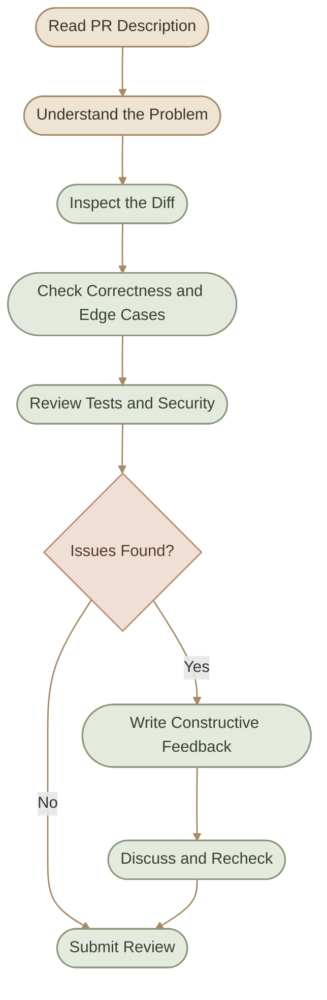
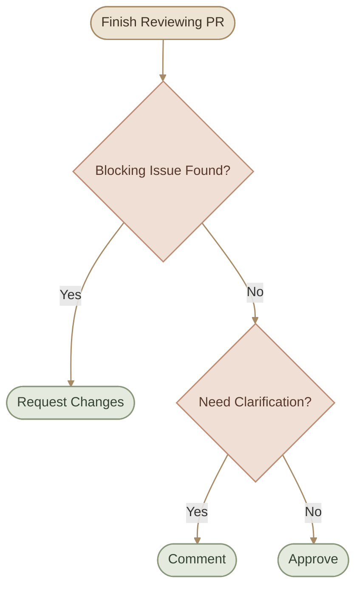
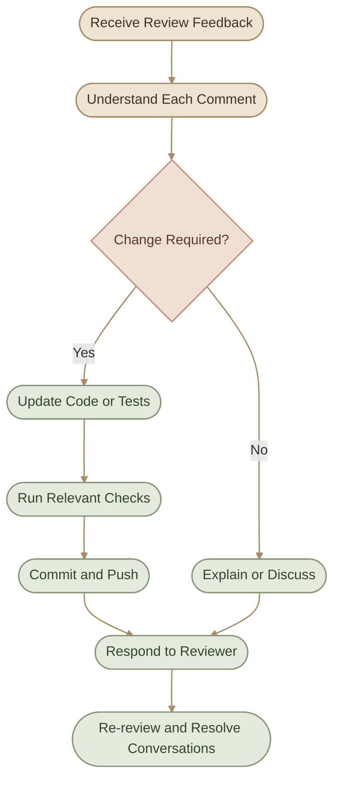
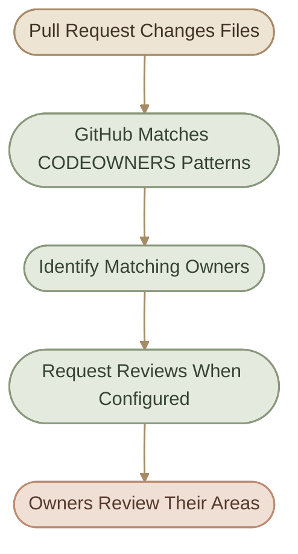

## Introduction

الـ **Code Review** هي عملية فحص التغييرات المقترحة في الكود قبل دمجها في المشروع، بهدف التأكد من صحتها، وسهولة صيانتها، والتزامها بمعايير المشروع.

في الـ Open Source والفرق الهندسية، الـ Code Review مش مجرد البحث عن الأخطاء؛ دي كمان فرصة لتحسين التصميم، مشاركة المعرفة، وتوضيح القرارات التقنية.

لكن لازم نفرّق بين حاجتين:

- **Code Review:** عملية مراجعة التغييرات ومناقشتها.
- **Pull Request:** المكان اللي بتتم فيه المراجعة غالبًا على GitHub.

### I. What You Will Learn

<CardGrid columns={2} label="Learning Objectives">
  <InfoCard variant="concept" title="Effective Reviews" description="راجع صحة التغيير وتأثيره واختباراته بدل التركيز على شكل الكود فقط." icon="pulse" tags={["Correctness", "Quality"]} />
  <InfoCard variant="feature" title="Constructive Feedback" description="اكتب تعليقات واضحة تشرح المشكلة وتقترح تحسينات قابلة للتنفيذ." icon="pulse" tags={["Comments", "Suggestions"]} />
  <InfoCard variant="comparison" title="Review Decisions" description="افهم الفرق بين Approve وRequest changes، وإزاي تتعامل مع المحادثات." icon="git-pull-request" tags={["Approval", "Discussion"]} />
  <InfoCard variant="insight" title="Maintainable Code" description="استخدم CODEOWNERS وممارسات PR الجيدة لتحسين التعاون والصيانة." icon="network" tags={["Ownership", "Maintainability"]} />
</CardGrid>

## 1. Reviewing Code Effectively

المراجعة الفعالة بتبدأ بفهم هدف التغيير قبل قراءة تفاصيل التنفيذ.

لو الـ Pull Request هدفها إصلاح Bug في Docker image، مثلًا، لازم تفهم المشكلة الأصلية، والتغيير المقترح، وإزاي نقدر نتأكد إن المشكلة اتحلت من غير ما نكسر سلوكًا موجودًا.

### Step 1: Understand the Context

قبل مراجعة الكود، اقرأ:

- وصف الـ Pull Request.
- الـ Issue المرتبطة بالتغيير، لو موجودة.
- الـ Commits والملفات المتأثرة.
- الاختبارات المضافة أو المعدّلة.
- أي نقاش سابق يوضح سبب اختيار الحل.

متبدأش باقتراح إعادة كتابة الكود قبل ما تفهم المشكلة اللي بيحاول يحلّها.

### Step 2: Review the Diff

افتح تبويب `Files changed` في GitHub، وراجع الـ Diff.

ركز على الأسئلة دي:

- هل التغيير بيحقق المطلوب؟
- هل فيه تغييرات غير مرتبطة بالهدف؟
- هل فيه حالات طرفية `Edge Cases` مش متغطية؟
- هل معالجة الأخطاء واضحة؟
- هل التغيير بيأثر على Security أو Performance؟
- هل الاختبارات مناسبة للتغيير؟

### Step 3: Check Correctness and Reliability

مش كل كود شكله صحيح بيكون صحيحًا في كل الحالات.

مثلًا، لو Script بتستخدم متغيرًا بيحتوي على مسار ملف، لازم تفكر في احتمالية إن الملف غير موجود أو إن المتغير فاضي، حسب السياق.

وفي بيئة DevOps، راجع كمان:

- التعامل مع فشل الأوامر.
- صلاحيات الملفات والعمليات.
- إدارة Secrets.
- سلوك الـ Deployment عند الفشل.
- إمكانية تكرار العملية بأمان `Idempotency`، لما تكون مطلوبة.
- تأثير التغيير على Logging وMonitoring.

مش كل نقطة من دول مطلوبة في كل PR؛ اختار اللي يناسب نوع التغيير.

### Step 4: Evaluate Tests

اسأل نفسك:

- هل الاختبارات بتغطي السلوك الجديد؟
- هل فيه اختبار للحالة اللي كانت بتسبب المشكلة؟
- هل التغيير بيحتاج Integration Test؟
- هل الاختبارات الحالية كفاية لإثبات صحة الحل؟

نجاح الاختبارات مؤشر مهم، لكنه مش ضمان مطلق إن التغيير خالٍ من الأخطاء.

### I. Effective Review Workflow



<InfoCard variant="tip" title="Review the Change, Not the Person" description="خلي تركيزك على صحة الحل، وتأثيره، ومدى توافقه مع متطلبات المشروع. الهدف تحسين التغيير، مش تقييم الشخص اللي كتبه." icon="flag" />

## 2. Comments and Suggestions

الـ Review Comments هي الوسيلة اللي بتوضح بيها مشكلة أو بتقترح تحسينًا على التغيير.

التعليق الجيد لازم يساعد صاحب الـ PR يفهم:

1. إيه المشكلة؟
2. ليه المشكلة مهمة؟
3. إيه النتيجة أو المخاطر المتوقعة؟
4. إيه التعديل المقترح، لو فيه حل واضح؟

### I. Example: Vague vs Constructive Comment

**Vague comment:**

```text
This code is bad. Please fix it.
```

التعليق ده مش بيشرح المشكلة، ومش بيساعد صاحب التغيير يعرف يبدأ منين.

**Constructive comment:**

```text
Could we handle the case where this configuration file is missing?
The application currently fails during startup without a clear error.
Returning a descriptive error would make the failure easier to diagnose.
```

التعليق التاني بيحدد الحالة، ويوضح أثرها، ويقترح اتجاهًا للحل.

### II. Types of Review Comments

<CardGrid columns={2} label="Comment Types">
  <InfoCard variant="warning" title="Bug or Correctness" description="يوضح سلوكًا غير صحيح أو حالة غير متغطية ممكن تسبب مشكلة." icon="wrench" />
  <InfoCard variant="concept" title="Question" description="يطلب توضيح قرار أو سلوك غير مفهوم قبل الحكم على الحل." icon="pulse" />
  <InfoCard variant="tip" title="Suggestion" description="يقترح تحسينًا في التصميم أو القراءة أو سهولة الصيانة." icon="code" />
  <InfoCard variant="insight" title="Nitpick" description="ملاحظة صغيرة، مثل تنسيق أو تسمية، لا تؤثر عادةً على صحة التغيير." icon="tag" />
</CardGrid>

### III. Explain the Impact

بدل ما تقول:

```text
This function is too complicated.
```

ممكن تقول:

```text
Could we split this function into smaller units?
Separating configuration loading from validation would make each
step easier to test and maintain.
```

كده أنت بتوضح السبب التقني وراء اقتراحك.

### IV. Distinguish Blocking Issues from Suggestions

مش كل تعليق لازم يمنع الدمج.

ممكن تستخدم كلمات واضحة في وصف الملاحظة:

| Label | Intended Meaning |
|---|---|
| `Blocking` | مشكلة لازم تتحل قبل الدمج |
| `Suggestion` | تحسين مقترح يمكن مناقشته |
| `Question` | نقطة محتاجة توضيح |
| `Nitpick` | ملاحظة صغيرة غير جوهرية غالبًا |

دي أمثلة على تصنيف التعليقات، مش Labels إلزامية بيفرضها GitHub. اتبع أسلوب الفريق لو عنده نظام محدد.

<InfoCard variant="success" title="Make Feedback Actionable" description="التعليق المفيد بيحدد المشكلة وتأثيرها، وبيوضح المطلوب من غير ما يفرض إعادة كتابة الكود بالكامل لو فيه حل أبسط." icon="shield" />

## 3. Approve vs Request Changes

بعد ما تراجع الـ Pull Request، تقدر تقدم قرار Review يتناسب مع نتيجة المراجعة.

في GitHub، أشهر الاختيارات هي:

- `Comment`
- `Approve`
- `Request changes`

### I. Comment

استخدمه لما تحب تضيف ملاحظات أو أسئلة من غير ما تسجل موافقة أو طلب تغييرات رسميًا.

مثال: عندك سؤال عن سبب اختيار طريقة معينة، لكن لسه مش عندك مشكلة واضحة تمنع الدمج.

### II. Approve

استخدم `Approve` لما تكون راضيًا عن التغييرات من ناحية المراجعة، ومش شايف مشكلة تستدعي منع الدمج.

الموافقة مش معناها إنك بتضمن خلو التغيير من كل الأخطاء، لكنها بتعبر عن قرارك بناءً على المراجعة اللي عملتها.

### III. Request Changes

استخدم `Request changes` لما تكتشف مشكلة مهمة محتاجة تتعالج قبل الدمج.

مثلًا:

- التغيير بيكشف Secret.
- فيه Bug واضح.
- التعديل بيكسر سلوكًا مطلوبًا.
- فيه مشكلة أمان مؤثرة.
- التغيير مخالف لمتطلبات أساسية للمشروع.

### IV. Comparison

| Action | Meaning | Typical Situation |
|---|---|---|
| Comment | ملاحظات أو نقاش من غير موافقة أو طلب تغييرات رسمي | محتاج توضيح أو عايز تسيب Feedback |
| Approve | موافقة على التغيير من ناحية المراجعة | التغيير مقبول ومفيش مشكلة معروفة تمنع الدمج |
| Request changes | طلب معالجة مشكلات قبل الدمج | فيه مشكلة مؤثرة لازم تتحل |

### V. Decision Flow



### V. Important: Approval Does Not Always Mean Merge Is Allowed

ممكن تدي Approval، لكن GitHub تمنع الدمج بسبب:

- Required status checks لسه فاشلة.
- عدد الموافقات المطلوبة مش مكتمل.
- Branch protection rules.
- تغييرات جديدة تستدعي مراجعة إضافية.
- صلاحيات أو قواعد خاصة بالـ Repository.

وفي بعض المشاريع، الـ Author نفسه مش مسموح له يعتمد التغيير أو يدمجه، حسب إعدادات المستودع.

<InfoCard variant="warning" title="Do Not Approve Automatically" description="متديش Approval لمجرد إن الاختبارات نجحت أو لأنك تعرف صاحب التغيير. راجع الـ Diff وافهم أثره، خصوصًا في التغييرات الأمنية أو المتعلقة بالـ Infrastructure." icon="shield" />

## 4. Review Conversations

الـ Review Conversation هي المناقشة المرتبطة بتعليق أو سؤال على سطر معين أو على التغيير عمومًا.

الهدف منها توضيح الملاحظات والوصول إلى قرار مفهوم، مش مجرد جمع Comments.

### I. How a Conversation Works

1. الـ Reviewer يكتب تعليقًا.
2. صاحب الـ PR يرد أو يوضّح السياق.
3. لو محتاج تعديل، صاحب الـ PR يحدّث الكود.
4. الطرفان يتأكدان إن المشكلة اتعالجت.
5. يتم إغلاق المحادثة `Resolve conversation` عند الوصول لحل مناسب.

### II. What Does Resolve Conversation Mean?

إغلاق المحادثة معناه إن النقاش المرتبط بالتعليق تم حله أو مش محتاج متابعة، وفقًا لسياق المشروع.

لكن **Resolve conversation مش هو نفسه Approve PR**، ومش معناه تلقائيًا إن المشكلة اتصلحت فعلًا.

قبل ما تعمل Resolve، اتأكد إن الرد أو التغيير بيعالج النقطة اللي اتناقشت.

### III. Example

Reviewer:

```text
Could this command fail if the target directory does not exist?
```

Author:

```text
Good catch. I added a directory existence check and a test
for the missing-directory case.
```

بعد مراجعة التعديل والتأكد من الاختبار، ممكن يتم إغلاق المحادثة.

### IV. Keep the Discussion Focused

لو فيه اختلاف في الرأي، ركّز على:

- السلوك المطلوب.
- المتطلبات التقنية.
- المخاطر.
- البدائل المتاحة.
- تكلفة الصيانة على المدى الطويل.

لو المشكلة محتاجة نقاشًا أوسع، ممكن تنقل التفاصيل إلى Issue أو Discussion بدل ما تحوّل تعليقًا واحدًا إلى نقاش طويل خارج سياق التغيير.

<InfoCard variant="tip" title="Resolve with Confidence" description="متقفلش المحادثة لمجرد إن فيه رد. اتأكد إن السؤال اتجاوب عليه أو إن المشكلة اتعالجت، خصوصًا لو التعليق متعلق بصحة الكود أو الأمان." icon="pulse" />

## 5. Addressing Review Feedback

لما تستقبل Review Comments، المطلوب إنك تفهمها وتتعامل معاها بموضوعية.

مش معنى إن Reviewer طلب تغييرًا إنك لازم تنفذه حرفيًا من غير تفكير، لكن لازم تفهم السبب وتناقش أي اختلاف بشكل واضح.

### Step 1: Read All Feedback

اقرأ التعليقات كلها قبل ما تبدأ التعديلات.

ده بيساعدك تكتشف لو فيه ملاحظات مرتبطة ببعض، أو لو فيه اقتراحات متعارضة محتاجة توضيح.

### Step 2: Classify the Feedback

قسّم الملاحظات ذهنيًا إلى:

- **Required fixes:** مشكلات لازم تتحل.
- **Clarifications:** أسئلة محتاجة إجابة.
- **Suggestions:** تحسينات مقترحة.
- **Disagreements:** نقاط محتاجة نقاشًا تقنيًا.

التصنيف ده بيساعدك ترتب العمل وتحدد الأولويات.

### Step 3: Make the Changes

عدّل الكود، وبعدها راجع التغييرات:

```bash
git status
git diff
git diff --check
```

شغّل الاختبارات المناسبة حسب التعديل.

### Step 4: Push Updates

لو بتشتغل على نفس الـ Branch المرتبطة بالـ PR:

```bash
git add path/to/changed-file
git commit -m "fix: address review feedback"
git push origin feature/my-change
```

استبدل أسماء الـ Branch والملفات بالقيم الفعلية.

الـ PR هتتحدّث بالـ Commits الجديدة.

### Step 5: Respond to Comments

رد باختصار ووضوح.

لو نفذت المطلوب:

```text
Updated. The validation is now performed before the command runs,
and I added a test for the missing configuration case.
```

لو مش متفق مع الاقتراح:

```text
I understand the concern. I kept the current approach because
the configuration is shared by both paths. Would extracting the
validation into a shared helper address the issue?
```

الأمثلة دي توضح أسلوب الرد؛ عدّلها حسب التغيير الفعلي.

### Step 6: Request Another Review if Needed

بعد التعديلات، اطلب إعادة المراجعة لو المشروع محتاج كده، أو لو التغيير أثّر على أجزاء مهمة من الكود.

ممكن كمان تراجع بنفسك التعليقات السابقة وتتأكد إنها اتعالجت.

### I. Feedback Workflow



<InfoCard variant="success" title="Respond, Don't React" description="اتعامل مع الملاحظات باعتبارها فرصة لتحسين التغيير. لو مش متفق مع اقتراح، اشرح السبب التقني واسأل عن بديل مناسب بدل ما تتجاهل التعليق." icon="network" />

## 6. Code Review Etiquette

الـ Code Review عملية تعاون بين أشخاص، ونجاحها بيعتمد على جودة الملاحظات وطريقة التواصل، مش على اكتشاف الأخطاء فقط.

### I. For Reviewers

**Be specific**

حدد الملف أو السلوك والمشكلة بدل ما تكتب تعليقًا عامًا.

**Explain why**

وضّح تأثير المشكلة أو سبب اقتراح التغيير.

**Separate requirements from preferences**

لو فيه مشكلة صحة أو أمان، وضّح إنها مهمة. أما لو مجرد تفضيل في أسلوب كتابة الكود، وضّح إنه اقتراح.

**Respect the author's context**

ممكن يكون فيه قرار تصميمي أو قيد مش واضح من الـ Diff وحده. اسأل قبل ما تفترض.

**Prioritize important issues**

ركز على Correctness وSecurity وReliability قبل الملاحظات الشكلية البسيطة.

### II. For Authors

**Assume good intent**

التعليق غالبًا هدفه تحسين الكود، حتى لو صياغته محتاجة توضيح.

**Ask questions**

لو مش فاهم سبب الملاحظة، اطلب تفسيرًا بدل ما تتجاهلها.

**Explain decisions**

لو عندك سبب تقني لعدم تطبيق اقتراح، اشرحه بأدلة أو أمثلة.

**Avoid defensive responses**

ناقش الفكرة وتأثيرها، مش شخصية الـ Reviewer.

**Acknowledge useful feedback**

لو التعليق اكتشف مشكلة فعلًا، اعترف بده وعالجها.

### III. Better Review Communication

| Avoid | Prefer |
|---|---|
| "This is wrong." | "This may fail when the configuration is missing because..." |
| "Rewrite this." | "Could we separate validation from execution to make it easier to test?" |
| "You don't understand the code." | "I think there may be a missing assumption here. Can we clarify..." |
| "Fine, whatever." | "I see the concern. I'll update the implementation and add a test." |

### IV. Keep Reviews Proportional

مش كل PR محتاجة مراجعة طويلة أو اقتراح إعادة تصميم.

حجم المراجعة لازم يتناسب مع:

- حجم التغيير.
- مستوى المخاطر.
- مدى تأثيره على بقية النظام.
- أهمية التوافق مع الأنظمة الحالية.
- نوع المشروع وسياساته.

<InfoCard variant="insight" title="A Review Is Not a Competition" description="الهدف مش إثبات مين عنده معرفة أكبر؛ الهدف الوصول لتغيير واضح وصحيح وقابل للصيانة، مع الحفاظ على تعاون محترم بين أعضاء الفريق." icon="network" />

## 7. `CODEOWNERS` — The Basics

ملف `CODEOWNERS` بيحدد الأشخاص أو الفرق المسؤولة عن مراجعة أجزاء معينة من الـ Repository.

بدل ما تعتمد على إن صاحب الـ PR يعرف مين المفروض يراجع كل ملف، تقدر تستخدم الملف لتوضيح Ownership على مستوى المسارات.

### I. Why Use CODEOWNERS?

في مشروع كبير، ممكن تكون فيه فرق مختلفة مسؤولة عن:

- Kubernetes manifests.
- Terraform modules.
- CI/CD workflows.
- Application code.
- Documentation.
- Security-sensitive configuration.

ملف `CODEOWNERS` بيساعد GitHub تحدد الـ Owners المرتبطين بالملفات المتغيرة، وقد تستخدمهم لطلب المراجعة تلقائيًا حسب إعدادات الـ Repository.

### II. Where Does CODEOWNERS Live?

GitHub بتبحث عن الملف في أحد المسارات المدعومة التالية:

```text
.github/CODEOWNERS
CODEOWNERS
docs/CODEOWNERS
```

لو فيه أكتر من نسخة في المسارات دي، GitHub بتستخدم الملف الموجود في المسار ذي الأولوية الأعلى: `.github/CODEOWNERS`، ثم جذر المستودع، ثم `docs/`.

الأفضل عادةً الاحتفاظ بنسخة واحدة واضحة لتجنب الالتباس.

### III. Example CODEOWNERS File

```text
# Default owners for the repository
* @platform-team

# Infrastructure changes
/terraform/ @cloud-team
/kubernetes/ @platform-team

# CI/CD workflows
/.github/workflows/ @devops-team

# Security-sensitive files
/security/ @security-team

# Documentation
/docs/ @documentation-team
```

الأسماء اللي بتبدأ بـ `@` لازم تشير إلى GitHub usernames أو Teams صالحة، ويكون عندها الوصول المناسب للـ Repository.

الـ Patterns بتحدد المسارات اللي تنطبق عليها القواعد. راجع قواعد GitHub الخاصة بملف `CODEOWNERS` لو عندك Patterns معقدة.

### IV. How CODEOWNERS Works



### V. Important CODEOWNERS Details

- وجود `CODEOWNERS` لوحده مش معناه إن كل PR لازم تستنى موافقة الـ Owners.
- لو عايز موافقة Code Owners تكون شرطًا للدمج، لازم تفعّل الإعداد المناسب في Branch protection أو Repository rules، حسب إعدادات GitHub المتاحة.
- لازم الـ Owners يكون عندهم صلاحية الوصول المطلوبة.
- الـ Patterns بتتفسر حسب قواعد `CODEOWNERS`، ومش كل صيغة من `.gitignore` تنطبق عليها بالضرورة.
- لو أكتر من قاعدة بتطابق نفس الملف، القاعدة الأخيرة المطابقة هي اللي بتحدد الـ Owners لذلك المسار.

<InfoCard variant="warning" title="Ownership Is Not the Same as Authorization" description="تحديد فريق في CODEOWNERS بيساعد على توجيه المراجعة، لكنه مش بديل عن صلاحيات GitHub أو Branch protection rules." icon="shield" />

## 8. Writing Maintainable PRs

الـ PR القابلة للصيانة مش شرط تكون قصيرة دائمًا، لكن لازم يكون هدفها واضحًا، والتغيير سهل الفهم والمراجعة والاختبار.

### I. Keep the Scope Focused

لو بتصلح Bug في Deployment script، حاول تتجنب إدخال Refactoring واسع في نفس PR إلا لو مرتبط مباشرةً بالحل.

التغييرات المركزة بتساعد الـ Reviewer يربط كل تعديل بسبب واضح.

### II. Make the Diff Easy to Understand

قبل Push، راجع:

```bash
git status
git diff --stat
git diff
git diff --check
```

الأوامر دي بتساعدك تفهم حجم التغيير وتراجعه، لكنها مش بديل عن مراجعة الـ Logic والاختبارات.

### III. Use Meaningful Commits

رسائل الـ Commits الواضحة بتساعد على فهم تاريخ التغيير.

مثال:

```text
feat: add readiness probe configuration
test: cover invalid environment values
docs: explain local deployment steps
```

استخدم الأسلوب اللي المشروع معتمده، لو فيه Convention محددة.

### IV. Include the Right Tests

التغيير في الكود غالبًا يحتاج اختبارًا مناسبًا، لكن نوع الاختبار بيختلف حسب المشكلة.

| Change | Possible Validation |
|---|---|
| Bug fix | اختبار يثبت إن المشكلة اتحلت |
| Configuration change | التحقق من صحة الـ Configuration |
| API change | Unit أو Integration Tests حسب السياق |
| Infrastructure change | Validation أو Plan أو فحص مناسب للأداة المستخدمة |
| Documentation change | مراجعة الأوامر والروابط والأمثلة |

في تغييرات Infrastructure، مثلًا، نجاح `terraform validate` مش معناه إن تنفيذ التغييرات على بيئة حقيقية آمن تلقائيًا؛ لازم تراجع الـ Plan والـ Impact قبل التطبيق.

### V. Avoid Unrelated Changes

قبل إرسال PR، اتأكد إنك مش بتضمّن:

- ملفات محلية مؤقتة.
- Secrets أو Credentials.
- Logs غير مطلوبة.
- تغييرات Formatting واسعة مش مرتبطة بالهدف.
- تعديلات على ملفات مولّدة إلا لو المشروع بيطلبها.

### VI. Keep the Description Updated

لو التغيير اتوسع أثناء الـ Review، حدّث وصف الـ PR علشان يفضل بيعكس محتواها الفعلي.

ولو اكتشفت إنك محتاج Feature كبيرة إضافية، ممكن يكون الأفضل فصلها في PR تانية.

### VII. Maintainable PR Checklist

<CardGrid columns={2} label="Before Requesting Review">
  <InfoCard variant="success" title="Clear Purpose" description="عنوان ووصف واضحان يشرحان المشكلة والحل." icon="layers" />
  <InfoCard variant="success" title="Focused Diff" description="تغييرات مترابطة من غير ملفات غير مطلوبة." icon="branch" />
  <InfoCard variant="success" title="Validation" description="الاختبارات والفحوصات المناسبة تم تشغيلها." icon="shield" />
  <InfoCard variant="success" title="Review Ready" description="الأسئلة المعروفة والتوثيق والتغييرات المطلوبة تم التعامل معها." icon="pulse" />
</CardGrid>

## 9. Practical Lab — Review a Pull Request

في التطبيق ده، استخدم Repository تجريبية أو مشروعًا تملكه، واعمل PR فيها تغيير صغير، وبعدها راجعها من منظور الـ Author والـ Reviewer.

### Step 1: Prepare a Small Change

أنشئ Branch جديدة:

```bash
git switch main
git switch -c docs/review-practice
```

اعمل تعديلًا بسيطًا على Documentation أو Script، وبعدها:

```bash
git diff
git diff --check
```

### Step 2: Commit and Push

```bash
git add path/to/changed-file
git commit -m "docs: improve setup instructions"
git push -u origin docs/review-practice
```

### Step 3: Open a Pull Request

على GitHub:

- اختار الـ Base branch الصحيحة.
- اكتب عنوانًا واضحًا.
- لخّص المشكلة والحل.
- اذكر الاختبارات أو الفحوصات اللي نفذتها فعلًا.

### Step 4: Review the Diff

افتح `Files changed` واسأل نفسك:

- هل التغيير بيحقق الهدف؟
- هل فيه أخطاء أو حالات ناقصة؟
- هل الـ Diff واضح؟
- هل الوصف بيعكس التغيير الفعلي؟

لو عندك حساب أو Collaborator تاني عنده الصلاحيات المناسبة، اطلب منه مراجعة التغيير. ولو بتتدرّب لوحدك، راجع الـ PR بنفسك وسجّل الملاحظات اللي كنت هتكتبها كـ Reviewer.

### Step 5: Practice Review Feedback

لو اكتشفت مشكلة، عدّلها على نفس الـ Branch:

```bash
git add path/to/changed-file
git commit -m "fix: address review feedback"
git push origin docs/review-practice
```

بعدها راجع الـ Diff من جديد وتأكد إن المشكلة اتعالجت.

### Step 6: Complete the PR

بعد ما تتأكد من صحة التغيير، ادمج الـ PR أو اقفلها حسب هدف التمرين وإعدادات الـ Repository.

### I. Lab Checklist

- [ ] أنشأت Branch منفصلة.
- [ ] عملت PR بوصف واضح.
- [ ] راجعت `Files changed`.
- [ ] حدّدت ملاحظة واحدة على الأقل تتعلق بالصحة أو سهولة الصيانة.
- [ ] جرّبت التعامل مع Review Feedback.
- [ ] راجعت التغييرات بعد التعديل.
- [ ] فهمت الفرق بين Approve وRequest changes.
- [ ] فهمت دور `CODEOWNERS` وحدوده.

## Summary

- الـ Code Review بتساعد على اكتشاف الأخطاء وتحسين جودة الكود ومشاركة المعرفة.
- المراجعة الفعالة بتبدأ بفهم هدف التغيير، ثم فحص الـ Diff والاختبارات والمخاطر.
- التعليقات المفيدة بتشرح المشكلة وتأثيرها، وبتقدم اقتراحًا واضحًا عند الحاجة.
- `Approve` و`Request changes` بيعبروا عن قرار المراجعة، لكن الدمج ممكن يظل ممنوعًا بسبب قواعد المشروع.
- `Resolve conversation` مش بديل عن إصلاح المشكلة أو اعتماد الـ PR.
- التعامل الاحترافي مع Feedback بيعتمد على النقاش التقني الواضح والاختبارات المناسبة.
- `CODEOWNERS` بتحدد المسؤولين عن مراجعة مسارات معينة، لكن صلاحيات الدمج والموافقات المطلوبة بتعتمد على إعدادات GitHub.
- الـ PR القابلة للصيانة بتكون مركزة، واضحة، مختبرة، وسهلة المراجعة.

### I. Essential Review Checklist

قبل ما تراجع أو تبعت PR، اسأل نفسك:

1. هل فاهم الهدف من التغيير؟
2. هل راجعت الـ Diff بالكامل؟
3. هل فيه مشاكل Correctness أو Security أو Reliability؟
4. هل الاختبارات مناسبة للتغيير؟
5. هل التعليقات واضحة ومحترمة وقابلة للتنفيذ؟
6. هل الـ PR ملتزمة بقواعد المشروع؟
7. هل التغيير سهل الفهم والصيانة مستقبلًا؟
