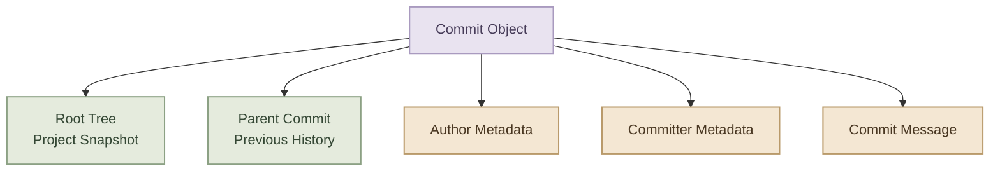
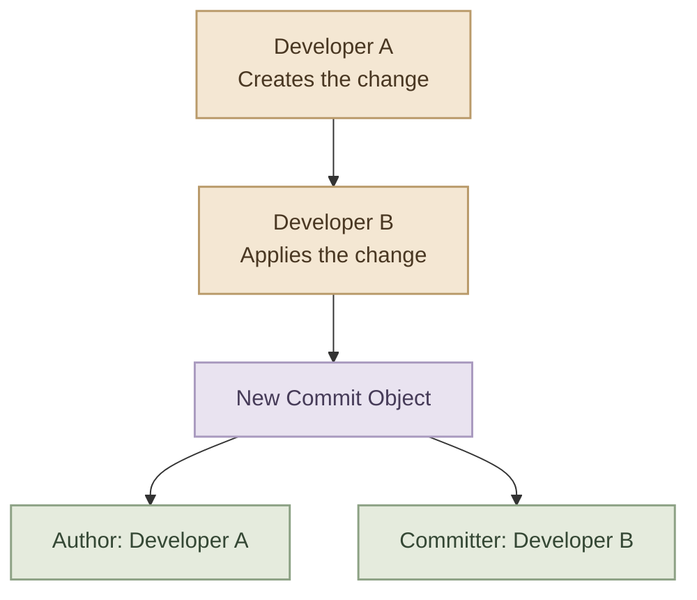

## Overview

بعد ما اتعلمنا الـ Basic Git Workflow، جه الوقت نفهم الـ Commits والتاريخ بتاع المشروع بشكل أعمق.

الـ Commit مش مجرد أمر بتنفذه بعد `git add`؛ هو جزء من تاريخ المشروع، وبيحتوي على معلومات بتساعدك تعرف إيه اللي اتسجل، ومين سجله، وإمتى، وإزاي التغييرات مرتبطة بالـ Commits السابقة.

وفي نفس الوقت، مش كل الملفات الموجودة في المشروع المفروض Git يتتبعها. فيه ملفات زي الـ Logs والـ Cache والـ Build Artifacts والـ Local Configuration اللي غالبًا مش عايزين نضيفها للـ Repository.

في الصفحة دي هنتعلم:

- Anatomy of a Commit.
- كتابة Commit Messages واضحة ومفيدة.
- استخدام Conventional Commits.
- الفرق بين Author وCommitter.
- استعراض الـ History والبحث جواه.
- إعداد `.gitignore` وكتابة Ignore Patterns.
- فهم `.gitkeep` وسبب استخدامه مع المجلدات الفارغة.

<InfoCard variant="concept" title="Two Important Responsibilities" description="الـ Commit History لازم يحكي قصة واضحة عن تطور المشروع، والـ Ignore Rules لازم تساعدك تمنع الملفات غير المطلوبة من الدخول في الـ Repository من الأساس." icon="wrench" tags={["History", "Repository Hygiene"]} />

---

## 1. Anatomy of a Commit

الـ `Commit` هو Object داخل Git بيسجل Snapshot من المشروع، ومعاها Metadata بتوضح معلومات عن الـ Commit وعلاقته بتاريخ المشروع.

خلينا نبص على المكونات الأساسية.

### I. What Does a Commit Contain?

الـ Commit Object بيحتوي على:

- **Tree:** مرجع إلى الـ Root Tree اللي بتمثل حالة الملفات والمجلدات في الـ Snapshot.
- **Parent:** مرجع إلى الـ Parent Commit أو الـ Commits السابقة المرتبط بيها الـ Commit الحالي.
- **Author:** الشخص اللي أنشأ التغيير من حيث النسبة إليه.
- **Committer:** الشخص اللي أنشأ الـ Commit Object نفسه.
- **Timestamp:** التوقيت المرتبط ببيانات الـ Author والـ Committer.
- **Commit Message:** وصف التغيير اللي الـ Commit بيسجله.

أول Commit في Repository جديد ممكن يكون من غير Parent، والـ Merge Commit ممكن يكون له أكتر من Parent.

### II. Commit Structure



الرسم بيوضح أهم المراجع والمعلومات الموجودة في الـ Commit. أما محتوى الملفات نفسه، فبيتم الوصول إليه عن طريق الـ Tree والـ Objects المرتبطة بيها.

### III. Inspect a Commit Object

تقدر تعرض محتويات الـ Commit الحالي باستخدام:

```bash
git cat-file -p HEAD
```

ممكن تشوف Output بالشكل ده:

```text
tree 8b137891791fe96927ad78e64b0aad7bded08bdc
parent 7a2e4c9...
author Example User <user@example.com> 1729000000 +0300
committer Example User <user@example.com> 1729000000 +0300

docs: explain commit structure
```

**ملاحظة:** الـ Hashes والتواريخ في المثال توضيحية، ومش بتمثل Commit حقيقي من مشروعك.

علشان تعرض ملخص الـ Commit بدل تفاصيل الـ Object:

```bash
git show --stat HEAD
```

ولو عايز تعرض بيانات الـ Commit من غير الـ Diff:

```bash
git show --no-patch --format=fuller HEAD
```

الأمر الأخير مفيد لمراجعة الـ Author والـ Committer والتوقيتات ورسالة الـ Commit.

---

## 2. Good Commit Messages

رسالة الـ Commit هي أول حاجة هتشوفها لما تستعرض تاريخ المشروع، وهي اللي بتساعدك تفهم سبب التغيير من غير ما تضطر تفتح كل الملفات بنفسك.

قارن بين الرسالتين دول:

```text
update
```

```text
Add validation for empty configuration values
```

الرسالة التانية أوضح؛ لأنها بتحدد التغيير اللي حصل بدل ما تقول بشكل عام إن فيه تحديث.

### I. What Makes a Good Commit Message?

رسالة الـ Commit الجيدة غالبًا بتكون:

- **Clear:** بتشرح التغيير بشكل مفهوم.
- **Specific:** بتحدد الجزء اللي اتغير بدل وصف عام.
- **Concise:** مختصرة من غير تفاصيل ملهاش لازمة.
- **Consistent:** ماشية مع الأسلوب المتبع في المشروع.
- **Focused:** مرتبطة بتغيير أو هدف واضح.

### II. Subject and Body

ممكن تكتب Commit Message بسيطة في سطر واحد:

```bash
git commit -m "Fix invalid configuration handling"
```

ولو محتاج تشرح سبب التغيير أو تفاصيل إضافية، استخدم Subject وBody:

```bash
git commit
```

هيفتح المحرر الافتراضي لإدخال الرسالة. ممكن تكون الرسالة بالشكل ده:

```text
Fix invalid configuration handling

Reject empty configuration values before initializing
the application to prevent startup failures.
```

السطر الأول هو الـ Subject، وبعده سطر فارغ، وبعدها الـ Body اللي بيوضح تفاصيل إضافية.

### III. Choosing the Right Level of Detail

| Weak Message | Better Message |
|---|---|
| `fix` | `Fix null reference in user lookup` |
| `update files` | `Update Docker setup instructions` |
| `changes` | `Remove unused configuration options` |
| `bug fixed` | `Handle missing environment variables` |
| `stuff` | `Add tests for invalid input` |

مش مطلوب إن كل رسالة تبقى طويلة. لو الـ Subject بيوضح التغيير بشكل كافي، مش محتاج تضيف Body.

<InfoCard variant="tip" title="Write for Your Future Self" description="اكتب الرسالة بحيث تقدر تفهم منها سبب التغيير بعد شهور، حتى لو نسيت تفاصيل المشكلة اللي كنت بتحلها وقتها." icon="wrench" tags={["Commit Quality", "Maintainability"]} />

---

## 3. Conventional Commits

`Conventional Commits` هو Convention لتنظيم شكل رسائل الـ Commits. بيساعد الفريق يكتب رسائل موحدة، ويسهّل تصنيف التغييرات، وممكن تستخدمه أدوات تانية في الـ Automation وإدارة الإصدارات.

الصيغة الأساسية:

```text
<type>[optional scope]: <description>

[optional body]

[optional footer(s)]
```

### I. Common Commit Types

| Type | Purpose | Example |
|---|---|---|
| `feat` | إضافة Feature جديدة | `feat: add user registration` |
| `fix` | إصلاح Bug | `fix: handle missing configuration` |
| `docs` | تغييرات Documentation | `docs: explain deployment setup` |
| `style` | تغييرات تنسيق لا تغير المعنى البرمجي | `style: format configuration file` |
| `refactor` | إعادة تنظيم الكود من غير تغيير مقصود في السلوك | `refactor: simplify user service` |
| `test` | إضافة أو تعديل Tests | `test: cover invalid input cases` |
| `build` | تغييرات مرتبطة بنظام Build أو Dependencies | `build: update runtime dependency` |
| `ci` | تغييرات إعدادات CI | `ci: adjust workflow permissions` |
| `perf` | تحسين الأداء | `perf: reduce repeated database queries` |
| `chore` | أعمال صيانة أخرى | `chore: remove obsolete files` |

الـ Types دي شائعة، لكن مش كلها إلزامية في كل مشروع. اتبع الـ Convention المعتمد في الـ Repository لو موجود.

### II. Using a Scope

الـ `Scope` اختيارية، وبتوضح الجزء اللي التغيير مرتبط بيه.

```text
feat(auth): add password reset
fix(api): handle missing request body
docs(kubernetes): explain readiness probes
```

في الأمثلة دي:

- `feat` أو `fix` أو `docs` هو الـ Type.
- `auth` أو `api` أو `kubernetes` هو الـ Scope.
- باقي السطر بيوضح التغيير.

### III. Breaking Changes

لو التغيير بيكسر التوافق مع طريقة استخدام سابقة، ممكن تستخدم `!` بعد الـ Type أو الـ Scope:

```text
feat(api)!: remove legacy authentication endpoint
```

وممكن توضح التغيير في الـ Body باستخدام `BREAKING CHANGE:`:

```text
feat(api): update authentication response

BREAKING CHANGE: The response no longer includes the legacy token field.
```

ده بيساعد أي شخص بيستهلك الـ API يعرف إن فيه تغيير ممكن يحتاج تعديل في الكود بتاعه.

### II. Conventional Commits in Practice

لو عدلت الـ README:

```bash
git commit -m "docs: update installation instructions"
```

لو أصلحت Bug:

```bash
git commit -m "fix: handle empty configuration values"
```

ولو أضفت Feature:

```bash
git commit -m "feat: add health check endpoint"
```

<InfoCard variant="insight" title="Convention, Not a Git Command" description="Conventional Commits مش أمر مدمج داخل Git؛ هو أسلوب متفق عليه لكتابة الرسائل. Git نفسه بيسمح برسائل مختلفة، لكن الالتزام بالـ Convention بيخلي تاريخ المشروع أسهل في القراءة والأتمتة." icon="wrench" tags={["Conventions", "Team Workflow"]} />

---

## 4. Author vs Committer

الـ `Author` والـ `Committer` الاتنين موجودين في بيانات الـ Commit، لكن مش لازم يكونوا نفس الشخص.

### I. Author

الـ Author هو الشخص المنسوب إليه التغيير الأصلي.

مثلًا، Developer كتب التغيير وأرسله لزميله علشان يراجعه أو يطبقه في Repository تاني.

### II. Committer

الـ Committer هو الشخص اللي أنشأ الـ Commit Object نفسه.

لو نفس الشخص كتب التغيير وعمل Commit عادي، غالبًا الـ Author والـ Committer هيكونوا نفس الشخص.

لكن لو شخص نقل التغيير أو أعاد تطبيقه ضمن عملية بتنشئ Commit جديد، ممكن بيانات الـ Author تفضل مرتبطة بصاحب التغيير الأصلي، بينما الـ Committer يشير للشخص اللي أنشأ الـ Commit الجديد.

### III. Visual Comparison



ده سيناريو توضيحي، مش معناه إن كل عملية Merge أو Cherry-pick لازم ينتج عنها اختلاف بين الـ Author والـ Committer.

### IV. Inspect Both Identities

```bash
git log -1 --format=fuller
```

ممكن تشوف معلومات بالشكل ده:

```text
commit 1234567...
Author:     Developer A <a@example.com>
AuthorDate: ...
Commit:     Developer B <b@example.com>
CommitDate: ...
```

الأمر ده بيعرض بيانات الـ Commit الأخير، بما فيها الـ Author والـ Committer والتوقيتات المرتبطة بيهم.

### V. Important Distinction

`user.name` و`user.email` في Git Configuration بيحددوا الهوية الافتراضية المستخدمة في إنشاء الـ Commits، لكن بيانات الـ Author والـ Committer ممكن تختلف في بعض العمليات أو عند استخدام خيارات مخصصة.

---

## 5. Viewing and Filtering History

مع الوقت، الـ Repository هيحتوي على Commits كتير، وساعتها مش هتحتاج تعرض التاريخ كله كل مرة. Git بيوفر خيارات لتصفية الـ History حسب العدد، والكاتب، ورسالة الـ Commit، والتوقيت، والملفات المتأثرة.

### I. Basic History

```bash
git log
```

لعرض تاريخ مختصر:

```bash
git log --oneline
```

ولعرض الـ History في صورة Graph:

```bash
git log --oneline --graph --decorate --all
```

الخيار `--all` بيسمح للأمر باستعراض التاريخ اللي يمكن الوصول إليه من الـ References المحلية المختلفة، بدل الاقتصار على الـ Current Branch.

### II. Filter by Number

```bash
git log -5 --oneline
```

يعرض أحدث خمسة Commits ضمن التاريخ المستعرض.

### II. Filter by Author

```bash
git log --author="Developer A"
```

بيعرض الـ Commits اللي بيانات الـ Author فيها بتطابق نمط البحث المحدد.

### IV. Search Commit Messages

```bash
git log --grep="authentication"
```

مفيد لو بتدور على Commit Message فيها كلمة أو موضوع معين.

### V. Filter by Date

```bash
git log --since="2 weeks ago"
```

ولعرض الـ Commits الأحدث من تاريخ معين:

```bash
git log --since="2026-10-01"
```

وتقدر تحدد نهاية الفترة كمان:

```bash
git log --since="2026-10-01" --until="2026-10-15"
```

التواريخ هنا بتتفسر حسب قواعد Git وإعدادات الوقت ذات الصلة.

### VI. Inspect a Specific File's History

```bash
git log -- README.md
```

ده بيعرض الـ Commits اللي أثرت على المسار المحدد.

ولو عايز ملخص التغييرات في الملفات لكل Commit:

```bash
git log --stat
```

### VII. Follow File History Across Renames

```bash
git log --follow -- README.md
```

الخيار `--follow` مفيد لتتبع تاريخ ملف واحد عبر عمليات إعادة التسمية التي يستطيع Git اكتشافها.

### VIII. Search for a Code Change

لو عايز تدور في الـ History عن Commits أضافت أو حذفت نصًا معينًا من الكود:

```bash
git log -S"validate_input" --oneline
```

الخيار `-S` بيبحث عن تغييرات في عدد مرات ظهور النص المحدد داخل الـ Diff الخاص بالـ Commits.

أما `-G` فبيستخدم Regular Expression للبحث في أسطر الـ Diff:

```bash
git log -G"validate_.*input" --oneline
```

الفرق بينهم مهم لما تكون بتبحث عن تغيير معين في الكود بدل البحث في رسائل الـ Commits فقط.

### IX. History Commands Summary

| Goal | Command |
|---|---|
| عرض التاريخ الكامل | `git log` |
| تاريخ مختصر | `git log --oneline` |
| عرض Graph للـ Branches | `git log --oneline --graph --decorate --all` |
| تصفية حسب الكاتب | `git log --author="Name"` |
| البحث في الرسائل | `git log --grep="keyword"` |
| عرض تاريخ ملف | `git log -- path/to/file` |
| تتبع إعادة تسمية ملف | `git log --follow -- path/to/file` |
| البحث عن إضافة أو حذف نص | `git log -S"text"` |
| عرض تفاصيل Commit | `git show <commit>` |

---

## 6. `.gitignore` and Ignore Patterns

مش كل ملف موجود في المشروع المفروض يدخل في Git History.

فيه ملفات بنحتاجها أثناء التطوير، لكن مش محتاجين نشاركها مع باقي الفريق، زي:

- ملفات Build الناتجة عن تشغيل أدوات التطوير.
- Logs وTemporary Files.
- Cache Directories.
- ملفات Local Configuration اللي فيها إعدادات خاصة بالجهاز.
- ملفات بيئة التطوير الشخصية.

ملف `.gitignore` بيسمحلك تحدد أنماط الملفات والمسارات اللي Git يتجاهلها عند اكتشاف الملفات غير المتتبعة.

### I. Create a `.gitignore` File

في Root Directory الخاص بالمشروع، أنشئ ملف:

```text
.gitignore
```

مثال لمشروع عام:

```gitignore
# Build output
dist/
build/

# Logs
*.log

# Environment variables
.env
.env.*

# Keep an example configuration
!.env.example

# Temporary files
*.tmp

# Editor settings
.vscode/
```

ده مثال توضيحي، ومش لازم تنسخ كل الأنماط دي لأي مشروع. اختار القواعد المناسبة للـ Tech Stack وطريقة شغل الفريق.

**مهم:** بعض الملفات زي `.vscode/` ممكن تكون مفيدة لو الفريق بيشارك إعدادات المحرر؛ ماتتجاهلهاش تلقائيًا من غير ما تفكر في احتياج المشروع.

### II. Common Ignore Patterns

| Pattern | Meaning |
|---|---|
| `*.log` | تجاهل الملفات اللي أسماؤها بتنتهي بـ `.log` |
| `build/` | تجاهل المجلدات المطابقة للاسم ده |
| `/dist/` | تجاهل `dist` الموجود في نفس المجلد اللي فيه قاعدة التجاهل |
| `config.local` | تجاهل المسارات المطابقة للاسم ده حسب مكان قاعدة التجاهل |
| `!important.log` | استثناء ملف من قاعدة تجاهل سابقة، إذا سمحت القواعد بذلك |
| `**/cache/` | تجاهل المجلدات المطابقة لـ `cache` عبر مستويات المجلدات |

### III. Understanding Pattern Scope

مكان ملف `.gitignore` بيفرق في نطاق تطبيق القواعد.

- ملف `.gitignore` في Root Directory ممكن يحتوي على قواعد للمشروع كله.
- ملف `.gitignore` داخل Subdirectory بيطبق قواعده بالنسبة للمجلد ده والمجلدات الموجودة تحته.
- القواعد بتتجمع مع قواعد التجاهل الأخرى، مع مراعاة الأولوية وترتيب الأنماط.

مثلًا، لو عندك:

```text
my-project/
├── .gitignore
├── src/
│   └── .gitignore
└── logs/
    └── app.log
```

فالـ `.gitignore` الموجود في `src/` مش هيكون هو المصدر الوحيد لقواعد التجاهل في المشروع؛ Git بيجمع القواعد من الأماكن المناسبة، بالإضافة إلى مصادر تجاهل أخرى زي `.git/info/exclude` وملف التجاهل العام لو متضبط.

### IV. Negation Patterns

علامة `!` بتسمح باستثناء مسار من قاعدة تجاهل سابقة.

مثلًا:

```gitignore
*.log
!important.log
```

القاعدة الأولى بتتجاهل ملفات الـ Logs، والتانية بتستثني `important.log` من القاعدة السابقة إذا كان المسار قابلًا للوصول ضمن قواعد التجاهل.

لكن فيه تفصيلة مهمة: لو مجلد أب تم تجاهله، مش دايمًا تقدر تستثني ملف داخله مباشرة بقاعدة `!`. في بعض الحالات لازم تستثني المجلد الأب الأول، لأن Git مش بيبحث داخل المجلدات المتجاهلة للوصول إلى الملفات المستثناة.

### V. Check Why a File Is Ignored

لو مش فاهم ليه Git بيتجاهل ملفًا معينًا:

```bash
git check-ignore -v path/to/file
```

الخيار `-v` بيساعدك تعرف قاعدة التجاهل ومصدرها اللي سببت تجاهل المسار.

ولو عايز تختبر ملفًا حتى لو كان متتبعًا بالفعل:

```bash
git check-ignore -v --no-index path/to/file
```

الخيار `--no-index` بيسمح بفحص قواعد التجاهل من غير استبعاد المسارات المتتبعة من الاعتبار.

<InfoCard variant="warning" title=".gitignore Does Not Untrack Existing Files" description="لو ملف اتضاف للـ Repository واتعمله Commit بالفعل، إضافة اسمه إلى .gitignore مش هتوقف Git عن تتبعه تلقائيًا. لازم تتعامل مع الـ Index بشكل منفصل." icon="shield" tags={["Tracked Files", "Ignore Rules"]} />

### VI. Stop Tracking a File Without Deleting It Locally

لو ملف اتتبع بالفعل وعايز Git يتوقف عن تتبعه مع الاحتفاظ بالنسخة الموجودة على جهازك:

```bash
git rm --cached path/to/file
```

بعدها أضف الملف إلى `.gitignore`، وراجع الحالة:

```bash
git status
```

الأمر `git rm --cached` بيشيل الملف من الـ Index، لكنه بيحتفظ بالنسخة الموجودة في الـ Working Directory.

بعد ما تعمل Commit للتغيير، Git مش هيستمر في تتبع الملف إلا لو أضفته تاني بطريقة مناسبة.

**تنبيه أمني:** لو الملف كان يحتوي على Password أو API Key أو Secret واتعمله Commit، إضافة الملف إلى `.gitignore` مش بتمسح البيانات من الـ History السابق. لو Secret اتكشف، لازم تتعامل معاه باعتباره مكشوفًا وتعمل Rotation أو Revocation حسب الحالة.

---

## 7. `.gitkeep` and Empty Directories

من الحاجات اللي بتتلخبط على ناس كتير إن Git مش بيتتبع المجلدات باعتبارها Objects مستقلة بالشكل اللي بيتتبع بيه الملفات.

Git بيمثل بنية المجلدات من خلال `Tree Objects`، والمجلد الفارغ مش بيكون له Entry مستقل في الـ Tree.

يعني لو عندك:

```text
my-project/
├── src/
└── logs/
```

وكان `logs/` فاضي، Git مش هيحتفظ بالمجلد ده في الـ Commit لمجرد إنه موجود على جهازك.

### I. What Is `.gitkeep`?

`.gitkeep` هو اسم اصطلاحي شائع لملف فارغ أو بسيط بيضيفه المطور داخل مجلد فاضي علشان يقدر Git يتتبع المجلد من خلال الملف ده.

مثال:

```text
my-project/
├── src/
└── logs/
    └── .gitkeep
```

ممكن تنشئه كده:

```bash
touch logs/.gitkeep
```

وبعدها:

```bash
git add logs/.gitkeep
git commit -m "chore: preserve logs directory"
```

كده Git بيحتفظ بالـ `.gitkeep` داخل المجلد، وبالتالي بنية المجلد بتظهر في الـ Repository.

### II. Is `.gitkeep` a Git Feature?

لا. `.gitkeep` مش أمر أو Feature خاصة في Git، ومفيش اسم إلزامي لازم تستخدمه.

هو مجرد ملف عادي، لكن المجتمع اعتاد استخدام الاسم ده للغرض ده.

تقدر تستخدم اسم تاني لو أنسب للمشروع، مثل ملف `README.md` يشرح وظيفة المجلد.

### III. `.gitkeep` vs `.gitignore`

الفرق الأساسي:

| `.gitkeep` | `.gitignore` |
|---|---|
| ملف عادي يُستخدم اصطلاحيًا للحفاظ على مجلد فارغ داخل الـ Repository | ملف بيحدد أنماط المسارات اللي Git يتجاهلها |
| مش Feature خاصة في Git | اسم معترف به من Git لقواعد التجاهل |
| ممكن يكون فارغًا | لازم يحتوي على Patterns لو عايز قواعد تجاهل فعلية |

### IV. Keeping an Empty Directory While Ignoring Its Contents

افترض إنك محتاج مجلد `logs/` موجود في بنية المشروع، لكن مش عايز تتبع ملفات الـ Logs اللي هتتولد أثناء التشغيل.

ممكن تستخدم:

```gitignore
/logs/*
!/logs/.gitkeep
```

وبنية المشروع تكون:

```text
my-project/
├── .gitignore
└── logs/
    └── .gitkeep
```

القاعدة الأولى بتتجاهل المحتويات الموجودة مباشرة داخل `logs/`، والقاعدة التانية بتستثني `.gitkeep`.

لو محتاج تتجاهل ملفات ومجلدات فرعية داخل `logs/` كمان، لازم تختبر الأنماط وتضبطها حسب البنية المطلوبة.

**مهم:** وجود `.gitkeep` مش معناه إن Git هيحافظ تلقائيًا على المجلد بعد حذفه من الـ Working Directory؛ الملف نفسه لازم يفضل موجودًا ضمن الملفات المتتبعة.

---

## 8. Practical Workflow: Commit and Ignore Files

<Callout type="lab" title="Hands-on: Workflow" />

<Steps>
<li>

<InfoCard title="Step 1 — Inspect" description="راجع حالة المشروع بـ git status." icon="layers" tags={["Inspect"]} />

```bash
git status
```

</li>
<li>

<InfoCard title="Step 2 — Create Ignore" description="أنشئ .gitignore وأضف قواعد التجاهل." icon="wrench" tags={["Ignore"]} />

```gitignore
*.log
```

</li>
<li>

<InfoCard title="Step 3 — Edit Docs" description="عدّل README.md بالطريقة المناسبة." icon="wrench" tags={["Edit"]} />

</li>
<li>

<InfoCard title="Step 4 — Review Changes" description="راجع التغييرات بـ git diff و git status." icon="branch" tags={["Review"]} />

```bash
git diff
git status
```

</li>
<li>

<InfoCard title="Step 5 — Stage" description="جهّز الملفات المطلوبة للـ Commit." icon="cube" tags={["Stage"]} />

```bash
git add README.md .gitignore
```

</li>
<li>

<InfoCard title="Step 6 — Review Staged" description="راجع التغييرات المجهّزة بـ git diff --cached." icon="shield" tags={["Review"]} />

```bash
git diff --cached
```

</li>
<li>

<InfoCard title="Step 7 — Commit" description="سجّل التغييرات برسالة واضحة." icon="wrench" tags={["Commit"]} />

```bash
git commit -m "docs: update README and ignore log files"
```

</li>
<li>

<InfoCard title="Step 8 — Inspect" description="راجع الـ Commit بـ git log و git show." icon="pulse" tags={["Inspect"]} />

```bash
git log -1 --oneline
git show --stat HEAD
git status
```

</li>
</Steps>

افترض إنك عندك Repository وعايز:

- تعدّل `README.md`.
- تضيف ملف `.gitignore`.
- تمنع ملفات Logs من الدخول في تاريخ المشروع.
- تسجل التغييرات في Commit واضح.

### I. Step 1 — Inspect the Current State

```bash
git status
```

### II. Step 2 — Create the Ignore Rules

أنشئ ملف `.gitignore` وأضف:

```gitignore
*.log
```

### III. Step 3 — Create or Update the Documentation

عدّل `README.md` بالطريقة اللي تناسب مشروعك.

### IV. Step 4 — Review the Changes

```bash
git diff
git status
```

لو `.gitignore` ملف جديد، مش هيظهر محتواه في `git diff` العادي قبل إضافته للـ Staging Area؛ لأن الأمر ده بيراجع تغييرات الملفات المتتبعة غير المجهزة.

### V. Step 5 — Stage the Intended Files

```bash
git add README.md .gitignore
```

### VI. Step 6 — Review Staged Changes

```bash
git diff --cached
```

### VII. Step 7 — Create a Commit

```bash
git commit -m "docs: update README and ignore log files"
```

### VIII. Step 8 — Inspect the Result

```bash
git log -1 --oneline
git show --stat HEAD
git status
```

بالشكل ده، إنت استخدمت Commit Message واضحة، وراجعت التغييرات قبل تسجيلها، وحددت قواعد تمنع الملفات غير المطلوبة من الدخول في الـ Repository.

---

## 9. Common Mistakes

<CardGrid columns={2} label="Commit History and Ignore Mistakes">
  <InfoCard variant="warning" title="Committing Without Reviewing" description="ممكن تسجل تغييرات مش مرتبطة ببعض أو ملفات مش مقصود إضافتها. راجع الـ Staging Area قبل كل Commit." icon="wrench" />

  <InfoCard variant="warning" title="Treating .gitignore as Security" description="ملف .gitignore مش وسيلة لحماية Secrets اتعملها Commit بالفعل، ومش بيمنع كل طرق إضافة الملفات يدويًا." icon="shield" />

  <InfoCard variant="warning" title="Expecting Empty Folders to Persist" description="Git مش بيحفظ المجلد الفارغ وحده. استخدم ملفًا مناسبًا داخله لو محتاج تحتفظ ببنية المجلد." icon="layers" />

  <InfoCard variant="warning" title="Assuming .gitkeep Is Built In" description=".gitkeep مجرد اسم متعارف عليه لملف عادي، مش أمر أو خاصية خاصة في Git." icon="cube" />
</CardGrid>

---

## Key Takeaways

- الـ Commit Object بيحتوي على Root Tree وبيانات الـ Author والـ Committer ورسالة الـ Commit ومراجع الـ Parent.
- رسائل الـ Commits الواضحة بتسهّل مراجعة تاريخ المشروع.
- Conventional Commits هو Convention لتنظيم الرسائل، ومش أمر خاص في Git.
- الـ Author والـ Committer ممكن يكونوا شخصين مختلفين.
- `git log` بيساعدك تستعرض التاريخ وتفلتره، و`git show` بيفحص Commit معين.
- `.gitignore` بيحدد أنماط الملفات والمسارات اللي Git يتجاهلها عند اكتشاف الملفات غير المتتبعة.
- إضافة ملف متتبع بالفعل إلى `.gitignore` مش بتوقف تتبعه تلقائيًا.
- `.gitkeep` اسم اصطلاحي شائع لملف عادي بيُستخدم للحفاظ على المجلدات الفارغة داخل الـ Repository.

---
