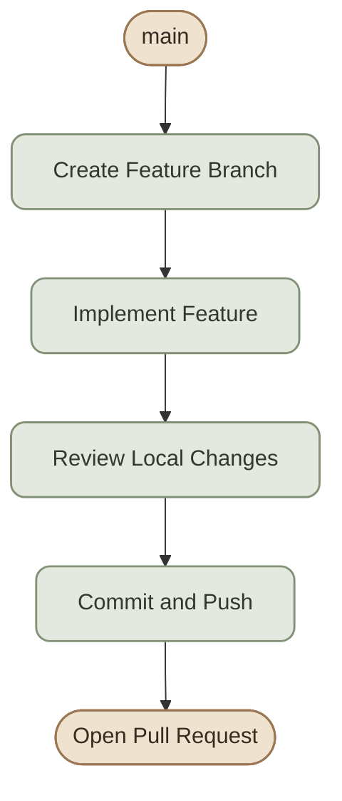
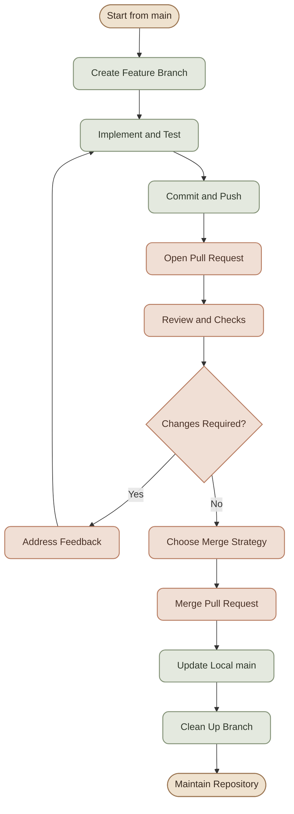

## Introduction

في الشغل الحقيقي، نادرًا ما تستخدم Command واحدة بمعزل عن باقي الـ Workflow. غالبًا بتبدأ بتغيير صغير، وتحتاج تزامن شغلك مع الفريق، وتراجع التغييرات، وتتعامل مع الأخطاء لو حصلت.

الهدف من الدرس ده إنك تتدرّب على اتخاذ القرار الصحيح، مش مجرد حفظ الأوامر.

<CardGrid columns={2} label="Workflow Skills">
  <InfoCard variant="concept" title="Build and Publish" description="ابدأ من مشروع محلي وانشره على GitHub باستخدام Remote صحيح." icon="branch" tags={["Git", "GitHub"]} />
  <InfoCard variant="concept" title="Collaborate Safely" description="استخدم Feature Branches وPull Requests وCode Reviews لتنظيم الشغل." icon="layers" tags={["Branches", "Reviews"]} />
  <InfoCard variant="concept" title="Recover from Mistakes" description="استرجع تغييرات أو Branch مفقودًا، مع تجنب فقدان الشغل غير المحفوظ." icon="cycle" tags={["Recovery", "Reflog"]} />
  <InfoCard variant="concept" title="Protect the Repository" description="تعامل مع الأسرار المكشوفة وجهّز Repository للتعاون بشكل احترافي." icon="shield" tags={["Security", "Maintenance"]} />
</CardGrid>

## 1. Create a Local Project and Publish It to GitHub

### I. Scenario

عندك مشروع جديد على جهازك، وعايز تبدأ تتبع التغييرات باستخدام Git وترفعه على GitHub.

<Steps>
<li>
<b>Initialize the Project</b>
<pre>{`mkdir ops-demo
cd ops-demo

git init
git branch -M main`}</pre>
<p>أنشئ ملفًا للمشروع:</p>
<pre>{`printf '# Ops Demo\n\nA practical Git workflow project.\n' > README.md`}</pre>
<p>قبل الـ Commit، تأكد إنك مش بتضيف ملفات Secrets أو Build Artifacts بالخطأ.</p>
<pre>{`git status
git diff
git add README.md
git diff --cached
git commit -m "Initial project setup"`}</pre>
</li>
<li>
<b>Create the GitHub Repository</b>

لو عندك GitHub CLI ومصادق عليه، تقدر تنشئ Repository وترفع المشروع مباشرة:

```bash
gh repo create ops-demo \
  --private \
  --source=. \
  --remote=origin \
  --push
```

الأمر ده بيطلب إنشاء Repository خاص باسم `ops-demo`، ويربطه بالـ Remote المسمى `origin`، ويرفع الـ Branch المحلي. غيّر `--private` إلى `--public` فقط لو عايز المشروع يكون عامًا.

لو الـ Repository موجود بالفعل، ما تعيدش إنشاءه؛ أضف الـ Remote الموجود عندك:

```bash
git remote add origin git@github.com:USERNAME/ops-demo.git
git push -u origin main
```

استبدل `USERNAME` بعنوان المالك الفعلي. لو `origin` موجود مسبقًا، افحصه باستخدام `git remote -v` بدل إضافة Remote بنفس الاسم.
</li>

<li>
<b>Verify the Result</b>
<pre>{`git status
git remote -v
git log --oneline -3`}</pre>
<p>تأكد إن الـ Branch اتدفع بنجاح وإن الـ Remote بيشير إلى Repository الصحيح.</p>
</li>
</Steps>

<InfoCard variant="success" title="Checkpoint" description="عندك Local Repository، وCommit ابتدائي، وRemote على GitHub، والـ main branch مرفوع." icon="shield" />

## 2. Develop a Feature Using a Separate Branch

### I. Scenario

عايز تضيف ميزة جديدة من غير ما تعدّل مباشرة على `main`.

<Steps>
<li>
<b>Create a Feature Branch</b>
<pre>{`git switch main
git pull --ff-only origin main
git switch -c feature/add-health-check`}</pre>
<p>اسم الـ Branch يوضح الهدف منه. استخدام <code>--ff-only</code> بيمنع <code>git pull</code> من إنشاء Merge Commit تلقائيًا لو حصل اختلاف في التاريخ يحتاج تدخلًا منك.</p>
</li>
<li>
<b>Make and Commit the Changes</b>

بعد تعديل ملفات المشروع:

```bash
git status
git diff
git add .
git diff --cached
git commit -m "Add application health check"
```

استخدم `git add` بشكل محدد لو مش كل الملفات المعدّلة جزء من الميزة.
</li>
<li>
<b>Push the Branch</b>
<pre>{`git push -u origin feature/add-health-check`}</pre>
<p>الـ Feature دلوقتي موجودة على Branch منفصل، وتقدر تفتح Pull Request لمراجعتها قبل الدمج.</p>
</li>
</Steps>



## 3. Synchronize a Branch with Team Changes

### I. Scenario

أنت شغال على Feature Branch، وفي نفس الوقت زميلك دمج تغييرات جديدة في `main`.

قبل ما تفتح PR أو تكمل شغل حساس، محتاج تعرف هل فرعك متوافق مع آخر نسخة من الفرع الأساسي.

<Steps>
<li>
<b>Fetch the Latest Changes</b>
<pre>{`git fetch origin`}</pre>
<p><code>fetch</code> بيحدّث معلومات الـ Remote-Tracking Branches، لكنه مش بيغيّر ملفات الـ Branch الحالي تلقائيًا.</p>
<p>راجع الاختلاف:</p>
<pre>{`git log --oneline --graph --decorate --all -15
git diff HEAD origin/main`}</pre>
</li>
<li>
<b>Choose a Synchronization Strategy</b>

لو فريقك بيسمح باستخدام Rebase على Feature Branch غير مشترك، تقدر تعمل:

```bash
git switch feature/add-health-check
git rebase origin/main
```

الـ Rebase بيعيد تطبيق Commits الخاصة بالـ Feature فوق أحدث `origin/main`.

لو الفرع مشترك بين أعضاء الفريق أو عندكم سياسة بتفضّل الحفاظ على تاريخ الفرع، ممكن تستخدم Merge بدلًا منه:

```bash
git merge origin/main
```

ما تستخدمش الطريقتين بالتتابع بشكل عشوائي؛ اختار الاستراتيجية المناسبة حسب حالة الفرع وسياسة الفريق.
</li>
<li>
<b>Push the Updated Branch</b>
<p>بعد Rebase، الـ Commit Hashes الخاصة بالفرع ممكن تتغير. لو الفرع اتنشر قبل كده، قد تحتاج إلى تحديثه باستخدام:</p>
<pre>{`git push --force-with-lease origin feature/add-health-check`}</pre>
<p>استخدم <code>--force-with-lease</code> فقط بعد فهم تأثير إعادة كتابة التاريخ والتأكد من عدم فقدان تغييرات زملائك. لو الفرع مشترك أو غير مسموح بإعادة كتابة تاريخه، نسّق مع الفريق واستخدم استراتيجية الدمج المعتمدة.</p>
</li>
</Steps>

## 4. Resolve Merge Conflicts

### I. Scenario

أنت وزميلك عدّلتوا نفس الجزء من ملف، وGit مش قادر يدمج التغييرات تلقائيًا.

<Steps>
<li>
<b>Identify the Conflict</b>
<p>أثناء Merge أو Rebase، ممكن يظهر تعارض. افحص الحالة:</p>
<pre>{`git status`}</pre>
<p>هتلاقي الملفات المتعارضة تحت قسم Unmerged paths.</p>
<p>داخل الملف، ممكن تشوف:</p>
<pre>{`&lt;&lt;&lt;&lt;&lt;&lt;&lt; HEAD
Current branch content
=======
Incoming branch content
&gt;&gt;&gt;&gt;&gt;&gt;&gt; origin/main`}</pre>
<p>العلامات دي بتحدد الأجزاء المتعارضة، ومش المفروض تفضل في النسخة النهائية من الملف.</p>
</li>
<li>
<b>Resolve the Conflict</b>

1. افتح الملف المتعارض.
2. افهم التغيير الموجود في كل جانب.
3. ادمج المنطق الصحيح، بدل اختيار نسخة بشكل آلي.
4. احذف Conflict Markers.
5. راجع الملف بعد التعديل.

```bash
git diff
git diff --check
```
</li>
<li>
<b>Complete the Operation</b>
<p>لو كنت بتعمل Merge:</p>
<pre>{`git add path/to/conflicted-file
git merge --continue`}</pre>
<p>الأمر <code>git merge --continue</code> مش متاح في كل الإصدارات والسياقات بنفس الطريقة؛ لو Git طلب منك إنهاء العملية باستخدام <code>git commit</code>، اتبع الرسالة المعروضة.</p>
<p>لو كنت بتعمل Rebase:</p>
<pre>{`git add path/to/conflicted-file
git rebase --continue`}</pre>
<p>ولو احتجت ترجع عن العملية، استخدم الأمر المناسب:</p>
<pre>{`git merge --abort`}</pre>
<p>أو:</p>
<pre>{`git rebase --abort`}</pre>
<p>ما تستخدمش <code>--abort</code> قبل ما تفهم إذا كانت عندك تغييرات محلية غير محفوظة؛ راجع <code>git status</code> الأول.</p>
</li>
</Steps>

<InfoCard variant="warning" title="Never Resolve Conflicts Blindly" description="اختيار Current أو Incoming بالكامل ممكن يحذف منطقًا صحيحًا. افهم التغييرين، واحسم التعارض بناءً على سلوك التطبيق المطلوب." icon="shield" />

## 5. Open a Pull Request and Review It

### I. Scenario

خلصت الـ Feature ورفعتها، وعايز تطلب من الفريق مراجعتها قبل الدمج.

<Steps>
<li>
<b>Open the Pull Request</b>
<p>باستخدام GitHub CLI:</p>
<pre>{`gh pr create \
  --base main \
  --head feature/add-health-check \
  --title "Add application health check" \
  --body "Add a health-check endpoint and document its expected behavior."`}</pre>
<p>الأمر بيفتح Pull Request من الـ Feature Branch إلى <code>main</code>. عدّل العنوان والوصف حسب التغييرات الحقيقية.</p>
</li>
<li>
<b>Review the Pull Request</b>

راجع النقاط دي:

- هل الـ PR بيحل مشكلة واضحة؟
- هل التغييرات محدودة ومفهومة؟
- هل فيه ملفات أو Secrets غير مقصودة؟
- هل الاختبارات المطلوبة نجحت؟
- هل فيه تغييرات ممكن تكسر سلوكًا موجودًا؟
- هل الوصف يشرح سبب التغيير وطريقة اختباره؟
</li>
<li>
<b>Inspect the PR from the CLI</b>
<pre>{`gh pr view
gh pr diff
gh pr checks`}</pre>
<p>الأوامر دي بتعرض تفاصيل الـ PR والـ Diff وحالة الفحوصات المرتبطة به. لو المشروع مش بيستخدم Checks، ممكن ما يكونش فيه شيء لعرضه في <code>gh pr checks</code>.</p>
</li>
</Steps>

### II. Draft Pull Requests

لو الميزة لسه تحت التطوير، تقدر تفتح Draft PR:

```bash
gh pr create --draft
```

استخدم Draft لما تكون محتاج Feedback مبكرًا، لكن لسه مش بتطلب الموافقة النهائية على الدمج.

## 6. Update a PR After Code Review

### I. Scenario

المراجع طلب تعديل اسم Function، وإضافة Test، ومعالجة Edge Case.

ما تحتاجش تفتح PR جديد؛ الـ PR الحالي بيتحدّث لما تدفع Commits جديدة إلى نفس الـ Head Branch.

<Steps>
<li>
<b>Understand the Feedback</b>
<p>قبل التعديل:</p>
<ol>
<li>حدد الملاحظة اللي تحتاج معالجة.</li>
<li>افهم السبب الفني وراءها.</li>
<li>اسأل عن النقاط غير الواضحة.</li>
<li>نفّذ التعديل المناسب.</li>
</ol>
</li>
<li>
<b>Commit the Fixes</b>

```bash
git status
git diff
git add src/health-check
git commit -m "Address health check review feedback"
git push
```

لأن الـ Branch مرتبط بالـ Upstream بعد `git push -u`، فالأمر الأخير غالبًا يكفي لتحديثه.
</li>
<li>
<b>Respond to Review Comments</b>
<p>بعد رفع التعديلات:</p>
<ul>
<li>وضّح للمراجع إيه اللي اتغير.</li>
<li>أشر إلى الـ Commit أو الملف عند الحاجة.</li>
<li>اطلب إعادة المراجعة لو التغييرات تحتاج موافقة جديدة.</li>
<li>ما تعتبرش إضافة Commit معناها إن كل Review Comments اتقفلت تلقائيًا.</li>
</ul>
<p><strong>نقطة مهمة:</strong> لو عندكم Required Approvals أو Required Status Checks، لازم تستوفيها قبل الدمج حسب سياسة الـ Repository.</p>
</li>
</Steps>

## 7. Choose the Right Merge Strategy

بعد اكتمال المراجعة، لازم تختار طريقة الدمج المناسبة.

<TableCard title="Merge Strategy Comparison">

<table>
<thead><tr><th>Strategy</th><th>What Happens</th><th>Common Use</th></tr></thead>
<tbody>
<tr><td>Merge Commit</td><td>يحتفظ بتاريخ الفرع وينشئ Merge Commit</td><td>الحفاظ على تاريخ المساهمات والـ Branches</td></tr>
<tr><td>Squash and Merge</td><td>يجمع تغييرات الـ PR في Commit واحد على الفرع الأساسي</td><td>تاريخ خطي ومختصر لكل Feature</td></tr>
<tr><td>Rebase and Merge</td><td>يعيد تطبيق Commits الـ PR فوق الفرع الأساسي من غير Merge Commit تقليدي</td><td>تاريخ خطي مع الاحتفاظ بعدة Commits</td></tr>
</tbody>
</table>

</TableCard>

اختيار الطريقة بيعتمد على سياسة الفريق وطريقة تنظيم الـ Commits. مش فيه استراتيجية واحدة هي الأفضل لكل المشروعات.

### I. Example: Squash Merge

لو الفريق بيستخدم Squash Merge:

```bash
gh pr merge --squash
```

الأمر بيدمج الـ PR الحالي باستخدام Squash، إذا كانت شروط الدمج متحققة وكان الأسلوب مسموحًا في إعدادات الـ Repository.

بدائل أخرى:

```bash
gh pr merge --merge
```

أو:

```bash
gh pr merge --rebase
```

الأوامر دي بتغيّر حالة الـ Repository على GitHub. قبل استخدامها، تأكد إنك على الـ PR الصحيح وإن المراجعة والـ Checks المطلوبة مكتملة.

### II. After the Merge

```bash
git switch main
git pull --ff-only origin main
git branch -d feature/add-health-check
```

احذف الـ Local Branch بعد التأكد من الدمج واحتفاظك بأي تغييرات محتاجها. حذف الفرع المحلي مش هو نفسه حذف الفرع على GitHub.

## 8. Recover a Commit or Branch After a Mistake

### I. Scenario A: Recover a Commit You Lost Track Of

ممكن تعمل Rebase أو Reset بالغلط، وبعدها تكتشف إن Commit مهم اختفى من تاريخ الفرع الحالي.

ابدأ بفحص:

```bash
git reflog
```

الـ Reflog بيسجل تحركات مراجع محلية، وقد يساعدك في العثور على Commit سابق حتى لو لم يعد ظاهرًا في الـ Branch الحالي.

بعد تحديد الـ Commit الصحيح، تقدر تنشئ Branch لاسترجاعه:

```bash
git branch recovery/restore-work <commit-hash>
```

استبدل `<commit-hash>` بالقيمة الفعلية. راجع محتوى الفرع المسترجع قبل دمج التغييرات مرة أخرى.

### II. Scenario B: Undo a Commit That Has Already Been Shared

لو الـ Commit اتدفع بالفعل إلى Branch مشترك، غالبًا يكون `git revert` أنسب لأنه ينشئ Commit جديدًا يعكس التغيير السابق:

```bash
git revert <commit-hash>
git push
```

راجع أثر الـ Revert قبل دفعه، خصوصًا لو الـ Commit جزء من سلسلة تغييرات مترابطة.

### III. Scenario C: Recover Uncommitted Work

قبل أي عملية Recovery، افحص:

```bash
git status
git diff
git diff --cached
```

لو التغييرات لسه موجودة في ملفات العمل، احفظ نسخة منها أو اعمل Commit مناسب قبل تنفيذ عمليات مدمرة.

**مهم:** `git reflog` مش ضمان لاستعادة كل شيء؛ التغييرات غير المحفوظة في ملفات العمل ممكن ما يكونش لها مدخل في Reflog.

<InfoCard variant="tip" title="Inspect Before Resetting" description="ما تبدأش بـ git reset --hard لمجرد إن التاريخ شكله غلط. حدّد الـ Commit المطلوب، واحفظ التغييرات المهمة، واستخدم Reflog عند الحاجة." icon="cycle" />

## 9. Contribute to an Open-Source Project Using a Fork

### I. Scenario

عايز تساهم في مشروع مش بتملك صلاحية الكتابة المباشرة على الـ Repository الأصلي.

الـ Workflow الشائع هو Fork → Clone → Branch → Commit → Push → Pull Request.

<Steps>
<li>
<b>Fork the Repository</b>
<p>أنشئ Fork من صفحة المشروع الأصلية على GitHub.</p>
<p>بعدها استنسخ الـ Fork الخاص بك:</p>
<pre>{`git clone git@github.com:YOUR_USERNAME/PROJECT.git
cd PROJECT`}</pre>
</li>
<li>
<b>Configure `origin` and `upstream`</b>

في العادة:

- `origin`: الـ Fork الخاص بك.
- `upstream`: الـ Repository الأصلي للمشروع.

أضف الـ Upstream:

```bash
git remote add upstream git@github.com:ORIGINAL_OWNER/PROJECT.git
git remote -v
```

استبدل أسماء المالك والمشروع بالقيم الفعلية.
</li>
<li>
<b>Start a Contribution Branch</b>
<pre>{`git switch main
git fetch upstream
git switch -c fix/documentation-typo upstream/main`}</pre>
<p>ده بيبدأ فرع المساهمة من آخر <code>upstream/main</code>، بشرط إن الفرع موجود وإنه الفرع الأساسي الصحيح للمشروع.</p>
</li>
<li>
<b>Make and Push the Contribution</b>

```bash
git add docs/
git commit -m "Fix documentation typo"
git push -u origin fix/documentation-typo
```

<p>بعدها افتح Pull Request من الـ Fork إلى الفرع المناسب في الـ Upstream Repository، واتبع <code>CONTRIBUTING.md</code> وأي تعليمات خاصة بالمشروع.</p>
</li>
</Steps>

### II. Keep the Fork Updated

```bash
git fetch upstream
git switch main
git merge --ff-only upstream/main
git push origin main
```

ده بيحدّث `main` المحلي من الـ Upstream لو كان التحديث ممكنًا باستخدام Fast-Forward فقط، ثم يدفع التحديث إلى الـ Fork.

لو فيه اختلاف في التاريخ، توقف وافحص الحالة بدل فرض التحديث. كمان تأكد إن `main` المحلي مخصص لمتابعة الفرع الأساسي، ومش عليه Commits خاصة بمساهمتك.

## 10. Secure the Repository After Discovering a Leaked Secret

### I. Scenario

اكتشفت إن API Token حقيقي اتضاف إلى Commit واترفع إلى GitHub.

التصرف الصحيح مش إنك تحذف السطر فقط؛ لازم تتعامل مع صلاحية الـ Token والتاريخ الذي يحتوي عليه.

<Steps>
<li>
<b>Revoke or Rotate the Credential</b>
<ul>
<li>ألغِ الـ Token أو اعمل له Rotation من الخدمة التي أصدرته.</li>
<li>أنشئ بديلًا آمنًا إذا كانت الخدمة تحتاجه.</li>
<li>حدّث الأنظمة التي تعتمد على الـ Credential.</li>
<li>راجع سجلات الوصول عند الحاجة لتقييم الاستخدام غير المصرح به.</li>
</ul>
<p>ابدأ بهذه الخطوة فورًا؛ تنظيف الـ History وحده لا يعطّل السر المكشوف.</p>
</li>
<li>
<b>Remove the Secret from Current Files</b>

انقل القيمة السرية إلى آلية تخزين مناسبة، وتأكد من عدم وجودها في التغييرات الجديدة.

```bash
git status
git diff
git grep -n "KNOWN_EXPOSED_VALUE"
```

استخدم قيمة وهمية في أي تدريب. عند التعامل مع حادثة حقيقية، تجنب إعادة طباعة السر داخل Terminal Logs أو مشاركته في التقارير.
</li>
<li>
<b>Decide Whether to Rewrite History</b>
<p>لو السر موجودًا في Git History، قيّم الحاجة إلى إزالته باستخدام أداة مثل <code>git-filter-repo</code>.</p>
<p>تنظيف التاريخ عملية حساسة قد تغيّر Commit Hashes وتتطلب تنسيقًا مع الفريق وتحديث الـ Branches والـ Tags المتأثرة.</p>
</li>
<li>
<b>Prevent Recurrence</b>

<ul>
<li>أضف الملفات المحلية الحساسة إلى <code>.gitignore</code>.</li>
<li>فعّل Secret Scanning وPush Protection حيثما كانا متاحين.</li>
<li>راجع صلاحيات الـ Tokens ومدد صلاحيتها.</li>
<li>انقل الأسرار إلى Secret Manager أو نظام إدارة أسرار مناسب.</li>
<li>وثّق الحادثة والإجراءات التصحيحية.</li>
</ul>
</li>
</Steps>

<InfoCard variant="danger" title="Rotate First, Clean History Second" description="اعتبر أي Secret حقيقي تم دفعه إلى مكان غير مناسب مكشوفًا، حتى لو حذفته بعد دقائق. إلغاء الـ Credential أو استبداله أهم خطوة عاجلة." icon="shield" />

## 11. Prepare a Professional Repository for Collaboration

### I. Scenario

عندك مشروع خلصت منه نسخة أولية، وعايز تخليه واضحًا وآمنًا وسهل التعاون عليه.

استخدم الـ Checklist التالية قبل ما تعتبره جاهزًا.

### II. Project Documentation

<ChecklistCard title="Documentation Checklist" items={[
  "README يوضح الهدف وطريقة التشغيل.",
  "المتطلبات والـ Dependencies موضحة.",
  "خطوات التثبيت والاختبار مكتوبة.",
  ".gitignore مناسب للتقنيات المستخدمة.",
  "LICENSE موجودة عندما تكون مناسبة للمشروع.",
  "CONTRIBUTING.md يوضح طريقة المساهمة عند الحاجة.",
  "SECURITY.md يوضح طريقة الإبلاغ عن الثغرات عند الحاجة."
]} />

### III. Collaboration and Workflow

<ChecklistCard title="Collaboration Checklist" items={[
  "أسماء الـ Branches واضحة.",
  "Commits مفهومة ومرتبطة بتغييرات محددة.",
  "Pull Requests لها وصف واضح.",
  "قواعد المراجعة والدمج مناسبة للمشروع.",
  "Required Status Checks مضبوطة لو المشروع يستخدمها.",
  "صلاحيات Collaborators وTeams محدودة حسب مسؤولياتهم."
]} />

### IV. Security and Maintenance

<ChecklistCard title="Security & Maintenance Checklist" items={[
  "لا توجد Secrets داخل الكود أو الـ History المعروفة.",
  "آليات المصادقة والتخزين آمنة.",
  "التنبيهات الأمنية للـ Dependencies تتم مراجعتها.",
  "Tags وReleases موثقة عند الحاجة.",
  "الإشعارات والـ Issues يتم متابعتها.",
  "توجد خطة للتعامل مع الحوادث الأمنية."
]} />

### V. A Practical Repository Structure

```text
ops-demo/
├── .github/
│   ├── ISSUE_TEMPLATE/
│   └── pull_request_template.md
├── docs/
├── src/
├── tests/
├── .gitignore
├── .env.example
├── CONTRIBUTING.md
├── LICENSE
├── README.md
└── SECURITY.md
```

ده مثال توضيحي؛ مش كل مشروع محتاج نفس الملفات أو المجلدات. أضف ما يناسب حجم المشروع وتقنياته.

## 12. End-to-End Workflow Map

الرسم ده بيربط مراحل الشغل من إنشاء الـ Feature لحد الدمج والصيانة.



## Summary

<CardGrid columns={2} label="Workflow Takeaways">
  <InfoCard variant="summary" title="Start Clean" description="أنشئ Repository منظمًا، افحص الملفات، واستخدم Remote صحيحًا قبل نشر المشروع." icon="branch" />
  <InfoCard variant="summary" title="Collaborate Through PRs" description="طوّر على Branch منفصل، وراجع التغييرات، وعالج Feedback قبل الدمج." icon="git-pull-request" />
  <InfoCard variant="summary" title="Handle Conflicts Carefully" description="افهم التغييرات المتعارضة واختبر النتيجة، بدل اختيار نسخة عشوائيًا." icon="git-merge" />
  <InfoCard variant="summary" title="Recover Safely" description="استخدم Reflog لاستكشاف التاريخ المحلي، وRevert للتراجع الآمن عن تغييرات منشورة عند ملاءمته." icon="cycle" />
  <InfoCard variant="summary" title="Contribute Upstream" description="استخدم Fork وorigin وupstream لتنظيم مساهماتك في المشروعات المفتوحة." icon="git-pull-request" />
  <InfoCard variant="summary" title="Secure and Maintain" description="عالج الـ Secrets المكشوفة، وراجع الصلاحيات والـ Dependencies، وجهّز ملفات التعاون." icon="shield" />
</CardGrid>

### I. Final Practice Challenge

اختار مشروعًا تجريبيًا تملكه ونفّذ الـ Workflow التالي:

1. أنشئ Repository وارفعه إلى GitHub.
2. افتح Feature Branch وأضف تغييرًا صغيرًا.
3. ادفع التغييرات وافتح Pull Request.
4. راجع الـ Diff وحسّن الوصف.
5. حدّث الفرع بعد تغيير موجود على `main`.
6. جرّب حل Conflict في مشروع تدريبي منفصل.
7. ادمج الـ PR باستخدام الاستراتيجية المناسبة.
8. راجع الـ History ونظّف الـ Branches غير المطلوبة.
9. أكمل Repository Checklist.
10. اكتب خطوات Recovery لو فقدت Commit أو اكتشفت Secret مكشوفًا.

ما تنفذش عمليات Force Push أو History Rewrite أو حذف Repository على مشروع حقيقي لمجرد التدريب.

لو قدرت تنفّذ السيناريوهات دي وتشرح سبب كل خطوة، فأنت مش بس عارف أوامر Git؛ أنت بتفهم الـ Workflow اللي بيحوّل التغييرات المحلية إلى مساهمات قابلة للمراجعة والصيانة.