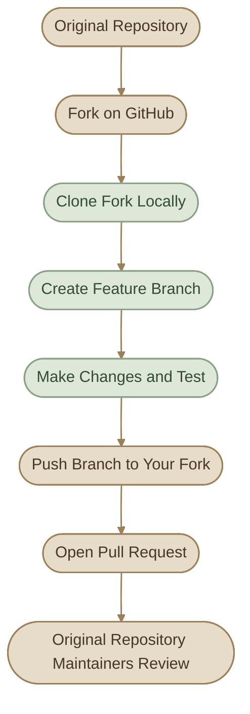
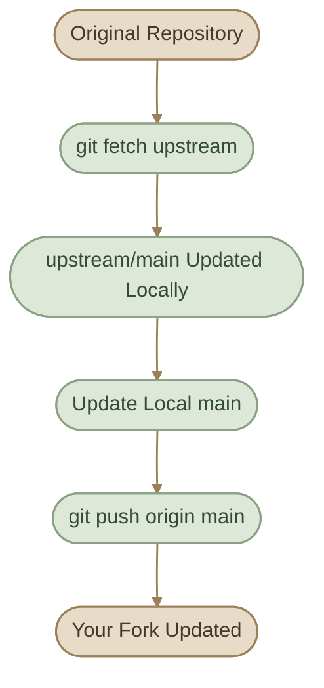
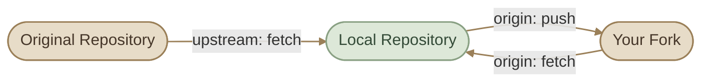
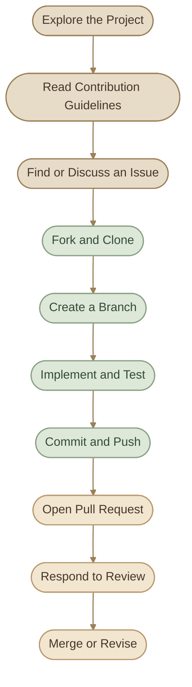

## Introduction

المساهمة في مشاريع **Open Source** من المهارات المهمة لأي DevOps Engineer؛ لأنها بتساعدك تتعامل مع مشاريع حقيقية، تفهم طريقة تعاون الفرق، وتشارك في تحسين الأدوات اللي بتستخدمها.

لكن قبل ما تعدّل في مشروع مش بتملكه، لازم تفهم إزاي تعمل `Fork`، وإزاي تشتغل محليًا باستخدام `Clone`، وإزاي تحافظ على نسختك متزامنة مع المشروع الأصلي.

### I. What You Will Learn

<CardGrid columns={2} label="Learning Objectives">
  <InfoCard variant="concept" title="Fork vs Clone" description="افهم الفرق بين إنشاء نسخة على GitHub ونسخة محلية على جهازك." icon="branch" tags={["GitHub", "Git"]} />
  <InfoCard variant="concept" title="Origin vs Upstream" description="ميّز بين المستودع الخاص بيك والمستودع الأصلي للمشروع." icon="git-pull-request" tags={["Remotes", "Synchronization"]} />
  <InfoCard variant="feature" title="Open Source Workflow" description="اتبع خطوات المساهمة من اختيار Issue لحد إرسال Pull Request." icon="git-merge" tags={["Contribution", "Pull Requests"]} />
  <InfoCard variant="tip" title="Quality Contributions" description="اكتب تغييرات واضحة، اختبرها، والتزم بقواعد المشروع." icon="shield" tags={["Testing", "Guidelines"]} />
</CardGrid>

## 1. Fork vs Clone

رغم إن `Fork` و`Clone` بيعملوا نسخ من Repository، كل واحد بيعمل نسخة في مكان مختلف ولغرض مختلف.

### I. Fork

الـ `Fork` هو نسخة من Repository بتتعمل على حسابك في GitHub، وتقدر تعدّل عليها من غير ما تحتاج صلاحيات كتابة على المشروع الأصلي.

بتستخدمه غالبًا لما تحب تساهم في مشروع مش بتملكه.

### II. Clone

الـ `Clone` هو نسخة محلية من Repository على جهازك، وبيحمّل ملفات المشروع وتاريخ Git، مع إعداد remote افتراضي عادةً اسمه `origin`.

بتستخدمه علشان تشتغل على الكود باستخدام Terminal أو IDE.

### III. Comparison

<TableCard title="Fork vs Clone">
<TableCard>
| Feature | Fork | Clone |
|---|---|---|
| Where does it live? | على GitHub | على جهازك |
| Main purpose | إنشاء نسخة تقدر تساهم من خلالها | العمل على الملفات محليًا |
| Requires a GitHub account? | عادةً نعم، عند عمل Fork على GitHub | مش بالضرورة، لو المشروع متاح للعامة |
| Creates a local copy? | لا، مش لوحده | نعم |
| Creates a GitHub repository? | نعم، على حسابك | لا |
| Common use | المساهمة في مشروع خارجي | التطوير والاختبار محليًا |
</TableCard>
</TableCard>

<InfoCard variant="insight" title="Important Distinction" description="الـ Fork مش بديل عن Clone. في الـ Open Source workflow المعتاد، بتعمل Fork على GitHub، وبعدها Clone للـ Fork على جهازك." icon="layers" />

### IV. Typical Workflow



## 2. Forking a Repository

خلينا نفترض إن فيه مشروع على GitHub اسمه `sample-project`، وإنت عايز تضيف له Feature أو تصلّح Bug.

<Steps>
<li>

<InfoCard title="Fork the Repository" icon="network" />

افتح صفحة المشروع الأصلي على GitHub، واضغط **Fork**، وبعدها اختار حسابك أو الـ Organization اللي عندك صلاحية إنشاء Repository فيها.

هيتعمل Repository جديد على حسابك، وغالبًا هيكون اسمه نفس اسم المشروع الأصلي.

مثلًا:

- Original: `open-source-owner/sample-project`
- Your fork: `your-username/sample-project`

الـ Fork بيكون مرتبط بالمشروع الأصلي من ناحية GitHub، لكنه Repository منفصل تقدر تعمل عليه تغييراتك.

</li>
<li>

<InfoCard title="Clone Your Fork" icon="terminal" />

بعد ما تعمل Fork، افتح Terminal ونفّذ:

```bash
git clone https://github.com/your-username/sample-project.git
cd sample-project
```

استبدل `your-username` باسم حسابك الفعلي.

تأكد من الـ remote الموجود:

```bash
git remote -v
```

المتوقع يكون قريبًا من:

```text
origin  https://github.com/your-username/sample-project.git (fetch)
origin  https://github.com/your-username/sample-project.git (push)
```

الـ `origin` هنا بيشير إلى الـ Fork الخاص بيك، مش بالضرورة إلى المشروع الأصلي.

</li>
<li>

<InfoCard title="Create a Branch" icon="branch" />

قبل ما تعدّل، اعمل Branch جديدة بدل ما تشتغل مباشرة على `main`.

```bash
git switch -c docs/improve-installation-guide
```

اسم الـ Branch بيعبّر عن نوع التغيير اللي هتعمله.

أمثلة:

```text
fix/docker-build-error
docs/update-readme
feat/add-health-check
```

مش كل مشروع بيفرض نفس naming convention؛ راجع قواعد المشروع قبل ما تختار الاسم.

</li>
<li>

<InfoCard title="Make and Commit Your Changes" icon="code" />

بعد تعديل الملفات، افحص التغييرات:

```bash
git status
git diff
```

أضف الملفات المطلوبة واعمل Commit:

```bash
git add README.md
git commit -m "docs: improve installation instructions"
```

استخدم مسار الملف الفعلي اللي عدّلته بدل `README.md` لو التغيير في ملف مختلف.

</li>
<li>

<InfoCard title="Push to Your Fork" icon="git-pull-request" />

```bash
git push -u origin docs/improve-installation-guide
```

كده الـ Branch اتنشرت على الـ Fork بتاعك على GitHub.

بعدها تقدر تفتح Pull Request من الـ Branch بتاعتك إلى المشروع الأصلي، بشرط اتباع آلية المساهمة المعتمدة في المشروع.

</li>
</Steps>

## 3. Keeping a Fork Synchronized

المشروع الأصلي ممكن يتغير بعد ما تعمل Fork؛ مثلًا Maintainers يضيفوا Features أو يصلحوا Bugs أو يدمجوا مساهمات ناس تانية.

لو فضلت تشتغل على Fork قديمة، ممكن تواجه Conflicts أو تبني شغلك على نسخة قديمة من المشروع.

علشان كده، محتاج تعمل **Synchronization** بين الـ Fork والمشروع الأصلي.

<Steps>
<li>

<InfoCard title="Add the Original Repository as Upstream" icon="network" />

من داخل نسخة المشروع المحلية:

```bash
git remote add upstream https://github.com/open-source-owner/sample-project.git
```

استبدل `open-source-owner/sample-project` بعنوان المشروع الأصلي.

تأكد من إعدادات الـ remotes:

```bash
git remote -v
```

المتوقع:

```text
origin    https://github.com/your-username/sample-project.git (fetch)
origin    https://github.com/your-username/sample-project.git (push)
upstream  https://github.com/open-source-owner/sample-project.git (fetch)
upstream  https://github.com/open-source-owner/sample-project.git (push)
```

<InfoCard variant="concept" title="Note" icon="flag">

<InfoCard variant="concept" title="Note" icon="flag">

**ملاحظة:** المثال بيعرض عنوان `upstream` للـ fetch والـ push لأن Git بيعرض الاتنين افتراضيًا، لكن وجود عنوان Push لا يعني إن عندك صلاحية الكتابة على المشروع الأصلي. في المعتاد، هتحتاج Push على `origin` فقط.

</InfoCard>

</InfoCard>

</li>
<li>

<InfoCard title="Fetch the Latest Changes" icon="cycle" />

```bash
git fetch upstream
```

الأمر ده بيجيب معلومات الـ Branches والـ Commits الجديدة من المشروع الأصلي، لكنه مش بيغيّر ملفاتك الحالية أو بيعمل Merge تلقائيًا.

</li>
<li>

<InfoCard title="Update Your Local Main Branch" icon="branch" />

لو الـ Branch الأساسية في المشروع اسمها `main`، وإنت مش واقف على Branch فيها شغل غير محفوظ:

```bash
git switch main
git merge --ff-only upstream/main
```

استخدام `--ff-only` بيخلّي العملية تفشل بدل ما تعمل Merge Commit لو الـ Fast-forward مش ممكن.

لو الـ Branch الأساسية اسمها `master` أو اسم مختلف، استخدم الاسم الفعلي.

</li>
<li>

<InfoCard title="Update Your Fork on GitHub" icon="git-pull-request" />

بعد تحديث الـ `main` المحلية:

```bash
git push origin main
```

كده الـ Fork الموجودة على GitHub اتحدّثت، بشرط إنك مش بتدفع تغييرات غير مقصودة وإن الـ Push مسموح.

</li>
</Steps>

### I. Synchronization Flow



### II. What If Your Feature Branch Is Behind?

لو عندك Branch شغال عليها، وعايز تجيب آخر تغييرات `main` إليها، عندك أكثر من اختيار، منها Merge أو Rebase.

مثال باستخدام Rebase:

```bash
git switch docs/improve-installation-guide
git rebase main
```

ده بيعيد تطبيق الـ Commits الخاصة بالـ Feature Branch فوق `main` المحلية المحدّثة.

لو ظهر Conflict، لازم تحلّه وتكمل العملية. ولو الـ Branch منشورة بالفعل، خليك حذر؛ الـ Rebase بيغيّر Commit History، وقد تحتاج طريقة Push مختلفة لو كنت دفعت الـ Branch قبل كده.

<InfoCard variant="warning" title="Avoid Blind Force Push" description="متستخدمش git push --force لمجرد إن Push فشل. افهم سبب المشكلة أولًا؛ ولو احتجت تحديث تاريخ Branch منشورة بعد Rebase، استخدم --force-with-lease فقط لما تكون فاهم تأثيره ومتأكد إنك مش هتمسح تغييرات حد تاني." icon="wrench" />

## 4. `origin` vs `upstream` عمليًا

الاتنين أسماء شائعة لـ Git Remotes، لكن **مش كلمات محجوزة في Git**. تقدر تسمي الـ Remotes بأسماء مختلفة؛ الأسماء دي مجرد Convention متعارف عليه.

### I. origin

في السيناريو المعتاد بتاع الـ Fork:

<CardGrid columns={1} label="origin">
  <InfoCard title="Your GitHub copy" description="بيشير إلى Repository بتاعتك على GitHub." icon="cloud" variant="concept" />
  <InfoCard variant="concept" title="Fetch and pull" icon="cycle">

بتعمل منه `fetch` و`pull` حسب احتياجك.

</InfoCard>
  <InfoCard variant="concept" title="Push your work" icon="git-pull-request">

بتعمل له `push` علشان ترفع الـ Branches والـ Commits الخاصة بيك.

</InfoCard>
</CardGrid>

### II. upstream

<CardGrid columns={1} label="upstream">
  <InfoCard title="Original repository" description="بيشير إلى Repository الأصلية اللي عملت منها Fork." icon="network" variant="concept" />
  <InfoCard title="Stay updated" description="بتستخدمه غالبًا علشان تجيب آخر التغييرات." icon="cycle" variant="concept" />
  <InfoCard title="No push required" description="مش مطلوب إنك تملك صلاحية Push عليه." icon="shield" variant="concept" />
</CardGrid>

### III. Visual Comparison



### IV. Commands You Should Know

<TableCard title="Remote Commands">
<TableCard>
| Command | Purpose |
|---|---|
| `git remote -v` | عرض أسماء وعناوين الـ Remotes |
| `git remote add upstream URL` | إضافة Remote للمشروع الأصلي |
| `git fetch upstream` | جلب آخر معلومات المشروع الأصلي |
| `git fetch origin` | جلب آخر معلومات الـ Fork |
| `git branch -r` | عرض Remote-tracking branches |
| `git switch main` | الانتقال إلى الـ Branch المحلية `main` |
| `git merge --ff-only upstream/main` | تحديث `main` المحلية باستخدام Fast-forward فقط |
| `git push origin main` | رفع `main` المحلية إلى الـ Fork |
</TableCard>
</TableCard>

### V. Practical Example

لنفترض إنك نفذت:

```bash
git remote -v
```

وظهر:

```text
origin    https://github.com/mustafammasoud/sample-project.git (fetch)
origin    https://github.com/mustafammasoud/sample-project.git (push)
upstream  https://github.com/platform-team/sample-project.git (fetch)
upstream  https://github.com/platform-team/sample-project.git (push)
```

التفسير:

<CardGrid columns={2} label="Reading the Output">
  <InfoCard title="origin" description="الـ Fork الموجودة على حسابك." icon="cloud" variant="concept" />
  <InfoCard title="upstream" description="المشروع الأصلي المملوك للفريق." icon="network" variant="concept" />
  <InfoCard title="git fetch upstream" description="تجيب آخر تحديثات المشروع الأصلي." icon="cycle" variant="command" />
  <InfoCard title="git push origin my-feature" description="ترفع الـ Feature Branch إلى الـ Fork الخاصة بيك." icon="git-pull-request" variant="command" />
</CardGrid>

**خلي بالك:** اسم `origin` مش معناه دائمًا إن الـ Repository بتاعتك، واسم `upstream` مش معناه دائمًا إنه المشروع الأصلي. المعنى الفعلي بيتحدد من عنوان كل Remote.

## 5. Contributing to Open Source

الـ **Open Source Contribution** هي أي مساهمة بتحسّن مشروعًا متاح للمشاركة وفقًا لترخيصه وقواعده.

مش لازم تبدأ بكتابة Feature كبيرة؛ مساهمات صغيرة ومدروسة ممكن تكون مفيدة جدًا.

### I. Types of Contributions

<CardGrid columns={2} label="Contribution Types">
  <InfoCard variant="concept" title="Documentation" description="تصحيح خطوات التثبيت، تحسين README، أو توضيح إعدادات Tool." icon="layers" tags={["Docs", "Beginner-friendly"]} />
  <InfoCard variant="feature" title="Bug Fixes" description="إصلاح مشكلة قابلة لإعادة الإنتاج مع اختبار يثبت الحل." icon="wrench" tags={["Debugging", "Testing"]} />
  <InfoCard variant="comparison" title="Tests" description="إضافة Unit Tests أو Integration Tests لتغطية سلوك ناقص." icon="shield" tags={["Quality", "Reliability"]} />
  <InfoCard variant="insight" title="Tooling and Automation" description="تحسين Scripts أو CI checks أو Development Workflow حسب احتياج المشروع." icon="sliders" tags={["Automation", "DevOps"]} />
</CardGrid>

### II. The Contribution Lifecycle



مش كل مشروع بيمشي بنفس الترتيب. بعض المشاريع بتطلب مناقشة الفكرة أو الحصول على موافقة قبل تنفيذ تغييرات كبيرة؛ لذلك راجع الـ Guidelines قبل ما تبدأ.

## 6. Finding Issues to Work On

أول تحدّي أحيانًا مش كتابة الكود، لكن اختيار مشكلة مناسبة تقدر تحلّها وتضيف قيمة حقيقية للمشروع.

### I. Where to Look

على GitHub، ابحث داخل الـ Repository عن Issues مفتوحة، واقرأ وصفها وتعليقات Maintainers والمساهمين.

ممكن تلاقي Labels زي:

<TableCard title="Common Issue Labels">
<TableCard>
| Label | Typical Meaning |
|---|---|
| `good first issue` | مشكلة مناسبة غالبًا للمساهمين الجدد |
| `help wanted` | المشروع محتاج مساعدة في المشكلة |
| `bug` | سلوك غير صحيح محتاج إصلاح |
| `documentation` | تحسين أو تصحيح Documentation |
| `enhancement` | اقتراح Feature أو تحسين |
| `question` | استفسار أو نقاش، مش بالضرورة مهمة تنفيذية |
</TableCard>
</TableCard>

الـ Labels دي مش Standard إلزامي؛ كل مشروع ممكن يعرّفها ويستخدمها بطريقة مختلفة.

### II. How to Choose an Issue

قبل ما تبدأ، قيّم المشكلة من خلال الأسئلة دي:

<CardGrid columns={2} label="Choosing an Issue">
  <InfoCard title="Reproducibility" description="هل المشكلة واضحة ويمكن إعادة إنتاجها؟" icon="pulse" variant="concept" />
  <InfoCard title="Active work" description="هل فيه حد شغال عليها بالفعل؟" icon="network" variant="concept" />
  <InfoCard title="Maintainer direction" description="هل فيه نقاش أو قرار من Maintainers بخصوص الحل؟" icon="flag" variant="concept" />
  <InfoCard title="Fit your level" description="هل التغيير مناسب لمستواك الحالي؟" icon="layers" variant="concept" />
  <InfoCard title="Project policy" description="هل المشروع بيطلب منك التعليق على الـ Issue قبل بدء التنفيذ؟" icon="tag" variant="concept" />
  <InfoCard title="Test the fix" description="هل تقدر تختبر الحل وتتأكد إنه مش هيكسر سلوكًا موجودًا؟" icon="shield" variant="concept" />
</CardGrid>

<InfoCard variant="tip" title="Start Small" description="تحسين Documentation أو إصلاح Bug محدود غالبًا بداية عملية أفضل من تنفيذ Feature كبيرة مش فاهم تأثيرها على المشروع." icon="flag" />

### III. Before Writing Code

لو الـ Issue مش واضحة، اسأل سؤالًا محددًا أو شارك فهمك للمشكلة قبل التنفيذ.

متفترضش إن كل Issue مفتوحة معناها إن أي شخص يقدر يبدأ فيها فورًا؛ بعض المشاريع بتستخدم Assignments أو Discussions لتنسيق الشغل.

## 7. Writing a Good Contribution

المساهمة الجيدة مش مجرد تغييرات بتشتغل على جهازك؛ لازم تكون مفهومة، محدودة النطاق، قابلة للاختبار، ومتوافقة مع أسلوب المشروع.

### I. Keep Changes Focused

لو الـ Issue بتطلب إصلاح خطأ في Docker build، حاول تخلي الـ Pull Request مركزة على المشكلة دي.

تجنب دمج تغييرات غير مرتبطة، زي إعادة تنسيق ملفات كثيرة أو تغيير أسماء متغيرات في أجزاء بعيدة عن المشكلة، إلا لو فيه سبب واضح ومقبول.

### II. Use a Clear Branch Name

أمثلة:

```bash
git switch -c fix/docker-build
git switch -c docs/improve-setup-guide
git switch -c test/config-validation
```

اختار الاسم حسب نوع التغيير وقواعد المشروع.

### III. Write Meaningful Commits

خلي رسالة الـ Commit تصف التغيير بوضوح:

```bash
git commit -m "fix: handle missing configuration file"
```

أو:

```bash
git commit -m "docs: clarify local setup steps"
```

استخدام Conventional Commits مفيد لو المشروع بيعتمده، لكنه مش قاعدة إلزامية لكل المشاريع.

### IV. Test Your Changes

راجع تعليمات الاختبار في المشروع. ممكن تحتاج تشغّل:

```bash
git diff --check
git status
```

`git diff --check` بيساعد على اكتشاف بعض مشكلات المسافات الزائدة وعلامات نهاية الأسطر داخل الـ Diff، لكنه مش بديل عن Unit Tests أو Integration Tests.

شغّل الاختبارات المطلوبة حسب نوع المشروع، مثلًا:

```bash
npm test
```

الأمر ده مجرد مثال لمشروع Node.js؛ استخدم أمر الاختبار الصحيح للمشروع اللي بتساهم فيه.

### V. Describe the Pull Request Clearly

الـ Pull Request الجيدة بتوضح:

<CardGrid columns={2} label="What a Good PR Describes">
  <InfoCard title="Problem" description="إيه المشكلة؟" icon="pulse" variant="concept" />
  <InfoCard title="Solution" description="إنت غيّرت إيه؟" icon="wrench" variant="concept" />
  <InfoCard title="Testing" description="اختبرت التغيير إزاي؟" icon="shield" variant="concept" />
  <InfoCard title="Related Issue" description="هل التغيير مرتبط بـ Issue معينة؟" icon="branch" variant="concept" />
  <InfoCard title="Limitations" description="هل فيه حاجة لسه مش مغطاة؟" icon="flag" variant="concept" />
</CardGrid>

<InfoCard variant="success" title="A Good Contribution Is Reviewable" description="خلّي الـ Diff واضحًا وصغيرًا بقدر الإمكان، واشرح سبب التغيير، واذكر الاختبارات اللي نفذتها فعلًا من غير ما تدّعي إن اختبارات ما شغّلتهاش نجحت." icon="shield" />

## 8. Understanding Contribution Guidelines

قبل ما تساهم في أي مشروع، دوّر على الملفات والتعليمات اللي بتحدد طريقة المساهمة.

### I. Common Guideline Files

<TableCard title="Contribution Files">
<TableCard>
| File | Purpose |
|---|---|
| `CONTRIBUTING.md` | شرح خطوات المساهمة ومتطلبات التطوير والاختبار |
| `CODE_OF_CONDUCT.md` | قواعد السلوك والتعامل داخل مجتمع المشروع |
| `README.md` | نظرة عامة، التثبيت، الاستخدام، وروابط مهمة |
| `LICENSE` | الشروط القانونية لاستخدام الكود وتعديله وتوزيعه |
| `SECURITY.md` | طريقة الإبلاغ عن الثغرات الأمنية |
| Issue templates | معلومات لازم تتوفر عند الإبلاغ عن مشكلة |
| Pull request template | المعلومات المطلوبة عند تقديم تغييرات |
</TableCard>
</TableCard>

مش شرط كل مشروع يحتوي على كل الملفات دي، وممكن يحط تعليمات المساهمة داخل Documentation أو ملفات أخرى.

### II. What to Check Before Contributing

<Steps>
<li>

<InfoCard title="Development Setup" icon="terminal" />

افهم إزاي تجهّز بيئة التطوير، وإيه الإصدارات أو Dependencies المطلوبة.

</li>
<li>

<InfoCard title="Coding Standards" icon="code" />

راجع أسلوب كتابة الكود، التنسيق، Naming conventions، والـ Linters المطلوبة.

</li>
<li>

<InfoCard title="Testing Requirements" icon="shield" />

اعرف الاختبارات اللي لازم تشغّلها قبل إرسال Pull Request.

</li>
<li>

<InfoCard title="Branch and Commit Conventions" icon="branch" />

تأكد من أسماء الـ Branches وطريقة كتابة Commit messages لو المشروع محدد قواعد لها.

</li>
<li>

<InfoCard title="Pull Request Process" icon="git-pull-request" />

راجع هل لازم تربط التغيير بـ Issue، أو تحصل على موافقة مسبقة، أو تستوفي شروط CI معينة.

</li>
<li>

<InfoCard title="Security Reporting" icon="shield" />

لو اكتشفت ثغرة أمنية، اتبع قناة الإبلاغ السرية الموثقة في `SECURITY.md` بدل ما تنشر تفاصيل استغلالها في Issue عامة.

</li>
</Steps>

<InfoCard variant="warning" title="Do Not Ignore Project Rules" description="حتى لو الحل بتاعك صحيح تقنيًا، ممكن الـ Maintainers يرفضوه لو مخالف لنطاق الـ Issue أو متطلبات الاختبار أو طريقة المساهمة المحددة في المشروع." icon="flag" />

## 9. Practical Lab — Contribute Through a Fork

في التطبيق ده هتتدرّب على Workflow المساهمة باستخدام Repository تملكها أو مشروع تجريبي تقدر تعدّل عليه بأمان.

### I. Lab Objectives

<CardGrid columns={2} label="Lab Objectives">
  <InfoCard title="Fork" description="إنشاء Fork على GitHub." icon="network" variant="concept" />
  <InfoCard title="Clone" description="استنساخ الـ Fork محليًا." icon="terminal" variant="concept" />
  <InfoCard variant="concept" title="Upstream" icon="cycle">

إضافة `upstream`.

</InfoCard>
  <InfoCard title="Branch" description="إنشاء Branch جديدة." icon="branch" variant="concept" />
  <InfoCard title="Change and check" description="تعديل ملف وتشغيل الفحوصات المناسبة." icon="wrench" variant="concept" />
  <InfoCard title="Push" description="رفع التغييرات إلى الـ Fork." icon="git-pull-request" variant="concept" />
  <InfoCard title="Pull Request" description="فهم اتجاه الـ Pull Request." icon="git-merge" variant="concept" />
</CardGrid>

<Steps>
<li>

<InfoCard title="Clone Your Fork" icon="terminal" />

```bash
git clone https://github.com/YOUR_USERNAME/sample-project.git
cd sample-project
```

استبدل `YOUR_USERNAME` و`sample-project` بالقيم الفعلية.

</li>
<li>

<InfoCard title="Configure Remotes" icon="network" />

لو الـ Repository الأصلية هي `https://github.com/ORIGINAL_OWNER/sample-project.git`:

```bash
git remote add upstream https://github.com/ORIGINAL_OWNER/sample-project.git
git remote -v
```

لو `upstream` موجود بالفعل، متضيفوش مرة تانية. افحص عنوانه بدلًا من ذلك.

</li>
<li>

<InfoCard title="Create a Branch" icon="branch" />

```bash
git switch -c docs/improve-readme
```

</li>
<li>

<InfoCard title="Make a Small Change" icon="code" />

عدّل ملفًا مناسبًا، مثل `README.md`، بما يتوافق مع غرض الـ Repository.

بعدها:

```bash
git diff
git diff --check
git status
```

</li>
<li>

<InfoCard title="Commit and Push" icon="git-pull-request" />

```bash
git add README.md
git commit -m "docs: improve project README"
git push -u origin docs/improve-readme
```

</li>
<li>

<InfoCard title="Open a Pull Request" icon="git-merge" />

افتح الـ Fork على GitHub، وابدأ Pull Request من:

<CardGrid columns={2} label="PR Direction">
  <InfoCard title="Head repository" description="الـ Fork بتاعتك." icon="cloud" variant="concept" />
  <InfoCard variant="concept" title="Compare branch" icon="branch">

`docs/improve-readme`.

</InfoCard>
  <InfoCard title="Base repository" description="المشروع الأصلي." icon="network" variant="concept" />
  <InfoCard title="Base branch" description="الـ Branch الأساسية اللي المشروع بيقبل عليها المساهمات." icon="flag" variant="concept" />
</CardGrid>

راجع الـ base branch وقواعد المساهمة قبل إرسال الـ Pull Request.

لو بتطبّق على Repository تجريبية بتملكها، تقدر تستخدم Repository ثانية كـ Original للتدرّب على نفس الخطوات من غير ما تبعت تغييرات لمشروع خارجي.

</li>
</Steps>

### II. Lab Checklist

<ChecklistCard title="Lab Checklist" items={[
  "عملت Fork على GitHub.",
  "عملت Clone للـ Fork محليًا.",
  "تأكدت إن `origin` بيشير للـ Fork.",
  "أضفت `upstream` للمشروع الأصلي.",
  "أنشأت Feature Branch منفصلة.",
  "راجعت الـ Diff وشغّلت الفحوصات المناسبة.",
  "عملت Commit برسالة واضحة.",
  "رفعت الـ Branch إلى `origin`.",
  "فهمت اتجاه الـ Pull Request وراجعت Contribution Guidelines.",
]} />

## 10. Summary

<CardGrid columns={2} label="Key Takeaways">
  <InfoCard variant="summary" title="Fork vs Clone" description="Fork نسخة على GitHub؛ Clone نسخة محلية على جهازك." icon="branch" />
  <InfoCard variant="summary" title="origin vs upstream" description="في Workflow المعتاد، origin هو الـ Fork وupstream هو المشروع الأصلي." icon="git-pull-request" />
  <InfoCard variant="summary" title="Synchronize Regularly" description="استخدم fetch لجلب التحديثات، ثم حدّث الـ Branch المناسبة بحذر." icon="cycle" />
  <InfoCard variant="summary" title="Contribute Responsibly" description="اختار Issue مناسبة، اتبع Guidelines، اختبر التغييرات، واكتب Pull Request واضحة." icon="shield" />
</CardGrid>

### I. Essential Commands

```bash
# Inspect remotes
git remote -v

# Add the original repository
git remote add upstream https://github.com/ORIGINAL_OWNER/REPOSITORY.git

# Fetch upstream updates
git fetch upstream

# Create a feature branch
git switch -c docs/improve-readme

# Review changes
git diff
git diff --check

# Commit and push your contribution
git add README.md
git commit -m "docs: improve README"
git push -u origin docs/improve-readme
```
