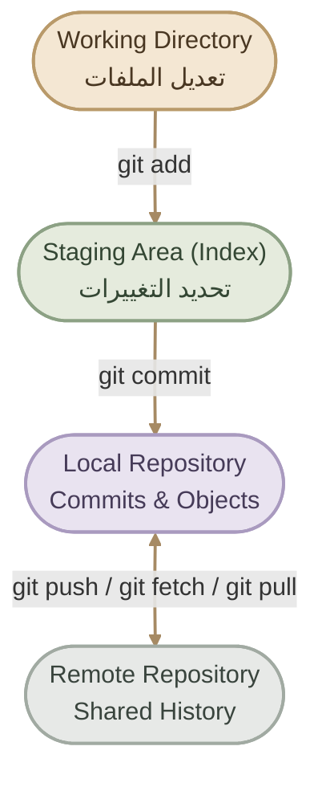
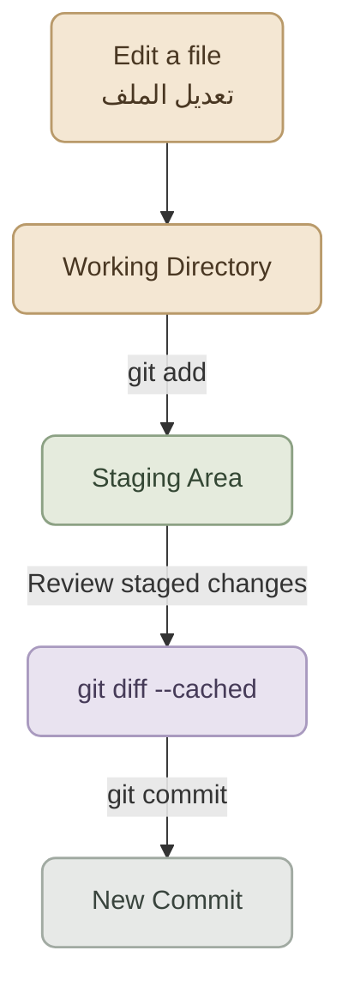
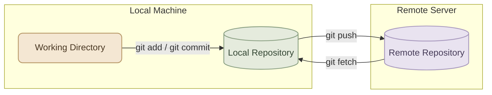
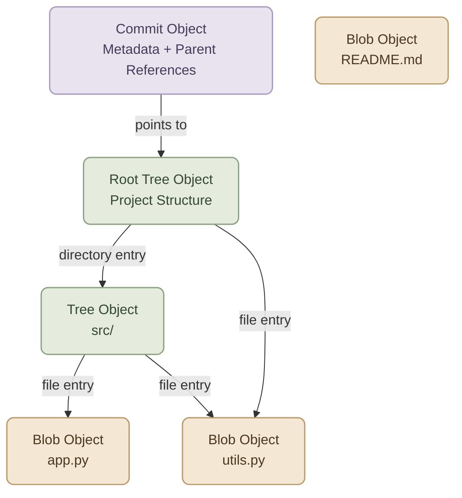
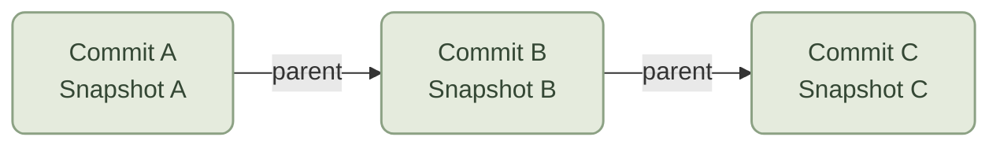

---
title: Git Architecture & Core Concepts
description: Understand Git's internal architecture, the working directory, staging area, repositories, Git objects, hashes, and snapshot-based history.
category: version-control
order: 2
level: beginner
draft: false
tags:
  - git
  - git-architecture
  - repository
  - staging-area
  - git-objects
language: ar
---

## Overview

عشان تفهم Git بجد، لازم تبقى فاهم هو بيشتغل إزاي من جوه، مش مجرد حافظ أوامر زي `git add` و`git commit`.

Git مش مجرد أداة بتحتفظ بنسخ قديمة من ملفاتك؛ هو **Distributed Version Control System (DVCS)**، وبيعتمد على مجموعة من المكونات والـ objects اللي بتسجل حالة المشروع وتاريخه.

في الصفحة دي هنفهم:

<CardGrid columns={3} label="Core Concepts">
<InfoCard variant="concept" title="Working Directory" description="المكان اللي بتعدّل فيه الملفات." icon="wrench" tags={["Overview"]} />
<InfoCard variant="concept" title="Staging Area" description="المرحلة اللي بتحدد فيها التغييرات المراد تسجيلها." icon="layers" tags={["Overview"]} />
<InfoCard variant="concept" title="Repository" description="بيحتفظ ببيانات المشروع وتاريخه." icon="database" tags={["Overview"]} />
<InfoCard variant="concept" title="Objects" description="Blob وTree وCommit objects." icon="cube" tags={["Overview"]} />
<InfoCard variant="concept" title="Hashes" description="تحديد هوية البيانات." icon="tag" tags={["Overview"]} />
<InfoCard variant="concept" title="Snapshots" description="كل Commit بيشير إلى لقطة كاملة للمشروع." icon="cycle" tags={["Overview"]} />
</CardGrid>

<InfoCard variant="concept" title="The Core Idea" description="Git بيسجل حالات المشروع على هيئة Commits، وكل Commit بيشير إلى Snapshot محددة من ملفات المشروع، مع الاحتفاظ بمعلومات تربطها بتاريخ التغييرات السابقة." icon="layers" tags={["Repository", "Commit", "Snapshot"]} />

---

## 1. Git Architecture at a Glance

قبل ما ندخل في التفاصيل، خلينا نشوف المكونات الأساسية وهي مرتبطة ببعض.



خد بالك من نقطة مهمة: كل جزء من دول له وظيفة مختلفة. تعديل ملف مش معناه إنه اتضاف للـ Staging Area، وإضافته للـ Staging Area مش معناها إنه اتحفظ في الـ Repository على هيئة Commit.

---

## 2. Git Repository

الـ `Git Repository` هو المكان اللي Git بيحتفظ فيه بالبيانات اللازمة لتتبع المشروع وتاريخه.

في المشروع العادي، لما تعمل:

```bash
git init
```

Git بيجهز Repository جديد داخل المجلد الحالي، وبيُنشئ مجلد مخفي اسمه `.git` يحتوي على البيانات الداخلية الخاصة بالـ Repository.

لو المشروع متعمله `git init` بالفعل أو نزلته باستخدام `git clone`، فغالبًا هتلاقي `.git` موجود.

### I. What's Inside `.git`?

المجلد ده بيحتوي على معلومات زي:

- **Objects:** البيانات اللي Git بيخزنها، زي محتوى الملفات والـ Commits.
- **Refs:** مراجع لأسماء زي Branches وTags.
- **HEAD:** بيحدد المرجع أو الـ Commit اللي الـ Repository واقف عليه حاليًا.
- **Index:** المعلومات المستخدمة في تجهيز التغييرات للـ Commit.
- **Configuration:** إعدادات خاصة بالـ Repository، ومنها إعدادات الـ Remotes.

بعض الملفات والمجلدات الداخلية ممكن تختلف حسب إصدار Git وطريقة استخدامه، لكن الفكرة الأساسية واحدة: `.git` هو قلب الـ Repository.

<InfoCard variant="tip" title="Inspect the Repository" description="استخدم الأمر ده علشان تعرف المسار الحقيقي لمجلد Git الداخلي بدل ما تفترض إنه موجود في مكان معين." icon="terminal" />

```bash
git rev-parse --git-dir
```

ولو عايز تشوف ملفات المشروع اللي Git بيتتبعها أو حالة التغييرات الحالية:

```bash
git status
```

**مهم:** مش كل ملف موجود داخل مجلد المشروع بيكون متتبع بواسطة Git. فيه ملفات ممكن تكون `Untracked` أو مستبعدة عن طريق `.gitignore`.

---

## 3. Working Directory

الـ `Working Directory` هو ملفات المشروع اللي بتتعامل معاها مباشرة على جهازك.

مثلًا، لو عندك مشروع بالشكل ده:

```text
my-project/
├── src/
│   └── app.py
├── tests/
│   └── test_app.py
├── README.md
└── .git/
```

لما تفتح `app.py` وتعدّل فيه، إنت بتغيّر النسخة الموجودة في الـ Working Directory.

لكن Git مش بيعتبر التعديل ده Commit تلقائيًا، ولا بيضيفه للـ Staging Area من نفسه.

### I. Common File States

الملفات اللي Git بيتعامل معاها ممكن تكون في حالات مختلفة:

- **Untracked:** ملف جديد Git لسه مش بيتتبعه.
- **Unmodified:** ملف متتبع، ومفيش تغييرات غير مسجلة عليه مقارنة بالحالة المعروفة عند Git.
- **Modified:** ملف متتبع حصل فيه تعديل.
- **Staged:** التغييرات الحالية اتجهزت علشان تدخل في الـ Commit القادم.

الحالات دي بتوصف وضع الملفات والتغييرات، ومش كلها مراحل إجبارية بيمر بيها كل ملف بنفس الترتيب.

```bash
git status
```

ده أول أمر ترجعله لما تكون مش متأكد من حالة المشروع.

<InfoCard variant="insight" title="A Common Misunderstanding" description="مجرد إنك تعدّل ملف وتحفظه في المحرر مش معناه إن Git سجّل التعديل. الحفظ في المحرر شيء، وتجهيز التغيير أو تسجيله في Git شيء تاني." icon="layers" />

---

## 4. Staging Area (Index)

الـ `Staging Area`، اللي Git بيسميها كمان `Index`، هي المنطقة اللي بتحدد فيها التغييرات اللي عايز تدخلها في الـ Commit القادم.

ليه Git محتاج مرحلة وسيطة أصلًا؟

لأنك ممكن تعدّل خمسة ملفات، لكن تكون عايز تعمل Commit لملفين بس. الـ Staging Area بتديك تحكم في التغييرات اللي هتدخل في كل Commit.

### I. The Role of `git add`

خلينا نفترض إنك عدّلت ملفين:

```text
src/app.py
README.md
```

لو نفذت:

```bash
git add src/app.py
```

إنت كده جهزت التغييرات الموجودة في `src/app.py` علشان تدخل في الـ Commit القادم، لكن مش بالضرورة التغييرات الموجودة في `README.md`.

وبعدها تقدر تعمل:

```bash
git status
git diff --cached
```

الأمر الأول بيعرض حالة الملفات، والتاني بيعرض التغييرات الموجودة في الـ Staging Area مقارنة بالـ Commit الحالي.

### II. From Editing to Committing



### III. What If You Edit a File After `git add`?

دي نقطة مهمة جدًا.

لما تنفذ `git add`، Git بيحدّث الـ Index بالتغييرات الموجودة في الملف وقت تنفيذ الأمر. لو عدّلت نفس الملف مرة تانية بعد كده، التعديل الجديد مش هيتضاف للـ Staging Area تلقائيًا.

مثلًا:

```bash
# Stage the current version
git add src/app.py

# Edit src/app.py again
# The new changes are not automatically staged

git status
git add src/app.py
```

في المثال ده، الأمر الأخير بيحدّث الـ Staging Area بالتغييرات الجديدة كمان.

<InfoCard variant="warning" title="Review Before Committing" description="ماتعتمدش على إنك نفذت git add وخلاص. راجع git diff --cached علشان تتأكد إن الـ Commit هيحتوي على التغييرات اللي إنت قاصد تسجلها فعلًا." icon="shield" tags={["Staging", "Review"]} />

---

## 5. Local vs Remote Repository

بما إن Git هو `Distributed Version Control System`، فكل Developer عنده Local Repository يحتوي على بيانات Git وتاريخ المشروع اللي تم الحصول عليه.

أما الـ `Remote Repository` فهو Repository موجود على جهاز أو خادم آخر، وغالبًا بيكون نقطة مشاركة وتعاون بين أعضاء الفريق.

مثلًا، ممكن يكون عندك Local Repository على Fedora، والـ Remote Repository مستضاف على GitHub.

### I. Local Repository

الـ Local Repository بيسمحلك تعمل عمليات كتير من غير ما تحتاج اتصال بالإنترنت، منها:

- إنشاء Commits.
- إنشاء Branches محلية والتنقل بينها.
- مراجعة تاريخ المشروع.
- مقارنة التغييرات.
- استرجاع حالات سابقة من المشروع.

### II. Remote Repository

الـ Remote Repository بيساعدك تشارك التغييرات وتستقبل تغييرات الآخرين.

أهم الأوامر المرتبطة بالتعامل مع الـ Remote:

<TableCard title="Remote Commands" caption="أهم أوامر التعامل مع المستودعات البعيدة.">
| Command | Purpose |
|---|---|
| `git remote -v` | عرض الـ Remote URLs المسجلة |
| `git fetch` | جلب بيانات وتحديثات من الـ Remote من غير دمجها تلقائيًا في الـ Branch الحالي |
| `git pull` | جلب التحديثات ودمجها أو إعادة تطبيقها حسب الإعدادات |
| `git push` | إرسال الـ Commits المحلية إلى الـ Remote |
</TableCard>

### III. How Local and Remote Repositories Work Together



**مهم:** `git fetch` مش هو نفسه `git pull`. الأول بيحدّث المعلومات اللي عندك عن الـ Remote، أما التاني فبيحاول يدمج التحديثات في سياق الـ Branch الحالي، أو يعيد تطبيقها لو إعدادات `pull.rebase` مفعّلة.

---

## 6. Git Objects: Blob, Tree, and Commit

واحدة من أهم الأفكار لفهم Git من الداخل هي إن الـ Repository بيخزن البيانات باستخدام أنواع مختلفة من الـ `Objects`.

الأنواع الأساسية اللي محتاج تعرفها هي:

- `Blob`
- `Tree`
- `Commit`

وفيه نوع رابع اسمه `Tag Object`، بنستخدمه في حالات معينة لإنشاء Annotated Tags. هنركز هنا على أول ثلاثة لأنهم أساس فهم Snapshot الخاصة بكل Commit.

### I. Blob Object

الـ `Blob` بيخزن محتوى ملف، لكنه مش بيخزن اسم الملف أو مكانه داخل المشروع.

يعني لو عندك ملف اسمه `app.py`، فالـ Blob بيحتوي على محتوى الملف، بينما الاسم والمسار بيتم تمثيلهم من خلال الـ Tree.

وده معناه إن ملفين بمحتوى متطابق ممكن يشيروا لنفس الـ Blob object داخل Git.

### II. Tree Object

الـ `Tree` بيمثل بنية Directory معينة داخل Snapshot المشروع.

بيحتوي على Entries بتربط أسماء الملفات والمجلدات بالـ Objects المناسبة، مع معلومات عن نوع كل Entry وصلاحيات الملفات التي يتتبعها Git.

ببساطة، الـ Tree هو اللي بيساعد Git يعرف الملفات موجودة فين وأسماءها إيه، وإزاي المجلدات مرتبطة ببعض.

### III.  Commit Object

الـ `Commit` بيسجل Snapshot المشروع من خلال الإشارة إلى Root Tree، بالإضافة إلى Metadata زي:

- اسم وبريد الـ Author.
- اسم وبريد الـ Committer.
- وقت إنشاء الـ Commit.
- رسالة الـ Commit.
- Parent Commit أو أكثر، حسب نوع الـ Commit.

الـ Commit العادي غالبًا بيكون له Parent واحد، أول Commit ممكن يكون من غير Parent، والـ Merge Commit ممكن يكون له أكتر من Parent.

### IV. How These Objects Fit Together



الرسم توضيحي للفكرة العامة: الـ Commit بيشير إلى Root Tree، والـ Trees بتربط أسماء الملفات والمجلدات بالـ Objects المناسبة. الرسم مش بيمثل الـ IDs الحقيقية أو كل تفاصيل التخزين الداخلي.

### V. Inspect Git Objects

تقدر تشوف معلومات الـ Commit الحالي باستخدام:

```bash
git cat-file -p HEAD
```

هتلاقي معلومات منها `tree` و`parent` و`author` و`committer`، بالإضافة إلى رسالة الـ Commit.

علشان تعرف نوع الـ Object المشار إليه بواسطة `HEAD`:

```bash
git cat-file -t HEAD
```

غالبًا النتيجة هتكون:

```text
commit
```

ولو عايز تعرض الـ Tree المرتبطة بالـ Commit:

```bash
git ls-tree HEAD
```

الأمر ده بيعرض Entries الموجودة في Root Tree، زي الملفات والمجلدات التي تمثلها الـ Objects.

---

## 7. Hashes and Object Identity

Git بيستخدم `Hash` علشان يحدد هوية الـ Objects، وده بيساعده يتعامل مع البيانات ويشير إليها داخل الـ Repository.

في Git، الـ Object ID التقليدي في كثير من الـ Repositories بيكون مبني على `SHA-1`، وفيه كمان دعم لـ `SHA-256` في Repositories التي تم إنشاؤها باستخدام نظام الـ Hash ده.

علشان كده، مش صح نفترض إن كل Git Object ID لازم يكون طوله 40 hexadecimal characters في كل Repository؛ الطول بيعتمد على الـ Hash algorithm المستخدمة.

### I. What Does a Hash Represent?

الـ Hash بيتحسب من محتوى الـ Object وفقًا لتنسيق Git الداخلي، مش بالضرورة من محتوى الملف الخام وحده.

وده معناه إن الـ Object ID مرتبط ببيانات الـ Object، بما فيها نوعه وطوله ومحتواه.

لو نفس الـ Object content اتخزن بنفس الطريقة، Git يقدر يتعرف عليه باستخدام نفس الـ Object ID.

### II. Inspect an Object's Hash

لعرض الـ Commit ID الحالي:

```bash
git rev-parse HEAD
```

ولعرض الـ Hash الخاص بملف متتبع، تقدر تستخدم:

```bash
git hash-object README.md
```

الأمر ده بيحسب الـ Object ID لمحتوى الملف وفقًا لقواعد Git، لكنه افتراضيًا مش بيخزن الـ Object داخل الـ Repository.

لو أضفت `-w`، Git بيكتب الـ Object في الـ Object Database:

```bash
git hash-object -w README.md
```

استخدم `-w` وأنت فاهم إنك بتكتب Object داخل الـ Repository؛ ده مش بديل عن `git add` أو `git commit` في الـ Workflow المعتاد.

<InfoCard variant="insight" title="Content-Based Identity" description="الـ Hash بيساعد Git يحدد الـ Objects ويكتشف اختلاف البيانات. لكنه مش معناه إن كل ملف ليه Hash منفصل دائمًا؛ المحتوى المتطابق ممكن ينتج نفس الـ Object ID، والـ Hash مش بديل عن مراجعة الكود أو ضمان أمني مطلق." icon="wrench" tags={["Hash", "Object ID"]} />

---

## 8. Snapshots vs Diffs

من المفاهيم المهمة جدًا إن Git بيفكر في الـ Commits باعتبارها Snapshots لحالة المشروع، مش مجرد قائمة من التعديلات النصية المتتالية.

### I. What Is a Snapshot?

الـ `Snapshot` هي الحالة المسجلة للملفات التي يتتبعها Git في لحظة معينة.

لما تعمل Commit، Git بيحفظ مرجع للحالة دي من خلال الـ Objects والـ Trees، وبيسجل علاقتها بتاريخ المشروع.

لو ملف لم يتغير عن الحالة السابقة، Git ممكن يعيد استخدام نفس الـ Object بدل ما ينشئ Blob جديد للمحتوى المتطابق.

### II. How Is This Different from a Diff?

الـ `Diff` هو طريقة لعرض الاختلافات بين حالتين أو أكثر.

مثلًا، لما تستخدم:

```bash
git diff
```

Git بيعرض الاختلافات بين الـ Working Directory والـ Staging Area.

أما:

```bash
git diff --cached
```

فبيعرض الاختلافات بين الـ Staging Area والـ Commit الحالي.

الـ Diff بيساعدك تفهم إيه اللي اتغير، لكن الـ Snapshot بتوصف الحالة الكاملة للملفات المتتبعة في نقطة زمنية معينة.

### III. Snapshots Across Commits



الرسم بيشرح علاقة الـ Commits عبر الزمن بصورة مبسطة. كل Commit بيشير إلى Snapshot، ويرتبط بالـ Parent Commit المناسب، وده بيكوّن تاريخ المشروع.

Git ممكن يعيد استخدام Objects بين Snapshots بدل ما يكرر تخزين المحتوى نفسه كل مرة. وعلشان كده، فكرة Snapshot مش معناها إن كل Commit بيحتوي على نسخة كاملة مستقلة من كل ملف على القرص.

### IV. Why This Matters

فهم الفرق بين الـ Snapshot والـ Diff هيساعدك تفهم:

- إزاي Git بيعرض التغييرات بين Commits.
- ليه `git show` و`git diff` بيقدموا معلومات مختلفة.
- إزاي الـ Branches بتشير إلى Commits مختلفة داخل التاريخ.
- ليه الـ Commit يقدر يحدد حالة المشروع حتى لو ملفات الـ Working Directory اتغيرت بعده.

---

## 9. Putting the Concepts Together

<Callout type="lab" title="Hands-on: Git Workflow" />

<Steps>
<li>

<InfoCard title="Step 1 — Check State" description="راجع حالة المشروع الحالية باستخدام git status." icon="layers" tags={["Status"]} />

```bash
git status
```

</li>
<li>

<InfoCard title="Step 2 — Review Changes" description="افحص التغييرات غير المجهّزة عبر git diff." icon="branch" tags={["Diff"]} />

```bash
git diff
```

</li>
<li>

<InfoCard title="Step 3 — Stage Changes" description="أضف التعديلات المطلوبة إلى Staging Area." icon="cube" tags={["Stage"]} />

```bash
git add README.md
```

</li>
<li>

<InfoCard title="Step 4 — Review Staged" description="راجع التغييرات المجهّزة عبر git diff --cached." icon="wrench" tags={["Review"]} />

```bash
git diff --cached
```

</li>
<li>

<InfoCard title="Step 5 — Create Commit" description="سجّل Snapshot جديدة عبر git commit." icon="shield" tags={["Commit"]} />

```bash
git commit -m "docs: update README"
```

</li>
<li>

<InfoCard title="Step 6 — Inspect Commit" description="افحص محتوى الـ Commit الحالي عبر git cat-file." icon="cycle" tags={["Inspect"]} />

```bash
git cat-file -p HEAD
```

</li>
<li>

<InfoCard title="Step 7 — Inspect Tree" description="راجع بنية الملفات في Root Tree." icon="layers" tags={["Tree"]} />

```bash
git ls-tree HEAD
```

</li>
</Steps>

---

## 10. Common Misconceptions

<CardGrid columns={2} label="Common Git Misconceptions">
  <InfoCard variant="comparison" title="Git vs GitHub" description="Git هو Version Control System. أما GitHub فهو منصة لاستضافة Git Repositories والتعاون عليها." icon="branch" />

  <InfoCard variant="comparison" title="Add vs Commit" description="git add بيجهز التغييرات داخل الـ Index. أما git commit فبيسجل Snapshot جديدة في تاريخ الـ Repository." icon="layers" />

  <InfoCard variant="comparison" title="Commit vs Push" description="الـ Commit بيتسجل محليًا أولًا. git push بيحاول يرسل الـ Commits إلى Remote Repository." icon="cloud" />

  <InfoCard variant="comparison" title="Snapshot vs Full Copy" description="الـ Snapshot بتمثل حالة المشروع، لكن Git ممكن يعيد استخدام Objects موجودة بدل ما يكرر تخزين نفس المحتوى." icon="cube" />
</CardGrid>

---

## 11. Key Takeaways

<InfoCard variant="summary" title="Git in Three Areas" description="Working Directory (تعديل) → Staging Area (تجهيز) → Repository (تسجيل). كل Commit لقطة كاملة موقّعة بـ Hash فريد." icon="layers" tags={["Mental Model"]} />

<CardGrid columns={2} label="Core Concepts to Remember">
  <InfoCard variant="summary" title="Working Directory" description="المكان اللي بتعدّل فيه ملفات المشروع مباشرة." icon="layers" />

  <InfoCard variant="summary" title="Staging Area" description="المرحلة اللي بتحدد فيها التغييرات المراد تضمينها في الـ Commit القادم." icon="layers" />

  <InfoCard variant="summary" title="Repository" description="بيحتفظ ببيانات Git وتاريخ المشروع، والـ Local Repository بيشتغل بصورة مستقلة عن الاتصال بالـ Remote." icon="cube" />

  <InfoCard variant="summary" title="Git Objects" description="Blob للمحتوى، وTree لبنية الملفات والمجلدات، وCommit لتسجيل Snapshot وبياناتها." icon="cube" />

  <InfoCard variant="summary" title="Hashes" description="بتحدد هوية الـ Objects بناءً على بياناتها باستخدام الـ Hash algorithm المعتمدة في الـ Repository." icon="wrench" />

  <InfoCard variant="summary" title="Snapshots" description="كل Commit بيشير إلى حالة مسجلة للمشروع، والـ Diffs بتعرض الاختلافات بين الحالات." icon="cycle" />
</CardGrid>

