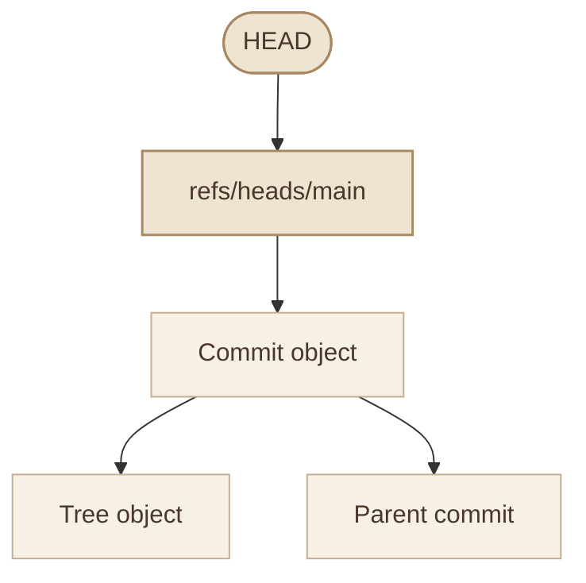
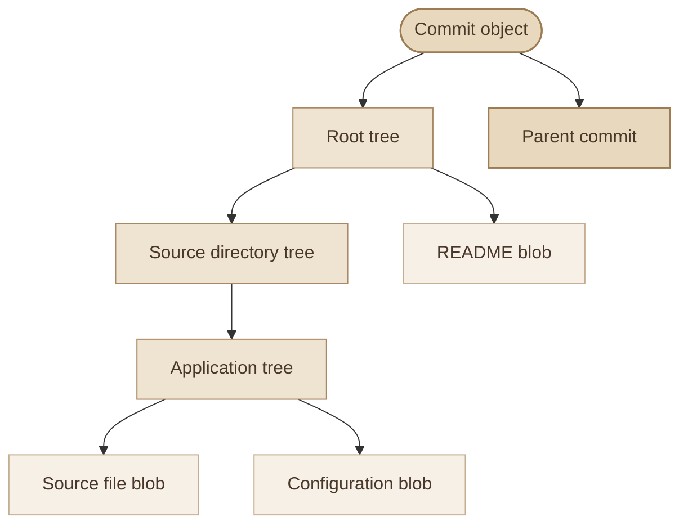
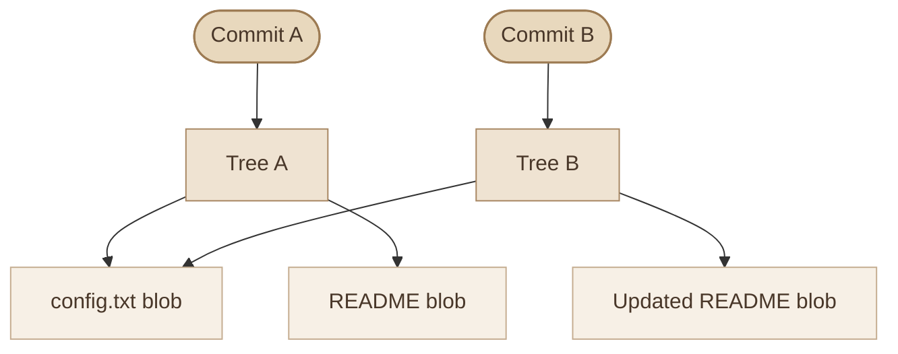
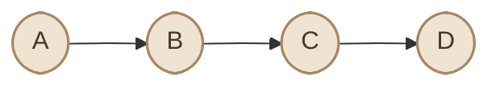
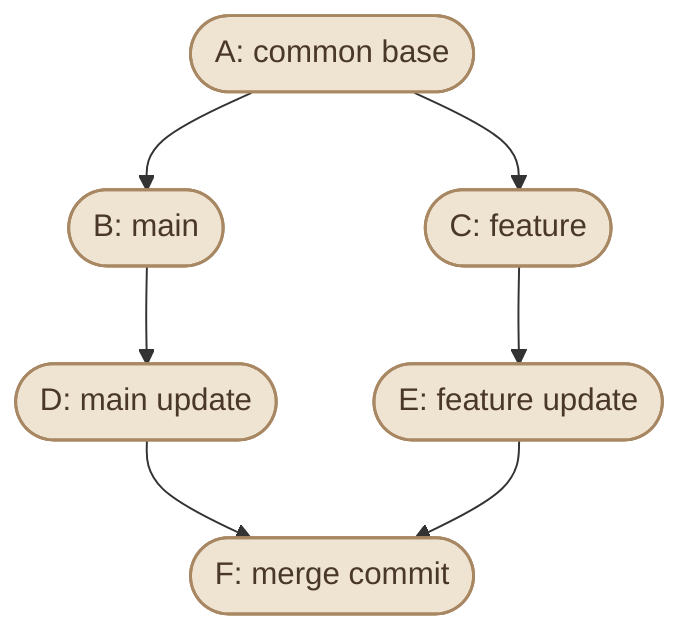

## Overview

Git مش مجرد مجموعة أوامر زي `add` و`commit` و`merge`. هو نظام بيخزن البيانات في شكل objects، وبيستخدم references عشان يحدد الفروع والـ tags، وبيمثل تاريخ المشروع باستخدام شبكة من الـ commits.

فهم الـ internals هيساعدك تعرف ليه:

<CardGrid columns={3} label="Why Internals Matter">
<InfoCard variant="concept" title="Branches Are References" description="الـ branch بيتحرك من commit للتانية من غير ما ينسخ ملفات المشروع." icon="branch" tags={["Lightweight"]} />

<InfoCard variant="concept" title="History Rewrites Create Objects" description="تعديل commit بيؤدي غالبًا إلى إنشاء commit جديدة." icon="cycle" tags={["New Hash"]} />

<InfoCard variant="concept" title="HEAD Is a Pointer" description="`HEAD` بيحدد إنت واقف فين داخل تاريخ المشروع." icon="flag" tags={["Position"]} />

<InfoCard variant="concept" title="Old Files Are Recoverable" description="Git يقدر يرجع ملفات من commits قديمة." icon="database" tags={["Recover"]} />

<InfoCard variant="concept" title="Objects Outlive References" description="بعض البيانات بتفضل موجودة مؤقتًا بعد ما الـ reference اللي كان بيوصل ليها يتغير أو يتم حذفه." icon="layers" tags={["GC"]} />

<InfoCard variant="concept" title="Storage Is Compressed" description="Git بيضغط objects ويجمعها في ملفات أكبر لتحسين كفاءة التخزين." icon="wrench" tags={["Packfiles"]} />
</CardGrid>

هنستخدم أوامر فحص آمنة قدر الإمكان، ونفحص الـ `.git` directory مباشرة عشان نربط المفاهيم بالملفات الحقيقية.

## 1. The `.git` Directory Structure

لما تنفذ `git init` داخل directory، Git بيجهز repository محلي وبيخزن بياناته الداخلية في مكان اسمه `.git`.

في repository عادي غير bare، بيكون الشكل العام كالتالي:

```text
my-project/
├── .git/
│   ├── HEAD
│   ├── config
│   ├── description
│   ├── index
│   ├── objects/
│   │   ├── info/
│   │   └── pack/
│   ├── refs/
│   │   ├── heads/
│   │   ├── tags/
│   │   └── remotes/
│   ├── hooks/
│   ├── logs/
│   └── ...
├── src/
├── README.md
└── .gitignore
```

ده شكل توضيحي؛ الملفات والـ directories الموجودة فعليًا بتختلف حسب إصدار Git، وحالة المستودع، والعمليات اللي اتنفذت عليه. بعض المراجع ممكن تكون مخزنة في `packed-refs` أو في صيغة مختلفة عن الـ loose references.

### I. Important Components

<TableCard title="Inside the .git Directory" caption="أهم ملفات ومجلدات اللي بتمثل حالة المستودع.">
| Component | Purpose |
|---|---|
| `HEAD` | بيحدد الـ commit أو المرجع المرتبط بالـ working state الحالية. |
| `config` | إعدادات خاصة بالـ repository. |
| `index` | بيمثل الـ staging area اللي Git بيستخدمها لتجهيز الـ next commit. |
| `objects/` | قاعدة بيانات Git الأساسية لتخزين الـ objects. |
| `refs/heads/` | بيحتوي عادةً على references الخاصة بالـ local branches. |
| `refs/tags/` | بيحتوي على references الخاصة بالـ tags، لما تكون مخزنة كـ loose refs. |
| `refs/remotes/` | بيحتوي على remote-tracking references، لما تكون مخزنة كـ loose refs. |
| `logs/` | بيحتوي على reflogs لبعض المراجع، حسب إعدادات Git. |
| `hooks/` | مكان للـ repository hooks، اللي ممكن تنفذ scripts عند أحداث معينة. |
</TableCard>

### II. Inspect the Repository

من داخل أي Git repository، نفذ:

```bash
# Show the repository's root directory
git rev-parse --show-toplevel

# Show the Git directory used by this repository
git rev-parse --git-dir

# Show the object database directory
git rev-parse --git-path objects

# Show the index file location
git rev-parse --git-path index
```

الأوامر دي أفضل من افتراض إن كل repository لازم يكون عنده `.git/objects` أو `.git/index` في مسارات ثابتة؛ بعض أنواع المستودعات أو إعدادات الـ worktrees بتستخدم ترتيبات مختلفة.

لفحص الملفات المخفية في repository عادي:

```bash
ls -la .git
```

**ملحوظة:** ما تعدلش الملفات الداخلية يدويًا لمجرد التجربة. استخدم أوامر Git الرسمية، وافحص النتائج بأوامر القراءة.

## 2. HEAD and References

الـ **References** هي أسماء بتوصلنا إلى commits أو objects في تاريخ Git. بدل ما تحفظ commit hash طويل وتستخدمه كل مرة، تقدر تستخدم أسماء زي `main` أو `v1.0.0`.

أما `HEAD`، فهو بيحدد الـ commit الحالية اللي بيبني عليها Git الـ working state، وغالبًا بيشير إلى الفرع الحالي.

### I. Symbolic HEAD

في الحالة المعتادة وإنت واقف على branch اسمه `main`، محتوى `.git/HEAD` بيكون شبيهًا بالتالي:

```text
ref: refs/heads/main
```

ده معناه إن `HEAD` بيشير إلى reference اسمها `refs/heads/main`، والـ reference دي بتحدد commit الحالية للفرع.

اعرض محتوى `HEAD`:

```bash
cat "$(git rev-parse --git-path HEAD)"
```

واعرف الفرع الحالي:

```bash
git branch --show-current
```

واعرف commit اللي `HEAD` بيشير ليها:

```bash
git rev-parse HEAD
```

### II. How HEAD Resolves



المخطط بيعرض الحالة الشائعة لما `HEAD` بيشير إلى branch. في حالة **Detached HEAD**، بيشير `HEAD` مباشرةً إلى commit بدل branch reference.

### III. References Are Not the Objects Themselves

اسم `main` مش هو الـ commit نفسها؛ ده reference بيوصل إلى commit.

تقدر تشوف القيمة الحالية للـ reference:

```bash
git show-ref --heads
```

أو:

```bash
git rev-parse refs/heads/main
```

الـ branch reference بتتحرك لما تضيف commits جديدة على الفرع. الـ commits القديمة نفسها مش بتتعدل لمجرد إن الفرع اتحرك.

### IV. Reflogs

Git بيحتفظ بسجل محلي لبعض تحركات references، وده اللي بتشوفه باستخدام:

```bash
git reflog
```

الـ reflog ممكن يساعدك تستعيد commit كنت واقف عليها قبل `reset` أو rebase أو تغيير reference، طالما البيانات لسه متاحة.

لكن **reflog مش نسخة احتياطية دائمة**؛ السجلات بتخضع لسياسات انتهاء الصلاحية والتنظيف، ومش بتتزامن كجزء من الـ push العادي مع باقي أعضاء الفريق.

## 3. Branches and Tags Internally

الـ branch والـ tag الاتنين references، لكن ليهم أدوار مختلفة.

### I. Branches

الـ branch المحلي العادي عبارة عن reference بتشير إلى commit، وبتتحرك تلقائيًا مع إضافة commits جديدة على الفرع.

مثلًا، بعد:

```bash
git switch -c feature/login
```

Git بينشئ branch اسمه `feature/login` عند الـ commit الحالية، ويخلي `HEAD` يشير إلى الفرع الجديد.

في repository بيستخدم loose references، ممكن تلاقي ملفًا زي:

```text
.git/refs/heads/feature/login
```

محتواه بيكون commit hash.

لكن مش مضمون إنك تلاقي الملف ده في كل repository؛ Git ممكن يجمع references في `packed-refs` بدل ملفات منفصلة.

### II. Tags

الـ tag بتستخدم عادةً لتسمية نقطة محددة في التاريخ، زي إصدار منشور:

```bash
git tag v1.0.0
```

الـ lightweight tag بتكون reference مباشرة إلى object، وغالبًا بتشير إلى commit.

أما annotated tag، فبتنشئ tag object يحتوي على metadata زي اسم المؤلف وتاريخ إنشاء الـ tag ورسالة، وممكن يحتوي على توقيع تشفيري لو اتعمل signed tag.

```bash
git tag -a v1.0.0 -m "Release version 1.0.0"
```

### III. Branch vs Tag

<TableCard title="Branch vs Tag" caption="الاتنين references، لكن بيتصرفوا مختلف تمامًا.">
| Aspect | Branch | Tag |
|---|---|---|
| Main purpose | متابعة خط التطوير | تسمية نقطة محددة، غالبًا إصدار |
| Typical target | Commit | Object؛ وغالبًا commit في الاستخدام المعتاد |
| Moves with new commits | نعم، عند إضافة commits للفرع | لا، مش بيتحرك تلقائيًا |
| Common example | `main` | `v1.0.0` |
| Typical usage | تطوير تغييرات جديدة | تحديد إصدار أو milestone |
</TableCard>

### IV. Inspect Tags

```bash
# List tags
git tag --list

# Inspect an annotated tag
git show v1.0.0

# Resolve a tag to the object it references
git rev-parse v1.0.0
```

لو عايز تعرف الـ commit اللي بيشير ليها tag، خصوصًا مع annotated tags:

```bash
git rev-parse 'v1.0.0^{commit}'
```

الصيغة دي بتطلب من Git حل الـ tag إلى commit، بشرط إن الـ tag في النهاية تشير إلى commit.

**مهم:** تعديل محتوى ملفات repository الداخلية يدويًا ممكن يسبب references غير صحيحة أو يفسد حالة المستودع. استخدم `git branch` و`git tag` وأوامر Git المناسبة لإدارة المراجع.

## 4. Git Object Database

Git بيخزن بياناته الأساسية في **Object Database**. الأنواع الأساسية للـ objects هي:

<CardGrid columns={2} label="Git Object Types">
<InfoCard variant="concept" title="Blob" description="بيخزن محتوى ملف، من غير اسم الملف أو مساره." icon="cube" tags={["File Content"]} />

<InfoCard variant="concept" title="Tree" description="بيمثل directory، وبيربط أسماء الملفات والـ subdirectories بالـ objects المرتبطة بها." icon="layers" tags={["Directory"]} />

<InfoCard variant="concept" title="Commit" description="بيمثل snapshot للمشروع، وبيشير إلى root tree، وقد يحتوي على parent commit واحدة أو أكثر، بالإضافة إلى metadata ورسالة." icon="flag" tags={["Snapshot"]} />

<InfoCard variant="concept" title="Tag" description="object اختياري بيضيف اسمًا وmetadata وتوقيعًا محتملًا إلى object أخرى." icon="tag" tags={["Annotated"]} />
</CardGrid>

### I. How the Objects Connect



المخطط توضيحي لعلاقات objects؛ أسماء الملفات الفعلية بتظهر في الـ tree objects، بينما الـ blobs بتحتوي على محتوى الملفات.

### II. Blob Objects

الـ blob بتخزن محتوى الملف فقط. اسم الملف ومساره مش جزء من محتوى الـ blob.

ده بيسمح لـ Git بإعادة استخدام نفس الـ blob object لما يكون محتوى ملف مطابقًا في أماكن مختلفة من المشروع أو عبر snapshots مختلفة.

### III. Tree Objects

الـ tree بتمثل directory، وبتحتوي على entries فيها معلومات مثل:

<CardGrid columns={3} label="Tree Entry Details">
<InfoCard variant="concept" title="Name" description="اسم الملف أو المجلد." icon="code" tags={["Path"]} />

<InfoCard variant="concept" title="Mode" description="نوع الـ entry أو الـ mode." icon="layers" tags={["Type"]} />

<InfoCard variant="concept" title="Object ID" description="object ID المرتبط بالـ entry." icon="code" tags={["Reference"]} />
</CardGrid>

ملفان لهما نفس المحتوى ممكن يشيرا إلى نفس blob، لكن أسماءهما ومساراتهما بتتحدد في الـ tree.

### IV. Commit Objects

الـ commit بتربط snapshot بتاريخ المشروع. عادةً بتحتوي على:

<CardGrid columns={3} label="Commit Object Details">
<InfoCard variant="concept" title="Root Tree" description="reference إلى root tree." icon="layers" tags={["Snapshot"]} />

<InfoCard variant="concept" title="Parents" description="parent commit واحدة أو أكثر، أو من غير parent في أول commit." icon="git-merge" tags={["History"]} />

<InfoCard variant="concept" title="Author" description="author metadata." icon="flag" tags={["Metadata"]} />

<InfoCard variant="concept" title="Committer" description="committer metadata." icon="flag" tags={["Metadata"]} />

<InfoCard variant="concept" title="Message" description="commit message." icon="code" tags={["Context"]} />
</CardGrid>

اعرض تفاصيل commit:

```bash
git cat-file -p HEAD
```

ممكن تشوف ناتجًا مشابهًا للتالي:

```text
tree 8a7b...
parent 1f2e...
author ...
committer ...

Add login validation
```

الـ hashes هنا مختصرة للتوضيح، والـ metadata الفعلية بتختلف حسب repository.

### V. Inspect Objects

اعرف نوع object:

```bash
git cat-file -t HEAD
```

اعرض محتوى object:

```bash
git cat-file -p HEAD
```

اعرض حجم object:

```bash
git cat-file -s HEAD
```

ولما تحتاج تفحص object محددة، تقدر تستخدم الـ hash أو reference بتوصل إليها.

## 5. How Git Stores Snapshots

لما تعمل commit، Git بيحفظ snapshot لمحتوى الملفات اللي دخلت في الـ commit من خلال الـ index، وبيمثلها باستخدام tree وblob objects.

Git مش مجرد نظام بيخزن سلسلة من الفروقات النصية بين كل نسخة واللي قبلها بالطريقة التقليدية اللي ممكن تتخيلها.

### I. A Snapshot-Based Model

افترض إن المشروع عنده ملف `config.txt`:

**Commit A**

```text
APP_ENV=development
APP_PORT=8080
```

وبعدها عدّلت `APP_PORT`:

**Commit B**

```text
APP_ENV=development
APP_PORT=9090
```

كل commit بتمثل حالة كاملة للمشروع، والـ tree بتوصل لمحتوى الملفات المناسب للحالة دي. لو محتوى `config.txt` مطابق لملف موجود في snapshot سابقة، Git يقدر يعيد استخدام نفس blob object بدل إنشاء نسخة مطابقة جديدة.

### II. Snapshot Reuse



المخطط بيوضح مثالًا ممكن فيه الـ commits تشترك في blob لملف لم يتغير محتواه، بينما ملف آخر اتغير فبقى له blob مختلفة.

### III. What Happens to Modified Files?

لما محتوى ملف يتغير، غالبًا بينتج blob object مختلفة. لكن لو المحتوى الجديد مطابق لمحتوى blob موجودة بالفعل، Git ممكن يعيد استخدام الـ object الموجودة.

الـ commit الجديدة بتشير إلى root tree الخاصة بالـ snapshot الجديدة، والـ commit السابقة بتفضل موجودة في التاريخ طالما لسه قابلة للوصول أو لم تُحذف بياناتها بالتنظيف.

### IV. Inspect a Snapshot

اعرض ملفات commit محددة:

```bash
git ls-tree HEAD
```

اعرض ملفات داخل directory:

```bash
git ls-tree HEAD:src
```

ولعرض محتوى ملف من commit معينة:

```bash
git show HEAD:README.md
```

الأوامر دي بتسمح لك تفحص snapshot قديمة أو حالية من غير ما تحتاج تغيّر الـ working directory.

## 6. Commit DAG

تاريخ Git بيتنظم في شكل **Directed Acyclic Graph (DAG)**.

<CardGrid columns={3} label="DAG Properties">
<InfoCard variant="concept" title="Directed" description="العلاقات لها اتجاه؛ الـ commit بتشير إلى الـ parent commits." icon="git-merge" tags={["Direction"]} />

<InfoCard variant="concept" title="Acyclic" description="التاريخ لا يحتوي على دورة في علاقات الـ parents." icon="shield" tags={["No Cycles"]} />

<InfoCard variant="concept" title="Graph" description="الـ commits مرتبطة ببعضها من خلال parent relationships." icon="branch" tags={["Relationships"]} />
</CardGrid>

في أبسط حالة، كل commit جديدة بتشير إلى commit واحدة سابقة. لكن مع الدمج، ممكن commit واحدة يكون لها أكثر من parent.

### I. Linear History



ده شكل تاريخ خطي: كل commit بعد الأولى لها parent واحدة في السلسلة.

### II. Branched History



في المثال ده، الـ merge commit لها parent من كل فرع. العلاقات دي هي اللي بتخلي Git قادر يمثل تاريخ التفرع والدمج.

### III. Inspect the Commit Graph

```bash
git log --oneline --graph --decorate --all
```

الأمر ده بيعرض التاريخ بصورة مرئية في الطرفية، وبيساعدك تلاحظ:

<CardGrid columns={2} label="What the Commit Graph Shows">
<InfoCard variant="concept" title="Common Base" description="نقطة بداية مشتركة بين الفروع." icon="branch" tags={["Base"]} />

<InfoCard variant="concept" title="Branch Commits" description="commits الموجودة على كل فرع." icon="code" tags={["History"]} />

<InfoCard variant="concept" title="Merge Commits" description="merge commits." icon="git-merge" tags={["Merge"]} />

<InfoCard variant="concept" title="References" description="مواقع الـ branch وtag references بالنسبة للتاريخ." icon="tag" tags={["Pointers"]} />
</CardGrid>

### IV. Why the DAG Matters

فهم الـ DAG بيساعدك تفهم ليه:

<CardGrid columns={3} label="Why the DAG Matters">
<InfoCard variant="concept" title="Merges Add Parents" description="`git merge` ممكن ينشئ commit لها أكثر من parent." icon="git-merge" tags={["Merge Commit"]} />

<InfoCard variant="concept" title="Rebase Rewires Parents" description="`git rebase` بيعيد تطبيق commits وبيغيّر parent relationships." icon="cycle" tags={["Replay"]} />

<InfoCard variant="concept" title="Branch = Pointer" description="الفرع مش نسخة منفصلة من ملفات المشروع؛ هو reference بيحدد نقطة في التاريخ." icon="branch" tags={["Reference"]} />

<InfoCard variant="concept" title="Shared Commits" description="ممكن يكون فيه أكثر من branch بيشير إلى نفس commit." icon="git-pull-request" tags={["Pointers"]} />

<InfoCard variant="concept" title="Hashes Depend on Parents" description="الـ commit hash بتعتمد على محتوى الـ commit وبياناتها، ومنها parent references، وبالتالي تغيير parent ممكن ينتج hash جديدة." icon="code" tags={["SHA"]} />
</CardGrid>

## 7. Packfiles and Garbage Collection

Git محتاج يخزن objects بكفاءة، خصوصًا في repositories اللي فيها عدد كبير من commits والملفات.

في البداية، ممكن objects تتخزن كـ **loose objects**، كل واحدة في ملف منفصل داخل object database. ومع الوقت، Git ممكن يجمع objects في **packfiles** عشان يقلل مساحة التخزين ويحسن كفاءة التعامل معها.

### I. Loose Objects

في repository بيستخدم SHA-1 object format، الـ loose object بتتخزن عادةً تحت مسار مبني على أول حرفين من الـ object ID، والباقي بيكون اسم الملف.

لكن مش لازم تعتمد على SHA-1 في كل repository؛ Git بيدعم كمان SHA-256 object format.

افحص object format:

```bash
git rev-parse --show-object-format
```

ولعرض مسار object database:

```bash
git rev-parse --git-path objects
```

### II. Packfiles

الـ packfile بتجمع objects في ملف أكبر، وGit ممكن يستخدم delta compression لتخزين الاختلافات بين objects متشابهة بكفاءة.

الـ packfile غالبًا بيكون مرتبطًا بملفات مساعدة، منها index file بتساعد Git يوصل للـ objects بسرعة. في العادة، مش محتاج تدير الملفات دي يدويًا.

### III. Inspect Object Storage

```bash
# Show repository object statistics
git count-objects -v

# Show the object database path
git rev-parse --git-path objects
```

الناتج من `git count-objects -v` ممكن يوضح معلومات زي عدد الـ loose objects، والمساحة اللي بتستخدمها، وعدد الـ packfiles، وحجمها.

### IV. Garbage Collection

الـ **Garbage Collection (GC)** هي عملية صيانة بتساعد Git ينظّم object database، ويضغط البيانات، ويتخلص من objects غير القابلة للوصول لما تسمح سياسات الاحتفاظ والتنظيف بذلك.

Git بيشغل عمليات صيانة تلقائية في ظروف معينة، ومش مطلوب منك تشغيل `git gc` يدويًا بصورة مستمرة.

لو محتاج تطلب صيانة repository يدويًا:

```bash
git gc
```

الأمر ده بيطلب من Git تنفيذ عملية garbage collection وفقًا لإعداداته وحالة المستودع.

### V. Reachable vs Unreachable Objects

الـ object بتكون **reachable** لما يكون فيه مسار من مرجع معروف، زي branch أو tag، يوصل إليها من خلال علاقات الـ objects.

لو عملت `reset` ونقلت branch إلى commit أقدم، ممكن commits كانت موجودة في تاريخ الفرع السابق تبقى غير قابلة للوصول من المراجع الحالية، مع إنها قد تظل قابلة للاسترجاع مؤقتًا من خلال reflog.

مش معنى إن commit مبقتش ظاهرة في `git log` العادي إنها اتمسحت فورًا من object database.

لكن ما تعتمدش على وجود unreachable objects كوسيلة لحفظ الشغل؛ Git ممكن ينظفها بعد فترة وفقًا لقواعده وإعداداته.

### VI. Important Safety Note

<CardGrid columns={2} label="Object Storage Safety">
<InfoCard variant="warning" title="Never Touch .git/objects" description="ما تمسحش ملفات من `.git/objects` يدويًا." icon="shield" tags={["Manual Delete"]} />

<InfoCard variant="warning" title="Reflog Is Not a Backup" description="ما تعتبرش الـ reflog أو unreachable objects بديلًا عن backup." icon="database" tags={["Not a Backup"]} />

<InfoCard variant="warning" title="Understand Maintenance Commands" description="قبل تشغيل أوامر صيانة غير معتادة على repository مهم، افهم تأثيرها وخد نسخة احتياطية مناسبة." icon="flag" tags={["Precaution"]} />

<InfoCard variant="tip" title="Let Git Manage It" description="في الاستخدام الطبيعي، سيب Git يدير packfiles والـ garbage collection تلقائيًا." icon="wrench" tags={["Automatic"]} />
</CardGrid>

## 8. Practical Lab: Inspect Git Internals

هنطبق المفاهيم دي في repository تجريبي عشان تقدر تشوف العلاقة بين الـ commits والـ references والـ objects بنفسك.

<Steps>

<li>

**Create a Test Repository**


```bash
mkdir git-internals-lab
cd git-internals-lab

git init
git config user.name "Lab User"
git config user.email "lab@example.com"
```

الإعدادات هنا محلية للمستودع التجريبي، ومش هتغير إعدادات Git العامة عندك.

</li>

<li>

**Create the First Commit**


```bash
printf "Git internals lab\n" > README.md

git add README.md
git commit -m "docs: initialize lab"

git log --oneline --decorate
```

</li>

<li>

**Inspect HEAD and the Branch**


```bash
cat "$(git rev-parse --git-path HEAD)"

git branch --show-current

git rev-parse HEAD
```

لاحظ إن `HEAD` غالبًا بيشير إلى branch reference، والـ branch reference بتحدد الـ commit الحالية.

</li>

<li>

**Inspect the Commit Object**


```bash
git cat-file -t HEAD

git cat-file -p HEAD
```

هتلاحظ إن النوع هو `commit`، وإن محتوى الـ commit بيحتوي على معلومات منها الـ tree والـ author والـ committer والرسالة.

</li>

<li>

**Inspect the Tree**


```bash
git ls-tree HEAD
```

هتلاقي entry مرتبطة بـ `README.md`، والـ entry دي بتشير إلى blob بتحتوي على محتوى الملف.

خد الـ object ID من الناتج واستخدمه:

```bash
git cat-file -t <blob-object-id>

git cat-file -p <blob-object-id>
```

استبدل `<blob-object-id>` بالقيمة الحقيقية اللي ظهرت عندك.

</li>

<li>

**Create Another Commit**


```bash
printf "\nSecond line\n" >> README.md

git add README.md
git commit -m "docs: extend lab notes"

git log --oneline --graph --decorate
```

قارن الـ commits:

```bash
git cat-file -p HEAD

git cat-file -p HEAD^
```

هتلاحظ إن الـ commit الجديدة بتشير إلى parent commit، وإن كل commit بتوصل إلى snapshot الخاصة بها.

</li>

<li>

**Create and Inspect a Tag**


```bash
git tag -a v0.1.0 -m "Internals lab checkpoint"

git show v0.1.0

git cat-file -t v0.1.0
```

بما إنك أنشأت annotated tag، المفروض النوع يكون `tag`، بدل `commit`.

</li>

<li>

**Inspect Storage Statistics**


```bash
git count-objects -v

git rev-parse --git-path objects
```

لاحظ معلومات التخزين الحالية. حجم الـ repository الصغير ممكن ما يوضحش كل تفاصيل packfiles؛ الهدف هنا تتعرف على أدوات الفحص، مش إجبار Git على إنشاء packfiles للتجربة.

</li>

</Steps>

## Key Takeaways

<Callout type="tip" title="Mental Model">
Git **مش سحر** — هو object database من أربعة أنواع (Blob/Tree/Commit/Tag) + ملفات نصية في `.git/` بتمثل refs وHEAD. `HEAD` → branch → commit → tree → blobs. افهم العلاقة دي وهتعرّف تعمل أي عملية Git بأمان من غير تخوّف.
</Callout>

<CardGrid columns={2} label="Git Internals Recap">
<InfoCard variant="tip" title=".git Directory" description="بتحتوي على بيانات Git الداخلية، لكن تركيبها التفصيلي ممكن يختلف حسب نوع المستودع وإعداداته." icon="database" tags={["Layout"]} />

<InfoCard variant="tip" title="HEAD" description="غالبًا بيشير إلى branch، والـ branch reference بتحدد commit الحالية." icon="flag" tags={["Pointer"]} />

<InfoCard variant="tip" title="Branches & Tags" description="عبارة عن references، لكن لكل واحدة غرض مختلف." icon="branch" tags={["Refs"]} />

<InfoCard variant="tip" title="Object Types" description="Git بيستخدم Blob وTree وCommit وTag objects لتمثيل محتوى المشروع وتاريخه." icon="cube" tags={["4 Types"]} />

<InfoCard variant="tip" title="Snapshots" description="الـ snapshots بتُمثل حالة المشروع، وGit ممكن يعيد استخدام objects متطابقة بدل تخزين نسخ مطابقة جديدة." icon="layers" tags={["Reuse"]} />

<InfoCard variant="tip" title="Commit DAG" description="الـ commit history عبارة عن DAG، والـ merge commits ممكن يكون لها أكثر من parent." icon="git-merge" tags={["Graph"]} />

<InfoCard variant="tip" title="Packfiles & GC" description="Packfiles وgarbage collection بيساعدوا Git يدير التخزين بكفاءة." icon="wrench" tags={["Storage"]} />

<InfoCard variant="warning" title="Don't Edit .git Manually" description="فهم الـ internals بيساعدك تستخدم Git بأمان أكبر، لكنه مش سبب لتعديل ملفات `.git` يدويًا." icon="shield" tags={["Caution"]} />
</CardGrid>
