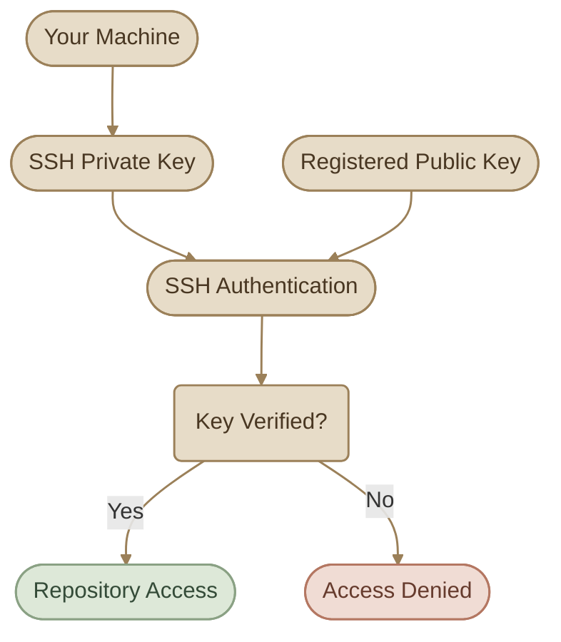
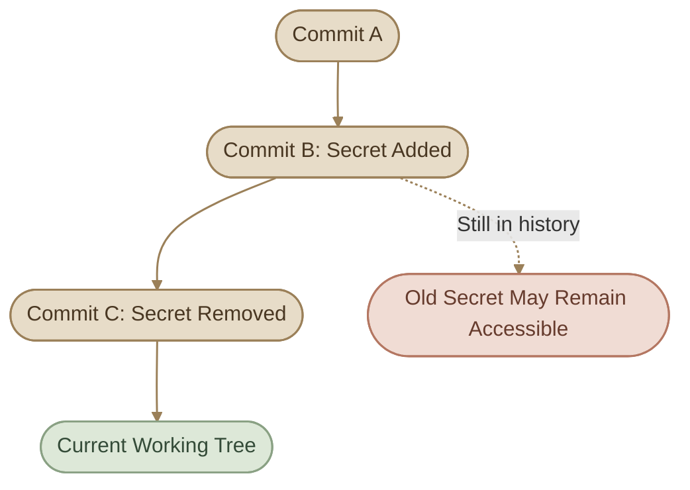
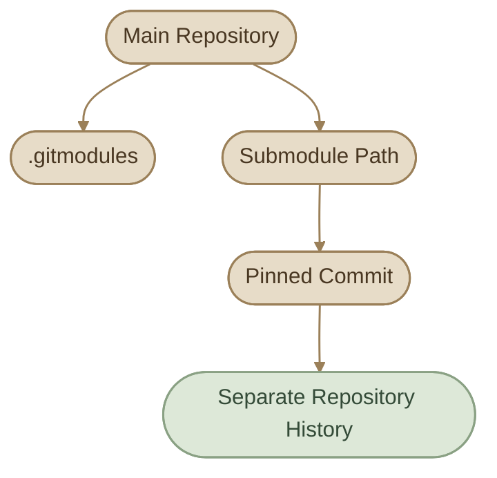
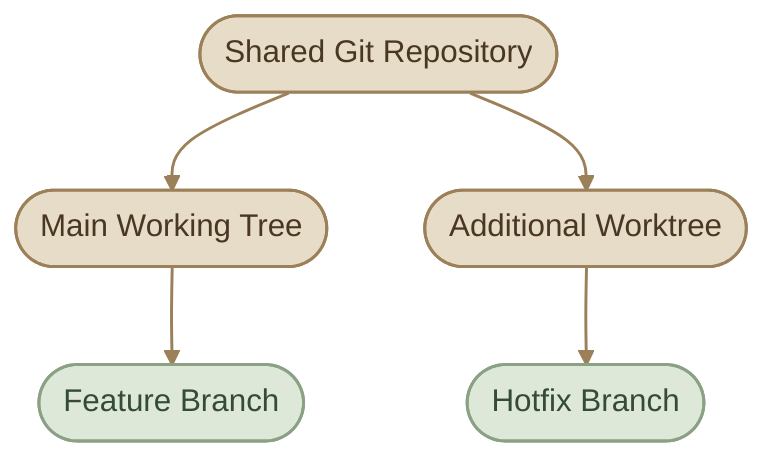
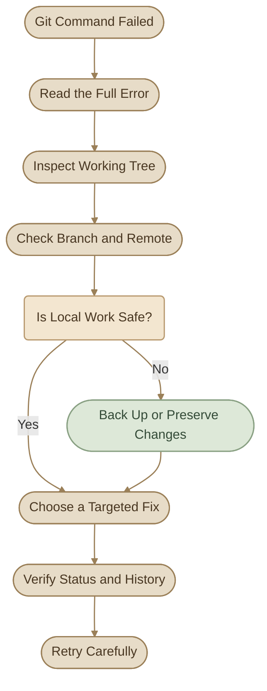

## Introduction

التعامل مع Git مش مجرد `add` و`commit` و`push`. في الشغل الحقيقي، لازم تعرف تحمي الـ credentials، وتتحقق من مصدر الـ commits، وتستخدم Git hooks، وتتعامل مع الأخطاء من غير ما تفقد شغلك أو تكشف أسرار بالخطأ.

في المقال ده هنغطي 3 جوانب مترابطة:

- **Security:** تأمين الوصول للـ repositories وحماية الأسرار.
- **Workflow Tools:** فهم Signed Commits وGit Hooks وSubmodules وWorktrees.
- **Troubleshooting:** تشخيص الأخطاء واستعادة الشغل بأقل مخاطرة.

<CardGrid columns={2} label="What You Will Learn">
  <InfoCard variant="concept" title="Authentication" description="الفرق بين SSH وHTTPS، وإدارة مفاتيح الوصول والـ tokens." icon="shield" tags={["SSH", "HTTPS"]} />
  <InfoCard variant="warning" title="Secret Protection" description="منع تسريب credentials والتعامل الصحيح مع الأسرار التي دخلت Git history." icon="shield" tags={["Secrets", "History"]} />
  <InfoCard variant="feature" title="Git Tools" description="فهم Signed Commits وHooks وSubmodules وWorktrees." icon="wrench" tags={["Signing", "Automation"]} />
  <InfoCard variant="tip" title="Recovery" description="تشخيص الأخطاء واستعادة commits أو الملفات باستخدام أوامر مناسبة للموقف." icon="cycle" tags={["Debugging", "Recovery"]} />
</CardGrid>

## 1. SSH Authentication

### I. What Is SSH Authentication?

الـ SSH هو طريقة للاتصال بالـ remote repository باستخدام **SSH key pair** بدل ما تدخل بيانات اعتماد في كل مرة.

الـ key pair بيتكوّن من جزأين:

<CardGrid columns={2} label="SSH Key Pair">
<InfoCard variant="warning" title="Private Key" description="يفضل على جهازك، وما تشاركهش مع أي حد." icon="shield" tags={["Private"]} />

<InfoCard variant="concept" title="Public Key" description="تقدر تضيفه إلى GitHub أو Git server الموثوق." icon="tag" tags={["Shareable"]} />
</CardGrid>

لما تتصل بالـ remote، السيرفر بيتحقق إنك تملك الـ private key المطابق للـ public key المسجل عنده.



### II. Generate an SSH Key on Fedora

اتأكد الأول إن عندك SSH client:

```bash
ssh -V
```

أنشئ مفتاحًا جديدًا باستخدام Ed25519:

```bash
ssh-keygen -t ed25519 -C "your-email@example.com"
```

استبدل البريد الإلكتروني ببريدك، واختار مسار الحفظ المقترح أو مسارًا آخر لو عندك سبب واضح.

<InfoCard variant="concept" title="Note" icon="flag">

<InfoCard variant="concept" title="Note" icon="flag">

**مهم:** لو عندك مفتاح موجود بالفعل، افحصه قبل إنشاء مفتاح جديد حتى لا تستبدله بالخطأ.

</InfoCard>

</InfoCard>

```bash
ls -la ~/.ssh
```

عادةً الملفات بتكون بالشكل ده:

```text
id_ed25519       # Private key
id_ed25519.pub   # Public key
```

الـ `.pub` هو المفتاح العام الذي تضيفه إلى حسابك أو السيرفر، وليس الملف الذي تستخدمه كـ private key.

### III. Start the SSH Agent

شغّل الـ agent وأضف المفتاح إليه:

```bash
eval "$(ssh-agent -s)"
ssh-add ~/.ssh/id_ed25519
```

لو استخدمت اسمًا أو مسارًا مختلفًا للمفتاح، عدّل الأمر accordingly.

اعرض الـ public key لنسخه:

```bash
cat ~/.ssh/id_ed25519.pub
```

أضف محتواه إلى إعدادات SSH keys في حساب Git hosting الذي تستخدمه.

### IV. Test the Connection

مع GitHub مثلًا:

```bash
ssh -T git@github.com
```

أول اتصال قد يطلب منك التأكد من هوية السيرفر. لا توافق تلقائيًا؛ تحقّق من بصمة المفتاح المضيف من المصدر الرسمي عند الحاجة.

رسالة نجاح المصادقة تعني أن GitHub تعرّف على مفتاحك، لكنها لا تعني أنك تملك صلاحية الوصول إلى كل repository.

### V. Use SSH for a Remote Repository

اعرض الـ remote URLs:

```bash
git remote -v
```

لو الـ remote مضبوط على HTTPS وعايز تستخدم SSH، غيّره إلى SSH URL الصحيح:

```bash
git remote set-url origin git@github.com:OWNER/REPOSITORY.git
```

استبدل `OWNER` و`REPOSITORY` بالقيم المناسبة.

<InfoCard variant="warning" title="Protect Your Private Key" description="ما ترفعش الـ private key إلى Git، وما تبعتوش في رسالة أو screenshot. الـ public key فقط هو اللي بيتسجل لدى خدمة الاستضافة." icon="shield" />

## 2. HTTPS and Personal Access Tokens

### I. HTTPS Authentication

الـ HTTPS طريقة أخرى للوصول إلى remote repositories، وعنوان الـ remote بيكون غالبًا بالشكل ده:

```text
https://github.com/OWNER/REPOSITORY.git
```

لما تحتاج مصادقة لعملية `push` أو عملية محمية أخرى، خدمة الاستضافة قد تستخدم credential manager أو تطلب منك credentials.

مع GitHub، لو طُلب منك استخدام token بدل كلمة المرور لحسابك، استخدم **Personal Access Token (PAT)** مناسبًا للصلاحيات المطلوبة.

الـ PAT مش مجرد بديل شكلي لكلمة المرور؛ هو credential حساس، وأي شخص يحصل عليه قد يستخدم الصلاحيات الممنوحة له.

### II. SSH vs HTTPS

<TableCard>
| Aspect | SSH | HTTPS |
|---|---|---|
| Authentication | SSH key pair | Token أو credential mechanism مدعوم |
| Remote URL | `git@github.com:OWNER/REPO.git` | `https://github.com/OWNER/REPO.git` |
| Initial setup | إعداد SSH keys | إعداد credentials أو token عند الحاجة |
| Secret to protect | Private key | PAT أو credentials |
| Typical use | أجهزة المطورين والـ automation | أجهزة المطورين والـ automation |
</TableCard>

اختيارك يعتمد على بيئة العمل وسياسة المؤسسة. الاتنين طرق صالحة، ومفيش سبب يخليك تغيّر طريقة شغالة لمجرد إن الطريقة الثانية مشهورة.

### III. Token Safety

<CardGrid columns={3} label="Token Safety">
<InfoCard variant="concept" title="Least Privilege" icon="shield" tags={["Permissions"]}>

استخدم أقل صلاحيات تسمح بالمهمة المطلوبة (**Least Privilege**).

</InfoCard>

<InfoCard variant="concept" title="Expiration" description="اختار مدة صلاحية مناسبة لو الخدمة بتدعمها." icon="flag" tags={["Lifetime"]} />

<InfoCard variant="warning" title="Keep It Out of Files" description="ما تكتبش الـ token مباشرةً في ملفات المشروع." icon="shield" tags={["Secret"]} />

<InfoCard variant="warning" title="Avoid Remote URLs" description="تجنّب وضعه في remote URL؛ لأن بيانات الاعتماد قد تظهر في الإعدادات أو logs." icon="shield" tags={["Logs"]} />

<InfoCard variant="concept" title="Credential Manager" description="استخدم credential manager موثوقًا بدل حفظه كنص صريح." icon="tag" tags={["Storage"]} />

<InfoCard variant="danger" title="Revoke on Exposure" description="ألغِ الـ token فورًا لو اتكشف أو شكّيت إنه اتسرّب." icon="shield" tags={["Incident"]} />
</CardGrid>

<InfoCard variant="danger" title="Never Commit a Token" description="الـ PAT يعتبر credential كامل الحساسية. لا تضعه داخل source code أو shell scripts أو ملفات documentation أو commit messages." icon="shield" />

## 3. Protecting Secrets

### I. What Counts as a Secret?

الـ secret هو أي معلومة سرية ممكن تتيح وصولًا غير مصرح به أو تكشف بيانات حساسة.

<CardGrid columns={2} label="Common Secrets">
  <InfoCard variant="warning" title="API Keys & Tokens" description="مفاتيح APIs، access tokens، وPersonal Access Tokens." icon="tag" />
  <InfoCard variant="warning" title="Credentials" description="كلمات المرور، database connection strings، وservice credentials." icon="shield" />
  <InfoCard variant="warning" title="Private Keys" description="SSH private keys، private certificates، ومفاتيح التشفير." icon="shield" />
  <InfoCard variant="warning" title="Environment Files" description="ملفات مثل .env التي قد تحتوي على credentials أو إعدادات حساسة." icon="code" />
</CardGrid>

### II. Use `.gitignore`

لو عندك ملف `.env` لا ينبغي تتبعه، أضفه إلى `.gitignore`:

```gitignore
# Environment variables
.env
.env.*
!.env.example

# Private keys
*.pem
*.key

# Local configuration
config.local.json
```

القواعد دي أمثلة تحتاج تكييفًا حسب المشروع؛ مثلًا بعض ملفات `.pem` قد تكون شهادات عامة مطلوبة، فلا تضف قاعدة واسعة بدون مراجعة.

لو المشروع يحتاج توثيق أسماء المتغيرات المطلوبة، استخدم `.env.example` يحتوي على أسماء المتغيرات وقيم placeholder غير حساسة:

```dotenv
APP_ENV=development
DATABASE_URL=replace-with-local-database-url
API_KEY=replace-with-your-own-key
```

**ما تحطش credentials حقيقية في `.env.example`.**

### III. Important: `.gitignore` Does Not Untrack Existing Files

لو الملف اتضاف إلى Git بالفعل، كتابة اسمه في `.gitignore` مش هتزيله من الـ index.

افحص حالة الملف:

```bash
git status --short
git ls-files .env
```

لو `.env` متتبع بالفعل، تقدر توقف تتبعه من غير حذف النسخة المحلية:

```bash
git rm --cached .env
git add .gitignore
git commit -m "Stop tracking local environment file"
```

الأمر ده يزيل الملف من الـ current version المتتبعة، لكنه **لا يزيله من الـ commits القديمة**.

ولو الملف يحتوي على secret اتكشف بالفعل، لازم تتعامل مع الـ credential نفسه أولًا، مش بس الملف.

## 4. Removing Exposed Secrets from History

### I. Why Deleting a Secret Is Not Enough

Git بيحتفظ بتاريخ من الـ commits. لو عملت commit يحتوي على token، ثم حذفت الـ token في commit لاحق، يظل بإمكان أي شخص لديه الوصول إلى التاريخ القديم الاطلاع عليه.



### II. The Correct Response

لو secret اتكشف في repository، اتبع الترتيب ده:

1. **Revoke or rotate the secret.** ألغِ الـ token أو المفتاح المسرب وأنشئ بديلًا جديدًا عند الحاجة. اعتبره مكشوفًا حتى لو الـ repository خاص.
2. **Assess the exposure.** حدد نوع السر، صلاحياته، مدة انكشافه، وهل توجد سجلات تدل على استخدام غير مصرح به.
3. **Remove it from history when necessary.** استخدم أداة مناسبة لإعادة كتابة التاريخ، مثل `git filter-repo`، وفق خطة واضحة.
4. **Coordinate with collaborators.** إعادة كتابة التاريخ تغيّر commit IDs، وقد تتطلب من الآخرين إعادة مزامنة نسخهم.
5. **Verify the cleanup.** افحص الفروع والـ tags والـ references المتأثرة، وراجع سياسات الاستضافة والنسخ الاحتياطية.

<InfoCard variant="danger" title="Rotate First, Rewrite Second" description="إعادة كتابة Git history لا تجعل token المسرب آمنًا من جديد. إلغاء السر أو تغييره هو الإجراء الأمني العاجل؛ تنظيف التاريخ خطوة منفصلة." icon="shield" />

### III. Remove Sensitive Data with `git-filter-repo`

لما تحتاج إزالة ملف حساس من التاريخ، يمكن استخدام `git-filter-repo`. الأوامر التالية مثال عام، وليست عملية آمنة للتنفيذ عشوائيًا على repository مهم.

قبل البدء:
<CardGrid columns={2} label="History Rewrite Preparation">
<InfoCard variant="tip" title="Back Up" description="خذ backup مناسبًا." icon="layers" tags={["Backup"]} />

<InfoCard variant="tip" title="Coordinate" description="نسّق مع فريقك." icon="branch" tags={["Team"]} />

<InfoCard variant="warning" title="Update References" description="افهم أن إعادة كتابة التاريخ قد تتطلب تحديث الفروع والـ tags على الـ remote." icon="cycle" tags={["Rewrite"]} />

<InfoCard variant="warning" title="Agree Before Force Push" description="لا تعمل force push قبل الاتفاق على خطة الاستبدال." icon="shield" tags={["Force Push"]} />
</CardGrid>

مثال لإزالة ملف `.env` من تاريخ repository كامل:

```bash
git filter-repo --path .env --invert-paths
```

الأمر ده يعيد كتابة التاريخ لاستبعاد المسار المحدد من الـ commits المعالجة. لو الملف كان موجودًا تحت مسارات مختلفة، لازم تحدد كل المسارات المطلوبة.

بعد إعادة كتابة التاريخ، راجع النتيجة:

```bash
git log --all --oneline -- .env
git status
git log --oneline -10
```

الأمر الأول يفحص ظهور الملف في التاريخ المتاح محليًا، لكنه وحده مش دليل كافٍ على أن كل النسخ أو الـ references أو النسخ البعيدة خالية منه.

<InfoCard variant="concept" title="Note" icon="flag">

<InfoCard variant="concept" title="Note" icon="flag">

**مهم:** قد تظل هناك نسخ قديمة لدى collaborators أو forks أو caches أو references أخرى. اتبع إرشادات خدمة الاستضافة الخاصة بإزالة البيانات الحساسة، ونسّق أي force push مع الفريق.

</InfoCard>

</InfoCard>

## 5. Signed Commits — Concept and Usage

### I. What Is a Signed Commit?

الـ Signed Commit هو commit مرفق بتوقيع رقمي يمكن التحقق منه باستخدام مفتاح التوقيع أو هوية التوقيع المناسبة.

التوقيع بيساعد في إثبات أن الـ commit اتوقّع باستخدام مفتاح معيّن، لكنه لا يثبت وحده أن محتوى الكود آمن أو صحيح، ولا يعني تلقائيًا أن كل commit في المشروع موثوق.

من طرق التوقيع التي يدعمها Git:

<CardGrid columns={3} label="Commit Signing Methods">
<InfoCard variant="concept" title="GPG" description="التوقيع باستخدام GPG keys." icon="tag" tags={["Signing"]} />

<InfoCard variant="concept" title="SSH" description="استخدام SSH key للتوقيع، مع إعداد Git المناسب." icon="shield" tags={["Signing"]} />

<InfoCard variant="concept" title="S/MIME" description="طريقة أخرى مدعومة في Git." icon="shield" tags={["Signing"]} />
</CardGrid>

### II. Configure SSH Commit Signing

لو عندك SSH key مناسب وتريد استخدامه لتوقيع commits، تقدر تضبط Git كالتالي:

```bash
git config --global gpg.format ssh
git config --global user.signingkey ~/.ssh/id_ed25519.pub
git config --global commit.gpgsign true
```

المثال يستخدم الـ public key كمرجع لإعداد توقيع SSH. تأكد أن نسخة Git لديك تدعم الإعدادات المطلوبة، وأن المفتاح المقابل متاح للتوقيع.

بعد الإعداد، أنشئ commit جديدًا بالطريقة المعتادة:

```bash
git add .
git commit -m "Add signed commit"
```

لو `commit.gpgsign` مضبوط على `true`، Git يحاول توقيع الـ commit تلقائيًا.

يمكنك أيضًا توقيع commit بشكل صريح:

```bash
git commit -S -m "Add signed commit"
```

### III. Verify a Commit

```bash
git log --show-signature -1
```

الأمر يعرض معلومات التوقيع المرتبطة بآخر commit. التحقق الناجح يعتمد على توفر المفتاح وإعدادات الثقة المناسبة.

في GitHub، قد يظهر الـ commit بحالة **Verified** إذا استوفى متطلبات التحقق الخاصة بالخدمة وإعدادات الحساب.

<InfoCard variant="concept" title="Signing Is Not Encryption" description="توقيع commit لا يخفي محتواه. Git history يظل قابلًا للقراءة حسب صلاحيات الوصول؛ التوقيع هدفه التحقق من سلامة التوقيع وهوية المفتاح." icon="shield" />

## 6. Git Hooks — Basics

### I. What Are Git Hooks?

Git Hooks هي scripts ينفذها Git عند نقاط محددة من دورة العمل، مثل إنشاء commit أو محاولة push.

تقدر تستخدمها لتنفيذ فحوصات تلقائية مثل:
<CardGrid columns={2} label="Hook Use Cases">
<InfoCard variant="concept" title="Format and Lint" description="تشغيل formatter أو linter." icon="wrench" tags={["Quality"]} />

<InfoCard variant="warning" title="Block Failed Tests" description="منع commit إذا فشل اختبار معين." icon="shield" tags={["Tests"]} />

<InfoCard variant="concept" title="Validate Messages" description="التحقق من صيغة commit message." icon="code" tags={["Commits"]} />

<InfoCard variant="concept" title="Check Before Push" description="تشغيل checks قبل push." icon="git-pull-request" tags={["Push"]} />
</CardGrid>

### II. Common Hooks

<TableCard>
| Hook | Timing | Typical Use |
|---|---|---|
| `pre-commit` | قبل إنشاء commit | فحص الملفات أو تشغيل checks |
| `prepare-commit-msg` | أثناء تجهيز commit message | تجهيز رسالة commit وفق قواعد محددة |
| `commit-msg` | بعد تجهيز الرسالة وقبل اكتمال commit | التحقق من صيغة الرسالة |
| `post-commit` | بعد اكتمال commit | إشعار أو تسجيل حدث |
| `pre-push` | قبل إرسال commits إلى remote | تشغيل فحوصات قبل push |
| `post-merge` | بعد اكتمال merge | تنفيذ مهام محلية مرتبطة بالتحديث |
</TableCard>

مش كل hooks هدفها رفض العملية؛ بعض الـ hooks تعمل بعد اكتمال العملية، وبالتالي لا يمكنها منعها بأثر رجعي.

### III. Where Are Hooks Stored?

بشكل افتراضي، Git بيضع hooks داخل:

```text
.git/hooks/
```

اعرض الملفات:

```bash
ls -la .git/hooks
```

هتلاقي عادةً ملفات تنتهي بـ `.sample`. دي أمثلة غير مفعّلة تلقائيًا؛ Git لا ينفذها لمجرد وجودها.

لإنشاء `pre-commit` hook محلي، أنشئ ملفًا باسم:

```text
.git/hooks/pre-commit
```

مثال بسيط يرفض commit لو `git diff --cached --check` اكتشف whitespace errors:

```bash
#!/bin/sh

git diff --cached --check
status=$?

if [ "$status" -ne 0 ]; then
  echo "Commit blocked: fix whitespace errors first."
  exit "$status"
fi

exit 0
```

اجعله executable:

```bash
chmod +x .git/hooks/pre-commit
```

جرّبه على repository تجريبي بإضافة whitespace error إلى ملف staged، ثم حاول إنشاء commit.

### IV. Important Hook Limitations

<CardGrid columns={2} label="Hook Limitations">
<InfoCard variant="warning" title="Local Only" icon="code" tags={["Clone"]}>

الـ hooks الموجودة في `.git/hooks` محلية، ولا تُنسخ تلقائيًا عند clone.

</InfoCard>

<InfoCard variant="warning" title="No Automatic Team Setup" description="إضافة ملف hook إلى repository لا تجعل Git يشغّله تلقائيًا على أجهزة باقي المطورين." icon="branch" tags={["Team"]} />

<InfoCard variant="tip" title="Share With Setup" icon="wrench" tags={["Configure"]}>

يمكن مشاركة scripts داخل repository، لكن الفريق يحتاج إعدادًا واضحًا لتشغيلها، مثل `core.hooksPath` أو أداة لإدارة hooks.

</InfoCard>

<InfoCard variant="warning" title="Not a Security Boundary" description="الـ hooks المحلية يمكن تجاوز بعضها في ظروف معينة؛ لذلك لا تعتمد عليها وحدها كحد أمني على مستوى الخادم." icon="shield" tags={["Security"]} />

<InfoCard variant="tip" title="Enforce in CI or Server" description="الفحوصات الأمنية التي يجب أن تنطبق على كل push ينبغي تطبيقها أيضًا في بيئة موثوقة، مثل server-side checks أو CI." icon="shield" tags={["Enforcement"]} />
</CardGrid>

لتحديد مسار hooks بديل:

```bash
git config --local core.hooksPath .githooks
```

لو استخدمت هذا الإعداد، أنشئ مجلد `.githooks` وضع فيه scripts بأسماء الـ hooks الصحيحة، وتأكد من صلاحيات التنفيذ. الإعداد ده محلي للـ repository ما لم تتم إدارته ومشاركته صراحةً.

## 7. Submodules — Basics

### I. What Is a Git Submodule?

الـ Submodule يسمح لك بربط repository داخل repository آخر مع الاحتفاظ بإشارة إلى commit محدد من المشروع الفرعي.

ده مفيد لما مشروعك يعتمد على مكتبة أو component محفوظ في repository منفصل وتريد تثبيت النسخة التي تستخدمها.



### II. Add a Submodule

```bash
git submodule add https://github.com/OWNER/PROJECT.git vendor/project
git status
git commit -m "Add project submodule"
```

الأمر يضيف إعدادات الـ submodule إلى `.gitmodules`، ويسجل في الـ main repository الإشارة إلى commit الخاص بالمشروع الفرعي.

### III. Clone a Repository with Submodules

لو الـ repository يحتوي على submodules، استخدم:

```bash
git clone --recurse-submodules https://github.com/OWNER/MAIN-REPOSITORY.git
```

لو كنت عملت clone بالفعل:

```bash
git submodule update --init --recursive
```

بعد تحديث الـ main repository، لو عايز تجلب commit المشار إليه للـ submodules:

```bash
git submodule update --init --recursive
```

ولو المطلوب تحديث submodule إلى commit أحدث من الفرع البعيد، فده إجراء مختلف؛ لا تستخدم `git submodule update --remote` من غير ما تكون فاهم الفرع المستهدف وتغيّر الـ pointer الناتج.

<InfoCard variant="tip" title="A Submodule Is Not a Normal Folder" description="الـ main repository يسجل commit reference للمشروع الفرعي، وليس كل ملفاته كأنها ملفات عادية تابعة له. لازم تضمن أن باقي الفريق يقدر يصل إلى repository الفرعي." icon="branch" />

## 8. Git Worktrees — Basics

### I. What Is a Git Worktree?

Git Worktree يسمح لك بإنشاء working directory إضافي مرتبط بنفس الـ repository، بحيث تقدر تشتغل على branch آخر من غير ما تغيّر الملفات في مجلد العمل الحالي.

مثال: عندك feature branch شغال عليه، وظهر bug عاجل يحتاج hotfix. بدل ما تعمل stash لتغييراتك وتبدّل بين الفروع، تقدر تستخدم worktree منفصلًا.



### II. Create a Worktree

من داخل الـ repository، أنشئ worktree لفرع جديد:

```bash
git worktree add -b hotfix/login-error ../project-hotfix main
```

الأمر ينشئ branch باسم `hotfix/login-error` اعتمادًا على `main`، ويجهّز working directory إضافيًا في `../project-hotfix`.

لو الفرع موجود بالفعل:

```bash
git worktree add ../project-hotfix hotfix/login-error
```

### III. List and Remove Worktrees

اعرض worktrees المرتبطة بالـ repository:

```bash
git worktree list
```

بعد الانتهاء من worktree، تأكد أنك لا تحتاج أي تغييرات موجودة فيه، ثم احذفه:

```bash
git worktree remove ../project-hotfix
```

إزالة worktree لا تعني بالضرورة حذف الـ branch الذي استخدمه. لو عايز تحذف branch، تعامل معه كعملية منفصلة بعد التأكد من عدم الحاجة إليه.

لو حذفت مجلد worktree يدويًا بطريقة كسرت التسجيل، افحص الحالة قبل التنظيف:

```bash
git worktree list
git worktree prune
```

`git worktree prune` ينظف بيانات التسجيل التي لم تعد تشير إلى worktrees موجودة؛ لا تستخدمه كبديل عن فحص العمل الذي قد يكون داخل مجلد مفقود.

<InfoCard variant="comparison" title="Submodule vs Worktree" description="Submodule يربط repository مستقلًا داخل مشروعك. Worktree يتيح لك العمل على أكثر من branch من نفس repository في مجلدات منفصلة." icon="branch" tags={["Dependency", "Parallel Work"]} />

## 9. Common Git Errors and Recovery

### I. Non-Fast-Forward Push

**الخطأ الشائع:**

```text
! [rejected] main -> main (non-fast-forward)
```

غالبًا الـ remote يحتوي على commits ليست موجودة في فرعك المحلي.

افحص الحالة أولًا:

```bash
git status
git fetch origin
git log --oneline --graph --decorate --all -20
```

لو تأكدت أن الدمج مناسب وأنك لا تحتاج إلى حفظ تغييرات غير ملتزم بها، يمكنك تحديث فرعك باستخدام merge أو rebase وفق سياسة الفريق.

مثال باستخدام rebase:

```bash
git pull --rebase origin main
git push origin main
```

لا تنفذ هذا الأمر آليًا على كل فرع؛ تأكد أن `main` هو الفرع المقصود، وأن تغييراتك المحلية لا تتعارض مع workflow المشروع.

### II. Merge Conflicts

عند حدوث conflict، افحص الملفات المتأثرة:

```bash
git status
```

افتح كل ملف وابحث عن علامات التعارض:

```text
<<<<<<< HEAD
Your current changes
=======
Incoming changes
>>>>>>> branch-name
```

عدّل المحتوى ليعكس النتيجة المطلوبة، واحذف علامات التعارض، ثم:

```bash
git add path/to/resolved-file
```

لو كنت تنفذ merge:

```bash
git merge --continue
```

ولو كنت تنفذ rebase:

```bash
git rebase --continue
```

لو قررت التراجع عن العملية، استخدم أمر الإلغاء المطابق للعملية الحالية، مثل `git merge --abort` أو `git rebase --abort`، بعد التأكد من وضع الملفات.

### III. Detached HEAD

لو ظهر لك إنك في حالة `detached HEAD`، فهذا يعني أنك واقف على commit مباشرةً بدل ما تكون على branch.

افحص الحالة:

```bash
git status
git log -1 --oneline
```

لو أنشأت commits وتريد الاحتفاظ بها، أنشئ branch يشير إلى موقعك الحالي:

```bash
git switch -c recovery/my-work
```

ده يحفظ نقطة الوصول إلى commit الحالي ضمن branch جديد. لا تنتقل إلى branch آخر قبل التأكد من حفظ أي commits أو تغييرات تحتاجها.

### IV. Accidentally Staged a File

لو أضفت ملفًا إلى staging بالخطأ ولم تنشئ commit بعد:

```bash
git restore --staged path/to/file
```

الأمر يشيل الملف من staging فقط، ويترك التغييرات في working tree.

### V. Discarding Local Changes

لو عايز تتخلص من التعديلات غير الملتزم بها في ملف معين:

```bash
git restore path/to/file
```

**تحذير:** الأمر يستبدل التعديلات المحلية في الملف بالنسخة الموجودة في الـ index، وقد يؤدي إلى فقدان التعديلات غير المحفوظة. افحص الملف أو احفظ نسخة منها أولًا لو مش متأكد.

لو محتاج تتخلص من تغييرات staging أيضًا، افهم الفرق بين الـ index والـ working tree قبل تنفيذ أوامر أوسع.

### VI. Recovering a Lost Commit with Reflog

لو نقلت branch أو عملت reset وفقدت الوصول الظاهر إلى commit، ابدأ بـ:

```bash
git reflog
```

حدد الـ commit المطلوب، ثم أنشئ branch لاستعادته:

```bash
git switch -c recovery/lost-work <commit-hash>
```

استبدل `<commit-hash>` بالـ hash الفعلي من الـ reflog. لا تعتمد على reflog باعتباره سجلًا دائمًا؛ entries القديمة قد تنتهي صلاحيتها، والـ reflog لا ينتقل عادةً مع clone إلى جهاز آخر.

### VII. Authentication Failed

لو `push` أو `fetch` فشل بسبب المصادقة:

```bash
git remote -v
git config --show-origin --get-all credential.helper
ssh -T git@github.com
```

الأمر الأخير مفيد فقط لو الـ remote يستخدم GitHub عبر SSH. لو الـ remote يستخدم HTTPS، راجع إعدادات الـ credentials والـ token والصلاحيات المطلوبة بدلًا من اختبار SSH فقط.

تأكد من:
<CardGrid columns={2} label="Authentication Checks">
<InfoCard variant="concept" title="Remote URL" description="صحة الـ remote URL." icon="git-pull-request" tags={["Remote"]} />

<InfoCard variant="concept" title="Correct Credential" description="استخدام credential مناسب للطريقة المحددة." icon="tag" tags={["Method"]} />

<InfoCard variant="warning" title="Token Status" description="أن الـ token غير منتهي أو ملغي." icon="shield" tags={["Token"]} />

<InfoCard variant="concept" title="Account Permissions" description="أن الحساب لديه الصلاحيات المطلوبة." icon="shield" tags={["Access"]} />

<InfoCard variant="warning" title="Old Saved Credentials" description="عدم وجود credentials قديمة مخزنة لدى credential helper." icon="wrench" tags={["Cache"]} />
</CardGrid>

لا تضع token في الأمر أو في remote URL بغرض التجربة؛ لأن ذلك قد يعرّضه للظهور في history أو logs.

### VIII. A Safe Troubleshooting Workflow



### XI. Recovery Command Reference

<TableCard>
| Situation | First Command | Purpose |
|---|---|---|
| Understand repository state | `git status` | معرفة وضع الملفات والعمليات الجارية |
| Inspect branch history | `git log --oneline --graph --decorate -20` | فهم تسلسل الـ commits |
| Find previous branch positions | `git reflog` | العثور على مواقع سابقة لـ HEAD |
| Inspect remote configuration | `git remote -v` | معرفة عناوين الـ remotes |
| Inspect local branches | `git branch -vv` | معرفة الفروع وعلاقات upstream |
| Check uncommitted whitespace errors | `git diff --check` | اكتشاف whitespace problems في التغييرات غير staged |
| Check staged whitespace errors | `git diff --cached --check` | فحص التغييرات الموجودة في staging |
</TableCard>

## 10. Security and Recovery Best Practices

<CardGrid columns={2} label="Safe Git Habits">
  <InfoCard variant="success" title="Protect Credentials" description="استخدم SSH keys أو tokens بصلاحيات محدودة، وألغِ أي credential يتعرض للتسريب." icon="shield" />
  <InfoCard variant="success" title="Inspect Before Destructive Commands" description="استخدم git status وgit log وgit diff قبل reset أو restore أو force push." icon="pulse" />
  <InfoCard variant="success" title="Preserve Work Before Recovery" description="احفظ نسخة من الملفات أو أنشئ branch مؤقتًا قبل عمليات استعادة غير واضحة." icon="layers" />
  <InfoCard variant="success" title="Use Trusted Checks" description="اجعل الفحوصات المطلوبة على مستوى الفريق مدعومة بـ CI أو server-side controls، وليس hooks محلية فقط." icon="shield" />
</CardGrid>

قبل تنفيذ أي أمر قد يغيّر التاريخ أو يحذف بيانات، اسأل نفسك:

1. هل عندي تغييرات غير محفوظة؟
2. هل الأمر سيغير الـ working tree فقط أم الـ index أم الـ commit history؟
3. هل التغيير محلي فقط أم سيؤثر على الـ remote والفريق؟
4. هل أستطيع التراجع عنه لو النتيجة لم تكن المطلوبة؟

## Summary

- **SSH وHTTPS:** طريقتان للمصادقة على remote repositories؛ اختر الطريقة المناسبة واحمِ مفاتيحك وcredentials.
- **Secrets:** لا تضع credentials داخل Git. تجاهل الملف في `.gitignore` لا يزيله من التاريخ إذا كان متتبعًا بالفعل.
- **Exposed Secrets:** ألغِ أو غيّر السر أولًا، ثم نظّف التاريخ عند الحاجة مع مراعاة forks والنسخ المحلية والـ references.
- **Signed Commits:** تساعد في التحقق من التوقيع، لكنها لا تثبت أن الكود آمن أو صحيح.
- **Git Hooks:** تؤتمت الفحوصات محليًا، لكن hooks المحلية ليست بديلًا عن server-side enforcement أو CI.
- **Submodules:** تربط repository مستقلًا عبر commit reference.
- **Worktrees:** تسمح بالعمل على فروع مختلفة في مجلدات منفصلة مرتبطة بنفس repository.
- **Troubleshooting:** افحص الحالة والتاريخ واحفظ الشغل قبل استخدام أوامر قد تكون مدمرة.
