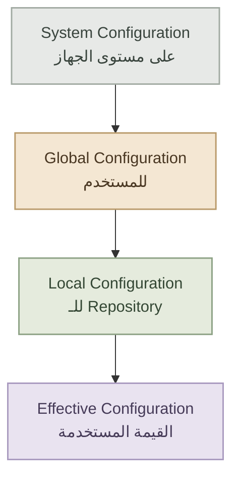
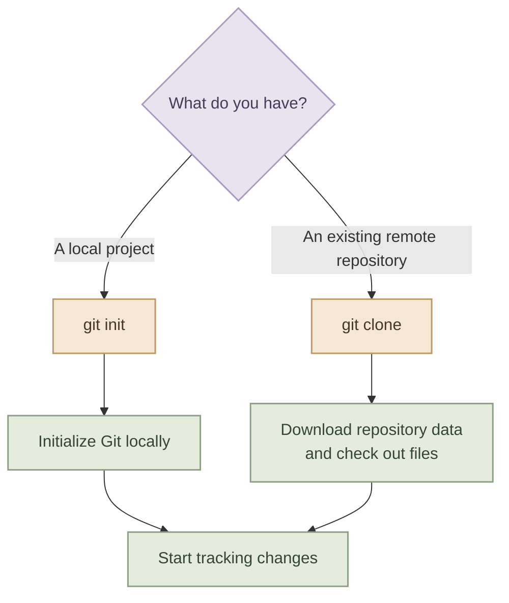

---
title: Git Setup & Configuration
description: Install Git on Fedora and Linux, configure identity and default behavior, understand configuration scopes, and initialize or clone repositories.
category: version-control
order: 3
level: beginner
draft: false
tags:
  - git
  - installation
  - git-config
  - git-init
  - git-clone
language: ar
---

## Overview

بعد ما فهمنا الـ `Git Architecture` والمكونات الأساسية، جه الوقت نجهز Git للاستخدام الفعلي.

قبل ما تبدأ تعمل Commits أو تشتغل على Projects، محتاج تتأكد إن Git متثبت، وتضبط الـ Configuration المناسبة، وتفهم إزاي تبدأ Repository جديد أو تنزل مشروع موجود.

في الصفحة دي هنغطي:

- تثبيت Git على Fedora وLinux.
- استخدام `git config` وتحديد نطاق تطبيق الإعدادات.
- الفرق بين `System` و`Global` و`Local Configuration`.
- ضبط `Username` و`Email` والـ Default Branch.
- استخدام `git init` و`git clone`.

<InfoCard variant="concept" title="Installation vs Configuration" description="تثبيت Git بيخلي الأداة متاحة على جهازك، لكن الـ Configuration بتحدد معلوماتك الشخصية وبعض السلوكيات الافتراضية اللي Git هيستخدمها أثناء الشغل." icon="wrench" tags={["Git CLI", "Configuration"]} />

---

## 1. Installation

### I. Check Whether Git Is Installed

قبل ما تثبت أي حاجة، اتأكد إن Git موجود بالفعل:

```bash
git --version
```

لو Git متثبت، هيظهرلك رقم الإصدار، مثلًا:

```text
git version 2.x.x
```

الرقم الفعلي هيختلف حسب إصدار Git المتوفر على جهازك.

لو ظهرلك إن الأمر `git` مش موجود، تقدر تثبته باستخدام Package Manager المناسب لتوزيعتك.

### I. Install Git on Linux Distributions

طريقة التثبيت بتختلف حسب الـ Distribution والـ Package Manager المستخدم.

| Distribution | Command |
|---|---|
| Fedora | `sudo dnf install git` |
| Ubuntu / Debian | `sudo apt install git` |
| Arch Linux | `sudo pacman -S git` |
| openSUSE | `sudo zypper install git` |

الأوامر دي بتستخدم الـ Package Manager الرسمي لكل توزيعة، وممكن تحتاج تحديث الـ Package Index أو تأكيد التثبيت حسب النظام.

<InfoCard variant="tip" title="Verify Before Moving On" description="نفّذ git --version الأول. لو الأمر اشتغل، كمل على إعدادات Git بدل ما تثبت نفس الأداة مرة تانية." icon="terminal" />

### II. Install Git on macOS

على macOS، تقدر تستخدم Homebrew:

```bash
brew install git
```

لو Homebrew مش متثبت، استخدم Xcode Command Line Tools:

```bash
xcode-select --install
```

أو حمّل Git مباشرة من الموقع الرسمي.

### III. Install Git on Windows

على Windows، أفضل طريقة هي استخدام Git for Windows:

- حمّل من `https://git-scm.com/download/win`
- شغّل الـ Installer واتبع الخطوات.
- بعد التثبيت، افتح Git Bash أو Command Prompt للتحقق:

```bash
git --version
```

---

## 2. Understanding `git config`

الأمر `git config` هو الأداة الأساسية لإدارة إعدادات Git.

من خلاله تقدر تضبط معلومات زي اسمك وبريدك الإلكتروني، وتحدد الـ Default Branch Name، وتتحكم في إعدادات تانية بتأثر على طريقة شغل Git.

### I. Set Your Identity

اضبط الاسم والبريد الإلكتروني اللي Git هيستخدمهم في الـ Commits:

```bash
git config --global user.name "Your Name"
git config --global user.email "you@example.com"
```

استبدل القيم دي باسمك وبريدك الحقيقيين.

الـ `user.name` والـ `user.email` بيتم تخزينهم داخل بيانات الـ Commit باعتبارهم معلومات الـ Author والـ Committer بحسب العملية.

**خد بالك:** البريد الإلكتروني المسجل في الـ Commit مش بالضرورة يكون نفس البريد المستخدم لتسجيل الدخول إلى GitHub. لو مهتم بخصوصية بريدك، GitHub بيوفر إعدادات لاستخدام عنوان `noreply` في الـ Commits.

### II. Verify Your Configuration

علشان تعرض القيم الحالية:

```bash
git config --global user.name
git config --global user.email
```

وتقدر تعرض كل الإعدادات الفعالة اللي Git بيقدر يقرأها:

```bash
git config --list
```

ولو عايز تعرف كل قيمة جت من أنهي Configuration File:

```bash
git config --list --show-origin
```

ده مفيد جدًا لما تلاقي قيمة مش زي اللي متوقعها، لأن ممكن تكون متعرفة في أكتر من مستوى.

---

## 3. System, Global, and Local Configuration

Git بيدعم أكتر من مستوى للـ Configuration. المستويات دي بتحدد نطاق تطبيق الإعدادات، ومين يقدر يستفيد منها.



الرسم بيوضح مستويات الـ Configuration وترتيب الأولوية المعتاد لما نفس الإعداد يكون متعرف بأكتر من مستوى. فيه كمان مستويات أخرى زي `--worktree` في حالات معينة، لكن مش محتاجينها في البداية.

### I. System Configuration

الـ `System Configuration` بتطبق على مستخدمي Git على مستوى الجهاز، وبتتخزن عادةً في ملف إعدادات النظام.

لعرضها:

```bash
git config --system --list
```

تعديل إعدادات النظام غالبًا بيحتاج صلاحيات Administrator، ومش مطلوب إنك تستخدم المستوى ده لضبط اسمك الشخصي في الاستخدام العادي.

### II. Global Configuration

الـ `Global Configuration` بتطبق على المستخدم الحالي عبر الـ Repositories المختلفة اللي بيشتغل عليها.

مثال:

```bash
git config --global user.name "Your Name"
git config --global user.email "you@example.com"
```

ده غالبًا أنسب مكان لإعداد الـ Identity الشخصية، لأنك مش محتاج تكررها في كل مشروع.

لعرض إعدادات المستخدم:

```bash
git config --global --list
```

### III. Local Configuration

الـ `Local Configuration` بتخص Repository معين، وبتتخزن عادةً داخل:

```text
.git/config
```

لو دخلت مجلد مشروع معمول له Git Repository، تقدر تضبط إعداد خاص بالمشروع:

```bash
git config --local user.email "work@example.com"
```

في الحالة دي، الـ Email المحلي للمشروع ده له أولوية على الـ Email الموجود في الـ Global Configuration.

وده مفيد مثلًا لو بتستخدم بريد شخصي في مشاريعك الخاصة وبريد مختلف في مشاريع الشغل.

### IV. Configuration Precedence

لو نفس الإعداد متعرف في أكتر من مستوى، فالأكثر تحديدًا بيكون له الأولوية عادةً.

| Scope | Applies To | Typical Use |
|---|---|---|
| System | كل المستخدمين على الجهاز | إعدادات عامة للجهاز |
| Global | المستخدم الحالي | الهوية والإعدادات الشخصية |
| Local | Repository واحد | Overrides خاصة بمشروع معين |

**مثال عملي:**

```bash
# Default identity for your user
git config --global user.email "personal@example.com"

# Override identity for one repository
git config --local user.email "work@example.com"

# Check the effective value inside that repository
git config user.email
```

الأمر الأخير بيعرض القيمة الفعالة في السياق الحالي.

<InfoCard variant="warning" title="Be Careful With Local Configuration" description="أوامر git config --local لازم تتنفذ من داخل Git Repository. لو نفذتها في مجلد مش تابع لـ Repository، Git مش هيقدر يطبق الإعداد المحلي عليه." icon="shield" />

---

## 4. Username, Email, and Default Branch

### I. `user.name` and `user.email`

Git محتاج معلومات الـ Identity علشان يضيفها لبيانات الـ Commits.

```bash
git config --global user.name "Your Name"
git config --global user.email "you@example.com"
```

دي معلومات بتظهر في تاريخ Git، ومش معناها إن Git أنشأ حساب ليك على أي Hosting Platform.

كمان لازم تفرق بين:

- **Git Identity:** الاسم والبريد المستخدمين في بيانات الـ Commits.
- **Authentication:** الطريقة اللي بتثبت بيها هويتك عند الاتصال بخدمة زي GitHub، مثل SSH أو HTTPS مع Credential مناسبة.

ضبط `user.name` و`user.email` مش كفاية لوحده علشان تقدر تعمل `git push` إلى Repository خاص.

### II. Set the Default Branch Name

في Repositories الجديدة، تقدر تحدد اسم الـ Initial Branch الافتراضي:

```bash
git config --global init.defaultBranch main
```

بعد كده، لما تنشئ Repository جديد باستخدام `git init`، Git هيستخدم `main` كاسم افتراضي للـ Initial Branch.

تقدر تتأكد من القيمة:

```bash
git config --global init.defaultBranch
```

**مهم:** الإعداد ده بيأثر على الـ Initial Branch عند إنشاء Repositories جديدة، لكنه مش بيغير تلقائيًا اسم الـ Branch في Repositories موجودة بالفعل.

### III. A Practical Initial Setup

لو بتجهز Git لمستخدم جديد على Fedora، فالإعداد الأساسي ممكن يكون:

```bash
git config --global user.name "Your Name"
git config --global user.email "you@example.com"
git config --global init.defaultBranch main
```

بعدها راجع الإعدادات:

```bash
git config --global --list
```

مش لازم تضبط كل إعدادات Git من البداية. ابدأ بالأساسيات، وزوّد الإعدادات لما تحتاجها فعلًا.

---

## 5. `git init` — Create a New Repository

استخدم `git init` لما يكون عندك مشروع موجود على جهازك وعايز تبدأ تتبع تاريخه باستخدام Git.

مثلًا، لو بتبدأ مشروع جديد:

```bash
mkdir my-project
cd my-project
git init
```

Git هيهيّأ Repository جديد في المجلد الحالي، وينشئ البيانات الداخلية اللازمة لتتبع تاريخ المشروع.

تقدر بعدها تتأكد من حالة الـ Repository:

```bash
git status
```

### I. What Does `git init` Do?

- بيجهز Git Repository جديد.
- بينشئ أو يهيّأ مجلد `.git` حسب حالة المجلد.
- بيخلي Git قادر يتتبع الملفات والتغييرات بعد إضافتها.
- مش بيعمل Commit تلقائيًا للملفات الموجودة في المجلد.

لو عندك ملفات جاهزة بالفعل، هتحتاج تضيف التغييرات للـ Staging Area وتعمل أول Commit بنفسك.

مثال:

```bash
git add .
git commit -m "Initial commit"
```

الأمر `git add .` بيجهز الملفات والتغييرات المناسبة الموجودة تحت المسار الحالي، مع مراعاة قواعد التجاهل والإعدادات ذات الصلة. راجع `git status` قبل الـ Commit علشان تتأكد من الملفات اللي هتتسجل.

<InfoCard variant="tip" title="Use git init for Your Own Existing Project" description="لو المشروع موجود على جهازك ومش مربوط بـ Git Repository، غالبًا git init هو الاختيار المناسب لبدء تتبع تاريخه." icon="cube" />

---

## 6. `git clone` — Copy an Existing Repository

على عكس `git init`، الأمر `git clone` بيستخدم لما يكون عندك Repository موجود بالفعل وعايز تنسخه إلى جهازك.

مثلًا:

```bash
git clone https://github.com/OWNER/REPOSITORY.git
```

استبدل `OWNER/REPOSITORY` باسم صاحب الـ Repository واسم المشروع الحقيقيين.

Git هيعمل مجلد للمشروع، وينزل بيانات الـ Repository وتاريخه المتاح من المصدر، ويجهز Local Repository تقدر تشتغل عليه.

### I. What Does `git clone` Set Up?

في الاستخدام المعتاد، `git clone` بيعمل الآتي:

- ينزل بيانات الـ Repository وتاريخه من المصدر.
- ينشئ Working Directory بالملفات الخاصة بالـ Branch الذي تم اختياره.
- يجهز Local Repository.
- يضيف Remote باسم `origin` يشير إلى المصدر اللي عملت منه Clone.
- يجهز إعدادات التتبع المناسبة للـ Branch الافتراضي.

تقدر تتأكد من الـ Remote:

```bash
git remote -v
```

وتشوف حالة المشروع:

```bash
git status
```

### II. Clone Into a Specific Directory

لو عايز تحدد اسم المجلد اللي هيتعمل فيه المشروع:

```bash
git clone https://github.com/OWNER/REPOSITORY.git my-project
```

في المثال ده، Git هيحاول ينشئ المجلد `my-project` بدل استخدام الاسم الافتراضي المستنتج من عنوان الـ Repository.

### III. HTTPS vs SSH

غالبًا هتلاقي طريقتين شائعتين لكتابة عنوان الـ Remote:

```bash
# HTTPS
git clone https://github.com/OWNER/REPOSITORY.git

# SSH
git clone git@github.com:OWNER/REPOSITORY.git
```

الاتنين بيستخدموا لنفس الغرض، لكن طريقة Authentication بتختلف.

- **HTTPS:** ممكن يستخدم Credential Manager أو آلية مصادقة تدعمها المنصة.
- **SSH:** بيستخدم SSH Keys بعد إعدادها وربط المفتاح العام بحسابك أو الخدمة المناسبة.

الـ Public Repositories ممكن تسمح بالـ Clone من غير تسجيل دخول، بينما الـ Private Repositories بتحتاج صلاحيات وصول مناسبة.

---

## 7. `git init` vs `git clone`

الفرق الأساسي بينهم هو نقطة البداية.

<CardGrid columns={2} label="Choose the Right Command">
  <InfoCard variant="concept" title="git init" description="عندك مشروع محلي وعايز تبدأ تتبع تاريخه باستخدام Git. الأمر بيجهز Repository جديد، لكنه مش بينزل مشروع من سيرفر." icon="cube" tags={["New Repository"]} />

  <InfoCard variant="concept" title="git clone" description="عندك Repository موجود على مصدر آخر وعايز تنسخه محليًا مع بيانات Git والتاريخ المتاح." icon="cloud" tags={["Existing Repository"]} />
</CardGrid>



| Situation | Command |
|---|---|
| بدأت مشروع جديد على جهازك | `git init` |
| عندك مجلد مشروع موجود بدون Git | `git init` |
| عايز تنزل Repository موجود على GitHub | `git clone` |
| عايز نسخة محلية من Repository عندك صلاحية الوصول إليه | `git clone` |

---

## 8. Verify Your Setup

<Callout type="lab" title="Hands-on: Verify Setup" />

<Steps>
<li>

<InfoCard title="Verify Installation" description="نفّذ git --version للتأكد من التثبيت." icon="layers" tags={["Install"]} />

```bash
git --version
```

</li>
<li>

<InfoCard title="Inspect Config" description="راجع الإعدادات العالمية عبر git config --global --list." icon="wrench" tags={["Config"]} />

```bash
git config --global --list
```

</li>
<li>

<InfoCard title="Check Identity" description="تحقق من user.name وuser.email." icon="cube" tags={["Identity"]} />

```bash
git config user.name
git config user.email
```

</li>
<li>

<InfoCard title="Check Default Branch" description="تأكد من إعداد init.defaultBranch." icon="branch" tags={["Branch"]} />

```bash
git config --global init.defaultBranch
```

</li>
</Steps>

خد بالك إن `git config user.name` و`git config user.email` من غير تحديد `--global` بيحاولوا يعرضوا القيمة الفعالة في السياق الحالي، بما في ذلك إعدادات الـ Repository لو كنت داخل واحد.

لو لسه مش داخل Repository، استخدم `--global` علشان تتحقق من الإعدادات الشخصية تحديدًا.

---

## 9. Common Mistakes

<CardGrid columns={2} label="Setup Mistakes to Avoid">
  <InfoCard variant="warning" title="Wrong Email in Commits" description="راجع user.email قبل ما تبدأ تعمل Commits، خصوصًا لو عندك إعدادات مختلفة لمشاريع شخصية ومشاريع شغل." icon="shield" />

  <InfoCard variant="warning" title="Confusing Identity With Login" description="إعداد user.name وuser.email مش معناه إنك سجلت دخولك إلى GitHub أو حصلت على صلاحية للـ Remote Repository." icon="shield" />

  <InfoCard variant="warning" title="Expecting init to Download Files" description="git init بيجهز Repository محلي، لكنه مش بينزل مشروع موجود على الإنترنت. استخدم git clone للغرض ده." icon="layers" />

  <InfoCard variant="warning" title="Changing the Default Branch of an Existing Repo" description="init.defaultBranch بيحدد الاسم الافتراضي للـ Initial Branch في Repositories الجديدة، ومش بيعيد تسمية Branch موجود تلقائيًا." icon="branch" />
</CardGrid>

---

## Key Takeaways

- `git --version` بيتأكد إن Git متثبت ومتاح من الـ Terminal.
- `git config` بيدير إعدادات Git.
- `System` و`Global` و`Local` بيحددوا نطاق تطبيق الإعدادات، والإعداد الأكثر تحديدًا بيكون له الأولوية عادةً.
- `user.name` و`user.email` بيتستخدموا في بيانات الـ Commits، مش كبديل عن Authentication.
- `init.defaultBranch` بيحدد اسم الـ Initial Branch الافتراضي للـ Repositories الجديدة.
- `git init` بيبدأ Repository محلي جديد.
- `git clone` بينزل Repository موجود ويجهز نسخة محلية منه.
