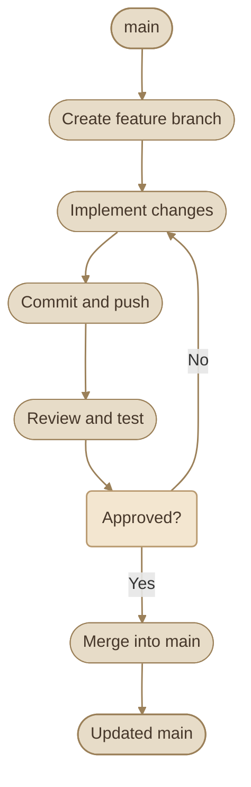
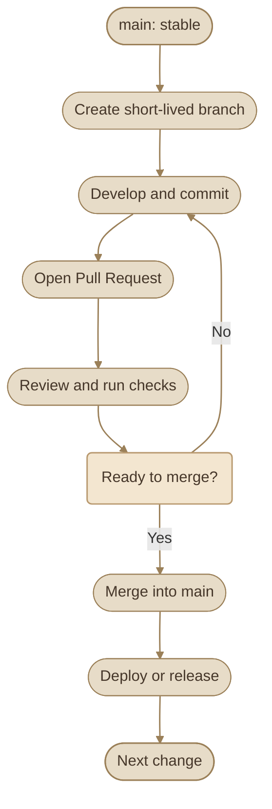
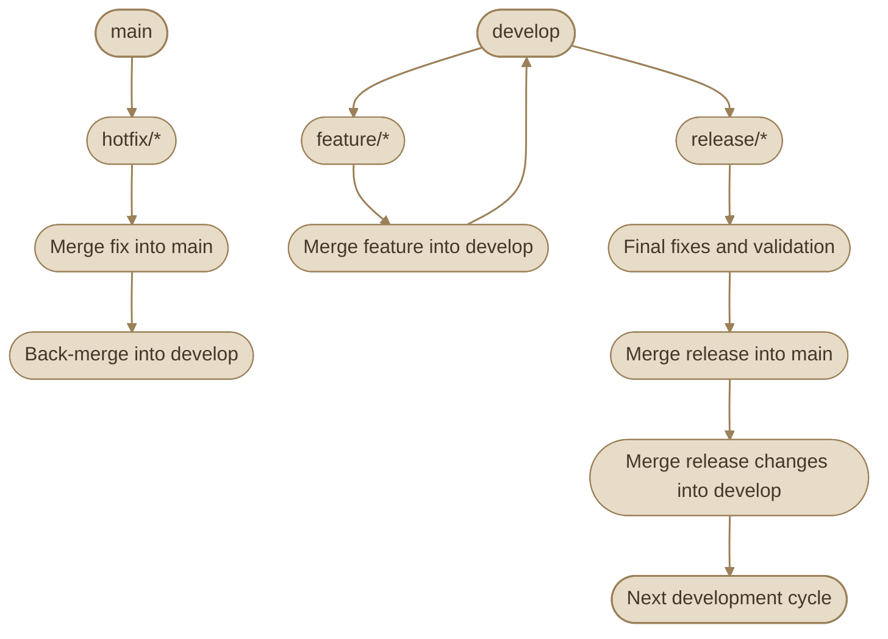
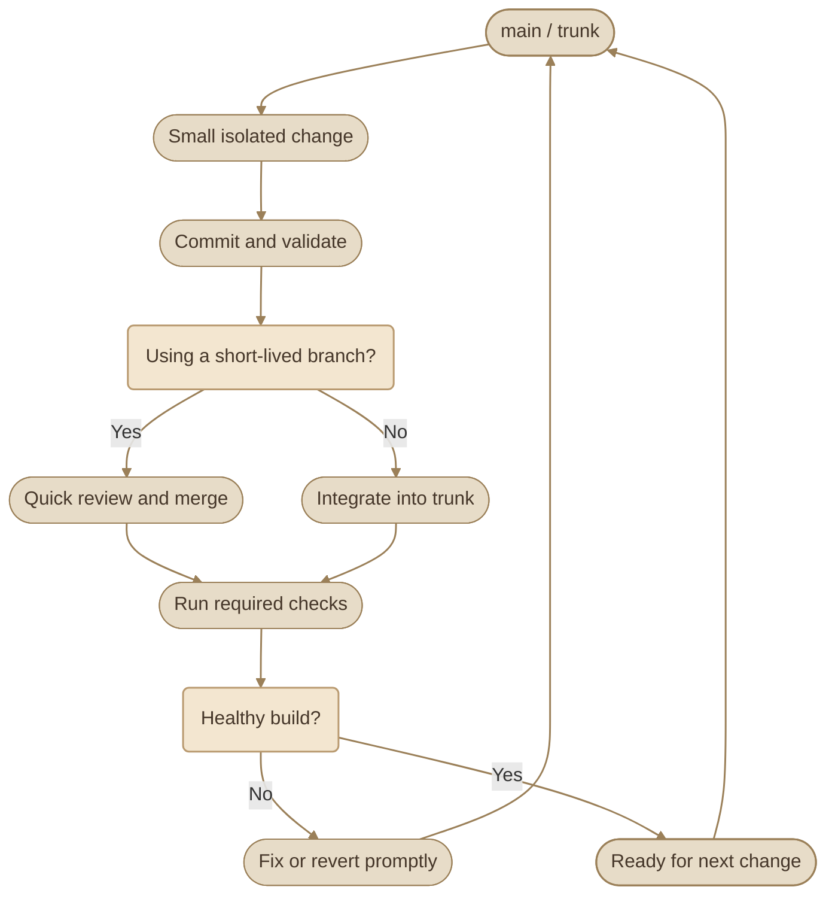

## Overview

اختيار الـ **Git Workflow** بيحدد إزاي الفريق هينظم الـ branches، وإزاي التغييرات هتنتقل من الـ development لحد ما توصل للـ `main` أو تدخل في release.

Git نفسه بيديك الأدوات زي `branch`, `merge`, `rebase` و`tag`، لكن مش بيفرض عليك طريقة واحدة للشغل. الـ Workflow هو مجموعة conventions وقواعد بيتفق عليها الفريق عشان يقلل التعارضات، وينظم الـ collaboration، ويخلي مراجعة الكود وإصدار النسخ أكثر قابلية للتوقع.

## 1. Why Git Workflows Matter

من غير workflow واضح، ممكن تلاقي كل developer بيشتغل بطريقة مختلفة: شخص بيعمل commits مباشرة على `main`، وشخص تاني بيستخدم branches طويلة العمر، وشخص بيعمل release branch من غير ما الفريق يعرف يتعامل معاها.

وجود workflow متفق عليه بيساعد الفريق على:

- تنظيم التغييرات وعزل الشغل المستقل.
- تحديد إمتى وإزاي التغييرات تدخل إلى `main`.
- دمج الـ code review والاختبارات في عملية الـ integration.
- تقليل التعارضات الناتجة عن branches طويلة العمر.
- تنظيم الـ releases والتعامل مع production bugs.
- توضيح مسؤولية كل branch والغرض منها.

<InfoCard variant="concept" title="A Workflow Is a Team Convention" description="الـ Git Workflow مش أمر Git معين؛ هو طريقة عمل مبنية على أوامر Git، مع قواعد للفريق بخصوص branching وintegration وreview وreleases." icon="branch" tags={["collaboration", "branching"]} />

### I. The Four Workflows at a Glance

<CardGrid columns={4}>
  <InfoCard variant="comparison" eyebrow="Workflow" title="Feature Branch" description="كل تغيير في branch منفصل، بيتمر بمراجعة قبل الدمج في main." icon="branch" />
  <InfoCard variant="comparison" eyebrow="Workflow" title="GitHub Flow" description="branches قصيرة العمر مع Pull Requests ودمج متكرر في main." icon="cycle" />
  <InfoCard variant="comparison" eyebrow="Workflow" title="Git Flow" description="فروع دائمة للتطوير والإصدارات: develop وrelease وhotfix." icon="layers" />
  <InfoCard variant="comparison" eyebrow="Workflow" title="Trunk-Based" description="دمج تغييرات صغيرة ومتكررة في الفرع الأساسي مباشرة." icon="pulse" />
</CardGrid>

## 2. Feature Branch Workflow

في الـ **Feature Branch Workflow**، كل feature أو bug fix بيتعمل في branch منفصل بدل ما الـ developer يشتغل مباشرة على `main`.

الـ branch بيكون مخصص لتغيير محدد، وبعد ما الشغل يخلص، التغيير بيتراجع ويتدمج في الفرع الأساسي.

### I. How It Works

<Steps>
<li>

<InfoCard title="Start from the Latest Main" icon="branch">

تبدأ من آخر نسخة من `main`.

</InfoCard>

</li>
<li>

<InfoCard title="تنشئ branch جديد للتغيير المطلوب." icon="branch" />

</li>
<li>

<InfoCard title="تنفذ التعديل وتعمل commits صغيرة وواضحة." icon="code" />

</li>
<li>

<InfoCard title="ترفع الـ branch إلى remote repository." icon="cloud" />

</li>
<li>

<InfoCard title="تفتح Pull Request لو الفريق بيستخدم code review." icon="git-pull-request" />

</li>
<li>

<InfoCard title="Merge After Review and Tests" icon="git-merge">

بعد المراجعة والاختبارات، تدمج التغيير في `main`.

</InfoCard>

</li>
</Steps>

```bash
# Start from the latest main branch
git switch main
git pull --ff-only

# Create a branch for a specific change
git switch -c feature/user-profile

# Make changes, then stage and commit them
git add .
git commit -m "feat: add user profile"

# Publish the branch
git push -u origin feature/user-profile
```

بعد كده، بتفتح Pull Request من `feature/user-profile` إلى `main` على منصة الاستضافة زي GitHub. أوامر Git المحلية مش بتفتح الـ Pull Request بنفسها.

### II. Workflow Diagram



### III. Advantages

- بيعزل كل تغيير عن الشغل الموجود على `main`.
- بيسهّل مراجعة التغييرات قبل الدمج.
- بيقلل احتمالية إدخال شغل غير مكتمل إلى الفرع الأساسي.
- مناسب للمشاريع اللي محتاجة Pull Requests أو approval قبل الدمج.

### IV. Trade-offs

- لو الـ feature branch فضل مفتوح فترة طويلة، ممكن يحصل divergence عن `main` وتزيد صعوبة الدمج.
- كثرة الـ branches مش مشكلة في حد ذاتها، لكن branches طويلة العمر بتخلي دمج التغييرات أصعب.
- وجود branch منفصل مش بديل عن الاختبارات أو code review.

**Best fit:** المشاريع اللي بتحتاج عزل التغييرات ومراجعتها قبل الدمج، سواء كانت فردية أو ضمن فريق.

## 3. GitHub Flow

الـ **GitHub Flow** هو workflow بسيط بيركز على إن `main` يفضل في حالة مستقرة وقابلًا للدمج والنشر باستمرار.

الفكرة الأساسية هي إنك تعمل branch قصير العمر لكل تغيير، وتفتح Pull Request، وتراجع التغيير وتختبره، وبعدها تدمجه في `main`.

### I. Typical Process



### II. Practical Example

```bash
# Update the local main branch
git switch main
git pull --ff-only

# Start a small, focused change
git switch -c fix/login-validation

# Implement and commit the fix
git add .
git commit -m "fix: validate login input"

# Push the branch and set its upstream
git push -u origin fix/login-validation
```

بعد رفع الـ branch:

<Steps>
<li>

<InfoCard title="Open the Pull Request" icon="git-pull-request">

تفتح Pull Request من `fix/login-validation` إلى `main`.

</InfoCard>

</li>
<li>

<InfoCard title="تستنى الـ review والـ required checks لو المشروع بيفرضهم." icon="pulse" />

</li>
<li>

<InfoCard title="تعالج الملاحظات لو موجودة." icon="wrench" />

</li>
<li>

<InfoCard title="تدمج التغيير بعد استيفاء شروط المشروع." icon="git-merge" />

</li>
<li>

<InfoCard title="تحذف الـ branch بعد الدمج لو مبقاش محتاجه." icon="branch" />

</li>
</Steps>

حذف الـ branch بعد الدمج اختياري، لكنه بيحافظ على نظافة قائمة الـ branches.

### III. Key Principles

- **Short-lived branches:** خلي الـ branch صغير ومحدد الهدف.
- **Review before integration:** راجع التغيير قبل ما يدخل `main` وفقًا لقواعد المشروع.
- **Automated checks:** شغّل الاختبارات والفحوصات المطلوبة قبل الدمج.
- **Deploy frequently when appropriate:** الدمج المتكرر بيسهّل وصول التغييرات الصغيرة، لكن النشر الفعلي بيتوقف على جاهزية التطبيق وإجراءات الـ deployment.

<InfoCard variant="insight" title="Merge Does Not Automatically Mean Deploy" description="GitHub Flow بيدعم دورة دمج ونشر سريعة، لكن دمج الـ Pull Request مش معناه إن التطبيق اتنشر تلقائيًا. النشر ممكن يكون يدوي أو جزء من deployment pipeline منفصل." icon="git-pull-request" tags={["pull-requests", "deployment"]} />

### IV. Advantages

- سهل الفهم والتطبيق.
- بيقلل الحاجة إلى عدد كبير من الفروع الدائمة.
- مناسب للتغييرات المتكررة والـ continuous delivery.
- بيسهّل دمج code review والاختبارات في مسار واضح.

### V. Trade-offs

- محتاج انضباط في الحفاظ على `main` بحالة جيدة.
- المشاريع اللي بتدعم إصدارات متعددة في نفس الوقت ممكن تحتاج قواعد إضافية لإدارة الـ releases.
- لو الفريق بيدمج تغييرات غير متوافقة مع بعضها، لازم يستخدم feature flags أو وسائل مناسبة للتحكم في إتاحة المزايا.

**Best fit:** فرق الويب والتطبيقات اللي بتدمج تغييرات صغيرة بصورة متكررة، وبتقدر تحافظ على `main` جاهزًا للدمج والنشر.

## 4. Git Flow

الـ **Git Flow** هو نموذج branching أكثر تنظيمًا، بيستخدم مجموعة من الفروع الدائمة والمؤقتة لإدارة التطوير والإصدارات.

بيكون مفيد في المشاريع اللي عندها release cycle واضح، أو محتاجة تفصل بين التطوير المستمر وتجهيز إصدار محدد. لكنه بيضيف قواعد وتعقيد أكتر من GitHub Flow.

### I. Main Branch Types

<TableCard title="Git Flow Branch Types" caption="The five branch roles in the Git Flow model.">

<TableCard>
| Branch | Purpose |
|---|---|
| `main` | يمثل الإصدارات المستقرة أو التاريخ المرتبط بالـ production releases وفقًا لقواعد المشروع. |
| `develop` | يجمع التغييرات اللي اتدمجت استعدادًا للإصدار القادم. |
| `feature/*` | لتطوير features جديدة، وعادةً بيتفرع من `develop`. |
| `release/*` | لتجهيز إصدار محدد، وإجراء الإصلاحات النهائية قبل إطلاقه. |
| `hotfix/*` | لإصلاح مشكلة عاجلة في إصدار production، وعادةً بيتفرع من `main`. |
</TableCard>

</TableCard>

### II. How the Branches Connect



المخطط بيوضح العلاقات العامة بين أنواع الفروع، لكنه مش بديل عن قواعد الدمج الدقيقة اللي لازم يحددها المشروع.

### III. Feature Development

الـ feature branch بيبدأ عادةً من `develop`:

```bash
git switch develop
git pull --ff-only
git switch -c feature/payment-validation

# Implement the feature
git add .
git commit -m "feat: validate payment requests"
```

بعد الانتهاء، بيتدمج في `develop` وفقًا لسياسة المشروع.

### IV. Release Preparation

لما الفريق يقرر تجهيز إصدار:

```bash
git switch develop
git switch -c release/1.4.0
```

الـ release branch بيُستخدم للتحقق النهائي وإصلاح المشاكل المرتبطة بالإصدار. بعد اعتماده، بيتم دمجه في `main`، وغالبًا بيتعمل tag للإصدار، وبعدها بتتنقل الإصلاحات المطلوبة إلى `develop` عشان تفضل متزامنة.

<InfoCard variant="tip" title="Release Branch Note" icon="flag">

إنشاء `release/1.4.0` من `develop` بيفترض إن `develop` هو مصدر التغييرات المعتمدة للإصدار في المشروع. تأكد إن الفرع محدث وإن سياسة الإصدار واضحة قبل بدء العملية.

</InfoCard>

### V. Hotfix Handling

لو ظهر bug خطير في إصدار production، ممكن الفريق يبدأ hotfix من `main` بدل انتظار دورة التطوير العادية:

```bash
git switch main
git pull --ff-only
git switch -c hotfix/payment-crash
```

بعد إصلاح المشكلة واختبارها، يتم دمج الإصلاح في `main`، ثم نقله إلى `develop` أو فروع الإصدارات الأخرى المتأثرة حسب سياسة المشروع.

### VI. Advantages

- بيوفر مسارًا واضحًا للتطوير وتجهيز الإصدارات.
- بيفصل شغل الـ features عن مرحلة تثبيت الإصدار.
- بيسهّل تنظيم hotfixes في المشاريع اللي بتدعم releases محددة.

### VII. Trade-offs

- عدد أكبر من الفروع والقواعد اللي لازم الفريق يفهمها.
- احتمالية وجود اختلافات بين `main` و`develop` و`release/*` لو عمليات الدمج مش منضبطة.
- ممكن يبطّأ الدمج ويزود التعقيد في المشاريع اللي بتنشر تغييرات صغيرة باستمرار.

**Best fit:** المشاريع اللي عندها إصدارات مخططة، أو بتحتاج دعم وصيانة لإصدارات مستقرة بصورة منفصلة عن التطوير الجاري.

## 5. Trunk-Based Development

في **Trunk-Based Development (TBD)**، المطورون بيدمجوا تغييرات صغيرة ومتكررة في فرع أساسي مشترك، غالبًا اسمه `main` أو `trunk`.

بدل الاعتماد على feature branches طويلة العمر، الفريق بيحافظ على تغييرات صغيرة، وبيقلل الوقت اللي بتقضيه الفروع بعيدًا عن الفرع الأساسي.

ممكن الشغل يتم بطريقتين:

- **Direct integration:** المطور يدمج تغييرات صغيرة مباشرة في الفرع الأساسي وفقًا لقواعد الفريق.
- **Short-lived branches:** المطور ينشئ branch قصير العمر، ويرفعه للمراجعة، وبعدها يدمجه بسرعة.

إذًا، Trunk-Based Development مش معناه بالضرورة إن كل المطورين بيعملوا commits مباشرة على `main`.

### I. Typical Flow



### II. Feature Flags

أحيانًا الـ feature بتكون لسه مش جاهزة للمستخدم، لكن الفريق محتاج يدمج أجزاء صغيرة منها باستمرار.

هنا ممكن استخدام **Feature Flags** للتحكم في ظهور الميزة بدل الاحتفاظ بفرع طويل العمر. الكود بيتدمج، لكن الميزة تفضل غير مفعلة للمستخدمين لحد ما تكون جاهزة.

مثال توضيحي:

```csharp
if (featureFlags.IsEnabled("NewCheckout"))
{
    ShowNewCheckout();
}
else
{
    ShowLegacyCheckout();
}
```

ده مثال توضيحي لفكرة الـ feature flag، ويفترض وجود آلية `featureFlags` في التطبيق؛ مش API مدمجة في C#.

<InfoCard variant="insight" icon="flag" title="Flags Replace Long-Lived Branches" description="الـ feature flag بيسمح لك تدمج الكود في trunk من بدري وتخفي الميزة لحد ما تكتمل — بدل ما تسيب branch مفتوحة أسابيع وتتعرض للـ conflicts." tags={["feature-flags", "trunk-based", "progressive-delivery"]} />

### III. Advantages

- بيقلل صعوبة دمج التغييرات المتراكمة.
- بيساعد على اكتشاف مشاكل التكامل بدري.
- بيدعم دورات تطوير ودمج سريعة.
- بيقلل الاعتماد على branches طويلة العمر.

### IV. Trade-offs

- محتاج اختبارات موثوقة وسريعة.
- محتاج انضباط في حجم التغييرات وسرعة الدمج.
- استخدام feature flags بصورة غير منظمة ممكن يؤدي إلى تراكم flags قديمة وزيادة تعقيد الكود.

**Best fit:** الفرق اللي عندها automated testing جيد، وبتقدر تدمج تغييرات صغيرة باستمرار.

## 6. Choosing the Right Workflow

مفيش workflow واحد هو الأفضل لكل المشاريع. الاختيار بيعتمد على طبيعة التطبيق، وحجم الفريق، وطريقة مراجعة الكود، وتكرار الإصدارات، وقدرة الفريق على اختبار التغييرات قبل الدمج.

### I. Workflow Comparison

<TableCard title="Workflow Comparison" caption="Branching model, release style, strength, and trade-off for each workflow.">

<TableCard>
| Workflow | Branching Model | Release Style | Main Strength | Main Trade-off |
|---|---|---|---|---|
| Feature Branch | Branch لكل تغيير | مرن | عزل ومراجعة التغييرات | الفروع الطويلة بتصعّب الدمج |
| GitHub Flow | Branches قصيرة + `main` | نشر متكرر عند الجاهزية | البساطة وسرعة الدمج | يحتاج `main` مستقرة |
| Git Flow | `main`, `develop` وفروع إضافية | إصدارات منظمة | فصل التطوير عن تجهيز الإصدار | قواعد وفروع أكثر |
| Trunk-Based | دمج متكرر في `main` أو `trunk` | تكامل مستمر | تقليل divergence | يعتمد على اختبارات سريعة وانضباط الفريق |
</TableCard>

</TableCard>

### II. Decision Guide

<CardGrid columns={3}>
  <InfoCard variant="comparison" title="Small Team, Frequent Releases" description="GitHub Flow غالبًا اختيار عملي لو الفريق بيستخدم Pull Requests وبيقدر يحافظ على main جاهزة للدمج والنشر." icon="git-pull-request" tags={["small-teams", "frequent-releases"]} />

  <InfoCard variant="comparison" title="Structured Release Cycle" description="Git Flow ممكن يكون مناسب لو المشروع محتاج develop وrelease branches واضحة، مع دعم إصدارات محددة بصورة منفصلة." icon="branch" tags={["release-management", "maintenance"]} />

  <InfoCard variant="comparison" title="Fast Integration" description="Trunk-Based Development مناسب للفرق اللي بتدمج تغييرات صغيرة ومتكررة، وعندها اختبارات موثوقة وآلية سريعة لاكتشاف المشاكل." icon="git-merge" tags={["continuous-integration", "small-changes"]} />
</CardGrid>

### III. Questions to Ask Before Choosing

قبل ما تقرر، اسأل:

1. هل الفريق بينشر تغييرات باستمرار، ولا بيجمعها في releases محددة؟
2. هل محتاجين صيانة أكتر من إصدار في نفس الوقت؟
3. هل كل تغيير لازم يمر بـ Pull Request ومراجعة؟
4. هل الاختبارات بتكتشف مشاكل التكامل بسرعة؟
5. هل الـ branches بتفضل مفتوحة لفترة طويلة؟
6. هل الفريق محتاج release branches فعلًا، ولا ممكن يحقق نفس الهدف بقواعد أبسط؟

ابدأ بأبسط workflow يحقق احتياجات المشروع، وزوّد التعقيد لما يكون فيه سبب واضح، مش لمجرد إن النموذج أكثر تفصيلًا.

## 7. Release and Hotfix Branches

الـ release branches والـ hotfix branches مش مطلوبين في كل workflow. أهميتهم بتظهر لما المشروع محتاج يفصل تجهيز إصدار محدد عن التطوير الجاري، أو يصلح مشكلة عاجلة في إصدار تم نشره بالفعل.

### I. Release Branches

الـ **Release Branch** بيُستخدم لتجهيز إصدار محدد قبل نشره.

أثناء تجهيز الإصدار، ممكن الفريق يحتاج يصلح bugs مرتبطة بالإصدار، أو يحدّث version metadata، أو ينفذ خطوات التحقق النهائية، من غير ما يوقف كل التطوير المستقبلي.

مثال:

```bash
git switch develop
git switch -c release/1.4.0
```

بعد إنشاء الفرع، الفريق بيجري الاختبارات النهائية ويصلح المشاكل المرتبطة بالإصدار. بعد الاعتماد، يتم دمجه في الفرع الأساسي للإصدارات المستقرة حسب الـ workflow، وعادةً بيتعمل tag يحدد النسخة المنشورة.

مش كل مشروع محتاج `release/*` branch؛ لو الفريق بيطلق تغييرات صغيرة باستمرار ومش محتاج يجمد مجموعة تغييرات لإصدار مستقل، ممكن يتبع طريقة أبسط.

### II. Hotfix Branches

الـ **Hotfix Branch** بيُستخدم لإصلاح مشكلة عاجلة في إصدار مستقر أو في production.

في نموذج Git Flow، غالبًا بيبدأ من `main` عشان الإصلاح يكون مبنيًا على النسخة المتأثرة بالمشكلة، مش على تغييرات مستقبلية موجودة في `develop`.

```bash
git switch main
git pull --ff-only
git switch -c hotfix/1.4.1-payment-crash
```

بعد إصلاح المشكلة واختبارها:

```bash
git add .
git commit -m "fix: handle payment processing crash"
```

بعدها، ارفع الفرع وافتح Pull Request أو نفذ مسار المراجعة المعتمد في المشروع. بعد الدمج، انقل الإصلاح إلى فروع التطوير أو الإصدارات الأخرى اللي محتاجاه، ثم أنشئ tag جديدًا لو الإصلاح أدى لإصدار جديد.

### III. Release vs Hotfix

<TableCard title="Release Branch vs Hotfix Branch" caption="When each branch type is used and how it behaves after merge.">

<TableCard>
| Aspect | Release Branch | Hotfix Branch |
|---|---|---|
| Purpose | تجهيز إصدار مخطط | إصلاح مشكلة عاجلة |
| Typical Starting Point | `develop` في Git Flow | `main` في Git Flow |
| Scope | مجموعة تغييرات مرتبطة بالإصدار | إصلاح محدود ومحدد |
| Timing | قبل إصدار مخطط | عند ظهور مشكلة عاجلة |
| After Merge | اعتماد الإصدار ومزامنة التغييرات المطلوبة | نشر الإصلاح ونقله للفروع المتأثرة |
</TableCard>

</TableCard>

### IV. Important Rules

- اختار نقطة البداية بناءً على الفرع اللي يحتوي على النسخة المتأثرة أو التغييرات المعتمدة.
- اختبر الإصلاح على الحالة المستهدفة، مش على فرع مختلف عنها فقط.
- ما تنساش نقل الإصلاح للفروع الأخرى اللي محتاجاه؛ دمجه في `main` وحده مش بيضمن وجوده في `develop`.
- استخدم tags لتحديد الإصدارات المنشورة بصورة واضحة.
- اتبع قواعد المراجعة والاختبارات الخاصة بالمشروع حتى في الإصلاحات العاجلة، مع إمكانية وجود مسار طوارئ موثق.

## 8. Common Mistakes

- استخدام Git Flow كامل في مشروع بسيط من غير احتياج حقيقي للفروع الإضافية.
- ترك feature branches مفتوحة لفترات طويلة من غير دمج.
- افتراض إن كل merge إلى `main` لازم يؤدي إلى deployment.
- إنشاء release branch من فرع غير محدث أو لا يحتوي على التغييرات المعتمدة للإصدار.
- دمج hotfix في فرع واحد ونسيان نقله إلى الفروع الأخرى المتأثرة.
- اعتبار Trunk-Based Development مرادفًا للعمل مباشرة على `main` من غير مراجعة أو اختبارات.
- الخلط بين الـ workflow وبين طريقة دمج بعينها؛ اختيار branch model لا يحدد وحده هل الفريق يستخدم merge أو squash merge أو rebase.

<InfoCard variant="warning" icon="shield" title="Borrow Complexity Only When You Need It" description="أكبر غلطة هي نسخ أكمل workflow من مشروع تاني. ابدأ بأبسط نموذج يغطي احتياجاتك دلوقتي، وزوّد الفروع والقواعد لما يظهر فيها سبب واضح — مش لمجرد إن النموذج يبدو أكثر احترافية." tags={["anti-pattern", "simplicity"]} />

## Key Takeaways

<InfoCard variant="summary" icon="layers" title="How to Pick a Workflow" description="اختار بناءً على دورة الإصدار وحجم الفريق ومدى اعتمادك على الاختبارات الآلية — مش على شعبية النموذج." tags={["decision-guide", "summary"]} />

- الـ Git Workflow هو اتفاق عملي بين أعضاء الفريق لتنظيم branching وintegration والإصدارات.
- Feature Branch Workflow بيعزل كل تغيير في branch منفصل.
- GitHub Flow بيعتمد على branches قصيرة وPull Requests ودمج متكرر في `main`.
- Git Flow بيوفر بنية أوضح للتطوير وتجهيز الإصدارات، لكنه أكثر تعقيدًا.
- Trunk-Based Development بيركز على دمج تغييرات صغيرة ومتكررة في الفرع الأساسي.
- Release branches بتساعد في تجهيز إصدار محدد، بينما hotfix branches بتساعد في معالجة مشاكل عاجلة.
- اختار workflow بناءً على احتياجات المشروع، مش بناءً على عدد الفروع اللي النموذج بيستخدمها.
